# [Web逆向] 某卡麦逆向分析

- 原帖: https://www.52pojie.cn/forum.php?mod=viewthread&tid=1949337
- 抓取时间: 2026-11-01T22:26:49

本文仅用于学习研究，请勿用于非法用途和商业用途！如因此产生任何法律纠纷，均与作者无关！如有问题，麻烦版主立即删除1

麦常见的时1.75和2的版本,现在1.75版本基本上看不到了 ，都是2的版本

## 特征

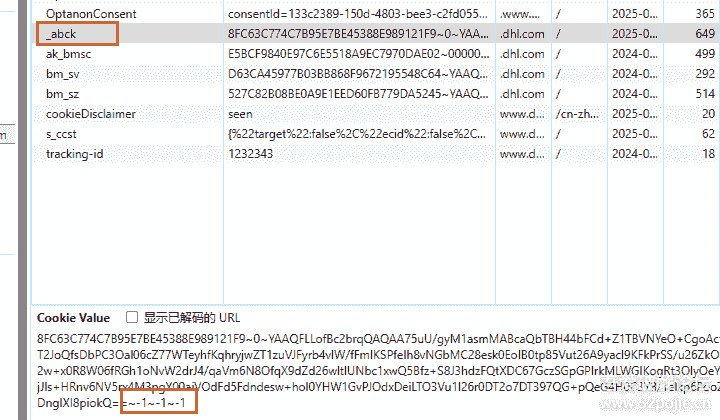

20240729210631.png (56.08 KB, 下载次数: 2)

[href="forum.php?mod=attachment&aid=MjcxMzEyMXw1YjFkNWMyMXwxNzkzNTcyMDA3fDE2ODA4NnwxOTQ5MzM3&nothumb=yes" target="_blank"](https://www.52pojie.cn/forum.php?mod=attachment&aid=MjcxMzEyMXw1YjFkNWMyMXwxNzkzNTcyMDA3fDE2ODA4NnwxOTQ5MzM3&nothumb=yes)

特征

2024-7-29 22:57 上传

也是通过cookie加验证 根据cookie 键的`_abck` 返回`~-1~` 则是失败 `~0~`则为成功

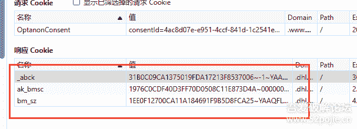

QQ图片20240729211558.png (25.01 KB, 下载次数: 1)

[href="forum.php?mod=attachment&aid=MjcxMzEyM3w5MWU1MTZlYXwxNzkzNTcyMDA3fDE2ODA4NnwxOTQ5MzM3&nothumb=yes" target="_blank"](https://www.52pojie.cn/forum.php?mod=attachment&aid=MjcxMzEyM3w5MWU1MTZlYXwxNzkzNTcyMDA3fDE2ODA4NnwxOTQ5MzM3&nothumb=yes)

2

2024-7-29 22:58 上传

请求首页会返回三个cookie，响应也会有一个外链的js

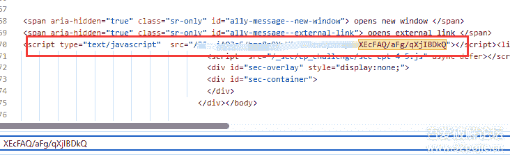

外链20240729212657.png (32.51 KB, 下载次数: 2)

[href="forum.php?mod=attachment&aid=MjcxMzEyOHxkYzdjNjdjNXwxNzkzNTcyMDA3fDE2ODA4NnwxOTQ5MzM3&nothumb=yes" target="_blank"](https://www.52pojie.cn/forum.php?mod=attachment&aid=MjcxMzEyOHxkYzdjNjdjNXwxNzkzNTcyMDA3fDE2ODA4NnwxOTQ5MzM3&nothumb=yes)

6

2024-7-29 22:58 上传

需要对这个js地址发送一次`get`请求，第二次对这个接口发送一个`post`请求

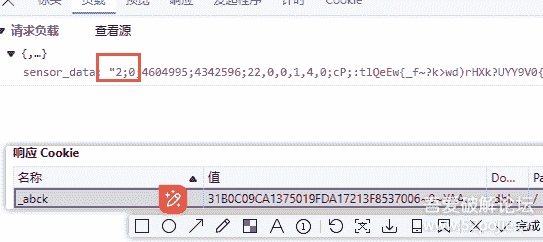

第二次的请求5.png (27.6 KB, 下载次数: 2)

[href="forum.php?mod=attachment&aid=MjcxMzEyNnw4OGQwMTNlMXwxNzkzNTcyMDA3fDE2ODA4NnwxOTQ5MzM3&nothumb=yes" target="_blank"](https://www.52pojie.cn/forum.php?mod=attachment&aid=MjcxMzEyNnw4OGQwMTNlMXwxNzkzNTcyMDA3fDE2ODA4NnwxOTQ5MzM3&nothumb=yes)

4

2024-7-29 22:58 上传

`sensor_data` 就是要逆向目标

逆向的时候可以用`xhr`调试 也可以从 发起程序的第一个位置开始

由于这个js是动态的，所以要把首页固定住，给他替换一下

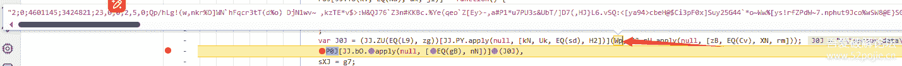

Wp.png (35.41 KB, 下载次数: 2)

[href="forum.php?mod=attachment&aid=MjcxMzEyNHxhZjEyMWEzN3wxNzkzNTcyMDA3fDE2ODA4NnwxOTQ5MzM3&nothumb=yes" target="_blank"](https://www.52pojie.cn/forum.php?mod=attachment&aid=MjcxMzEyNHxhZjEyMWEzN3wxNzkzNTcyMDA3fDE2ODA4NnwxOTQ5MzM3&nothumb=yes)

3

2024-7-29 22:58 上传

就是这里了 直接搜 `Wp =` 会搜到大概11个 都下好断点 会把这个`Wp` 参数生成返回 ---> 生成返回 起码要解5次， 全扣不太现实

从第一个开始分析 会得到一个58位的数组，在用"`join`" 拼接`dN`

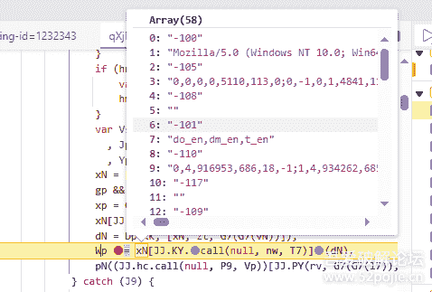

58位数组.png (37.54 KB, 下载次数: 0)

[href="forum.php?mod=attachment&aid=MjcxMzEyMHw4ZmQ4YjFjOXwxNzkzNTcyMDA3fDE2ODA4NnwxOTQ5MzM3&nothumb=yes" target="_blank"](https://www.52pojie.cn/forum.php?mod=attachment&aid=MjcxMzEyMHw4ZmQ4YjFjOXwxNzkzNTcyMDA3fDE2ODA4NnwxOTQ5MzM3&nothumb=yes)

58

2024-7-29 22:57 上传

这个58位的数组 就是小麦最核心的地方了 ， ， ， 这个58位数组会记录很多风控的信息 特别重要 会检测你的ua 插件信息 分辨率显卡配置指纹 权限指纹 鼠标轨迹 方法执行次数

只能慢慢测 慢慢扣

```
xN = [JJ.Sc(zw, np, Gt, kk), GB, JJ.Lc(Op, jp, kk, wk), zp, JJ.Gc(cp, Q7), t8, JJ.Yc(rp, g2, nh, tk), qB, JJ.Zc.apply(null, [Fp, mw]), l8, JJ.nc.apply(null, [z2, Ep]), m8, JJ.Oc(Up, tQ, Hp, kk), Kp, JJ.jc(RQ, MB, wk, gl), TB, JJ.zc(hB, ns, G7(G7([])), q2), fp, JJ.cc(G7(l7), l7, FN, J2), h8, JJ.rc.apply(null, [Kl, HQ, G7({}), P2]), Cp, JJ.Fc.apply(null, [mw, AN, Sk, vk]), NB, JJ.Ec(Jk, G7({}), qp, RQ), dv, JJ.Uc(Rp, bw), lB, JJ.sS(nh, gw, lk, Zh, dk, nB), Ip, JJ.Hc(bp, d7), Is, JJ.Kc.apply(null, [DQ, fv]), ss, JJ.fc(Tp, nB), ps, JJ.Cc(Rl, tp, zw, Um), As, JJ.pS(gw, lp, nB, rv), mp, JJ.qc(fk, hp, H2, x7), Vs, JJ.Rc(kp, wp), Jp, JJ.Ic.call(null, Np, Bp), Yp, JJ.bc.call(null, Uh, J2, Yh, Q7), vp, JJ.Tc.apply(null, [gk, Qp]), QB[JJ.DY(rm, Sm)], JJ.AS(gw, sp, Hm, f2), OQ, JJ.gS(dk, gw, nB, Hm), p8, JJ.tc.apply(null, [cB, pp])]
```

数组的第一个（`JJ.Sc(zw, np, Gt, kk)`）是 -100

第二个`GB` 前面是ua的信息 后面就看不懂了 直接搜`GB`

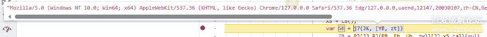

GB.png (21.21 KB, 下载次数: 2)

[href="forum.php?mod=attachment&aid=MjcxMzExOXwzMWIzYjBjOXwxNzkzNTcyMDA3fDE2ODA4NnwxOTQ5MzM3&nothumb=yes" target="_blank"](https://www.52pojie.cn/forum.php?mod=attachment&aid=MjcxMzExOXwzMWIzYjBjOXwxNzkzNTcyMDA3fDE2ODA4NnwxOTQ5MzM3&nothumb=yes)

GB

2024-7-29 22:57 上传

`BG` 第一个接收的是一个60 第二个接收的是一个数组

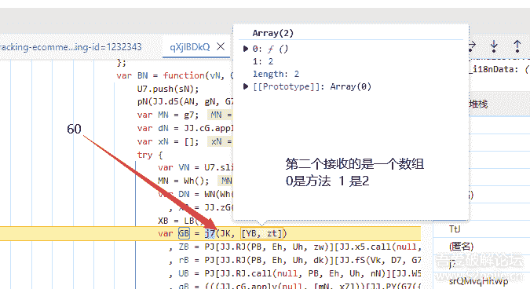

123.png (49.85 KB, 下载次数: 3)

[href="forum.php?mod=attachment&aid=MjcxMzE1Mnw1OGNiN2QzNXwxNzkzNTcyMDA3fDE2ODA4NnwxOTQ5MzM3&nothumb=yes" target="_blank"](https://www.52pojie.cn/forum.php?mod=attachment&aid=MjcxMzE1Mnw1OGNiN2QzNXwxNzkzNTcyMDA3fDE2ODA4NnwxOTQ5MzM3&nothumb=yes)

123

2024-7-29 23:21 上传

跟到方法会发现 他实际调用的就是数组的第一个方法`YB`

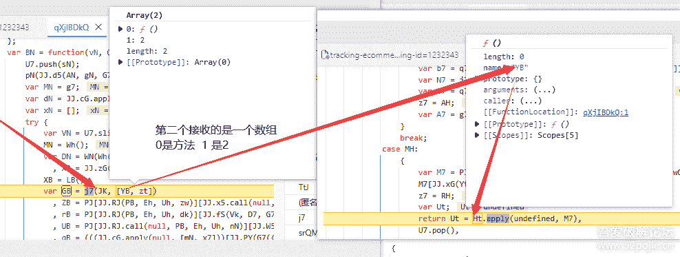

掉用数组的第一个方法.png (77.47 KB, 下载次数: 1)

[href="forum.php?mod=attachment&aid=MjcxMzE1NHw3MDRhM2M0YnwxNzkzNTcyMDA3fDE2ODA4NnwxOTQ5MzM3&nothumb=yes" target="_blank"](https://www.52pojie.cn/forum.php?mod=attachment&aid=MjcxMzE1NHw3MDRhM2M0YnwxNzkzNTcyMDA3fDE2ODA4NnwxOTQ5MzM3&nothumb=yes)

数组调用的方法

2024-7-29 23:37 上传

这个时候直接找`YB`这个方法就可以了， （中间搞了很多）

直接进去`YB` 这个方法看看 干了什么

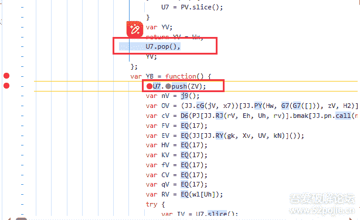

YB进去.png (37.3 KB, 下载次数: 2)

[href="forum.php?mod=attachment&aid=MjcxMzE1NnwyNWJjNzE1YXwxNzkzNTcyMDA3fDE2ODA4NnwxOTQ5MzM3&nothumb=yes" target="_blank"](https://www.52pojie.cn/forum.php?mod=attachment&aid=MjcxMzE1NnwyNWJjNzE1YXwxNzkzNTcyMDA3fDE2ODA4NnwxOTQ5MzM3&nothumb=yes)

YB进去

2024-7-29 23:49 上传

1、`YB` `U7.push(ZV)`; 第一行这个就是记录代码执行的过程 `push`提交 `pop`删除 所以 采用魔法是搞不了的 只能扣

下面就是`var nV = j9()`; 就是ua 直接写死

2、`YB` `var OV = (JJ.cG(jV, x7))[JJ.PY(Hw, G7(G7([])), zV, H2)](j7(JK, [JQ, g7, nV]))`; 这里就是"`concat`" 拼接`j7` (`j7`实际调用的还是[]里面的 `JQ` 上面有说到)

`jQ`直接跟进去后发现就是根据ua生成对应的 编码 ，既然是根据ua生成 那么直接固定

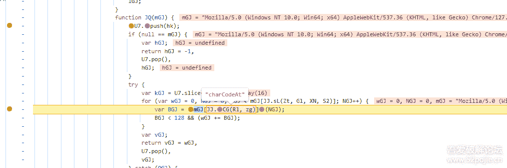

JQ.png (45.95 KB, 下载次数: 1)

[href="forum.php?mod=attachment&aid=MjcxMzE1N3wzYmE0OGZiMnwxNzkzNTcyMDA3fDE2ODA4NnwxOTQ5MzM3&nothumb=yes" target="_blank"](https://www.52pojie.cn/forum.php?mod=attachment&aid=MjcxMzE1N3wzYmE0OGZiMnwxNzkzNTcyMDA3fDE2ODA4NnwxOTQ5MzM3&nothumb=yes)

JQ

2024-7-30 00:08 上传

3、`YB` `var cV = D6(PJ[JJ.RJ(rV, Eh, Uh, rv)].bmak[JJ.pn.call(null, Hh, O3)], zt)`; 

我问过了豆包了 这个就是记录访问小麦开始的时间

就是时间戳 除以 2的值

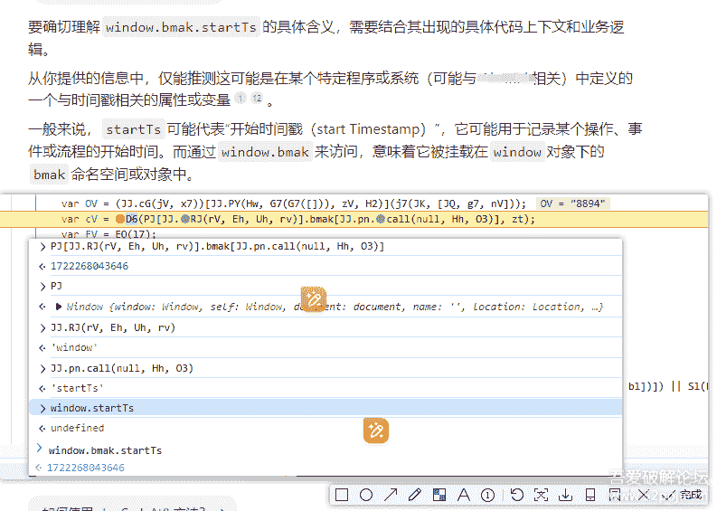

开始时间.png (78.12 KB, 下载次数: 2)

[href="forum.php?mod=attachment&aid=MjcxMzE1OHxiYTdiYjg0N3wxNzkzNTcyMDA3fDE2ODA4NnwxOTQ5MzM3&nothumb=yes" target="_blank"](https://www.52pojie.cn/forum.php?mod=attachment&aid=MjcxMzE1OHxiYTdiYjg0N3wxNzkzNTcyMDA3fDE2ODA4NnwxOTQ5MzM3&nothumb=yes)

开始时间

2024-7-30 00:19 上传

4 、`YB` `RV = PJ[JJ.nY(zl, bV, Sw, Sm)](Ks(JJ.zF(Cv, cB, jd, P2), PJ[JJ.RJ.apply(null, [rV, Eh, Uh, bl])]) || Sl(PJ[JJ.mJ(Tl, K9, Um, Hm, rv, Um)][JJ.cF.apply(null, [V7, g7, FN, Kl])], g7) || Sl(PJ[JJ.mJ(Tl, K9, bw, Qw, Ow, Um)][JJ.rF(TV, tV)], g7))`;

这一个就是获取设备的触摸点数量我这是电脑没这个 所以是0

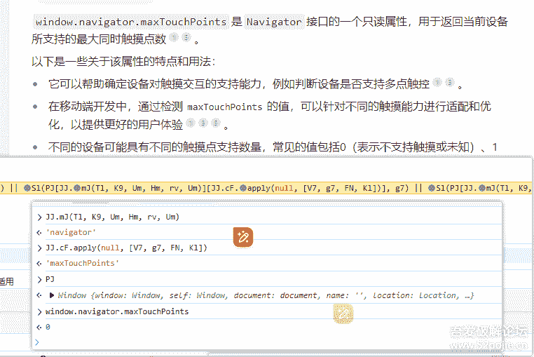

触摸.png (63.36 KB, 下载次数: 1)

[href="forum.php?mod=attachment&aid=MjcxMzE2MXxlYzY5ZGM4OXwxNzkzNTcyMDA3fDE2ODA4NnwxOTQ5MzM3&nothumb=yes" target="_blank"](https://www.52pojie.cn/forum.php?mod=attachment&aid=MjcxMzE2MXxlYzY5ZGM4OXwxNzkzNTcyMDA3fDE2ODA4NnwxOTQ5MzM3&nothumb=yes)

触摸点

2024-7-30 00:40 上传

还有上面就是-1

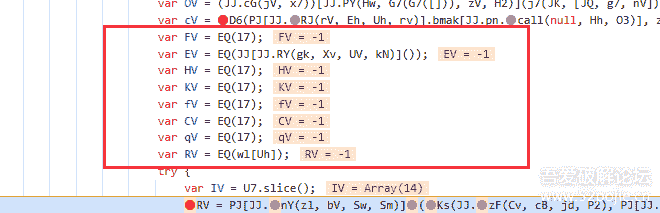

---1.png (33.84 KB, 下载次数: 1)

[href="forum.php?mod=attachment&aid=MjcxMzE2M3w2NzE1YzQ0OHwxNzkzNTcyMDA3fDE2ODA4NnwxOTQ5MzM3&nothumb=yes" target="_blank"](https://www.52pojie.cn/forum.php?mod=attachment&aid=MjcxMzE2M3w2NzE1YzQ0OHwxNzkzNTcyMDA3fDE2ODA4NnwxOTQ5MzM3&nothumb=yes)

-1

2024-7-30 00:43 上传

下面有一个要注意的就是`window.innerHeight` 这个是获取浏览器网页窗口的高度 (这里有坑 最好是把调试窗口单独拿出来)

流程大概就是这样了 ，这就是第二个数组(参数是不能写死的 否则过不了风控) 然后还有组数还要慢慢去扣，现在的时间是2024年7月30日01:58 太晚了 我要睡觉了

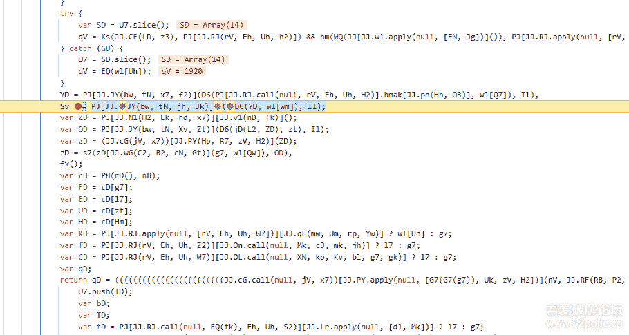

下面流程.png (63.55 KB, 下载次数: 3)


[href="forum.php?mod=attachment&aid=MjcxMzE3M3wxNzQxOGY4MnwxNzkzNTcyMDA3fDE2ODA4NnwxOTQ5MzM3&nothumb=yes" target="_blank"](https://www.52pojie.cn/forum.php?mod=attachment&aid=MjcxMzE3M3wxNzQxOGY4MnwxNzkzNTcyMDA3fDE2ODA4NnwxOTQ5MzM3&nothumb=yes)

流程

2024-7-30 01:56 上传

-
