# [原创] 记录第一次破解 .NET单行阅读器无限试用

- 原帖: https://www.52pojie.cn/forum.php?mod=viewthread&tid=1949654
- 抓取时间: 2026-11-01T22:26:48

## 使用体验

最近在上班摸鱼的时候发现了一个好用的阅读器，他只有一行文字，可以完美的隐藏在屏幕里面，光明正大的摸鱼而不被老板发现。

具体效果如下：

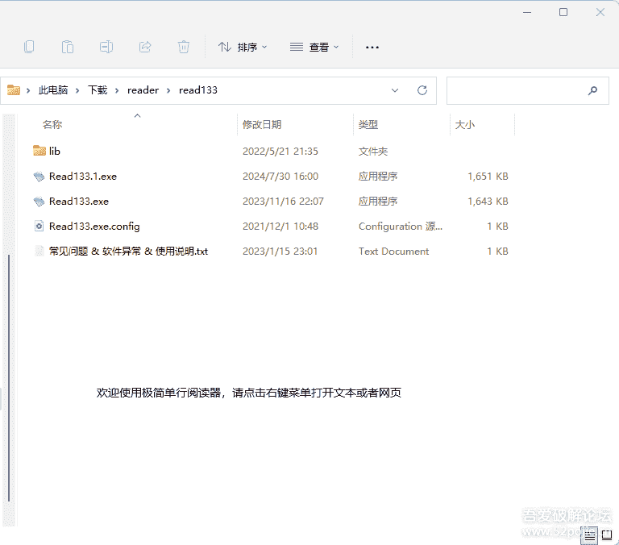

1.png (37.25 KB, 下载次数: 3)

[href="forum.php?mod=attachment&aid=MjcxMzM5MHw2MjQxNmYyZHwxNzkzNTcyMDA2fDE2ODA4NnwxOTQ5NjU0&nothumb=yes" target="_blank"](https://www.52pojie.cn/forum.php?mod=attachment&aid=MjcxMzM5MHw2MjQxNmYyZHwxNzkzNTcyMDA2fDE2ODA4NnwxOTQ5NjU0&nothumb=yes)

使用效果

2024-7-30 19:22 上传

但是用了几天之后发现，发现试用天数已经到了，必须要充值才能继续使用。

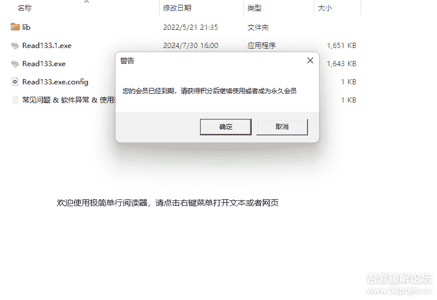

2.png (38.01 KB, 下载次数: 2)

[href="forum.php?mod=attachment&aid=MjcxMzM5NHxjZWM2NDhjYnwxNzkzNTcyMDA2fDE2ODA4NnwxOTQ5NjU0&nothumb=yes" target="_blank"](https://www.52pojie.cn/forum.php?mod=attachment&aid=MjcxMzM5NHxjZWM2NDhjYnwxNzkzNTcyMDA2fDE2ODA4NnwxOTQ5NjU0&nothumb=yes)

会员到期

2024-7-30 19:24 上传

对于一个刚开始打工的牛马来说，掏钱那是万万不可能的。所以我先尝试在网上寻找有没有“学习版”来使用一下。但是这个软件好像太小众了，52里也没有相关的资源。

然后我就开始琢磨着自己尝试[//www.52pojie.cn" target="_blank" class="relatedlink"](https://www.52pojie.cn:href="https)一下。首先先跟着论坛里的新手导航帖学习了一下工具的使用，发现通常破解的第一步是要先确定软件是用什么语言编写或用什么软件编译的。

那么我就试着先给这个软件拖到`DIE`里看一看。

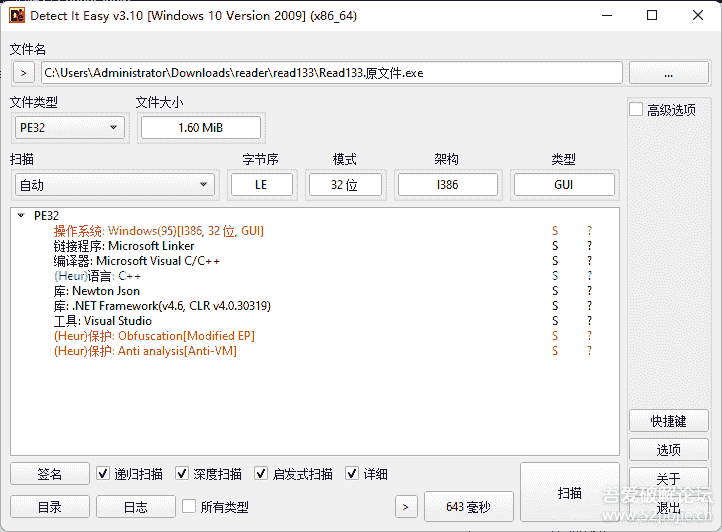

10.png (40.58 KB, 下载次数: 3)

[href="forum.php?mod=attachment&aid=MjcxMzQwMHxlZDJkYzdhM3wxNzkzNTcyMDA2fDE2ODA4NnwxOTQ5NjU0&nothumb=yes" target="_blank"](https://www.52pojie.cn/forum.php?mod=attachment&aid=MjcxMzQwMHxlZDJkYzdhM3wxNzkzNTcyMDA2fDE2ODA4NnwxOTQ5NjU0&nothumb=yes)

DIE

2024-7-30 19:29 上传

发现他使用了一个叫.NET Framework的库，刚好我在浏览新手导航帖的时候发现有一个Blue大佬的.NET系列教程，于是我就去拜读了一下大佬的第一篇教程。

## 定位关键函数

首先使用`NETReflector8`软件打开需要破解的阅读器软件。并在搜索栏搜索充值弹窗的字符串，看看能不能从代码上下文找到突破口。

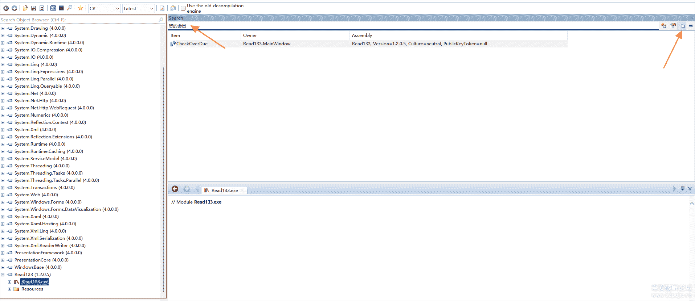

3.png (107.59 KB, 下载次数: 2)

[href="forum.php?mod=attachment&aid=MjcxMzQwNHw4NTIwNTE0Y3wxNzkzNTcyMDA2fDE2ODA4NnwxOTQ5NjU0&nothumb=yes" target="_blank"](https://www.52pojie.cn/forum.php?mod=attachment&aid=MjcxMzQwNHw4NTIwNTE0Y3wxNzkzNTcyMDA2fDE2ODA4NnwxOTQ5NjU0&nothumb=yes)

NETReflector8

2024-7-30 19:33 上传

搜索后发现只有一个`CheckOverDue`的函数里有包含这个字符串，那么点进去看看。

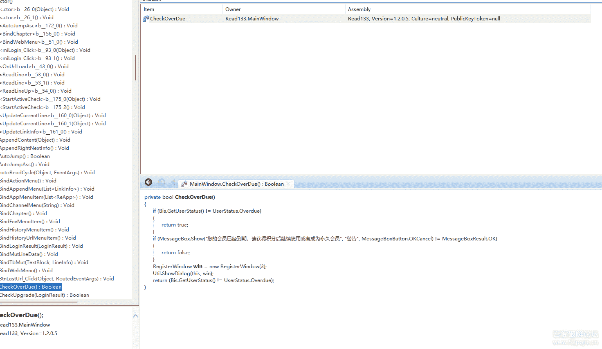

4.png (99.24 KB, 下载次数: 1)

[href="forum.php?mod=attachment&aid=MjcxMzQwNXwyZjU0MzYwN3wxNzkzNTcyMDA2fDE2ODA4NnwxOTQ5NjU0&nothumb=yes" target="_blank"](https://www.52pojie.cn/forum.php?mod=attachment&aid=MjcxMzQwNXwyZjU0MzYwN3wxNzkzNTcyMDA2fDE2ODA4NnwxOTQ5NjU0&nothumb=yes)

CheckOverDue

2024-7-30 19:35 上传

运气很好，一下就找到了控制弹窗出现的逻辑。仔细分析一下这个函数，这个函数的作用是检查用户的试用期限是否到期。

首先将用户的状态与一个叫`OverDue`的变量进行比较，如果不相等就直接返回`true`。那跟着看看状态函数和`OverDue`变量。

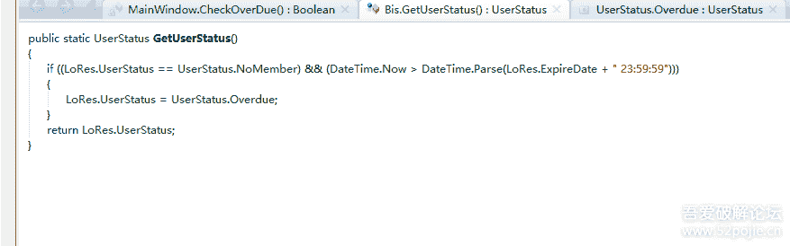

6.png (27.75 KB, 下载次数: 3)

[href="forum.php?mod=attachment&aid=MjcxMzQwN3wzOGVmM2Q2MXwxNzkzNTcyMDA2fDE2ODA4NnwxOTQ5NjU0&nothumb=yes" target="_blank"](https://www.52pojie.cn/forum.php?mod=attachment&aid=MjcxMzQwN3wzOGVmM2Q2MXwxNzkzNTcyMDA2fDE2ODA4NnwxOTQ5NjU0&nothumb=yes)

`UserStatus`

2024-7-30 19:39 上传

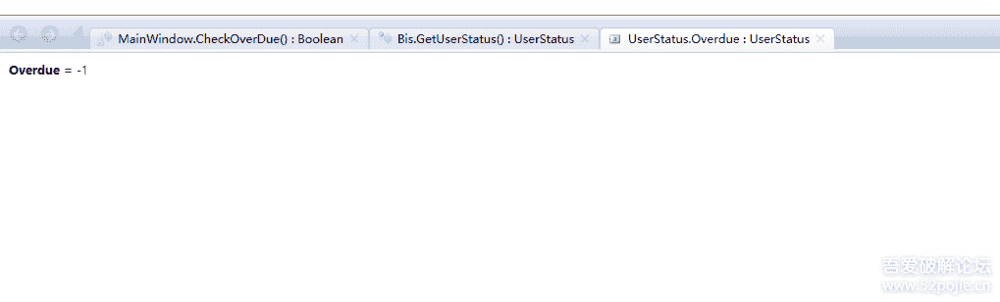

7.png (20.67 KB, 下载次数: 3)

[href="forum.php?mod=attachment&aid=MjcxMzQwNnw3MzY1ZjNhNXwxNzkzNTcyMDA2fDE2ODA4NnwxOTQ5NjU0&nothumb=yes" target="_blank"](https://www.52pojie.cn/forum.php?mod=attachment&aid=MjcxMzQwNnw3MzY1ZjNhNXwxNzkzNTcyMDA2fDE2ODA4NnwxOTQ5NjU0&nothumb=yes)

`OverDue`

2024-7-30 19:39 上传

可以看到`OverDue`是一个值为-1的常量，而状态函数里如果用户的使用时间超过了软件设置的时间，则会使状态等于`OverDue`，那么在`checkOverDue`这个函数里的第一个判断语句里，判断的值一定就为`False`，没有办法到达`return true`的语句，所以就会进行第二个判断，并弹出需要充值的弹窗。

那么现在问题的关键就已经找到了，只需要使`checkOverDue`这个函数永远也无法到达第二个判断语句，那么我们就不会再触发充值弹窗了。首先使用`reflexil1`插件看一下`checkOverDue`的IL代码。

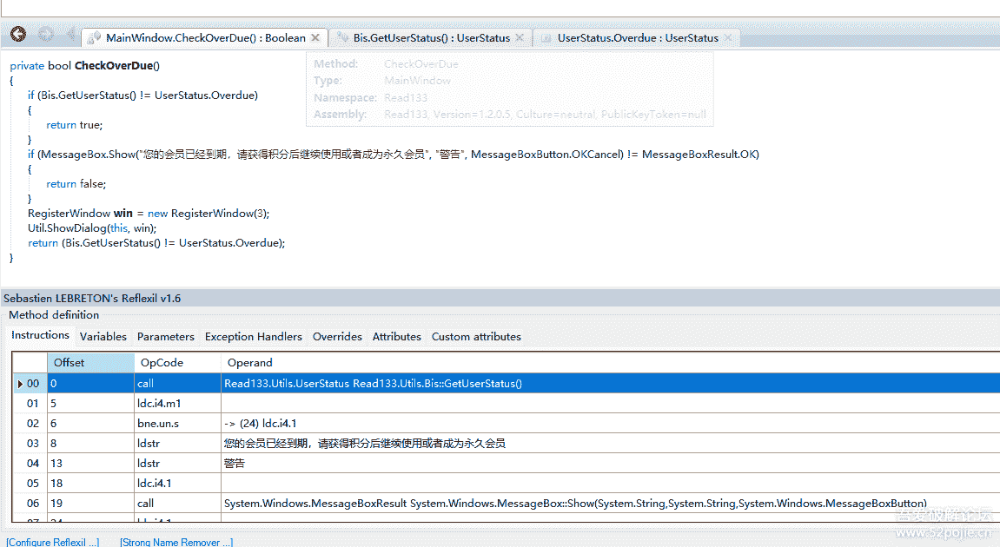

5.png (70.75 KB, 下载次数: 5)

[href="forum.php?mod=attachment&aid=MjcxMzQwOHwwODQ2NTUzZXwxNzkzNTcyMDA2fDE2ODA4NnwxOTQ5NjU0&nothumb=yes" target="_blank"](https://www.52pojie.cn/forum.php?mod=attachment&aid=MjcxMzQwOHwwODQ2NTUzZXwxNzkzNTcyMDA2fDE2ODA4NnwxOTQ5NjU0&nothumb=yes)

`reflexil1`

2024-7-30 19:43 上传

## IL 修改与验证

发现02行代码中，使用`bne.un.s`来比较`status`与-1的值，经过网上查阅发现，`ben.un.s`操作码的作用是如果两个值不相等，则执行后面的语句。

但是前面分析发现现在`status`的值一定是等于-1的，那是不是意味着，如果我把这个代码的逻辑改为，两个值相等就执行后面的语句，就可以直接返回`true`，而避开第二个判断语句了？

说干就干，在网上查阅发现`beq.s`操作码的作用是如果两个值相等，则执行后面的语句，所以可以使用`reflexil1`插件将02行代码中的`ben.un.s`操作码改为`beq.s`操作码。

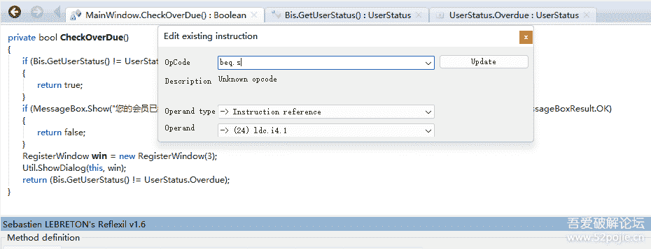

8.png (43.34 KB, 下载次数: 3)

[href="forum.php?mod=attachment&aid=MjcxMzQxMHxiNmNkYjRkNnwxNzkzNTcyMDA2fDE2ODA4NnwxOTQ5NjU0&nothumb=yes" target="_blank"](https://www.52pojie.cn/forum.php?mod=attachment&aid=MjcxMzQxMHxiNmNkYjRkNnwxNzkzNTcyMDA2fDE2ODA4NnwxOTQ5NjU0&nothumb=yes)

`beq.s`

2024-7-30 19:50 上传

点击`update`，再使用`reflexil1`插件保存后，打开软件试一试。

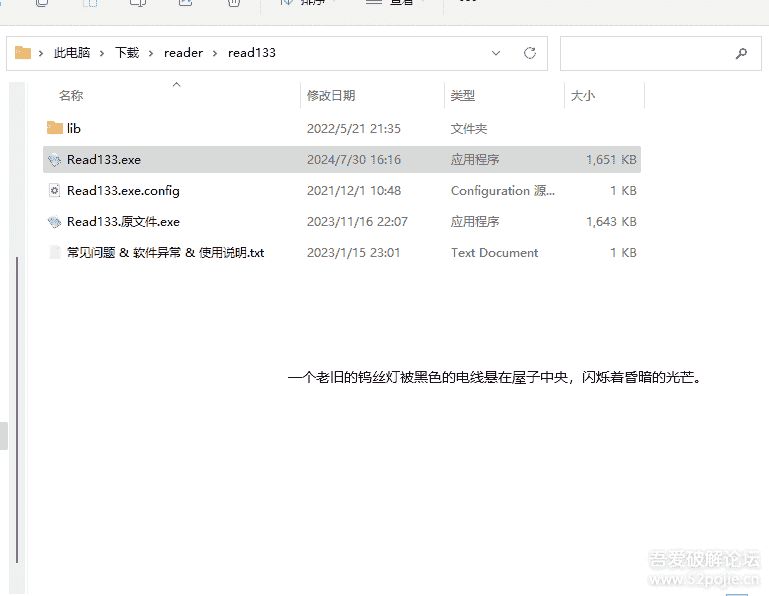

9.png (35.04 KB, 下载次数: 2)

[href="forum.php?mod=attachment&aid=MjcxMzQxMXxjMjllYmJiNXwxNzkzNTcyMDA2fDE2ODA4NnwxOTQ5NjU0&nothumb=yes" target="_blank"](https://www.52pojie.cn/forum.php?mod=attachment&aid=MjcxMzQxMXxjMjllYmJiNXwxNzkzNTcyMDA2fDE2ODA4NnwxOTQ5NjU0&nothumb=yes)

破解成功

2024-7-30 19:51 上传

可以看到现在已经可以成功打开小说阅读了，这次的破解就完成了。

## 最终完善

但是后面仔细思考了之后发现，目前改的这个逻辑，只适用于已经到期了的用户。如果是一个新用户，就会出现他明明有试用天数，但是却会弹出充值窗口。

后来发现可以将`CheckOverDue`函数的逻辑改为，不管怎样，都直接返回`true`，这样无论是哪一个用户，都可以有无限的试用。

最终`CheckOverDue`函数修改代码如下，主要是将第00行代码，改为直接用一个`ldc.i4.1`操作码向栈中存入一个1，也就是`true`值。

然后将第01行代码改为`ret`操作码，`ret`操作码的作用就和`return`一样，返回一个值。

最后将第02行代码删除，保存后即可成功破解。

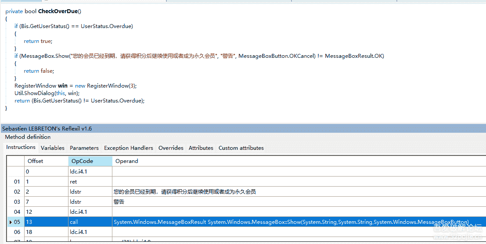

11.png (47.09 KB, 下载次数: 4)

[href="forum.php?mod=attachment&aid=MjcxMzQxMnwyOTkwN2E2NHwxNzkzNTcyMDA2fDE2ODA4NnwxOTQ5NjU0&nothumb=yes" target="_blank"](https://www.52pojie.cn/forum.php?mod=attachment&aid=MjcxMzQxMnwyOTkwN2E2NHwxNzkzNTcyMDA2fDE2ODA4NnwxOTQ5NjU0&nothumb=yes)

最终修改

2024-7-30 19:54 上传

原文件和破解文件如下：

[href="forum.php?mod=attachment&aid=MjcxMzQxM3w4MjBiODRmZHwxNzkzNTcyMDA2fDE2ODA4NnwxOTQ5NjU0" target="_blank"](https://www.52pojie.cn/forum.php?mod=attachment&aid=MjcxMzQxM3w4MjBiODRmZHwxNzkzNTcyMDA2fDE2ODA4NnwxOTQ5NjU0)

(1.03 MB, 下载次数: 1241)

2024-7-30 19:57 上传

点击文件名下载附件

下载积分: 吾爱币 -1 CB
