# [.NET逆向] 记录一下一个.Net阅读器的两种破解方式

- 原帖: https://www.52pojie.cn/forum.php?mod=viewthread&tid=1950441
- 抓取时间: 2026-11-01T22:26:42

## 声明

本文章中所有内容仅供研究、学习交流使用，不能用作其他任何目的，严禁用于商业用途和非法用途，否则一切后果自负，与作者无关。您必须在下载后的24个小时之内，从您的电脑中彻底删除上述内容。如果您喜欢该程序，请支持正版软件，购买注册，得到更好的正版服务。如有侵权请发送邮件Service@52pojie.cn联系论坛管理员删除文章

> 

XX阅读器133，下载见 `aHR0cDovL3JlYWQuaG9tZTEzMy5jb20v`

原分析帖链接：[//www.52pojie.cn/thread-1949654-1-1.html" target="_blank" rel="noopener noreferrer nofollow"](https://www.52pojie.cn/thread-1949654-1-1.html:href="https://www.52pojie.cn/thread-1949654-1-1.html)

## 1、检查软件

### 运行起来看看

软件运行起来是个框框，右键这个框框有菜单可以注册，注册之后会提示快到期了。

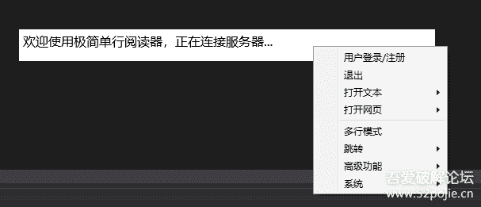

1.png (18.01 KB, 下载次数: 1)

[href="forum.php?mod=attachment&aid=MjcyODM2OXxjMDUwODg0YXwxNzkzNTcyMDAwfDE2ODA4NnwxOTUwNDQx&nothumb=yes" target="_blank"](https://www.52pojie.cn/forum.php?mod=attachment&aid=MjcyODM2OXxjMDUwODg0YXwxNzkzNTcyMDAwfDE2ODA4NnwxOTUwNDQx&nothumb=yes)

2024-10-12 15:56 上传

右键系统->会员可以看到会员信息

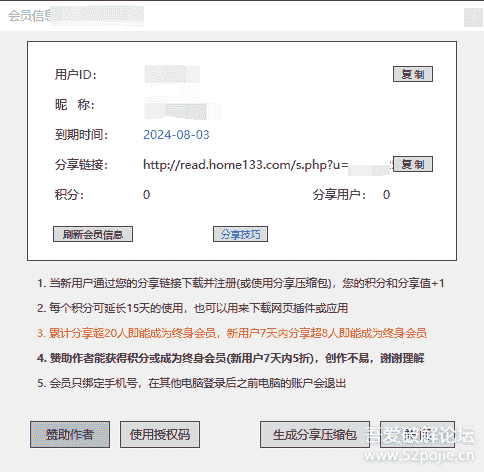

2.png (39.47 KB, 下载次数: 1)

[href="forum.php?mod=attachment&aid=MjcyODM3MHw0MGI0OGRlYXwxNzkzNTcyMDAwfDE2ODA4NnwxOTUwNDQx&nothumb=yes" target="_blank"](https://www.52pojie.cn/forum.php?mod=attachment&aid=MjcyODM3MHw0MGI0OGRlYXwxNzkzNTcyMDAwfDE2ODA4NnwxOTUwNDQx&nothumb=yes)

2024-10-12 15:56 上传

大概的会员信息都在这里了，下一步

### 拖到 DIT 里面查壳

一眼顶针，C# `.Net` 有混淆，先不管，直接丢到`dnspy`看代码

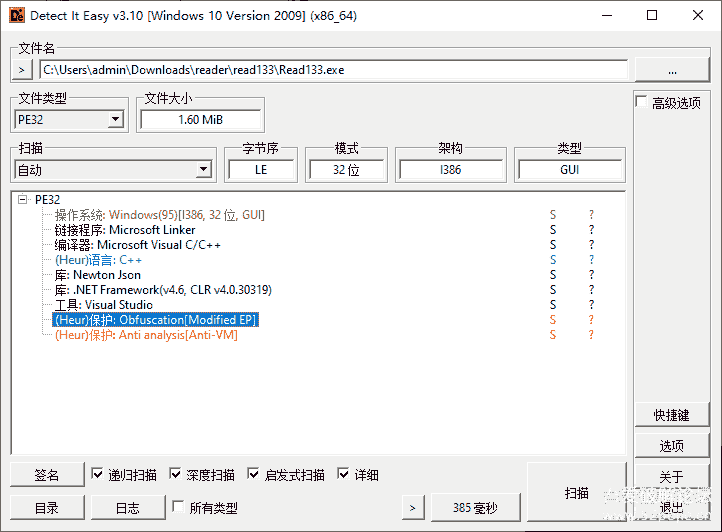

3.png (36.17 KB, 下载次数: 1)

[href="forum.php?mod=attachment&aid=MjcyODM3MXwyZDJjMmM0MnwxNzkzNTcyMDAwfDE2ODA4NnwxOTUwNDQx&nothumb=yes" target="_blank"](https://www.52pojie.cn/forum.php?mod=attachment&aid=MjcyODM3MXwyZDJjMmM0MnwxNzkzNTcyMDAwfDE2ODA4NnwxOTUwNDQx&nothumb=yes)

2024-10-12 15:56 上传

### 代码分析

直接在`dnspy`里面搜索 “会员”

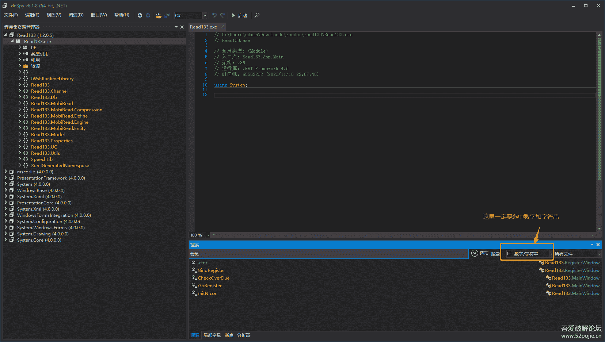

4.png (103.29 KB, 下载次数: 1)

[href="forum.php?mod=attachment&aid=MjcyODM3Mnw2ZTZmM2JlNXwxNzkzNTcyMDAwfDE2ODA4NnwxOTUwNDQx&nothumb=yes" target="_blank"](https://www.52pojie.cn/forum.php?mod=attachment&aid=MjcyODM3Mnw2ZTZmM2JlNXwxNzkzNTcyMDAwfDE2ODA4NnwxOTUwNDQx&nothumb=yes)

2024-10-12 15:56 上传

可以看到有4个结果，一个个打开看，其实第一条就是我们要找的结果，仔细观察这个函数可以得到两个很关键的点，一个会员状态，一个过期时间，会员状态本身就是个 `enum` 枚举有3个状态，会员(永久会员)，非会员（期限会员），过期。

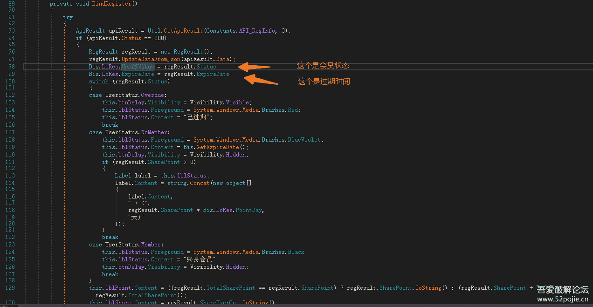

5.png (44.97 KB, 下载次数: 1)

[href="forum.php?mod=attachment&aid=MjcyODM3M3xiYzg2YWEyYnwxNzkzNTcyMDAwfDE2ODA4NnwxOTUwNDQx&nothumb=yes" target="_blank"](https://www.52pojie.cn/forum.php?mod=attachment&aid=MjcyODM3M3xiYzg2YWEyYnwxNzkzNTcyMDAwfDE2ODA4NnwxOTUwNDQx&nothumb=yes)

2024-10-12 15:56 上传

根据代码可以看到，这个状态是联网获取的并且请求和响应没有加密，那这里就有两个方式破解了：
- 抓包改相应，直接修改
- `patch`程序

## 2、破解方式一、抓包破解

### 分析请求和响应

掏出我们的老朋友`HttpDbgPro`开始分析，先直接开软件，可以看到登录请求，是个`GET`请求，请求头里面带上了`UID`，这个`UID`就是软件界面显示的`UID`，实际就是用这个`UID`判断用户的，响应可以看到是明文的

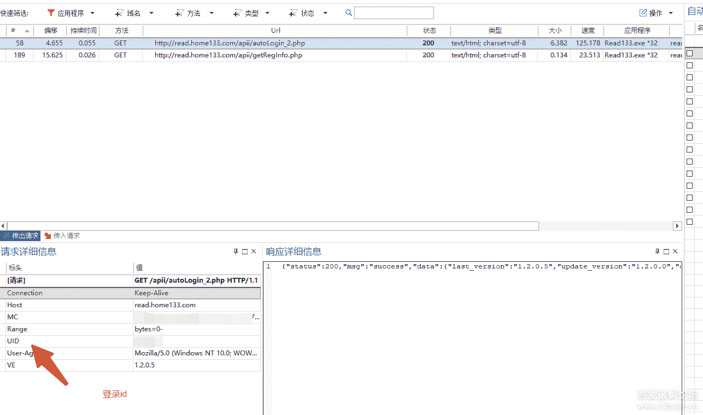

6.png (48.84 KB, 下载次数: 0)

[href="forum.php?mod=attachment&aid=MjcyODM3NHxlOGMzZmYyM3wxNzkzNTcyMDAwfDE2ODA4NnwxOTUwNDQx&nothumb=yes" target="_blank"](https://www.52pojie.cn/forum.php?mod=attachment&aid=MjcyODM3NHxlOGMzZmYyM3wxNzkzNTcyMDAwfDE2ODA4NnwxOTUwNDQx&nothumb=yes)

2024-10-12 15:56 上传

我们把`json`格式化一下

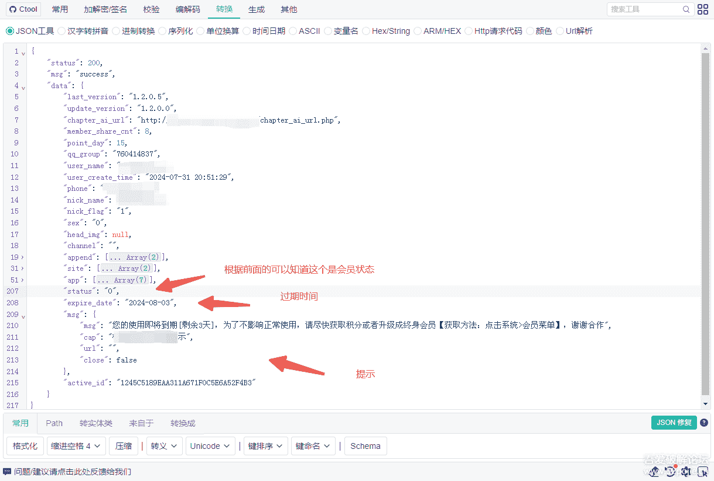

7.png (69.79 KB, 下载次数: 1)

[href="forum.php?mod=attachment&aid=MjcyODM3NXw3MDU2YTYzY3wxNzkzNTcyMDAwfDE2ODA4NnwxOTUwNDQx&nothumb=yes" target="_blank"](https://www.52pojie.cn/forum.php?mod=attachment&aid=MjcyODM3NXw3MDU2YTYzY3wxNzkzNTcyMDAwfDE2ODA4NnwxOTUwNDQx&nothumb=yes)

2024-10-12 15:56 上传

#### 伪造响应

重要数据都出来了，我们直接在`HttpDbg`里面修改响应的`status`为1

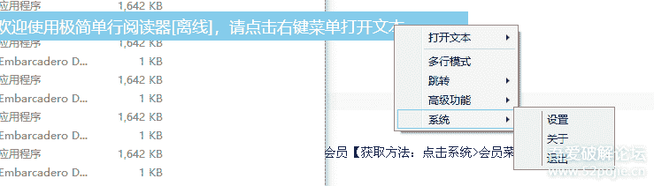

8.png (27.81 KB, 下载次数: 1)

[href="forum.php?mod=attachment&aid=MjcyODM3NnwyMzAzYjQxY3wxNzkzNTcyMDAwfDE2ODA4NnwxOTUwNDQx&nothumb=yes" target="_blank"](https://www.52pojie.cn/forum.php?mod=attachment&aid=MjcyODM3NnwyMzAzYjQxY3wxNzkzNTcyMDAwfDE2ODA4NnwxOTUwNDQx&nothumb=yes)

2024-10-12 15:56 上传

不对了，现在怎么提示离线版本了，右键菜单也没会员选项了

刚开始以为有校验，仔细看了下伪造的响应，发现回复的数据比之前的数据小

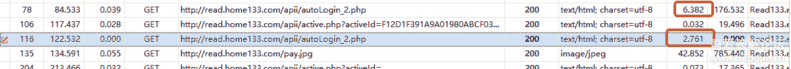

9.png (27.43 KB, 下载次数: 2)

[href="forum.php?mod=attachment&aid=MjcyODM3N3xkZDVmODIxNHwxNzkzNTcyMDAwfDE2ODA4NnwxOTUwNDQx&nothumb=yes" target="_blank"](https://www.52pojie.cn/forum.php?mod=attachment&aid=MjcyODM3N3xkZDVmODIxNHwxNzkzNTcyMDAwfDE2ODA4NnwxOTUwNDQx&nothumb=yes)

2024-10-12 15:56 上传

是被自动回复截断了，改成用文件回复

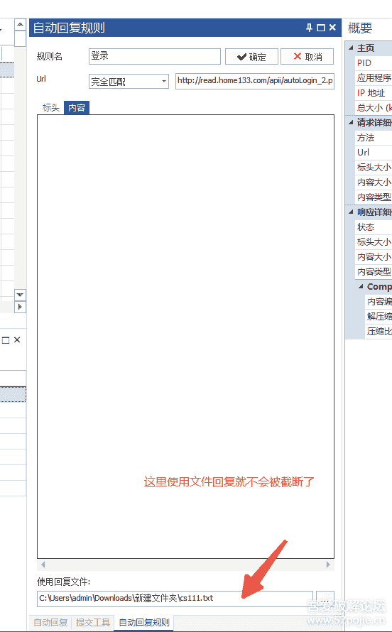

10.png (39.46 KB, 下载次数: 0)

[href="forum.php?mod=attachment&aid=MjcyODM3OHw4M2Y4YzcxNXwxNzkzNTcyMDAwfDE2ODA4NnwxOTUwNDQx&nothumb=yes" target="_blank"](https://www.52pojie.cn/forum.php?mod=attachment&aid=MjcyODM3OHw4M2Y4YzcxNXwxNzkzNTcyMDAwfDE2ODA4NnwxOTUwNDQx&nothumb=yes)

2024-10-12 15:56 上传

然后在文件里面改下数据，就可以正常回复，这时候我们再重新打开软件，可以显示会员信息了，但是我们打开会员信息发现和之前的没有变化

#### 伪造获取用户信息响应

但是在`httpdbg`上可以看到有一条新的请求

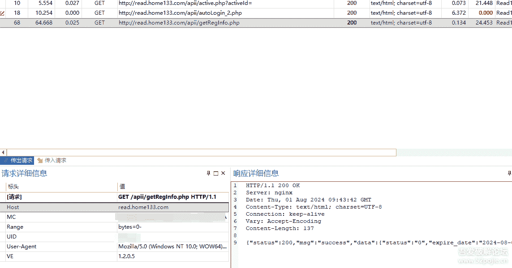

12.png (46.85 KB, 下载次数: 1)

[href="forum.php?mod=attachment&aid=MjcyODM4MHwzMmVjYjhlYXwxNzkzNTcyMDAwfDE2ODA4NnwxOTUwNDQx&nothumb=yes" target="_blank"](https://www.52pojie.cn/forum.php?mod=attachment&aid=MjcyODM4MHwzMmVjYjhlYXwxNzkzNTcyMDAwfDE2ODA4NnwxOTUwNDQx&nothumb=yes)

2024-10-12 15:57 上传

和登陆请求差不多，也是获取信息的，那我们把这条请求也进行伪造

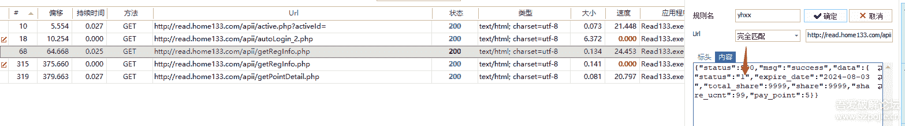

13.png (40.97 KB, 下载次数: 1)

[href="forum.php?mod=attachment&aid=MjcyODM4MXxhYzM2ODI4YXwxNzkzNTcyMDAwfDE2ODA4NnwxOTUwNDQx&nothumb=yes" target="_blank"](https://www.52pojie.cn/forum.php?mod=attachment&aid=MjcyODM4MXxhYzM2ODI4YXwxNzkzNTcyMDAwfDE2ODA4NnwxOTUwNDQx&nothumb=yes)

2024-10-12 15:57 上传

伪造完了点一下刷新用户信息

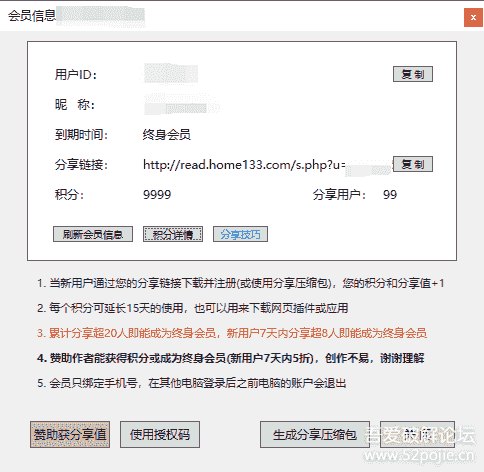

14.png (40.39 KB, 下载次数: 1)

[href="forum.php?mod=attachment&aid=MjcyODM4Mnw3YTJiNTRhN3wxNzkzNTcyMDAwfDE2ODA4NnwxOTUwNDQx&nothumb=yes" target="_blank"](https://www.52pojie.cn/forum.php?mod=attachment&aid=MjcyODM4Mnw3YTJiNTRhN3wxNzkzNTcyMDAwfDE2ODA4NnwxOTUwNDQx&nothumb=yes)

2024-10-12 15:57 上传

可以看到我们已经变成终生会员了，至此，会员部分就分析完了。

### 小应用部分

刚开始一直不知道这个积分有什么作用，但是他放在这里就肯定有放在这里的原因，仔细去找了找，发现了个好玩的地方---应用中心

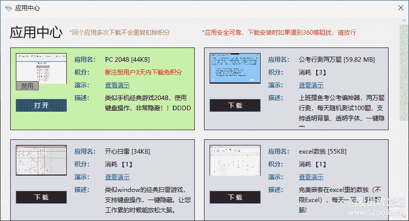

15.png (73.92 KB, 下载次数: 1)

[href="forum.php?mod=attachment&aid=MjcyODM4M3w1Y2I1YzdmMXwxNzkzNTcyMDAwfDE2ODA4NnwxOTUwNDQx&nothumb=yes" target="_blank"](https://www.52pojie.cn/forum.php?mod=attachment&aid=MjcyODM4M3w1Y2I1YzdmMXwxNzkzNTcyMDAwfDE2ODA4NnwxOTUwNDQx&nothumb=yes)

2024-10-12 15:57 上传

这里有一些其他的小软件，需要消耗积分下载，我们点击公考行测两万题下载，提示了积分不足，看看请求和响应

响应如下：

`{"status":402,"msg":"\u60a8\u7684\u5206\u4eab\u503c\u4e0d\u8db3\uff0c\u65e0\u6cd5\u4e0b\u8f7d\r\n\u8bf7\u524d\u5f80\u3010\u7cfb\u7edf\u3011-\u3010\u6ce8\u518c\u3011\u6a21\u5757\u83b7\u53d6\u66f4\u591a\u7684\u5206\u4eab\u503c"}`

根据前面的响应我们就能猜到这个正确响应的`status`码应该是200，我们改成200试试

> 

这里不赘述怎么修改响应了，和之前的一样方法，只是需要注意自动回复设置成“含有”URL，因为每个App的ID是不一样的

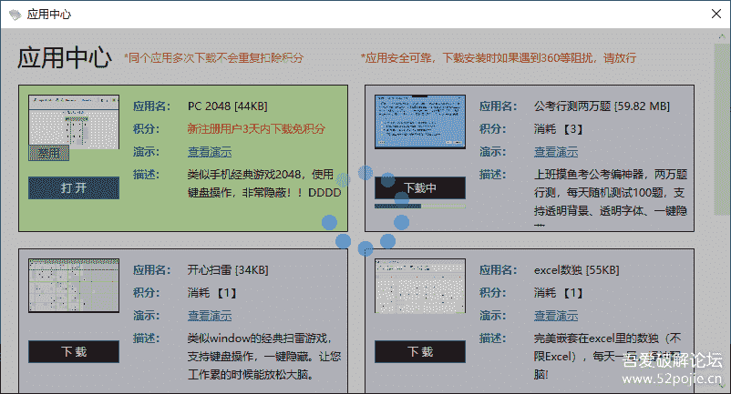

16.png (77.07 KB, 下载次数: 2)

[href="forum.php?mod=attachment&aid=MjcyODM4NHw5NzM5YjFiZnwxNzkzNTcyMDAwfDE2ODA4NnwxOTUwNDQx&nothumb=yes" target="_blank"](https://www.52pojie.cn/forum.php?mod=attachment&aid=MjcyODM4NHw5NzM5YjFiZnwxNzkzNTcyMDAwfDE2ODA4NnwxOTUwNDQx&nothumb=yes)

2024-10-12 15:57 上传

可以看到开始下载了，下载完点击打开又出问题了


17.png (14.89 KB, 下载次数: 1)

[href="forum.php?mod=attachment&aid=MjcyODM4NXw5OGI1ODRiOXwxNzkzNTcyMDAwfDE2ODA4NnwxOTUwNDQx&nothumb=yes" target="_blank"](https://www.52pojie.cn/forum.php?mod=attachment&aid=MjcyODM4NXw5OGI1ODRiOXwxNzkzNTcyMDAwfDE2ODA4NnwxOTUwNDQx&nothumb=yes)

2024-10-12 15:57 上传

提示你妹购买，看来还有二次检测。

同样的方式，在`HttpDbg`里面看请求，有一条 “`checkApp`” 的请求，把他的`status`码也改成200

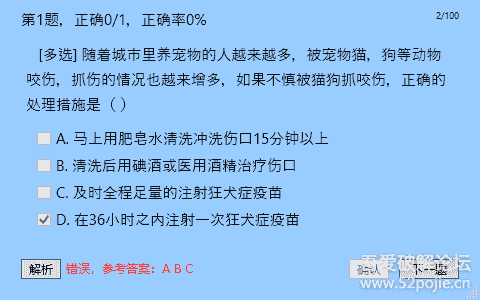

18.png (46.22 KB, 下载次数: 1)


[href="forum.php?mod=attachment&aid=MjcyODM4NnwxMzhhYmViZXwxNzkzNTcyMDAwfDE2ODA4NnwxOTUwNDQx&nothumb=yes" target="_blank"](https://www.52pojie.cn/forum.php?mod=attachment&aid=MjcyODM4NnwxMzhhYmViZXwxNzkzNTcyMDAwfDE2ODA4NnwxOTUwNDQx&nothumb=yes)

2024-10-12 15:57 上传

现在就能正常打开了，答题功能也能用，其他的APP也是同理了，但是我们退出之后再进来应用中心，发现又变成下载了，虽然每次都能正常打开，但是每次都要下载还是挺麻烦的。这个状态每次重开应用中心就会被重置，那肯定有网络请求。

和前面的一样，仔细看就会有个`getAppList`请求，分析请求就可以发现，你已有的应用的`status`是1，没有的就是0

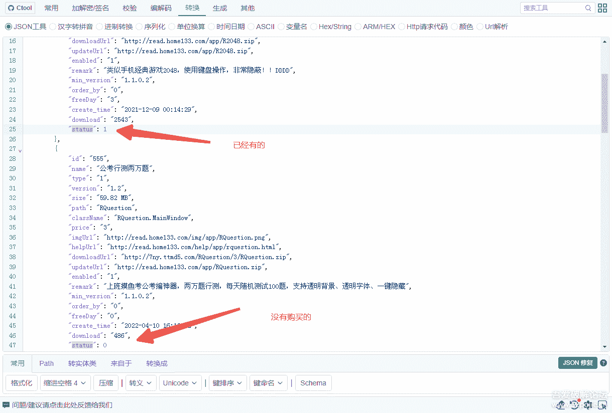

19.png (69.39 KB, 下载次数: 1)

[href="forum.php?mod=attachment&aid=MjcyODM4N3xiNDMxMjY1Y3wxNzkzNTcyMDAwfDE2ODA4NnwxOTUwNDQx&nothumb=yes" target="_blank"](https://www.52pojie.cn/forum.php?mod=attachment&aid=MjcyODM4N3xiNDMxMjY1Y3wxNzkzNTcyMDAwfDE2ODA4NnwxOTUwNDQx&nothumb=yes)

2024-10-12 15:57 上传

手动把这些状态全部改成1，就可以看到我们已经下载过的APP就不会需要再次重新下载了。

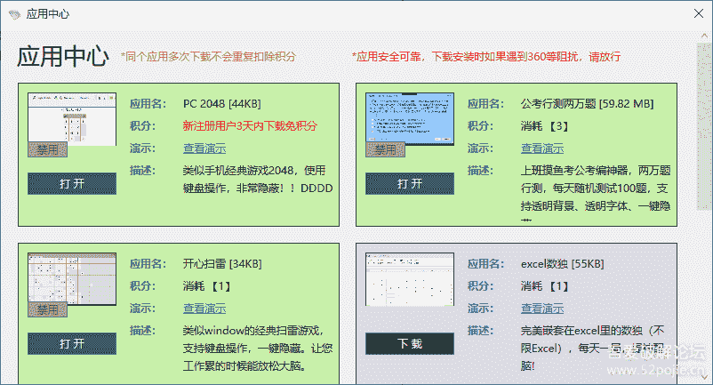

20.png (74.07 KB, 下载次数: 1)

[href="forum.php?mod=attachment&aid=MjcyODM4OHxmMjJhMmM5ZHwxNzkzNTcyMDAwfDE2ODA4NnwxOTUwNDQx&nothumb=yes" target="_blank"](https://www.52pojie.cn/forum.php?mod=attachment&aid=MjcyODM4OHxmMjJhMmM5ZHwxNzkzNTcyMDAwfDE2ODA4NnwxOTUwNDQx&nothumb=yes)

2024-10-12 15:57 上传

至此，伪造响应破解的分析就完成了，要写成代码很简单，就留给评论区的大牛们去做了。我们开始下一步，Patch程序。

## 3、破解方式二、修改软件

### 分析程序

前面已经说了，判断是不是会员的关键点在`BindRegister()`这个函数里面，关键点就在`Bis.LoRes.UserStatus = regResult.Status;`在这里设置了用户的会员状态。

### 修改

#### 修改会员

我们已知永久会员的状态是1，直接右键编辑IL指令

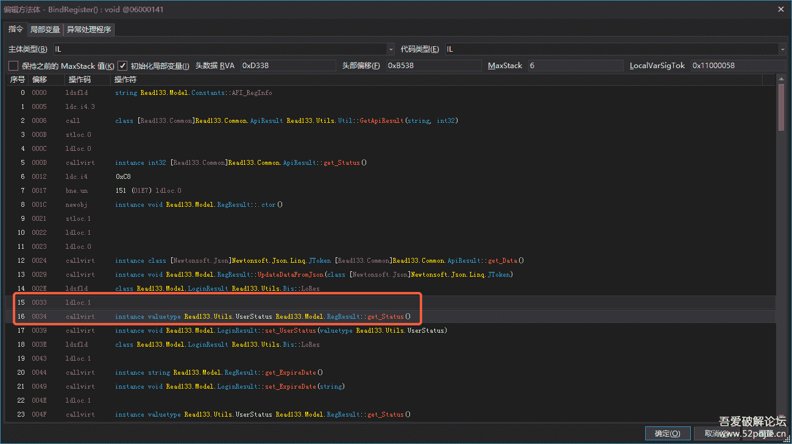

21.png (52.37 KB, 下载次数: 1)

[href="forum.php?mod=attachment&aid=MjcyODM4OXxhYTU5ZjczY3wxNzkzNTcyMDAwfDE2ODA4NnwxOTUwNDQx&nothumb=yes" target="_blank"](https://www.52pojie.cn/forum.php?mod=attachment&aid=MjcyODM4OXxhYTU5ZjczY3wxNzkzNTcyMDAwfDE2ODA4NnwxOTUwNDQx&nothumb=yes)

2024-10-12 15:57 上传

我们先把这两句选中，右键用`NOP`替换，然后在15行填上`idc.i4.1`（常数1），然后点确定

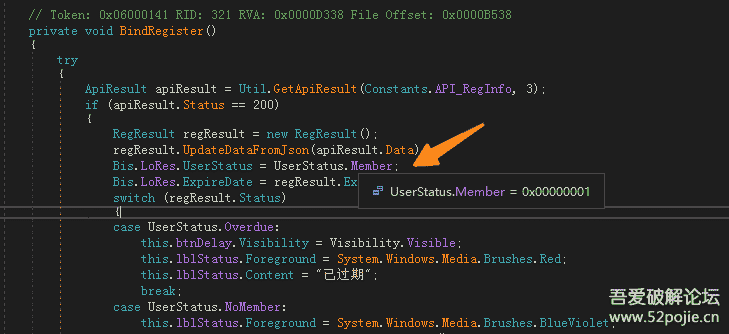

22.png (22.31 KB, 下载次数: 1)

[href="forum.php?mod=attachment&aid=MjcyODM5MHxmYTRmODQ4OHwxNzkzNTcyMDAwfDE2ODA4NnwxOTUwNDQx&nothumb=yes" target="_blank"](https://www.52pojie.cn/forum.php?mod=attachment&aid=MjcyODM5MHxmYTRmODQ4OHwxNzkzNTcyMDAwfDE2ODA4NnwxOTUwNDQx&nothumb=yes)

2024-10-12 15:57 上传

可以看到代码里面赋值的地方已经被我们替换成一个常量了。注意看下面的`switch`语句，判断的是服务器返回值的`status`，所以还需要修改一下，和上面的同理。

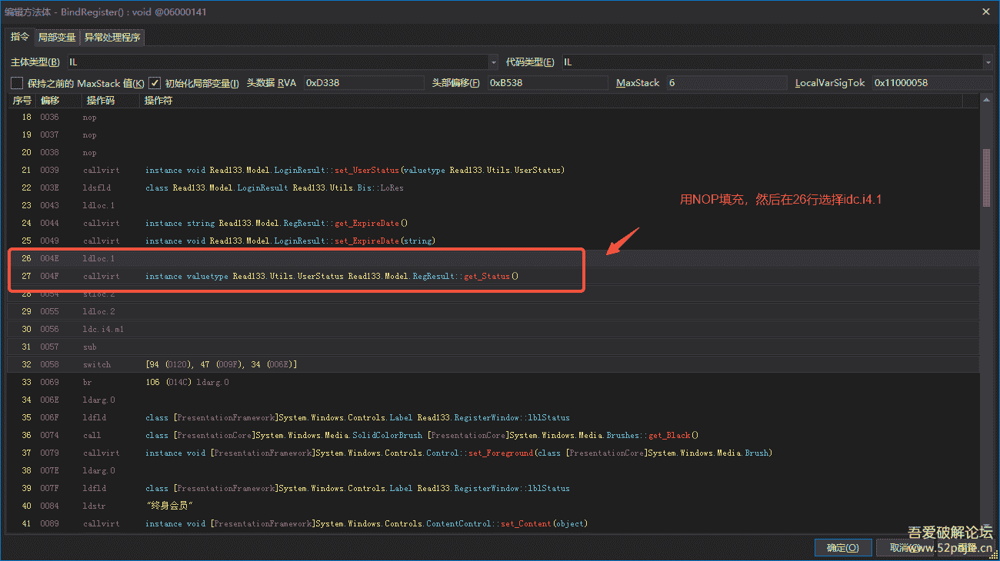

23.png (55.76 KB, 下载次数: 1)

[href="forum.php?mod=attachment&aid=MjcyODM5MXxkMTEyOTAwN3wxNzkzNTcyMDAwfDE2ODA4NnwxOTUwNDQx&nothumb=yes" target="_blank"](https://www.52pojie.cn/forum.php?mod=attachment&aid=MjcyODM5MXxkMTEyOTAwN3wxNzkzNTcyMDAwfDE2ODA4NnwxOTUwNDQx&nothumb=yes)

2024-10-12 15:57 上传

上面的这个修改了之后`switch`就变成判断1了，其实也可以改成本地的数据判断，就是改`Call`，但是我懒得改了，有兴趣的话自己研究一下，不难。

然后 左上角-》文件-》全部保存，可以加点后缀，比如破解会员，避免自己搞混了，然后再运行

> 
要注意，`dnspy`的调试必须先保存再调试才有效果，我们暂时不需要调试，所以保存了之后直接去打开这个`exe`看效果

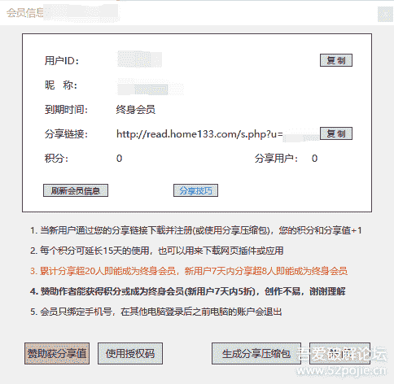

24.png (39.56 KB, 下载次数: 1)

[href="forum.php?mod=attachment&aid=MjcyODM5MnxlOTIzYTFkOXwxNzkzNTcyMDAwfDE2ODA4NnwxOTUwNDQx&nothumb=yes" target="_blank"](https://www.52pojie.cn/forum.php?mod=attachment&aid=MjcyODM5MnxlOTIzYTFkOXwxNzkzNTcyMDAwfDE2ODA4NnwxOTUwNDQx&nothumb=yes)

2024-10-12 15:57 上传

可以看到我们已经变成终身会员了，会员功能也有效果

#### 修改应用中心

##### 修改下载

应用中心和之前的一样，下载会判断，所以需要修改判断点，直接在`dnspy`搜索“需要消耗”，搜出来的第一个就是弹窗提示的内容

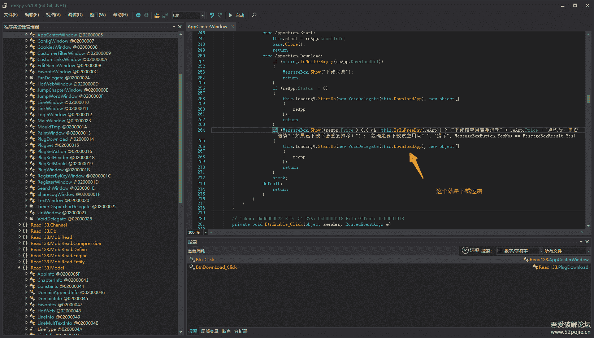

25.png (160.1 KB, 下载次数: 1)

[href="forum.php?mod=attachment&aid=MjcyODM5M3w1Njg3ZjQ5ZHwxNzkzNTcyMDAwfDE2ODA4NnwxOTUwNDQx&nothumb=yes" target="_blank"](https://www.52pojie.cn/forum.php?mod=attachment&aid=MjcyODM5M3w1Njg3ZjQ5ZHwxNzkzNTcyMDAwfDE2ODA4NnwxOTUwNDQx&nothumb=yes)

2024-10-12 15:57 上传

我们点进去可以看到很明显的`get`请求，判断状态是不是等于200

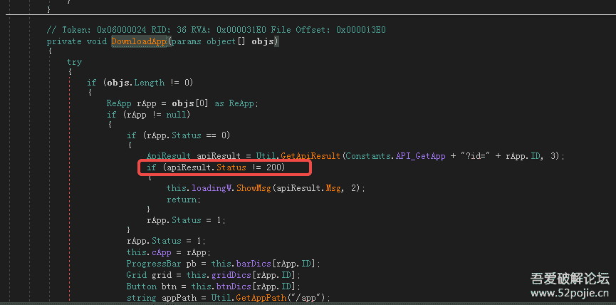

26.png (21.92 KB, 下载次数: 1)

[href="forum.php?mod=attachment&aid=MjcyODM5NHw4MjM0MGRjY3wxNzkzNTcyMDAwfDE2ODA4NnwxOTUwNDQx&nothumb=yes" target="_blank"](https://www.52pojie.cn/forum.php?mod=attachment&aid=MjcyODM5NHw4MjM0MGRjY3wxNzkzNTcyMDAwfDE2ODA4NnwxOTUwNDQx&nothumb=yes)

2024-10-12 15:57 上传

直接右键-》编辑IL指令，这里有几种改法，一个是改成0不执行，跳过这段代码，另一个是取反，让他等于200的时候才提示不足，或者直接删除`return`等等，我们这里直接取反

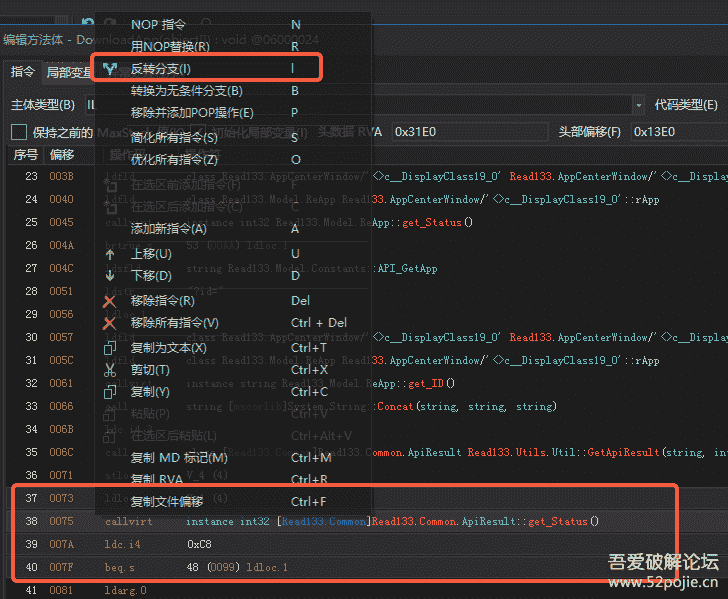

27.png (77.26 KB, 下载次数: 1)

[href="forum.php?mod=attachment&aid=MjcyODM5NXw0ZWEyM2U1YXwxNzkzNTcyMDAwfDE2ODA4NnwxOTUwNDQx&nothumb=yes" target="_blank"](https://www.52pojie.cn/forum.php?mod=attachment&aid=MjcyODM5NXw0ZWEyM2U1YXwxNzkzNTcyMDAwfDE2ODA4NnwxOTUwNDQx&nothumb=yes)

2024-10-12 15:57 上传

选择这4条语句，右键反转分支即可，因为我们没有积分，返回值必定不可能是200。

> 
这里修改完之后再保存一下，然后看效果。最好做一步保存一步，这样即使有问题闪退了，也能在上次修改保存好的文件基础上再改

这里已经可以下载了，但是打开和之前的抓包一样，有二次检测会提示没有购买，所以要找一下检测的点并且修改。

##### 修改二次检测

二次检测稍微麻烦一点，因为提示的内容是服务器返回的，搜不到字符串，所以要跟一下流程。

我们先返回上一步修改下载的位置，可以看到这一块是打开App的，但是没有调用函数，只是改了状态

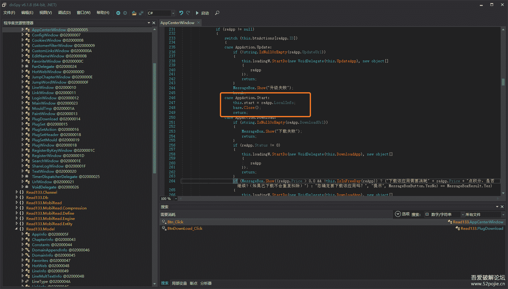

28.png (158.59 KB, 下载次数: 1)

[href="forum.php?mod=attachment&aid=MjcyODM5NnxhNWJhY2JmM3wxNzkzNTcyMDAwfDE2ODA4NnwxOTUwNDQx&nothumb=yes" target="_blank"](https://www.52pojie.cn/forum.php?mod=attachment&aid=MjcyODM5NnxhNWJhY2JmM3wxNzkzNTcyMDAwfDE2ODA4NnwxOTUwNDQx&nothumb=yes)

2024-10-12 15:57 上传

所以我们这一步要右键这个`this.start`然后点击分析，可以看到读取和赋值都是那个函数调用了，追一下可以追到下面这个函数

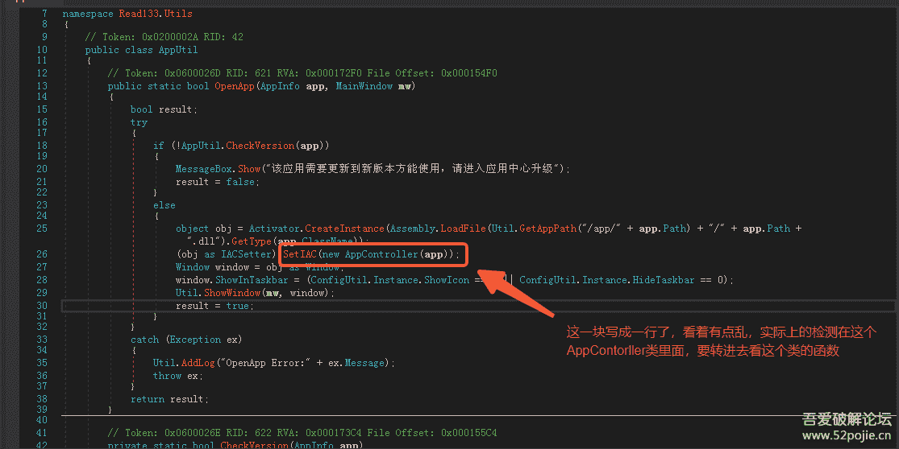

29.png (39.57 KB, 下载次数: 1)

[href="forum.php?mod=attachment&aid=MjcyODM5N3wwYWMxYWQ0M3wxNzkzNTcyMDAwfDE2ODA4NnwxOTUwNDQx&nothumb=yes" target="_blank"](https://www.52pojie.cn/forum.php?mod=attachment&aid=MjcyODM5N3wwYWMxYWQ0M3wxNzkzNTcyMDAwfDE2ODA4NnwxOTUwNDQx&nothumb=yes)

2024-10-12 15:57 上传

代码精简了，分开看就知道是在干嘛了


```csharp
// 动态加载指定路径的DLL文件
Assembly assembly = Assembly.LoadFile(Util.GetAppPath("/app/" + app.Path) + "/" + app.Path + ".dll");

// 获取assembly中指定类名的Type对象
Type type = assembly.GetType(app.ClassName);

// 使用反射创建type类型的实例
object obj = Activator.CreateInstance(type);

// 如果obj实现了IACSetter接口，将调用其SetIAC方法
if (obj is IACSetter setter)
{
    // 创建一个AppController实例并传给SetIAC方法
    setter.SetIAC(new AppController(app));
}
```

进这个类就可以看到

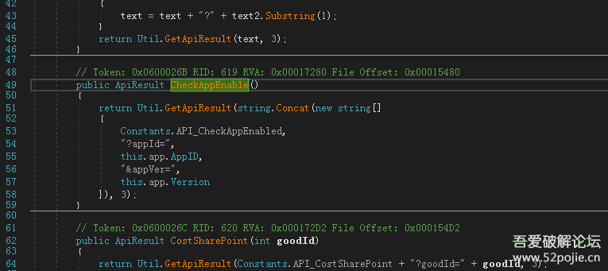

30.png (19.5 KB, 下载次数: 1)

[href="forum.php?mod=attachment&aid=MjcyODM5OHw5ZGFkYTM3MnwxNzkzNTcyMDAwfDE2ODA4NnwxOTUwNDQx&nothumb=yes" target="_blank"](https://www.52pojie.cn/forum.php?mod=attachment&aid=MjcyODM5OHw5ZGFkYTM3MnwxNzkzNTcyMDAwfDE2ODA4NnwxOTUwNDQx&nothumb=yes)

2024-10-12 15:57 上传

这个检测函数了，但是这个检测函数值负责返回，不判断。分析也没有发现调用，那说明是小App的DLL调用了这个方法，小APP有点多，不可能一个个去改，这个函数留给我们的操作空间也不是很多，因为没有声明临时变量，所以修改`ApiResult`的内容还挺麻烦的，那我们换个思路，让他请求一个返回status返回200的地址。

打开抓包软件，看看软件请求的哪个数据一直都是200返回值的

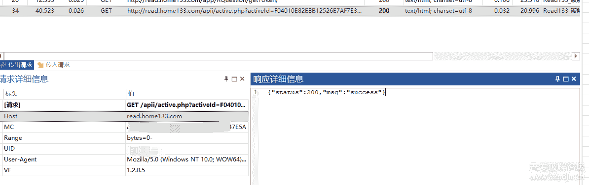

31.png (34.32 KB, 下载次数: 1)

[href="forum.php?mod=attachment&aid=MjcyODM5OXxlZjMyNzgwMnwxNzkzNTcyMDAwfDE2ODA4NnwxOTUwNDQx&nothumb=yes" target="_blank"](https://www.52pojie.cn/forum.php?mod=attachment&aid=MjcyODM5OXxlZjMyNzgwMnwxNzkzNTcyMDAwfDE2ODA4NnwxOTUwNDQx&nothumb=yes)

2024-10-12 15:57 上传

找到了一个符合要求的，这个是每次退出都会调用的，我们吧参数改一下看看是不是还返回200

经过测试修改参数之后返回的还是200，说明没对传入的参数检测

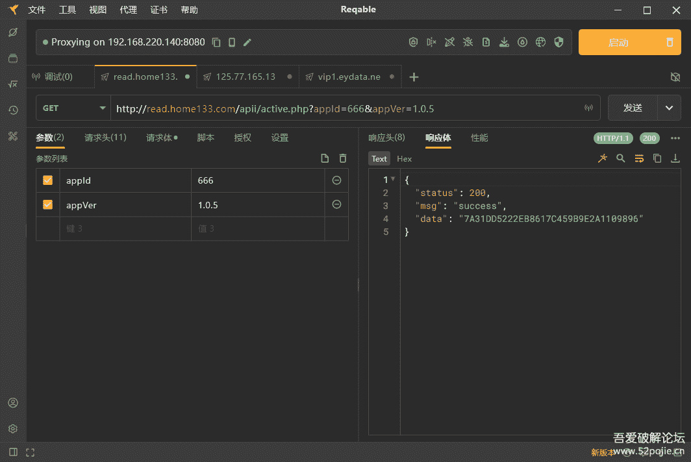

32.png (61.92 KB, 下载次数: 1)

[href="forum.php?mod=attachment&aid=MjcyODQwMHw3NTU4NzE0ZXwxNzkzNTcyMDAwfDE2ODA4NnwxOTUwNDQx&nothumb=yes" target="_blank"](https://www.52pojie.cn/forum.php?mod=attachment&aid=MjcyODQwMHw3NTU4NzE0ZXwxNzkzNTcyMDAwfDE2ODA4NnwxOTUwNDQx&nothumb=yes)

2024-10-12 15:57 上传

那我们修改一下访问的路径

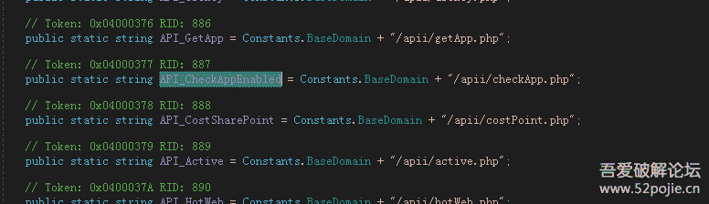

33.png (15.53 KB, 下载次数: 0)

[href="forum.php?mod=attachment&aid=MjcyODQwMXw5NGZhNDJlM3wxNzkzNTcyMDAwfDE2ODA4NnwxOTUwNDQx&nothumb=yes" target="_blank"](https://www.52pojie.cn/forum.php?mod=attachment&aid=MjcyODQwMXw5NGZhNDJlM3wxNzkzNTcyMDAwfDE2ODA4NnwxOTUwNDQx&nothumb=yes)

2024-10-12 15:57 上传

直接右键编辑C#方法，把这个改成`active.php`或者修改获取的改成获取active的。

保存，测试

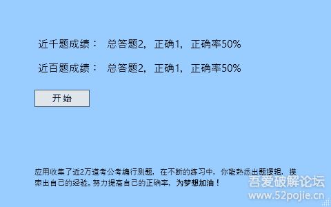

34.png (28.45 KB, 下载次数: 1)

[href="forum.php?mod=attachment&aid=MjcyODQwMnwyMjdjYjM5MXwxNzkzNTcyMDAwfDE2ODA4NnwxOTUwNDQx&nothumb=yes" target="_blank"](https://www.52pojie.cn/forum.php?mod=attachment&aid=MjcyODQwMnwyMjdjYjM5MXwxNzkzNTcyMDAwfDE2ODA4NnwxOTUwNDQx&nothumb=yes)

2024-10-12 15:57 上传

OK，可以打开了，但是我们还是遇到了和抓包破解一样的问题，每次都要重新下载。

### 处理状态检测

我们再去找状态检测的地方，继续返回到修改应用中心的地方，在这个类里面可以看到有添加`item`到列表的操作，那我们就看看在哪里设置了按钮的状态，往上翻翻可以看到一个`private void SetActionStyle(ReApp app)`的函数设置了按钮的状态，

这里是用switch语句判断添加的

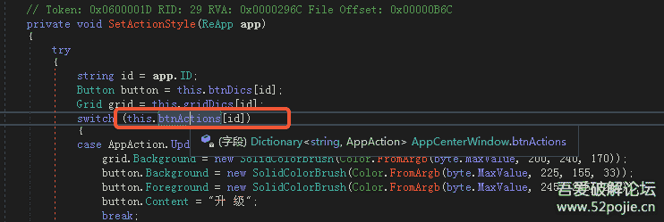

35.png (20.96 KB, 下载次数: 1)

[href="forum.php?mod=attachment&aid=MjcyODQwM3w2ZDhmYWNjYnwxNzkzNTcyMDAwfDE2ODA4NnwxOTUwNDQx&nothumb=yes" target="_blank"](https://www.52pojie.cn/forum.php?mod=attachment&aid=MjcyODQwM3w2ZDhmYWNjYnwxNzkzNTcyMDAwfDE2ODA4NnwxOTUwNDQx&nothumb=yes)

2024-10-12 15:57 上传

我们点击这个成员变量，找到他定义的地方（这里直接点分析是不行的，因为他是初始化过的一个`Map`（字典）），要找往字典添加的方法调用，所以先跳转到它定义的地方，因为是个私有变量，所以肯定在这个类内部添加的数据，在代码搜索`btnActions`

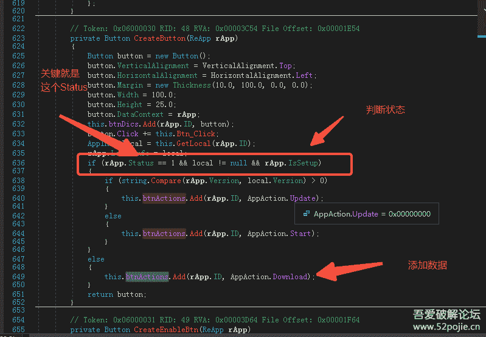

36.png (40.45 KB, 下载次数: 1)

[href="forum.php?mod=attachment&aid=MjcyODQwNHw1YzZjNTUzYnwxNzkzNTcyMDAwfDE2ODA4NnwxOTUwNDQx&nothumb=yes" target="_blank"](https://www.52pojie.cn/forum.php?mod=attachment&aid=MjcyODQwNHw1YzZjNTUzYnwxNzkzNTcyMDAwfDE2ODA4NnwxOTUwNDQx&nothumb=yes)

2024-10-12 15:57 上传

很容易就能找到赋值的地方，关键点就是这个`rApp.Status == 1`，那我们就把这个判断去掉，右键，编辑IL指令

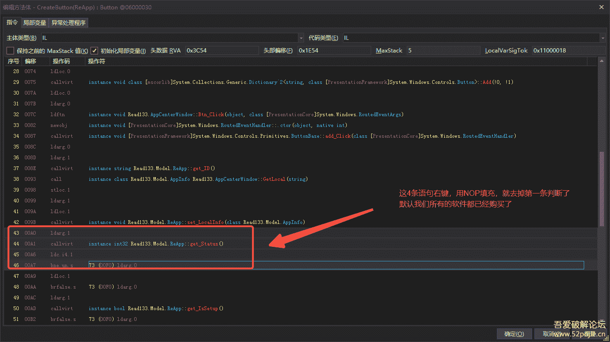

37.png (60.52 KB, 下载次数: 1)

[href="forum.php?mod=attachment&aid=MjcyODQwNXw1YjM4MjgwOXwxNzkzNTcyMDAwfDE2ODA4NnwxOTUwNDQx&nothumb=yes" target="_blank"](https://www.52pojie.cn/forum.php?mod=attachment&aid=MjcyODQwNXw1YjM4MjgwOXwxNzkzNTcyMDAwfDE2ODA4NnwxOTUwNDQx&nothumb=yes)

2024-10-12 15:57 上传

修改后的C#代码如下

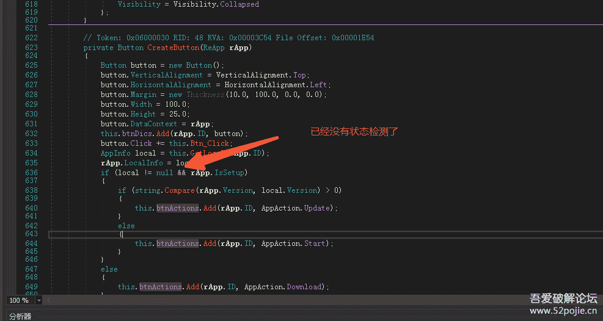

38.png (34.7 KB, 下载次数: 1)

[href="forum.php?mod=attachment&aid=MjcyODQwNnwzYmM0YWZlNXwxNzkzNTcyMDAwfDE2ODA4NnwxOTUwNDQx&nothumb=yes" target="_blank"](https://www.52pojie.cn/forum.php?mod=attachment&aid=MjcyODQwNnwzYmM0YWZlNXwxNzkzNTcyMDAwfDE2ODA4NnwxOTUwNDQx&nothumb=yes)

2024-10-12 15:58 上传

这样就没有状态判断了，默认都是已经购买了的。

我们保存打开看看效果（和上面图一样，我就不贴了），可以看到下载了的软件默认就是打开按钮，不需要再次下载了，至此，分析结束。

### 4、后语

> 具体的IL指令代表的什么意思就不解释了，可以百度或者问GPT都可以得到很好地回答。

这个软件分析没花多久，我个人认为这个软件比较简单，很适合新手练手，不管是Patch技巧还是抓包姿势都很适合。但是还是那句话，只做分析讨论，不提供成品，如有需求请支持正版。
