# [CTF] 2022腾讯游戏安全PC端初赛复现

- 原帖: https://www.52pojie.cn/forum.php?mod=viewthread&tid=1952072
- 抓取时间: 2026-11-01T22:26:31

## 2022 PC端初赛复现

### 初赛题

这里有一个画了flag的小程序，可好像出了点问题，flag丢失了，需要把它找回来。

题目：

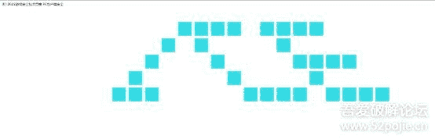  
wps1.jpg (9.69 KB, 下载次数: 2)  
[附件](https://www.52pojie.cn/forum.php?mod=attachment&aid=MjcxNTM5NnxjODNlZWEyNHwxNzkzNTcxOTg5fDE2ODA4NnwxOTUyMDcy&nothumb=yes)  
2024-8-6 23:51 上传

找回flag样例：

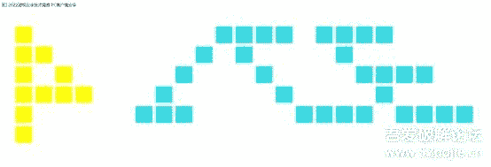  
wps2.jpg (11.01 KB, 下载次数: 2)  
[附件](https://www.52pojie.cn/forum.php?mod=attachment&aid=MjcxNTM5N3wyZjZmYzM4MXwxNzkzNTcxOTg5fDE2ODA4NnwxOTUyMDcy&nothumb=yes)  
2024-8-6 23:51 上传

要求

1、不得直接patch系统组件实现绘制（如：直接编写D3D代码绘制flag），只能对题目自身代码进行修改或调用。

2、找回的flag需要和预期图案（包括颜色）一致，如果绘制结果存在偏差会扣除一定分数。

3、赛后需要提交找回flag的截图和解题代码或文档进行评分。

DIE查壳,PE64位无壳,先IDA静态分析看一下

定位到这个函数

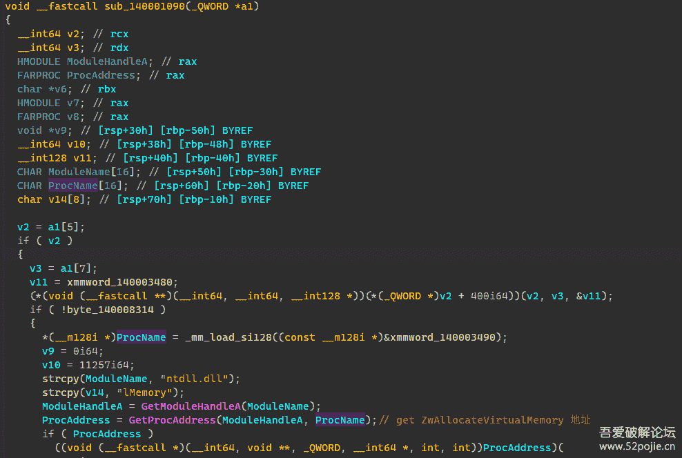  
image-20240624131512660.png (91.91 KB, 下载次数: 2)  
[附件](https://www.52pojie.cn/forum.php?mod=attachment&aid=MjcxNTM5OHxhM2NlNDliYXwxNzkzNTcxOTg5fDE2ODA4NnwxOTUyMDcy&nothumb=yes)  
2024-8-6 23:51 上传

该函数先是加载了`ntdll`系统模块,再进行拼接字符串获取该模块`ZwAllocateVirtualMemory`函数地址

```c
NTSTATUS ZwAllocateVirtualMemory(
  HANDLE ProcessHandle,     // 要分配内存的进程的句柄
  PVOID *BaseAddress,      // 指向一个变量的指针，该变量接收分配的内存的基地址
  ULONG ZeroBits,           // 指定返回的基地址中的高位必须为零的位数，用于对齐内存
  PULONG AllocationSize,    // 指向一个变量，指定要分配的内存大小
  ULONG AllocationType,     // 指定内存分配的类型，例如 MEM_COMMIT（提交内存）或 MEM_RESERVE（保留内存）
  ULONG Protect             // 指定内存的保护属性，例如 PAGE_READWRITE（可读写）
);
```

接着往下看

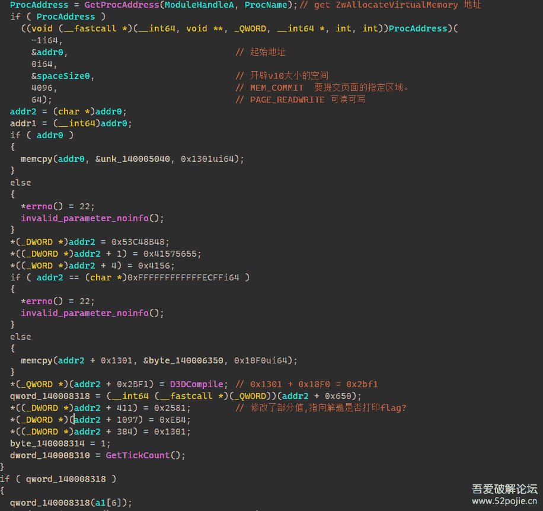  
image-20240624133213434.png (103.22 KB, 下载次数: 2)  
[附件](https://www.52pojie.cn/forum.php?mod=attachment&aid=MjcxNTM5OXwzMDgwOGU5NXwxNzkzNTcxOTg5fDE2ODA4NnwxOTUyMDcy&nothumb=yes)  
2024-8-6 23:51 上传

先是利用`ZwAllocateVirtualMemory`开辟了一块`0x2BF9`可读可写的地址空间,随后在该地址空间填入数据,最后再对地址空间部分数据进行了修改,`qword_140008318`可能是一个函数地址,在最后调用了这个函数,然后等待一段时间就释放了这个地址空间,所以绘画逻辑应该是在这个函数里,绘画完之后展现一段时间后消失和运行效果相同

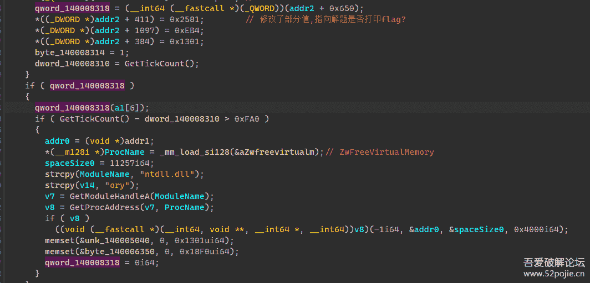  
image-20240624133856075.png (82.52 KB, 下载次数: 2)  
[附件](https://www.52pojie.cn/forum.php?mod=attachment&aid=MjcxNTQwMXxlYjUwNmJhZHwxNzkzNTcxOTg5fDE2ODA4NnwxOTUyMDcy&nothumb=yes)  
2024-8-6 23:51 上传

所以主要逻辑应该是在`qword_140008318`函数里,x64dbg调试看一下,定位到`qword_140008318`赋值语句,`00000001400011FE`地址处下断点

```asm
00000001400011FE   | 48:8905 13710000                      | mov qword ptr ds:[140008318],rax              |
0000000140001205   | C783 6C060000 81250000                | mov dword ptr ds:[rbx+66C],2581               | rbx+66C:L"▁"
000000014000120F   | C783 49040000 B40E0000                | mov dword ptr ds:[rbx+449],EB4                |
0000000140001219   | C783 00060000 01130000                | mov dword ptr ds:[rbx+600],1301               |
0000000140001223   | C605 EA700000 01                      | mov byte ptr ds:[140008314],1                 |
```

进入`rax`发现确实是一个函数地址

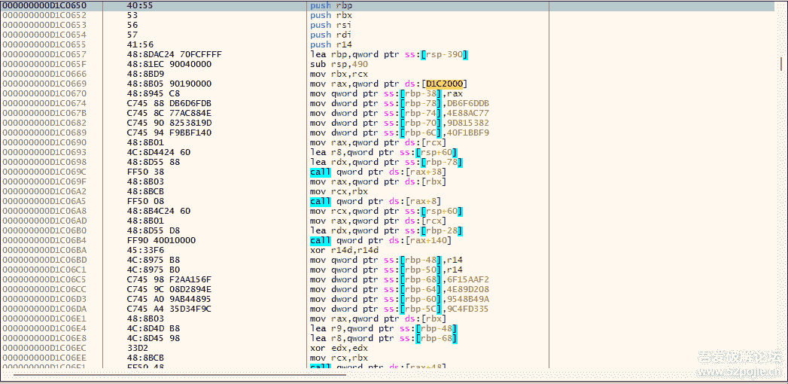  
image-20240624134305304.png (113.69 KB, 下载次数: 2)  
[附件](https://www.52pojie.cn/forum.php?mod=attachment&aid=MjcxNTQwMnxlZDNiMDY1OHwxNzkzNTcxOTg5fDE2ODA4NnwxOTUyMDcy&nothumb=yes)  
2024-8-6 23:52 上传

再看一下修改部分的数据代表到底什么意思

```asm
00000001400011FE   | 48:8905 13710000                      | mov qword ptr ds:[140008318],rax              |
0000000140001205   | C783 6C060000 81250000                | mov dword ptr ds:[rbx+66C],2581               | rbx+66C:L"▁"
000000014000120F   | C783 49040000 B40E0000                | mov dword ptr ds:[rbx+449],EB4                |
0000000140001219   | C783 00060000 01130000                | mov dword ptr ds:[rbx+600],1301               |
0000000140001223   | C605 EA700000 01                      | mov byte ptr ds:[140008314],1                 |
```

分别定位到`rbx`对应的偏移处找不同

第一处 `mov dword ptr ds:[rbx+66C],2581`

```asm
000000000D1A0666   | 48:8BD9                               | mov rbx,rcx                                   |
000000000D1A0669   | 48:8B05 90190000                      | mov rax,qword ptr ds:[D1A2000]                |
000000000D1A0670   | 48:8945 C8                            | mov qword ptr ss:[rbp-38],rax                 |
;修改后
000000000D1A0666   | 48:8BD9                               | mov rbx,rcx                                   |
000000000D1A0669   | 48:8B05 81250000                      | mov rax,qword ptr ds:[]          |
000000000D1A0670   | 48:8945 C8                            | mov qword ptr ss:[rbp-38],rax                 |
```

第二处 `mov dword ptr ds:[rbx+449],EB4`

```asm
000000000D1A0442   | 4C:8B65 70                            | mov r12,qword ptr ss:[rbp+70]                 |
000000000D1A0446   | 48:8D05 F32B0000                      | lea rax,qword ptr ds:[D1A3040]                |
000000000D1A044D   | 4C:8B6D 68                            | mov r13,qword ptr ss:[rbp+68]                 |
;修改后
000000000D190442   | 4C:8B65 70                            | mov r12,qword ptr ss:[rbp+70]                 |
000000000D190446   | 48:8D05 B40E0000                      | lea rax,qword ptr ds:[D191301]                |
000000000D19044D   | 4C:8B6D 68                            | mov r13,qword ptr ss:[rbp+68]                 |
```

第三处 `mov dword ptr ds:[rbx+600],1301`

```asm
000000000D1A05FD   | 48:81FE 8F050000                      | cmp rsi,58F                                   |
000000000D1A0604   | 0F82 A6FEFFFF                         | jb D1A04B0                                    |
000000000D1A060A   | 48:8B9C24 D0000000                    | mov rbx,qword ptr ss:[rsp+D0]                 |
;修改后
000000000D1A05FD   | 48:81FE 01130000                      | cmp rsi,1301                                  |
000000000D1A0604   | 0F82 A6FEFFFF                         | jb D1A04B0                                    |
000000000D1A060A   | 48:8B9C24 D0000000                    | mov rbx,qword ptr ss:[rsp+D0]                 |
```

第一处和第二处`nop`掉直接程序出现异常

第三处`nop`掉发现会对绘画效果产生影响,这里少了五个方块,

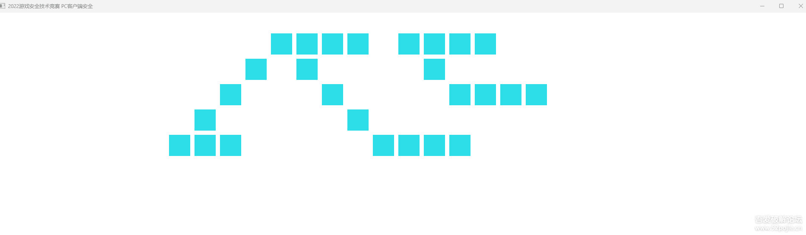  
image-20240624142158258.png (14.67 KB, 下载次数: 2)  
[附件](https://www.52pojie.cn/forum.php?mod=attachment&aid=MjcxNTQwM3w2MGRmNDJiYXwxNzkzNTcxOTg5fDE2ODA4NnwxOTUyMDcy&nothumb=yes)  
2024-8-6 23:52 上传

所以`[rbx+600]`处附近会可能有绘画逻辑,运行到附近看看

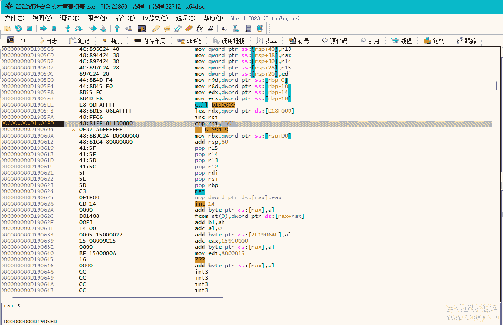  
image-20240624211750273.png (122.71 KB, 下载次数: 2)  
[附件](https://www.52pojie.cn/forum.php?mod=attachment&aid=MjcxNTQwNXxhOTEwZGI1NnwxNzkzNTcxOTg5fDE2ODA4NnwxOTUyMDcy&nothumb=yes)  
2024-8-6 23:53 上传

分析这个函数,这里的`rsi`应该是一个数组的索引值,通过数组的值是否等于7进行判断,应该是将有效值和无效值进行区分,然后遍历了整个数组,进行了多次循环操作

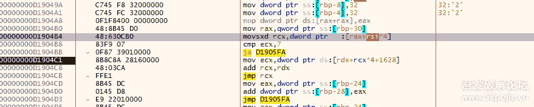  
image-20240624212123944.png (44.45 KB, 下载次数: 2)  
[附件](https://www.52pojie.cn/forum.php?mod=attachment&aid=MjcxNTQwNnwyNjliMGQ2NnwxNzkzNTcxOTg5fDE2ODA4NnwxOTUyMDcy&nothumb=yes)  
2024-8-6 23:53 上传

那有效值在哪呢,我们主要找的绘画的浮点数位置保存在哪?D3D开发的经验不多,我就从一个个可能的函数的参数入手

看看是否能直接通过传参获取位置数组,这个函数里只有一个函数`D190000`

运行到该函数,观察函数传参窗口

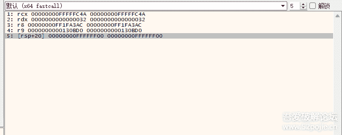  
image-20240624212702425.png (14.46 KB, 下载次数: 2)


[href="forum.php?mod=attachment&aid=MjcxNTQwN3wwNTdiMmUxNnwxNzkzNTcxOTg5fDE2ODA4NnwxOTUyMDcy&nothumb=yes" target="_blank"](https://www.52pojie.cn/forum.php?mod=attachment&aid=MjcxNTQwN3wwNTdiMmUxNnwxNzkzNTcxOTg5fDE2ODA4NnwxOTUyMDcy&nothumb=yes)

2024-8-6 23:54 上传

显然没有这么容易，那还有可能在这个函数的母函数或者子函数的函数里。

通过堆栈回溯找到母函数。

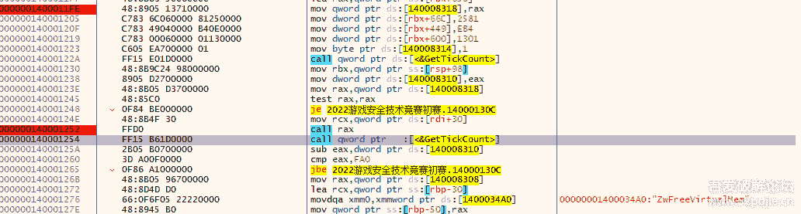

`image-20240624212930015.png`（70.74 KB，下载次数：2）

[href="forum.php?mod=attachment&aid=MjcxNTQwOXw5NWMzNTU5OXwxNzkzNTcxOTg5fDE2ODA4NnwxOTUyMDcy&nothumb=yes" target="_blank"](https://www.52pojie.cn/forum.php?mod=attachment&aid=MjcxNTQwOXw5NWMzNTU5OXwxNzkzNTcxOTg5fDE2ODA4NnwxOTUyMDcy&nothumb=yes)

2024-8-6 23:55 上传

这个`rax`是之前分析过了的函数地址，所以这个函数就是位置数组的出处了。

进入分析。

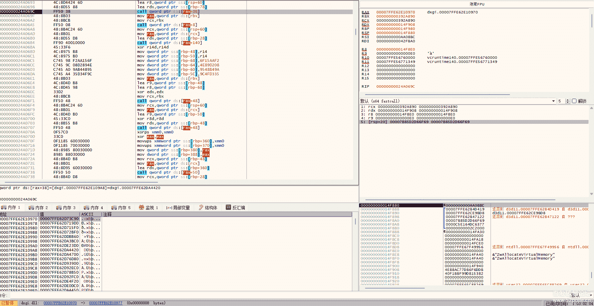

`image-20240624213223998.png`（227.64 KB，下载次数：2）

[href="forum.php?mod=attachment&aid=MjcxNTQxMHxhOWFjNjVhNHwxNzkzNTcxOTg5fDE2ODA4NnwxOTUyMDcy&nothumb=yes" target="_blank"](https://www.52pojie.cn/forum.php?mod=attachment&aid=MjcxNTQxMHxhOWFjNjVhNHwxNzkzNTcxOTg5fDE2ODA4NnwxOTUyMDcy&nothumb=yes)

2024-8-6 23:55 上传

调用了一堆系统函数，并没有明显传参，也没有浮点数处理的汇编指令，这些略过分析，继续看。

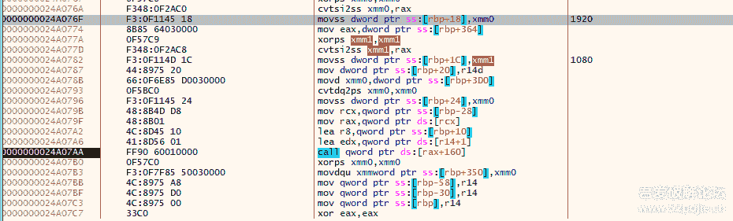

`image-20240624213702469.png`（69.73 KB，下载次数：3）

[href="forum.php?mod=attachment&aid=MjcxNTQxMXwzMWY4Y2RhOXwxNzkzNTcxOTg5fDE2ODA4NnwxOTUyMDcy&nothumb=yes" target="_blank"](https://www.52pojie.cn/forum.php?mod=attachment&aid=MjcxNTQxMXwzMWY4Y2RhOXwxNzkzNTcxOTg5fDE2ODA4NnwxOTUyMDcy&nothumb=yes)

2024-8-6 23:55 上传

这里传入了两个浮点数，一个`1920`，一个`1080`，分辨率大小？应该是绘画的初始化操作，继续分析找浮点数数组。

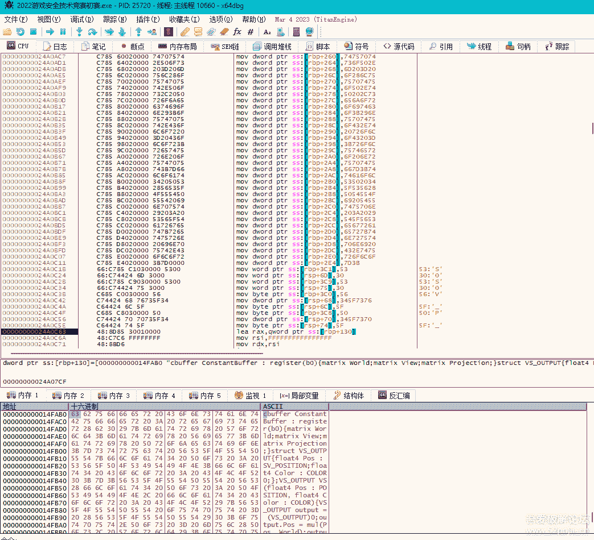

`image-20240624214126525.png`（246.07 KB，下载次数：2）

[href="forum.php?mod=attachment&aid=MjcxNTQxMnxkYzFlMTRiMXwxNzkzNTcxOTg5fDE2ODA4NnwxOTUyMDcy&nothumb=yes" target="_blank"](https://www.52pojie.cn/forum.php?mod=attachment&aid=MjcxNTQxMnxkYzFlMTRiMXwxNzkzNTcxOTg5fDE2ODA4NnwxOTUyMDcy&nothumb=yes)

2024-8-6 23:55 上传

这里有个缓冲区，存储了用`HLSL`语言编写的一段顶点着色器和像素着色器的代码，进行图形渲染步骤，然后再调用了一些`D3D`函数。

```hlsl
// 定义常量缓冲区
cbuffer ConstantBuffer : register(b0)
{
    matrix World;        // 世界矩阵
    matrix View;          // 视图矩阵
    matrix Projection;    // 投影矩阵
};

// 定义顶点着色器的输出结构体
struct VS_OUTPUT
{
    float4 Pos : SV_POSITION; // 顶点位置
    float4 Color : COLOR0;    // 顶点颜色
};

// 顶点着色器
VS_OUTPUT VS(float4 Pos : POSITION, float4 Color : COLOR)
{
    VS_OUTPUT output = (VS_OUTPUT)0;

    // 应用变换矩阵
    output.Pos = mul(Pos, World);
    output.Pos = mul(output.Pos, View);
    output.Pos = mul(output.Pos, Projection);

    // 传递颜色
    output.Color = Color;

    return output;
}

// 像素着色器
float4 PS(VS_OUTPUT input) : SV_Target
{
    // 直接返回输入颜色
    return input.Color;
}
```

下面还有一个。

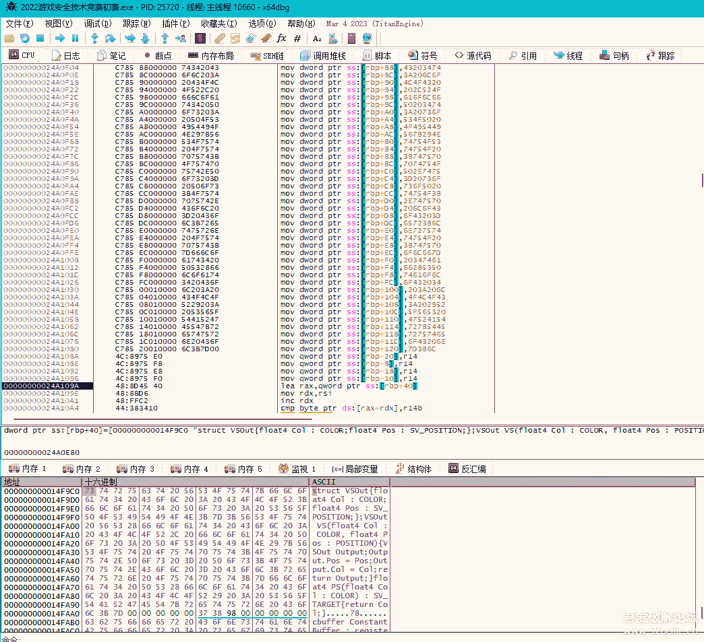

`image-20240624214515403.png`（237.51 KB，下载次数：2）

[href="forum.php?mod=attachment&aid=MjcxNTQxM3w4OWQ3YWE4NXwxNzkzNTcxOTg5fDE2ODA4NnwxOTUyMDcy&nothumb=yes" target="_blank"](https://www.52pojie.cn/forum.php?mod=attachment&aid=MjcxNTQxM3w4OWQ3YWE4NXwxNzkzNTcxOTg5fDE2ODA4NnwxOTUyMDcy&nothumb=yes)

2024-8-6 23:55 上传

```hlsl
// 定义顶点着色器的输出结构体

struct VSOut

{

    float4 Col : COLOR;   // 顶点颜色

    float4 Pos : SV_POSITION; // 顶点位置

};

// 顶点着色器

VSOut VS(float4 Col : COLOR, float4 Pos : POSITION)

{

    VSOut Output;

    // 将输入位置赋值给输出位置

    Output.Pos = Pos;

    // 将输入颜色赋值给输出颜色

    Output.Col = Col;

    return Output;

}

// 像素着色器

float4 PS(float4 Col : COLOR) : SV_TARGET

{

    // 直接返回输入的颜色作为像素颜色

    return Col;

}
```

两个不同的着色器设计，是否对应了一个`flag`图形和原始图形两种图形不同的着色器呢？

但是最关键的位置数组我们还没找到，接着往下分析吧。

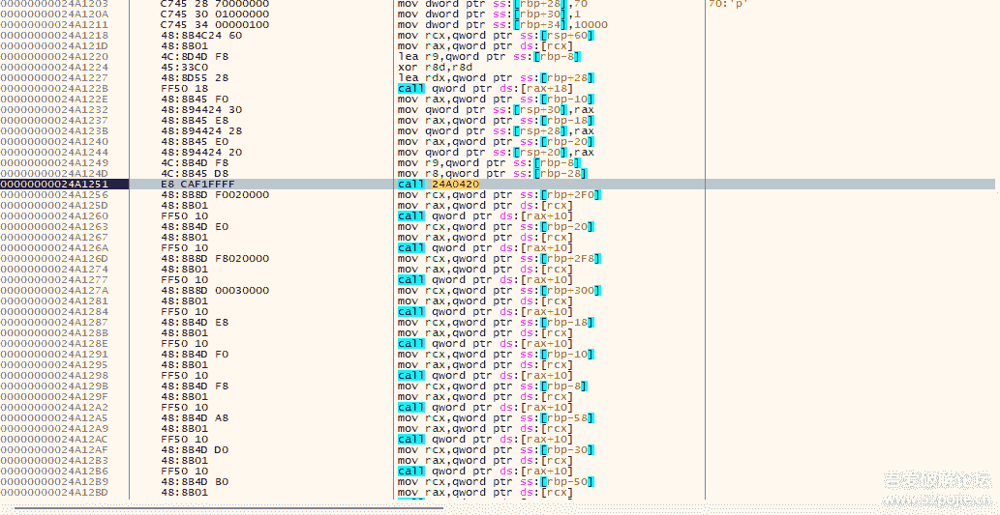

`image-20240624215140725.png`（134.29 KB，下载次数：2）

[href="forum.php?mod=attachment&aid=MjcxNTQxNHxhNDg1M2RkYnwxNzkzNTcxOTg5fDE2ODA4NnwxOTUyMDcy&nothumb=yes" target="_blank"](https://www.52pojie.cn/forum.php?mod=attachment&aid=MjcxNTQxNHxhNDg1M2RkYnwxNzkzNTcxOTg5fDE2ODA4NnwxOTUyMDcy&nothumb=yes)

2024-8-6 23:55 上传

这个函数内部还有一个用户层函数，进入分析。

发现这个函数内部就是刚刚回溯开始的函数，那就直接进入该函数的子函数分析。

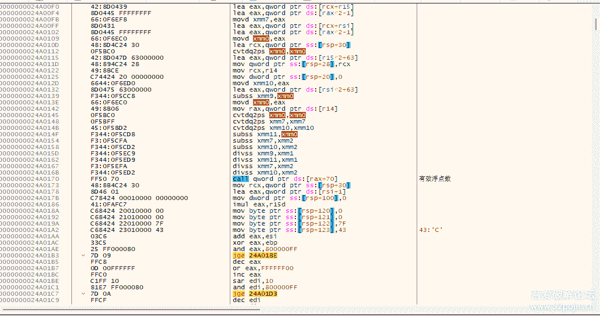

`image-20240624215445902.png`（116.66 KB，下载次数：2）

[href="forum.php?mod=attachment&aid=MjcxNTQxNXxkZjU1MmMyMnwxNzkzNTcxOTg5fDE2ODA4NnwxOTUyMDcy&nothumb=yes" target="_blank"](https://www.52pojie.cn/forum.php?mod=attachment&aid=MjcxNTQxNXxkZjU1MmMyMnwxNzkzNTcxOTg5fDE2ODA4NnwxOTUyMDcy&nothumb=yes)

2024-8-6 23:56 上传

一堆浮点数处理的汇编指令，好像还进行了加密解密操作，所以这里应该就是浮点数数组的出处了吧。

跳过这些计算浮点数的指令，直接找到赋值语句并定位位置数组的首地址。

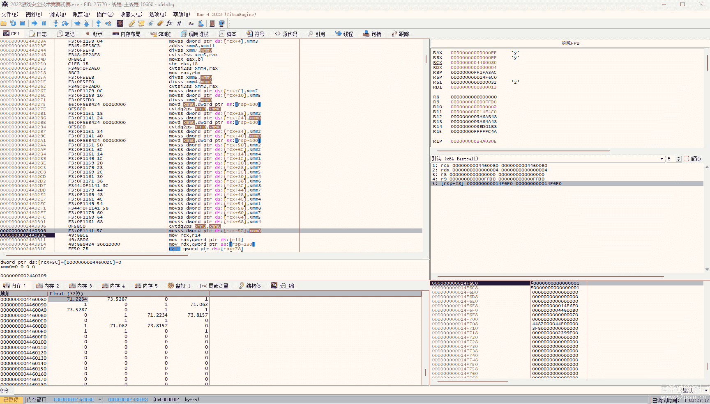

`image-20240624215757189.png`（228.87 KB，下载次数：3）

[href="forum.php?mod=attachment&aid=MjcxNTQxN3xkZTA1MDhjM3wxNzkzNTcxOTg5fDE2ODA4NnwxOTUyMDcy&nothumb=yes" target="_blank"](https://www.52pojie.cn/forum.php?mod=attachment&aid=MjcxNTQxN3xkZTA1MDhjM3wxNzkzNTcxOTg5fDE2ODA4NnwxOTUyMDcy&nothumb=yes)

2024-8-6 23:58 上传

这里分析发现，`rcx`即为数组首地址，继续分析，后面就是继续调用`D3D`函数，但是我并没有发现数组怎么传进去的，只是找到可能的位置数组。这个函数运行到返回只提供了`0x70`大小的浮点数数组，但是我们在之前分析过了，这个函数会循环运行，循环运行完后导出这些浮点数。得到`1340`个浮点数，到这里我有点怀疑这个数组的真实性了，不应该有这么长的数据的，总共方块数是`31+11=42`个，点数就是`42*4=168`个点，就算是三维坐标也不超过这么多数据，但是我还是在`Python`进行了一个绘制，这里是`Python`绘制代码。


## 绘图代码

```python
import struct
import matplotlib.pyplot as plt
from mpl_toolkits.mplot3d import Axes3D
float_values = [  71.2234,       73.5287,             0,             1,
        1,             0,             1,        71.062,
  73.5287,             ...]
coordinates = [float_values[i:i+2] for i in range(0,len(float_values),2)]

fig = plt.figure()

ax = fig.add_subplot(111)

x_values = [x for x, _ in coordinates]
y_values = [y for _, y in coordinates]

ax.scatter(x_values, y_values)

plt.show()
```

## 运行结果

运行结果如图：

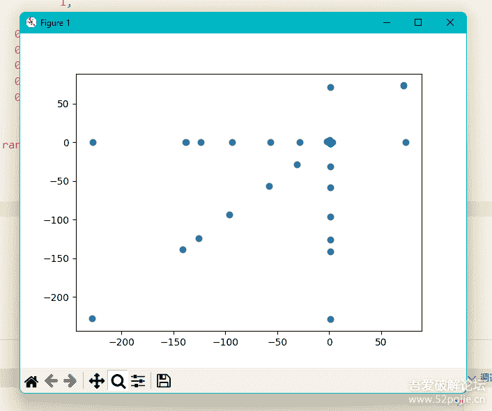

`image-20240624221016969.png` (34.11 KB, 下载次数: 2)

[href="forum.php?mod=attachment&aid=MjcxNTQxOHwyN2VjMDZiNXwxNzkzNTcxOTg5fDE2ODA4NnwxOTUyMDcy&nothumb=yes" target="_blank"](https://www.52pojie.cn/forum.php?mod=attachment&aid=MjcxNTQxOHwyN2VjMDZiNXwxNzkzNTcxOTg5fDE2ODA4NnwxOTUyMDcy&nothumb=yes)

2024-8-6 23:58 上传

这里有一个密集位置，箭头指向应该是让我们放大看。

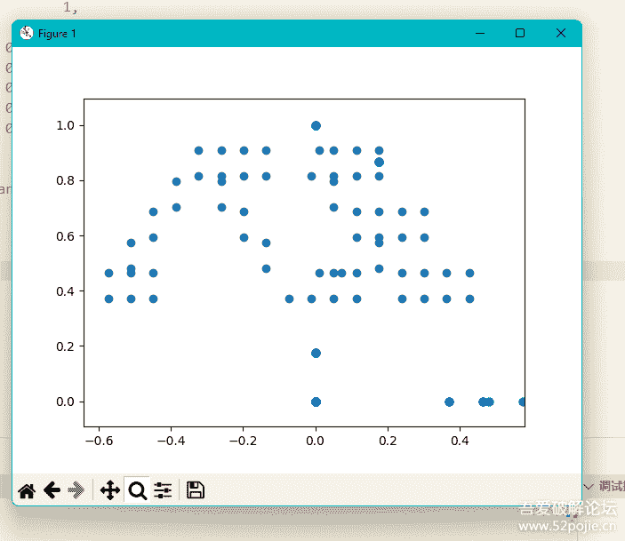

`image-20240624221254947.png` (36.06 KB, 下载次数: 2)

[href="forum.php?mod=attachment&aid=MjcxNTQyMHxmNjE4YWMwMHwxNzkzNTcxOTg5fDE2ODA4NnwxOTUyMDcy&nothumb=yes" target="_blank"](https://www.52pojie.cn/forum.php?mod=attachment&aid=MjcxNTQyMHxmNjE4YWMwMHwxNzkzNTcxOTg5fDE2ODA4NnwxOTUyMDcy&nothumb=yes)

2024-8-6 23:59 上传

确实出现了原图的形状，但是 flag 旗帜的点也嵌在其中，但是对比位置好像有点问题，而且点的数量也不够，还有一个问题就是为什么这些位置没有被实际展现出来。

## 问题分析

那我们先解决为什么没有展现出来的问题。根据之前的分析，这里的几个跳转语句可能是问题所在。这里类似一个 `switch` 语句，通过数组的索引和其中的值来决定下一步的运算，有加减和一些别的运算。有点类似虚拟机的 `opcode`。

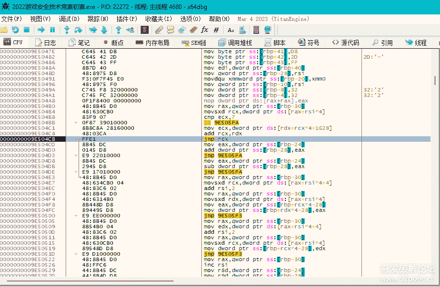

`image-20240626100831665.png` (138.48 KB, 下载次数: 2)

[href="forum.php?mod=attachment&aid=MjcxNTQyMXw2YTMyYWVkZXwxNzkzNTcxOTg5fDE2ODA4NnwxOTUyMDcy&nothumb=yes" target="_blank"](https://www.52pojie.cn/forum.php?mod=attachment&aid=MjcxNTQyMXw2YTMyYWVkZXwxNzkzNTcxOTg5fDE2ODA4NnwxOTUyMDcy&nothumb=yes)

2024-8-6 23:59 上传

这里汇编有点没分析出来啥意思，拖到 IDA 里调试看看伪代码。

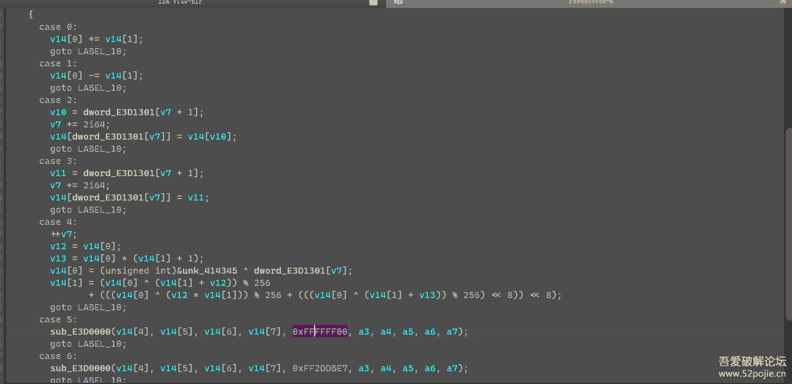

`image-20240626103148199.png` (65.39 KB, 下载次数: 2)

[href="forum.php?mod=attachment&aid=MjcxNTQyMnxhNDdhNzY2MHwxNzkzNTcxOTg5fDE2ODA4NnwxOTUyMDcy&nothumb=yes" target="_blank"](https://www.52pojie.cn/forum.php?mod=attachment&aid=MjcxNTQyMnxhNDdhNzY2MHwxNzkzNTcxOTg5fDE2ODA4NnwxOTUyMDcy&nothumb=yes)

2024-8-6 23:59 上传

`dword_E3D1301` 应该就是 `opcode` 数组，然后 `v14` 应该是指八个寄存器。然后 `case4` 有点没看像是一种加解密运算；`case5` 和 `case6` 是两个相同的函数，传参只有一个不同，`0xFFFFFF00` 和 `0xFF2DDBE7`，可能与 `rgb` 的十六进制值有关，上在线转换网站上看一下。


`image-20240626103952814.png` (10.5 KB, 下载次数: 2)

[href="forum.php?mod=attachment&aid=MjcxNTQyM3xkNTM1NmQyMHwxNzkzNTcxOTg5fDE2ODA4NnwxOTUyMDcy&nothumb=yes" target="_blank"](https://www.52pojie.cn/forum.php?mod=attachment&aid=MjcxNTQyM3xkNTM1NmQyMHwxNzkzNTcxOTg5fDE2ODA4NnwxOTUyMDcy&nothumb=yes)

2024-8-6 23:59 上传


`image-20240626104016412.png` (10.56 KB, 下载次数: 2)

[href="forum.php?mod=attachment&aid=MjcxNTQyOXxhZjZlZmVkZHwxNzkzNTcxOTg5fDE2ODA4NnwxOTUyMDcy&nothumb=yes" target="_blank"](https://www.52pojie.cn/forum.php?mod=attachment&aid=MjcxNTQyOXxhZjZlZmVkZHwxNzkzNTcxOTg5fDE2ODA4NnwxOTUyMDcy&nothumb=yes)

2024-8-6 23:59 上传

应该就是 flag 的黄色和原图的蓝色了，但是为什么同一个函数，只是颜色不同，怎么会有不显示和显示的情况呢？不清楚，`hook` 一下看一下调用的时候其他参数有什么区别。

### `hook` 代码

```cpp
// dllmain.cpp : 定义 DLL 应用程序的入口点。

#include "pch.h"

#include 

#include 

#pragma comment(lib,"detours.lib")

//addr = [140008318] - 0x650

#define QWORDADDR 0x140008318

#define OFFSET 0x650

typedef __int64 (*funptr)(int, int, int, int, int, __int64, __int64, __int64, __int64, __int64);

INT64 func;

__int64 __fastcall funcHook(

    int a1,

    int a2,

    int a3,

    int a4,

    int a5,

    __int64 a6,

    __int64 a7,

    __int64 a8,

    __int64 a9,

    __int64 a10)

{

    FILE* f = fopen("C:\\Users\\15386\\Desktop\\out.txt", "a+");

    char in[100];

    sprintf(in,"a1:0x%08x,a2:0x%08x,a3:0x%08x,a4:0x%08x,a5:0x%08x\n", a1, a2, a3, a4, a5);

    fputs(in, f);

    fclose(f);

    funptr fpt;

    fpt = (funptr)func;

    fpt(a1, a2, a3, a4, a5, a6, a7, a8, a9, a10);

    return 0;

}

void Start_Hook()

{

        DetourRestoreAfterWith();

        DetourTransactionBegin();

        DetourUpdateThread(GetCurrentThread());

        INT64 qword_addr;

    if (!ReadProcessMemory(GetCurrentProcess(), (LPCVOID*)QWORDADDR, &qword_addr, 8, NULL))

    {

        FILE* f = fopen("C:\\Users\\15386\\Desktop\\out.txt", "a+");

        fputs("error ReadProcessMemory\n", f);

        fclose(f);

        return;

    }

    func = qword_addr - OFFSET;

        DetourAttach((PVOID*)&func, funcHook);//msg

        DetourTransactionCommit();

}

void Exit_Hook()

{

        DetourTransactionBegin();

        DetourUpdateThread(GetCurrentThread());

        DetourDetach((PVOID*)&func, funcHook);

        DetourTransactionCommit();

}

BOOL APIENTRY DllMain( HMODULE hModule,

                       DWORD  ul_reason_for_call,

                       LPVOID lpReserved

                     )

{

    switch (ul_reason_for_call)

    {

    case DLL_PROCESS_ATTACH:

                Start_Hook();

                break;

    case DLL_THREAD_ATTACH:

    case DLL_THREAD_DETACH:

    case DLL_PROCESS_DETACH:

                Exit_Hook();

        break;

    }

    return TRUE;

}
```

得到前五个参数内容


```
a1:0xfffffc4a,a2:0x00000032,a3:0xff1fa3ac,a4:0x00130bd0,a5:0xffffff00
a1:0x00000032,a2:0xfffffe7a,a3:0x001bcd69,a4:0xffe8bcc5,a5:0xffffff00
a1:0xfffffc4a,a2:0x000000aa,a3:0xff8eb263,a4:0x00d91997,a5:0xffffff00
a1:0x00000032,a2:0x000000e6,a3:0x001cf400,a4:0x00e82b18,a5:0xffffff00
a1:0xfffffc4a,a2:0xffffff2e,a3:0x00391faa,a4:0x006ee5d2,a5:0xffffff00
a1:0x00000032,a2:0x0000015e,a3:0x000ebe72,a4:0x00d77de2,a5:0xffffff00
a1:0xfffffc86,a2:0xfffffef2,a3:0x00071150,a4:0x0074fb28,a5:0xffffff00
a1:0x000000aa,a2:0xfffffef2,a3:0xffda3e17,a4:0x00c42e8b,a5:0xffffff00
a1:0xfffffcfe,a2:0x000000e6,a3:0x0034cf2b,a4:0xff321ecf,a5:0xffffff00
a1:0x0000006e,a2:0xfffffe7a,a3:0xffa49c19,a4:0x00d9e5f1,a5:0xffffff00
a1:0xfffffcc2,a2:0x000000aa,a3:0xffca5ee7,a4:0x00c42d8b,a5:0xffffff00
a1:0x0000028a,a2:0x00000032,a3:0x00eabf17,a4:0x00a7e3ab,a5:0xff2ddbe7
a1:0x0000024e,a2:0x0000006e,a3:0x00c42d8b,a4:0x00cb0f37,a5:0xff2ddbe7
a1:0x00000212,a2:0x000000aa,a3:0x00d717af,a4:0x001f5b13,a5:0xff2ddbe7
a1:0x000001d6,a2:0x000000e6,a3:0x00c460e9,a4:0x00e9ad55,a5:0xff2ddbe7
a1:0x0000019a,a2:0x00000122,a3:0x00c7a989,a4:0x00b9fd35,a5:0xff2ddbe7
a1:0x000001d6,a2:0x00000122,a3:0x00ab7100,a4:0x00646cf8,a5:0xff2ddbe7
a1:0x00000212,a2:0x00000122,a3:0x00c409a9,a4:0x0031cd9d,a5:0xff2ddbe7
a1:0x000002c6,a2:0x00000032,a3:0x00d77e8b,a4:0x002f2773,a5:0xff2ddbe7
a1:0x00000302,a2:0x00000032,a3:0x00d9ad01,a4:0x00996535,a5:0xff2ddbe7
a1:0x0000033e,a2:0x00000032,a3:0x0039e156,a4:0x00da4a26,a5:0xff2ddbe7
a1:0x000002c6,a2:0x0000006e,a3:0x0013207c,a4:0x00346848,a5:0xff2ddbe7
a1:0x00000302,a2:0x000000aa,a3:0x00c9140b,a4:0x000b5fa7,a5:0xff2ddbe7
a1:0x0000033e,a2:0x000000e6,a3:0x0053071f,a4:0x00c7ab3b,a5:0xff2ddbe7
a1:0x0000037a,a2:0x00000122,a3:0x00d71106,a4:0x00d6329a,a5:0xff2ddbe7
a1:0x000003b6,a2:0x00000122,a3:0x00eb60a1,a4:0x00a58d79,a5:0xff2ddbe7
a1:0x000003f2,a2:0x00000122,a3:0x00eb67cd,a4:0x00f5e9d9,a5:0xff2ddbe7
a1:0x0000042e,a2:0x00000122,a3:0x00d71161,a4:0x000d7d31,a5:0xff2ddbe7
a1:0x000003b6,a2:0x00000032,a3:0x00677611,a4:0x00659df9,a5:0xff2ddbe7
a1:0x000003f2,a2:0x00000032,a3:0x0040173d,a4:0x00557919,a5:0xff2ddbe7
a1:0x0000042e,a2:0x00000032,a3:0x00d77661,a4:0x003d9d01,a5:0xff2ddbe7
a1:0x0000046a,a2:0x00000032,a3:0x00efff9a,a4:0x00ca2e06,a5:0xff2ddbe7
a1:0x000003f2,a2:0x0000006e,a3:0x00c404eb,a4:0x00b7178b,a5:0xff2ddbe7
a1:0x0000042e,a2:0x000000aa,a3:0x00d7c6ef,a4:0x008b6337,a5:0xff2ddbe7
a1:0x0000046a,a2:0x000000aa,a3:0x00d7701f,a4:0x00677b0b,a5:0xff2ddbe7
a1:0x000004a6,a2:0x000000aa,a3:0x00d71171,a4:0x00fd4d21,a5:0xff2ddbe7
a1:0x000004e2,a2:0x000000aa,a3:0x003906ab,a4:0x000bbf27,a5:0xff2ddbe7
a1:0x0000046a,a2:0x000000e6,a3:0x00096663,a4:0x00ef5f33,a5:0xff2ddbe7
a1:0x000004a6,a2:0x00000122,a3:0x00732157,a4:0x00835b9f,a5:0xff2ddbe7
a1:0x000004e2,a2:0x00000122,a3:0x00353730,a4:0x00383434,a5:0xff2ddbe7
a1:0x0000051e,a2:0x00000122,a3:0x006257a9,a4:0x009555e9,a5:0xff2ddbe7
a1:0x0000055a,a2:0x00000122,a3:0x00d777af,a4:0x00df5bd3,a5:0xff2ddbe7
```

可以看到蓝色调用了31次,黄色调用了11次,正好对应正方形块数,验证了猜测.

前面的四个参数在蓝色调用的时候基本都是正数,黄色调用的时候则总会出现一些负数的情况,所以可能就是在这四个参数出了问题让绘制出现了失败,在蓝色调用的前两个参数有一些相同的情况,比如说第二个参数0x00000032这个值,出现了8次,对应了一行的八个方块,0x0000006e则对应三个方块,应该就是指的y坐标,第一个参数则可能会是x坐标,知道了这个,我们就可以通过`hook`这个绘制函数通过正确传参就能实现绘制,但是正确的位置在哪呢?位置被错误的计算了,只能从虚拟机运行入手了,写个脚本跑一下运行流程

```
opcode = [0x00000002, 0x00000008, 0x00000000, 0x00000002, 0x00000000, 0x00000004, 0x00000002, 0x00000004, 0x00000000, 0x00000003, 0x000003E8, ...]

key = 0x0AD00001F

reg = [0,0,0,0,0,0,0,0,50,50]

rip = 0

while rip 
```

## 运行结果部分

```
===2 reg[0]=reg[8],reg[0]=0,reg[8]=50
===2 reg[4]=reg[0],reg[4]=0,reg[0]=50
===2 reg[0]=reg[4],reg[0]=50,reg[4]=50
===3 reg[1]=1000,reg[1]=0,reg[4]=1000
---1 reg[0]=50,reg[1]=1000,reg[0]=-950
===2 reg[4]=reg[0],reg[4]=50,reg[0]=-950
===2 reg[0]=reg[9],reg[0]=-950,reg[9]=50
===2 reg[5]=reg[0],reg[5]=0,reg[0]=50
===2 reg[0]=reg[4],reg[0]=50,reg[4]=-950
===2 reg[1]=reg[5],reg[1]=1000,reg[5]=50
decrypt reg[0]=2907850890,reg[1]=8060662
===2 reg[3]=reg[0],reg[3]=0,reg[0]=2907850890
===2 reg[0]=reg[1],reg[0]=2907850890,reg[1]=8060662
===2 reg[1]=reg[3],reg[1]=8060662,reg[3]=2907850890
===2 reg[6]=reg[0],reg[6]=0,reg[0]=8060662
===2 reg[7]=reg[1],reg[7]=0,reg[1]=2907850890
call-5 reg[4]=-950,reg[5]=50,reg[6]=8060662,reg[7]=2907850890
===2 reg[0]=reg[8],reg[0]=8060662,reg[8]=50
===2 reg[4]=reg[0],reg[4]=-950,reg[0]=50
===2 reg[0]=reg[9],reg[0]=50,reg[9]=50
===3 reg[1]=60,reg[1]=2907850890,reg[9]=60
+++0 reg[0]=50,reg[1]=60,reg[0]=110
===2 reg[5]=reg[0],reg[5]=50,reg[0]=110
===2 reg[0]=reg[5],reg[0]=110,reg[5]=110
===3 reg[1]=500,reg[1]=60,reg[5]=500
---1 reg[0]=110,reg[1]=500,reg[0]=-390
===2 reg[5]=reg[0],reg[5]=110,reg[0]=-390
===2 reg[0]=reg[4],reg[0]=-390,reg[4]=50
===2 reg[1]=reg[5],reg[1]=500,reg[5]=-390
decrypt reg[0]=2908393011,reg[1]=11790239
===2 reg[6]=reg[0],reg[6]=8060662,reg[0]=2908393011
===2 reg[7]=reg[1],reg[7]=2907850890,reg[1]=11790239
call-5 reg[4]=50,reg[5]=-390,reg[6]=2908393011,reg[7]=11790239
```

基本都是在`case1`的时候减了一个大数,然后`call`的参数就出现负数,简单的加个`if`条件,将减的那一步选择性的跳过,如果结果为负数,那么就不执行减操作,改下程序得到的参数貌似正常了,得到的“正确“参数如下:

```
reg[4]=50,reg[5]=50,reg[6]=10637038,reg[7]=2907850890

reg[4]=50,reg[5]=110,reg[6]=2908393011,reg[7]=3100563

reg[4]=50,reg[5]=170,reg[6]=14547217,reg[7]=2912443085

reg[4]=50,reg[5]=230,reg[6]=4632154,reg[7]=2913560642

reg[4]=50,reg[5]=290,reg[6]=2910346480,reg[7]=545956

reg[4]=50,reg[5]=350,reg[6]=5563432,reg[7]=2912304824

reg[4]=110,reg[5]=230,reg[6]=2907066890,reg[7]=2285150

reg[4]=170,reg[5]=230,reg[6]=10317121,reg[7]=2911202769

reg[4]=230,reg[5]=230,reg[6]=2910162033,reg[7]=120253

reg[4]=110,reg[5]=110,reg[6]=9170807,reg[7]=2912462507

reg[4]=170,reg[5]=170,reg[6]=15283589,reg[7]=2911203025
```

尝试`hook`绘制函数传入这些参数进行绘制看看结果,试了很久一直没有显示,连原图的都不显示了,最后对照了一下第三个和第四个参数发现和之前`hook`来的参数不同,应该是计算的时候`C`有溢出但是`python`没有,重新用`C`写一遍模拟虚拟机运行的脚本运行得到第三个参数和第四个参数数组

```
    int reg6[11] = { 0xf814b4,0x1bcd69,0x87a34b,0x1cf400,0x391faa,0xebe72,0x71150,0xc7371b,0x34cf2b,0xd1b52d,0xb36fdf};
    int reg7[11] = { 0x130bd0,0x7515c9,0xd91997,0xe82b18,0x520efe,0xd77de2,0x788404,0xc42e8b,0x5b8fe7,0xd9e5f1,0xc42d8b };
```

## 注入测试

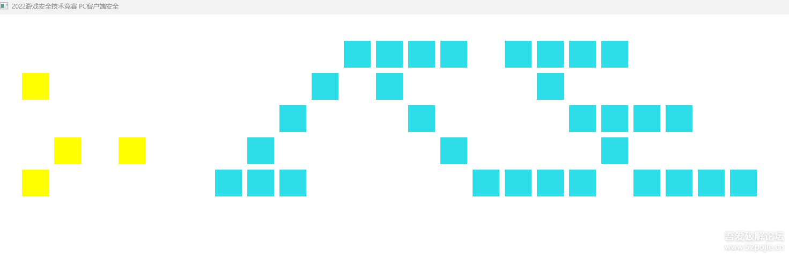

image-20240626145848145.png (13.02 KB, 下载次数: 2)

[href="forum.php?mod=attachment&aid=MjcxNTQyNXxkM2MzMDYxYXwxNzkzNTcxOTg5fDE2ODA4NnwxOTUyMDcy&nothumb=yes" target="_blank"](https://www.52pojie.cn/forum.php?mod=attachment&aid=MjcxNTQyNXxkM2MzMDYxYXwxNzkzNTcxOTg5fDE2ODA4NnwxOTUyMDcy&nothumb=yes)

2024-8-6 23:59 上传

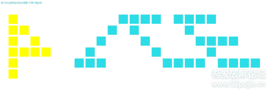

image-20240626150321144.png (12.1 KB, 下载次数: 2)

[href="forum.php?mod=attachment&aid=MjcxNTQyNnxlNzM0MjMxNHwxNzkzNTcxOTg5fDE2ODA4NnwxOTUyMDcy&nothumb=yes" target="_blank"](https://www.52pojie.cn/forum.php?mod=attachment&aid=MjcxNTQyNnxlNzM0MjMxNHwxNzkzNTcxOTg5fDE2ODA4NnwxOTUyMDcy&nothumb=yes)

2024-8-6 23:59 上传

只显示了四个方块,嘶,怎么会少了7块呢,根据前两个参数的大概位置分析在第2,5,7,9次黄色函数调用处,对比一下他们的虚拟机运行情况

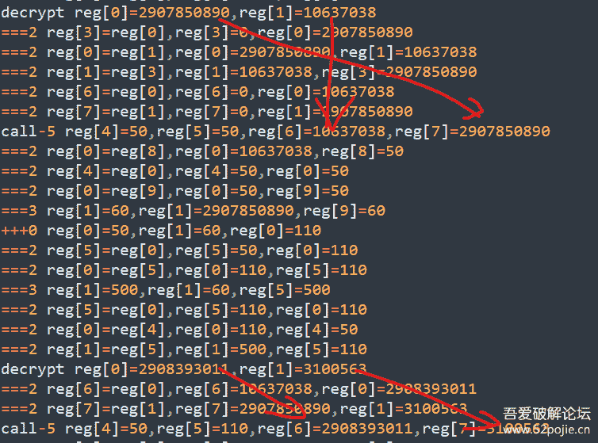

image-20240626150951503.png (176.43 KB, 下载次数: 2)

[href="forum.php?mod=attachment&aid=MjcxNTQyN3xmZDExMDRhYXwxNzkzNTcxOTg5fDE2ODA4NnwxOTUyMDcy&nothumb=yes" target="_blank"](https://www.52pojie.cn/forum.php?mod=attachment&aid=MjcxNTQyN3xmZDExMDRhYXwxNzkzNTcxOTg5fDE2ODA4NnwxOTUyMDcy&nothumb=yes)

2024-8-6 23:59 上传

在这里看到了有些`call`调用的前将第三个和第四个参数分别调换了位置,刚好2,5,7,9没有调换!!!

所以根据这个再把错误的参数位置调换一下进行注入测试

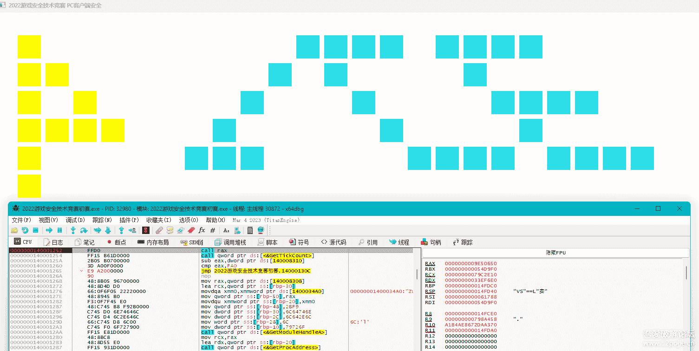

image-20240626151806428.png (112.21 KB, 下载次数: 2)

[href="forum.php?mod=attachment&aid=MjcxNTQyOHxjNmExZTgyYXwxNzkzNTcxOTg5fDE2ODA4NnwxOTUyMDcy&nothumb=yes" target="_blank"](https://www.52pojie.cn/forum.php?mod=attachment&aid=MjcxNTQyOHxjNmExZTgyYXwxNzkzNTcxOTg5fDE2ODA4NnwxOTUyMDcy&nothumb=yes)

2024-8-6 23:59 上传

成功绘制出flag！！！

## DLL代码

```
// dllmain.cpp : 定义 DLL 应用程序的入口点。

#include "pch.h"

#include 

#include 

DWORD64 HOOKADDR1 = (long long)GetModuleHandleA("2022游戏安全技术竞赛初赛.exe") + 0X11E4; // MEMCPY函数

DWORD64 HOOKADDR2 = 0;

DWORD64 SHEELCODE = 0X0000001400027E2;
```


```c
DWORD64 SHEELCODE2 = 0X0000001400027C9;
BYTE oldByte[12];

typedef void (*myMemecpy)(void* dest, const void* src, size_t n);
typedef __int64 (*funptr)(int, int, int, int, int, __int64, __int64, __int64, __int64, __int64);

//HOOK绘制函数修改传参
__int64 __fastcall drawHook(
    int a1,
    int a2,
    int a3,
    int a4,
    int a5,
    __int64 a6,
    __int64 a7,
    __int64 a8,
    __int64 a9,
    __int64 a10)
{
    int reg4[11] = { 50,50,50,50,50,50,110,170,230,110,170 };
    int reg5[11] = { 50,110,170,230,290,350,230,230,230,110,170 };
    int reg6[11] = { 0xf814b4,0x1bcd69,0x87a34b,0x1cf400,0x391faa,0xebe72,0x71150,0xc7371b,0x34cf2b,0xd1b52d,0xb36fdf };
    int reg7[11] = { 0x130bd0,0x7515c9,0xd91997,0xe82b18,0x520efe,0xd77de2,0x788404,0xc42e8b,0x5b8fe7,0xd9e5f1,0xc42d8b };

    for (int i = 0; i
```
