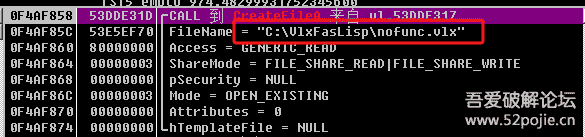
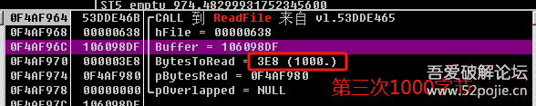
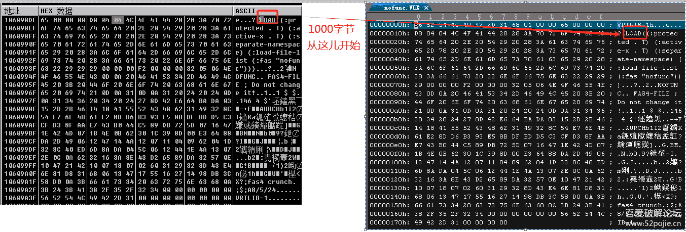
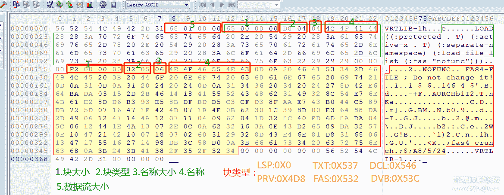

# [原创] VLX在CAD中内存中查看

- 原帖: https://www.52pojie.cn/forum.php?mod=viewthread&tid=1952119
- 抓取时间: 2026-11-01T22:26:29

## 方法如下

1. 运行`AutoCAD2007`，打开`od`，附加`acad.exe`进程或都直接打开`OD`，运行`AutoCAD`
2. 设置文件断点`bp CreateFileA`,`bp ReadFile`,按`F9`让`CAD`正常运行，
3. （`load "***.vlx"`）加载`***.vlx`,
4. 运行到`CreateFileA`断点停下，

微信图片_20240807084818.png (11.06 KB, 下载次数: 1)

[href="forum.php?mod=attachment&aid=MjcxNTQ3MnwzMGFhNzRiZHwxNzkzNTcxOTg3fDE2ODA4NnwxOTUyMTE5&nothumb=yes" target="_blank"](https://www.52pojie.cn/forum.php?mod=attachment&aid=MjcxNTQ3MnwzMGFhNzRiZHwxNzkzNTcxOTg3fDE2ODA4NnwxOTUyMTE5&nothumb=yes)

createFile

2024-8-7 09:07 上传

5. 第一次`F9`，停在`readfile`断点，是读取4个字节到缓冲区。
6. 第二次`F9`，停在`readfile`断点，是读取12个字节到缓冲区。

微信图片_20240807085643.png (10.65 KB, 下载次数: 1)

[href="forum.php?mod=attachment&aid=MjcxNTQ2OHxiMTc0MGI1MHwxNzkzNTcxOTg3fDE2ODA4NnwxOTUyMTE5&nothumb=yes" target="_blank"](https://www.52pojie.cn/forum.php?mod=attachment&aid=MjcxNTQ2OHxiMTc0MGI1MHwxNzkzNTcxOTg3fDE2ODA4NnwxOTUyMTE5&nothumb=yes)

12字节readFile

2024-8-7 09:04 上传

微信图片_20240807085721.png (4.65 KB, 下载次数: 1)

[href="forum.php?mod=attachment&aid=MjcxNTQ2OXw3ZTQxYzgzOHwxNzkzNTcxOTg3fDE2ODA4NnwxOTUyMTE5&nothumb=yes" target="_blank"](https://www.52pojie.cn/forum.php?mod=attachment&aid=MjcxNTQ2OXw3ZTQxYzgzOHwxNzkzNTcxOTg3fDE2ODA4NnwxOTUyMTE5&nothumb=yes)

12字节readFile值

2024-8-7 09:04 上传

7. 第三次`F9`，停在`readfile`断点，是读取1000个字节到缓冲区。

微信图片_20240807085906.png (12.13 KB, 下载次数: 1)

[href="forum.php?mod=attachment&aid=MjcxNTQ3MHxmYWQxMGQ3YnwxNzkzNTcxOTg3fDE2ODA4NnwxOTUyMTE5&nothumb=yes" target="_blank"](https://www.52pojie.cn/forum.php?mod=attachment&aid=MjcxNTQ3MHxmYWQxMGQ3YnwxNzkzNTcxOTg3fDE2ODA4NnwxOTUyMTE5&nothumb=yes)

1000字节readFile

2024-8-7 09:05 上传

微信图片_20240807090246.png (61.08 KB, 下载次数: 1)

[href="forum.php?mod=attachment&aid=MjcxNTQ3MXwyZWNlZjUxM3wxNzkzNTcxOTg3fDE2ODA4NnwxOTUyMTE5&nothumb=yes" target="_blank"](https://www.52pojie.cn/forum.php?mod=attachment&aid=MjcxNTQ3MXwyZWNlZjUxM3wxNzkzNTcxOTg3fDE2ODA4NnwxOTUyMTE5&nothumb=yes)

1000字节readFile值

2024-8-7 09:05 上传

## VLX格式解析

### A
先用一张图展示一下，有不明白的，欢迎交流。

微信图片_20240807101935.png (111.08 KB, 下载次数: 1)

[href="forum.php?mod=attachment&aid=MjcxOTg4Mnw2YjBiM2YzZXwxNzkzNTcxOTg3fDE2ODA4NnwxOTUyMTE5&nothumb=yes" target="_blank"](https://www.52pojie.cn/forum.php?mod=attachment&aid=MjcxOTg4Mnw2YjBiM2YzZXwxNzkzNTcxOTg3fDE2ODA4NnwxOTUyMTE5&nothumb=yes)

2024-8-26 08:57 上传

### B
我们先看一下第五步：5.第一次`F9`，停在`readfile`断点，是读取4个字节到缓冲区。如果你跟踪过内存，发现读取的是 00 00 00 00

如果想了解他的读取过程，在

在此步之前，增加 `bp setFilePointer` ,就发现`CAD`在`createFile`与`readFile`之间，new了一个`ifream`，读取了8-A步中图示的【5】，数据流大小，把文件指针移到了数据流未尾。

在读取四个空字符之后，再读取12个字节，验证`VRTLIB-1..`从而确定`VLX`的文件格式是否正确。
