# [Web逆向] 某灵考核题-瑞数，部分环境分析

- 原帖：[https://www.52pojie.cn/forum.php?mod=viewthread&tid=1952790](https://www.52pojie.cn/forum.php?mod=viewthread&tid=1952790)
- 抓取时间：2026-11-01T22:26:25

本文仅用于学习研究，请勿用于非法用途和商业用途！如因此产生任何法律纠纷，均与作者无关！如有问题，麻烦版主立即删除。

目标地址是 `'aHR0cHM6Ly9xaWthbi5jcXZpcC5jb20vUWlrYW4vSm91cm5hbC9Kb3VybmFsR3VpZD9mcm9tPWluZGV4'`，管它是 rs 4 5 6 直接分析就对了，不要觉得很难。

但是我用 Edge 浏览器没有发现 `debugger`？

## 特征和流程分析

### 1. 特征

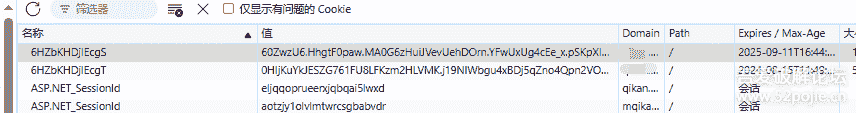

QQ图片20240808195313.png (27.7 KB, 下载次数: 1)

[下载附件](https://www.52pojie.cn/forum.php?mod=attachment&aid=MjcxNTg5N3wxYmJhYTlkYnwxNzkzNTcxOTgzfDE2ODA4NnwxOTUyNzkw&nothumb=yes)

特征1

2024-8-8 19:53 上传

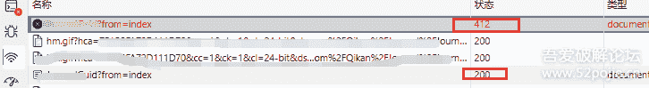

特征2.png (20.2 KB, 下载次数: 0)

[下载附件](https://www.52pojie.cn/forum.php?mod=attachment&aid=MjcxNTg5OHw3ZDg3NjdhMnwxNzkzNTcxOTgzfDE2ODA4NnwxOTUyNzkw&nothumb=yes)

2024-8-8 19:55 上传

- `6HZbKHDjIEcgS` 服务返回的 412
- `6HZbKHDjIEcgT` JS 生成的，第一个参数就是代数 200
- `6HZbKHDjIEcgT` 这个在浏览器看到的长度是用了一个加长方法，`window.ActiveXObject = null`；这个 cookie 加长的方法不影响长度

### 2. 流程分析

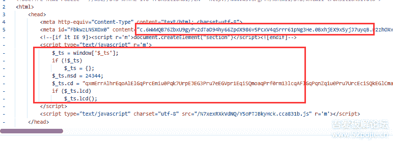

流程分析1.png (39.62 KB, 下载次数: 2)

[下载附件](https://www.52pojie.cn/forum.php?mod=attachment&aid=MjcxNTg5OXwxMGM5MDQxOHwxNzkzNTcxOTgzfDE2ODA4NnwxOTUyNzkw&nothumb=yes)

流程分析1

2024-8-8 20:03 上传

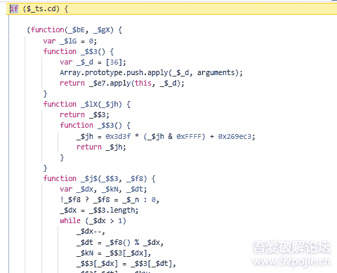

流程分析2.png (34.59 KB, 下载次数: 1)

[下载附件](https://www.52pojie.cn/forum.php?mod=attachment&aid=MjcxNTkwMHw5YmM3YTg0MXwxNzkzNTcxOTgzfDE2ODA4NnwxOTUyNzkw&nothumb=yes)

流程分析2

2024-8-8 20:06 上传

第一次请求会得到一个 HTML 页面，加载 `meta` 标签里面会有一个 `content`（动态加载的，需要写活）。

`if ($_ts.cd) {` 这个就是外链 JS（固定好基本不会变），直接搜 `call` 就会找到。

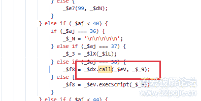

流程分析3.png (18.71 KB, 下载次数: 1)

[下载附件](https://www.52pojie.cn/forum.php?mod=attachment&aid=MjcxNTkwMnxhYWMxNTgxMHwxNzkzNTcxOTgzfDE2ODA4NnwxOTUyNzkw&nothumb=yes)

流程分析3

2024-8-8 20:10 上传

这个 `call` 里面就是生成 cookie 的地方了，调试的时候记得把首页的 HTML 文件替换保存到本地。

开搞，我就用补环境的方法了。

还是老三样 `ts` + `content` + 自执行方法。

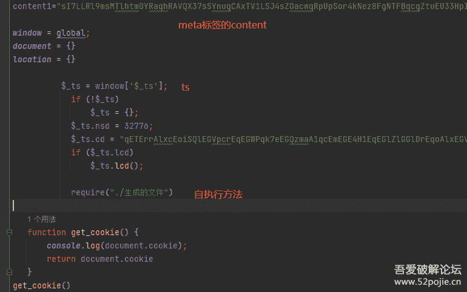

rs补环境1.png (56.64 KB, 下载次数: 0)

[下载附件](https://www.52pojie.cn/forum.php?mod=attachment&aid=MjcxNTkyMnxhZDM4ZjNhMHwxNzkzNTcxOTgzfDE2ODA4NnwxOTUyNzkw&nothumb=yes)

补环境1

2024-8-8 20:23 上传

运行一次发现报错是没有 `location`，直接去浏览器拿。

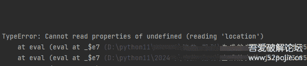

rs补环境2报错.png (21.19 KB, 下载次数: 2)

[下载附件](https://www.52pojie.cn/forum.php?mod=attachment&aid=MjcxNTkyNHxjODA2NWVhN3wxNzkzNTcxOTgzfDE2ODA4NnwxOTUyNzkw&nothumb=yes)

报错1

2024-8-8 20:26 上传

拿完之后发现还是这个错误，这个是时候就要上代{过}{滤}理了，网上一搜一大把。

上完代{过}{滤}理发现是缺少 `window.top`，再运行。

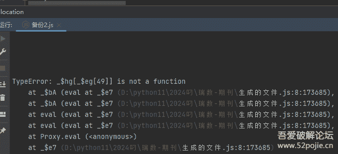

补环境3.png (48.02 KB, 下载次数: 2)

[下载附件](https://www.52pojie.cn/forum.php?mod=attachment&aid=MjcxNTkzNXwyNWEwMWNiOHwxNzkzNTcxOTgzfDE2ODA4NnwxOTUyNzkw&nothumb=yes)

补环境3

2024-8-8 20:39 上传

`_$hg[_$eg[49]] is not a function` 没有这个方法。从自执行方法的 `call` 进去 `vm` 文件里面搜下断点，有很多这个方法，都下好断点。

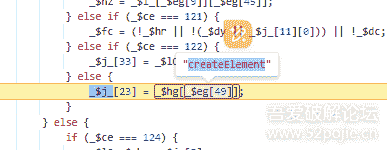

补环境4.png (19.2 KB, 下载次数: 1)

[下载附件](https://www.52pojie.cn/forum.php?mod=attachment&aid=MjcxNTkzN3xiZjBkYTI3NHwxNzkzNTcxOTgzfDE2ODA4NnwxOTUyNzkw&nothumb=yes)

补环境4

2024-8-8 20:43 上传

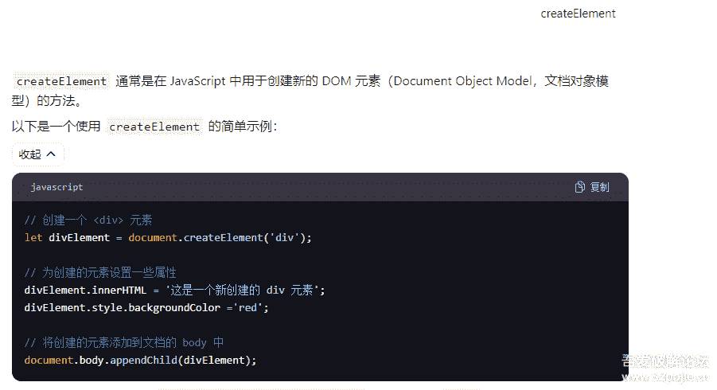

创建标签1.png (38.31 KB, 下载次数: 1)

[下载附件](https://www.52pojie.cn/forum.php?mod=attachment&aid=MjcxNTkzOHw3MDU3ZWFjY3wxNzkzNTcxOTgzfDE2ODA4NnwxOTUyNzkw&nothumb=yes)

创建标签1

2024-8-8 20:46 上传

`createElement` 创建一个 `div` 和 `i`，里面 `length` 是 0，到这里还是和 rs 的其他版本一样。

还是一样，下面的流程就不多说了。

下面重点来了。

在取标签的时候没有像其他版本一样在 `getElementsByTagName` 取 `meta` 标签。

在刚开始补的时候我是直接复制以前的代码，结果出现以下效果。

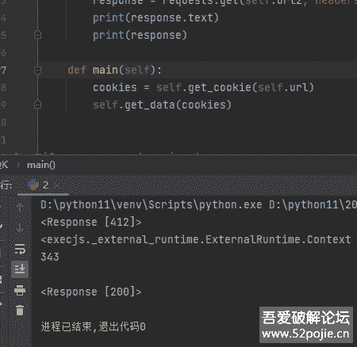

meta.png (12.91 KB, 下载次数: 1)

[下载附件](https://www.52pojie.cn/forum.php?mod=attachment&aid=MjcxNTk0N3xkNWYzNTNkZHwxNzkzNTcxOTgzfDE2ODA4NnwxOTUyNzkw&nothumb=yes)

meta

2024-8-8 21:33 上传

看了好多帖子发现没有一点头绪，我咨询过大佬，说是类似于蜜罐这样的东西。

过了几天之后再重新补环境发现。

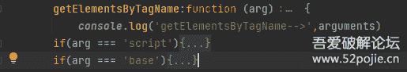

没有meta.png (21.54 KB, 下载次数: 2)

[下载附件](https://www.52pojie.cn/forum.php?mod=attachment&aid=MjcxNTk1MXxmMzRiNjdmMnwxNzkzNTcxOTgzfDE2ODA4NnwxOTUyNzkw&nothumb=yes)

没有meta

2024-8-8 21:36 上传

以下是另外的 rs 产品补的。

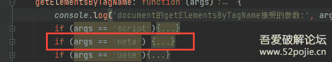

有meta.png (23.89 KB, 下载次数: 0)

[下载附件](https://www.52pojie.cn/forum.php?mod=attachment&aid=MjcxNTk1NnwyYTZlNjcwOXwxNzkzNTcxOTgzfDE2ODA4NnwxOTUyNzkw&nothumb=yes)

有meta

2024-8-8 21:37 上传

那么这个版本的 rs 的 `meta` 藏在哪里呢，(一包辣条我告诉你！

)

---

在这里！！！哈哈。

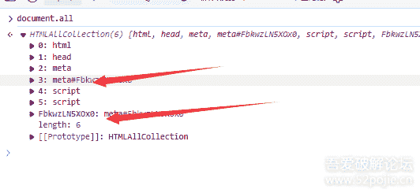

all1.png (22.15 KB, 下载次数: 2)

[下载附件](https://www.52pojie.cn/forum.php?mod=attachment&aid=MjcxNTk1N3xlMDgxYjA0MHwxNzkzNTcxOTgzfDE2ODA4NnwxOTUyNzkw&nothumb=yes)

all

2024-8-8 21:41 上传

最后上结果。

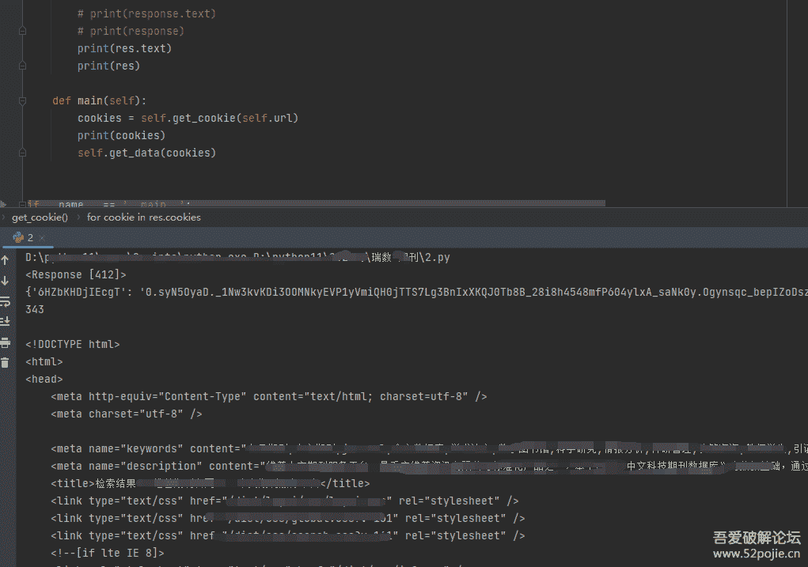

最后结果.png (86.29 KB, 下载次数: 0)

[下载附件](https://www.52pojie.cn/forum.php?mod=attachment&aid=MjcxNTk1OHw3ZDAyMWNkOXwxNzkzNTcxOTgzfDE2ODA4NnwxOTUyNzkw&nothumb=yes)

最后结果

2024-8-8 21:45 上传

以上只是个人理解，有错误的地方，请大佬帮我纠正。
