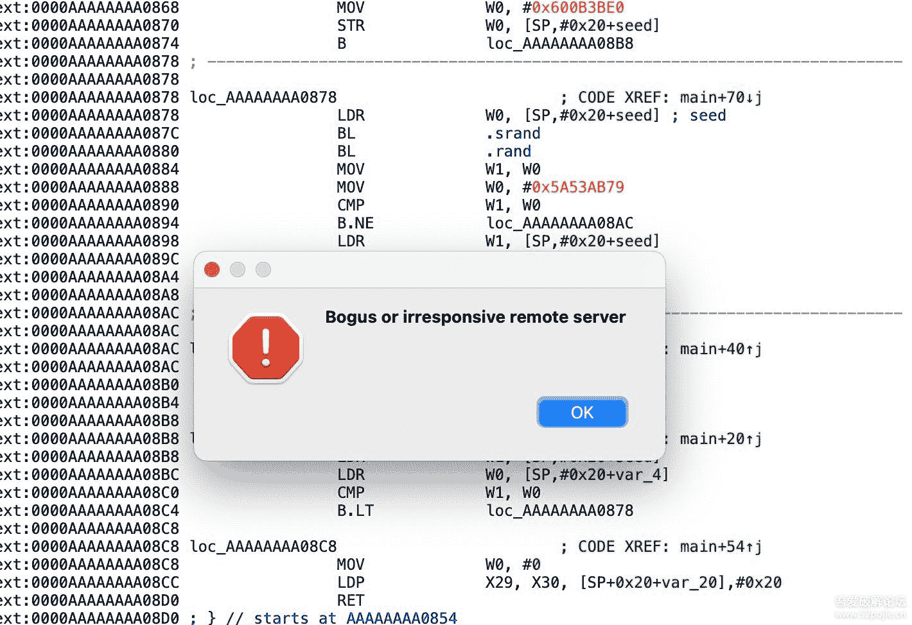
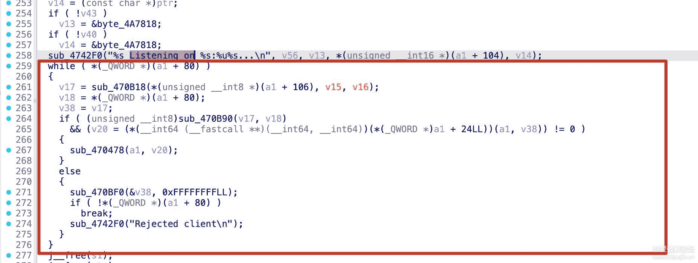
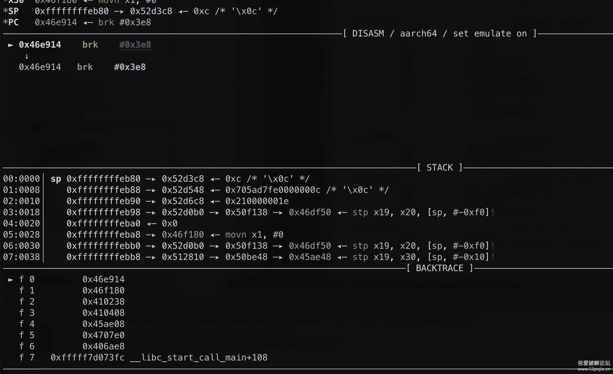
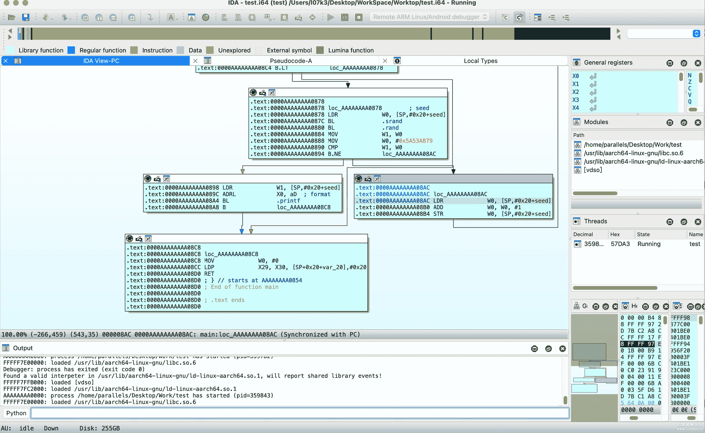

# [原创] `IDA pro 9.0 armlinux_server64` 修复

- 原帖: https://www.52pojie.cn/forum.php?mod=viewthread&tid=1953431
- 抓取时间: 2026-11-01T22:26:19

直接使用 `ida pro 9.0 armlinux_server64` 调试程序会报错：

`Xnip2024-08-11_10-56-57.jpg` (259.25 KB, 下载次数: 2)

[href="forum.php?mod=attachment&aid=MjcxNjUwNHw1ZTU0Y2FkZnwxNzkzNTcxOTc3fDE2ODA4NnwxOTUzNDMx&nothumb=yes" target="_blank"](https://www.52pojie.cn/forum.php?mod=attachment&aid=MjcxNjUwNHw1ZTU0Y2FkZnwxNzkzNTcxOTc3fDE2ODA4NnwxOTUzNDMx&nothumb=yes)

2024-8-11 10:58 上传

`Xnip2024-08-11_11-01-53.jpg` (56.36 KB, 下载次数: 3)

[href="forum.php?mod=attachment&aid=MjcxNjUxM3xmMWU5ZmI5NHwxNzkzNTcxOTc3fDE2ODA4NnwxOTUzNDMx&nothumb=yes" target="_blank"](https://www.52pojie.cn/forum.php?mod=attachment&aid=MjcxNjUxM3xmMWU5ZmI5NHwxNzkzNTcxOTc3fDE2ODA4NnwxOTUzNDMx&nothumb=yes)

2024-8-11 11:02 上传

根据字符串定位到连接函数

`Xnip2024-08-11_11-02-27.jpg` (145.22 KB, 下载次数: 3)

[href="forum.php?mod=attachment&aid=MjcxNjUxNHw0ODg0YmVlY3wxNzkzNTcxOTc3fDE2ODA4NnwxOTUzNDMx&nothumb=yes" target="_blank"](https://www.52pojie.cn/forum.php?mod=attachment&aid=MjcxNjUxNHw0ODg0YmVlY3wxNzkzNTcxOTc3fDE2ODA4NnwxOTUzNDMx&nothumb=yes)

2024-8-11 11:02 上传

在地址 `0x470748` 处打断点跟进

`Xnip2024-08-11_11-04-47.jpg` (235.56 KB, 下载次数: 3)

[href="forum.php?mod=attachment&aid=MjcxNjUxNnxiZjlkMmRlMHwxNzkzNTcxOTc3fDE2ODA4NnwxOTUzNDMx&nothumb=yes" target="_blank"](https://www.52pojie.cn/forum.php?mod=attachment&aid=MjcxNjUxNnxiZjlkMmRlMHwxNzkzNTcxOTc3fDE2ODA4NnwxOTUzNDMx&nothumb=yes)

2024-8-11 11:04 上传

根据栈回溯找到被杀掉的地方，可以看到如果程序被调试会执行 `brk` 指令，如果不被调试就会报 `30016` 的错误

`Xnip2024-08-11_11-05-42.jpg` (46.46 KB, 下载次数: 3)

[href="forum.php?mod=attachment&aid=MjcxNjUxN3w4YWRhZGMzOXwxNzkzNTcxOTc3fDE2ODA4NnwxOTUzNDMx&nothumb=yes" target="_blank"](https://www.52pojie.cn/forum.php?mod=attachment&aid=MjcxNjUxN3w4YWRhZGMzOXwxNzkzNTcxOTc3fDE2ODA4NnwxOTUzNDMx&nothumb=yes)

2024-8-11 11:05 上传

直接将 `0x46E8EC` 处的跳转改为 `NOP`

`Xnip2024-08-11_11-08-31.jpg` (86.48 KB, 下载次数: 1)

[href="forum.php?mod=attachment&aid=MjcxNjUyM3w1YTRhYTcyOXwxNzkzNTcxOTc3fDE2ODA4NnwxOTUzNDMx&nothumb=yes" target="_blank"](https://www.52pojie.cn/forum.php?mod=attachment&aid=MjcxNjUyM3w1YTRhYTcyOXwxNzkzNTcxOTc3fDE2ODA4NnwxOTUzNDMx&nothumb=yes)

2024-8-11 11:08 上传

保存到源文件后再次测试，成功启动调试进程。

`Xnip2024-08-11_11-10-00.jpg` (747.59 KB, 下载次数: 2)

[href="forum.php?mod=attachment&aid=MjcxNjUyNHw2NWI1YTg1NnwxNzkzNTcxOTc3fDE2ODA4NnwxOTUzNDMx&nothumb=yes" target="_blank"](https://www.52pojie.cn/forum.php?mod=attachment&aid=MjcxNjUyNHw2NWI1YTg1NnwxNzkzNTcxOTc3fDE2ODA4NnwxOTUzNDMx&nothumb=yes)

2024-8-11 11:09 上传
