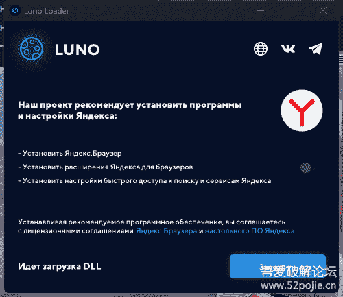
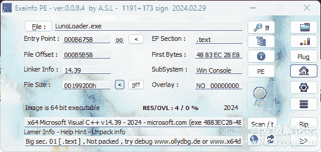
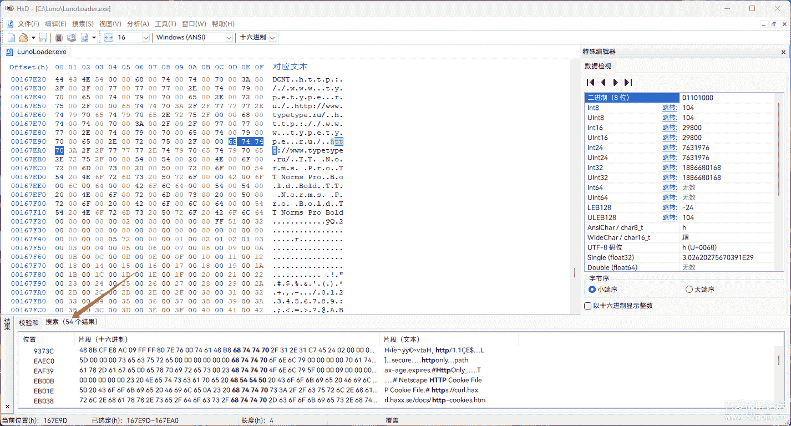
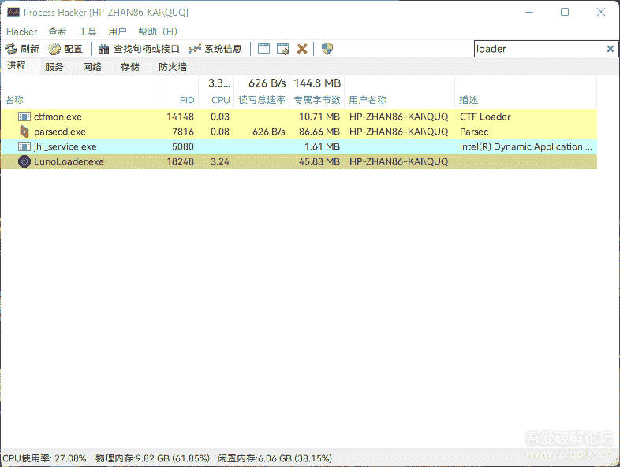
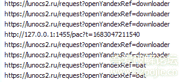
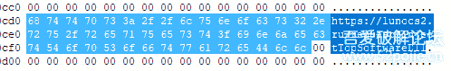
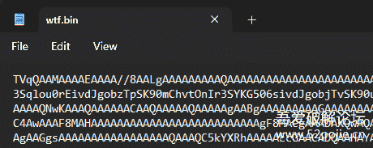
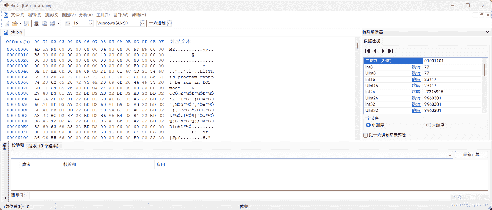
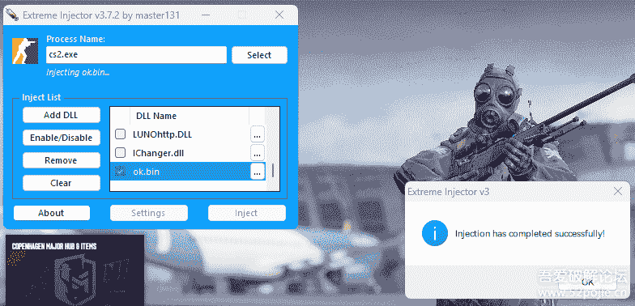
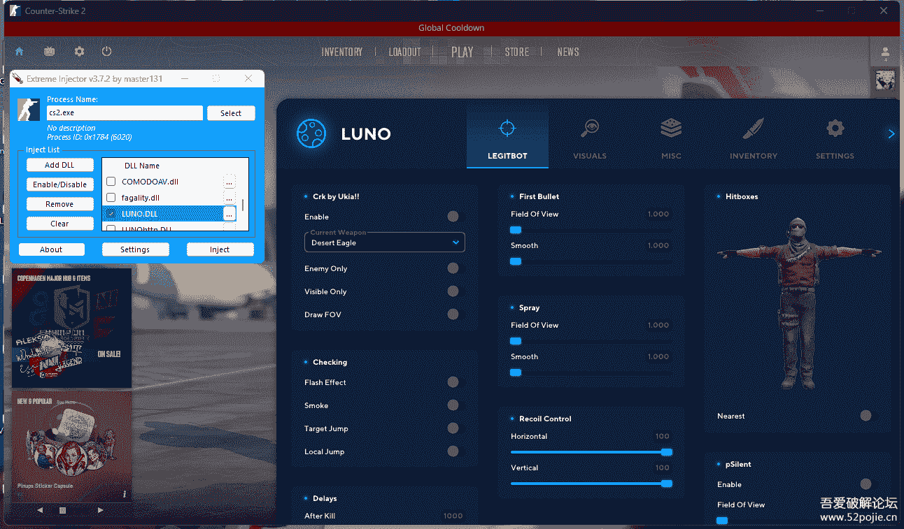

# [原创] 利用`ProcessHacker`轻松获取某软件`http`请求，从而提取`Dll`数据包

- 原帖: https://www.52pojie.cn/forum.php?mod=viewthread&tid=1953835
- 抓取时间: 2026-11-01T22:26:17

新人第一次发帖，望各位大佬不吝赐教

目标软件是一款俄罗斯游戏作弊软件
他的启动界面全是俄文，如果有小伙伴不注意，就会捆绑下载Yandex浏览器
虽然没有病毒的顾虑，但是这种流氓捆绑行为也确实让人感到困扰

`51a1b9fc3f62c6a3ce30d3755fc7fc97.png` (79.77 KB, 下载次数: 0)

[href="forum.php?mod=attachment&aid=MjcxNjc3MHxmMjNkYTlkNXwxNzkzNTcxOTc1fDE2ODA4NnwxOTUzODM1&nothumb=yes" target="_blank"](https://www.52pojie.cn/forum.php?mod=attachment&aid=MjcxNjc3MHxmMjNkYTlkNXwxNzkzNTcxOTc1fDE2ODA4NnwxOTUzODM1&nothumb=yes)

界面完全是俄文

2024-8-12 17:03 上传

软件加载的原理，是从服务器上获取`Dll`文件的数据，再将其注入到游戏进程中
因为我的汇编知识基本为0，所以无论是通过逆向加载器本身还是从游戏进程中转储`dll`文件，对我来说难度都过大了

`982372f2213be1f879db792cdbeedda5.png` (52.59 KB, 下载次数: 0)

[href="forum.php?mod=attachment&aid=MjcxNjc3MnxlNmUwMTAxNXwxNzkzNTcxOTc1fDE2ODA4NnwxOTUzODM1&nothumb=yes" target="_blank"](https://www.52pojie.cn/forum.php?mod=attachment&aid=MjcxNjc3MnxlNmUwMTAxNXwxNzkzNTcxOTc1fDE2ODA4NnwxOTUzODM1&nothumb=yes)

无需手动更新`exe`

2024-8-12 17:15 上传

该软件标榜无需更新加载器，能够自行获取最新的`Dll`，说明`Dll`数据是从服务器获取

想到此类软件通常通过捆绑下载的方式从软件厂商处获得盈利，利润微薄通常对服务器开销较为敏感，因此极有可能使用`http`请求的方式获取`Dll`数据

`74448ed1c10d5c2224dbd55495f2fd92.png` (107.88 KB, 下载次数: 0)

[href="forum.php?mod=attachment&aid=MjcxNjc3MXxmNzJhM2IwMHwxNzkzNTcxOTc1fDE2ODA4NnwxOTUzODM1&nothumb=yes" target="_blank"](https://www.52pojie.cn/forum.php?mod=attachment&aid=MjcxNjc3MXxmNzJhM2IwMHwxNzkzNTcxOTc1fDE2ODA4NnwxOTUzODM1&nothumb=yes)

软件没有加壳

2024-8-12 17:10 上传

将加载器拖入`exeinfope`，发现没有加壳，那么起步就很轻松了

`6772dd71b7ad3e25b63bd91805714865.png` (172.36 KB, 下载次数: 0)

[href="forum.php?mod=attachment&aid=MjcxNjc3M3xlMTIwYWIxOHwxNzkzNTcxOTc1fDE2ODA4NnwxOTUzODM1&nothumb=yes" target="_blank"](https://www.52pojie.cn/forum.php?mod=attachment&aid=MjcxNjc3M3xlMTIwYWIxOHwxNzkzNTcxOTc1fDE2ODA4NnwxOTUzODM1&nothumb=yes)

尝试在`Hxd`中搜索`http`

2024-8-12 17:17 上传

尝试将加载器拖入`HxD`中，搜索“`http`”字样，出现五十多条结果，但是显然都不是我们想要的

于是运行加载器，并使用`ProcessHacker`查找其内存

`e2774ec57784493f3c15e793e664966c.png` (55.64 KB, 下载次数: 1)

[href="forum.php?mod=attachment&aid=MjcxNjc3NHxhOTIyMzgzN3wxNzkzNTcxOTc1fDE2ODA4NnwxOTUzODM1&nothumb=yes" target="_blank"](https://www.52pojie.cn/forum.php?mod=attachment&aid=MjcxNjc3NHxhOTIyMzgzN3wxNzkzNTcxOTc1fDE2ODA4NnwxOTUzODM1&nothumb=yes)

使用`ProcessHacker`

2024-8-12 17:19 上传

`ae7a29ca064ff030b1431f033a683d54.png` (13.02 KB, 下载次数: 0)

[href="forum.php?mod=attachment&aid=MjcxNjc3NXxjZjBjNzU2OXwxNzkzNTcxOTc1fDE2ODA4NnwxOTUzODM1&nothumb=yes" target="_blank"](https://www.52pojie.cn/forum.php?mod=attachment&aid=MjcxNjc3NXxjZjBjNzU2OXwxNzkzNTcxOTc1fDE2ODA4NnwxOTUzODM1&nothumb=yes)

查找其内存中`http`字样

2024-8-12 17:19 上传

查找“`http`”字样，发现了捆绑下载yandex浏览器的`http`请求地址，但没有发现获取`Dll`数据的请求地址

于是点击加载，等待其界面出现"idet zagruzka dll"字样后使用`ProcessHacker`将加载器进程暂停，再次查找内存

`51a1b9fc3f62c6a3ce30d3755fc7fc97.png` (79.77 KB, 下载次数: 0)

[href="forum.php?mod=attachment&aid=MjcxNjc3N3w2MDdiN2JmYnwxNzkzNTcxOTc1fDE2ODA4NnwxOTUzODM1&nothumb=yes" target="_blank"](https://www.52pojie.cn/forum.php?mod=attachment&aid=MjcxNjc3N3w2MDdiN2JmYnwxNzkzNTcxOTc1fDE2ODA4NnwxOTUzODM1&nothumb=yes)

开始获取`dll`

2024-8-12 17:22 上传

`101b7ac7c995cf8911a8a79a293e5891.png` (13.99 KB, 下载次数: 0)

[href="forum.php?mod=attachment&aid=MjcxNjc3OXxlYWFiZWQxMHwxNzkzNTcxOTc1fDE2ODA4NnwxOTUzODM1&nothumb=yes" target="_blank"](https://www.52pojie.cn/forum.php?mod=attachment&aid=MjcxNjc3OXxlYWFiZWQxMHwxNzkzNTcxOTc1fDE2ODA4NnwxOTUzODM1&nothumb=yes)

发现`http`请求地址

2024-8-12 17:26 上传

不出意外，顺利地获取到了获取`Dll`数据的`http`请求地址

将地址复制进浏览器，发现如下数据

`df5995f5e951ed3e3929774422f9a4ab.png` (18.2 KB, 下载次数: 0)

[href="forum.php?mod=attachment&aid=MjcxNjc4MHxjN2ZhZDVkZXwxNzkzNTcxOTc1fDE2ODA4NnwxOTUzODM1&nothumb=yes" target="_blank"](https://www.52pojie.cn/forum.php?mod=attachment&aid=MjcxNjc4MHxjN2ZhZDVkZXwxNzkzNTcxOTc1fDE2ODA4NnwxOTUzODM1&nothumb=yes)

2024-8-12 17:28 上传

数据中不存在乱码，推测是通过`Base64`加密，将开头一小段复制进在线工具中进行解密

`47be8e641f469d2996dba397381db720.png` (14.6 KB, 下载次数: 0)

[href="forum.php?mod=attachment&aid=MjcxNjc4MXwyMjc3OTMyOXwxNzkzNTcxOTc1fDE2ODA4NnwxOTUzODM1&nothumb=yes" target="_blank"](https://www.52pojie.cn/forum.php?mod=attachment&aid=MjcxNjc4MXwyMjc3OTMyOXwxNzkzNTcxOTc1fDE2ODA4NnwxOTUzODM1&nothumb=yes)

2024-8-12 17:29 上传

成功解密出`MZ`头，说明该数据确实是可执行的`PE`文件经过`Base64`加密后的结果

于是将数据保存至本地，编写一段`Base64`解密程序，将数据包解密

`6e60e1a44b856dc3b0f3badf30ec10f8.png` (20.95 KB, 下载次数: 0)

[href="forum.php?mod=attachment&aid=MjcxNjc4MnwzMjE3ZjM4OHwxNzkzNTcxOTc1fDE2ODA4NnwxOTUzODM1&nothumb=yes" target="_blank"](https://www.52pojie.cn/forum.php?mod=attachment&aid=MjcxNjc4MnwzMjE3ZjM4OHwxNzkzNTcxOTc1fDE2ODA4NnwxOTUzODM1&nothumb=yes)

2024-8-12 17:30 上传

`88fa964c328fa08133c9a760f448287f.png` (105.63 KB, 下载次数: 0)

[href="forum.php?mod=attachment&aid=MjcxNjc4M3xjMDlkMDVjZHwxNzkzNTcxOTc1fDE2ODA4NnwxOTUzODM1&nothumb=yes" target="_blank"](https://www.52pojie.cn/forum.php?mod=attachment&aid=MjcxNjc4M3xjMDlkMDVjZHwxNzkzNTcxOTc1fDE2ODA4NnwxOTUzODM1&nothumb=yes)

2024-8-12 17:32 上传

`7d13906a4ca5525d772753777d5dc947.png` (320.13 KB, 下载次数: 1)

[href="forum.php?mod=attachment&aid=MjcxNjc4NHw2MTMzYWY0Y3wxNzkzNTcxOTc1fDE2ODA4NnwxOTUzODM1&nothumb=yes" target="_blank"](https://www.52pojie.cn/forum.php?mod=attachment&aid=MjcxNjc4NHw2MTMzYWY0Y3wxNzkzNTcxOTc1fDE2ODA4NnwxOTUzODM1&nothumb=yes)

2024-8-12 17:32 上传

在`HxD`中查看，发现解密后的数据带有完整的`PE`头，拖入`ExInjector`中进行注入，也显示注入成功

最后在`Dll`文件中略加修改

`f01cfdde7b094ea43a4c22a56d1786d7.png` (539.64 KB, 下载次数: 0)

[href="forum.php?mod=attachment&aid=MjcxNjc4NXwxOGNjNDNmY3wxNzkzNTcxOTc1fDE2ODA4NnwxOTUzODM1&nothumb=yes" target="_blank"](https://www.52pojie.cn/forum.php?mod=attachment&aid=MjcxNjc4NXwxOGNjNDNmY3wxNzkzNTcxOTc1fDE2ODA4NnwxOTUzODM1&nothumb=yes)

2024-8-12 17:33 上传

大功告成，可以和Yandex浏览器说拜拜了

