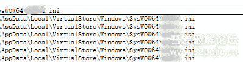

# [原创] xx取个名软件启动检测分析

- 原帖: `https://www.52pojie.cn/forum.php?mod=viewthread&tid=1957809`
- 抓取时间: `2026-11-01T22:24:49`

## 缘起
- 朋友家孩子生了，问我起名的经验。我想起了几年前在论坛学逆向时，整个一个类似的软件，并且使用注册机生成了注册码，很好用。
- 于是自信满满掏出当年那个软件，而且是很老的版本，使用注册机注册，填写注册码，一气呵成。结果第二次打开的时候，出现弹窗：禁止访问。后续怎么点都不行，再次使用注册机也不行。

## 分析
- 明明当时是好用的，但是现在却不行了，那应该是联网问题。所以先卸载，再断网，再安装，再执行注册机。结果还是直接弹窗，第二次安装进入后甚至连软件注册码页面都进不去。
- 那看来是软件没卸载干净，于是使用`360`强力卸载/`HIBIT`强力卸载，并清理注册表，自己也尝试去注册表一个一个找，把名字相关的全干掉，结果还是不行。
- 那说明肯定这个结果还是存在某个地方，要是能知道这个程序运行时，访问了哪些文件和注册表就好了，于是询问豆包。豆包推荐使用`process monitor`，这个软件可以满足要求

## 监控进程
- 简单使用那个软件，打开，筛选框打开，输入进程名称，选择包含或者等于关系就可以了。
- 运行弹窗的程序。
- 观察结果，找到了两个可疑配置文件，以`.ini`结尾。

`Snipaste_2024-08-24_23-14-40.png` (13.98 KB, 下载次数: 0)
[href="forum.php?mod=attachment&aid=MjcxOTcxOHw3YTcyY2I1YnwxNzkzNTcxODg2fDE2ODA4NnwxOTU3ODA5&nothumb=yes" target="_blank"](https://www.52pojie.cn/forum.php?mod=attachment&aid=MjcxOTcxOHw3YTcyY2I1YnwxNzkzNTcxODg2fDE2ODA4NnwxOTU3ODA5&nothumb=yes)
2024-8-24 23:14 上传

## 测试
- 测试过程很简单，把那两个`.ini`配置文件干掉后，再点击主程序，成功启动，弹窗消失
- 但是第二次启动后，配置文件又出现了，里面`MODE`字段变成3. 我尝试把它改成1，发现又可以用了。说明就是这个字段控制了弹窗的出现
- 打开主程序后，尝试断网，第二次打开没有问题，说明还是联网判断了key是否存在

## 最终解决
- 先改配置文件`mode=1`，再断网激活，注册成功
- 把`host`文件对应域名指向本机
- 恢复正常使用
