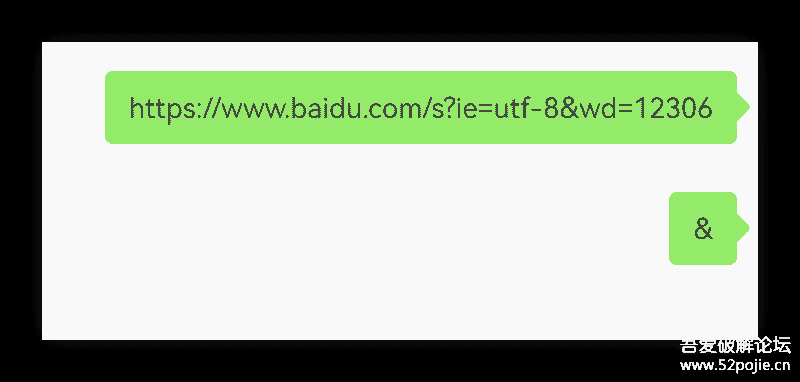
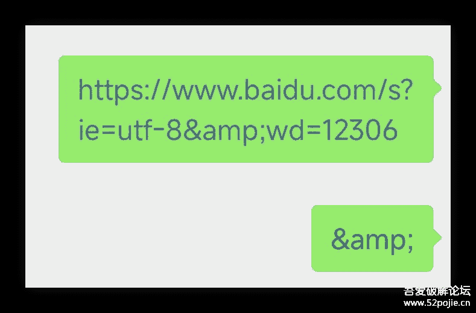
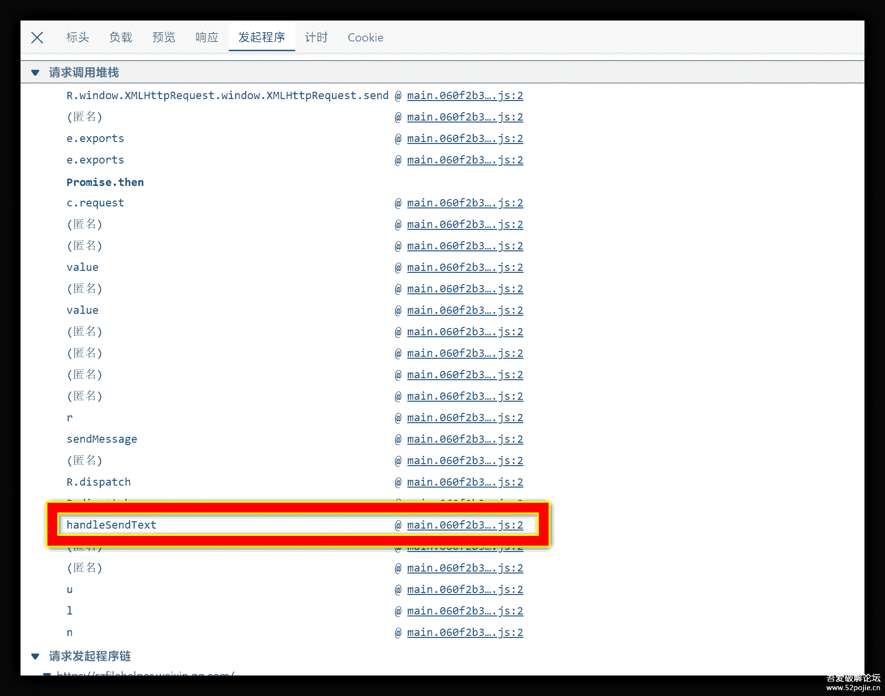
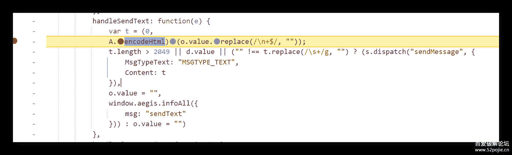
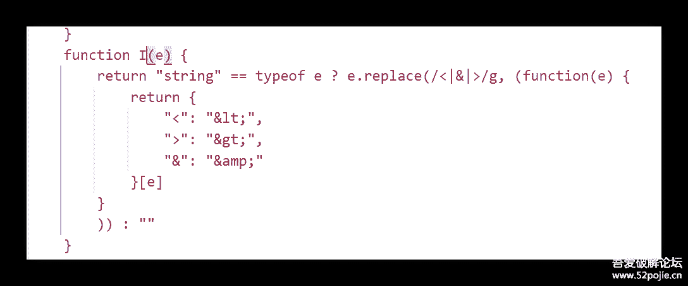
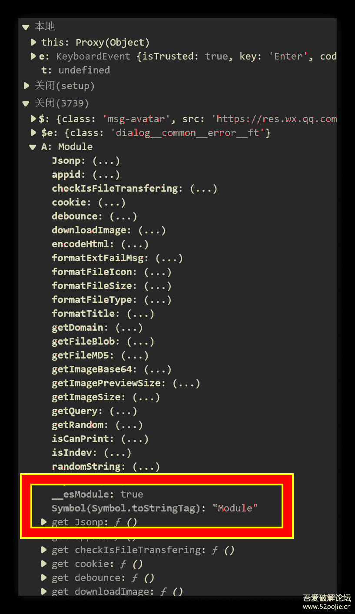
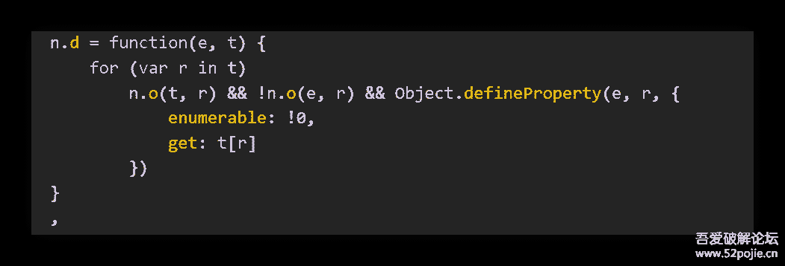
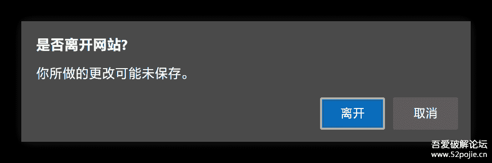
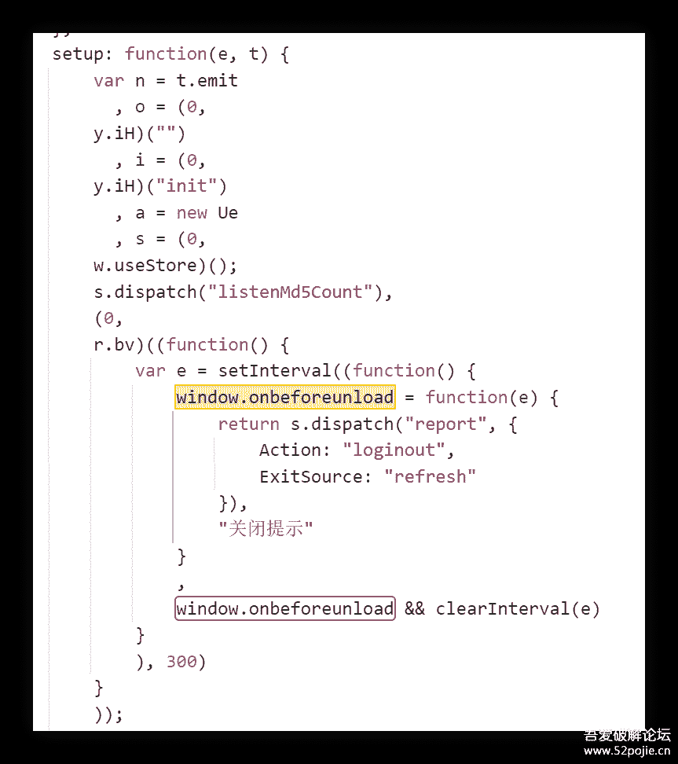

# [Web逆向] 我是怎么修绿泡泡的bug

- 原帖：[https://www.52pojie.cn/forum.php?mod=viewthread&tid=1958367](https://www.52pojie.cn/forum.php?mod=viewthread&tid=1958367)
- 抓取时间：2026-11-01T22:24:44

## 背景

在使用绿泡泡文件传输助手网页版的时候总会遇到一些奇怪的 bug（聋哥教我做产品），在发送网页链接的时候，往往发送的链接在手机上完全打不开。



`sshot-1.png`（26.74 KB，下载次数：0）

[附件链接](https://www.52pojie.cn/forum.php?mod=attachment&aid=MjcyMDAyNXw5MzZkNjY2MHwxNzkzNTcxODgyfDE2ODA4NnwxOTU4MzY3&nothumb=yes)

2024-8-26 20:08 上传



`1.png`（144.73 KB，下载次数：0）

[附件链接](https://www.52pojie.cn/forum.php?mod=attachment&aid=MjcyMDAzN3wwNTZhMGVjM3wxNzkzNTcxODgyfDE2ODA4NnwxOTU4MzY3&nothumb=yes)

2024-8-26 20:14 上传

## 分析

首先找到发送请求的函数。在函数堆栈中，最明显的是 `handleSendText`，一看就像是发送文本的。



`sshot-2.png`（244.75 KB，下载次数：0）

[附件链接](https://www.52pojie.cn/forum.php?mod=attachment&aid=MjcyMDAyOXw4NmU4MjM4NXwxNzkzNTcxODgyfDE2ODA4NnwxOTU4MzY3&nothumb=yes)

2024-8-26 20:09 上传

下个断点进去后很明显可以看到有个 `encodeHtml` 的调用。传入的 `o.value` 为 `&`，但是返回后的 `t` 却变为了 `&`。可以肯定，就是这个调用导致问题。



`sshot-3.png`（77.91 KB，下载次数：0）

[附件链接](https://www.52pojie.cn/forum.php?mod=attachment&aid=MjcyMDAzMFw1YjBhZGRiMnwxNzkzNTcxODgyfDE2ODA4NnwxOTU4MzY3&nothumb=yes)

2024-8-26 20:09 上传

查看 `encodeHtml` 函数，可以看到，使用了一个替换函数，将 `<`、`>`、`&` 替换为对应的 HTML 转义符。事实上，这里并没有必要进行 HTML 转义，只需要原样发送就行了。



`sshot-4.png`（42.67 KB，下载次数：0）

[附件链接](https://www.52pojie.cn/forum.php?mod=attachment&aid=MjcyMDAzMnwyODIzZjgyMnwxNzkzNTcxODgyfDE2ODA4NnwxOTU4MzY3&nothumb=yes)

2024-8-26 20:09 上传

目前的问题就很简单了，只要把 `encodeHtml` 注释掉就行了。那么，问题是如何注释呢？

## 思路

众所周知，油猴是只能访问 `window`、`Document` 等全局对象，不能够深入到闭包内部。如果想要进行注释，只能依靠浏览器的网络拦截进行响应替换（或者外部的 Fiddler 等）才能完成。很明显，这个方案非常的复杂，为了解决一个小问题，还需要创建一个插件？

可以注意到，`encodeHtml` 是 `A` 中的成员。而 `A` 是一个 `Module`。这一点非常关键，可以联想到类似于 `CommonJS` 模块在 `Webpack` 中的行为。`Webpack` 打包模块的时候，会自动处理 `CommonJS` 模块导出对象，兼容 `ES` 模块中的导入。



`sshot-6.png`（168.5 KB，下载次数：0）

[附件链接](https://www.52pojie.cn/forum.php?mod=attachment&aid=MjcyMDAzNHw0ZDIxZTAzY3wxNzkzNTcxODgyfDE2ODA4NnwxOTU4MzY3&nothumb=yes)

2024-8-26 20:10 上传

## 方案

仔细阅读代码，可以发现处理的时候调用了 `Object.defineProperty`，而这个函数属于全局范围，也就是油猴可以控制的部分。



`sshot-7.png`（37.8 KB，下载次数：0）

[附件链接](https://www.52pojie.cn/forum.php?mod=attachment&aid=MjcyMDAzNXxlOThhY2FhY3wxNzkzNTcxODgyfDE2ODA4NnwxOTU4MzY3&nothumb=yes)

2024-8-26 20:10 上传

```js
let defineProperty = Object.defineProperty;
Object.defineProperty = (obj, prop, descriptor) => {
    return defineProperty(obj, prop, descriptor);
}
```

这样，每当调用 `Object.defineProperty` 的时候，都会调用到我们自定义的函数。这样，只要判断 `prop` 是否为 `encodeHtml` 就可以知道是不是正在初始化我们所期望的函数，直接进行替换。

```js
if (prop === "encodeHtml") {
    descriptor.get = () => (_) => _;
}
```

以上，就将 `encodeHtml` 替换为了一个空函数，返回值和传入参数一模一样。

测试可以看到，发送的内容就和接收到的内容完全一致。以下是全部代码：

```js
let defineProperty = Object.defineProperty;
Object.defineProperty = (obj, prop, descriptor) => {
    if (prop === "encodeHtml") {
        descriptor.get = () => (_) => _;
    }
    return defineProperty(obj, prop, descriptor);
}
```

可以看到，代码只有短短的 7 行，非常的精简。

## 一处小问题

除此之外，还有一些很细节的问题：如果我在手机上退出了网页版，但是网页版仍会在关闭时弹出弹窗。尽管无伤大雅，但是还是有一些难受。



`sshot-8.png`（27.53 KB，下载次数：0）

[附件链接](https://www.52pojie.cn/forum.php?mod=attachment&aid=MjcyMDAzNnxjODBjZjM1YnwxNzkzNTcxODgyfDE2ODA4NnwxOTU4MzY3&nothumb=yes)

2024-8-26 20:10 上传

这个问题相对来说就比较好定位，因为是直接修改 `window.onbeforeunload` 来实现的。搜索源代码可以很快找到，在 `v-chat-panel` 组件中的 `setup` 中，修改了 `window.onbeforeunload`，但是却没有将其清空的代码。



`sshot-5.png`（98.58 KB，下载次数：0）

[附件链接](https://www.52pojie.cn/forum.php?mod=attachment&aid=MjcyMDAzM3wxN2M2ODMwNXwxNzkzNTcxODgyfDE2ODA4NnwxOTU4MzY3&nothumb=yes)

2024-8-26 20:10 上传

为了减少修改，可以想到：每当看到二维码的时候，不是没有登录就是已经登出。这个时候是不需要关闭弹出弹窗的。因此，如法炮制，在 `v-qrcode` 组件的 `setup` 将 `window.onbeforeunload` 清空，就可以实现效果。

```js
let e = setInterval((() => {
    let t = document.querySelectorAll("#app")[0].__vue_app__._component.components["v-qrcode"];
    if (t) {
        let setup = t.setup;
        t.setup = (e, t) => {
            window.onbeforeunload = null;
            return setup(e, t);
        }
        clearInterval(e);
    }
}), 300);
```

## 后记

`hook` 是一个很强劲的工具，或者说思想，能够将很复杂的问题变得极其简单，并保持良好的兼容性。遥想当年，[kazutoiris/anti-dingtalk-recall](https://github.com/kazutoiris/anti-dingtalk-recall) 实现的某钉反撤回，代码没有几行，却在两年后的今天也依然可用。

本贴也彰显了简单性与持久性的深刻哲理——真正的智慧在于以最简单的方式解决最复杂的问题。

## 附录

- GreasyFork：[微信文件传输助手网页版修复工具](https://greasyfork.org/zh-CN/scripts/505110-%E5%BE%AE%E4%BF%A1%E6%96%87%E4%BB%B6%E4%BC%A0%E8%BE%93%E5%8A%A9%E6%89%8B%E7%BD%91%E9%A1%B5%E7%89%88%E4%BF%AE%E5%A4%8D%E5%B7%A5%E5%85%B7)
- GitHub：[wechat-filehelper-repair-tool](https://github.com/kazutoiris/wechat-filehelper-repair-tool)

欢迎 Star、Fork！Follow 可以第一时间看到新项目！
