# [Web逆向] 某浏览器插件的逆向分析 一、

- 原帖: https://www.52pojie.cn/forum.php?mod=viewthread&tid=1959760
- 抓取时间: 2026-11-01T22:24:32

给自己的逆向过程做个记录，因为自己记性不好，权当做备忘录了，各位看官看个乐就好了

## 二话不说，直接开始。

首先，在浏览器中，找到对应的扩展ID：

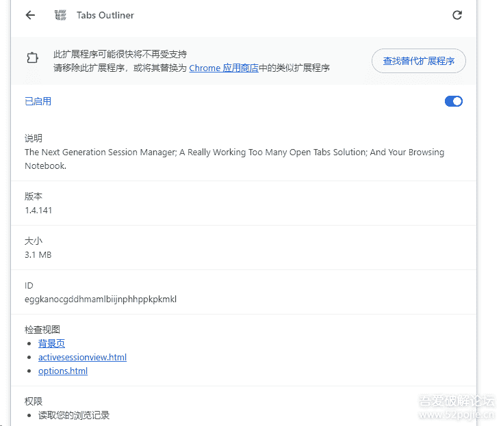

image.png (43.64 KB, 下载次数: 1)

[href="forum.php?mod=attachment&aid=MjcyMDcwM3xlZGQ0MDIxOHwxNzkzNTcxODcwfDE2ODA4NnwxOTU5NzYw&nothumb=yes" target="_blank"](https://www.52pojie.cn/forum.php?mod=attachment&aid=MjcyMDcwM3xlZGQ0MDIxOHwxNzkzNTcxODcwfDE2ODA4NnwxOTU5NzYw&nothumb=yes)

2024-8-30 14:34 上传

然后，在浏览器安装扩展的路径中，根据刚刚的扩展ID号，找到对应的文件夹，文件夹中存放的是扩展的源代码：

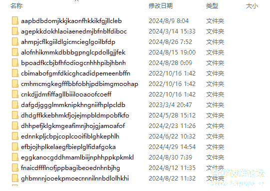

image.png (46.35 KB, 下载次数: 1)

[href="forum.php?mod=attachment&aid=MjcyMDcwNHxmNTdiZDBiYXwxNzkzNTcxODcwfDE2ODA4NnwxOTU5NzYw&nothumb=yes" target="_blank"](https://www.52pojie.cn/forum.php?mod=attachment&aid=MjcyMDcwNHxmNTdiZDBiYXwxNzkzNTcxODcwfDE2ODA4NnwxOTU5NzYw&nothumb=yes)

2024-8-30 14:35 上传

打开`VScode`，很幸运，可以看到源码并没有被混淆，这样子分析起来就会轻松很多了：

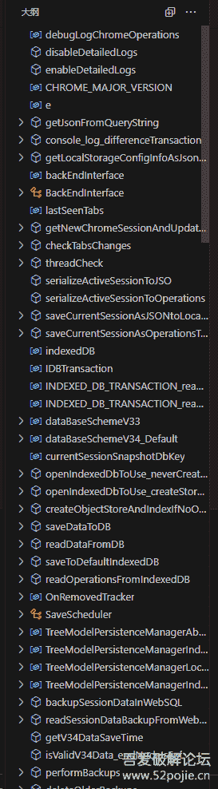

image.png (54.89 KB, 下载次数: 3)

[href="forum.php?mod=attachment&aid=MjcyMDcwNnxkNmFiOWVlYXwxNzkzNTcxODcwfDE2ODA4NnwxOTU5NzYw&nothumb=yes" target="_blank"](https://www.52pojie.cn/forum.php?mod=attachment&aid=MjcyMDcwNnxkNmFiOWVlYXwxNzkzNTcxODcwfDE2ODA4NnwxOTU5NzYw&nothumb=yes)

2024-8-30 14:37 上传

使用远程调试模式打开浏览器，开始动态调试分析：

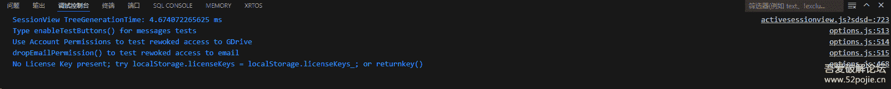

image.png (33.29 KB, 下载次数: 2)

[href="forum.php?mod=attachment&aid=MjcyMDcwOHw1ZDZjNWQ3Y3wxNzkzNTcxODcwfDE2ODA4NnwxOTU5NzYw&nothumb=yes" target="_blank"](https://www.52pojie.cn/forum.php?mod=attachment&aid=MjcyMDcwOHw1ZDZjNWQ3Y3wxNzkzNTcxODcwfDE2ODA4NnwxOTU5NzYw&nothumb=yes)

2024-8-30 15:01 上传

根据上面的调试输出信息以及函数调用堆栈信息，很轻松地定位到了关键函数一：`checkAndUpdateLicenseStatusInAllViews`，可以在下图中看出，它就是负责更新付费许可证状态的函数

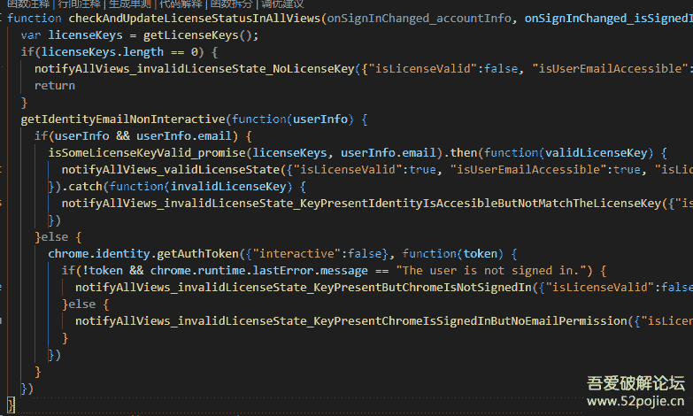

image.png (72.38 KB, 下载次数: 3)

[href="forum.php?mod=attachment&aid=MjcyMDcwOXwwZWU5MWNlMXwxNzkzNTcxODcwfDE2ODA4NnwxOTU5NzYw&nothumb=yes" target="_blank"](https://www.52pojie.cn/forum.php?mod=attachment&aid=MjcyMDcwOXwwZWU5MWNlMXwxNzkzNTcxODcwfDE2ODA4NnwxOTU5NzYw&nothumb=yes)

2024-8-30 15:02 上传

暂时把这段函数修改一下（把检查付费许可证的部分注释掉，然后手动加上一个许可证，比如我加的“123”），变成这样：

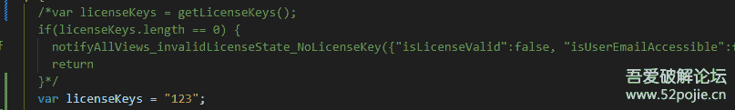

image.png (16.95 KB, 下载次数: 1)

[href="forum.php?mod=attachment&aid=MjcyMDcyOHwyNjYyZDc3OXwxNzkzNTcxODcwfDE2ODA4NnwxOTU5NzYw&nothumb=yes" target="_blank"](https://www.52pojie.cn/forum.php?mod=attachment&aid=MjcyMDcyOHwyNjYyZDc3OXwxNzkzNTcxODcwfDE2ODA4NnwxOTU5NzYw&nothumb=yes)

2024-8-30 15:36 上传

可以发现插件的备份功能可以正常使用了：

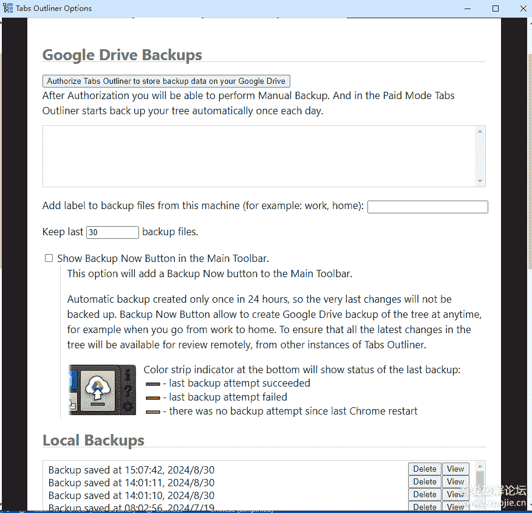

image.png (151.69 KB, 下载次数: 3)

[href="forum.php?mod=attachment&aid=MjcyMDczMHwwNjM3MWI4Y3wxNzkzNTcxODcwfDE2ODA4NnwxOTU5NzYw&nothumb=yes" target="_blank"](https://www.52pojie.cn/forum.php?mod=attachment&aid=MjcyMDczMHwwNjM3MWI4Y3wxNzkzNTcxODcwfDE2ODA4NnwxOTU5NzYw&nothumb=yes)

2024-8-30 15:37 上传

（为了比对，下图是修改代码前的状态，提示需要付费许可证）

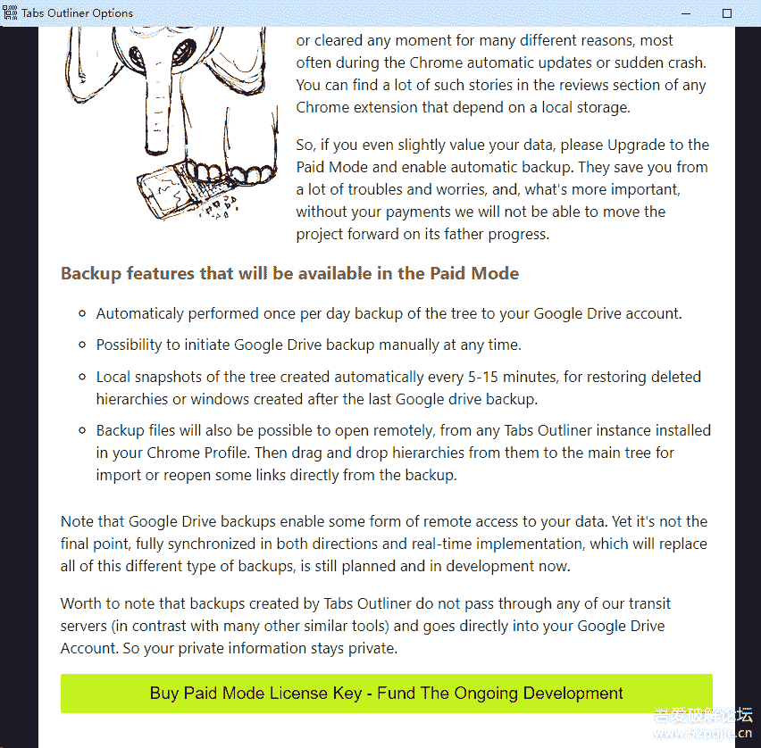

image.png (191.55 KB, 下载次数: 3)

[href="forum.php?mod=attachment&aid=MjcyMDcyOXxiMjYyZTA0N3wxNzkzNTcxODcwfDE2ODA4NnwxOTU5NzYw&nothumb=yes" target="_blank"](https://www.52pojie.cn/forum.php?mod=attachment&aid=MjcyMDcyOXxiMjYyZTA0N3wxNzkzNTcxODcwfDE2ODA4NnwxOTU5NzYw&nothumb=yes)

2024-8-30 15:37 上传

备份功能部分搞定了，接下来是插件的快捷键功能：（在插件中使用快捷键，然后弹出了一个弹窗，提示让我付费）

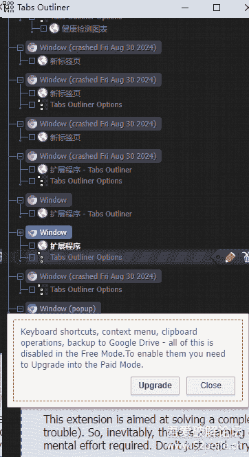

image.png (179.36 KB, 下载次数: 3)

[href="forum.php?mod=attachment&aid=MjcyMDczMXw0NTUwOTkyYXwxNzkzNTcxODcwfDE2ODA4NnwxOTU5NzYw&nothumb=yes" target="_blank"](https://www.52pojie.cn/forum.php?mod=attachment&aid=MjcyMDczMXw0NTUwOTkyYXwxNzkzNTcxODcwfDE2ODA4NnwxOTU5NzYw&nothumb=yes)

2024-8-30 15:40 上传

根据弹窗中的内容，在源代码中进行搜索，然后下断点，再根据函数调用堆栈，可以很轻松地定位到关键函数二：`ifLite_goPro`，可以在下图中看出，它就是判断是否启用专业版快捷键功能的函数，如果启用，则会返回false

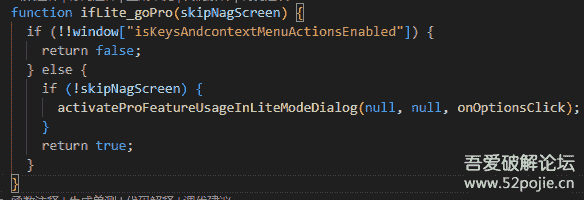

image.png (23.17 KB, 下载次数: 3)

[href="forum.php?mod=attachment&aid=MjcyMDczMnw0YzQyZjExYnwxNzkzNTcxODcwfDE2ODA4NnwxOTU5NzYw&nothumb=yes" target="_blank"](https://www.52pojie.cn/forum.php?mod=attachment&aid=MjcyMDczMnw0YzQyZjExYnwxNzkzNTcxODcwfDE2ODA4NnwxOTU5NzYw&nothumb=yes)

2024-8-30 15:42 上传

那我需要做的事情就很简单了，让它返回false即可：

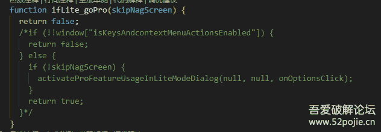

image.png (23.19 KB, 下载次数: 2)

[href="forum.php?mod=attachment&aid=MjcyMDczM3w4OGNjZGRlMXwxNzkzNTcxODcwfDE2ODA4NnwxOTU5NzYw&nothumb=yes" target="_blank"](https://www.52pojie.cn/forum.php?mod=attachment&aid=MjcyMDczM3w4OGNjZGRlMXwxNzkzNTcxODcwfDE2ODA4NnwxOTU5NzYw&nothumb=yes)

2024-8-30 15:44 上传

重启浏览器，至此，快捷键功能与本地备份功能都可以正常使用了。

众所周知，因为`chrome`没有提供侧边栏来管理标签页（只能进行顶部管理），所以就诞生了一些解决这类需求的插件，这款插件是我体验最好的之一（能够保存上万个标签页，如果喜欢，请支持正版），但是由于以下两点原因：

- 作者长期不更新
- 插件的所有功能无法完整地移植到`edge`（因为插件需要使用`chrome`的API来检查`google drive`进行云端备份，在`edge`上做不到）

需要对其进行二开：

- 本地备份功能（√）
- 快捷键功能（√）
- 使用其它云盘来替换掉`google drive`进行云端备份，使其能够在`edge`上正常使用（尚未完成）

所以，未完待续。。。
