# [原创] 《英雄无敌》3完整版complete（英文）——免cd修改

- 原帖：[https://www.52pojie.cn/forum.php?mod=viewthread&tid=1960687](https://www.52pojie.cn/forum.php?mod=viewthread&tid=1960687)
- 抓取时间：2026-11-01T22:24:27

## 一、概况

《英雄无敌》3，在是魔法门6取得巨大成功，又在《英雄无敌》2大热后，new world computing大力开发并完善的一款益智类策略游戏。最初版本《埃拉西亚的光复》（简称ROE有8个种族，城堡（Castle）、塔楼（Tower）、壁垒（Rampart）、要塞（Fortress）、据点（Stronghold）、地狱（Inferno）、墓园（Necropolis）、地下城（Dungeon），每个族有7个等级的兵种，兵种都有升级模式，加上6种中立兵种，ROE共有118种单位；而资料片《末日之刃》则增加了元素生物和一些中立生物，合计141种。第二个资料片《死亡阴影》（The Shadow of Death，简称SOD），发行于2000年3月31日。因为元素城的不平衡，在SOD中被取消了，不过单位的设计依然存在，此外游戏添加了7章新战役，新的传送门和7种新的特殊地形，以及12个组合宝物，可以说很多人玩大地图就是了收集宝物特别是组合宝物的快感，同时游戏还平衡修正了一些数值，增加了护城河伤害和战役难度选择。至此SOD共有141种兵，与上一个资料片完全相同。

接着，3DO公司又将三部合并成一个完整版（Complete Edition）进行了发行，本次免CD修改就是在该版本上进行的。

## 二、逆向过程

首先放进`Die`检测一下壳情况。

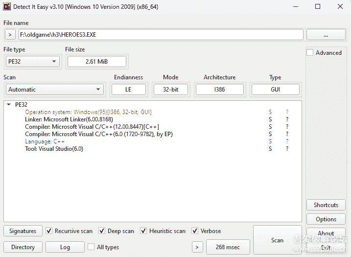

[附件链接](https://www.52pojie.cn/forum.php?mod=attachment&aid=MjcyMTI1MHw2NjM0ZDNmOXwxNzkzNTcxODY1fDE2ODA4NnwxOTYwNjg3&nothumb=yes)（2024-9-2 18:58 上传）

可知是没有壳的。

用`OD`打开程序

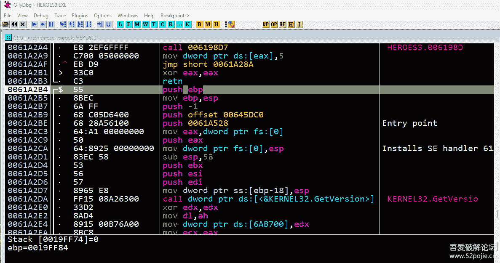

[附件链接](https://www.52pojie.cn/forum.php?mod=attachment&aid=MjcyMTI1MXwxN2FhOTcwNHwxNzkzNTcxODY1fDE2ODA4NnwxOTYwNjg3&nothumb=yes)（2024-9-2 18:59 上传）

自然先去搜索字符串

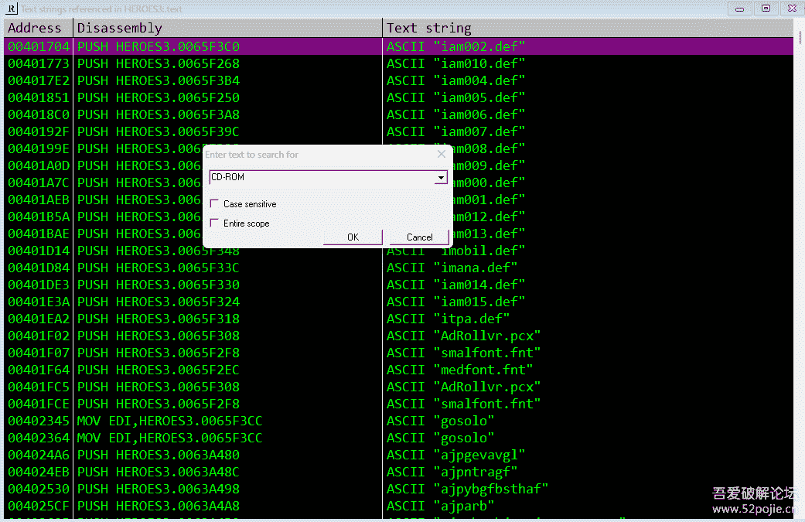

[附件链接](https://www.52pojie.cn/forum.php?mod=attachment&aid=MjcyMTI1MnxkZmNkNDZjYnwxNzkzNTcxODY1fDE2ODA4NnwxOTYwNjg3&nothumb=yes)（2024-9-2 19:00 上传）

情况不妙，居然没有搜索到，说明根据没有CD的提示字符串去寻找程序检查光驱的子程序，这条路径是不通的，得另想方法。

这时得祭出`WinAPI`了，与光驱有关的`API`，给下图的2个`API`打上断点

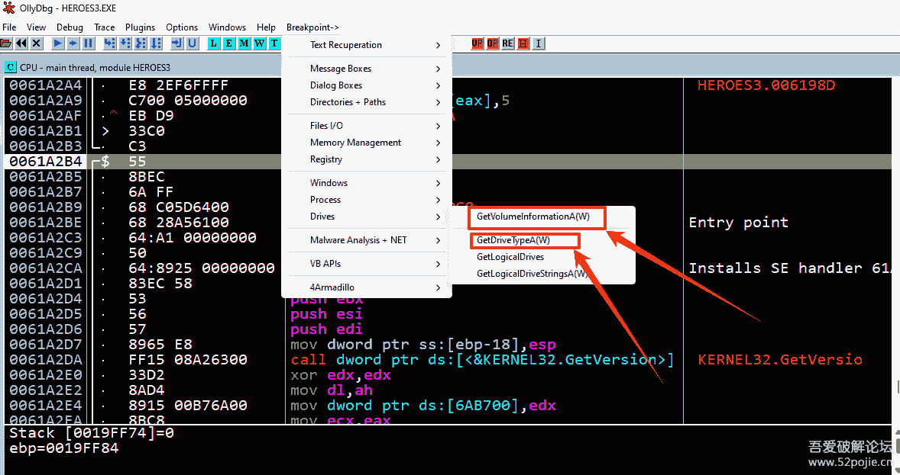

[附件链接](https://www.52pojie.cn/forum.php?mod=attachment&aid=MjcyMTI1M3xkMTZkY2MxYXwxNzkzNTcxODY1fDE2ODA4NnwxOTYwNjg3&nothumb=yes)（2024-9-2 19:01 上传）

检查一下断点情况，没错，正是所要的

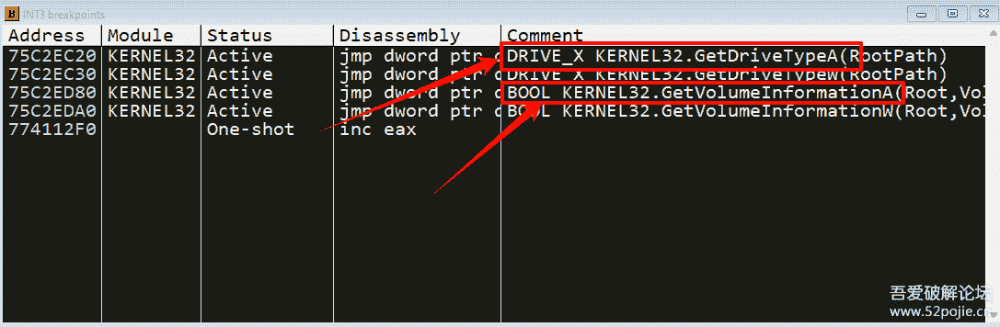

[附件链接](https://www.52pojie.cn/forum.php?mod=attachment&aid=MjcyMTI1NHwwZWNjMGE1YXwxNzkzNTcxODY1fDE2ODA4NnwxOTYwNjg3&nothumb=yes)（2024-9-2 19:02 上传）

运行程序后，程序被断下

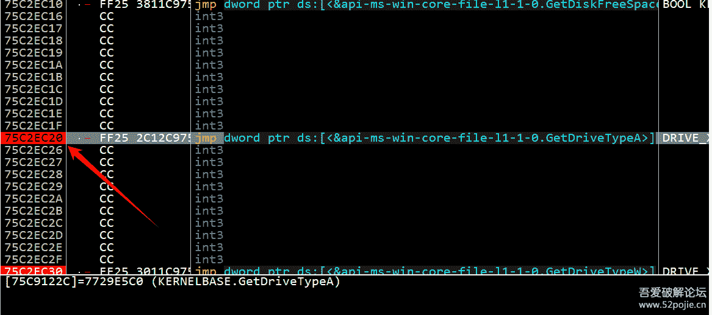

[附件链接](https://www.52pojie.cn/forum.php?mod=attachment&aid=MjcyMTI1NXxmYTAxNTBlZXwxNzkzNTcxODY1fDE2ODA4NnwxOTYwNjg3&nothumb=yes)（2024-9-2 19:02 上传）

跟进去，来到调用处

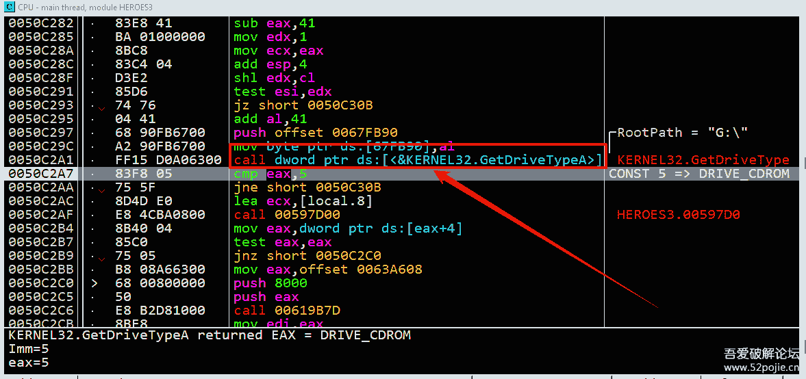

[附件链接](https://www.52pojie.cn/forum.php?mod=attachment&aid=MjcyMTI1NnwyYjNiYTk0ZXwxNzkzNTcxODY1fDE2ODA4NnwxOTYwNjg3&nothumb=yes)（2024-9-2 19:03 上传）

此时，我的虚拟光驱是挂载的，所以，看到该`API`的返回值是`eax=5`，从注释来看，5正好是`DRIVE_CDROM`。

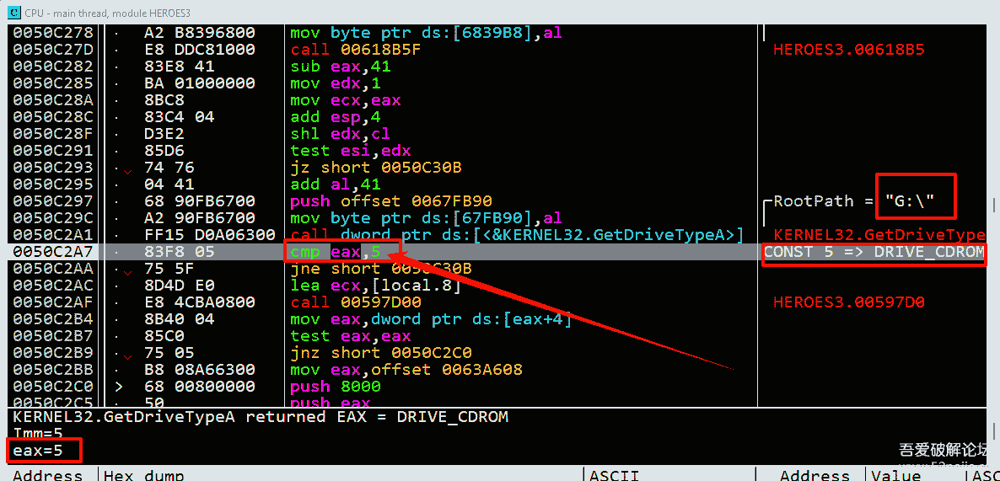

[附件链接](https://www.52pojie.cn/forum.php?mod=attachment&aid=MjcyMTI1OXw5ODg2YzVhNHwxNzkzNTcxODY1fDE2ODA4NnwxOTYwNjg3&nothumb=yes)（2024-9-2 19:04 上传）

接着`run to return`看看是否出现没有CD的提示以及是那个调用的这个子程序。结果没有提示出现，而来到了调用处。

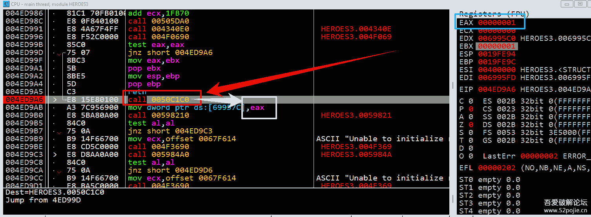

[附件链接](https://www.52pojie.cn/forum.php?mod=attachment&aid=MjcyMTI2MHw0OTMwMzUzYnwxNzkzNTcxODY1fDE2ODA4NnwxOTYwNjg3&nothumb=yes)（2024-9-2 19:05 上传）

很显然，这个`call`就是检测CD的关键`call`了。撤掉前面对`Drive`的`API`断点，在此`call`处下断点。但在运行前，先看看程序后面有什么东西。显然这个程序的返回值先被保存到`[69957C]`，后面接着的2个相同的`call`都是提示有问题的，会导致程序关闭的。

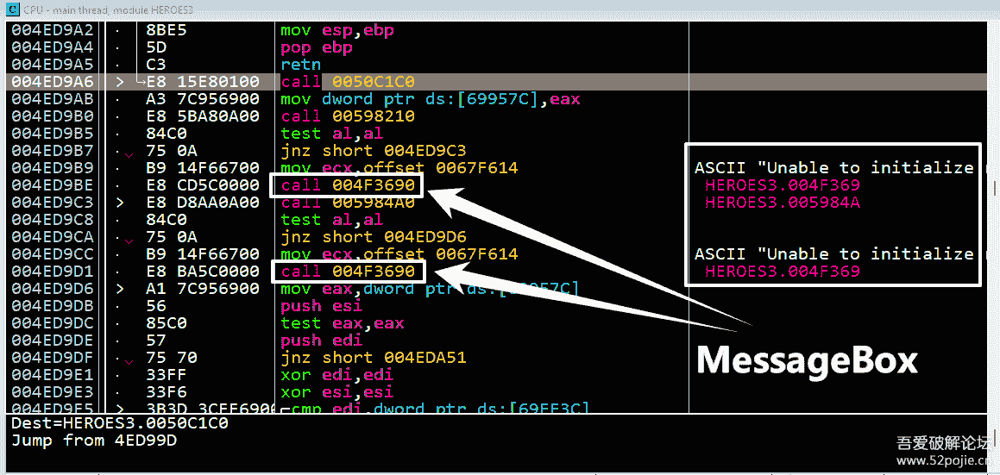

[附件链接](https://www.52pojie.cn/forum.php?mod=attachment&aid=MjcyMTI2MXw4Yzg2OTI4MnwxNzkzNTcxODY1fDE2ODA4NnwxOTYwNjg3&nothumb=yes)（2024-9-2 19:06 上传）

在上面2个提示`call`之后，还将存在`[69957C]`里的那个子程序的返回值调出来，如果不为0的，将跳转；若为0的，还会在后面将5、6冲掉`[69957C]`里面的数值。

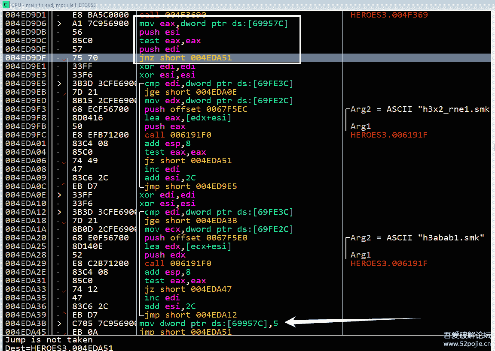

[附件链接](https://www.52pojie.cn/forum.php?mod=attachment&aid=MjcyMTI2Mnw4Mjg5MjE3MnwxNzkzNTcxODY1fDE2ODA4NnwxOTYwNjg3&nothumb=yes)（2024-9-2 19:07 上传）

如果关键`call`的子程序返回值不为0，将会跳转到这里（如图）

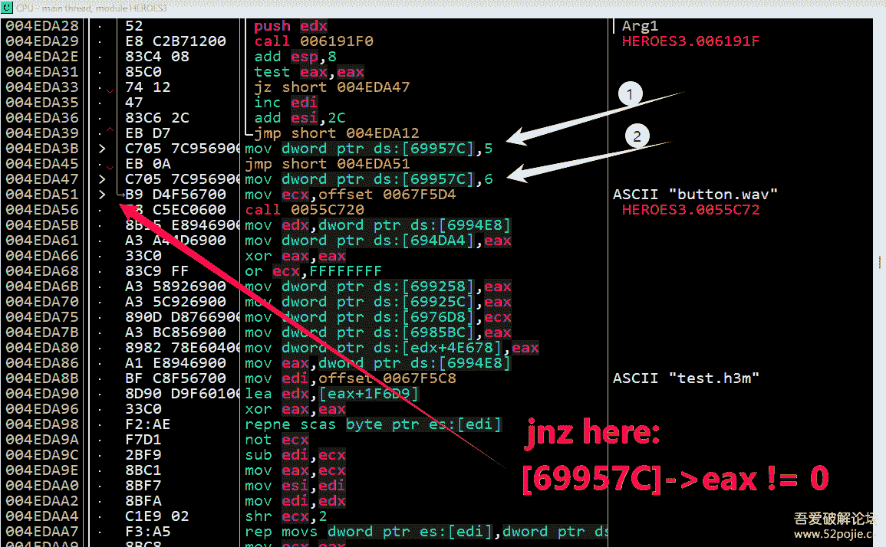

[附件链接](https://www.52pojie.cn/forum.php?mod=attachment&aid=MjcyMTI2M3w5OGQ5MGUwMHwxNzkzNTcxODY1fDE2ODA4NnwxOTYwNjg3&nothumb=yes)（2024-9-2 19:07 上传）

这样，就可以在关键`call`的子程序返回值上动脑筋了。

首先，返回值5、6可以排除。

接着，把正确的play盘挂载上去，看看返回值是多少？结果是0

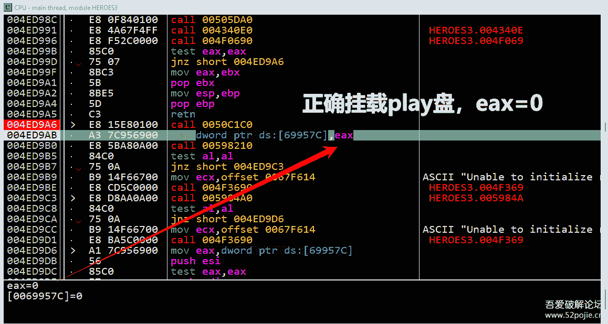

[附件链接](https://www.52pojie.cn/forum.php?mod=attachment&aid=MjcyMTI2NHw3YzMzMTlkNnwxNzkzNTcxODY1fDE2ODA4NnwxOTYwNjg3&nothumb=yes)（2024-9-2 19:09 上传）

再把虚拟光驱卸载，即没有光驱，结果是2

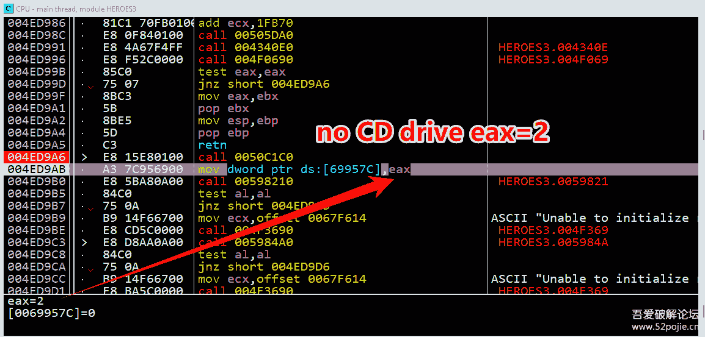

[附件链接](https://www.52pojie.cn/forum.php?mod=attachment&aid=MjcyMTI2NXxhYWU1NjRlZHwxNzkzNTcxODY1fDE2ODA4NnwxOTYwNjg3&nothumb=yes)（2024-9-2 19:09 上传）

再把虚拟光驱加载但挂载是非play盘，结果还是2

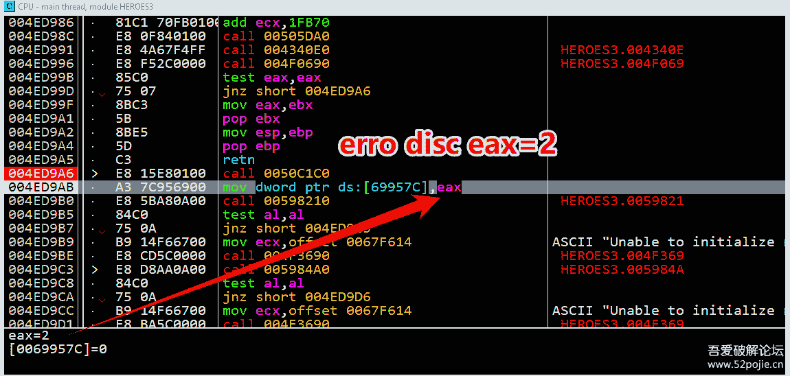

[附件链接](https://www.52pojie.cn/forum.php?mod=attachment&aid=MjcyMTI2NnwxOWVjZjdjZXwxNzkzNTcxODY1fDE2ODA4NnwxOTYwNjg3&nothumb=yes)（2024-9-2 19:10 上传）

再看该子程序中，有5种情况的返回值，分别是：

[Asm] 纯文本查看 复制代码


```
0050C21C  |.  B8 03000000   mov eax,3
0050C23F  |.  B8 04000000   mov eax,4
0050C302  |.  33C0          xor eax,eax
0050C4D1  |.  B8 02000000   mov eax,2
0050C592  |.  33C0          xor eax,eax
```

至此，知道了`eax`的情况，大致有：0、2、3、4、5、6。

下面，先试试不调用这个子程序情况能否运行？即将`call`改成直接跳过。结果是程序中断。

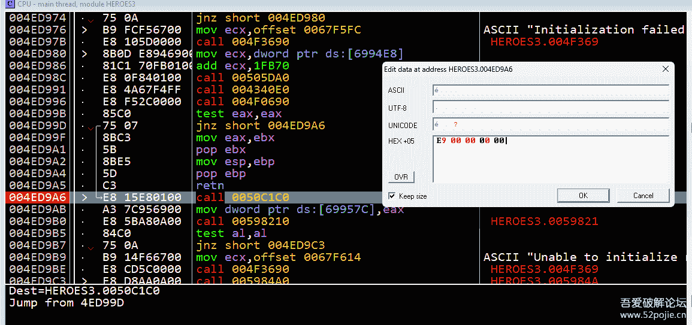

`h3-15.png` (114.01 KB, 下载次数: 1) · [附件](https://www.52pojie.cn/forum.php?mod=attachment&aid=MjcyMTI2N3wxNGRhYThmNXwxNzkzNTcxODY1fDE2ODA4NnwxOTYwNjg3&nothumb=yes) · 2024-9-2 19:12 上传

既然直接跳过不行，那就直接给`eax`赋值。先试试1。

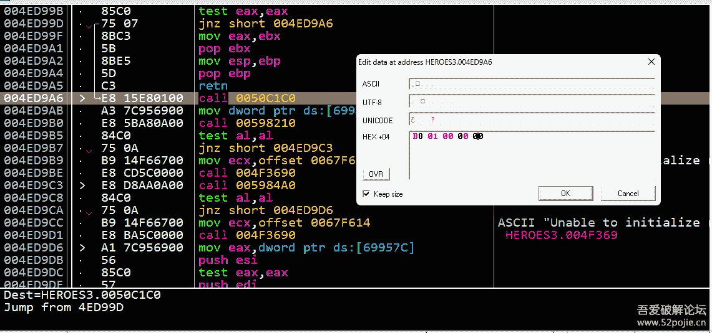

`h3-16.png` (105.42 KB, 下载次数: 0) · [附件](https://www.52pojie.cn/forum.php?mod=attachment&aid=MjcyMTI2OHw1OTVmNDllYnwxNzkzNTcxODY1fDE2ODA4NnwxOTYwNjg3&nothumb=yes) · 2024-9-2 19:13 上传

结果还是出现没有CD的提示，说明1不正确。再试试7，结果成功了。

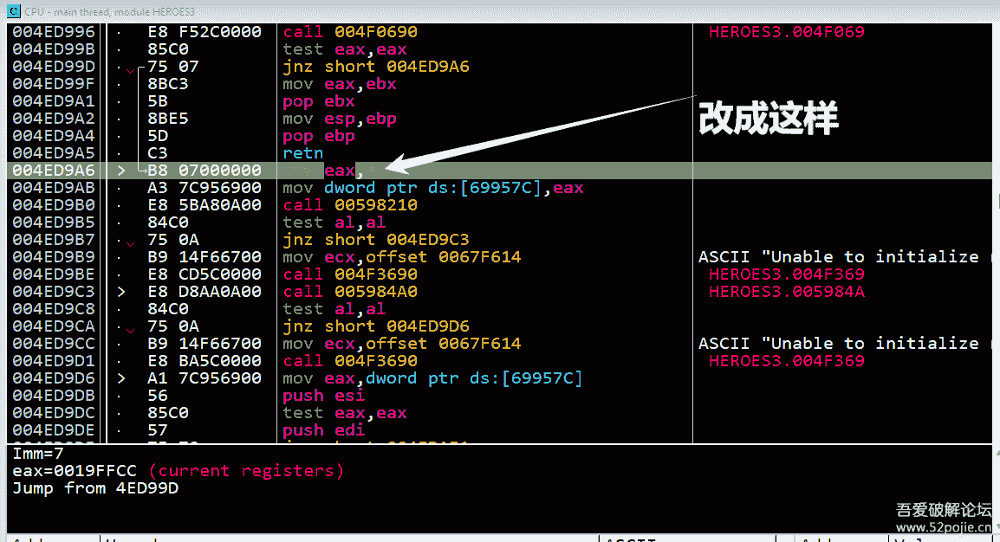

`h3-17.png` (118.21 KB, 下载次数: 1) · [附件](https://www.52pojie.cn/forum.php?mod=attachment&aid=MjcyMTI2OXwzOTNlOWE3ZHwxNzkzNTcxODY1fDE2ODA4NnwxOTYwNjg3&nothumb=yes) · 2024-9-2 19:14 上传

再试试8，也是可以的。

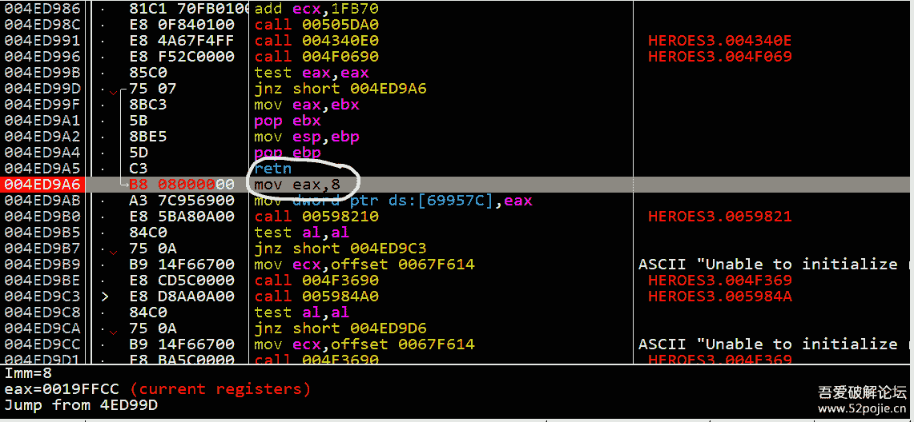

`h3-18.png` (104.63 KB, 下载次数: 1) · [附件](https://www.52pojie.cn/forum.php?mod=attachment&aid=MjcyMTI3MHw3OTAzZTU3NnwxNzkzNTcxODY1fDE2ODA4NnwxOTYwNjg3&nothumb=yes) · 2024-9-2 19:14 上传

说明大于6的返回值都是可行的。至此，免CD基本成功了。

## 三、不足之处

这样免CD后，由于游戏中有的资源（如：战役模式中的动画，应该是存在光盘上的，所以只有文字而没有动画了，还有就是失败后，被斩首的动画也没有）是存在光盘上，涉及这些资源的游戏调用，自然就调用不到了。

## 四、hex编辑软件直接修改

如果不想使用OD的，也可以直接使用hex类的编辑软件如：010Editor，进行直接修改。从前面的图片可知，要修改的命令是在`004ED9A6`地址的`call 0050C1C0`，将其改为：`mov eax,7`即可。

下面用010Editor打开`heroes3.exe`，选search工具栏里的`go to`。

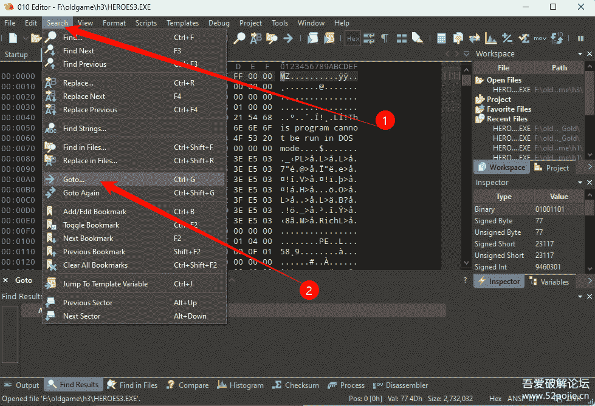

`h3-19.png` (160.91 KB, 下载次数: 0) · [附件](https://www.52pojie.cn/forum.php?mod=attachment&aid=MjcyMTI3MXw1ZWMwYjE2ZnwxNzkzNTcxODY1fDE2ODA4NnwxOTYwNjg3&nothumb=yes) · 2024-9-2 19:17 上传

在地址栏里输入`000ED9A6`，这个就是`call 0050C1C0`命令行的偏移地址，再回车。

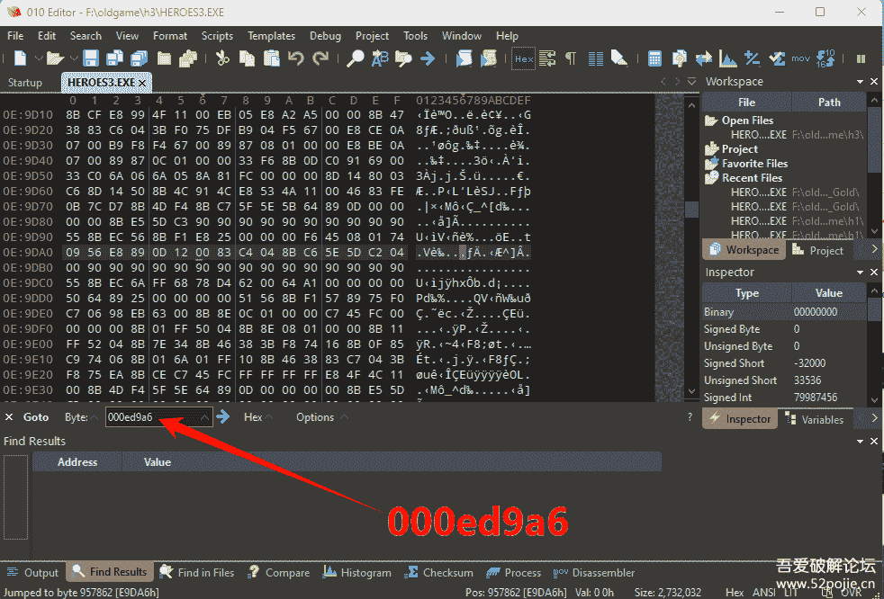

`h3-20.png` (137.42 KB, 下载次数: 1) · [附件](https://www.52pojie.cn/forum.php?mod=attachment&aid=MjcyMTI3Mnw4ZWZhM2Q1ZXwxNzkzNTcxODY1fDE2ODA4NnwxOTYwNjg3&nothumb=yes) · 2024-9-2 19:18 上传

来到这里，其中：`E8 15 E8 01 00`正是`call 0050C1C0`。

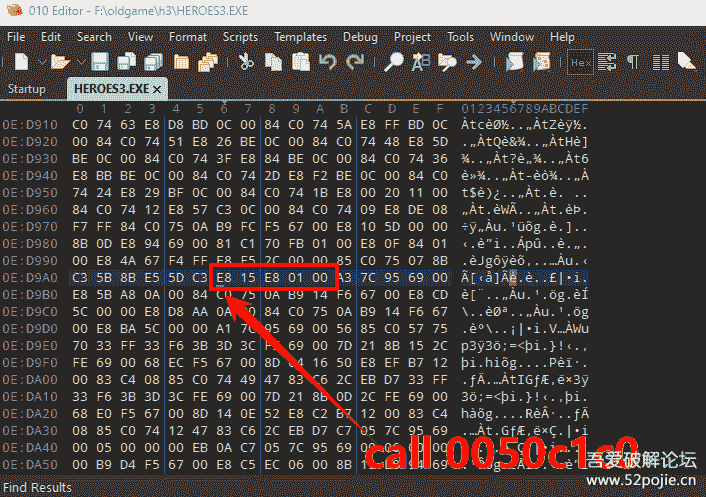

`h3-21.png` (94.37 KB, 下载次数: 0) · [附件](https://www.52pojie.cn/forum.php?mod=attachment&aid=MjcyMTI3M3w0ODY2ZTQ1ZnwxNzkzNTcxODY1fDE2ODA4NnwxOTYwNjg3&nothumb=yes) · 2024-9-2 19:18 上传

将其改成：`B8 07 00 00 00`，即`mov eax,7`即可，保存的程序就是免CD的了。

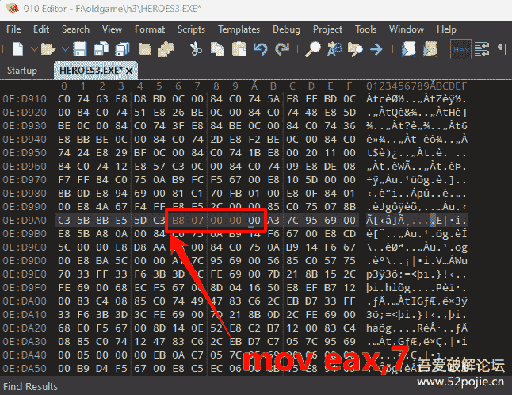

`h3-22.png` (92.06 KB, 下载次数: 1) · [附件](https://www.52pojie.cn/forum.php?mod=attachment&aid=MjcyMTI3NHxiNTg1YzI3MnwxNzkzNTcxODY1fDE2ODA4NnwxOTYwNjg3&nothumb=yes) · 2024-9-2 19:19 上传

## 五、资源下载

《英雄无敌》3complete版（英文）下载：<https://www.123pan.com/s/7jpKVv-7bjCh>

《英雄无敌》3complete版免CD修改后的程序和win11可以直接运行的HD补丁下载：<https://www.123pan.com/s/7jpKVv-YZjCh>
