# [Web逆向] 某考试平台登录分析

- 原帖: https://www.52pojie.cn/forum.php?mod=viewthread&tid=1961495
- 抓取时间: 2026-11-01T22:24:16

## 声明

本文章中所有内容仅供学习交流使用，不用于其他任何目的，不提供完整代码，抓包内容、敏感网址、数据接口等均已做脱敏处理，严禁用于商业用途和非法用途，否则由此产生的一切后果均与作者无关.本文章未经许可禁止转载，禁止任何修改后二次传播，擅自使用本文讲解的技术而导致的任何意外，作者均不负责，若有侵权，请联系作者立即删除.

## 前言

本人纯萌新一只，web逆向刚学完又跑去学安卓逆向了，最近某人扔给了我个网址，让用web逆向搞定登录，还说非常简单，我想着正好复习一下web逆向的东西，就开工了。

## 目标地址

aHR0cHM6Ly9zdHVkZW50LWV4YW1zZXJ2aWNlLm91Yy1vbmxpbmUuY29tLmNuLyMvbG9naW4=

## 参数来源分析

### 过debugger

打开`devtools`并浏览目标地址，直接给了个下马威，无限`debugger`，点右边的堆栈列表，查看上一个栈，看看这个是怎么来的

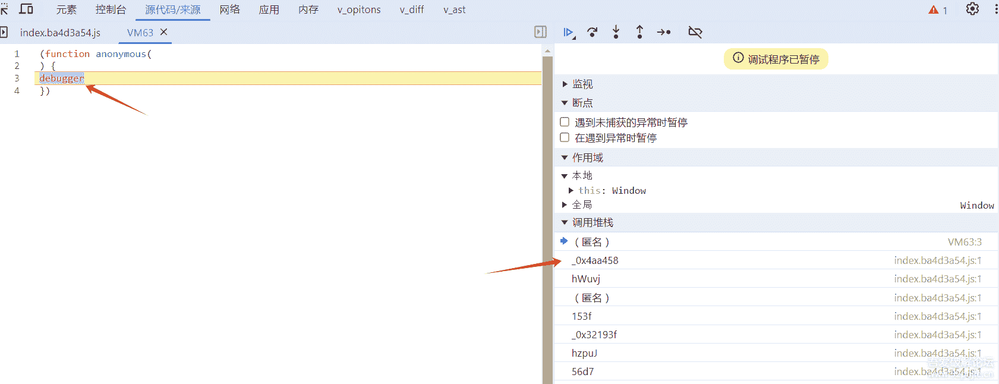

Pasted image 20240903102246.png (67.94 KB, 下载次数: 0)

[href="forum.php?mod=attachment&aid=MjcyMTgwMHxiMjEyMGUyNXwxNzkzNTcxODU0fDE2ODA4NnwxOTYxNDk1&nothumb=yes" target="_blank"](https://www.52pojie.cn/forum.php?mod=attachment&aid=MjcyMTgwMHxiMjEyMGUyNXwxNzkzNTcxODU0fDE2ODA4NnwxOTYxNDk1&nothumb=yes)

2024-9-4 22:28 上传

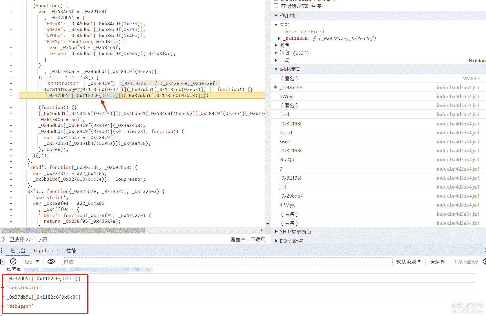

Pasted image 20240903102806.png (206.04 KB, 下载次数: 1)

[href="forum.php?mod=attachment&aid=MjcyMjk3MXw4NDJmNTgyM3wxNzkzNTcxODU0fDE2ODA4NnwxOTYxNDk1&nothumb=yes" target="_blank"](https://www.52pojie.cn/forum.php?mod=attachment&aid=MjcyMjk3MXw4NDJmNTgyM3wxNzkzNTcxODU0fDE2ODA4NnwxOTYxNDk1&nothumb=yes)

2024-9-11 15:45 上传

又一个下马威，代码混淆，先凑合看吧，选中前面的部分，浏览器直接提示`constructor`，或者复制到控制台也能看到，后面的部分是`debugger`，应该是由`constructor`动态构造得到，直接在`console`中上相关`hook`代码：


```
let _constructor = constructor;
Function.prototype.constructor = function(s) {
    if (s == "debugger") {
        console.log(s);
        return null;
    }
    return _constructor(s);
}
```

enter后点右边的继续执行

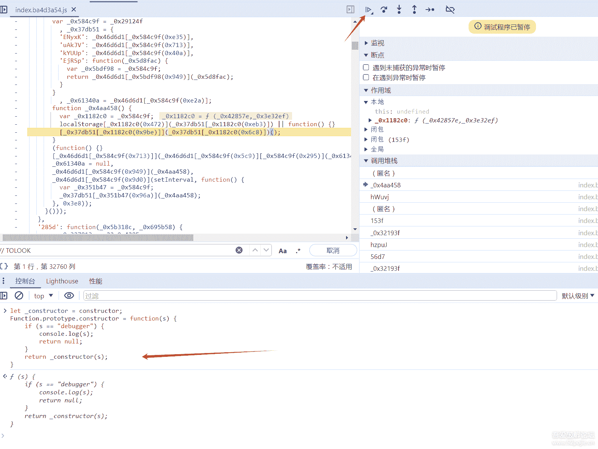

Pasted image 20240903113046.png (173.15 KB, 下载次数: 0)

[href="forum.php?mod=attachment&aid=MjcyMTgwNHw4MmNjYWFhYnwxNzkzNTcxODU0fDE2ODA4NnwxOTYxNDk1&nothumb=yes" target="_blank"](https://www.52pojie.cn/forum.php?mod=attachment&aid=MjcyMTgwNHw4MmNjYWFhYnwxNzkzNTcxODU0fDE2ODA4NnwxOTYxNDk1&nothumb=yes)

2024-9-4 22:37 上传

很好，直接失败了

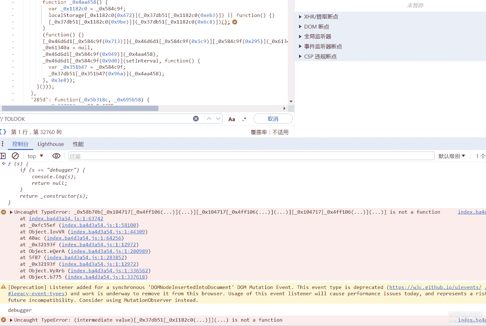

Pasted image 20240903113206.png (161.08 KB, 下载次数: 0)

[href="forum.php?mod=attachment&aid=MjcyMTgwNXwyZmEzMzI0ZHwxNzkzNTcxODU0fDE2ODA4NnwxOTYxNDk1&nothumb=yes" target="_blank"](https://www.52pojie.cn/forum.php?mod=attachment&aid=MjcyMTgwNXwyZmEzMzI0ZHwxNzkzNTcxODU0fDE2ODA4NnwxOTYxNDk1&nothumb=yes)

2024-9-4 22:37 上传

这大概是把`'debugger'`字符串当函数直接执行了，还执行了别的操作，此路不通，稍微往下看一下，发现半边“)"，嗯？这是构造了字符串，用的`eval`？

再往下看一下，发现了`setInterval`，定时器，这肯定就是无限`debugger`的来源了，这行语句上下各有一个函数调用了上面那个`_0x4aa458`，看来问题就出在这了

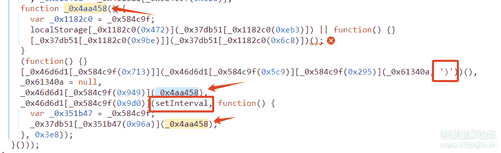

Pasted image 20240903115544.png (50.41 KB, 下载次数: 1)

[href="forum.php?mod=attachment&aid=MjcyMTgwNnw1YzhkZjkzOXwxNzkzNTcxODU0fDE2ODA4NnwxOTYxNDk1&nothumb=yes" target="_blank"](https://www.52pojie.cn/forum.php?mod=attachment&aid=MjcyMTgwNnw1YzhkZjkzOXwxNzkzNTcxODU0fDE2ODA4NnwxOTYxNDk1&nothumb=yes)

2024-9-4 22:37 上传

看到调用这个`debugger`函数实现，心头涌上一计，不让它调用不就可以了嘛，修改代码注释掉这2个调用就行了，在上方标签页点右键，选替换内容

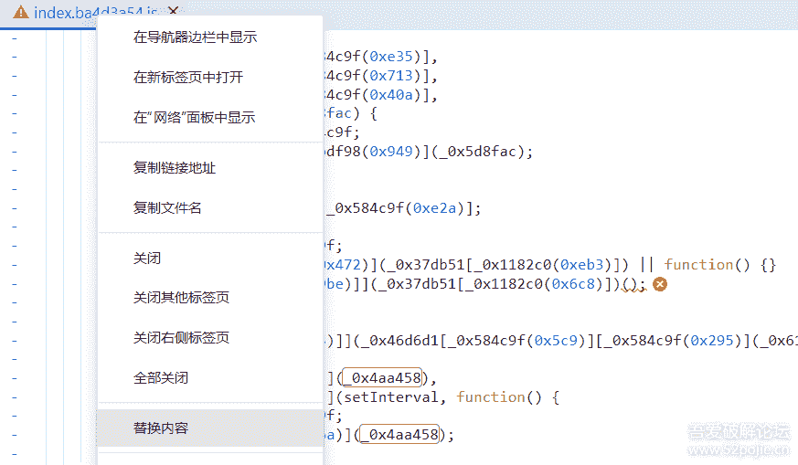

Pasted image 20240903120058.png (59.62 KB, 下载次数: 1)

[href="forum.php?mod=attachment&aid=MjcyMTgwOHwzOTZjOTBhZXwxNzkzNTcxODU0fDE2ODA4NnwxOTYxNDk1&nothumb=yes" target="_blank"](https://www.52pojie.cn/forum.php?mod=attachment&aid=MjcyMTgwOHwzOTZjOTBhZXwxNzkzNTcxODU0fDE2ODA4NnwxOTYxNDk1&nothumb=yes)

2024-9-4 22:37 上传

保存到本地后，标签前面有个紫色小点，这时候代码是一行，没有格式化的。

这里有个坑，如果直接用这种没格式化的，后面会很难找到代码，那时候再点格式化的话，又会创建一个新的VM标签，在那里是不能修改的，点回原标签又变成了第一行，而且点右侧的栈也是跳到这个VM标签。

总之就是，先点下面的{}进行格式化，切回原标签，保存(ctrl+s)一下，再刷新页面就好了，否则一堆麻烦事。当然，这个操作也可能会有麻烦，有的混淆中如果格式化了重构函数或者自解密函数，会导致卡死，那时候就不能这么搞了，好在这里没问题。

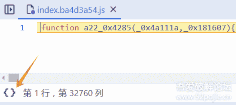

Pasted image 20240903121705.png (16.31 KB, 下载次数: 1)

[href="forum.php?mod=attachment&aid=MjcyMTgwOXwyYTk0OWE3ZHwxNzkzNTcxODU0fDE2ODA4NnwxOTYxNDk1&nothumb=yes" target="_blank"](https://www.52pojie.cn/forum.php?mod=attachment&aid=MjcyMTgwOXwyYTk0OWE3ZHwxNzkzNTcxODU0fDE2ODA4NnwxOTYxNDk1&nothumb=yes)

2024-9-4 22:37 上传

刷新后再点栈切到这里，注释掉2个调用，再保存一下，刷新后顺利进入页面

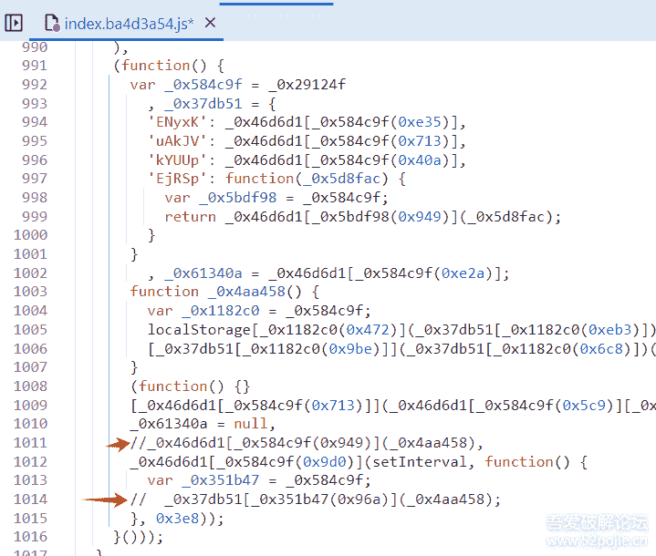

Pasted image 20240903122020.png (91.65 KB, 下载次数: 1)

[href="forum.php?mod=attachment&aid=MjcyMTgxMHxhYTZiMzk2YnwxNzkzNTcxODU0fDE2ODA4NnwxOTYxNDk1&nothumb=yes" target="_blank"](https://www.52pojie.cn/forum.php?mod=attachment&aid=MjcyMTgxMHxhYTZiMzk2YnwxNzkzNTcxODU0fDE2ODA4NnwxOTYxNDk1&nothumb=yes)

2024-9-4 22:37 上传


Pasted image 20240903122336.png (23.2 KB, 下载次数: 1)

[href="forum.php?mod=attachment&aid=MjcyMTgxMXwwNzgwM2Q1MHwxNzkzNTcxODU0fDE2ODA4NnwxOTYxNDk1&nothumb=yes" target="_blank"](https://www.52pojie.cn/forum.php?mod=attachment&aid=MjcyMTgxMXwwNzgwM2Q1MHwxNzkzNTcxODU0fDE2ODA4NnwxOTYxNDk1&nothumb=yes)

2024-9-4 22:37 上传

### 4> 明确参数

控制台切到网络页面，清掉前面的数据，页面随便填数据，点登录，发现3个包

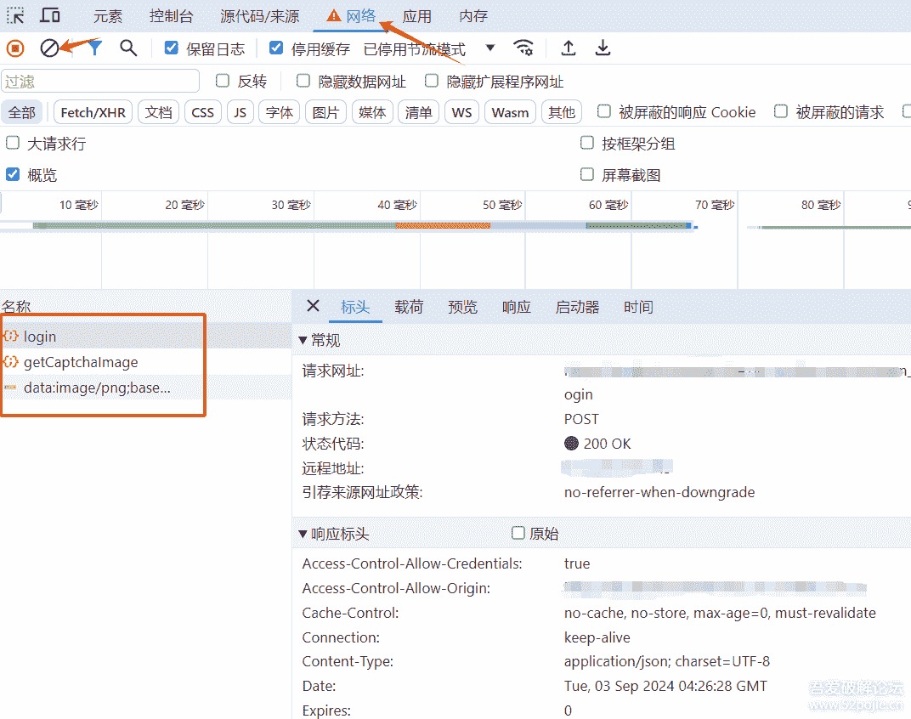

Pasted image 20240903123137.png (90.56 KB, 下载次数: 1)

[href="forum.php?mod=attachment&aid=MjcyMTgxMnw0MWIyZTRlNXwxNzkzNTcxODU0fDE2ODA4NnwxOTYxNDk1&nothumb=yes" target="_blank"](https://www.52pojie.cn/forum.php?mod=attachment&aid=MjcyMTgxMnw0MWIyZTRlNXwxNzkzNTcxODU0fDE2ODA4NnwxOTYxNDk1&nothumb=yes)

2024-9-4 22:37 上传

逐一点开看右侧的数据，发现请求头都没带加密参数，查看载荷和预览

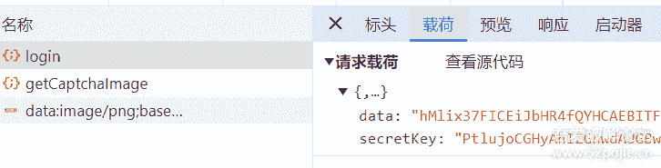

Pasted image 20240903123345.png (26.79 KB, 下载次数: 2)

[href="forum.php?mod=attachment&aid=MjcyMTgxM3w3YzE3NGY4OXwxNzkzNTcxODU0fDE2ODA4NnwxOTYxNDk1&nothumb=yes" target="_blank"](https://www.52pojie.cn/forum.php?mod=attachment&aid=MjcyMTgxM3w3YzE3NGY4OXwxNzkzNTcxODU0fDE2ODA4NnwxOTYxNDk1&nothumb=yes)

2024-9-4 22:37 上传

第一个包就应该是发送的数据，返回验证码已失效，下面的包重新发送了验证码，应该是时间太长验证码失效，重新登录的意思，验证码是编码发过来的，第三个包就是解码后的验证码

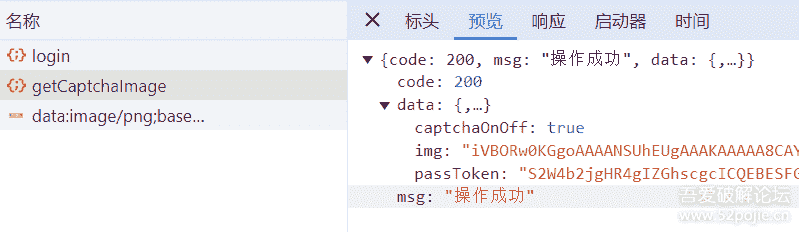

Pasted image 20240903123514.png (29.88 KB, 下载次数: 1)

[href="forum.php?mod=attachment&aid=MjcyMTgxNHw1Njc0NmMxZnwxNzkzNTcxODU0fDE2ODA4NnwxOTYxNDk1&nothumb=yes" target="_blank"](https://www.52pojie.cn/forum.php?mod=attachment&aid=MjcyMTgxNHw1Njc0NmMxZnwxNzkzNTcxODU0fDE2ODA4NnwxOTYxNDk1&nothumb=yes)

2024-9-4 22:37 上传

到这里就很明确了，要逆向的参数为`data`和`secretKey`

### 4> 参数分析

切回源代码页面，搜索`data`，总共有32个，太多了，再搜`secretKey`，只有2个，都打上断点

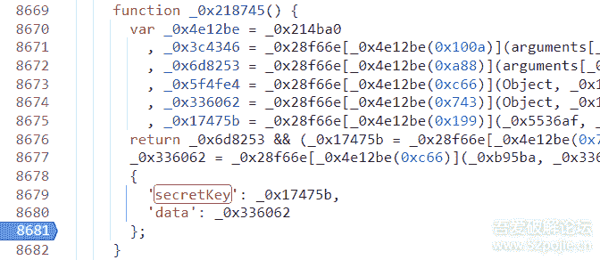

Pasted image 20240903124254.png (51.9 KB, 下载次数: 2)

[href="forum.php?mod=attachment&aid=MjcyMTgxNXw2ZGM4ZDM1YXwxNzkzNTcxODU0fDE2ODA4NnwxOTYxNDk1&nothumb=yes" target="_blank"](https://www.52pojie.cn/forum.php?mod=attachment&aid=MjcyMTgxNXw2ZGM4ZDM1YXwxNzkzNTcxODU0fDE2ODA4NnwxOTYxNDk1&nothumb=yes)

2024-9-4 22:37 上传

随便填数据，再点登录，成功断住

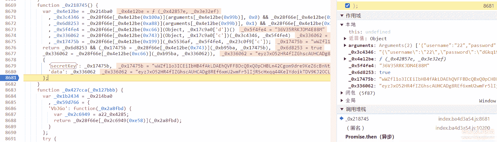

Pasted image 20240903124505.png (176.32 KB, 下载次数: 1)

[href="forum.php?mod=attachment&aid=MjcyMTgxNnxlYWI5MDdlZHwxNzkzNTcxODU0fDE2ODA4NnwxOTYxNDk1&nothumb=yes" target="_blank"](https://www.52pojie.cn/forum.php?mod=attachment&aid=MjcyMTgxNnxlYWI5MDdlZHwxNzkzNTcxODU0fDE2ODA4NnwxOTYxNDk1&nothumb=yes)

2024-9-4 22:37 上传

挺好的，明文密文一锅端了，再来看看里面的数据

`_0x3c4346`：明文，`password`已经加密，后面再找

`_0x6d8253`：ture，并参与后面的`return`计算，姑且认为是固定值，否则后面`_0x6d8253&&`为假就`return`不了

`_0x5f4fe4`：一个自执行函数返回的结果，结合下面的代码来看，应该是随机生成的密码，在控制台复制后面的自执行函数，确实返回了不同的字符串

`_0x336062`：把明文和密码放进函数，返回加密字符串，看着像是AES加密

`_0x17475b`：接收了3个参数，1是函数，2是密码，3是一个字符串

再下面就是`return`了，里面还有一些计算，我们先看这些东西

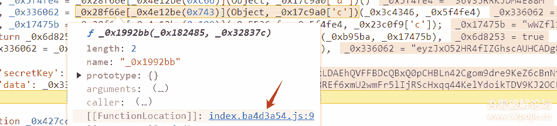

Pasted image 20240903130708.png (66.02 KB, 下载次数: 1)

[href="forum.php?mod=attachment&aid=MjcyMTgxN3w1NGQzN2U3NHwxNzkzNTcxODU0fDE2ODA4NnwxOTYxNDk1&nothumb=yes" target="_blank"](https://www.52pojie.cn/forum.php?mod=attachment&aid=MjcyMTgxN3w1NGQzN2U3NHwxNzkzNTcxODU0fDE2ODA4NnwxOTYxNDk1&nothumb=yes)

2024-9-4 22:37 上传

选中`_0x336062`后面的函数，点进去查看定义

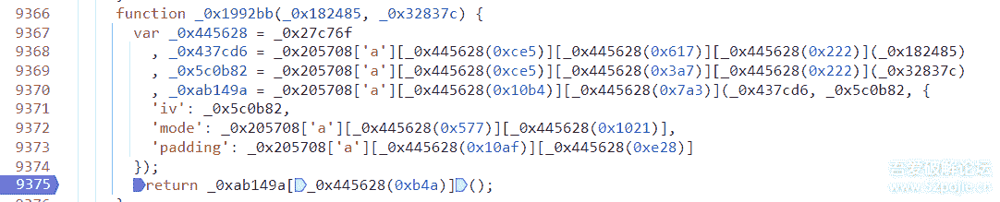

Pasted image 20240903130945.png (57.59 KB, 下载次数: 1)

[href="forum.php?mod=attachment&aid=MjcyMTgxOHwwMWQ4MmMxMXwxNzkzNTcxODU0fDE2ODA4NnwxOTYxNDk1&nothumb=yes" target="_blank"](https://www.52pojie.cn/forum.php?mod=attachment&aid=MjcyMTgxOHwwMWQ4MmMxMXwxNzkzNTcxODU0fDE2ODA4NnwxOTYxNDk1&nothumb=yes)

2024-9-4 22:37 上传

很明显的一个加密函数，打上断点，重新发数据，成功断住

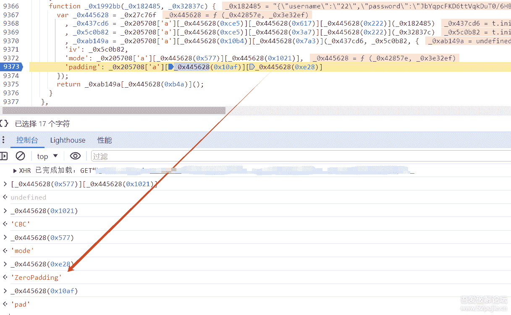

Pasted image 20240903131325.png (116.48 KB, 下载次数: 1)

[href="forum.php?mod=attachment&aid=MjcyMjk3N3w5Y2Q1NzliNHwxNzkzNTcxODU0fDE2ODA4NnwxOTYxNDk1&nothumb=yes" target="_blank"](https://www.52pojie.cn/forum.php?mod=attachment&aid=MjcyMjk3N3w5Y2Q1NzliNHwxNzkzNTcxODU0fDE2ODA4NnwxOTYxNDk1&nothumb=yes)

2024-9-11 15:48 上传

明显的AES加密，但这里出现了一个坑，填充模式是`'ZeroPadding'`，不是常用的`Pkcs7`

用工具验证一下，没有问题

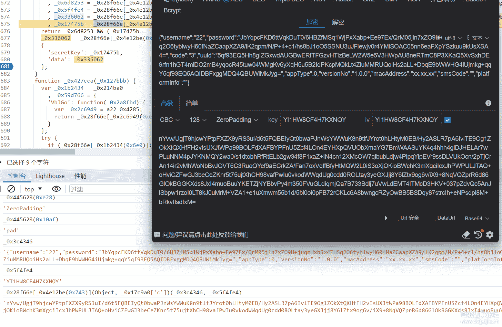

Pasted image 20240903222903.png (366.72 KB, 下载次数: 1)

[href="forum.php?mod=attachment&aid=MjcyMTgyMHxjODg1OGFlY3wxNzkzNTcxODU0fDE2ODA4NnwxOTYxNDk1&nothumb=yes" target="_blank"](https://www.52pojie.cn/forum.php?mod=attachment&aid=MjcyMTgyMHxjODg1OGFlY3wxNzkzNTcxODU0fDE2ODA4NnwxOTYxNDk1&nothumb=yes)

2024-9-4 22:37 上传

然后是`_0x17475b`，用上面的方法查看函数定义，发现第一参数是一个函数，把后面2个参数传进函数。

同样的查看第一参数函数的定义，这函数只接收一个参数，我？？？不管怎么说，在返回处下个断点先，然后不小心刷新了一下页面，重新提交后成功断住，却发现了额外惊喜

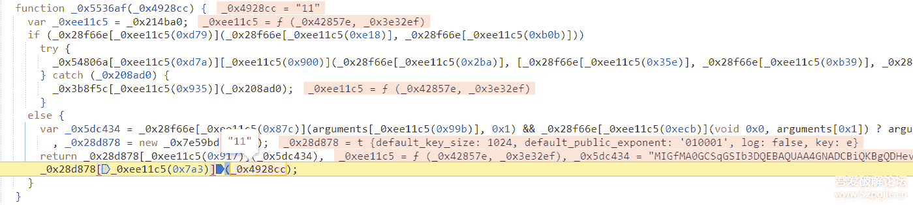

Pasted image 20240903225444.png (77.03 KB, 下载次数: 1)

[href="forum.php?mod=attachment&aid=MjcyMTgyMXw1N2NmMDg4OXwxNzkzNTcxODU0fDE2ODA4NnwxOTYxNDk1&nothumb=yes" target="_blank"](https://www.52pojie.cn/forum.php?mod=attachment&aid=MjcyMTgyMXw1N2NmMDg4OXwxNzkzNTcxODU0fDE2ODA4NnwxOTYxNDk1&nothumb=yes)

2024-9-4 22:37 上传

这个11不是我输入的密码吗？前面的密码也是在这里加密的，直接破案

MIG开头的是很明显的RSA公钥，加上1024,010001这2个参数，基本确定是rsa加密了，可惜没办法验证，RSA加密的结果每次都不一样。

再按F8继续执行，又回到此处，这次是之前的`KEY`传进来了，同时注意到尽管函数只接收1个参数，但这里还是用了第二个参数，即另外一组公钥，呵呵，这就是JS

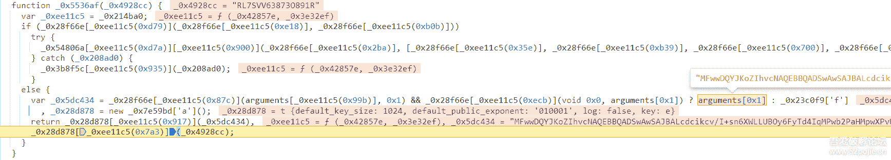

Pasted image 20240903230710.png (87.98 KB, 下载次数: 1)

[href="forum.php?mod=attachment&aid=MjcyMTgyMnxiM2U2NDgyOXwxNzkzNTcxODU0fDE2ODA4NnwxOTYxNDk1&nothumb=yes" target="_blank"](https://www.52pojie.cn/forum.php?mod=attachment&aid=MjcyMTgyMnxiM2U2NDgyOXwxNzkzNTcxODU0fDE2ODA4NnwxOTYxNDk1&nothumb=yes)

2024-9-4 22:37 上传

再往下走，在最终`return`之前，还进行了一些操作

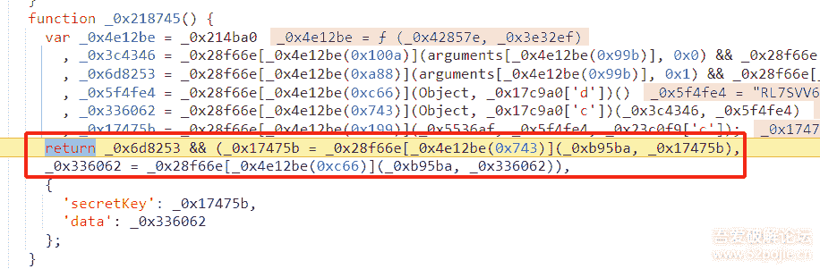

Pasted image 20240903231334.png (60.42 KB, 下载次数: 1)

[href="forum.php?mod=attachment&aid=MjcyMTgyM3xhM2M3MTIzNnwxNzkzNTcxODU0fDE2ODA4NnwxOTYxNDk1&nothumb=yes" target="_blank"](https://www.52pojie.cn/forum.php?mod=attachment&aid=MjcyMTgyM3xhM2M3MTIzNnwxNzkzNTcxODU0fDE2ODA4NnwxOTYxNDk1&nothumb=yes)

2024-9-4 22:37 上传

这里查看函数定义，仍然是第一参数是函数，把第二个参数传进去执行。查看`_0xb95ba`函数的定义

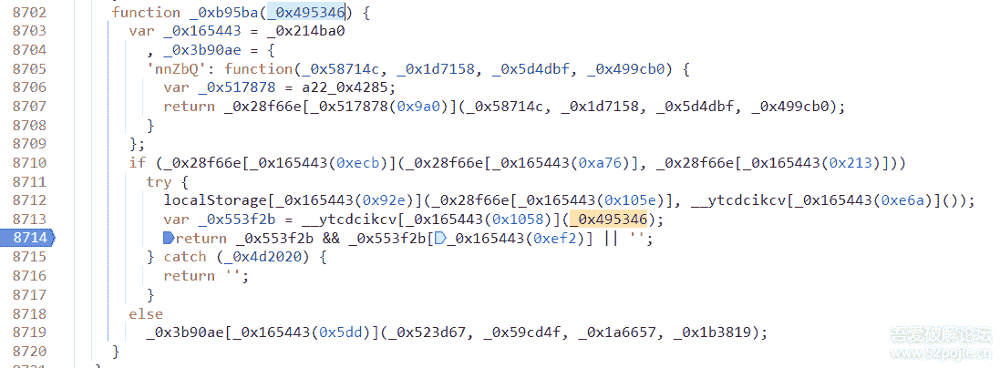

Pasted image 20240903231652.png (74.23 KB, 下载次数: 1)

[href="forum.php?mod=attachment&aid=MjcyMTgyNHxiMGNkYzExOXwxNzkzNTcxODU0fDE2ODA4NnwxOTYxNDk1&nothumb=yes" target="_blank"](https://www.52pojie.cn/forum.php?mod=attachment&aid=MjcyMTgyNHxiMGNkYzExOXwxNzkzNTcxODU0fDE2ODA4NnwxOTYxNDk1&nothumb=yes)

2024-9-4 22:37 上传

只在一个`return`之前用了传进来的参数，那么在`return`这里下断，成功断住

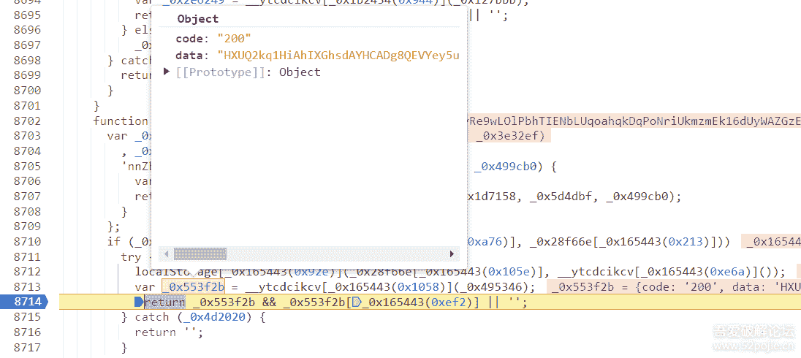

Pasted image 20240903232057.png (89.83 KB, 下载次数: 1)

[href="forum.php?mod=attachment&aid=MjcyMTgyNXxkNGQwMjk1NXwxNzkzNTcxODU0fDE2ODA4NnwxOTYxNDk1&nothumb=yes" target="_blank"](https://www.52pojie.cn/forum.php?mod=attachment&aid=MjcyMTgyNXxkNGQwMjk1NXwxNzkzNTcxODU0fDE2ODA4NnwxOTYxNDk1&nothumb=yes)

2024-9-4 22:37 上传

`return`返回的是`_0x553f2b`的`data`参数，生成`_0x553f2b`的函数追进去看看，然后一脸懵逼，是个VM虚拟机里的超级复杂的函数，足足有237行代码，太丧心病狂了，这叫非常简单？

大概翻了一下，找到点东西，这个函数返回`code`和`data`，里面有很多处`code`和`data`赋值，但大部分`data`是空值，只有2处`data`有赋值，直接在这2处下断，成功断住

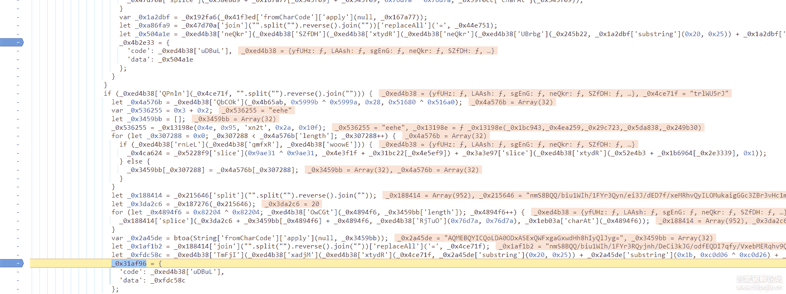

Pasted image 20240903233130.png (218.64 KB, 下载次数: 0)

[href="forum.php?mod=attachment&aid=MjcyMTgyNnxmNzhiN2IxN3wxNzkzNTcxODU0fDE2ODA4NnwxOTYxNDk1&nothumb=yes" target="_blank"](https://www.52pojie.cn/forum.php?mod=attachment&aid=MjcyMTgyNnxmNzhiN2IxN3wxNzkzNTcxODU0fDE2ODA4NnwxOTYxNDk1&nothumb=yes)

2024-9-4 22:38 上传

然后就开始了漫长又痛苦的分析过程，过程略过，反正就是查看定义，看混淆的内容，查看入参出参，分析每个语句是做什么的，分析的结果如下

```
```


# 算法逆向记录

## 核心步骤

1. 传入之前加密的密文`_0x215646` -> `data`
2. 生成32为随机密钥`_0x1eb03a` -> `key`
3. `temp = _0x1eb03a + _0x215646 + _0x1eb03a`
4. `_0x215646 = aes加密(temp, key);` //ECB模式 Pkcs7 Padding
5. 生成空字符串`_0x4ce71f`
6. 生成8位随机字符串`_0x18952d`并进行处理，如果处理后结果大于550，把`_0x18952d`赋值给`_0x4ce71f`，否则循环100次直到结果长度>550，都不满足则走另外流程
7. 生成32位随机数组`_0x4a576b`，值为1-40内
8. 生成空数组`_0x3459bb`，并把`_0x4a576b`赋值给`_0x3459bb`
9. 把`_0x215646`按字符拆分成数组`_0x188414`
10. 把`_0x215646`进行处理得到一个数字`_0x3da2c6`
11. 在`_0x188414`中某个位置插入字符，算法用到了`_0x3da2c6`、`_0x3459bb`、`_0x1eb03a`（固定字符串`gRJly8wsdlflx8NAgWQ6VYix1TyCvnSF`）
12. 把`_0x3459bb`中的数字转换为对应的字符，组合成字符串，然后将该字符串转换为 Base64 编码的字符串，并赋值给变量`_0x2a45de`
13. 把数组`_0x188414`中的内容合并成一个字符串，然后替换这个字符串中的所有等号（`=`）字符为变量`_0x4ce71f`的值，并将结果赋值给变量`_0x1af1b2`
14. 生成最终结果`_0xfdc58c`，值为
`_0x4ce71f + _0x2a45de(32到37位) + _0x2a45de(27到33位) + _0x2a45de(5到640位) + _0x2a45de(16到37位) + _0x1af1b2 + _0x2a45de(0到5位) + _0x2a45de(24到27位) + _0x2a45de(6到22位) + _0x2a45de(21到42位) + _0x2a45de(37到44位)`

## 分析过程

正当我想用`python`还原算法的时候，某人又找过来了，问我怎么这么慢，然后我倒了一肚子的苦水，他就问了两句话：你不会反混淆吗？你不会扣代码吗？我....

想死的心都有了，学安卓逆向给学傻了，这些全都给忘了。

把代码复制到`pycharm`中，全部折叠，再展开一层

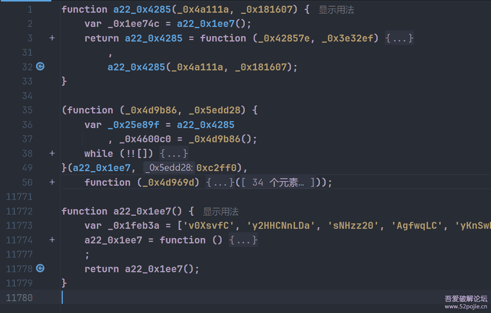

Pasted image 20240903235247.png (153.01 KB, 下载次数: 1)

[href="forum.php?mod=attachment&aid=MjcyMTgyN3w0ODJjMjk5MnwxNzkzNTcxODU0fDE2ODA4NnwxOTYxNDk1&nothumb=yes" target="_blank"](https://www.52pojie.cn/forum.php?mod=attachment&aid=MjcyMTgyN3w0ODJjMjk5MnwxNzkzNTcxODU0fDE2ODA4NnwxOTYxNDk1&nothumb=yes)

2024-9-4 22:38 上传

这不很明显的ob混淆结构嘛，重构函数，解密函数，主函数，大数组，齐了，拿工具直接反混淆，再替换回去

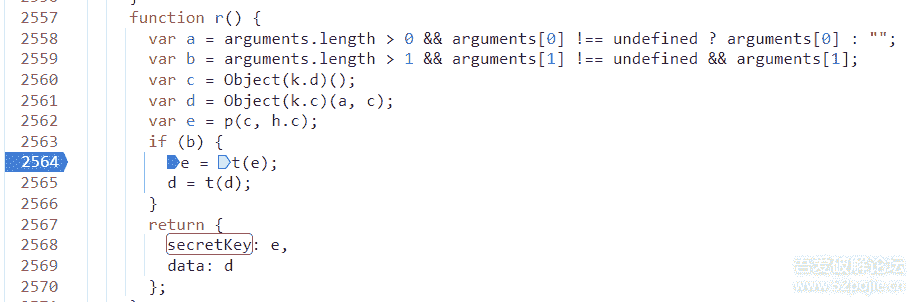

Pasted image 20240904001042.png (37.47 KB, 下载次数: 1)

[href="forum.php?mod=attachment&aid=MjcyMTgyOHxiYzYyN2JlOXwxNzkzNTcxODU0fDE2ODA4NnwxOTYxNDk1&nothumb=yes" target="_blank"](https://www.52pojie.cn/forum.php?mod=attachment&aid=MjcyMTgyOHxiYzYyN2JlOXwxNzkzNTcxODU0fDE2ODA4NnwxOTYxNDk1&nothumb=yes)

2024-9-4 22:38 上传

这解混淆后看起来要舒服一万倍，vm算法虚拟机里的东西也全扣出来，算法函数是`_0x385e31`

直接`node.js`跑，传参调用，返回`data`是空值，看来走了另外一个流程，稍微分析了一下，是`_0x723668`值判断的时候走了另外的分支。

改简单，直接判断取反，然后继续跑，报错，`CryptoJS`未定义，导入就行

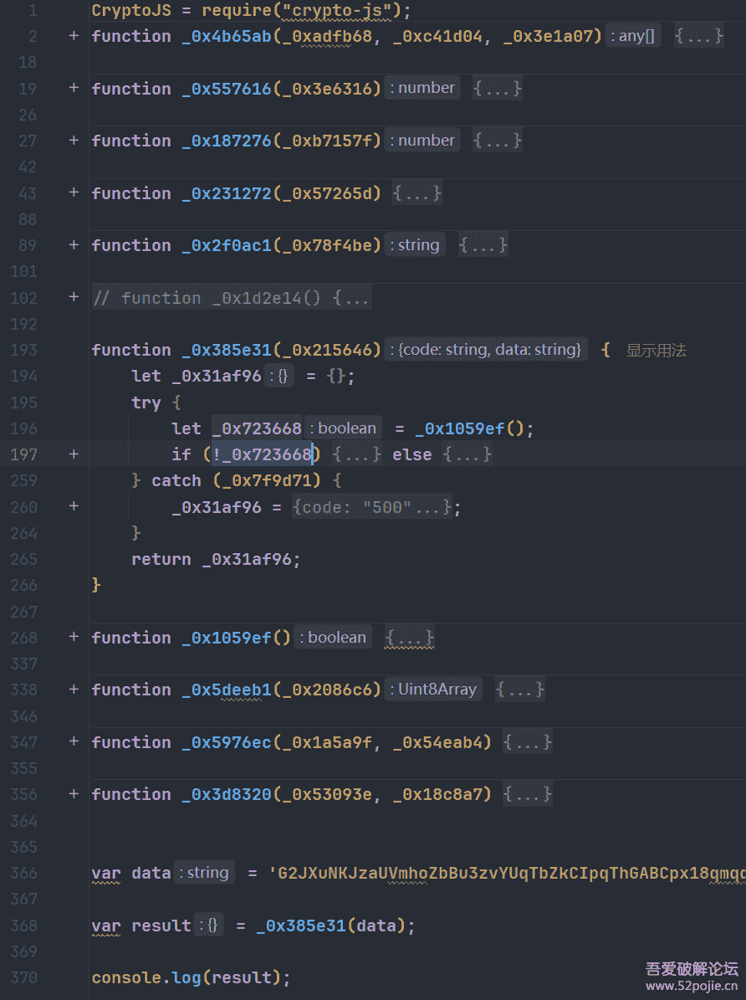

Pasted image 20240904002026.png (196.33 KB, 下载次数: 1)

[href="forum.php?mod=attachment&aid=MjcyMTgyOXwwMTQ4NDIzNnwxNzkzNTcxODU0fDE2ODA4NnwxOTYxNDk1&nothumb=yes" target="_blank"](https://www.52pojie.cn/forum.php?mod=attachment&aid=MjcyMTgyOXwwMTQ4NDIzNnwxNzkzNTcxODU0fDE2ODA4NnwxOTYxNDk1&nothumb=yes)

2024-9-4 22:38 上传

终于出结果了，这个`data`就是最终生成的值，后面测试发现`secretKey`和`data`都是走的这个流程

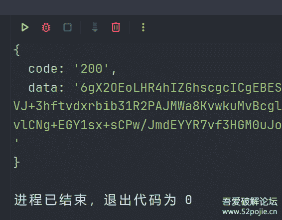

Pasted image 20240904002136.png (47.4 KB, 下载次数: 1)

[href="forum.php?mod=attachment&aid=MjcyMTgzMHxhODBiODIzZHwxNzkzNTcxODU0fDE2ODA4NnwxOTYxNDk1&nothumb=yes" target="_blank"](https://www.52pojie.cn/forum.php?mod=attachment&aid=MjcyMTgzMHxhODBiODIzZHwxNzkzNTcxODU0fDE2ODA4NnwxOTYxNDk1&nothumb=yes)

2024-9-4 22:38 上传

整个流程分析完了，回去检查一下有没有问题，结果还真发现问题了，最开始传入的明文里有个`uuid`，然后又开始痛苦的追栈，死活找不到

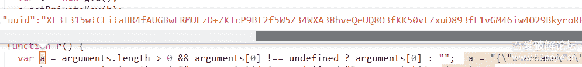

Pasted image 20240904002822.png (24.3 KB, 下载次数: 1)

[href="forum.php?mod=attachment&aid=MjcyMTgzMXw1YTBhMzNiMXwxNzkzNTcxODU0fDE2ODA4NnwxOTYxNDk1&nothumb=yes" target="_blank"](https://www.52pojie.cn/forum.php?mod=attachment&aid=MjcyMTgzMXw1YTBhMzNiMXwxNzkzNTcxODU0fDE2ODA4NnwxOTYxNDk1&nothumb=yes)

2024-9-4 22:38 上传

看样子像某个加密的数据，又翻了一下加密那块，也没有。

正一筹莫展的盯着这个`"uuid":`，突然想到可以直接搜字符串试试啊，试试又不要钱。

一下还真让我搜到了，在另外一个js文件里，就1个赋值的地方，老样子，解混淆，替换文件，下断，刷新，填数据提交一气呵成，然后没断住...

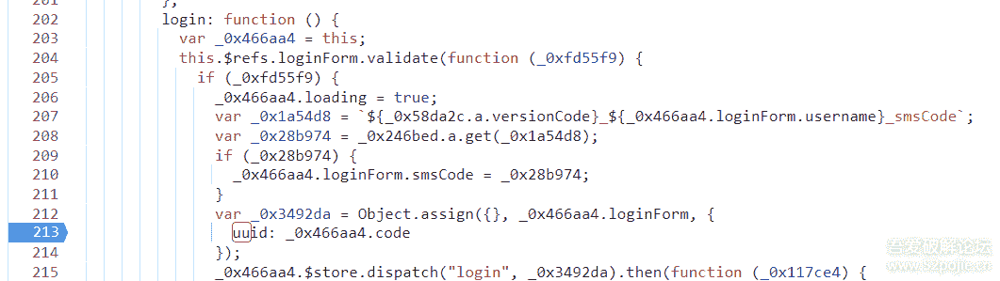

Pasted image 20240904003650.png (55.4 KB, 下载次数: 1)

[href="forum.php?mod=attachment&aid=MjcyMTgzMnw5OTYyNDczMHwxNzkzNTcxODU0fDE2ODA4NnwxOTYxNDk1&nothumb=yes" target="_blank"](https://www.52pojie.cn/forum.php?mod=attachment&aid=MjcyMTgzMnw5OTYyNDczMHwxNzkzNTcxODU0fDE2ODA4NnwxOTYxNDk1&nothumb=yes)

2024-9-4 22:38 上传

线索又断了，看样子是从`_0x466aa4`里取的`code`，上面`_0x466aa4`又指向`this`，去翻翻`this`吧，往上慢慢翻。然后就看见了这个

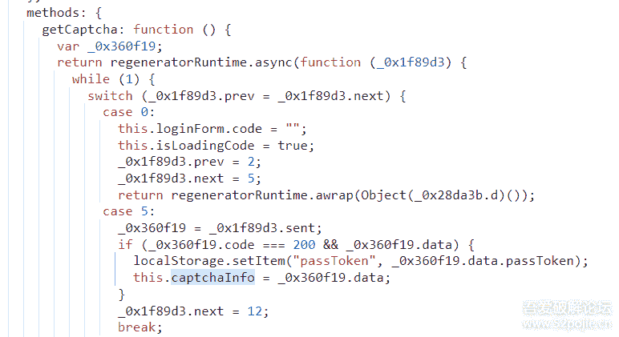

Pasted image 20240904004532.png (48.97 KB, 下载次数: 2)

[href="forum.php?mod=attachment&aid=MjcyMTgzM3w3YzEyOGQwNXwxNzkzNTcxODU0fDE2ODA4NnwxOTYxNDk1&nothumb=yes" target="_blank"](https://www.52pojie.cn/forum.php?mod=attachment&aid=MjcyMTgzM3w3YzEyOGQwNXwxNzkzNTcxODU0fDE2ODA4NnwxOTYxNDk1&nothumb=yes)

2024-9-4 22:38 上传

嗯？`data`？`code`？`passToken`？脑袋里突然就灵光一闪，去看看那个`passToken`！

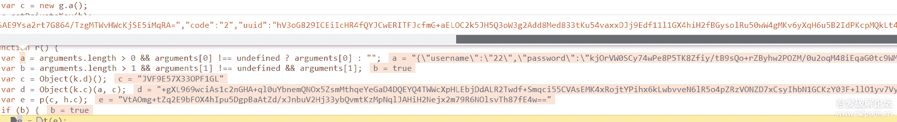

Pasted image 20240904005341.png (67.58 KB, 下载次数: 1)

[href="forum.php?mod=attachment&aid=MjcyMTgzNHwxYWJmYjlmY3wxNzkzNTcxODU0fDE2ODA4NnwxOTYxNDk1&nothumb=yes" target="_blank"](https://www.52pojie.cn/forum.php?mod=attachment&aid=MjcyMTgzNHwxYWJmYjlmY3wxNzkzNTcxODU0fDE2ODA4NnwxOTYxNDk1&nothumb=yes)

2024-9-4 22:38 上传

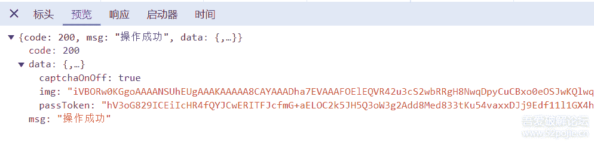

Pasted image 20240904005411.png (30.62 KB, 下载次数: 1)

[href="forum.php?mod=attachment&aid=MjcyMTgzNXwyOTZjMzIwOXwxNzkzNTcxODU0fDE2ODA4NnwxOTYxNDk1&nothumb=yes" target="_blank"](https://www.52pojie.cn/forum.php?mod=attachment&aid=MjcyMTgzNXwyOTZjMzIwOXwxNzkzNTcxODU0fDE2ODA4NnwxOTYxNDk1&nothumb=yes)

2024-9-4 22:38 上传

直接进行文本对比，完美

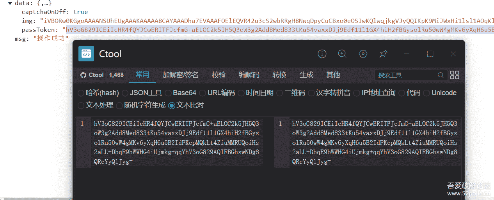

Pasted image 20240904005554.png (85.05 KB, 下载次数: 1)

[href="forum.php?mod=attachment&aid=MjcyMTgzNnw2MTM5NGE4M3wxNzkzNTcxODU0fDE2ODA4NnwxOTYxNDk1&nothumb=yes" target="_blank"](https://www.52pojie.cn/forum.php?mod=attachment&aid=MjcyMTgzNnw2MTM5NGE4M3wxNzkzNTcxODU0fDE2ODA4NnwxOTYxNDk1&nothumb=yes)

2024-9-4 22:38 上传

明文还有个参数是`code`，就是输入的验证码，至此就全部分析完成

## 总结

就一句话，我太菜了。说起来确实非常简单，但是长期不用导致很多最基本的东西都忘了，反混淆，扣代码，通过字符串查找，导致浪费了很多时间，菜就要多练，那么下次见了。


Pasted image 20240904010629.png (650.54 KB, 下载次数: 1)

[href="forum.php?mod=attachment&aid=MjcyMTgzN3w4MTM1NWQ4MnwxNzkzNTcxODU0fDE2ODA4NnwxOTYxNDk1&nothumb=yes" target="_blank"](https://www.52pojie.cn/forum.php?mod=attachment&aid=MjcyMTgzN3w4MTM1NWQ4MnwxNzkzNTcxODU0fDE2ODA4NnwxOTYxNDk1&nothumb=yes)

2024-9-4 22:38 上传
