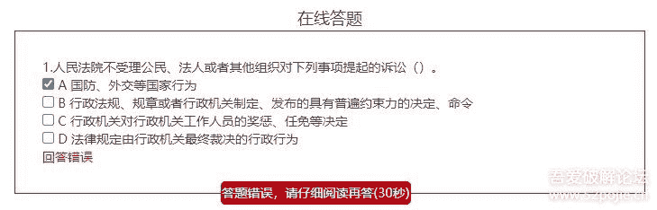
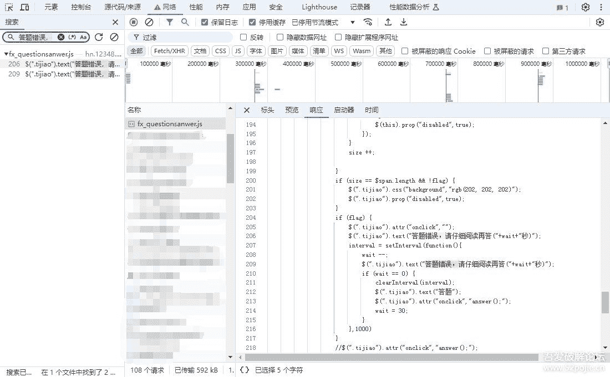
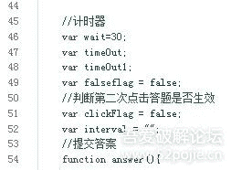

# [Web逆向] 某学法平台，答题错误时候跳过等待时间

- 原帖：[https://www.52pojie.cn/forum.php?mod=viewthread&tid=1961564](https://www.52pojie.cn/forum.php?mod=viewthread&tid=1961564)
- 抓取时间：2026-11-01T22:24:14

此贴是记录我第一次把逆向知识实际运用的过程，经验欠缺，思路不严谨，见笑了。

又到了一年一度的学法时段，这个平台答题没有次数限制，但是答错需要等待30秒才能重新答题，可以通过刷新页面跳过等待时间，但是遇上网络不稳的时候，刷新等待时间也差不多接近30秒了。

回答错误.png (33.43 KB, 下载次数: 0)

[下载附件](https://www.52pojie.cn/forum.php?mod=attachment&aid=MjcyMTg3MHw4MGVhOGNmMXwxNzkzNTcxODUyfDE2ODA4NnwxOTYxNTY0&nothumb=yes)

回答错误时候需要等待30秒

2024-9-5 09:10 上传

如果是单选题还好，运气不好最多回答4次（等待3个30秒），但是如果是不定项多选题就……

所以我的目标是——偷懒，即答题错误后，不想等待，马上重新回答。

开干。

F12打开控制台，刷新页面之后，搜索关键词“答题错误，请仔细阅读再答”，很好，结果只有一个。

搜索结果.png (115.27 KB, 下载次数: 0)

[下载附件](https://www.52pojie.cn/forum.php?mod=attachment&aid=MjcyMTg3NXxmY2U0M2MxM3wxNzkzNTcxODUyfDE2ODA4NnwxOTYxNTY0&nothumb=yes)

2024-9-5 09:33 上传

很显然，`wait`就是等待时间。我兴冲冲的把这个时间改成1秒，刷新页面答题试试，结果怎么还是倒计时30秒？！

原来这段代码的赋值，是当`wait=0`之后，即第二次答题失败才生效。

那么往上翻一翻，找到`wait`第一次赋值时候的语句，把它修改为1（基础知识不牢，我怕直接修改为0，下面代码会有问题）。

wait赋值.png (13.47 KB, 下载次数: 0)

[下载附件](https://www.52pojie.cn/forum.php?mod=attachment&aid=MjcyMTg3M3wxYTJjMzAxY3wxNzkzNTcxODUyfDE2ODA4NnwxOTYxNTY0&nothumb=yes)

2024-9-5 09:26 上传

再次刷新，很好~我可以愉快的刷题了。

等到兴奋劲过去，我想，还能不能再缩短等待时间呢？

回忆一下`setInterval()`函数的各参数意思，我把`1000`改为`100`、`10`、`1`，哇喔，时间过得飞快。

到此已基本实现我最初的需求，但是本着学习精神，我继续研究了这段代码。

我发现，出现答题错误倒计时的判断关键在`flag`变量，而且这个`if`函数没有`else`部分，如果`flag`恒为`false`……不就完全跳过等待，这才是我追求的目标呀。

一次简单的时间跳过，居然让我爽了三次。

果然还是要不断实践才能把知识转化为自己的经验。

靠自己的努力，实现目标时候的成就感，才是最真实、最持久的满足感。
