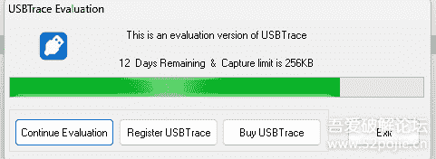
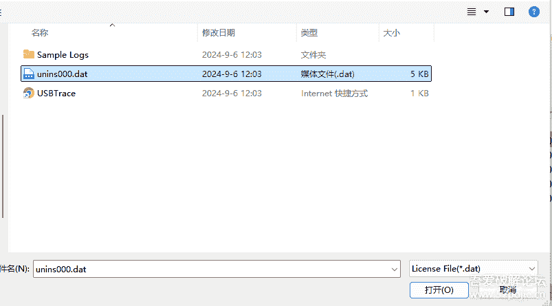
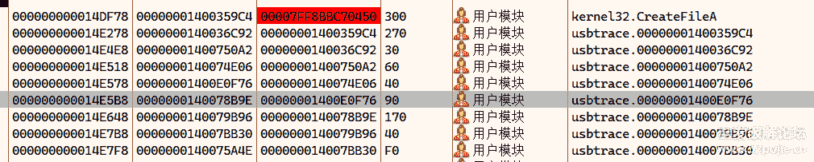
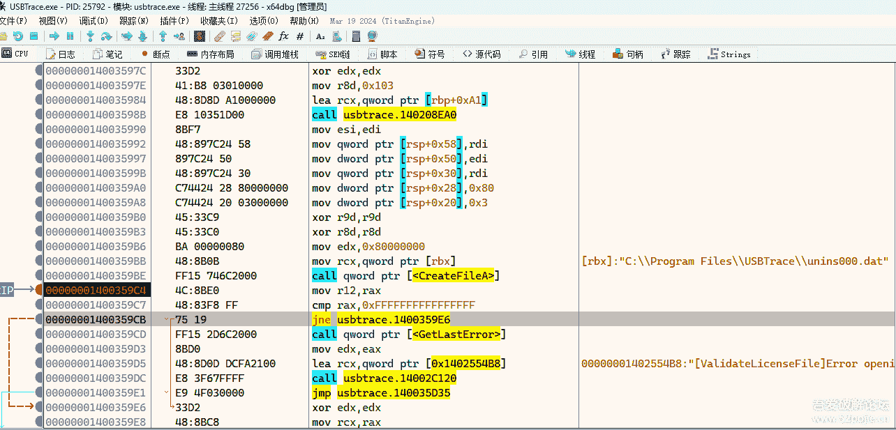
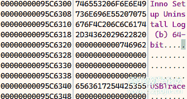

# [原创] 记录一次有缺的USBTrace分析

- 原帖：<https://www.52pojie.cn/forum.php?mod=viewthread&tid=1963181>
- 抓取时间：`2026-11-01T22:24:02`

## 前言

前段时间有看到有人在找`USBTrace`软件，在网上找了也没看到有相关免费使用的教程。自己试了试，成功将程序解开功能也都能使用。结果不太优雅。

废话不多说了，进入教程正题吧。本案例中所有内容仅供个人学习交流，严禁用于商业用途和非法用途，否则由此产生的一切后果均与作者无关！

## 体验软件

首先去`USBTrace`官方网站将软件下载下来，正常走一遍使用流程。

## 分析注册流程

安装的是`x64`，工具：`x64dbg`、`IDA`。

软件的注册页面



`login.png`（15.82 KB，下载次数：0）  
[login.png](https://www.52pojie.cn/forum.php?mod=attachment&aid=MjcyMjczM3xhMjhhM2JiN3wxNzkzNTcxODQwfDE2ODA4NnwxOTYzMTgx&nothumb=yes)  
登录  
2024-9-10 13:56 上传

用`x64dbg`附加，点击`Register USBTrace`，然后回弹出一个这样的框，他会让选择文件，由此可以判读出，它肯定调用了`CreateFile`函数。所以在`CreateFileA`和`CreateFileW`上下断点。


`register_selectFile.png`（15.82 KB，下载次数：1）  
[register_selectFile.png](https://www.52pojie.cn/forum.php?mod=attachment&aid=MjcyMjczNHw3MGFmYzIwZnwxNzkzNTcxODQwfDE2ODA4NnwxOTYzMTgx&nothumb=yes)  
register_selectFile.png  
2024-9-10 13:56 上传

在选文件的对话框中观察到他的`License File(*.dat)`，所以就选`unins000.dat`文件即可。



`selectDatFile.png`（26.11 KB，下载次数：0）  
[selectDatFile.png](https://www.52pojie.cn/forum.php?mod=attachment&aid=MjcyMjczNXxkMmJmN2UwOHwxNzkzNTcxODQwfDE2ODA4NnwxOTYzMTgx&nothumb=yes)  
selectDatFile.png  
2024-9-10 13:56 上传

他在`CreateFileA`断下，然后去看调用堆栈，看他上一层的调用函数是谁，在上一层调用里下断点。



`callBack.png`（42.71 KB，下载次数：0）  
[callBack.png](https://www.52pojie.cn/forum.php?mod=attachment&aid=MjcyMjczMXxkZDMzZWM3YnwxNzkzNTcxODQwfDE2ODA4NnwxOTYzMTgx&nothumb=yes)  
callBack  
2024-9-10 13:56 上传

上一层的位置



`upPose.png`（145.33 KB，下载次数：0）  
[upPose.png](https://www.52pojie.cn/forum.php?mod=attachment&aid=MjcyMjczNnw1ODQ5MmE3MXwxNzkzNTcxODQwfDE2ODA4NnwxOTYzMTgx&nothumb=yes)  
upPose  
2024-9-10 13:56 上传

在这里可以看到主模块是`USBTrace.exe`，然后把它拖到`IDA`中进行分析。同时将两个的基址设置一样，在`X64dbg`中复制地址在`IDA`中跳转到相应位置。`F5`查看反汇编代码，看一下整个流程。

在其中有看到`ReadFile`函数被调用，在网上搜索该函数，该函数的第二个参数是接收读取到内容的缓存区。

接下来就是在`X64dbg`中动态调试分析。

运行过`ReadFile`之后在内存窗口中可以看到`unins000.dat`文件的内容被读取进来。



`datFileContent.png`（19.36 KB，下载次数：0）  
[datFileContent.png](https://www.52pojie.cn/forum.php?mod=attachment&aid=MjcyMjczMnw5OTZmODkyMnwxNzkzNTcxODQwfDE2ODA4NnwxOTYzMTgx&nothumb=yes)  
datFileContent  
2024-9-10 13:56 上传

在`IDA`中看到在`ReadFile`之后是在调`strtok_s`函数，该函数的参数作用如下：

```
//strtok_s()函数原型
_Check_return_ _CRTIMP_ALTERNATIVE 
    char *  __cdecl strtok_s(_Inout_opt_z_ char * _Str, _In_z_ const char * _Delim, _Inout_ _Deref_prepost_opt_z_ char ** _Context);
//第一个参数是要被分割的字符串
//第二个参数是分割的标识符
//第三个参数是用来存放被分割过的字符串
//返回值是分割过后的结果
```

所以在之前`ReadFile`之后的内容缓冲区头部给他改成`snlicdat#300024144#testUser#22/11/2025#(b)#cccccc`。

```
00000001400359BE | FF15 746C2000            | call qword ptr []             |

00000001400359C4 | 4C:8BE0                  | mov r12,rax                                |

00000001400359C7 | 48:83F8 FF               | cmp rax,0xFFFFFFFFFFFFFFFF                 |

00000001400359CB | 75 19                    | jne usbtrace.1400359E6                     |

00000001400359CD | FF15 2D6C2000            | call qword ptr []            |

00000001400359D3 | 8BD0                     | mov edx,eax                                | edx:"#"

00000001400359D5 | 48:8D0D DCFA2100         | lea rcx,qword ptr [0x1402554B8]            |  00000001402554B8:"

00000001400359DC | E8 3F67FFFF              | call usbtrace.14002C120                    |

00000001400359E1 | E9 4F030000              | jmp usbtrace.140035D35                     |

00000001400359E6 | 33D2                     | xor edx,edx                                | edx:"#"

00000001400359E8 | 48:8BC8                  | mov rcx,rax                                | 

00000001400359EB | FF15 FF6C2000            | call qword ptr []             |

00000001400359F1 | 44:8BF8                  | mov r15d,eax                               |

00000001400359F4 | 3D 00000400              | cmp eax,0x40000                            | 

00000001400359F9 | 76 11                    | jbe usbtrace.140035A0C                     |

00000001400359FB | 48:8D0D EEFA2100         | lea rcx,qword ptr [0x1402554F0]            | 

0000000140035A02 | E8 1967FFFF              | call usbtrace.14002C120                    |

0000000140035A07 | E9 ED020000              | jmp usbtrace.140035CF9                     |

0000000140035A0C | 41:8D5F 01               | lea ebx,qword ptr [r15+0x1]                |

0000000140035A10 | FF15 D26C2000            | call qword ptr []          |

0000000140035A16 | 48:8BC8                  | mov rcx,rax                                | 

0000000140035A19 | 44:8BC3                  | mov r8d,ebx                                |

0000000140035A1C | BA 08000000              | mov edx,0x8                                | edx:"#"

0000000140035A21 | FF15 B16C2000            | call qword ptr []               |

0000000140035A27 | 4C:8BF0                  | mov r14,rax                                | 

0000000140035A2A | 48:85C0                  | test rax,rax                               |

0000000140035A2D | 75 11                    | jne usbtrace.140035A40                     |

0000000140035A2F | 48:8D0D F2FA2100         | lea rcx,qword ptr [0x140255528]            | 

0000000140035A36 | E8 E566FFFF              | call usbtrace.14002C120                    |

0000000140035A3B | E9 B4020000              | jmp usbtrace.140035CF4                     |

0000000140035A40 | 48:897C24 20             | mov qword ptr [rsp+0x20],rdi               |

0000000140035A45 | 4C:8D4C24 68             | lea r9,qword ptr [rsp+0x68]                |

0000000140035A4A | 45:8BC7                  | mov r8d,r15d                               |

0000000140035A4D | 48:8BD0                  | mov rdx,rax                                | rdx:"#"

0000000140035A50 | 49:8BCC                  | mov rcx,r12                                | 

0000000140035A53 | FF15 87702000            | call qword ptr []                |

0000000140035A59 | 8BF8                     | mov edi,eax                                |

0000000140035A5B | 85C0                     | test eax,eax                               |

0000000140035A5D | 75 19                    | jne usbtrace.140035A78                     |

0000000140035A5F | FF15 9B6B2000            | call qword ptr []            |

0000000140035A65 | 8BD0                     | mov edx,eax                                | edx:"#"

0000000140035A67 | 48:8D0D F2FA2100         | lea rcx,qword ptr [0x140255560]            | 

0000000140035A6E | E8 AD66FFFF              | call usbtrace.14002C120                    |

0000000140035A73 | E9 7C020000              | jmp usbtrace.140035CF4                     |

0000000140035A78 | 4C:8D4424 60             | lea r8,qword ptr [rsp+0x60]                |

0000000140035A7D | 48:8D5424 40             | lea rdx,qword ptr [rsp+0x40]               |

0000000140035A82 | 49:8BCE                  | mov rcx,r14                                | 

0000000140035A85 | E8 EA481D00              | call                    |
```


```
0000000140035A8A | 48:85C0                  | test rax,rax                               |
0000000140035A8D | 75 07                    | jne usbtrace.140035A96                     |
0000000140035A8F | 33FF                     | xor edi,edi                                |
0000000140035A91 | E9 5E020000              | jmp usbtrace.140035CF4                     |
0000000140035A96 | 48:8D15 F3FA2100         | lea rdx,qword ptr [0x140255590]            | 
0000000140035A9D | 48:8BC8                  | mov rcx,rax                                | 
0000000140035AA0 | E8 2B4E1D00              | call                      |以"#"为分隔符 将分割出的第一个和snlicdat进行比较
0000000140035AA5 | 85C0                     | test eax,eax                               |
0000000140035AA7 | 74 07                    | je usbtrace.140035AB0                      |
0000000140035AA9 | 33FF                     | xor edi,edi                                |
0000000140035AAB | E9 44020000              | jmp usbtrace.140035CF4                     |
0000000140035AB0 | 4C:8D4424 60             | lea r8,qword ptr [rsp+0x60]                |
0000000140035AB5 | 48:8D5424 40             | lea rdx,qword ptr [rsp+0x40]               |
0000000140035ABA | 33C9                     | xor ecx,ecx                                | 
0000000140035ABC | E8 B3481D00              | call                    |
0000000140035AC1 | 48:8BD8                  | mov rbx,rax                                |
0000000140035AC4 | 48:85C0                  | test rax,rax                               |
0000000140035AC7 | 75 07                    | jne usbtrace.140035AD0                     |
0000000140035AC9 | 33FF                     | xor edi,edi                                |
0000000140035ACB | E9 24020000              | jmp usbtrace.140035CF4                     |
0000000140035AD0 | 4C:8BC0                  | mov r8,rax                                 |
0000000140035AD3 | BA 04010000              | mov edx,0x104                              | edx:"#"
0000000140035AD8 | 48:8D4D 90               | lea rcx,qword ptr [rbp-0x70]               |
0000000140035ADC | E8 2F351D00              | call                    |"将300024144拼接到一个缓冲区"
0000000140035AE1 | 4C:8D0D E0E52D00         | lea r9,qword ptr [0x1403140C8]             | r9:&"PE", 
0000000140035AE8 | 4C:8D15 F9E52D00         | lea r10,qword ptr [0x1403140E8]            | r10:NtReadFile+14
0000000140035AEF | 90                       | nop                                        |
0000000140035AF0 | 48:8BC3                  | mov rax,rbx                                |
0000000140035AF3 | 4D:8B01                  | mov r8,qword ptr [r9]                      | [r9]:"PE"
0000000140035AF6 | 4C:2BC3                  | sub r8,rbx                                 |
0000000140035AF9 | 0F1F80 00000000          | nop dword ptr [rax],eax                    |
0000000140035B00 | 0FB610                   | movzx edx,byte ptr [rax]                   | edx:"#"
0000000140035B03 | 42:0FB60C00              | movzx ecx,byte ptr [rax+r8]                | 
0000000140035B08 | 2BD1                     | sub edx,ecx                                | edx:"#", 
0000000140035B0A | 75 07                    | jne usbtrace.140035B13                     |
0000000140035B0C | 48:FFC0                  | inc rax                                    |
0000000140035B0F | 85C9                     | test ecx,ecx                               | 
0000000140035B11 | 75 ED                    | jne usbtrace.140035B00                     |
0000000140035B13 | 85D2                     | test edx,edx                               | edx:"#"
0000000140035B15 | 74 16                    | je usbtrace.140035B2D                      |
0000000140035B17 | 49:83C1 08               | add r9,0x8                                 | r9:&"PE"
0000000140035B1B | 4D:3BCA                  | cmp r9,r10                                 | r9:&"PE", r10:NtReadFile+14
0000000140035B1E | 7C D0                    | jl usbtrace.140035AF0                      |
0000000140035B20 | 397424 68                | cmp dword ptr [rsp+0x68],esi               |
0000000140035B24 | 75 07                    | jne usbtrace.140035B2D                     |
0000000140035B26 | 33FF                     | xor edi,edi                                |
0000000140035B28 | E9 C7010000              | jmp usbtrace.140035CF4                     |
0000000140035B2D | 4C:8D4424 60             | lea r8,qword ptr [rsp+0x60]                |
0000000140035B32 | 48:8D5424 40             | lea rdx,qword ptr [rsp+0x40]               |
0000000140035B37 | 33C9                     | xor ecx,ecx                                | 
0000000140035B39 | E8 36481D00              | call                    |
0000000140035B3E | 48:8BD8                  | mov rbx,rax                                |
0000000140035B41 | 48:85C0                  | test rax,rax                               |
0000000140035B44 | 75 07                    | jne usbtrace.140035B4D                     |
0000000140035B46 | 33FF                     | xor edi,edi                                |
0000000140035B48 | E9 A7010000              | jmp usbtrace.140035CF4                     |
0000000140035B4D | 4C:8BC0                  | mov r8,rax                                 |
0000000140035B50 | BA 04010000              | mov edx,0x104                              | edx:"#"
0000000140035B55 | 48:8D4D 90               | lea rcx,qword ptr [rbp-0x70]               |
0000000140035B59 | E8 B2341D00              | call                    |"将TestUser连接到300024144的后面，最终这个字符串会进行加密运算"
0000000140035B5E | 4D:85ED                  | test r13,r13                               |
0000000140035B61 | 74 10                    | je usbtrace.140035B73                      |
0000000140035B63 | 4C:8BC3                  | mov r8,rbx                                 |
0000000140035B66 | BA 04010000              | mov edx,0x104                              | edx:"#"
0000000140035B6B | 49:8BCD                  | mov rcx,r13                                | 
0000000140035B6E | E8 39341D00              | call                    |
0000000140035B73 | 4C:8D4424 60             | lea r8,qword ptr [rsp+0x60]                |
0000000140035B78 | 48:8D5424 40             | lea rdx,qword ptr [rsp+0x40]               |
0000000140035B7D | 33C9                     | xor ecx,ecx                                | 
0000000140035B7F | E8 F0471D00              | call                    |
0000000140035B84 | 48:8BD8                  | mov rbx,rax                                |
0000000140035B87 | 4C:8BC0                  | mov r8,rax                                 |
0000000140035B8A | BA 04010000              | mov edx,0x104                              | edx:"#"
0000000140035B8F | 48:8D4D 90               | lea rcx,qword ptr [rbp-0x70]               |
0000000140035B93 | E8 78341D00              | call                    |"这里是22/11/2025日期，后面有个函数对这个字符串进行时间校验"
0000000140035B98 | 48:8BD3                  | mov rdx,rbx                                | 第四个#号
0000000140035B9B | 4C:8B6C24 70             | mov r13,qword ptr [rsp+0x70]               |
0000000140035BA0 | 49:8BCD                  | mov rcx,r13                                | 
0000000140035BA3 | E8 48FBFFFF              | call usbtrace.1400356F0                    |"校验函数 对上面分割出的时间22/11/2025进行校验"
0000000140035BA8 | 85C0                     | test eax,eax                               |
0000000140035BAA | 75 07                    | jne usbtrace.140035BB3                     |
0000000140035BAC | 33FF                     | xor edi,edi                                |
0000000140035BAE | E9 41010000              | jmp usbtrace.140035CF4                     |
0000000140035BB3 | 4C:8D4424 60             | lea r8,qword ptr [rsp+0x60]                |
0000000140035BB8 | 48:8D5424 40             | lea rdx,qword ptr [rsp+0x40]               |
```


```
0000000140035BBD | 33C9                     | xor ecx,ecx                                | 
0000000140035BBF | E8 B0471D00              | call                    |
0000000140035BC4 | 48:85C0                  | test rax,rax                               |
0000000140035BC7 | 75 07                    | jne usbtrace.140035BD0                     |
0000000140035BC9 | 33FF                     | xor edi,edi                                |
0000000140035BCB | E9 24010000              | jmp usbtrace.140035CF4                     |
0000000140035BD0 | 4C:8BC0                  | mov r8,rax                                 |
0000000140035BD3 | BA 04010000              | mov edx,0x104                              | edx:"#"
0000000140035BD8 | 48:8D8D A0000000         | lea rcx,qword ptr [rbp+0xA0]               |
0000000140035BDF | E8 C8331D00              | call                    |
0000000140035BE4 | 4C:8D4C24 50             | lea r9,qword ptr [rsp+0x50]                |
0000000140035BE9 | 4C:8D4424 58             | lea r8,qword ptr [rsp+0x58]                |
0000000140035BEE | 48:8D95 A0000000         | lea rdx,qword ptr [rbp+0xA0]               |
0000000140035BF5 | 49:8BCD                  | mov rcx,r13                                | 
0000000140035BF8 | E8 D3F7FFFF              | call                       |"里面调用的是微软官方的hash加密函数 问了GPT不能还原出加密内容未加密时的内容"
0000000140035BFD | 48:8B7424 58             | mov rsi,qword ptr [rsp+0x58]               |
0000000140035C02 | 85C0                     | test eax,eax                               |
0000000140035C04 | 75 07                    | jne usbtrace.140035C0D                     |
0000000140035C06 | 33FF                     | xor edi,edi                                |
0000000140035C08 | E9 E7000000              | jmp usbtrace.140035CF4                     |
0000000140035C0D | 44:8B4424 50             | mov r8d,dword ptr [rsp+0x50]               |
0000000140035C12 | 48:8D15 A7E32D00         | lea rdx,qword ptr [0x140313FC0]            | rdx:"#"
0000000140035C19 | 48:8BCE                  | mov rcx,rsi                                | 
0000000140035C1C | E8 CF4B1D00              | call                      |
0000000140035C21 | 85C0                     | test eax,eax                               |
0000000140035C23 | 74 13                    | je usbtrace.140035C38                      |
0000000140035C25 | 48:8D0D 74F92100         | lea rcx,qword ptr [0x1402555A0]            | 
0000000140035C2C | E8 EF64FFFF              | call usbtrace.14002C120                    |
0000000140035C31 | 33FF                     | xor edi,edi                                |
0000000140035C33 | E9 BC000000              | jmp usbtrace.140035CF4                     |
0000000140035C38 | FF15 AA6A2000            | call qword ptr []          |
0000000140035C3E | 48:8BC8                  | mov rcx,rax                                | 
0000000140035C41 | 4C:8BC6                  | mov r8,rsi                                 |
0000000140035C44 | 33D2                     | xor edx,edx                                | edx:"#"
0000000140035C46 | FF15 946A2000            | call qword ptr []                |
0000000140035C4C | 48:C74424 58 00000000    | mov qword ptr [rsp+0x58],0x0               |
0000000140035C55 | 4C:8D4424 60             | lea r8,qword ptr [rsp+0x60]                |
0000000140035C5A | 48:8D15 CF812000         | lea rdx,qword ptr [0x14023DE30]            | rdx:"#"
0000000140035C61 | 33C9                     | xor ecx,ecx                                | 
0000000140035C63 | E8 0C471D00              | call                    |
0000000140035C68 | 48:8BD8                  | mov rbx,rax                                |
0000000140035C6B | 4C:8D4C24 50             | lea r9,qword ptr [rsp+0x50]                |
0000000140035C70 | 4C:8D4424 58             | lea r8,qword ptr [rsp+0x58]                |
0000000140035C75 | 48:8D55 90               | lea rdx,qword ptr [rbp-0x70]               |
0000000140035C79 | 49:8BCD                  | mov rcx,r13                                | 
0000000140035C7C | E8 4FF7FFFF              | call                       |
0000000140035C81 | 85C0                     | test eax,eax                               |
0000000140035C83 | 75 09                    | jne usbtrace.140035C8E                     |
0000000140035C85 | 33FF                     | xor edi,edi                                |
0000000140035C87 | 48:8B7424 58             | mov rsi,qword ptr [rsp+0x58]               |
0000000140035C8C | EB 66                    | jmp usbtrace.140035CF4                     |
0000000140035C8E | 44:8B4424 50             | mov r8d,dword ptr [rsp+0x50]               |
0000000140035C93 | 4B:8D0C3E                | lea rcx,qword ptr [r14+r15]                | 
0000000140035C97 | 49:8D0418                | lea rax,qword ptr [r8+rbx]                 |
0000000140035C9B | 48:3BC8                  | cmp rcx,rax                                | 
0000000140035C9E | 73 15                    | jae usbtrace.140035CB5                     |
0000000140035CA0 | 48:8D0D 29F92100         | lea rcx,qword ptr [0x1402555D0]            | 
0000000140035CA7 | E8 7464FFFF              | call usbtrace.14002C120                    |
0000000140035CAC | 33FF                     | xor edi,edi                                |
0000000140035CAE | 48:8B7424 58             | mov rsi,qword ptr [rsp+0x58]               |
0000000140035CB3 | EB 3F                    | jmp usbtrace.140035CF4                     |
0000000140035CB5 | 48:8BD3                  | mov rdx,rbx                                | rdx:"#"
0000000140035CB8 | 48:8B7424 58             | mov rsi,qword ptr [rsp+0x58]               |
0000000140035CBD | 48:8BCE                  | mov rcx,rsi                                | 
0000000140035CC0 | E8 2B4B1D00              | call                      |
0000000140035CC5 | 85C0                     | test eax,eax                               |
0000000140035CC7 | 74 10                    | je usbtrace.140035CD9                      |
0000000140035CC9 | 48:8D0D 00F92100         | lea rcx,qword ptr [0x1402555D0]            | 
0000000140035CD0 | E8 4B64FFFF              | call usbtrace.14002C120                    |
0000000140035CD5 | 33FF                     | xor edi,edi                                |
0000000140035CD7 | EB 1B                    | jmp usbtrace.140035CF4                     |
0000000140035CD9 | FF15 096A2000            | call qword ptr []          |
0000000140035CDF | 48:8BC8                  | mov rcx,rax                                | 
0000000140035CE2 | 4C:8BC6                  | mov r8,rsi                                 |
0000000140035CE5 | 33D2                     | xor edx,edx                                | edx:"#"
0000000140035CE7 | FF15 F3692000            | call qword ptr []                |
0000000140035CED | 33F6                     | xor esi,esi                                |
0000000140035CEF | 48:897424 58             | mov qword ptr [rsp+0x58],rsi               |
0000000140035CF4 | 48:8B5C24 48             | mov rbx,qword ptr [rsp+0x48]               | 
0000000140035CF9 | 49:8BCC                  | mov rcx,r12                                | 
0000000140035CFC | FF15 06692000            | call qword ptr []             |
0000000140035D02 | 4D:85F6                  | test r14,r14                               | 
0000000140035D05 | 74 14                    | je usbtrace.140035D1B                      |
0000000140035D07 | FF15 DB692000            | call qword ptr []          |
0000000140035D0D | 48:8BC8                  | mov rcx,rax                                | 
0000000140035D10 | 4D:8BC6                  | mov r8,r14                                 | 
0000000140035D13 | 33D2                     | xor edx,edx                                | edx:"#"
0000000140035D15 | FF15 C5692000            | call qword ptr []                |
```


# USBTrace License 校验汇编分析

## 读取文件后校验 license 的关键汇编

```
0000000140035D1B | 48:85F6                  | test rsi,rsi                               |
0000000140035D1E | 74 15                    | je usbtrace.140035D35                      |
0000000140035D20 | FF15 C2692000            | call qword ptr []          |
0000000140035D26 | 48:8BC8                  | mov rcx,rax                                | 
0000000140035D29 | 4C:8BC6                  | mov r8,rsi                                 |
0000000140035D2C | 33D2                     | xor edx,edx                                | edx:"#"
0000000140035D2E | FF15 AC692000            | call qword ptr []                |
0000000140035D34 | 90                       | nop                                        |
0000000140035D35 | 48:8B13                  | mov rdx,qword ptr [rbx]                    | rdx:"#"
0000000140035D38 | 48:83EA 18               | sub rdx,0x18                               | rdx:"#"
0000000140035D3C | F0:8342 10 FF            | lock add dword ptr [rdx+0x10],0xFFFFFFFF   |
0000000140035D41 | 7F 09                    | jg usbtrace.140035D4C                      |
0000000140035D43 | 48:8B0A                  | mov rcx,qword ptr [rdx]                    | 
0000000140035D46 | 48:8B01                  | mov rax,qword ptr [rcx]                    | 
0000000140035D49 | FF50 08                  | call qword ptr [rax+0x8]                   |
0000000140035D4C | 8BC7                     | mov eax,edi                                |
0000000140035D4E | 48:8B8D B0010000         | mov rcx,qword ptr [rbp+0x1B0]              |
0000000140035D55 | 48:33CC                  | xor rcx,rsp                                |
0000000140035D58 | E8 A3281D00              | call usbtrace.140208600                    |
0000000140035D5D | 48:8B9C24 18030000       | mov rbx,qword ptr [rsp+0x318]              | 
0000000140035D65 | 48:81C4 C0020000         | add rsp,0x2C0                              |
0000000140035D6C | 41:5F                    | pop r15                                    |
0000000140035D6E | 41:5E                    | pop r14                                    | 
0000000140035D70 | 41:5D                    | pop r13                                    |
0000000140035D72 | 41:5C                    | pop r12                                    |
0000000140035D74 | 5F                       | pop rdi                                    |
0000000140035D75 | 5E                       | pop rsi                                    |
0000000140035D76 | 5D                       | pop rbp                                    |
0000000140035D77 | C3                       | ret                                        |
```

上面是读取文件之后校验`license`是否有效的关键汇编代码处。一些分析写在旁边的注释上。

在`ReadFile`缓冲区为什么要给它头部内容替换成`snlicdat#300024144#testUser#22/11/2025#(b)#cccccc`是因为它的校验是这样的。

## 函数返回后的判断

在这个函数运行完返回，有个判断。汇编代码如下所示

```
0000000140036C74 | 48:8D46 18               | lea rax,qword ptr [rsi+0x18]               | rsi+18:"C:\\Program Files\\USBTrace\\unins000.dat"
0000000140036C78 | 4C:8D8424 40010000       | lea r8,qword ptr [rsp+0x140]               |
0000000140036C80 | 48:8D5424 20             | lea rdx,qword ptr [rsp+0x20]               | [rsp+20]:"C:\\Program Files\\USBTrace\\unins000.dat"
0000000140036C85 | 48:8BCD                  | mov rcx,rbp                                |
0000000140036C88 | 48:894424 20             | mov qword ptr [rsp+0x20],rax               | [rsp+20]:"C:\\Program Files\\USBTrace\\unins000.dat"
0000000140036C8D | E8 6EECFFFF              | call usbtrace.140035900                    | userName "尝试将下面两行代码nop掉看能不能过掉检测"
0000000140036C92 | 85C0                     | test eax,eax                               |
0000000140036C94 | 0F84 C1000000            | je usbtrace.140036D5B                      |"发现将下面两行nop 软件已经成功运行而且各种功能都放开了限制"
0000000140036C9A | E8 CD810400              | call usbtrace.14007EE6C                    |
0000000140036C9F | 4C:8D8C24 40010000       | lea r9,qword ptr [rsp+0x140]               |
0000000140036CA7 | 4C:8D05 CACB2100         | lea r8,qword ptr [0x140253878]             | 0000000140253878:"UserName"
0000000140036CAE | 48:8B48 08               | mov rcx,qword ptr [rax+0x8]                |
0000000140036CB2 | 48:8D15 CFCB2100         | lea rdx,qword ptr [0x140253888]            | 0000000140253888:"RegInfo"
0000000140036CB9 | 48:8B01                  | mov rax,qword ptr [rcx]                    |
0000000140036CBC | FF90 10010000            | call qword ptr [rax+0x110]                 |
0000000140036CC2 | 48:8D4C24 30             | lea rcx,qword ptr [rsp+0x30]               |
0000000140036CC7 | BA 04010000              | mov edx,0x104                              |
0000000140036CCC | FF15 5E592000            | call qword ptr []    |
0000000140036CD2 | 4C:8D05 2FE92100         | lea r8,qword ptr [0x140255608]             | 0000000140255608:"\\system32\\"
0000000140036CD9 | 48:8D4C24 30             | lea rcx,qword ptr [rsp+0x30]               |
0000000140036CDE | BA 04010000              | mov edx,0x104                              |
0000000140036CE3 | E8 28231D00              | call                    |
```

### 结果

`nop`掉下面这个位置的两行汇编即可，只是每次启动需要选择一下`license`文件。不过所有功能都是正常的不影响后续使用。

```
0000000140036C92 | 85C0                     | test eax,eax                               |
0000000140036C94 | 0F84 C1000000            | je usbtrace.140036D5B
```

本想写个生成`license`文件应用的，但是由于它有一段加密的结果是不可逆的，所以就没写了。将就着用吧。功能正常就行，唉。。。。。还是太菜了。
