# [Web逆向] 某团新版Web mtgsig1.2 算法解析

- 原帖: https://www.52pojie.cn/forum.php?mod=viewthread&tid=1964578
- 抓取时间: 2026-11-01T22:24:00

- 前言
- 声明
- 流程
- a3
- a5
- a6

## 前言

最近工作有点小忙。没空更新，现在简单更新一下美团的吧

算法和环境更新了一下。某些接口请求几次就强校验了。今天简单来看看。

## 声明

本文章中所有内容仅供学习交流，抓包内容、敏感网址、数据接口均已做脱敏处理，严禁用于商业用途和非法用途，否则由此产生的一切后果均与作者无关，若有侵权，请联系我立即删除！

## 流程

首先AST解混淆，把代码中`b`函数给解出来就行了。非常简单。

后面解完之后发现 环境代码非常之多。

这里算了。我补了一天最后还差了200多位。这里正常应该是476位。

这里就不多B了。之间开撸。

这里其实就是一个VMP。

层层入栈 直接插桩

`ki+1,kg["getUint8"](ki+1),kb`

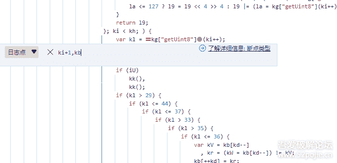

1.png (28.75 KB, 下载次数: 2)

[href="forum.php?mod=attachment&aid=MjcyODQwOHw3MzIwOTY3M3wxNzkzNTcxODM4fDE2ODA4NnwxOTY0NTc4&nothumb=yes" target="_blank"](https://www.52pojie.cn/forum.php?mod=attachment&aid=MjcyODQwOHw3MzIwOTY3M3wxNzkzNTcxODM4fDE2ODA4NnwxOTY0NTc4&nothumb=yes)

2024-10-12 16:07 上传

保存打印的日志。

## a3

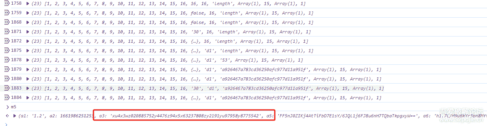

2.png (80.83 KB, 下载次数: 3)

[href="forum.php?mod=attachment&aid=MjcyODQwOXxmOWQzMDFlNnwxNzkzNTcxODM4fDE2ODA4NnwxOTY0NTc4&nothumb=yes" target="_blank"](https://www.52pojie.cn/forum.php?mod=attachment&aid=MjcyODQwOXxmOWQzMDFlNnwxNzkzNTcxODM4fDE2ODA4NnwxOTY0NTc4&nothumb=yes)

2024-10-12 16:07 上传

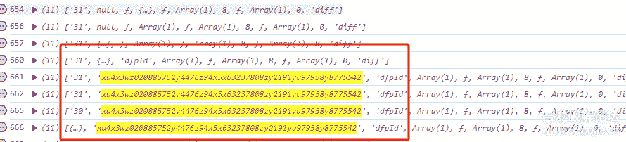

3.png (54.83 KB, 下载次数: 2)

[href="forum.php?mod=attachment&aid=MjcyODQxMHw0NjE1ZGExMHwxNzkzNTcxODM4fDE2ODA4NnwxOTY0NTc4&nothumb=yes" target="_blank"](https://www.52pojie.cn/forum.php?mod=attachment&aid=MjcyODQxMHw0NjE1ZGExMHwxNzkzNTcxODM4fDE2ODA4NnwxOTY0NTc4&nothumb=yes)

2024-10-12 16:07 上传

之间搜索`dfpID`的位置。

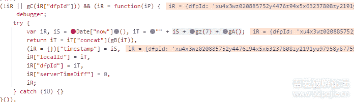

4.png (31.59 KB, 下载次数: 1)

[href="forum.php?mod=attachment&aid=MjcyODQxMXw0MTE3ODVhMHwxNzkzNTcxODM4fDE2ODA4NnwxOTY0NTc4&nothumb=yes" target="_blank"](https://www.52pojie.cn/forum.php?mod=attachment&aid=MjcyODQxMXw0MTE3ODVhMHwxNzkzNTcxODM4fDE2ODA4NnwxOTY0NTc4&nothumb=yes)

2024-10-12 16:07 上传

扣完`a3`即生成。

## a5

然后找到位置再插一波

如下图

```
 kR["apply"](kS, kP)
```

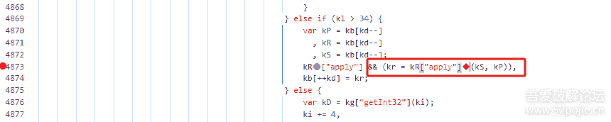

5.png (23.09 KB, 下载次数: 2)

[href="forum.php?mod=attachment&aid=MjcyODQxMnxjMDA5MDJhMnwxNzkzNTcxODM4fDE2ODA4NnwxOTY0NTc4&nothumb=yes" target="_blank"](https://www.52pojie.cn/forum.php?mod=attachment&aid=MjcyODQxMnxjMDA5MDJhMnwxNzkzNTcxODM4fDE2ODA4NnwxOTY0NTc4&nothumb=yes)

2024-10-12 16:07 上传

这里 可以看见 数组转换成字符串。那我们两个断点一起打着看看。

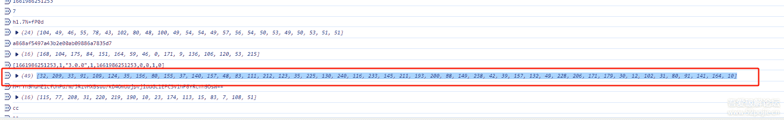

6.png (37.96 KB, 下载次数: 2)

[href="forum.php?mod=attachment&aid=MjcyODQxM3xjZTMyNWM2OXwxNzkzNTcxODM4fDE2ODA4NnwxOTY0NTc4&nothumb=yes" target="_blank"](https://www.52pojie.cn/forum.php?mod=attachment&aid=MjcyODQxM3xjZTMyNWM2OXwxNzkzNTcxODM4fDE2ODA4NnwxOTY0NTc4&nothumb=yes)

2024-10-12 16:07 上传

这里重新插一下一开始的位置

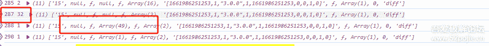

7.png (32.74 KB, 下载次数: 2)

[href="forum.php?mod=attachment&aid=MjcyODQxNHxjY2NlMzJmM3wxNzkzNTcxODM4fDE2ODA4NnwxOTY0NTc4&nothumb=yes" target="_blank"](https://www.52pojie.cn/forum.php?mod=attachment&aid=MjcyODQxNHxjY2NlMzJmM3wxNzkzNTcxODM4fDE2ODA4NnwxOTY0NTc4&nothumb=yes)

2024-10-12 16:07 上传

单步进栈。发现又是一个`switch`流程

那继续插

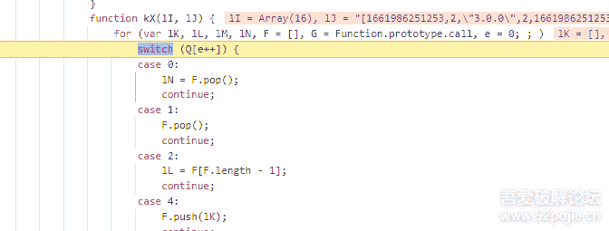

8.png (23.69 KB, 下载次数: 2)

[href="forum.php?mod=attachment&aid=MjcyODQxNXw0YzdkZjQzNnwxNzkzNTcxODM4fDE2ODA4NnwxOTY0NTc4&nothumb=yes" target="_blank"](https://www.52pojie.cn/forum.php?mod=attachment&aid=MjcyODQxNXw0YzdkZjQzNnwxNzkzNTcxODM4fDE2ODA4NnwxOTY0NTc4&nothumb=yes)

2024-10-12 16:07 上传

OK。那就继续插

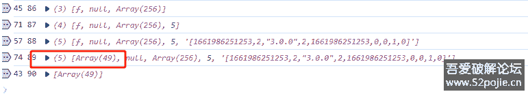

9.png (8.86 KB, 下载次数: 2)

[href="forum.php?mod=attachment&aid=MjcyODQxNnw1YTJjN2FmMHwxNzkzNTcxODM4fDE2ODA4NnwxOTY0NTc4&nothumb=yes" target="_blank"](https://www.52pojie.cn/forum.php?mod=attachment&aid=MjcyODQxNnw1YTJjN2FmMHwxNzkzNTcxODM4fDE2ODA4NnwxOTY0NTc4&nothumb=yes)

2024-10-12 16:07 上传

定位到下图位置 单步调试跟栈

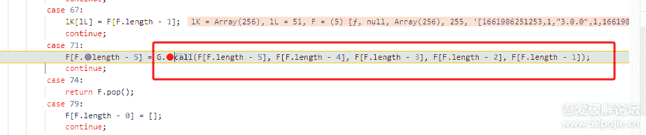

10.png (23.83 KB, 下载次数: 1)

[href="forum.php?mod=attachment&aid=MjcyODQxN3wyYjBlMjdlNXwxNzkzNTcxODM4fDE2ODA4NnwxOTY0NTc4&nothumb=yes" target="_blank"](https://www.52pojie.cn/forum.php?mod=attachment&aid=MjcyODQxN3wyYjBlMjdlNXwxNzkzNTcxODM4fDE2ODA4NnwxOTY0NTc4&nothumb=yes)

2024-10-12 16:07 上传

如下图 扣下来即可。后面就是考虑动态数组的问题了。

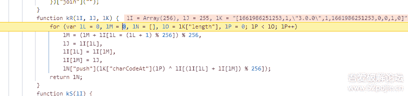

11.png (26.35 KB, 下载次数: 2)

[href="forum.php?mod=attachment&aid=MjcyODQxOHw3NjY0YmNlNnwxNzkzNTcxODM4fDE2ODA4NnwxOTY0NTc4&nothumb=yes" target="_blank"](https://www.52pojie.cn/forum.php?mod=attachment&aid=MjcyODQxOHw3NjY0YmNlNnwxNzkzNTcxODM4fDE2ODA4NnwxOTY0NTc4&nothumb=yes)

2024-10-12 16:07 上传

即`lI`，`lJ`，`lK`三个值。那又要插装。

这里重新插装要打印全部值。

这里找到 0,1,2,3,4 ...256的地方。

重新插

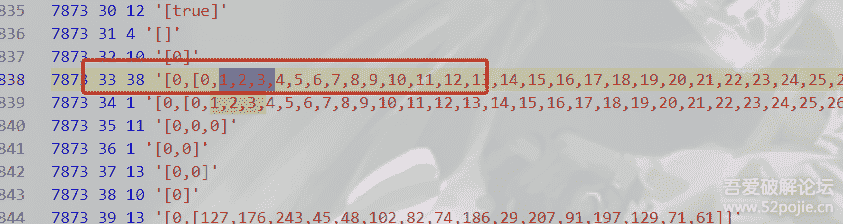

12.png (132.04 KB, 下载次数: 2)

[href="forum.php?mod=attachment&aid=MjcyODQxOXxiMjRkZjUxN3wxNzkzNTcxODM4fDE2ODA4NnwxOTY0NTc4&nothumb=yes" target="_blank"](https://www.52pojie.cn/forum.php?mod=attachment&aid=MjcyODQxOXxiMjRkZjUxN3wxNzkzNTcxODM4fDE2ODA4NnwxOTY0NTc4&nothumb=yes)

2024-10-12 16:07 上传

这里动态数组。我们`JSON.stringify` 来分析下。

这里分析如下

```
origin_arr = [0, 1, 2, 3, 4, 5, 6, 7, 8, 9, 10, 11, 12, 13, 14, 15, 16, 17, 18, 19, 20, 21, 22, 23, 24, 25, 26, 27, 28, 29, 30, 31, 32, 33, 34, 35, 36, 37, 38, 39, 40, 41, 42, 43, 44, 45, 46, 47, 48, 49, 50, 51, 52, 53, 54, 55, 56, 57, 58, 59, 60, 61, 62, 63, 64, 65, 66, 67, 68, 69, 70, 71, 72, 73, 74, 75, 76, 77, 78, 79, 80, 81, 82, 83, 84, 85, 86, 87, 88, 89, 90, 91, 92, 93, 94, 95, 96, 97, 98, 99, 100, 101, 102, 103, 104, 105, 106, 107, 108, 109, 110, 111, 112, 113, 114, 115, 116, 117, 118, 119, 120, 121, 122, 123, 124, 125, 126, 127, 128, 129, 130, 131, 132, 133, 134, 135, 136, 137, 138, 139, 140, 141, 142, 143, 144, 145, 146, 147, 148, 149, 150, 151, 152, 153, 154, 155, 156, 157, 158, 159, 160, 161, 162, 163, 164, 165, 166, 167, 168, 169, 170, 171, 172, 173, 174, 175, 176, 177, 178, 179, 180, 181, 182, 183, 184, 185, 186, 187, 188, 189, 190, 191, 192, 193, 194, 195, 196, 197, 198, 199, 200, 201, 202, 203, 204, 205, 206, 207, 208, 209, 210, 211, 212, 213, 214, 215, 216, 217, 218, 219, 220, 221, 222, 223, 224, 225, 226, 227, 228, 229, 230, 231, 232, 233, 234, 235, 236, 237, 238, 239, 240, 241, 242, 243, 244, 245, 246, 247, 248, 249, 250, 251, 252, 253, 254, 255]

// 需要与之运算的16位数组

encrypt_arr = [152, 232, 186, 109, 125, 188, 249, 229, 95, 58, 250, 230, 169, 75, 115, 56]

// 第一个

// 152+0 = 152   152 = 152+0  232 第一个数组

152 + 31

1

// 结果

183

// 第二个

// 184+232 = 416   184 = 183+1  232 第二个数组

416 + 31

447 - 256 || 447 % 256

// 结果

191

// 第三个

// 193+186   191+2  186 第三个数组

379 + 31

410 - 256 || 410 % 256

// 结果

154

// 第四个

// 157 + 109  154+3    109 第四个数组

266 + 31

297 - 256 || 297 * 256

// 结果

41

// ==== ..... 一组轮询完毕

// 第16个

// 231 + 56   216 + 15  56 第15个数组

287 + 31

318 - 256 || 318 % 256

// 结果

62

// 第17个

// 78+152     62+16   152 第1个数组

230 + 31

261 - 256 || 318 % 256
```

这里直接保姆级教学了。

然后就可以整合算法了。

这里有个小坑~~~ 留着先自己弄弄

这里还有个地方 就是与之运算的16位数组了。

这个地方继续如下图插装

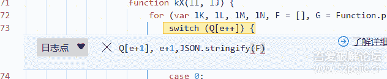

13.png (20.15 KB, 下载次数: 2)

[href="forum.php?mod=attachment&aid=MjcyODQyMHw4NGUzMmIyNnwxNzkzNTcxODM4fDE2ODA4NnwxOTY0NTc4&nothumb=yes" target="_blank"](https://www.52pojie.cn/forum.php?mod=attachment&aid=MjcyODQyMHw4NGUzMmIyNnwxNzkzNTcxODM4fDE2ODA4NnwxOTY0NTc4&nothumb=yes)

2024-10-12 16:07 上传

然后插装 13 39 

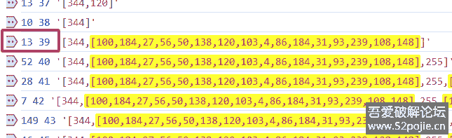

14.png (11.13 KB, 下载次数: 1)

[href="forum.php?mod=attachment&aid=MjcyODQyMXw0M2JhZWJkOHwxNzkzNTcxODM4fDE2ODA4NnwxOTY0NTc4&nothumb=yes" target="_blank"](https://www.52pojie.cn/forum.php?mod=attachment&aid=MjcyODQyMXw0M2JhZWJkOHwxNzkzNTcxODM4fDE2ODA4NnwxOTY0NTc4&nothumb=yes)

2024-10-12 16:07 上传

然后发现 这一层是上一层`kr = kR["apply"](kS, kP)`生成的。

所以继续插装 这个位置的`length`


## `a5`

最后走到这个位置。

这里发现。有传参的两个值。第一个是一串类似于 hash 加密的。

第二端是把这个值转换成数组。这个直接抠出来就可以。

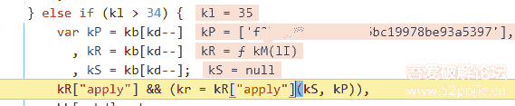

`15.png` (19.97 KB, 下载次数: 2)

[href="forum.php?mod=attachment&aid=MjcyODQyMnw4MTQyMTMwN3wxNzkzNTcxODM4fDE2ODA4NnwxOTY0NTc4&nothumb=yes" target="_blank"](https://www.52pojie.cn/forum.php?mod=attachment&aid=MjcyODQyMnw4MTQyMTMwN3wxNzkzNTcxODM4fDE2ODA4NnwxOTY0NTc4&nothumb=yes)

2024-10-12 16:07 上传

这里继续回去看最外层的日志。

这里直接贴3张图。一眼就能看懂

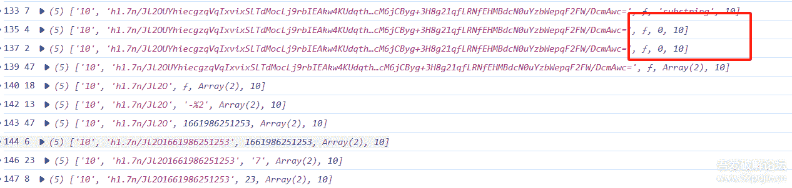

`16.png` (75.04 KB, 下载次数: 2)

[href="forum.php?mod=attachment&aid=MjcyODQyM3xlODc4Zjc2Y3wxNzkzNTcxODM4fDE2ODA4NnwxOTY0NTc4&nothumb=yes" target="_blank"](https://www.52pojie.cn/forum.php?mod=attachment&aid=MjcyODQyM3xlODc4Zjc2Y3wxNzkzNTcxODM4fDE2ODA4NnwxOTY0NTc4&nothumb=yes)

2024-10-12 16:07 上传

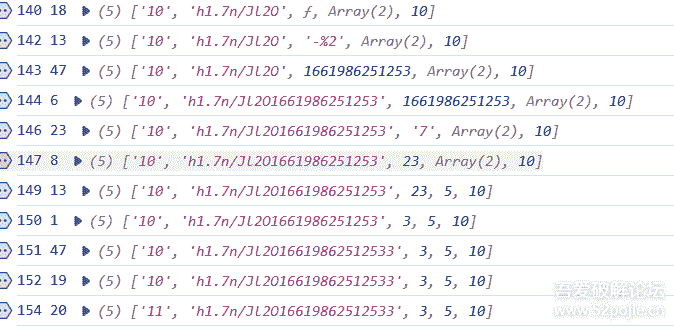

`17.png` (58.6 KB, 下载次数: 2)

[href="forum.php?mod=attachment&aid=MjcyODQyNHxmMTQ4YzE4ZHwxNzkzNTcxODM4fDE2ODA4NnwxOTY0NTc4&nothumb=yes" target="_blank"](https://www.52pojie.cn/forum.php?mod=attachment&aid=MjcyODQyNHxmMTQ4YzE4ZHwxNzkzNTcxODM4fDE2ODA4NnwxOTY0NTc4&nothumb=yes)

2024-10-12 16:07 上传

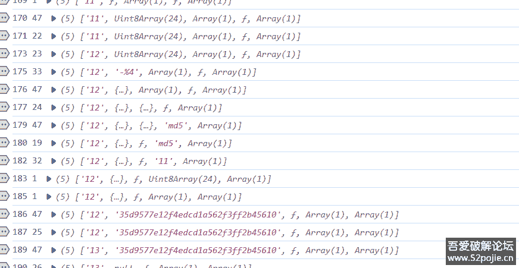

`18.png` (16.2 KB, 下载次数: 1)

[href="forum.php?mod=attachment&aid=MjcyODQyNXxkMjIyNjBjM3wxNzkzNTcxODM4fDE2ODA4NnwxOTY0NTc4&nothumb=yes" target="_blank"](https://www.52pojie.cn/forum.php?mod=attachment&aid=MjcyODQyNXxkMjIyNjBjM3wxNzkzNTcxODM4fDE2ODA4NnwxOTY0NTc4&nothumb=yes)

2024-10-12 16:07 上传

至此的话。`a5`就算是搞定了。

## 2> `a6`

直接老样子 根据日志 去插装

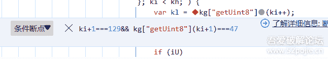

`19.png` (18.1 KB, 下载次数: 2)

[href="forum.php?mod=attachment&aid=MjcyODQyNnw5YmU2N2RlMXwxNzkzNTcxODM4fDE2ODA4NnwxOTY0NTc4&nothumb=yes" target="_blank"](https://www.52pojie.cn/forum.php?mod=attachment&aid=MjcyODQyNnw5YmU2N2RlMXwxNzkzNTcxODM4fDE2ODA4NnwxOTY0NTc4&nothumb=yes)

2024-10-12 16:07 上传

最后瞎JB一顿乱找 和 乱猜

定位点如下图所示

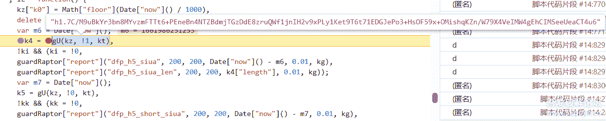

`20.png` (69.91 KB, 下载次数: 1)

[href="forum.php?mod=attachment&aid=MjcyODQyN3xjMGRiOTFjOHwxNzkzNTcxODM4fDE2ODA4NnwxOTY0NTc4&nothumb=yes" target="_blank"](https://www.52pojie.cn/forum.php?mod=attachment&aid=MjcyODQyN3xjMGRiOTFjOHwxNzkzNTcxODM4fDE2ODA4NnwxOTY0NTc4&nothumb=yes)

2024-10-12 16:07 上传

OK 这个函数直接缺啥扣啥。确实感觉没什么写的。

至此 `a3` `a5` `a6` 全部搞定。

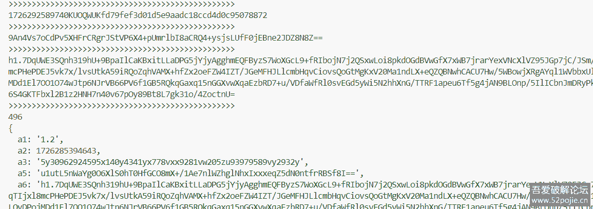

`21.png` (32.27 KB, 下载次数: 1)

[href="forum.php?mod=attachment&aid=MjcyODQyOHwzYWIxZWY5MnwxNzkzNTcxODM4fDE2ODA4NnwxOTY0NTc4&nothumb=yes" target="_blank"](https://www.52pojie.cn/forum.php?mod=attachment&aid=MjcyODQyOHwzYWIxZWY5MnwxNzkzNTcxODM4fDE2ODA4NnwxOTY0NTc4&nothumb=yes)

2024-10-12 16:07 上传

## 后续验证

后面拼出来就行了。

然后找几个关键校验的接口 这里我用的是某Boking 去测试的。至于 还有`a8` 和 `d1` 。。 只能说待续

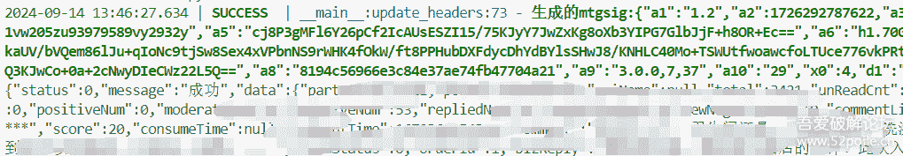

`22.png` (53.99 KB, 下载次数: 2)

[href="forum.php?mod=attachment&aid=MjcyODQyOXw4NzIwZWEwMHwxNzkzNTcxODM4fDE2ODA4NnwxOTY0NTc4&nothumb=yes" target="_blank"](https://www.52pojie.cn/forum.php?mod=attachment&aid=MjcyODQyOXw4NzIwZWEwMHwxNzkzNTcxODM4fDE2ODA4NnwxOTY0NTc4&nothumb=yes)

2024-10-12 16:07 上传
