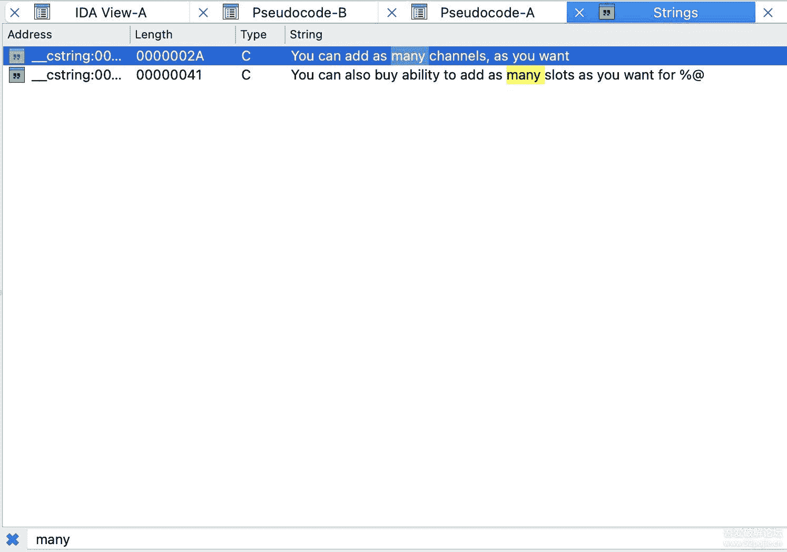
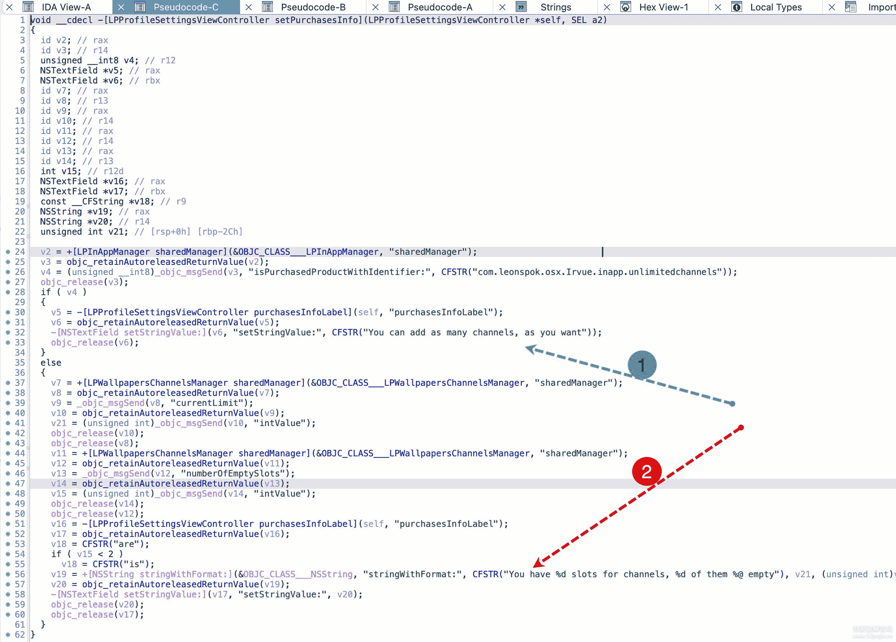

# [MacOS逆向] 壁纸Irvue

- 原帖: https://www.52pojie.cn/forum.php?mod=viewthread&tid=1966462
- 抓取时间: 2026-11-01T22:22:39

## Irvue 美丽大气的壁纸, 使用 Unsplash 站的图片作为图片源。[//apps.apple.com/cn/app/irvue/id1039633667?mt=12]" target="_blank" rel="noopener noreferrer nofollow"](https://apps.apple.com/cn/app/irvue/id1039633667?mt=12]:rel="nofollow noopener" href="https)

### Manage channels有限制


17269235892676.jpg (44.86 KB, 下载次数: 0)

[href="forum.php?mod=attachment&aid=MjcyNDQ5NnxkMjM2MTZmNXwxNzkzNTcxNzU3fDE2ODA4NnwxOTY2NDYy&nothumb=yes" target="_blank"](https://www.52pojie.cn/forum.php?mod=attachment&aid=MjcyNDQ5NnxkMjM2MTZmNXwxNzkzNTcxNzU3fDE2ODA4NnwxOTY2NDYy&nothumb=yes)

1

2024-9-21 21:14 上传

### 查找字符串 many channels



17269236478944.jpg (84.24 KB, 下载次数: 0)

[href="forum.php?mod=attachment&aid=MjcyNDQ5N3wxZDAyYjVhNXwxNzkzNTcxNzU3fDE2ODA4NnwxOTY2NDYy&nothumb=yes" target="_blank"](https://www.52pojie.cn/forum.php?mod=attachment&aid=MjcyNDQ5N3wxZDAyYjVhNXwxNzkzNTcxNzU3fDE2ODA4NnwxOTY2NDYy&nothumb=yes)

2

2024-9-21 21:14 上传

### 通过查找引用，可以找到下图函数，可以看到`isPurchasedProductWithIdentifier`返回1即可。



17269239608537.jpg (515.22 KB, 下载次数: 0)

[href="forum.php?mod=attachment&aid=MjcyNDQ5OHw5NmE0YzExOXwxNzkzNTcxNzU3fDE2ODA4NnwxOTY2NDYy&nothumb=yes" target="_blank"](https://www.52pojie.cn/forum.php?mod=attachment&aid=MjcyNDQ5OHw5NmE0YzExOXwxNzkzNTcxNzU3fDE2ODA4NnwxOTY2NDYy&nothumb=yes)

2024-9-21 21:15 上传

### 上代码

```
var LPInAppManager = ObjC.classes.LPInAppManager;
var hook = LPInAppManager["- isPurchasedProductWithIdentifier:"];

Interceptor.attach(hook.implementation, {
    onEnter: function (args) {
        mylog("\n===============hook isPurchasedProductWithIdentifier================")
    },
    onLeave: function (ret) {
        ret.replace(0x1);
    }
})
```
