# [原创] 2024腾讯游戏安全PC初赛复现

- 原帖: https://www.52pojie.cn/forum.php?mod=viewthread&tid=1966860
- 抓取时间: 2026-11-01T22:22:33

## 题目

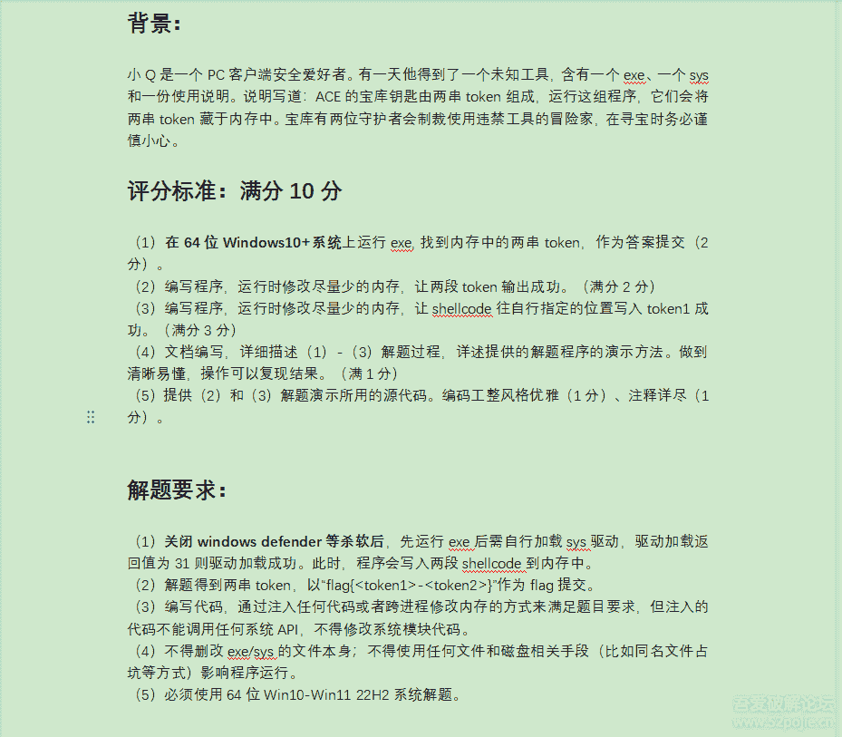

image-20240923132824209.png (125.07 KB, 下载次数: 0)

[href="forum.php?mod=attachment&aid=MjcyNDc4OHw5MjBiYTdkZnwxNzkzNTcxNzUwfDE2ODA4NnwxOTY2ODYw&nothumb=yes" target="_blank"](https://www.52pojie.cn/forum.php?mod=attachment&aid=MjcyNDc4OHw5MjBiYTdkZnwxNzkzNTcxNzUwfDE2ODA4NnwxOTY2ODYw&nothumb=yes)

2024-9-23 13:45 上传

## （一）解题过程

拿到`hack.exe`，浅分析一下发现加了`VM`，并且有检测黑客工具的行为，检测到了之后即使关闭黑客程序也会影响程序正常运行，但是`xdbg`稍微改一下还是可以动调的，在`xdbg`里下一些可能的函数断点，我这里在这些地方下了断点

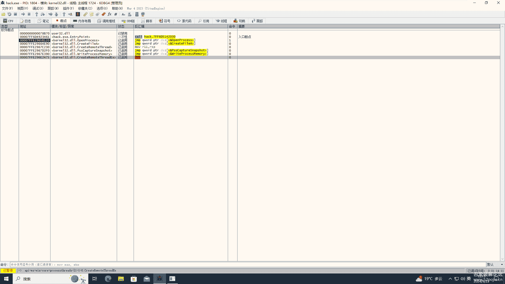

image-20240923131144727.png (116.71 KB, 下载次数: 0)

[href="forum.php?mod=attachment&aid=MjcyNDc4NHxmNTVmNDk3OHwxNzkzNTcxNzUwfDE2ODA4NnwxOTY2ODYw&nothumb=yes" target="_blank"](https://www.52pojie.cn/forum.php?mod=attachment&aid=MjcyNDc4NHxmNTVmNDk3OHwxNzkzNTcxNzUwfDE2ODA4NnwxOTY2ODYw&nothumb=yes)

2024-9-23 13:45 上传

运行发现程序会多次在`WriteProcessMemory`下断下，`hook`一下观察传参

```cpp
//dllmain.cpp
#include "pch.h"
#include 
#include 
#include 
#include 
#include 
#pragma comment(lib,"detours.lib")
#define _KDEBUG
#define DBGMGEBOX(fmt, ...) \
    do { \
         /* 假设最大长度为1024，根据需要调整大小 */ \
        wsprintfA(out, fmt, __VA_ARGS__); \
        MessageBoxA(NULL, out, "提示", MB_OK); \
    } while(0)
char out[100];
typedef BOOL(WINAPI* WriteProcessMemory_t)(
    _In_ HANDLE hProcess,
    _In_ LPVOID lpBaseAddress,
    _In_reads_bytes_(nSize) LPCVOID lpBuffer,
    _In_ SIZE_T nSize,
    _Out_opt_ SIZE_T* lpNumberOfBytesWritten
    );
WriteProcessMemory_t TrueWriteProcessMemory = NULL;
BOOL
WINAPI
HookWriteProcessMemory(
    _In_ HANDLE hProcess,
    _In_ LPVOID lpBaseAddress,
    _In_reads_bytes_(nSize) LPCVOID lpBuffer,
    _In_ SIZE_T nSize,
    _Out_opt_ SIZE_T * lpNumberOfBytesWritten
)
{
    char fileName[12] = { 0 };
    sprintf(fileName, "out%d.txt", (int)hProcess % 1000);
    HANDLE hFile = CreateFile(fileName, FILE_APPEND_DATA, FILE_SHARE_READ, NULL, OPEN_ALWAYS, FILE_ATTRIBUTE_NORMAL, NULL);
    if (hFile == INVALID_HANDLE_VALUE)
    {
        DBGMGEBOX("CreateFile Fail");
        return TrueWriteProcessMemory(hProcess, lpBaseAddress, lpBuffer, nSize, lpNumberOfBytesWritten);
    }
    SetFilePointer(hFile, 0, NULL, FILE_END);
    DWORD bytesWritten;
    BOOL result = WriteFile(hFile, lpBuffer, nSize, &bytesWritten, NULL);
    CloseHandle(hFile);
    DBGMGEBOX("findProcess WriteProcessMemory:%p,size:%d\n", hProcess,nSize);
    return TrueWriteProcessMemory(hProcess, lpBaseAddress, lpBuffer, nSize, lpNumberOfBytesWritten);
}

BOOL APIENTRY DllMain(HMODULE hModule, DWORD ul_reason_for_call, LPVOID lpReserved) {
    switch (ul_reason_for_call) {
    case DLL_PROCESS_ATTACH:

        DetourTransactionBegin();
        DetourUpdateThread(GetCurrentThread());

        TrueWriteProcessMemory = (WriteProcessMemory_t)DetourFindFunction("kernel32.dll", "WriteProcessMemory");
        DetourAttach(&(PVOID&)TrueWriteProcessMemory, HookWriteProcessMemory);

        DetourTransactionCommit();
        break;
    case DLL_PROCESS_DETACH:
        DetourTransactionBegin();
        DetourUpdateThread(GetCurrentThread());
        DetourDetach(&(PVOID&)TrueWriteProcessMemory, HookWriteProcessMemory);

        DetourTransactionCommit();
        break;
    }
    return TRUE;
}
```

这里输出了三个txt文件

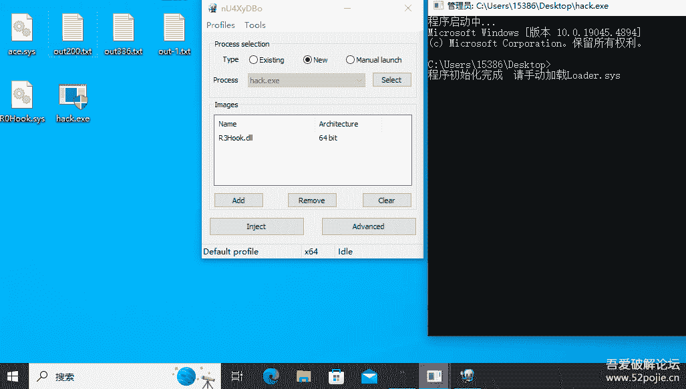

image-20240923131546102.png (83.68 KB, 下载次数: 0)

[href="forum.php?mod=attachment&aid=MjcyNDc4NXxkMWYxZTBkMXwxNzkzNTcxNzUwfDE2ODA4NnwxOTY2ODYw&nothumb=yes" target="_blank"](https://www.52pojie.cn/forum.php?mod=attachment&aid=MjcyNDc4NXxkMWYxZTBkMXwxNzkzNTcxNzUwfDE2ODA4NnwxOTY2ODYw&nothumb=yes)

2024-9-23 13:45 上传

其中`out200.txt`文件有明显的PE头

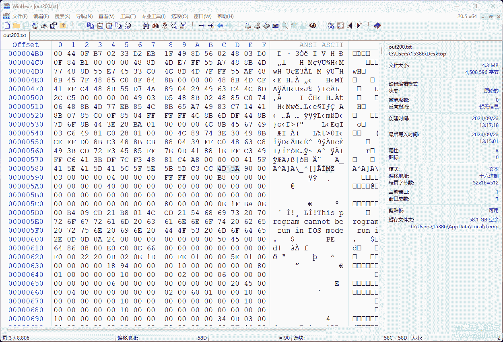

image-20240923131748329.png (156.21 KB, 下载次数: 0)

[href="forum.php?mod=attachment&aid=MjcyNDc4Nnw4NjBmYzlmMHwxNzkzNTcxNzUwfDE2ODA4NnwxOTY2ODYw&nothumb=yes" target="_blank"](https://www.52pojie.cn/forum.php?mod=attachment&aid=MjcyNDc4Nnw4NjBmYzlmMHwxNzkzNTcxNzUwfDE2ODA4NnwxOTY2ODYw&nothumb=yes)

2024-9-23 13:45 上传

去除前面的字节，把文件丢到`DIE`里分析一下发现是`dll64`文件并且貌似没加壳，所以`hack.exe`通过`WriteProcessMemory`往某个进程写入了一个`dll`?怀疑是远程注入，至于做了什么，有可能跟`token`有关，继续分析。

`ida64`打开发现程序的`dllMain`入口还是被加密了

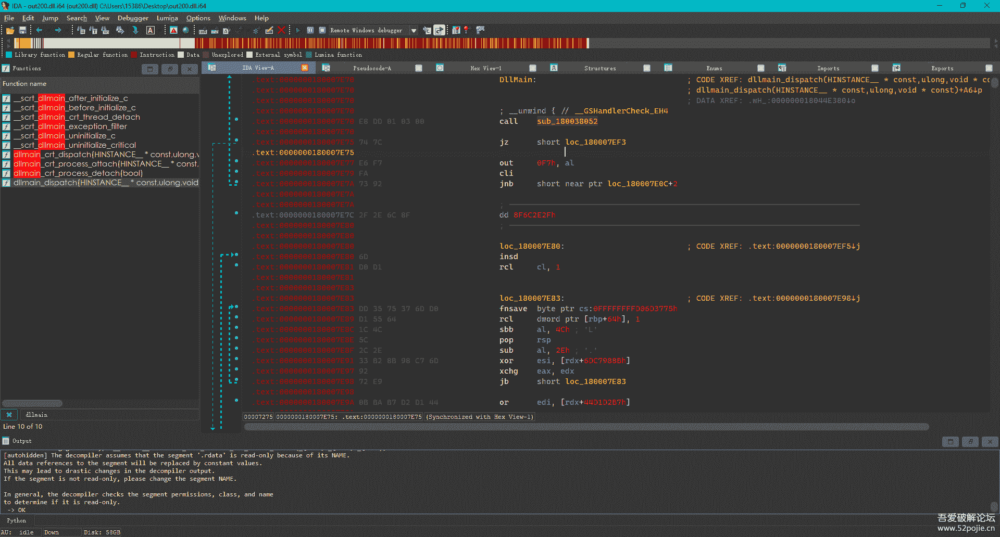

image-20240923132428865.png (201.85 KB, 下载次数: 1)

[href="forum.php?mod=attachment&aid=MjcyNDc4N3xjODBhYWYzMXwxNzkzNTcxNzUwfDE2ODA4NnwxOTY2ODYw&nothumb=yes" target="_blank"](https://www.52pojie.cn/forum.php?mod=attachment&aid=MjcyNDc4N3xjODBhYWYzMXwxNzkzNTcxNzUwfDE2ODA4NnwxOTY2ODYw&nothumb=yes)

2024-9-23 13:45 上传

还是继续动调，随便找了个64位的可执行文件，拖到`X64dbg`里运行，直接用`xdbg`的注入方式将`out200.dll`注入进程，在入口点下断点，并且对一些可疑的`WINDOWS API`下断观察进程行为

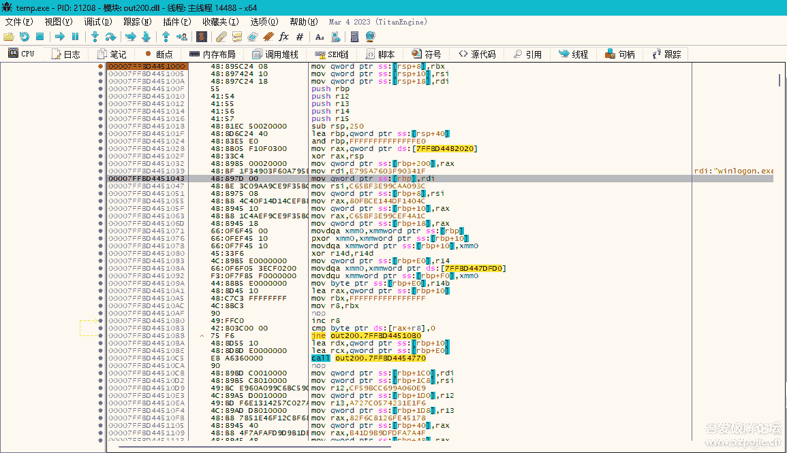

image-20240913213116556.png (176.36 KB, 下载次数: 0)

[href="forum.php?mod=attachment&aid=MjcyNDc2MHw0OTcyYTVhYXwxNzkzNTcxNzUwfDE2ODA4NnwxOTY2ODYw&nothumb=yes" target="_blank"](https://www.52pojie.cn/forum.php?mod=attachment&aid=MjcyNDc2MHw0OTcyYTVhYXwxNzkzNTcxNzUwfDE2ODA4NnwxOTY2ODYw&nothumb=yes)

2024-9-23 13:44 上传

这里我对下面这几个`API`下了断点

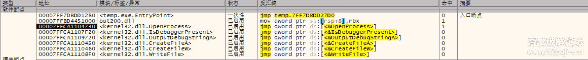

image-20240913213203300.png (42.32 KB, 下载次数: 0)

[href="forum.php?mod=attachment&aid=MjcyNDc2MXxlZGQ2NDdkMnwxNzkzNTcxNzUwfDE2ODA4NnwxOTY2ODYw&nothumb=yes" target="_blank"](https://www.52pojie.cn/forum.php?mod=attachment&aid=MjcyNDc2MXxlZGQ2NDdkMnwxNzkzNTcxNzUwfDE2ODA4NnwxOTY2ODYw&nothumb=yes)

2024-9-23 13:44 上传

运行，第一次成功在`OpenProcess`函数断下

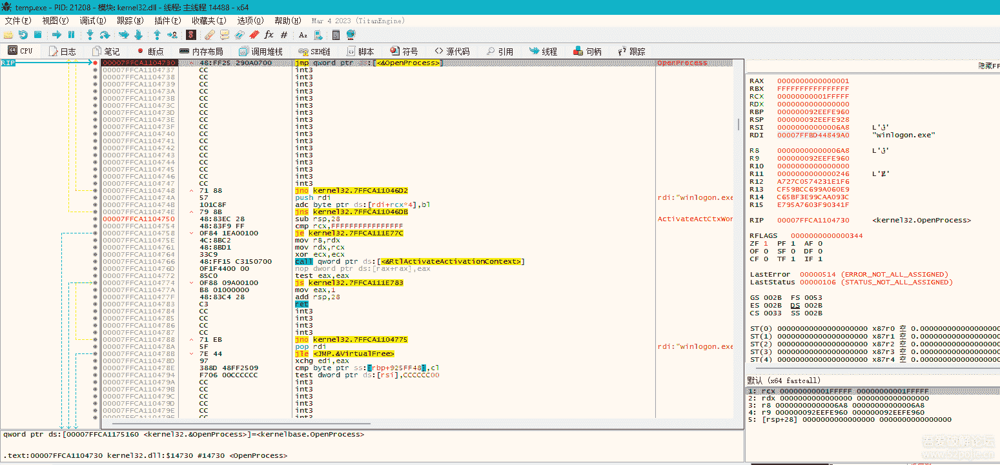

image-20240913213252406.png (171.12 KB, 下载次数: 0)

[href="forum.php?mod=attachment&aid=MjcyNDc2MnxjMzY4NGY1OXwxNzkzNTcxNzUwfDE2ODA4NnwxOTY2ODYw&nothumb=yes" target="_blank"](https://www.52pojie.cn/forum.php?mod=attachment&aid=MjcyNDc2MnxjMzY4NGY1OXwxNzkzNTcxNzUwfDE2ODA4NnwxOTY2ODYw&nothumb=yes)

2024-9-23 13:44 上传

观察传参窗口，找到了一个系统进程名称字符串`winlogon.exe`，而这里调用的是`OpenProcess`，疑似是对系统进程`winlogon.exe`做了一些操作。继续分析，运行到返回，回溯一层函数，找到一段没有被加密的代码

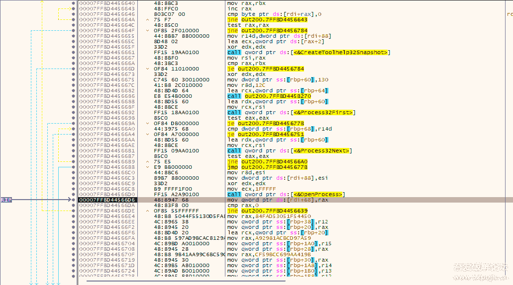

image-20240913213951735.png (151.54 KB, 下载次数: 0)

[href="forum.php?mod=attachment&aid=MjcyNDc2M3xlMzg5YTVhNXwxNzkzNTcxNzUwfDE2ODA4NnwxOTY2ODYw&nothumb=yes" target="_blank"](https://www.52pojie.cn/forum.php?mod=attachment&aid=MjcyNDc2M3xlMzg5YTVhNXwxNzkzNTcxNzUwfDE2ODA4NnwxOTY2ODYw&nothumb=yes)

2024-9-23 13:44 上传

汇编代码不是很好看，根据偏移在`IDA`里反汇编看看

```c
__int64 __fastcall sub_1800063D0(_DWORD *Dst, DWORD dwProcessId)
{
  __m128i si128; // xmm0
  __m128i v6; // xmm0
  __int64 result; // rax
  __m128i v10; // xmm2
  size_t v14; // rbx
  __int64 v15; // rax
  int v16; // r14d
  HANDLE Toolhelp32Snapshot; // rsi
  HANDLE v18; // rax
  __int64 v21; // rbx
  CHAR Caption[16]; // [rsp+40h] [rbp+0h] BYREF
  _RBP = (unsigned __int64)Caption & 0xFFFFFFFFFFFFFFE0ui64;
  if ( !dwProcessId )
  {
    *(_QWORD *)(((unsigned __int64)Caption & 0xFFFFFFFFFFFFFFE0ui64) + 0x28) = 0xC65BF3E99CAA093Cui64;
    *(_QWORD *)(((unsigned __int64)Caption & 0xFFFFFFFFFFFFFFE0ui64) + 8) = 0xC65BF3E99CAA093Cui64;
    *(_QWORD *)_RBP = 0xE795A71250E2465Aui64;
    si128 = _mm_load_si128((const __m128i *)_RBP);
    *(_QWORD *)(((unsigned __int64)Caption & 0xFFFFFFFFFFFFFFE0ui64) + 0x20) = 0xE795A7603F90341Fui64;
    v6 = _mm_xor_si128(si128, *(__m128i *)(((unsigned __int64)Caption & 0xFFFFFFFFFFFFFFE0ui64) + 0x20));
    *(_QWORD *)(((unsigned __int64)Caption & 0xFFFFFFFFFFFFFFE0ui64) + 0x20) = 0x84FAD5301FE45158ui64;
    *(__m128i *)_RBP = v6;
    *(_QWORD *)(((unsigned __int64)Caption & 0xFFFFFFFFFFFFFFE0ui64) + 0x28) = 0xBF19D3ADD5D97A59ui64;
    *(_QWORD *)(((unsigned __int64)Caption & 0xFFFFFFFFFFFFFFE0ui64) + 0x1A0) = 0xE795A7603F90341Fui64;
```


```
    *(_QWORD *)(((unsigned __int64)Caption & 0xFFFFFFFFFFFFFFE0ui64) + 0x30) = 0xBD1C9CA3F4C12EC9ui64;
    *(_QWORD *)(((unsigned __int64)Caption & 0xFFFFFFFFFFFFFFE0ui64) + 0x38) = 0xA727C05763438E84ui64;
    *(_QWORD *)(((unsigned __int64)Caption & 0xFFFFFFFFFFFFFFE0ui64) + 0x1A8) = 0xC65BF3E99CAA093Cui64;
    *(_QWORD *)(((unsigned __int64)Caption & 0xFFFFFFFFFFFFFFE0ui64) + 0x1B0) = 0xCF59BCC699A060E9ui64;
    *(_QWORD *)(((unsigned __int64)Caption & 0xFFFFFFFFFFFFFFE0ui64) + 0x1B8) = 0xA727C0574231E1F6ui64;
    __asm
    {
      vmovdqu ymm0, [rbp+210h+var_70]
      vpxor   ymm1, ymm0, ymmword ptr [rbp+210h+Text]
      vmovdqa ymmword ptr [rbp+210h+Text], ymm1
      vzeroupper
    }
    MessageBoxA(0i64, (LPCSTR)(_RBP + 32), (LPCSTR)((unsigned __int64)Caption & 0xFFFFFFFFFFFFFFE0ui64), 0);

LABEL_3:

    GetLastError();
    *(_QWORD *)(((unsigned __int64)Caption & 0xFFFFFFFFFFFFFFE0ui64) + 0x20) = 0xE795A7603F90341Fui64;
    *(_QWORD *)_RBP = 0x88D6871250E2465Aui64;
    *(_QWORD *)(((unsigned __int64)Caption & 0xFFFFFFFFFFFFFFE0ui64) + 0x28) = 0xC65BF3E99CAA093Cui64;
    *(_QWORD *)(((unsigned __int64)Caption & 0xFFFFFFFFFFFFFFE0ui64) + 8) = 0xC65BF98DB9906C58ui64;
    *(__m128i *)_RBP = _mm_xor_si128(
                         _mm_load_si128((const __m128i *)_RBP),
                         *(__m128i *)(((unsigned __int64)Caption & 0xFFFFFFFFFFFFFFE0ui64) + 0x20));
    return sub_180006A00((void *)((unsigned __int64)Caption & 0xFFFFFFFFFFFFFFE0ui64));
  }
  if ( !(unsigned __int8)sub_180006FC0() )
  {
    *(_QWORD *)(((unsigned __int64)Caption & 0xFFFFFFFFFFFFFFE0ui64) + 0x1A0) = 0xE795A7603F90341Fui64;
    *(_QWORD *)(((unsigned __int64)Caption & 0xFFFFFFFFFFFFFFE0ui64) + 0x48) = 0x44F651D568826090i64;
    *(_QWORD *)(((unsigned __int64)Caption & 0xFFFFFFFFFFFFFFE0ui64) + 0x1C0) = 0x52C9FCDC77FF5FC3i64;
    *(_QWORD *)(((unsigned __int64)Caption & 0xFFFFFFFFFFFFFFE0ui64) + 0x20) = 0xDDD2E92971C27548ui64;
    *(_QWORD *)(((unsigned __int64)Caption & 0xFFFFFFFFFFFFFFE0ui64) + 0x28) = 0xA43EB7C9E8CF4E1Cui64;
    *(_QWORD *)(((unsigned __int64)Caption & 0xFFFFFFFFFFFFFFE0ui64) + 0x30) = 0xA62FD5B4C980079Cui64;
    *(_QWORD *)(((unsigned __int64)Caption & 0xFFFFFFFFFFFFFFE0ui64) + 0x38) = 0xD55585772756849Aui64;
    *(_QWORD *)(((unsigned __int64)Caption & 0xFFFFFFFFFFFFFFE0ui64) + 0x40) = 0x52C9FCDC7DDE2DACi64;
    v10 = _mm_load_si128((const __m128i *)(_RBP + 64));
    *(_QWORD *)(((unsigned __int64)Caption & 0xFFFFFFFFFFFFFFE0ui64) + 0x1C8) = 0x44F651D568826090i64;
    _XMM2 = _mm_xor_si128(v10, *(__m128i *)(((unsigned __int64)Caption & 0xFFFFFFFFFFFFFFE0ui64) + 0x1C0));
    *(_QWORD *)(((unsigned __int64)Caption & 0xFFFFFFFFFFFFFFE0ui64) + 0x1A8) = 0xC65BF3E99CAA093Cui64;
    *(_QWORD *)(((unsigned __int64)Caption & 0xFFFFFFFFFFFFFFE0ui64) + 0x1B0) = 0xCF59BCC699A060E9ui64;
    *(_QWORD *)(((unsigned __int64)Caption & 0xFFFFFFFFFFFFFFE0ui64) + 0x1B8) = 0xA727C0574231E1F6ui64;
    __asm
    {
      vmovdqu ymm0, [rbp+210h+var_70]
      vpxor   ymm1, ymm0, ymmword ptr [rbp+210h+Text]
      vmovdqa [rbp+210h+var_1D0], xmm2
      vmovdqa ymmword ptr [rbp+210h+Text], ymm1
      vzeroupper
    }
    sub_180006A00((void *)(_RBP + 32));
  }
  v14 = -1i64;
  if ( dwProcessId == -1 )
  {
    Dst[34] = GetCurrentProcessId();
    *((_QWORD *)Dst + 13) = -1i64;
  }
  else
  {
    Dst[34] = dwProcessId;
    v18 = OpenProcess(0x1FFFFFu, 0, dwProcessId);
    *((_QWORD *)Dst + 13) = v18;
    if ( !v18 )
    {
      *(_QWORD *)(((unsigned __int64)Caption & 0xFFFFFFFFFFFFFFE0ui64) + 0x38) = 0xA727C0574231E1F6ui64;
      *(_QWORD *)(((unsigned __int64)Caption & 0xFFFFFFFFFFFFFFE0ui64) + 0x20) = 0x84FAD53051F54450ui64;
      *(_QWORD *)(((unsigned __int64)Caption & 0xFFFFFFFFFFFFFFE0ui64) + 0x1A0) = 0xE795A7603F90341Fui64;
      *(_QWORD *)(((unsigned __int64)Caption & 0xFFFFFFFFFFFFFFE0ui64) + 0x28) = 0xA92981ACBCD97A59ui64;
      *(_QWORD *)(((unsigned __int64)Caption & 0xFFFFFFFFFFFFFFE0ui64) + 0x30) = 0xCF59BCC699AA419Bui64;
      *(_QWORD *)(((unsigned __int64)Caption & 0xFFFFFFFFFFFFFFE0ui64) + 0x1A8) = 0xC65BF3E99CAA093Cui64;
      *(_QWORD *)(((unsigned __int64)Caption & 0xFFFFFFFFFFFFFFE0ui64) + 0x1B0) = 0xCF59BCC699A060E9ui64;
      *(_QWORD *)(((unsigned __int64)Caption & 0xFFFFFFFFFFFFFFE0ui64) + 0x1B8) = 0xA727C0574231E1F6ui64;
      __asm
      {
        vmovdqu ymm0, [rbp+210h+var_70]
        vpxor   ymm1, ymm0, ymmword ptr [rbp+210h+Text]
        vmovdqa ymmword ptr [rbp+210h+Text], ymm1
        vzeroupper
      }
      sub_180006A00((void *)(_RBP + 32));//打印报错信息
      goto LABEL_3;
    }
  }
  Dst[30] = 0x1FFFFF;
  v15 = -1i64;
  do
    ++v15;
  while ( *((_BYTE *)Dst + v15) );
  if ( !v15 )
  {
    v16 = Dst[34];
    Toolhelp32Snapshot = CreateToolhelp32Snapshot(2u, 0);
    if ( Toolhelp32Snapshot != (HANDLE)-1i64 )
    {
      *(_DWORD *)(((unsigned __int64)Caption & 0xFFFFFFFFFFFFFFE0ui64) + 0x60) = 304;
      memset((void *)(_RBP + 100), 0, 0x12Cui64);
      if ( Process32First(Toolhelp32Snapshot, (LPPROCESSENTRY32)(_RBP + 96)) )
      {
        while ( *(_DWORD *)(((unsigned __int64)Caption & 0xFFFFFFFFFFFFFFE0ui64) + 0x68) != v16 )
        {
          if ( !Process32Next(Toolhelp32Snapshot, (LPPROCESSENTRY32)(_RBP + 96)) )
            goto LABEL_20;
        }
        do
          ++v14;
        while ( *(_BYTE *)(_RBP + 140 + v14) );
        memmove(Dst, (const void *)(_RBP + 140), v14);
      }
LABEL_20:
      CloseHandle(Toolhelp32Snapshot);
    }
  }
  *((_QWORD *)Dst + 18) = sub_1800068D0(Dst, Dst);
  v21 = 0i64;
  *(_DWORD *)(((unsigned __int64)Caption & 0xFFFFFFFFFFFFFFE0ui64) + 8) = Dst[34];
  *(_QWORD *)_RBP = 0i64;
  EnumWindows(EnumFunc, (unsigned __int64)Caption & 0xFFFFFFFFFFFFFFE0ui64);
  result = *(_QWORD *)_RBP;
  if ( *(_QWORD *)_RBP )
    v21 = *(_QWORD *)_RBP;
  *((_QWORD *)Dst + 16) = v21;
  return result;
}
```

这段代码一次进行了获取进程`pid`，打开进程，遍历模块等操作，并且在函数失败后做了一些奇奇怪怪的东西，对一些地址赋上了一些64位的值，猜测是隐藏字符串来打印调试信息用的，再通过`messagebox`和`outputDebugString`给出调试信息，显示打开进程失败，猜测是因为`hack.exe`启动是管理员启动，这里失去了管理员权限。


`image-20240913221222730.png` (964.04 KB, 下载次数: 0)

[href="forum.php?mod=attachment&aid=MjcyNDc2NHxkOWViZDU3YnwxNzkzNTcxNzUwfDE2ODA4NnwxOTY2ODYw&nothumb=yes" target="_blank"](https://www.52pojie.cn/forum.php?mod=attachment&aid=MjcyNDc2NHxkOWViZDU3YnwxNzkzNTcxNzUwfDE2ODA4NnwxOTY2ODYw&nothumb=yes)

2024-9-23 13:44 上传

分析完这个函数，继续回溯一层，运行到返回，定位到这个地方

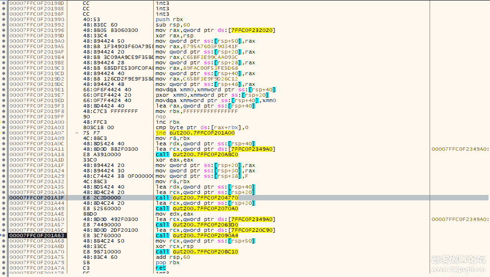

`image-20240913221520425.png` (145.71 KB, 下载次数: 0)

[href="forum.php?mod=attachment&aid=MjcyNDc2NXxjODliOTdlY3wxNzkzNTcxNzUwfDE2ODA4NnwxOTY2ODYw&nothumb=yes" target="_blank"](https://www.52pojie.cn/forum.php?mod=attachment&aid=MjcyNDc2NXxjODliOTdlY3wxNzkzNTcxNzUwfDE2ODA4NnwxOTY2ODYw&nothumb=yes)

2024-9-23 13:44 上传

继续根据偏移转到IDA里看反汇编

```
int sub_180001990()
{
  size_t v0; // rbx
  DWORD v1; // eax
  __m128i Dst; // [rsp+20h] [rbp-48h] BYREF
  __int64 v4; // [rsp+30h] [rbp-38h]
  __int64 v5; // [rsp+38h] [rbp-30h]
  __m128i Src; // [rsp+40h] [rbp-28h] BYREF

  Dst.m128i_i64[0] = 0xE795A7603F90341Fui64;
  Dst.m128i_i64[1] = 0xC65BF3E99CAA093Cui64;
  Src.m128i_i64[0] = 0x89FAC00F53FE5D68ui64;
  Src.m128i_i64[1] = 0xC65BF3E9F9D26C12ui64;
  Src = _mm_xor_si128(_mm_load_si128(&Src), Dst);
  v0 = -1i64;
  do
    ++v0;
  while ( Src.m128i_i8[v0] );
  memmove(dword_1800349A0, &Src, v0);
  Dst.m128i_i64[0] = 0i64;
  v4 = 0i64;
  v5 = 15i64;
  sub_180004770(&Dst, &Src, v0);
  v1 = sub_1800070A0(&Dst);
  sub_1800063D0(dword_1800349A0, v1);
  return atexit(sub_180020C90);
}
```

前面应该是一个加密的字符串操作，用`python`打印出字符串

```
def hex_xor_to_string(a, b):
    result = a ^ b
    hex_str = hex(result)[2:]
    if len(hex_str) % 2 != 0:
        hex_str = '0' + hex_str
    result_str = ''.join(chr(int(hex_str[i:i+2], 16)) for i in range(0, len(hex_str), 2))
    return result_str
```


```text
x1 = 0xE795A7603F90341F
x2 = 0xC65BF3E99CAA093C
y1 = 0x89FAC00F53FE5D68
y2 = 0xC65BF3E9F9D26C12

result1 = hex_xor_to_string(x1, y1)
result2 = hex_xor_to_string(x2, y2)

print("Result 1:", result1)
print("Result 2:", result2)
```

```text
#Result 1: nogolniw
#Result 2: exe.
```

得到的刚好是 `winlogon.exe` 字符串，然后程序将这个字符串转移到了 `dword_1800349A0` 全局变量中，目的应该是隐藏字符串，接着 `sub_180004770` 函数也是一个类似 `memmove` 操作，把这个字符串传到了 `Dst` 局部变量中，接着在 `sub_1800070A0` 中传入这个字符串，貌似是在根据字符串获取进程 PID，接着调用 `sub_1800063D0` 函数根据 `pid` 打开进程，并将进程句柄存储到了某个地方。

```text
v18 = OpenProcess(0x1FFFFFu, 0, dwProcessId);
*((_QWORD *)Dst + 13) = v18;
```

随后 `return exit` 退出。

随后我在退出函数传参的时候看到了一个 `hProcess`

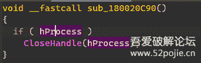

`image-20240914102337797.png` (13.17 KB, 下载次数: 0)

[href="forum.php?mod=attachment&aid=MjcyNDc2Nnw4NGM2YWU1OXwxNzkzNTcxNzUwfDE2ODA4NnwxOTY2ODYw&nothumb=yes" target="_blank"](https://www.52pojie.cn/forum.php?mod=attachment&aid=MjcyNDc2Nnw4NGM2YWU1OXwxNzkzNTcxNzUwfDE2ODA4NnwxOTY2ODYw&nothumb=yes)

2024-9-23 13:44 上传

一个全局变量，很有可能在其他地方对句柄进行了读取，交叉引用一下定位到如下函数

```text
void sub_180007C10()
{
  HANDLE v1; // rcx
  void *v2; // rdx
  __int128 v3; // xmm0
  __int128 v4; // xmm1
  HANDLE FileA; // rbx
  __int64 v8; // rcx
  _BYTE *v9; // rdx
  unsigned __int64 v10; // rdx
  _QWORD *v11; // rcx
  char Buffer; // [rsp+60h] [rbp+0h] BYREF

  _RBP = (unsigned __int64)&Buffer & 0xFFFFFFFFFFFFFFE0ui64;

  while ( byte_180032C00 )
  {
    if ( !byte_180034961 && !byte_180034960 )
      sub_1800041D0();

    v1 = hProcess;
    v2 = (void *)(qword_180034968 + 2766);
    *(_BYTE *)_RBP = 15;
    WriteProcessMemory(v1, v2, (LPCVOID)((unsigned __int64)&Buffer & 0xFFFFFFFFFFFFFFE0ui64), 1ui64, 0i64);
    byte_180032C00 = 0;
    *(_QWORD *)(((unsigned __int64)&Buffer & 0xFFFFFFFFFFFFFFE0ui64) + 0x20) = 0xAA32D3B2B7C50388ui64;
    *(_QWORD *)(((unsigned __int64)&Buffer & 0xFFFFFFFFFFFFFFE0ui64) + 0x10) = 0xA0A195500DCC0E5Cui64;
    *(_QWORD *)(((unsigned __int64)&Buffer & 0xFFFFFFFFFFFFFFE0ui64) + 0x18) = 0x943E9588CFCF645Dui64;
    v3 = *(_OWORD *)(((unsigned __int64)&Buffer & 0xFFFFFFFFFFFFFFE0ui64) + 0x10);
    *(_QWORD *)(((unsigned __int64)&Buffer & 0xFFFFFFFFFFFFFFE0ui64) + 0x28) = 0xA727C0574231D098ui64;
    v4 = *(_OWORD *)(((unsigned __int64)&Buffer & 0xFFFFFFFFFFFFFFE0ui64) + 0x20);
    *(_QWORD *)(((unsigned __int64)&Buffer & 0xFFFFFFFFFFFFFFE0ui64) + 0x80) = 0xE795A7603F90341Fui64;
    *(_OWORD *)(((unsigned __int64)&Buffer & 0xFFFFFFFFFFFFFFE0ui64) + 0x60) = v3;
    *(_QWORD *)(((unsigned __int64)&Buffer & 0xFFFFFFFFFFFFFFE0ui64) + 0x88) = 0xC65BF3E99CAA093Cui64;
    *(_OWORD *)(((unsigned __int64)&Buffer & 0xFFFFFFFFFFFFFFE0ui64) + 0x70) = v4;
    *(_QWORD *)(((unsigned __int64)&Buffer & 0xFFFFFFFFFFFFFFE0ui64) + 0x90) = 0xCF59BCC699A060E9ui64;
    *(_QWORD *)(((unsigned __int64)&Buffer & 0xFFFFFFFFFFFFFFE0ui64) + 0x98) = 0xA727C0574231E1F6ui64;

    __asm
    {
      vmovdqu ymm0, [rbp+0D0h+var_50]
      vpxor   ymm1, ymm0, ymmword ptr [rbp+0D0h+FileName]
      vmovdqa ymmword ptr [rbp+0D0h+FileName], ymm1
      vzeroupper
    }

    FileA = CreateFileA((LPCSTR)(_RBP + 96), 0x40000000u, 0, 0i64, 3u, 0x80u, 0i64);
    if ( FileA != (HANDLE)-1i64 )
    {
      ((void (__fastcall *)(unsigned __int64))loc_180007A20)(_RBP + 48);
      v8 = -1i64;
      if ( *(_QWORD *)(((unsigned __int64)&Buffer & 0xFFFFFFFFFFFFFFE0ui64) + 0x48) = 0x10 )
      {
        v11 = *(_QWORD **)(((unsigned __int64)&Buffer & 0xFFFFFFFFFFFFFFE0ui64) + 0x30);
        if ( v10 + 1 >= 0x1000 )
        {
          v11 = (_QWORD *)*(v11 - 1);
          if ( (unsigned __int64)(*(_QWORD *)(((unsigned __int64)&Buffer & 0xFFFFFFFFFFFFFFE0ui64) + 0x30)
                                - (_QWORD)v11
                                - 8i64) > 0x1F )
            invalid_parameter_noinfo_noreturn();
        }

        j_j_free(v11);
      }
    }
  }
}
```

看到了有 `WriteProcessMemory` 写入 `hProcess` 内存操作，`CreateFileA`、`WriteFile`，打开和写入文件操作，但是并没有找到 `hProcess` 的赋值语句，也就是说这个进程句柄还不知道是谁的，猜测赋值被隐藏了，但是可以猜测可能是 `winlogon.exe` 进程句柄。`byte_180032C00` 是一个全局的标志变量，强制函数只能执行一次，对应的是运行程序时仅一次的初始化操作。接着看一下 `CreateFileA` 函数，同样的文件名被隐藏了，`python` 解析一下

```text
def hex_xor_to_string(a, b):
    result = a ^ b
    hex_str = hex(result)[2:]
    if len(hex_str) % 2 != 0:
        hex_str = '0' + hex_str

    result_str = ''.join(chr(int(hex_str[i:i+2], 16)) for i in range(0, len(hex_str), 2))
    return result_str

x1 = 0xA0A195500DCC0E5C
x2 = 0x943E9588CFCF645D
x3 = 0xAA32D3B2B7C50388
x4 = 0xA727C0574231D098
y1 = 0xE795A7603F90341F
y2 = 0xC65BF3E99CAA093C
y3 = 0xCF59BCC699A060E9
y4 = 0xA727C0574231E1F6

result1 = hex_xor_to_string(x1, y1)
result2 = hex_xor_to_string(x2, y2)
result3 = hex_xor_to_string(x3, y3)
result4 = hex_xor_to_string(x4, y4)

print("Result 1:", result1)
print("Result 2:", result2)
print("Result 3:", result3)
print("Result 4:", result4)

res = result1[::-1] + result2[::-1] + result3[::-1] + result4[::-1]
print(res)
```

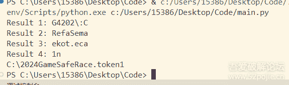

`image-20240914110434860.png` (23.9 KB, 下载次数: 0)

[href="forum.php?mod=attachment&aid=MjcyNDc2N3xhMTdhNmI3YXwxNzkzNTcxNzUwfDE2ODA4NnwxOTY2ODYw&nothumb=yes" target="_blank"](https://www.52pojie.cn/forum.php?mod=attachment&aid=MjcyNDc2N3xhMTdhNmI3YXwxNzkzNTcxNzUwfDE2ODA4NnwxOTY2ODYw&nothumb=yes)

2024-9-23 13:44 上传

整个拼起来是字符串 `C:\2024GameSafeRace.token1`，应该是创建了一个文件，然后向这个文件写入了 `token1` 了，接着往下

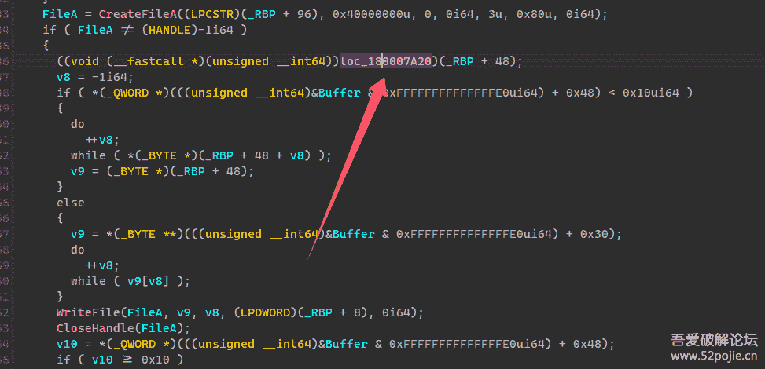

`image-20240914110826942.png` (67 KB, 下载次数: 0)

[href="forum.php?mod=attachment&aid=MjcyNDc2OHwxMWYxMGEwNXwxNzkzNTcxNzUwfDE2ODA4NnwxOTY2ODYw&nothumb=yes" target="_blank"](https://www.52pojie.cn/forum.php?mod=attachment&aid=MjcyNDc2OHwxMWYxMGEwNXwxNzkzNTcxNzUwfDE2ODA4NnwxOTY2ODYw&nothumb=yes)

2024-9-23 13:44 上传

`loc_180007A20` 这个函数内部被加密了，猜测是对 `token1` 的解密过程，然后通过 `WriteFile` 写入 `C:\2024GameSafeRace.token1` 中，并不是很像去分析这个函数，直接加载驱动看看能不能直接运行得到 `2024GameSafeRace.token1` 文件。

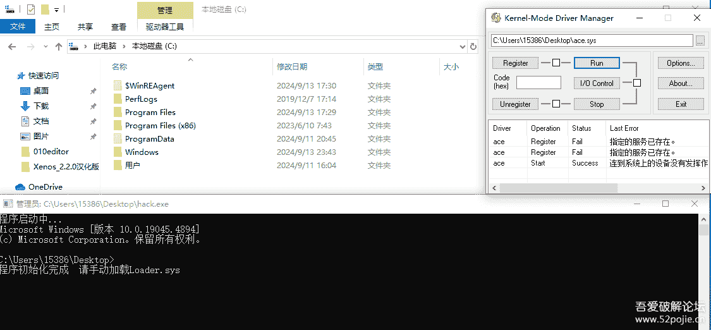

`image-20240914111407201.png` (61.58 KB, 下载次数: 0)

[href="forum.php?mod=attachment&aid=MjcyNDc2OXw5YTQzNjFmY3wxNzkzNTcxNzUwfDE2ODA4NnwxOTY2ODYw&nothumb=yes" target="_blank"](https://www.52pojie.cn/forum.php?mod=attachment&aid=MjcyNDc2OXw5YTQzNjFmY3wxNzkzNTcxNzUwfDE2ODA4NnwxOTY2ODYw&nothumb=yes)

2024-9-23 13:44 上传

找到下没找到，回头看看 `CreateFileA` 函数，核查一下后面几个参数

```text
FileA = CreateFileA((LPCSTR)(_RBP + 96), 0x40000000u, 0, 0i64, 3u, 0x80u, 0i64);
```

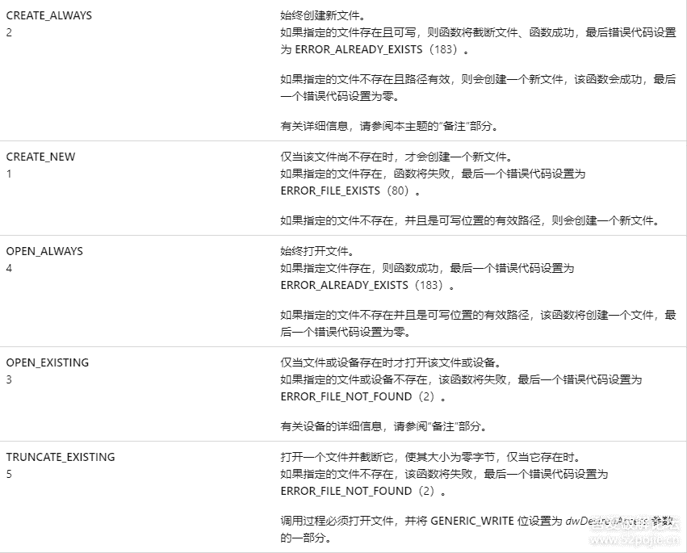

`image-20240914111653640.png` (106.61 KB, 下载次数: 0)

[href="forum.php?mod=attachment&aid=MjcyNDc3MHxmNDMyZTA3NXwxNzkzNTcxNzUwfDE2ODA4NnwxOTY2ODYw&nothumb=yes" target="_blank"](https://www.52pojie.cn/forum.php?mod=attachment&aid=MjcyNDc3MHxmNDMyZTA3NXwxNzkzNTcxNzUwfDE2ODA4NnwxOTY2ODYw&nothumb=yes)

2024-9-23 13:45 上传

看来是参数在作怪，`CreateFileA` 函数传入 `OPEN_EXISTING` 参数，如果没有指定文件，则函数会返回失败，那也好办，自己创建一个就好了。

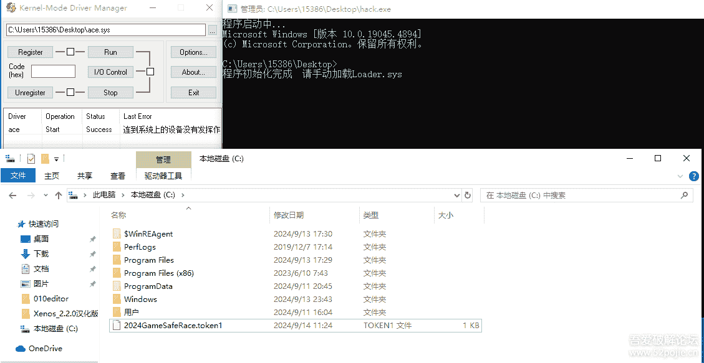

`image-20240914112419617.png` (66.76 KB, 下载次数: 0)

[href="forum.php?mod=attachment&aid=MjcyNDc3MXw0MTY5ZjgyN3wxNzkzNTcxNzUwfDE2ODA4NnwxOTY2ODYw&nothumb=yes" target="_blank"](https://www.52pojie.cn/forum.php?mod=attachment&aid=MjcyNDc3MXw0MTY5ZjgyN3wxNzkzNTcxNzUwfDE2ODA4NnwxOTY2ODYw&nothumb=yes)

2024-9-23 13:45 上传

`C:\2024GameSafeRace.token1` 成功被写入

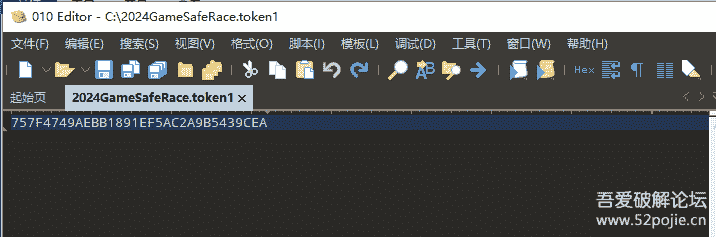

`image-20240914112536772.png` (25.27 KB, 下载次数: 0)

[href="forum.php?mod=attachment&aid=MjcyNDc3Mnw2MDhiM2ExMHwxNzkzNTcxNzUwfDE2ODA4NnwxOTY2ODYw&nothumb=yes" target="_blank"](https://www.52pojie.cn/forum.php?mod=attachment&aid=MjcyNDc3Mnw2MDhiM2ExMHwxNzkzNTcxNzUwfDE2ODA4NnwxOTY2ODYw&nothumb=yes)

2024-9-23 13:45 上传

010 打开找到 `token1:757F4749AEBB1891EF5AC2A9B5439CEA`

`token2` 的寻找就偏简单了，加载驱动后留意一下 `dbgView` 的打印信息就可以获取

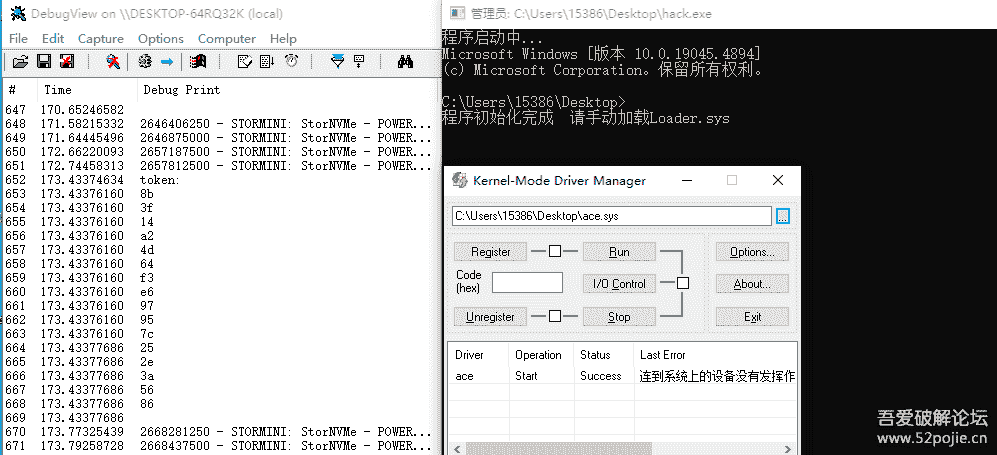

`image-20240914113718466.png` (37.44 KB, 下载次数: 0)


[href="forum.php?mod=attachment&aid=MjcyNDc3M3xiNzU2NTc5MHwxNzkzNTcxNzUwfDE2ODA4NnwxOTY2ODYw&nothumb=yes" target="_blank"](https://www.52pojie.cn/forum.php?mod=attachment&aid=MjcyNDc3M3xiNzU2NTc5MHwxNzkzNTcxNzUwfDE2ODA4NnwxOTY2ODYw&nothumb=yes)

2024-9-23 13:45 上传

组合一下就是`token2`：803f14a24d64f3e697957c252e3a5686

## 3. （二）解题过程

题目要求：

编写程序，运行时修改尽量少的内存，让两段token输出成功。（满分2分）

根据之前分析的`token1`，我们可以知道程序会在`CreateFileA`后解密`token1`然后写入到`C:\2024GameSafeRace.token1`中，但是会因为`CreateFileA`参数`OPEN_EXISTING`条件不满足而失败，所以我们只需要修改这个传参，改成`OPEN_ALWAYS`，即可实现输出`token1`，那我们只需要hook `CreateFileA`函数修改传参即可，但是有个问题，因为不是`hack.exe`本身调用`CreateFileA`函数，而是`hack.exe`注入了一个dll到`winlogon.exe`，然后再`winlogon.exe`里调用`CreateFileA`函数，所以我们可以考虑在注入前修改`WriteProcessMemory`函数参数`buffer`，从而在注入前patch dll，或者编写代码直接注入`winlogon.exe`，hook `CreateFileA`函数修改传参，但是考虑到第二种方式可能不被允许，`winlogon.exe`毕竟是系统进程，题目应该是要我们通过patch dll的方式解题。

这里我们要patch 传参，通过ida找到传参的汇编代码

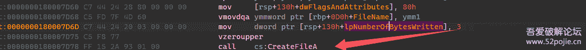

`image-20240920142928600.png` (37.66 KB, 下载次数: 0)

[href="forum.php?mod=attachment&aid=MjcyNDc4MXw3MDM0YTg1MHwxNzkzNTcxNzUwfDE2ODA4NnwxOTY2ODYw&nothumb=yes" target="_blank"](https://www.52pojie.cn/forum.php?mod=attachment&aid=MjcyNDc4MXw3MDM0YTg1MHwxNzkzNTcxNzUwfDE2ODA4NnwxOTY2ODYw&nothumb=yes)

2024-9-23 13:45 上传

在winhex里找到对应所在文件偏移

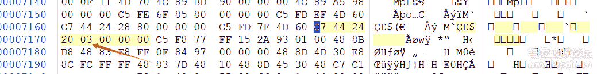

`image-20240920143006628.png` (29.71 KB, 下载次数: 0)

[href="forum.php?mod=attachment&aid=MjcyNDc4MnxhYWNjMzIzZXwxNzkzNTcxNzUwfDE2ODA4NnwxOTY2ODYw&nothumb=yes" target="_blank"](https://www.52pojie.cn/forum.php?mod=attachment&aid=MjcyNDc4MnxhYWNjMzIzZXwxNzkzNTcxNzUwfDE2ODA4NnwxOTY2ODYw&nothumb=yes)

2024-9-23 13:45 上传

也就是在`0x7171`处`OPEN_EXISTING:0x3`是要patch的地方，把这个参数修改成`OPEN_ALWAYS:0x4`即可。下面编写代码实现。

```
//dllmain.cpp
#include "pch.h"
#include 
#include 
#include 
#include 
#include 
#pragma comment(lib,"detours.lib")
#define _KDEBUG
#define DBGMGEBOX(fmt, ...) \
    do { \
         /* 假设最大长度为1024，根据需要调整大小 */ \
        wsprintfA(out, fmt, __VA_ARGS__); \
        MessageBoxA(NULL, out, "提示", MB_OK); \
    } while(0)
char out[100];
typedef BOOL(WINAPI* WriteProcessMemory_t)(
    _In_ HANDLE hProcess,
    _In_ LPVOID lpBaseAddress,
    _In_reads_bytes_(nSize) LPCVOID lpBuffer,
    _In_ SIZE_T nSize,
    _Out_opt_ SIZE_T* lpNumberOfBytesWritten
    );
WriteProcessMemory_t TrueWriteProcessMemory = NULL;
BOOL
WINAPI
HookWriteProcessMemory(
    _In_ HANDLE hProcess,
    _In_ LPVOID lpBaseAddress,
    _In_reads_bytes_(nSize) LPCVOID lpBuffer,
    _In_ SIZE_T nSize,
    _Out_opt_ SIZE_T* lpNumberOfBytesWritten
)
{
    if (nSize == 4506624 && *((PUCHAR)lpBuffer + 0x7171) == 0x3)
    {
        *((PUCHAR)lpBuffer + 0x7171) = 0x4;
        DBGMGEBOX("Hook Success!\n");
    }
    return TrueWriteProcessMemory(hProcess, lpBaseAddress, lpBuffer, nSize, lpNumberOfBytesWritten);
}

BOOL APIENTRY DllMain(HMODULE hModule, DWORD ul_reason_for_call, LPVOID lpReserved) {
    switch (ul_reason_for_call) {
    case DLL_PROCESS_ATTACH:

        DetourTransactionBegin();
        DetourUpdateThread(GetCurrentThread());

        TrueWriteProcessMemory = (WriteProcessMemory_t)DetourFindFunction("kernel32.dll", "WriteProcessMemory");
        DetourAttach(&(PVOID&)TrueWriteProcessMemory, HookWriteProcessMemory);

        DetourTransactionCommit();
        break;
    case DLL_PROCESS_DETACH:
        DetourTransactionBegin();
        DetourUpdateThread(GetCurrentThread());
        DetourDetach(&(PVOID&)TrueWriteProcessMemory, HookWriteProcessMemory);

        DetourTransactionCommit();
        break;
    }
    return TRUE;
}
```

成功输出`token1`文件：

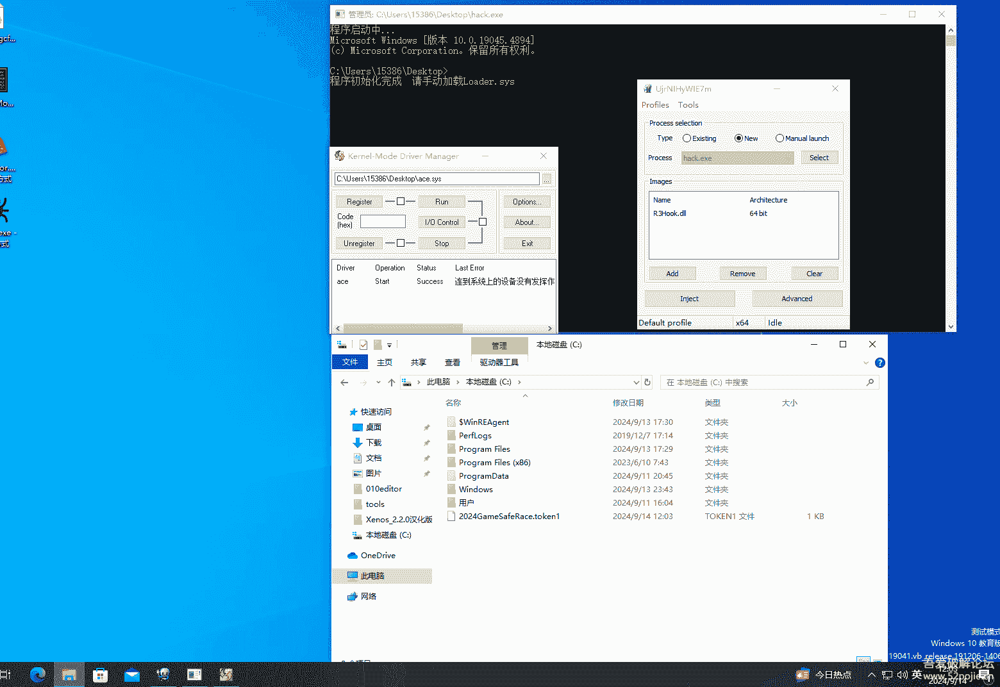

`image-20240914120306770.png` (345.09 KB, 下载次数: 0)

[href="forum.php?mod=attachment&aid=MjcyNDc3NHxlOTM1ZTVkM3wxNzkzNTcxNzUwfDE2ODA4NnwxOTY2ODYw&nothumb=yes" target="_blank"](https://www.52pojie.cn/forum.php?mod=attachment&aid=MjcyNDc3NHxlOTM1ZTVkM3wxNzkzNTcxNzUwfDE2ODA4NnwxOTY2ODYw&nothumb=yes)

2024-9-23 13:45 上传

然后是`token2`，既然是内核输出，那只能是在`ace.sys`里做点手脚，DIE查壳发现`ace.sys`的大部分代码都被加壳过了，静态代码不好看，只能先猜测`token2`的输出调用了`DbgPrint`或者`DbgPrintEx`，因为之前输出`token2`的时候开启了Verbose Kernel outPut，猜测之所以正常输出失败是因为`DbgPrintEx`的`level`值太低，仅将字符串传递给内核调试器，不执行输出操作。

hook `DbgPrintEx`函数看一眼传参。

```
#include 

#include 

#include 

#include 

#include "R0Hook.h"

#define dbgFilter "Kvancy:"

typedef ULONG(*FuncPtr) (ULONG ComponentId, ULONG Level, PCSTR Format, ...);

HOOK_MANAGER hookManager;

ULONG myDbgPrintEx(ULONG ComponentId, ULONG Level, PCSTR Format, ...) {

    Unhook(&hookManager);

    FuncPtr func = (FuncPtr)hookManager.target;

    kPrint("%s DbgPrintEx ComponentId:%lu,Level:%lu\n",dbgFilter, ComponentId, Level);

    va_list args;

    va_start(args, Format);

    NTSTATUS s = func(ComponentId, Level, Format, args);

    va_end(args);

    ApplyHook(&hookManager);

    return s;

}

void DriverUnload(PDRIVER_OBJECT pDriver) {

    kPrint("%s DriverUnload\n", dbgFilter);

    Unhook(&hookManager);

}

NTSTATUS DriverEntry(

    _In_ PDRIVER_OBJECT DriverObject, _In_ PUNICODE_STRING RegistryPath

) {

    DriverObject->DriverUnload = DriverUnload;

    PVOID dbgPrintEx = DbgPrintEx;

    InitializeHookManager(&hookManager, dbgPrintEx, myDbgPrintEx);

    ApplyHook(&hookManager);

    DbgPrintEx(DPFLTR_IHVDRIVER_ID, DPFLTR_ERROR_LEVEL, "%s DriverEntry\n",dbgFilter);

    return STATUS_SUCCESS;

}
```

发现加载ace驱动后，有大量的`level:5`的调试信息输出

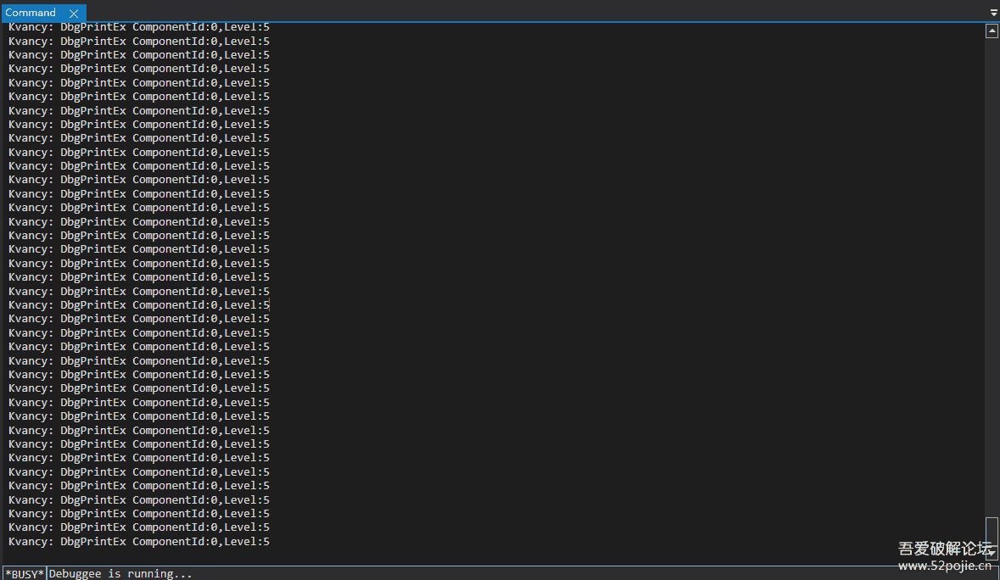

`image-20240918212128643.png` (94.56 KB, 下载次数: 0)

[href="forum.php?mod=attachment&aid=MjcyNDc3NXxjNjlmZTdlNHwxNzkzNTcxNzUwfDE2ODA4NnwxOTY2ODYw&nothumb=yes" target="_blank"](https://www.52pojie.cn/forum.php?mod=attachment&aid=MjcyNDc3NXxjNjlmZTdlNHwxNzkzNTcxNzUwfDE2ODA4NnwxOTY2ODYw&nothumb=yes)

2024-9-23 13:45 上传

也就是说，程序通过设置调试信息的重要级别来控制调试信息是否正常输出，于是可以提高`level`级别来输出`token2`，那么最简单的方式就是hook之后修改`level`后传回去，编写代码hook测试下。


```
#include 
#include 
#include 
#include 
#include 
#include 
#include "R0Hook.h"
#define dbgFilter "Kvancy:"
typedef ULONG(*FuncPtr) (ULONG ComponentId, ULONG Level, PCSTR Format, ...);
HOOK_MANAGER hookManager;
char buffer[1024]; 
ULONG myDbgPrintEx(ULONG ComponentId, ULONG Level, PCSTR Format, ...) {
    Unhook(&hookManager);
    FuncPtr func = (FuncPtr)hookManager.target;
    va_list args;
    va_start(args, Format);
    vsprintf(buffer, Format, args);
    va_end(args);
    NTSTATUS s = func(ComponentId, 0, "%s", buffer);//修改level为0
    ApplyHook(&hookManager);
    return s;
}

void DriverUnload(PDRIVER_OBJECT pDriver) {
    kPrint("Kvancy: DriverUnload\n");
    Unhook(&hookManager);
}

NTSTATUS DriverEntry(
    _In_ PDRIVER_OBJECT DriverObject, _In_ PUNICODE_STRING RegistryPath
) {
    DriverObject->DriverUnload = DriverUnload;
    PVOID dbgPrintEx = DbgPrintEx;
    InitializeHookManager(&hookManager, dbgPrintEx, myDbgPrintEx);
    ApplyHook(&hookManager);
    DbgPrintEx(DPFLTR_IHVDRIVER_ID, DPFLTR_ERROR_LEVEL, "Kvancy: DriverEntry\n");
    return STATUS_SUCCESS;
}
```

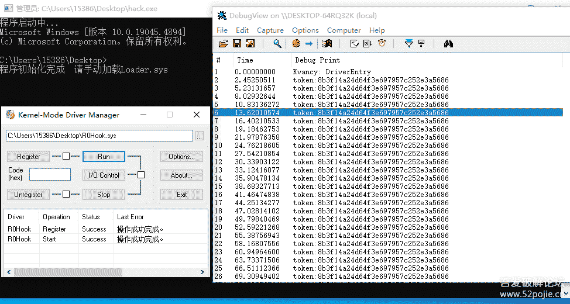

{4981D7A9-1EAA-4A38-9280-429D63ECABF9}.png (55.29 KB, 下载次数: 0)

[href="forum.php?mod=attachment&aid=MjcyNDc1OHw0YzZjMjEyZHwxNzkzNTcxNzUwfDE2ODA4NnwxOTY2ODYw&nothumb=yes" target="_blank"](https://www.52pojie.cn/forum.php?mod=attachment&aid=MjcyNDc1OHw0YzZjMjEyZHwxNzkzNTcxNzUwfDE2ODA4NnwxOTY2ODYw&nothumb=yes)

2024-9-23 13:44 上传

成功输出`token2`，但是根据题目要求是不能修改系统模块代码的，也就是说`hook`内核函数的方法不能过这道题，还是得想想别的方法。现在已知的`ace.sys`的行为就是驱动会在被加载之后做了某些操作会使得系统持续调用`DbgPrintEx`来输出`token2`，但是`ace.sys`其实做了某种操作后就被卸载掉了，如下图所示。

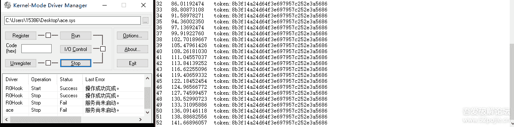

{170126A6-1C28-4BF3-AB47-AB2397C76595}.png (34.28 KB, 下载次数: 0)

[href="forum.php?mod=attachment&aid=MjcyNDc1OXxjN2VmOGRkOHwxNzkzNTcxNzUwfDE2ODA4NnwxOTY2ODYw&nothumb=yes" target="_blank"](https://www.52pojie.cn/forum.php?mod=attachment&aid=MjcyNDc1OXxjN2VmOGRkOHwxNzkzNTcxNzUwfDE2ODA4NnwxOTY2ODYw&nothumb=yes)

2024-9-23 13:44 上传

可以想到就是说驱动启动了一个线程或者进程，让该任务持续输出`token2`，创建完随后再卸载自己并且不停止这个线程或者进程。先枚举进程看看有没有奇怪的进程出现。

```
VOID WriteToFile(PUNICODE_STRING FilePath, PCHAR Data)

{

    OBJECT_ATTRIBUTES objAttr;

    IO_STATUS_BLOCK ioStatusBlock;

    HANDLE fileHandle;

    NTSTATUS status;

    UNICODE_STRING unicodeFilePath;

    RtlInitUnicodeString(&unicodeFilePath, FilePath->Buffer);

    InitializeObjectAttributes(&objAttr, &unicodeFilePath, OBJ_CASE_INSENSITIVE | OBJ_KERNEL_HANDLE, NULL, NULL);

    status = ZwCreateFile(

        &fileHandle,

        FILE_APPEND_DATA | SYNCHRONIZE,

        &objAttr,

        &ioStatusBlock,

        NULL,

        FILE_ATTRIBUTE_NORMAL,

        0,

        FILE_OPEN_IF,

        FILE_SYNCHRONOUS_IO_NONALERT,

        NULL,

        0

    );

    if (NT_SUCCESS(status)) {

        size_t dataLength = strlen(Data);

        ZwWriteFile(fileHandle, NULL, NULL, NULL, &ioStatusBlock, Data, (ULONG)dataLength, NULL, NULL);

        ZwClose(fileHandle);

    }

    else {

        DbgPrint("Failed to create file: %08X\n", status);

    }

}

VOID EnumProcesses()

{

    NTSTATUS status;

    PVOID buffer;

    ULONG bufferSize = 0x10000; // Initial buffer size, can grow if needed

    ULONG returnLength;

    CHAR logBuffer[1024];

    UNICODE_STRING filePath;

    RtlInitUnicodeString(&filePath, L"\\??\\C:\\Users\\15386\\Desktop\\1.txt");

    buffer = ExAllocatePoolWithTag(NonPagedPool, bufferSize, 'proc');

    if (!buffer) {

        DbgPrint("Failed to allocate buffer for process information\n");

        return;

    }

    status = ZwQuerySystemInformation(SystemProcessInformation, buffer, bufferSize, &returnLength);

    if (status == STATUS_INFO_LENGTH_MISMATCH) {

        ExFreePool(buffer);

        bufferSize = returnLength;

        buffer = ExAllocatePoolWithTag(NonPagedPool, bufferSize, 'proc');

        if (!buffer) {

            DbgPrint("Failed to allocate larger buffer for process information\n");

            return;

        }

        status = ZwQuerySystemInformation(SystemProcessInformation, buffer, bufferSize, &returnLength);

    }

    if (NT_SUCCESS(status)) {

        PSYSTEM_PROCESS_INFORMATION processInfo = (PSYSTEM_PROCESS_INFORMATION)buffer;

        while (TRUE) {

            if (processInfo->ImageName.Buffer) {

                _snprintf(logBuffer, sizeof(logBuffer), "Process ID: %lu, Name: %wZ\n", (ULONG)(ULONG_PTR)processInfo->ProcessId, &processInfo->ImageName);

            }

            else {

                _snprintf(logBuffer, sizeof(logBuffer), "Process ID: %lu, Name: [System Process]\n", (ULONG)(ULONG_PTR)processInfo->ProcessId);

            }

            WriteToFile(&filePath, logBuffer);

            if (processInfo->NextEntryOffset == 0)

                break;

            processInfo = (PSYSTEM_PROCESS_INFORMATION)((PUCHAR)processInfo + processInfo->NextEntryOffset);

        }

    }

    ExFreePool(buffer);

}
```

结果发现好像没有奇怪的进程被创建出来，那么有可能是驱动利用`PsCreateSystemThread`创建了一个内核线程。`hookPsCreateSystemThread`函数看看驱动加载时是否调用了这个函数。

```
#include 
#include 
#include 
#include 
#include 
#include "R0Hook.h"
#define dbgFilter "Kvancy:"
typedef ULONG(*FuncPtr) (
    PHANDLE            ThreadHandle,
    ULONG              DesiredAccess,
    POBJECT_ATTRIBUTES ObjectAttributes,
    HANDLE             ProcessHandle,
    PCLIENT_ID         ClientId,
    PKSTART_ROUTINE    StartRoutine,
    PVOID              StartContext);
HOOK_MANAGER hookManager;

NTSTATUS myPsCreateSystemThread(
    PHANDLE            ThreadHandle,
    ULONG              DesiredAccess,
    POBJECT_ATTRIBUTES ObjectAttributes,
    HANDLE             ProcessHandle,
    PCLIENT_ID         ClientId,
    PKSTART_ROUTINE    StartRoutine,
    PVOID              StartContext
)
{
    Unhook(&hookManager);
    FuncPtr func = (FuncPtr)hookManager.target;
    kPrint("%s myPsCreateSystemThread StartRoutine:%p\n", dbgFilter, StartRoutine);
    NTSTATUS s = func(ThreadHandle, DesiredAccess, ObjectAttributes, ProcessHandle, ClientId, StartRoutine, StartContext);
    ApplyHook(&hookManager);
    return s;
}

void DriverUnload(PDRIVER_OBJECT pDriver) {
    kPrint("%s DriverUnload\n", dbgFilter);
    Unhook(&hookManager);
}

NTSTATUS DriverEntry(
    _In_ PDRIVER_OBJECT DriverObject, _In_ PUNICODE_STRING RegistryPath
) {
    DriverObject->DriverUnload = DriverUnload;
    PVOID dbgPrintEx = PsCreateSystemThread;
    InitializeHookManager(&hookManager, dbgPrintEx, myPsCreateSystemThread);
    ApplyHook(&hookManager);
    DbgPrintEx(DPFLTR_IHVDRIVER_ID, DPFLTR_ERROR_LEVEL, "%s DriverEntry\n", dbgFilter);
    return STATUS_SUCCESS;
}
```

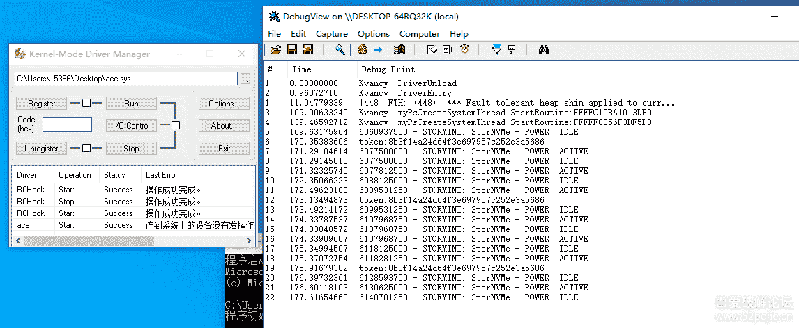

{81A1CDF1-D6A3-454A-BAA1-BAE048F8B7F3}.png (61.69 KB, 下载次数: 0)

[href="forum.php?mod=attachment&aid=MjcyNDc1NnwwNDVjZjlmNHwxNzkzNTcxNzUwfDE2ODA4NnwxOTY2ODYw&nothumb=yes" target="_blank"](https://www.52pojie.cn/forum.php?mod=attachment&aid=MjcyNDc1NnwwNDVjZjlmNHwxNzkzNTcxNzUwfDE2ODA4NnwxOTY2ODYw&nothumb=yes)

2024-9-23 13:44 上传

发现在`token2`输出前确实有`PsCreateSystemThread`函数调用，虽然不确定是不是`ace.sys`创建的。在`windbg`里反汇编看看线程函数

```
0: kd> u FFFFBA0729013DB0 l 100

ffffba07`29013db0 488bc4          mov     rax,rsp

ffffba07`29013db3 48895808        mov     qword ptr [rax+8],rbx

ffffba07`29013db7 48897818        mov     qword ptr [rax+18h],rdi

ffffba07`29013dbb 4c897020        mov     qword ptr [rax+20h],r14

ffffba07`29013dbf 55              push    rbp

ffffba07`29013dc0 488d68a1        lea     rbp,[rax-5Fh]

ffffba07`29013dc4 4881eca0000000  sub     rsp,0A0h

ffffba07`29013dcb 48bf4e93328b546b331e mov rdi,1E336B548B32934Eh

ffffba07`29013dd5 49bed520794add1d6d4b mov r14,4B6D1DDD4A7920D5h

ffffba07`29013ddf 0f57c0          xorps   xmm0,xmm0

ffffba07`29013de2 488d4d37        lea     rcx,[rbp+37h]

ffffba07`29013de6 0f114537        movups  xmmword ptr [rbp+37h],xmm0

ffffba07`29013dea e8d1030000      call    ffffba07`290141c0
```


# 反汇编分析

## 汇编 Dump
```
ffffba07`29013def 48b8a14f122fb3276d4b mov rax,4B6D27B32F124FA1h
ffffba07`29013df9 4c8d45e7        lea     r8,[rbp-19h]
ffffba07`29013dfd 4889456f        mov     qword ptr [rbp+6Fh],rax
ffffba07`29013e01 ba05000000      mov     edx,5
ffffba07`29013e06 488b456f        mov     rax,qword ptr [rbp+6Fh]
ffffba07`29013e0a 33c9            xor     ecx,ecx
ffffba07`29013e0c 488945e7        mov     qword ptr [rbp-19h],rax
ffffba07`29013e10 48897d6f        mov     qword ptr [rbp+6Fh],rdi
ffffba07`29013e14 488b456f        mov     rax,qword ptr [rbp+6Fh]
ffffba07`29013e18 488945ef        mov     qword ptr [rbp-11h],rax
ffffba07`29013e1c 4c89756f        mov     qword ptr [rbp+6Fh],r14
ffffba07`29013e20 488b456f        mov     rax,qword ptr [rbp+6Fh]
ffffba07`29013e24 48894517        mov     qword ptr [rbp+17h],rax
ffffba07`29013e28 48897d6f        mov     qword ptr [rbp+6Fh],rdi
ffffba07`29013e2c 488b456f        mov     rax,qword ptr [rbp+6Fh]
ffffba07`29013e30 660f6f45e7      movdqa  xmm0,xmmword ptr [rbp-19h]
ffffba07`29013e35 4889451f        mov     qword ptr [rbp+1Fh],rax
ffffba07`29013e39 660fef4517      pxor    xmm0,xmmword ptr [rbp+17h]
ffffba07`29013e3e 488b0543330000  mov     rax,qword ptr [ffffba07`29017188]
ffffba07`29013e45 660f7f45e7      movdqa  xmmword ptr [rbp-19h],xmm0
ffffba07`29013e4a ff15c8210000    call    qword ptr [ffffba07`29016018]
ffffba07`29013e50 33db            xor     ebx,ebx
ffffba07`29013e52 48b8f0104b32dd1d6d4b mov rax,4B6D1DDD324B10F0h
ffffba07`29013e5c 4c8d45f7        lea     r8,[rbp-9]
ffffba07`29013e60 4889456f        mov     qword ptr [rbp+6Fh],rax
ffffba07`29013e64 ba05000000      mov     edx,5
ffffba07`29013e69 488b456f        mov     rax,qword ptr [rbp+6Fh]
ffffba07`29013e6d 33c9            xor     ecx,ecx
ffffba07`29013e6f 488945f7        mov     qword ptr [rbp-9],rax
ffffba07`29013e73 48897d6f        mov     qword ptr [rbp+6Fh],rdi
ffffba07`29013e77 488b456f        mov     rax,qword ptr [rbp+6Fh]
ffffba07`29013e7b 488945ff        mov     qword ptr [rbp-1],rax
ffffba07`29013e7f 4c89756f        mov     qword ptr [rbp+6Fh],r14
ffffba07`29013e83 488b456f        mov     rax,qword ptr [rbp+6Fh]
ffffba07`29013e87 48894527        mov     qword ptr [rbp+27h],rax
ffffba07`29013e8b 48897d6f        mov     qword ptr [rbp+6Fh],rdi
ffffba07`29013e8f 488b456f        mov     rax,qword ptr [rbp+6Fh]
ffffba07`29013e93 660f6f45f7      movdqa  xmm0,xmmword ptr [rbp-9]
ffffba07`29013e98 440fb64c1d37    movzx   r9d,byte ptr [rbp+rbx+37h]
ffffba07`29013e9e 4889452f        mov     qword ptr [rbp+2Fh],rax
ffffba07`29013ea2 660fef4527      pxor    xmm0,xmmword ptr [rbp+27h]
ffffba07`29013ea7 488b05da320000  mov     rax,qword ptr [ffffba07`29017188]
ffffba07`29013eae 660f7f45f7      movdqa  xmmword ptr [rbp-9],xmm0
ffffba07`29013eb3 ff155f210000    call    qword ptr [ffffba07`29016018]
ffffba07`29013eb9 48ffc3          inc     rbx
ffffba07`29013ebc 4883fb10        cmp     rbx,10h
ffffba07`29013ec0 7c90            jl      ffffba07`29013e52
ffffba07`29013ec2 48b8df20794add1d6d4b mov rax,4B6D1DDD4A7920DFh
ffffba07`29013ecc 4c8d4507        lea     r8,[rbp+7]
ffffba07`29013ed0 4889456f        mov     qword ptr [rbp+6Fh],rax
ffffba07`29013ed4 ba05000000      mov     edx,5
ffffba07`29013ed9 488b456f        mov     rax,qword ptr [rbp+6Fh]
ffffba07`29013edd 33c9            xor     ecx,ecx
ffffba07`29013edf 48894507        mov     qword ptr [rbp+7],rax
ffffba07`29013ee3 48897d6f        mov     qword ptr [rbp+6Fh],rdi
ffffba07`29013ee7 488b456f        mov     rax,qword ptr [rbp+6Fh]
ffffba07`29013eeb 4889450f        mov     qword ptr [rbp+0Fh],rax
ffffba07`29013eef 4c89756f        mov     qword ptr [rbp+6Fh],r14
ffffba07`29013ef3 488b456f        mov     rax,qword ptr [rbp+6Fh]
ffffba07`29013ef7 48894547        mov     qword ptr [rbp+47h],rax
ffffba07`29013efb 48897d6f        mov     qword ptr [rbp+6Fh],rdi
ffffba07`29013eff 488b456f        mov     rax,qword ptr [rbp+6Fh]
ffffba07`29013f03 660f6f4507      movdqa  xmm0,xmmword ptr [rbp+7]
ffffba07`29013f08 4889454f        mov     qword ptr [rbp+4Fh],rax
ffffba07`29013f0c 660fef4547      pxor    xmm0,xmmword ptr [rbp+47h]
ffffba07`29013f11 488b0570320000  mov     rax,qword ptr [ffffba07`29017188]
ffffba07`29013f18 660f7f4507      movdqa  xmmword ptr [rbp+7],xmm0
ffffba07`29013f1d ff15f5200000    call    qword ptr [ffffba07`29016018]
ffffba07`29013f23 b9ce0a0000      mov     ecx,0ACEh
ffffba07`29013f28 e833e9ffff      call    ffffba07`29012860
ffffba07`29013f2d e9adfeffff      jmp     ffffba07`29013ddf
ffffba07`29013f32 cc              int     3
ffffba07`29013f33 cc              int     3
ffffba07`29013f34 4152            push    r10
```

### 导入到IDA里看伪代码
```
void __noreturn sub_180005148()
{
  __m128i v0; // xmm0
  __int64 i; // rbx
  __m128i v2; // xmm0
  __int64 v3; // r9
  __m128i v4; // xmm0
  __m128i v5; // [rsp+30h] [rbp-19h] BYREF
  __m128i v6; // [rsp+40h] [rbp-9h] BYREF
  __m128i v7; // [rsp+50h] [rbp+7h] BYREF
  __m128i v8; // [rsp+60h] [rbp+17h]
  __m128i v9; // [rsp+70h] [rbp+27h]
  __int128 v10; // [rsp+80h] [rbp+37h] BYREF
  __m128i v11; // [rsp+90h] [rbp+47h]

  while ( 1 )
  {
    v10 = 0i64;
    ((void (__fastcall *)(__int128 *))((char *)&loc_180005556 + 2))(&v10);
    v5.m128i_i64[0] = 0x4B6D27B32F124FA1i64;
    v5.m128i_i64[1] = 0x1E336B548B32934Ei64;
    v8.m128i_i64[0] = 0x4B6D1DDD4A7920D5i64;
    v0 = _mm_load_si128(&v5);
    v8.m128i_i64[1] = 0x1E336B548B32934Ei64;
    v5 = _mm_xor_si128(v0, v8);
    MEMORY[0x31305A8047353130](0i64, 5i64, &v5);
    for ( i = 0i64; i 
```

好像是做了一个字符串解密然后输出的操作，浅浅用python跑一下解析字符串验证猜想。

```python
def hex_xor_to_string(a, b):
    result = a ^ b
    hex_str = hex(result)[2:]
    if len(hex_str) % 2 != 0:
        hex_str = '0' + hex_str
    result_str = ''.join(chr(int(hex_str[i:i+2], 16)) for i in range(0, len(hex_str), 2))
    return result_str

x1 = 0x4B6D27B32F124FA1
x2 = 0x1E336B548B32934E
y1 = 0x4B6D1DDD4A7920D5
y2 = 0x1E336B548B32934E

result1 = hex_xor_to_string(x1, y1)
result2 = hex_xor_to_string(x2, y2)

print("Result 1:", result1)
print("Result 2:", result2)

res = result1[::-1] + result2[::-1]
print(res)
```

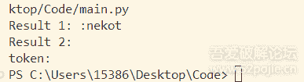

{8FBDE081-6C77-49BA-BEDA-94E3B44A9056}.png (12.72 KB, 下载次数: 0)

[href="forum.php?mod=attachment&aid=MjcyNDc1NXwzMjQ1YzkyM3wxNzkzNTcxNzUwfDE2ODA4NnwxOTY2ODYw&nothumb=yes" target="_blank"](https://www.52pojie.cn/forum.php?mod=attachment&aid=MjcyNDc1NXwzMjQ1YzkyM3wxNzkzNTcxNzUwfDE2ODA4NnwxOTY2ODYw&nothumb=yes)

2024-9-23 13:44 上传

打印出了token基本上确定了这个线程就是打印token的线程，现在就是要想怎么patch这个线程函数使得token能够输出出来。

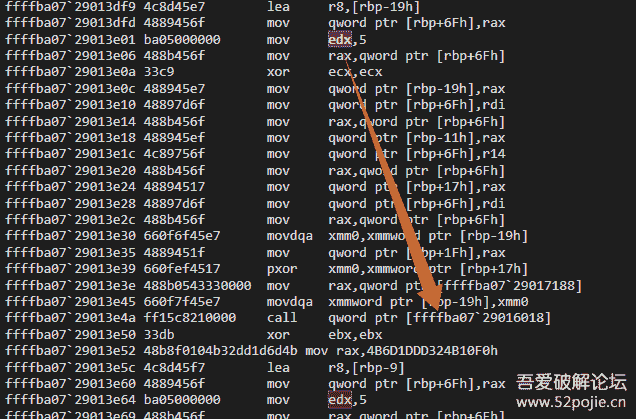

image-20240919195412464.png (82.56 KB, 下载次数: 0)

[href="forum.php?mod=attachment&aid=MjcyNDc3Nnw0Yzc4OWFjMXwxNzkzNTcxNzUwfDE2ODA4NnwxOTY2ODYw&nothumb=yes" target="_blank"](https://www.52pojie.cn/forum.php?mod=attachment&aid=MjcyNDc3Nnw0Yzc4OWFjMXwxNzkzNTcxNzUwfDE2ODA4NnwxOTY2ODYw&nothumb=yes)

2024-9-23 13:45 上传

这里有个`mov edx,5`语句，将`DbgPrintEx`函数的`level`设置成5，可以考虑`patch`这个语句，将5改成0，那么只需要`patch`一个字节，共三处。但是又要怎么`patch`呢，首先不能通过现在这种方式`hook` `PsCreateSystemThread`函数调用来确定`StartRoutine`地址（题目要求不能修改系统模块代码），也就是说得想另外一个办法确定这个线程的地址，然后通过偏移来确定需要`patch`的地址。

那么怎么确定这个线程地址呢，如果通过`ZwQuerySystemInformation`枚举内核模块然后枚举模块下的所有线程的话，已经卸载了的`ace.sys`模块还能被枚举到么？问了下GPT好像是不能的，还可以考虑用`StartRoutine`地址的后几位做特征，匹配所有线程的开始地址的后几位，但是这种方式又感觉怕遇到地址特征一模一样的，感觉还是不大行。又问GPT怎么寻找到某个内核线程，得到答复是除了`ZwQuerySystemInformation`枚举，还有通过`PsLookupThreadByThreadId`函数从进程id和线程id查找的。

那么线程id和进程id又从哪获取呢？因为之前`hook`过`PsCreateSystemThread`函数，翻阅文档找到了一个`ClientId`参数，这个参数指向接收新线程的客户端标识符的结构，即一个`pid`，一个`tid`，但是`pid`，`tid`应该都是系统分配的吧，能是一个固定值么？`hook`一下看看输出

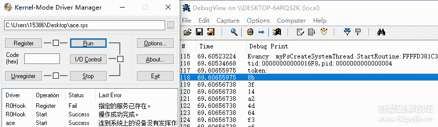

image-20240919214001840.png (26.8 KB, 下载次数: 1)


[href="forum.php?mod=attachment&aid=MjcyNDc3N3xjYjNhYzcyNnwxNzkzNTcxNzUwfDE2ODA4NnwxOTY2ODYw&nothumb=yes" target="_blank"](https://www.52pojie.cn/forum.php?mod=attachment&aid=MjcyNDc3N3xjYjNhYzcyNnwxNzkzNTcxNzUwfDE2ODA4NnwxOTY2ODYw&nothumb=yes)

2024-9-23 13:45 上传

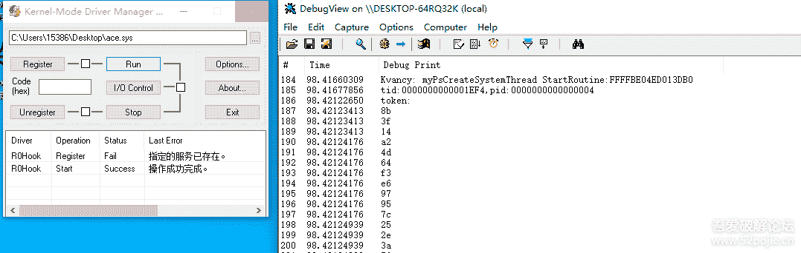

image-20240919215044101.png (31.08 KB, 下载次数: 0)

[href="forum.php?mod=attachment&aid=MjcyNDc3OHwyNjkyYjUyN3wxNzkzNTcxNzUwfDE2ODA4NnwxOTY2ODYw&nothumb=yes" target="_blank"](https://www.52pojie.cn/forum.php?mod=attachment&aid=MjcyNDc3OHwyNjkyYjUyN3wxNzkzNTcxNzUwfDE2ODA4NnwxOTY2ODYw&nothumb=yes)

2024-9-23 13:45 上传

诶，`tid`貌似是系统分配的，但是`pid`一直都是4，很奇怪，`pid=4`代表的是什么进程呢？之前刚好枚举过进程来找有没有新进程创建，现在正好能派上用场。

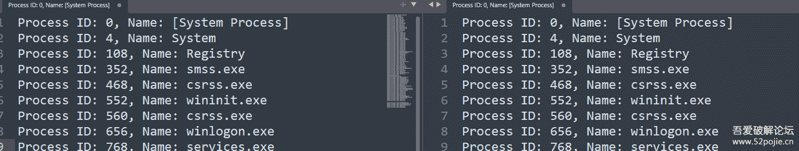

image-20240919215837787.png (144.86 KB, 下载次数: 0)

[href="forum.php?mod=attachment&aid=MjcyNDc3OXw5YWU4YWM1NnwxNzkzNTcxNzUwfDE2ODA4NnwxOTY2ODYw&nothumb=yes" target="_blank"](https://www.52pojie.cn/forum.php?mod=attachment&aid=MjcyNDc3OXw5YWU4YWM1NnwxNzkzNTcxNzUwfDE2ODA4NnwxOTY2ODYw&nothumb=yes)

2024-9-23 13:45 上传

貌似是一个系统进程，GPT了一下发现原来如果驱动程序通过内核模式创建系统线程（使用`PsCreateSystemThread`），这些线程通常会在系统进程下运行，`PID`为4。原来如此，驱动程序和进程是一个级别的，但是驱动程序创建的这个线程是在系统进程之下的，而不是属于驱动模块，只是线程起始地址隶属于模块地址空间的，驱动卸载并不影响线程的运行。

这样的话，我们要找的线程因为模块被卸载了，所以它不在所有模块地址空间内，只要枚举所有系统进程`pid=4`下的所有线程，然后通过判断线程的起始地址是否在所有模块地址之内，即可判断它是否是我们要找的线程。这下思路就通了，开始编写代码实现patch。

```
#include "header.h"

PVOID MoudleBaseAddress[1024];
ULONG64 MoudleSize[1024];
ULONG ModuleCount = 0;
ULONG Offset1 = 0x52, Offset2 = 0xB5, Offset3 = 0x125;

BOOLEAN IsAddressInKnownModules(PVOID Address, PVOID* ModuleBaseAddresses, ULONG64* ModuleSize, ULONG ModuleCount)
{
    for (size_t i = 0; i = ModuleBaseAddresses[i] && Address ModulesCount;
        for (ULONG i = 0; i ModulesCount; i++) {
            PSYSTEM_MODULE_INFORMATION_ENTRY moduleEntry = &moduleInfo->Modules[i];
            MoudleBaseAddress[i] = moduleEntry->Base;
            MoudleSize[i] = moduleEntry->Size;
        }
    }

    // 遍历进程信息
    if (NT_SUCCESS(status)) {
        PSYSTEM_PROCESS_INFORMATION processInfo = (PSYSTEM_PROCESS_INFORMATION)processBuffer;
        while (TRUE) {
            if (processInfo->ProcessId == TargetProcessId) {
                PSYSTEM_THREAD_INFORMATION threadInfo = (PSYSTEM_THREAD_INFORMATION)(processInfo + 1);
                for (ULONG i = 0; i NumberOfThreads; i++) {
                    if (!IsAddressInKnownModules(threadInfo[i].StartAddress, MoudleBaseAddress, MoudleSize, ModuleCount))
                    {
                        DbgPrint("Find it:%p\n",threadInfo[i].StartAddress);
                        return threadInfo[i].StartAddress;
                    }
                }
                break;
            }
            if (processInfo->NextEntryOffset == 0)
                break;
            processInfo = (PSYSTEM_PROCESS_INFORMATION)((PUCHAR)processInfo + processInfo->NextEntryOffset);
        }
    }

    // 清理分配的内存
    ExFreePool(processBuffer);
    ExFreePool(moduleBuffer);
    return 0;
}

VOID UnloadDriver(PDRIVER_OBJECT DriverObject) {
    KdPrint(("Driver Unloaded\n"));
}

NTSTATUS DriverEntry(PDRIVER_OBJECT DriverObject, PUNICODE_STRING RegistryPath) {
    DriverObject->DriverUnload = UnloadDriver;
    KdPrint(("Driver Loaded\n"));

    HANDLE targetPid = (HANDLE)4; // 系统进程的 PID
    PVOID targetAddress = EnumSystemModulesForProcess(targetPid);

    UCHAR valueToWrite = 0x00; // 要写入的字节值
    UCHAR valueToRead = 0x05; // 要写入的字节值
    ULONG numHasChanged = 0x00;
    if (*(PUCHAR)((ULONG64)targetAddress + Offset1) == valueToRead)
    {
        *(PUCHAR)((ULONG64)targetAddress + Offset1) = valueToWrite;
        numHasChanged++;
    }
    if (*(PUCHAR)((ULONG64)targetAddress + Offset2) == valueToRead)
    {
        *(PUCHAR)((ULONG64)targetAddress + Offset2) = valueToWrite;
        numHasChanged++;
    }
    if (*(PUCHAR)((ULONG64)targetAddress + Offset3) == valueToRead)
    {
        *(PUCHAR)((ULONG64)targetAddress + Offset3) = valueToWrite;
        numHasChanged++;
    }
    DbgPrint("numHasChanged:%d\n", numHasChanged);
    return STATUS_SUCCESS;
}
```

成功输出`token2`

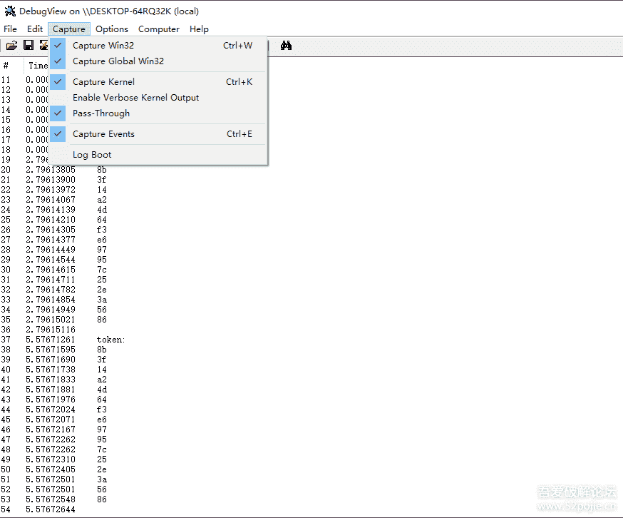

image-20240920125107119.png (32.6 KB, 下载次数: 0)

[href="forum.php?mod=attachment&aid=MjcyNDc4MHxkOTc2OTg1YXwxNzkzNTcxNzUwfDE2ODA4NnwxOTY2ODYw&nothumb=yes" target="_blank"](https://www.52pojie.cn/forum.php?mod=attachment&aid=MjcyNDc4MHxkOTc2OTg1YXwxNzkzNTcxNzUwfDE2ODA4NnwxOTY2ODYw&nothumb=yes)

2024-9-23 13:45 上传

### 3> （三）解题过程

题目要求：

编写程序，运行时修改尽量少的内存，让`shellcode` 往自行指定的位置写入`token1`成功。（满分3分）

要求任意位置，也就是要修改`CreateFileA`函数的第一个参数的值，根据之前分析的`C:\2024GameSafeRace.token1`字符串是由十六进制异或得到的，也就是下面这些

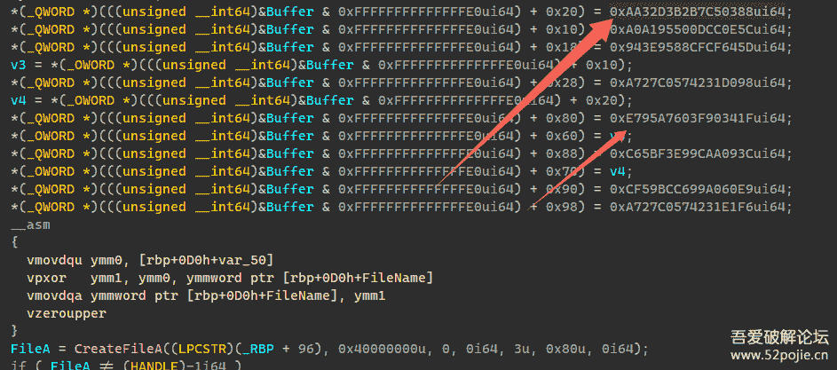

image-20240920145014956.png (98.44 KB, 下载次数: 0)

[href="forum.php?mod=attachment&aid=MjcyNDc4M3w5YWNlN2Q5NHwxNzkzNTcxNzUwfDE2ODA4NnwxOTY2ODYw&nothumb=yes" target="_blank"](https://www.52pojie.cn/forum.php?mod=attachment&aid=MjcyNDc4M3w5YWNlN2Q5NHwxNzkzNTcxNzUwfDE2ODA4NnwxOTY2ODYw&nothumb=yes)

2024-9-23 13:45 上传

可以考虑的是patch这些十六进制数据，把异或的`key`改成0，然后密文改成明文即可，因为明文异或0还是明文，但是考虑到要尽量修改少量的内存，我们最好还是保持`key`不变，自定义密文解密到我们所要的文件地址。跑个`python`脚本解出新的密文，得到新的密文，接着找到密文所在文件的偏移然后patch即可，给出解题代码。

```
//dllmain.cpp

#include "pch.h"

#include 

#include 

#include 

#include 

#include 

#include 

#pragma comment(lib,"detours.lib")

#define _KDEBUG

#define DBGMGEBOX(fmt, ...) \

    do { \

         /* 假设最大长度为1024，根据需要调整大小 */ \

        wsprintfA(out, fmt, __VA_ARGS__); \

        MessageBoxA(NULL, out, "提示", MB_OK); \

    } while(0)

char out[100];

typedef BOOL(WINAPI* WriteProcessMemory_t)(

    _In_ HANDLE hProcess,

    _In_ LPVOID lpBaseAddress,

    _In_reads_bytes_(nSize) LPCVOID lpBuffer,

    _In_ SIZE_T nSize,

    _Out_opt_ SIZE_T* lpNumberOfBytesWritten

    );

WriteProcessMemory_t TrueWriteProcessMemory = NULL;

BOOL

WINAPI

HookWriteProcessMemory(

    _In_ HANDLE hProcess,

    _In_ LPVOID lpBaseAddress,

    _In_reads_bytes_(nSize) LPCVOID lpBuffer,

    _In_ SIZE_T nSize,

    _Out_opt_ SIZE_T* lpNumberOfBytesWritten

)

{

    if (nSize == 4506624 && *((PUCHAR)lpBuffer + 0x7171) == 0x3)

    {

        *((PUCHAR)lpBuffer + 0x7171) = 0x4;

        *(PULONG64)((ULONG64)lpBuffer + 0x7082) = 0x94e7c2136acc0e5c;//

        *(PULONG64)((ULONG64)lpBuffer + 0x7093) = 0x8207c5d1af9f3860;

        *(PULONG64)((ULONG64)lpBuffer + 0x70F1) = 0xa905cca9edcb138c;

        *(PULONG64)((ULONG64)lpBuffer + 0x7108) = 0xa753b8236c56809a;

        //C:\Users\15386\Desktop\flag.txt

        DBGMGEBOX("Hook Success!\n");

    }

    return TrueWriteProcessMemory(hProcess, lpBaseAddress, lpBuffer, nSize, lpNumberOfBytesWritten);

}

BOOL APIENTRY DllMain(HMODULE hModule, DWORD ul_reason_for_call, LPVOID lpReserved) {

    switch (ul_reason_for_call) {

    case DLL_PROCESS_ATTACH:

        DetourTransactionBegin();

        DetourUpdateThread(GetCurrentThread());

        TrueWriteProcessMemory = (WriteProcessMemory_t)DetourFindFunction("kernel32.dll", "WriteProcessMemory");

        DetourAttach(&(PVOID&)TrueWriteProcessMemory, HookWriteProcessMemory);

        DetourTransactionCommit();

        break;

    case DLL_PROCESS_DETACH:

        DetourTransactionBegin();

        DetourUpdateThread(GetCurrentThread());

        DetourDetach(&(PVOID&)TrueWriteProcessMemory, HookWriteProcessMemory);

        DetourTransactionCommit();

        break;

    }

    return TRUE;

}
```

注入hook成功后，成功在桌面的`flag.txt`输出`token1`

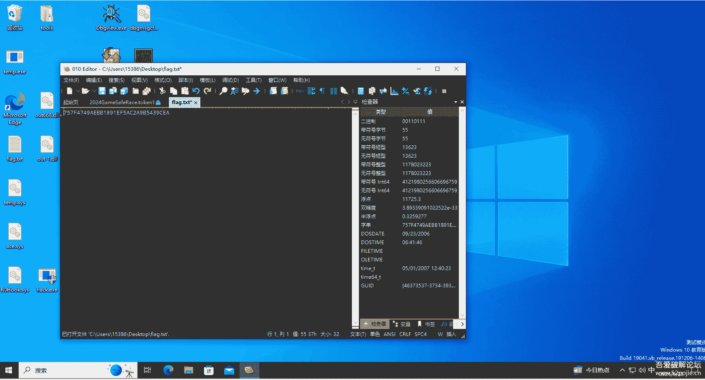

{87F08EF1-EECF-4DBC-A7D0-954E04FFA9CD}.png (594 KB, 下载次数: 0)

[href="forum.php?mod=attachment&aid=MjcyNDc1N3w1MWNlNGRkMnwxNzkzNTcxNzUwfDE2ODA4NnwxOTY2ODYw&nothumb=yes" target="_blank"](https://www.52pojie.cn/forum.php?mod=attachment&aid=MjcyNDc1N3w1MWNlNGRkMnwxNzkzNTcxNzUwfDE2ODA4NnwxOTY2ODYw&nothumb=yes)

2024-9-23 13:44 上传
