# [原创] 小白向—2022腾讯游戏安全初赛分析（上）

- 原帖：https://www.52pojie.cn/forum.php?mod=viewthread&tid=1968489
- 抓取时间：2026-11-01T22:22:21

下篇已更新：https://www.52pojie.cn/thread-1968679-1-1.html

参考：

1. https://github.com/smallzhong/gslab-2022-competition?tab=readme-ov-file
2. https://www.52pojie.cn/thread-1904205-1-1.html
3. https://www.52pojie.cn/thread-1952072-1-1.html

## 前言

8月在爱破网的精华帖里看到了对2022腾讯游戏安全初赛的分析（“参考”中的第二条链接），感觉挺有意思的，但因为当时看的时候楼主是纯小白（甚至没用过ida pro），完全看不懂，就想着去学一学，试一试。没想到拖拖拉拉地一试就是两个月。学到了很多东西，觉得是一次不错的入门经历，因此记录下来，向其他小白详细地介绍整个分析以及操作的流程。

因为小白向的话文字以及图片都需要非常详细，整体做起来还是比较费时间的，所以教程分为上下两部分，大概隔个两三天就会出下。

## 小白将学到

1. ida pro的基本使用。
2. hook的概念以及操作方式
3. dump的概念以及操作方式

## 所需前置知识

c语言基础

## 所需工具

IDA Pro

Visual Studio

## 赛题说明

赛题下载链接：

[https://gslab.qq.com/html/competition/2022/doc/PC%E5%AE%A2%E6%88%B7%E7%AB%AF%E5%AE%89%E5%85%A8-%E5%88%9D%E8%B5%9B%E8%B5%9B%E9%A2%98.zip](https://gslab.qq.com/html/competition/2022/doc/PC%E5%AE%A2%E6%88%B7%E7%AB%AF%E5%AE%89%E5%85%A8-%E5%88%9D%E8%B5%9B%E8%B5%9B%E9%A2%98.zip)

这里有一个画了flag的小程序，可好像出了点问题，flag丢失了，需要把它找回来。

题目：

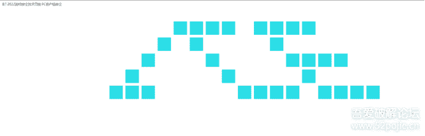

找回flag样例：


## 操作与分析

接下来正式开始。

### 使用IDA Pro打开赛题的exe程序

首先使用ida pro打开赛题的exe程序

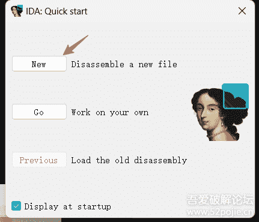

在弹出的文件选择窗口中选择赛题的exe程序

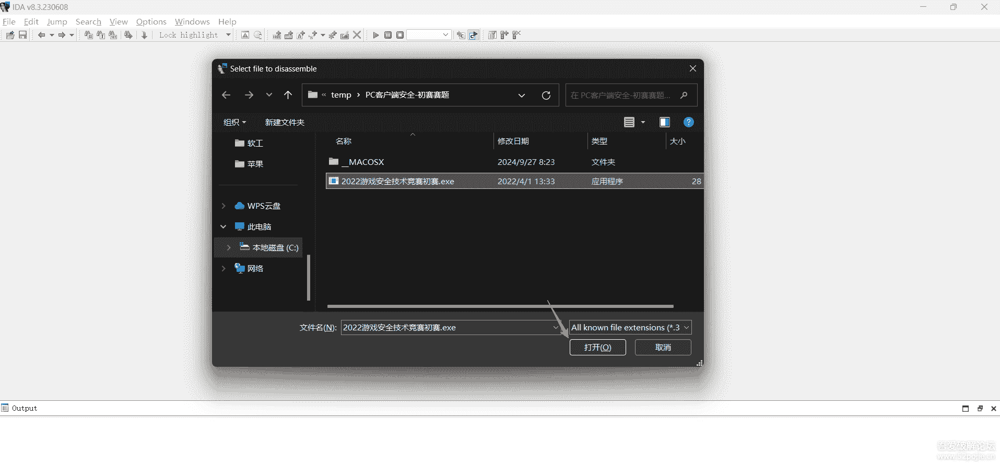

之后弹出的第一个窗口直接选ok，第二个选择no。

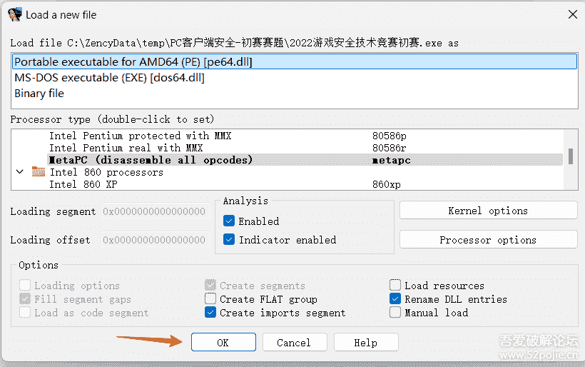

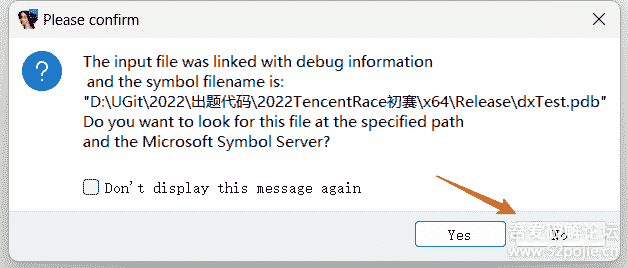

文件就加载完成了

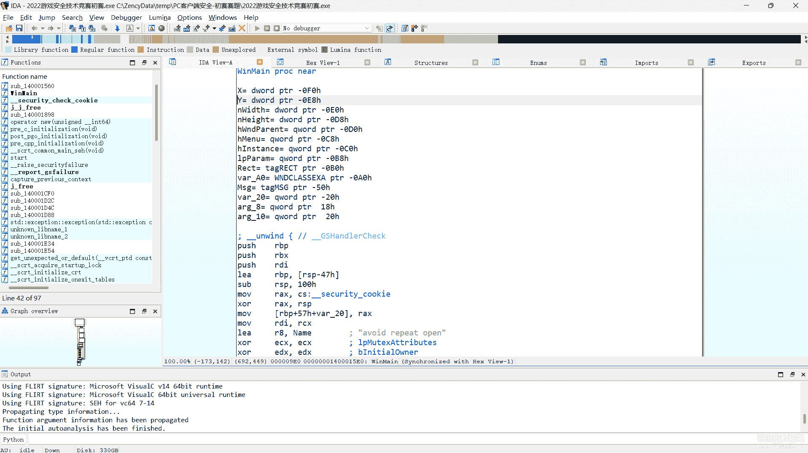

### 静态分析

我们的主界面初始位于IDA View-A窗口，且看到的是一个被称为graphs的界面，按下空格键可在graphs界面与hex代码界面（这只是我的称呼，官方名称我也不太清楚）切换，其中展示的是汇编代码。

IDA的左边具有一个Functions窗口，罗列了系统检索到的函数，其中具有一个名为`WinMain`函数，类似于C中的`main`函数，是整个程序的起始函数。双击`WinMain`，IDA会跳转到`WinMain`汇编代码的部分。

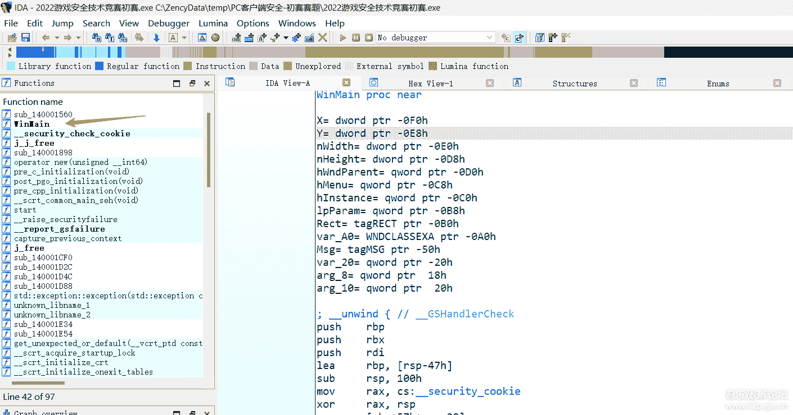

汇编代码很难分析，我们想要看c语言代码，按下Tab键，将跳转到`WinMain`函数的c代码界面，即Pseudocode-A界面。

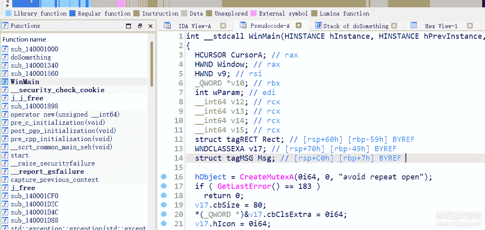

现在我们可以开始分析代码的逻辑了。查看`WinMain`函数中的代码，可以发现在60行以前都是赋值，在第61行开始进行逻辑功能处理

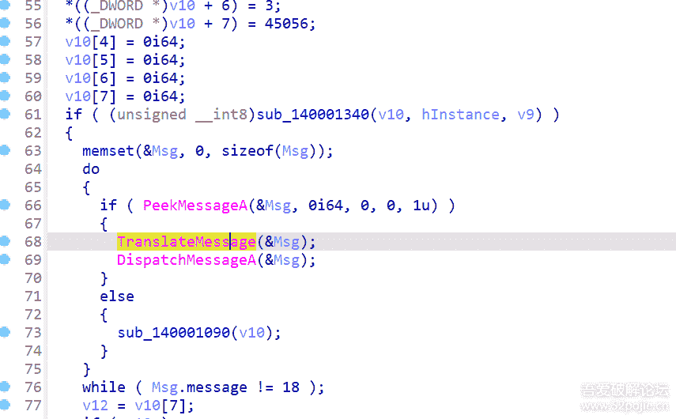

粉紫色的函数为windows提供的官方api，且经询问ai得知与图像绘制无关

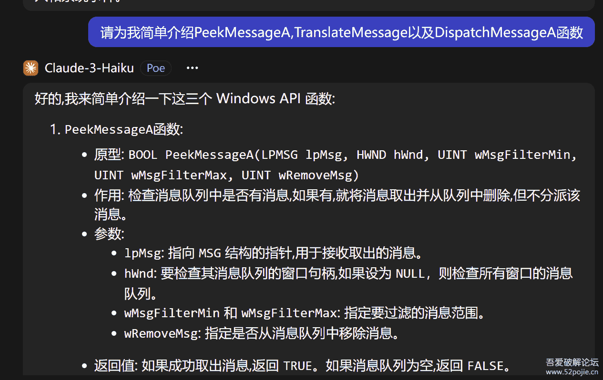

因此推测图像处理逻辑存在于`else`中的`sub_140001090`函数，双击此函数，进入其函数实现界面，观察代码

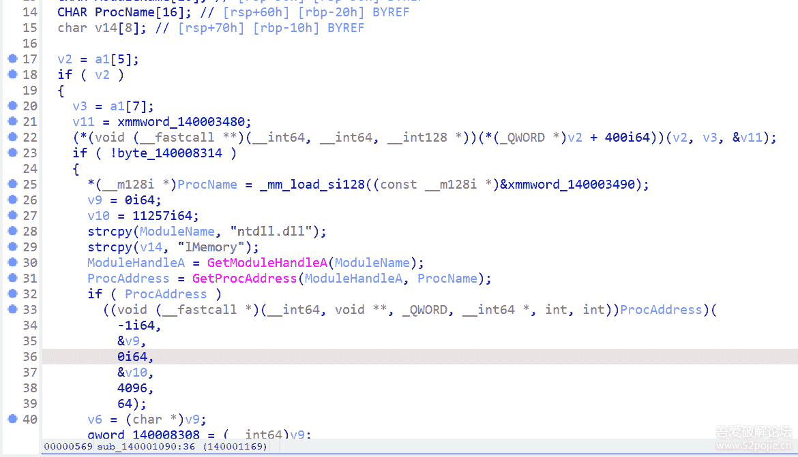

从第18行开始进入逻辑处理，观察代码，每遇到一个深蓝色变量都双击观察其是否具有初始值，如`byte_140008314`，双击后显示`db`为“？”，即没有初始值，不深究

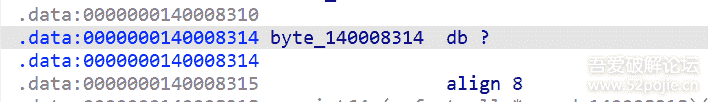

而`xmmword_140003490`双击后为

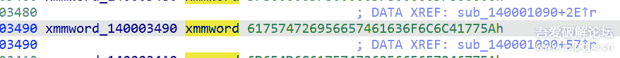

`617574726956657461636F6C6C41775Ah`，尝试转换成字符串（末尾h表示16进制，且以两个数字为单位组合，如`61`表示`a`，具体对应关系请查看ascall码表），得到`autriVetacollAwZ`

由于在内存中，两个数字为一个单位，且右边的单位为高位（比如1234，我们读是一千二百三十四，但是在内存中的顺序来读，则代表三千四百一十二），因此需要将字符串倒过来为`ZwAllocateVirtua`

结合第29行的`lMemory`，构成函数`ZwAllocateVirtualMemory`，用于申请内存。至于为什么能结合，在第14与第15行声明时，`v14`与`ProcName`时相邻声明的，因此在内存中其位置也是相邻的，无需再手动进行拼接。

而后通过第30、31行，使`procAddress`指代函数`ZwAllocateVirtualMemory`，并于33行调用，将内存分配到`v9`，内存的大小为`v10`，`v10`在第27行赋值为`11257i64`，很大，因此推测`v9`并不是用来存储普通变量，而是可能存储数组或者函数，但是这个程序并没有哪一处需要用到这么大的数组（绘制点的存储也不需要这么大），因此推测`v9`可能用来存储函数。

接下来要盯着`v9`，分析分配出的内存会被用来做什么。

第44行中，将`unk_140005040`的数据分配到`v9`

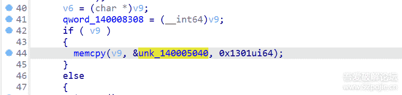


# 逆向分析记录

image 14.png (21.4 KB, 下载次数: 1)

[href="forum.php?mod=attachment&aid=MjcyNTcwMnxiYzhkNzMyMHwxNzkzNTcxNzM5fDE2ODA4NnwxOTY4NDg5&nothumb=yes" target="_blank"](https://www.52pojie.cn/forum.php?mod=attachment&aid=MjcyNTcwMnxiYzhkNzMyMHwxNzkzNTcxNzM5fDE2ODA4NnwxOTY4NDg5&nothumb=yes)

2024-9-28 21:38 上传

但是双击`unk_140005040`查看其初始值，并不能直接获取到什么有效信息

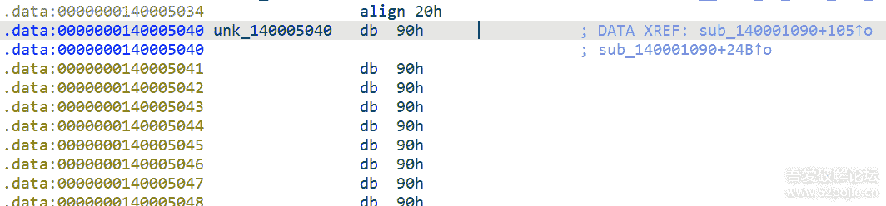

image 15.png (37.6 KB, 下载次数: 1)

[href="forum.php?mod=attachment&aid=MjcyNTcwM3xmNmJhMTVjY3wxNzkzNTcxNzM5fDE2ODA4NnwxOTY4NDg5&nothumb=yes" target="_blank"](https://www.52pojie.cn/forum.php?mod=attachment&aid=MjcyNTcwM3xmNmJhMTVjY3wxNzkzNTcxNzM5fDE2ODA4NnwxOTY4NDg5&nothumb=yes)

2024-9-28 21:38 上传

我们之前推测`v9`可能用来存储函数，如果真的是这样，那么`unk_140005040`应该就是那个函数。我们按下`c`键，IDA将把这些数据转化为汇编码

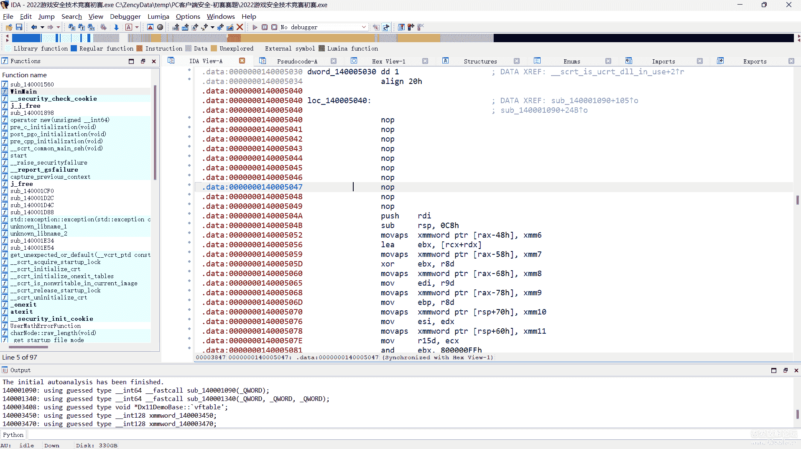

image 16.png (194.88 KB, 下载次数: 2)

[href="forum.php?mod=attachment&aid=MjcyNTcwNHxlMzEzZjExOHwxNzkzNTcxNzM5fDE2ODA4NnwxOTY4NDg5&nothumb=yes" target="_blank"](https://www.52pojie.cn/forum.php?mod=attachment&aid=MjcyNTcwNHxlMzEzZjExOHwxNzkzNTcxNzM5fDE2ODA4NnwxOTY4NDg5&nothumb=yes)

2024-9-28 21:38 上传

`14000504A`及之后的代码挺像一回事的，但是前部分作为函数的话缺少几个push，我们就先回到`Pseudocode-A`，看看之后有没有对函数进行其他处理。

分析代码逻辑，会发现第40行将`v9`的值赋值给了`v6`，而第51-53，65-67行，有使用`v6`来对函数所在内存的开头部分以及其他一些点重新赋值（使用地址定位来进行的小范围赋值一般称为patch）

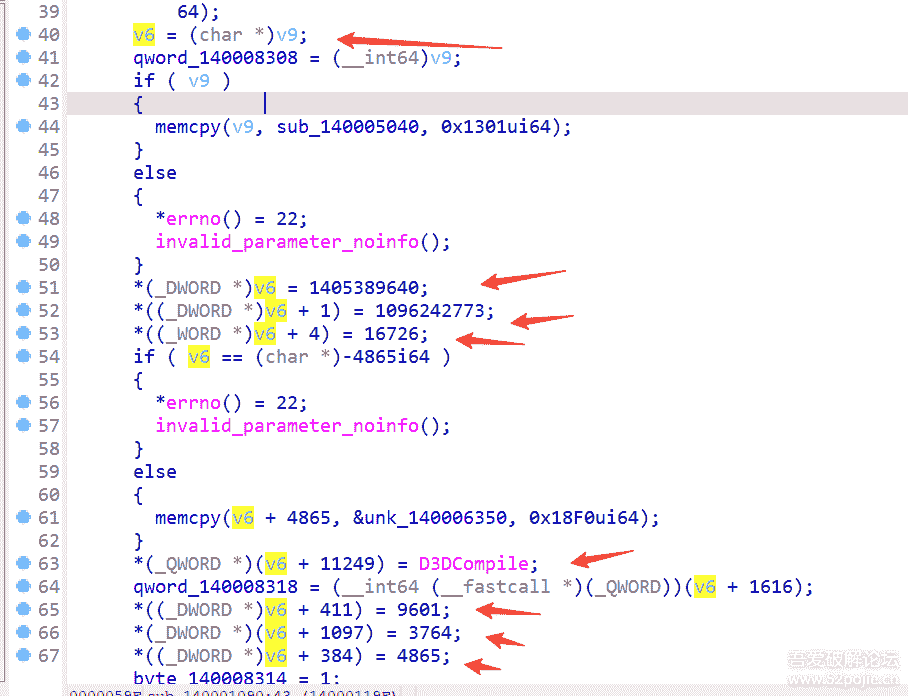

image 17.png (86.28 KB, 下载次数: 1)

[href="forum.php?mod=attachment&aid=MjcyNTcwNXw4MGQxODU2MnwxNzkzNTcxNzM5fDE2ODA4NnwxOTY4NDg5&nothumb=yes" target="_blank"](https://www.52pojie.cn/forum.php?mod=attachment&aid=MjcyNTcwNXw4MGQxODU2MnwxNzkzNTcxNzM5fDE2ODA4NnwxOTY4NDg5&nothumb=yes)

2024-9-28 21:38 上传

我们想要查看重新赋值后的函数，就要进入动态分析

## 动态分析

点击菜单栏的`Debugger`，选中`Select debugger`

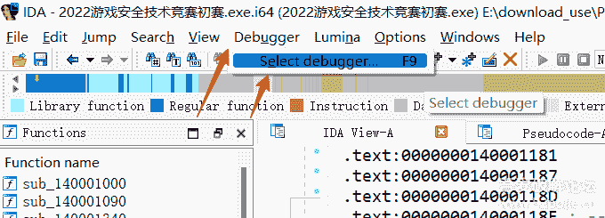

image 18.png (41.61 KB, 下载次数: 2)

[href="forum.php?mod=attachment&aid=MjcyNTcwNnxkNWU4MDJjYnwxNzkzNTcxNzM5fDE2ODA4NnwxOTY4NDg5&nothumb=yes" target="_blank"](https://www.52pojie.cn/forum.php?mod=attachment&aid=MjcyNTcwNnxkNWU4MDJjYnwxNzkzNTcxNzM5fDE2ODA4NnwxOTY4NDg5&nothumb=yes)

2024-9-28 21:38 上传

在弹出的窗口中选择`Local Windows debugger`，点击OK

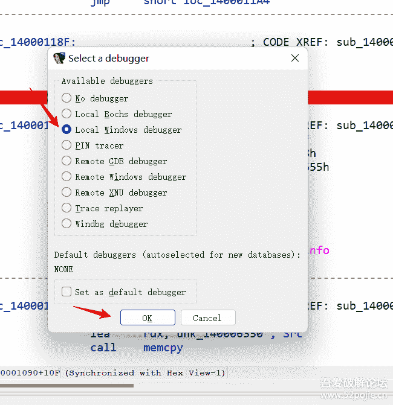

image 19.png (57.04 KB, 下载次数: 1)

[href="forum.php?mod=attachment&aid=MjcyNTcwN3xhMGFiY2E2YnwxNzkzNTcxNzM5fDE2ODA4NnwxOTY4NDg5&nothumb=yes" target="_blank"](https://www.52pojie.cn/forum.php?mod=attachment&aid=MjcyNTcwN3xhMGFiY2E2YnwxNzkzNTcxNzM5fDE2ODA4NnwxOTY4NDg5&nothumb=yes)

2024-9-28 21:38 上传

这样我们就设置好了调试器，接下来就是打断点

由于我们希望看到patch后的函数，因此直接在patch后的下一条指令打下断点即可

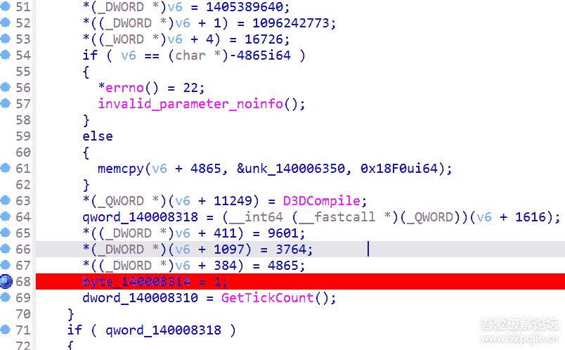

image 20.png (62.4 KB, 下载次数: 1)

[href="forum.php?mod=attachment&aid=MjcyNTcwOHw5NmU3ZWNjNXwxNzkzNTcxNzM5fDE2ODA4NnwxOTY4NDg5&nothumb=yes" target="_blank"](https://www.52pojie.cn/forum.php?mod=attachment&aid=MjcyNTcwOHw5NmU3ZWNjNXwxNzkzNTcxNzM5fDE2ODA4NnwxOTY4NDg5&nothumb=yes)

2024-9-28 21:38 上传

再次点击菜单栏的`Debugger`, 会发现展开内容变化了，选择`Start process`，即开始调试。弹出的窗口全点yes或ok。

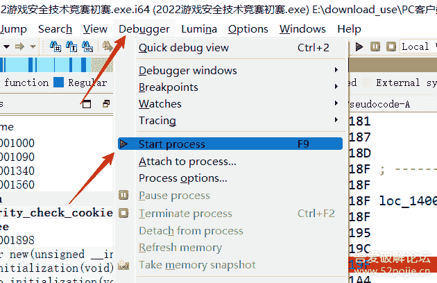

image 21.png (54.24 KB, 下载次数: 1)

[href="forum.php?mod=attachment&aid=MjcyNTcwOXxlYTAxZjQzYXwxNzkzNTcxNzM5fDE2ODA4NnwxOTY4NDg5&nothumb=yes" target="_blank"](https://www.52pojie.cn/forum.php?mod=attachment&aid=MjcyNTcwOXxlYTAxZjQzYXwxNzkzNTcxNzM5fDE2ODA4NnwxOTY4NDg5&nothumb=yes)

2024-9-28 21:38 上传

代码会停止在下断点处

这时我们就可以查看patch后的代码，查看方式为

鼠标悬浮在`v6`上，查看`v6`的值

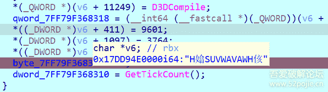

image 22.png (35.74 KB, 下载次数: 1)

[href="forum.php?mod=attachment&aid=MjcyNTcxMHw5MzZhNmQ2MXwxNzkzNTcxNzM5fDE2ODA4NnwxOTY4NDg5&nothumb=yes" target="_blank"](https://www.52pojie.cn/forum.php?mod=attachment&aid=MjcyNTcxMHw5MzZhNmQ2MXwxNzkzNTcxNzM5fDE2ODA4NnwxOTY4NDg5&nothumb=yes)

2024-9-28 21:38 上传

我们就得到了`v6`的值为`0x17DD94E0000`（不固定，每一次调试的具体值都可能不同），也就是说`0x17DD94E0000`指向代码的开始

按下`g`键，弹出地址跳转窗口，输入`v6`的值，点击ok。

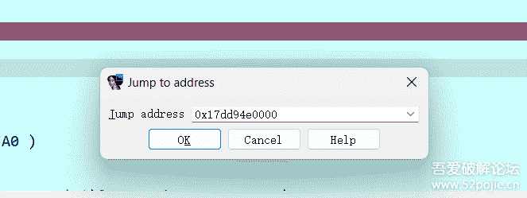

image 23.png (23.22 KB, 下载次数: 1)

[href="forum.php?mod=attachment&aid=MjcyNTcxMXxiMDVlMmEyM3wxNzkzNTcxNzM5fDE2ODA4NnwxOTY4NDg5&nothumb=yes" target="_blank"](https://www.52pojie.cn/forum.php?mod=attachment&aid=MjcyNTcxMXxiMDVlMmEyM3wxNzkzNTcxNzM5fDE2ODA4NnwxOTY4NDg5&nothumb=yes)

2024-9-28 21:38 上传

跳转到新界面后按下`c`键，将数据转化为汇编代码

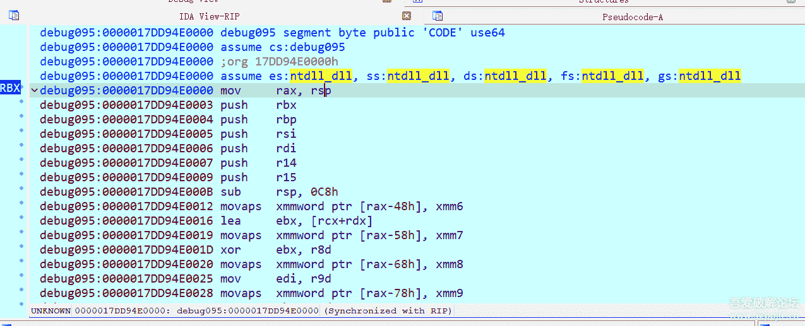

image 24.png (87.15 KB, 下载次数: 1)

[href="forum.php?mod=attachment&aid=MjcyNTcxMnxlMzhkM2EzMnwxNzkzNTcxNzM5fDE2ODA4NnwxOTY4NDg5&nothumb=yes" target="_blank"](https://www.52pojie.cn/forum.php?mod=attachment&aid=MjcyNTcxMnxlMzhkM2EzMnwxNzkzNTcxNzM5fDE2ODA4NnwxOTY4NDg5&nothumb=yes)

2024-9-28 21:38 上传

可以看到之前的nop都变成具体的代码了。想要看这些汇编代码对于的c语言代码，则右键函数的起始位置，即`17DD94E0000`，在菜单中选择`create function`

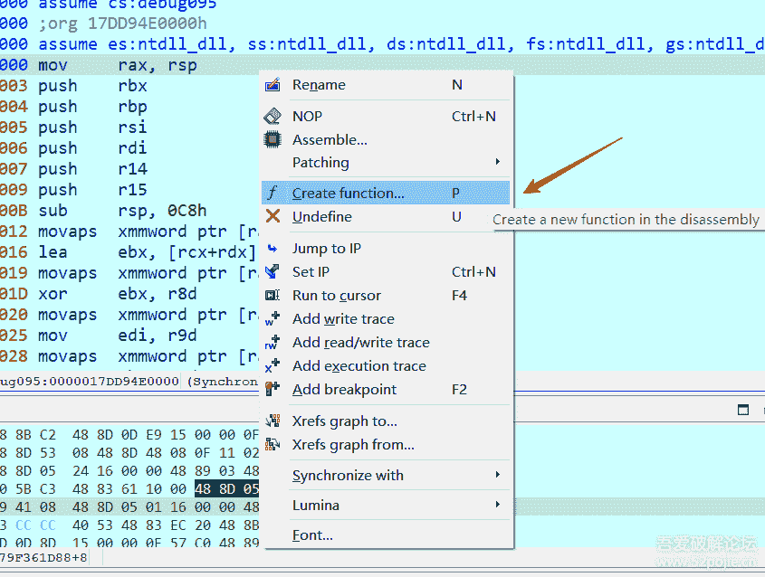

image 25.png (84.81 KB, 下载次数: 1)

[href="forum.php?mod=attachment&aid=MjcyNTcxM3xlOTkzNTZmNnwxNzkzNTcxNzM5fDE2ODA4NnwxOTY4NDg5&nothumb=yes" target="_blank"](https://www.52pojie.cn/forum.php?mod=attachment&aid=MjcyNTcxM3xlOTkzNTZmNnwxNzkzNTcxNzM5fDE2ODA4NnwxOTY4NDg5&nothumb=yes)

2024-9-28 21:38 上传

点击后可以注意到代码再次产生了变化

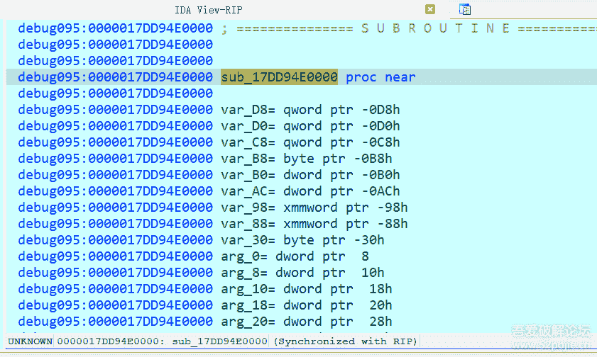

image 26.png (83.35 KB, 下载次数: 1)

[href="forum.php?mod=attachment&aid=MjcyNTcxNHwyNjViM2VmMHwxNzkzNTcxNzM5fDE2ODA4NnwxOTY4NDg5&nothumb=yes" target="_blank"](https://www.52pojie.cn/forum.php?mod=attachment&aid=MjcyNTcxNHwyNjViM2VmMHwxNzkzNTcxNzM5fDE2ODA4NnwxOTY4NDg5&nothumb=yes)

2024-9-28 21:38 上传

这时选中函数名，按下`tab`键，就将跳转到c语言代码界面。

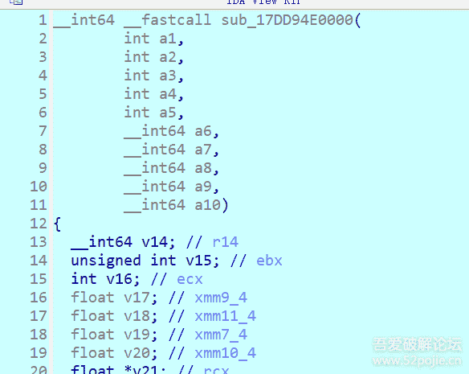

image 27.png (38.8 KB, 下载次数: 1)

[href="forum.php?mod=attachment&aid=MjcyNTY4M3xkODBjM2ZhNHwxNzkzNTcxNzM5fDE2ODA4NnwxOTY4NDg5&nothumb=yes" target="_blank"](https://www.52pojie.cn/forum.php?mod=attachment&aid=MjcyNTY4M3xkODBjM2ZhNHwxNzkzNTcxNzM5fDE2ODA4NnwxOTY4NDg5&nothumb=yes)

2024-9-28 21:37 上传

这段代码有一些赋值以及看不明白的函数调用，搞不清楚，于是先回到`winMain`里的那个名为`sub_140001090`的函数。按下窗口左上角的左向箭头，返回上一个界面

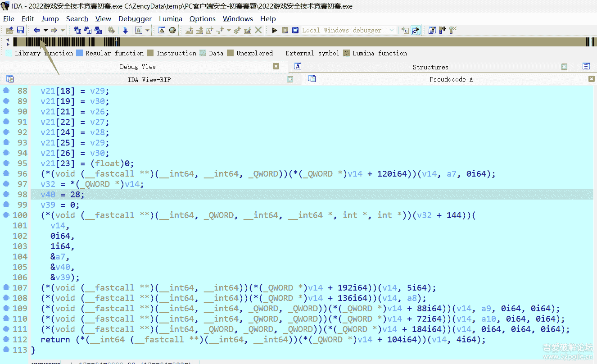

image 28.png (125.13 KB, 下载次数: 1)

[href="forum.php?mod=attachment&aid=MjcyNTY4NHw3NjlkMTg4OHwxNzkzNTcxNzM5fDE2ODA4NnwxOTY4NDg5&nothumb=yes" target="_blank"](https://www.52pojie.cn/forum.php?mod=attachment&aid=MjcyNTY4NHw3NjlkMTg4OHwxNzkzNTcxNzM5fDE2ODA4NnwxOTY4NDg5&nothumb=yes)

2024-9-28 21:37 上传

回到`sub_140001090`，重新梳理程序逻辑，发现第一次调用`v6`指向的函数为第64行（`__fastcall*`即意为将之后的内存作为函数调用），会发现这里并不是调用`v6`的起始位置，而是还有一个`1616`（十进制，有0x前缀才为16进制）的偏移

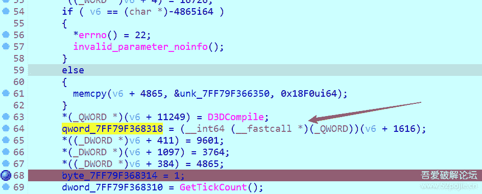

image 29.png (59.27 KB, 下载次数: 1)

[href="forum.php?mod=attachment&aid=MjcyNTY4NXwyOTIwNDA3MHwxNzkzNTcxNzM5fDE2ODA4NnwxOTY4NDg5&nothumb=yes" target="_blank"](https://www.52pojie.cn/forum.php?mod=attachment&aid=MjcyNTY4NXwyOTIwNDA3MHwxNzkzNTcxNzM5fDE2ODA4NnwxOTY4NDg5&nothumb=yes)

2024-9-28 21:37 上传

这意味着`v6`指向的一大段内存中可能不止一个函数，因此我们再次按下`g`键，看一看`v6`偏移`1616`的函数。`1616`转为十六进制为`0x650`，因此函数的地址为：`v6+650`，以我这次运行的`v6=0x17DD94E0000`，加上`0x650`的偏移，就是 `0x17DD94E0650`。

按下`g`键，输入地址，按下`c`键，转化为汇编码，右键函数起始，`create function`，选中函数名，按下`tab`，以操作`0x17DD94E0000`的步骤，操作`0x17DD94E0650`，查看其c语言代码

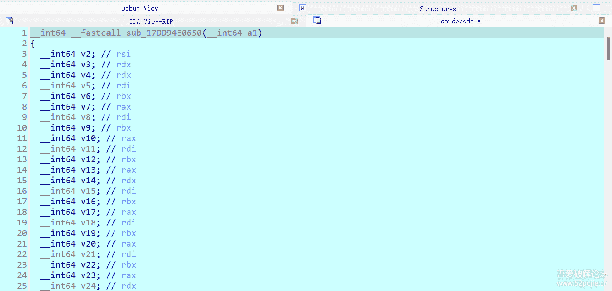

image 30.png (68.13 KB, 下载次数: 1)

[href="forum.php?mod=attachment&aid=MjcyNTY4Nnw0OGRjNTM0NXwxNzkzNTcxNzM5fDE2ODA4NnwxOTY4NDg5&nothumb=yes" target="_blank"](https://www.52pojie.cn/forum.php?mod=attachment&aid=MjcyNTY4Nnw0OGRjNTM0NXwxNzkzNTcxNzM5fDE2ODA4NnwxOTY4NDg5&nothumb=yes)

2024-9-28 21:37 上传

结果还是莫名其妙的赋值以及函数调用

但在第111行的字符串中，看到了`position`，有看到了`color`，由此推测图像绘制的核心代码大概就存在于`v6`指向的那一大块代码里。

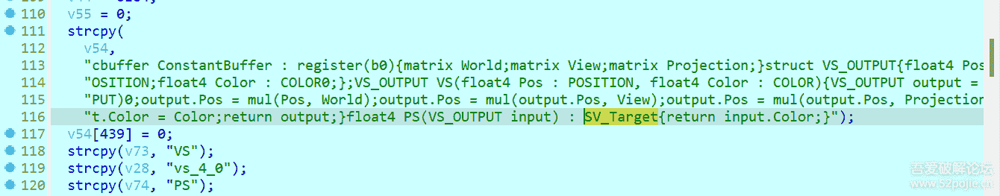

image 31.png (46.17 KB, 下载次数: 1)


[href="forum.php?mod=attachment&aid=MjcyNTY4N3w2YWZjYWMzN3wxNzkzNTcxNzM5fDE2ODA4NnwxOTY4NDg5&nothumb=yes" target="_blank"](https://www.52pojie.cn/forum.php?mod=attachment&aid=MjcyNTY4N3w2YWZjYWMzN3wxNzkzNTcxNzM5fDE2ODA4NnwxOTY4NDg5&nothumb=yes)

2024-9-28 21:37 上传

由于`sub_140001090`中只有一处有调用`v6`内存中的函数——`v6+650`，因此对绘制图像的处理大概率存在于`v6+650`或是从`v6+650`中跳转。具体逻辑分析起来太过于繁杂，我们先看深蓝色的变量

前几个是对变量进行操作，由于操作的变量意义不明，因此这几步也看不出来什么

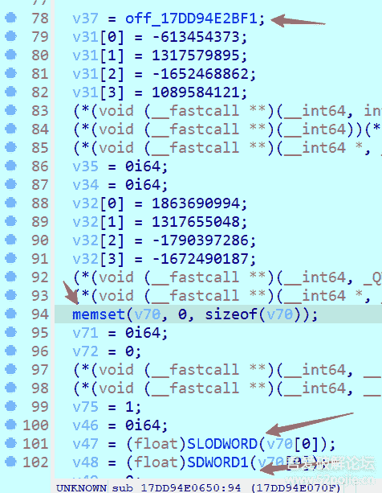

image 32.png (79.51 KB, 下载次数: 1)

[href="forum.php?mod=attachment&aid=MjcyNTY4OHw3NDIzMDgyM3wxNzkzNTcxNzM5fDE2ODA4NnwxOTY4NDg5&nothumb=yes" target="_blank"](https://www.52pojie.cn/forum.php?mod=attachment&aid=MjcyNTY4OHw3NDIzMDgyM3wxNzkzNTcxNzM5fDE2ODA4NnwxOTY4NDg5&nothumb=yes)

2024-9-28 21:37 上传

但在第249行可以注意到有调用一个函数，且地址为`v6+0x420`（函数默认名称去除前缀就是函数地址），这意味着`v6+0x420`处也存在一个函数，并且会在`v6+0x650`中进行调用。

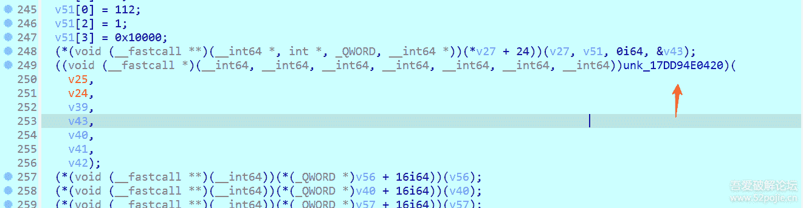

image 33.png (52.81 KB, 下载次数: 0)

[href="forum.php?mod=attachment&aid=MjcyNTY4OXw4MTU4OWIyN3wxNzkzNTcxNzM5fDE2ODA4NnwxOTY4NDg5&nothumb=yes" target="_blank"](https://www.52pojie.cn/forum.php?mod=attachment&aid=MjcyNTY4OXw4MTU4OWIyN3wxNzkzNTcxNzM5fDE2ODA4NnwxOTY4NDg5&nothumb=yes)

2024-9-28 21:37 上传

那我们就再看一看`v6+0x420`处的代码：按下g键，输入地址，按下c键，转化成汇编码，右键首行,`create function`；选中函数名，按下tab键查看c代码

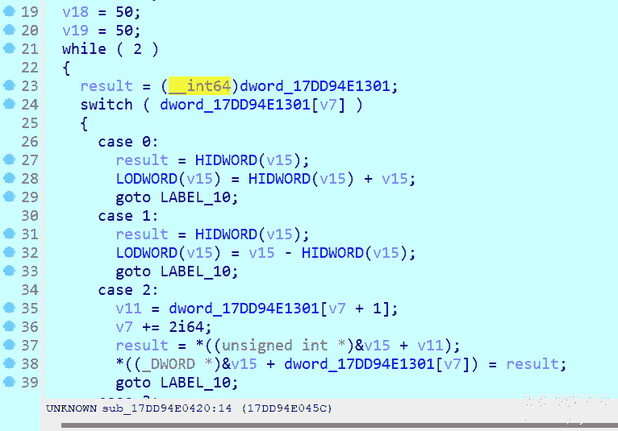

image 34.png (59.11 KB, 下载次数: 1)

[href="forum.php?mod=attachment&aid=MjcyNTY5MHxjYWM1MDdlYnwxNzkzNTcxNzM5fDE2ODA4NnwxOTY4NDg5&nothumb=yes" target="_blank"](https://www.52pojie.cn/forum.php?mod=attachment&aid=MjcyNTY5MHxjYWM1MDdlYnwxNzkzNTcxNzM5fDE2ODA4NnwxOTY4NDg5&nothumb=yes)

2024-9-28 21:37 上传

终于是一段能看明白结构的`while + switch`代码，这种结构被其他博主称作虚拟机结构。

看一下各个case，0,1,2,3,4都是做了些意义不明的运算，5,6调用了同一个函数，函数地址是`v6+0`，且只有第五个参数不同。为了之后遇到的时候更好辨认这个函数，我们给`v6+0`起一个名字。

右键单击函数，在菜单中选择`Rename global item`

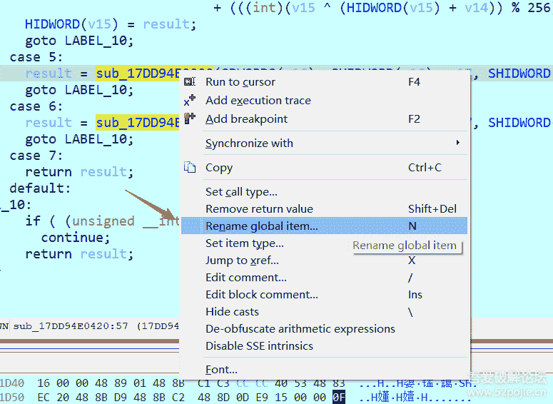

image 35.png (67.13 KB, 下载次数: 1)

[href="forum.php?mod=attachment&aid=MjcyNTY5MXxjZDc5Mzk5Y3wxNzkzNTcxNzM5fDE2ODA4NnwxOTY4NDg5&nothumb=yes" target="_blank"](https://www.52pojie.cn/forum.php?mod=attachment&aid=MjcyNTY5MXxjZDc5Mzk5Y3wxNzkzNTcxNzM5fDE2ODA4NnwxOTY4NDg5&nothumb=yes)

2024-9-28 21:37 上传

我将其命名为`shellCode0`，点击ok。其他的可以同理命名为`shellCode420`，`shellCode650`。

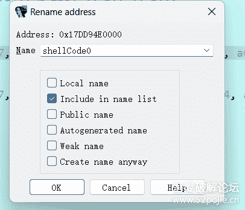

image 36.png (21.39 KB, 下载次数: 1)

[href="forum.php?mod=attachment&aid=MjcyNTY5MnwzN2JhMWUxMnwxNzkzNTcxNzM5fDE2ODA4NnwxOTY4NDg5&nothumb=yes" target="_blank"](https://www.52pojie.cn/forum.php?mod=attachment&aid=MjcyNTY5MnwzN2JhMWUxMnwxNzkzNTcxNzM5fDE2ODA4NnwxOTY4NDg5&nothumb=yes)

2024-9-28 21:37 上传

重命名后，函数就好辨认多了

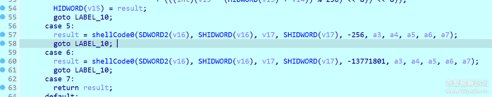

image 37.png (38.91 KB, 下载次数: 1)

[href="forum.php?mod=attachment&aid=MjcyNTY5M3xmOWI2MGExN3wxNzkzNTcxNzM5fDE2ODA4NnwxOTY4NDg5&nothumb=yes" target="_blank"](https://www.52pojie.cn/forum.php?mod=attachment&aid=MjcyNTY5M3xmOWI2MGExN3wxNzkzNTcxNzM5fDE2ODA4NnwxOTY4NDg5&nothumb=yes)

2024-9-28 21:37 上传

`shellCode0`里只有第五个参数不同，因此想研究一下第五个参数的意义

鼠标悬浮在第五个参数时，会显示`invsign`，通过询问ai，得知`invsign`是倒数的意思，因此先把他从倒数转化会普通值（我这里莫名奇妙突然显示起了函数以及参数的类型，我也不太清楚是按到了哪个键，不过不影响之后的过程）

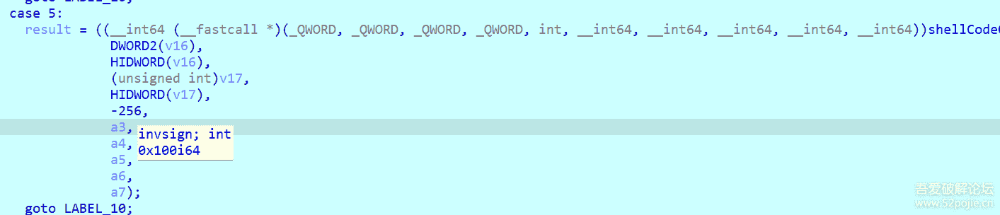

image 38.png (30.63 KB, 下载次数: 1)

[href="forum.php?mod=attachment&aid=MjcyNTY5NHxjOTY3YTI1Y3wxNzkzNTcxNzM5fDE2ODA4NnwxOTY4NDg5&nothumb=yes" target="_blank"](https://www.52pojie.cn/forum.php?mod=attachment&aid=MjcyNTY5NHxjOTY3YTI1Y3wxNzkzNTcxNzM5fDE2ODA4NnwxOTY4NDg5&nothumb=yes)

2024-9-28 21:37 上传

右键`-256`，在菜单中选择`Hexadecimal`，将其为普通值，同理转化case6的13771801

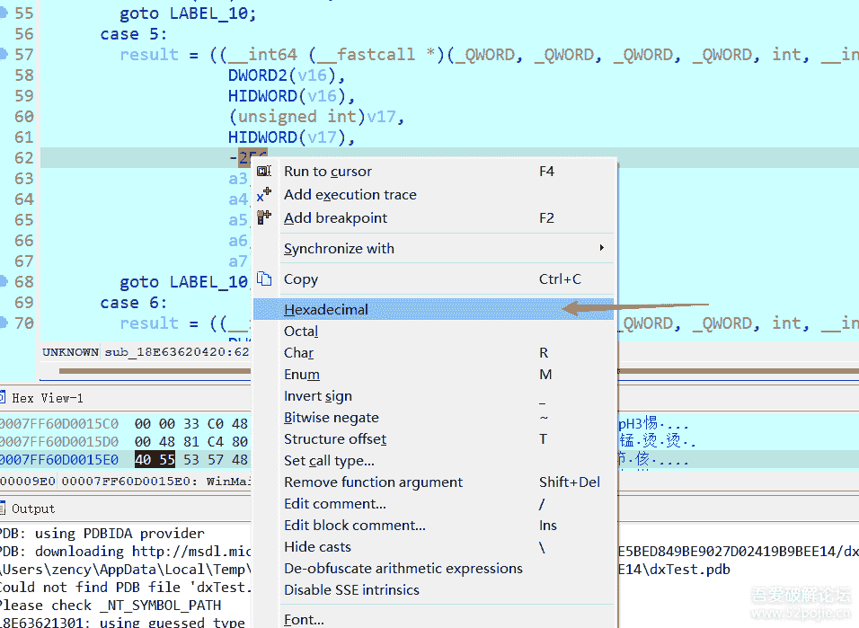

image 39.png (82.86 KB, 下载次数: 1)

[href="forum.php?mod=attachment&aid=MjcyNTY5NXw1MzVmYjRhYXwxNzkzNTcxNzM5fDE2ODA4NnwxOTY4NDg5&nothumb=yes" target="_blank"](https://www.52pojie.cn/forum.php?mod=attachment&aid=MjcyNTY5NXw1MzVmYjRhYXwxNzkzNTcxNzM5fDE2ODA4NnwxOTY4NDg5&nothumb=yes)

2024-9-28 21:38 上传

分别得到`0xFFFFFF00`，以及`0xFF0DDBE7`

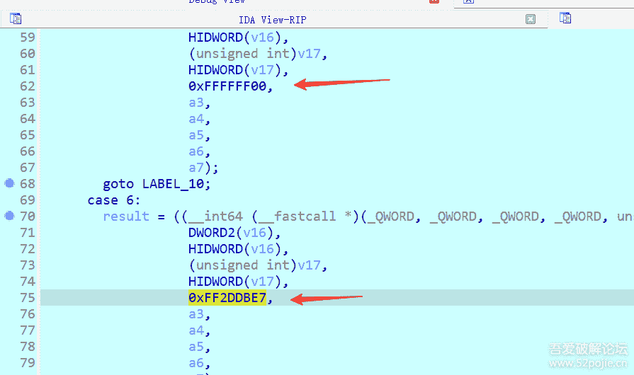

image 40.png (46.73 KB, 下载次数: 1)

[href="forum.php?mod=attachment&aid=MjcyNTY3MXxhYWE2MmE5NHwxNzkzNTcxNzM5fDE2ODA4NnwxOTY4NDg5&nothumb=yes" target="_blank"](https://www.52pojie.cn/forum.php?mod=attachment&aid=MjcyNTY3MXxhYWE2MmE5NHwxNzkzNTcxNzM5fDE2ODA4NnwxOTY4NDg5&nothumb=yes)

2024-9-28 21:37 上传

很像是16进制的颜色代码，因此在取色表看一下，发现真的是题目绘制需要的两种颜色，前置的两个`ff`应该是占位。既然`shellcode0`需要用到颜色，因此推测`shellcode0`即为绘制代码。

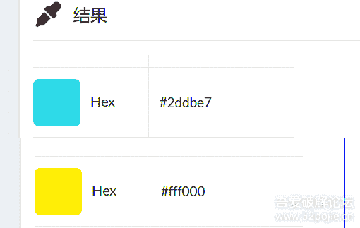

image 41.png (14.89 KB, 下载次数: 1)

[href="forum.php?mod=attachment&aid=MjcyNTY3Mnw0MzFlY2ZkOXwxNzkzNTcxNzM5fDE2ODA4NnwxOTY4NDg5&nothumb=yes" target="_blank"](https://www.52pojie.cn/forum.php?mod=attachment&aid=MjcyNTY3Mnw0MzFlY2ZkOXwxNzkzNTcxNzM5fDE2ODA4NnwxOTY4NDg5&nothumb=yes)

2024-9-28 21:37 上传

但`shecode0`我们只知道第五个参数的含义（颜色），其他参数连具体值都不知道，因此我们尝试获取每一次调取`shellcode0`时的各个参数。

hook：

我们将使用hook技术获取到每一次调取`shellcode0`时的十个参数。

hook技术分为几种，这里使用inline hook，我学习inline hook技术的文章有：

[InlineHook & 原理与实现 - 知乎 (zhihu.com)](https://zhuanlan.zhihu.com/p/459912527)

[万字长文！inlinehook看这一篇足矣！ - 东北码农 - 博客园 (cnblogs.com)](https://www.cnblogs.com/northeast-coder/p/15782665.html)

hook的细节请查看这两篇文章学习，这里只是结合赛题简单讲一讲hook

简单来说hook就是将函数的开头代码修改为一段跳转代码，跳转到一个自定义的函数。比如我们现在想要获取到每一次调取`shellcode0`时的十个参数，就将函数的开头修改为跳转到一个自定义的`print`函数，将参数全部打印输出。

hook一般需要两个东西，一个是自己编写的dll文件，用于实现修改函数开头，以及实现自定义函数；还有一个被称为注入器，用于将dll文件注入到进程中。

首先是注入器的代码，思路就是查看是否有名为`2022游戏安全技术竞赛初赛.exe`的进程，如果有，则使用windows提供的api注入最后一句代码路径中的dll文件。

```cpp
//注入器代码
#include
#include
#include
#include
#include
#define EXEFILEW L"2022游戏安全技术竞赛初赛.exe"
#define EXEFILE "2022游戏安全技术竞赛初赛.exe"
DWORD old;
SIZE_T written;
DWORD FindProcess() {
    HANDLE hSnap = CreateToolhelp32Snapshot(TH32CS_SNAPPROCESS, 0);
    PROCESSENTRY32 pe32;
    pe32 = { sizeof(pe32) };
    BOOL ret = Process32First(hSnap, &pe32);
    while (ret)
    {
        if (!wcsncmp(pe32.szExeFile, EXEFILEW, lstrlen(EXEFILEW))) {
            printf("找到程序 %s ,PID=%d\n", EXEFILE, pe32.th32ProcessID);
            return pe32.th32ProcessID;
        }
        ret = Process32Next(hSnap, &pe32);
    }
    return 0;
}
void InjectModule(DWORD ProcessId, const char* szPath)
{
    HANDLE hProcess = OpenProcess(PROCESS_ALL_ACCESS, FALSE, ProcessId);
    printf("进程句柄:%p\n", hProcess);
    LPVOID lpAddress = VirtualAllocEx(hProcess, NULL, 0x100, MEM_COMMIT | MEM_RESERVE, PAGE_READWRITE);
    SIZE_T dwWriteLength = 0;
    WriteProcessMemory(hProcess, lpAddress, szPath, strlen(szPath), &dwWriteLength);
    HANDLE hThread = CreateRemoteThread(hProcess, NULL, NULL, (LPTHREAD_START_ROUTINE)LoadLibraryA, lpAddress, NULL, NULL);
    WaitForSingleObject(hThread, -1);
    VirtualFreeEx(hProcess, lpAddress, 0, MEM_RELEASE);
    CloseHandle(hProcess);
    CloseHandle(hThread);
}
int main() {
    DWORD ProcessId = FindProcess();
    while (!ProcessId) {
        printf("未找到%s程序，等待两秒中再试\n", EXEFILE);
        Sleep(2000);
        ProcessId = FindProcess();
    }
    InjectModule(ProcessId, "C:\\ZencyData\\CODE\\C_plus_plus\\injectionDll\\x64\\Debug\\injectionDll.dll");
}
```

然后是 dll文件，首先打开visual studio，创建一个dll新项目

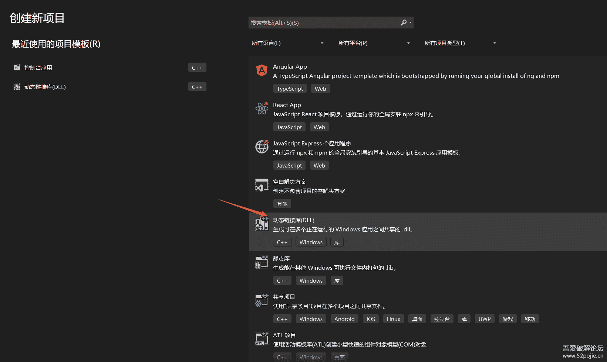

image 42.png (100.89 KB, 下载次数: 1)

[href="forum.php?mod=attachment&aid=MjcyNTY3M3xkMzdiZTEzZXwxNzkzNTcxNzM5fDE2ODA4NnwxOTY4NDg5&nothumb=yes" target="_blank"](https://www.52pojie.cn/forum.php?mod=attachment&aid=MjcyNTY3M3xkMzdiZTEzZXwxNzkzNTcxNzM5fDE2ODA4NnwxOTY4NDg5&nothumb=yes)

2024-9-28 21:37 上传

将新项目的`dllmain.cpp`文件中的代码修改为

```cpp

// dllmain.cpp : 定义 DLL 应用程序的入口点。

#include "pch.h"

#include 

#include 

#include 

typedef __int64 (*Func)(int a1, int a2, int a3, int a4, int a5, __int64 a6, __int64 a7, __int64 a8, __int64 a9, __int64 a10);

__int64 GetBaseAddr() {

    HMODULE hMode = GetModuleHandle(nullptr);

    return (__int64)hMode;

}

void* shellcode = 0;
```


## 代码

```cpp
BYTE HookCode[] = { //目标将开头修改成HookCode
    0x48,0xB8,0x00,0x00,0x00,0x00,0x00,0x00,0x00,0x00,  //mov rax,xxx
    0xFF,0xE0                                           //jmp rax 
};

BYTE OriginCode[0x50]; //存储修改前的开头

size_t HookLen = 12;  // 修改内存大小为100

__int64 times = 100;  //只输出100次hook结果

__int64 HackShellcode(int a1, int a2, int a3, int a4, int a5, __int64 a6, __int64 a7, __int64 a8, __int64 a9, __int64 a10) {
    memcpy(shellcode, OriginCode,HookLen);              //将开头恢复成原来的样子
    //
    int x = a1, y = a2;
    __int64 ret=(*(Func)shellcode)(x, y, a3, a4, a5, a6, a7, a8, a9, a10); //
    times--;
    if (times>0) {
        printf("call shellcode(%d,%d,%d,%d,%d,%p,%p,%p,%p,%p)\n",x, y, a3, a4, a5, a6, a7, a8, a9, a10);          
    }
    memcpy(shellcode, HookCode, HookLen);               //将开头修改为跳转到自定义函数
    return ret;
}

void HookShellcode() { // 第一次hook代码
    __int64 base = GetBaseAddr(); //程序基地址
    __int64 Ptr = base + 0x8308; //指针的地址为程序地址 + 0x8308
    shellcode = (void*)(*(__int64*)Ptr); //获取shellcode0代码起始地址
    while (!shellcode) { //上一步获取失败，间隔0.2秒后再次尝试
        shellcode = (void*)(*(__int64*)Ptr);
        printf("Find shellcode Fail\n");
        Sleep(200);
    }
    printf("shellcode addr=%p\n", shellcode); //输出shellcode0代码起始地址
    memcpy(OriginCode, shellcode,HookLen);              //存储原本起始地址
    Func FuncPtr = HackShellcode;                //获取自定义函数地址
    *(__int64*)(HookCode + 2) = (__int64)FuncPtr;    //将HookCode跳转到的地址改为自定义函数地址
    memcpy(shellcode, HookCode, HookLen);               //将原本函数开头修改为跳转指令
}

BOOL APIENTRY DllMain( HMODULE hModule,
                      DWORD  ul_reason_for_call,
                      LPVOID lpReserved
                     )
{//dll文件的main函数
    switch (ul_reason_for_call)
    {
        case DLL_PROCESS_ATTACH://dll文件被注入时调用
            AllocConsole();//启动一个控制台
            freopen("CONOUT$", "w", stdout);//设置输出
            HookShellcode();//进行第一次hook
        case DLL_THREAD_ATTACH:
        case DLL_THREAD_DETACH:
        case DLL_PROCESS_DETACH:
            break;
    }
    return TRUE;
}
```

## 整体逻辑

整个 DLL 文件的逻辑也比较清晰，就是将 `shellcode0` 的开头修改成一个跳转指令，跳转到 `HackShellcode` 函数；然后在 `HackShellcode` 中 `print` 输出参数，并且将开头恢复为修改前的状态，重新调用一次 `shellcode0`，完成 `shellcode0` 原本需要完成的功能；调用完成后，再将开头修改为跳转，以输出 `shellcode0` 的下一次调用。

## `0x8308` 的来历

这里主要解释 `HookShellcode` 函数第二行的 `0x8308` 是怎么来的。

Hook 时，我们需要知道函数的地址。在我们重命名前，`shellcode0` 我们称为 `v6 + 0`，因为它的地址是 `v6` 偏移量为 `0` 的地址。所以我们需要去看 `v6` 的值。

按下窗口左上角 左向箭头旁边的扩展力，点击倒数第三个选项（具体名称大概不一样，但是地址以 `1090` 结尾），我们就能跳转回 `v6` 出现的那个界面

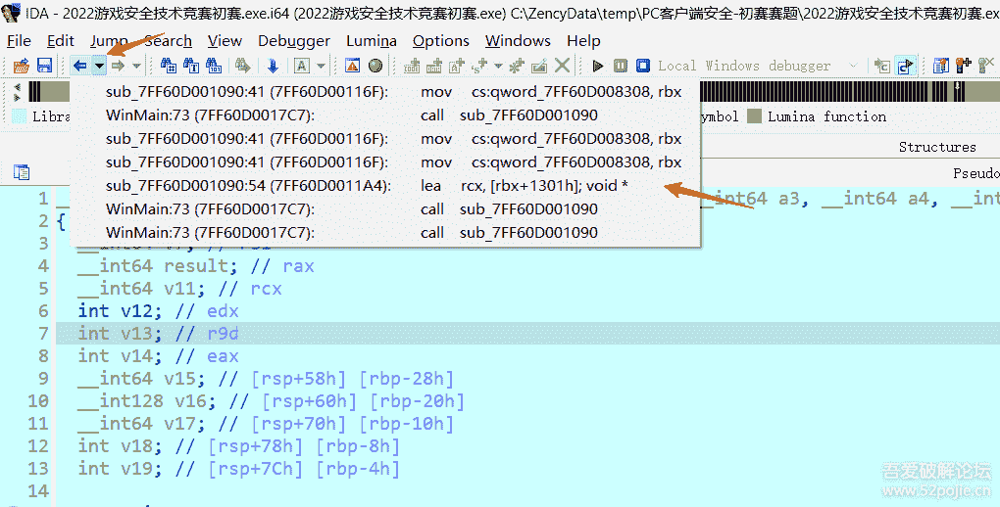

`image 43.png` (84.18 KB, 下载次数: 1)

<https://www.52pojie.cn/forum.php?mod=attachment&aid=MjcyNTY3NHw0NWI0OGNhY3wxNzkzNTcxNzM5fDE2ODA4NnwxOTY4NDg5&nothumb=yes>

2024-9-28 21:37 上传

我们发现，在给 `v6` 赋值的时候，还将 `v9` 的值赋值给了一个全局变量 `qword_7FF60D008308`，这意味着 `qword_7FF60D008308` 的值即为 `v6`，即 `v9`，也即 `shellcode0` 的地址，而 `qword_7FF60D008308` 的地址为 `0x7FF60D008308`，根据右边第二个窗口中可以看到，此程序的基地址为 `0x7FF6D000000`（不一定一样，甚至每次调试都可能变化），也就是 `qword_7FF60D008308` 的地址为 `基地址 + 0x8308`，因此在 DLL 文件中，通过 `基地址 + 0x8308` 可以获取到 `qword_7FF60D008308` 的值，然后这个值就是 `shellcode` 的地址。

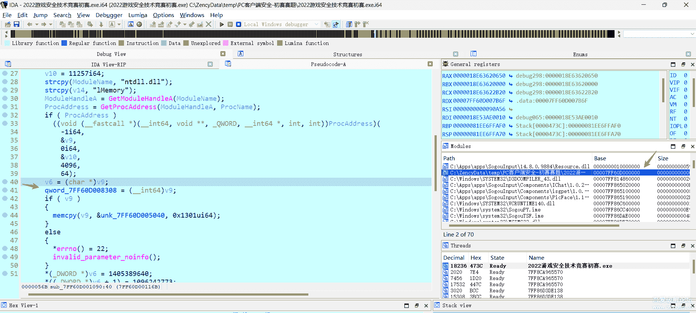

`image 44.png` (174.1 KB, 下载次数: 1)

<https://www.52pojie.cn/forum.php?mod=attachment&aid=MjcyNTY3NXw2MzUxOTYxY3wxNzkzNTcxNzM5fDE2ODA4NnwxOTY4NDg5&nothumb=yes>

2024-9-28 21:37 上传

## 生成 DLL

接下来我们就生成 DLL 文件。

生成之前，还需要在 `pch.cpp` 中增加一句宏定义代码，取消 Visual Studio 的默认安全模式

```cpp
#define _CRT_SECURE_NO_WARNINGS
#include "pch.h"
```

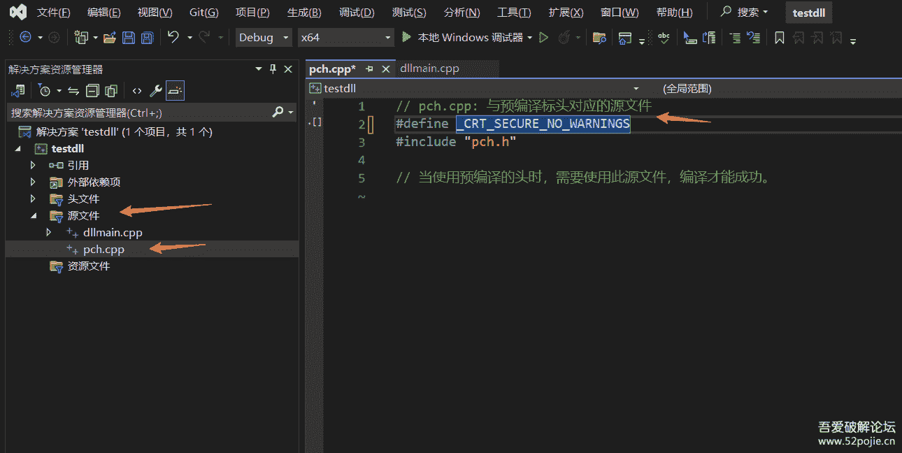

`image 45.png` (84.79 KB, 下载次数: 1)

<https://www.52pojie.cn/forum.php?mod=attachment&aid=MjcyNTY3Nnw3NzQzOTQ5Y3wxNzkzNTcxNzM5fDE2ODA4NnwxOTY4NDg5&nothumb=yes>

2024-9-28 21:37 上传

鼠标右击项目名，菜单中点击“生成”

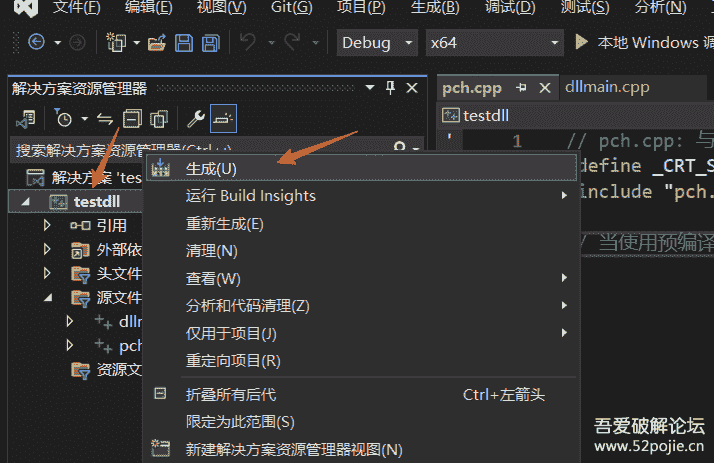

`image 46.png` (70.99 KB, 下载次数: 1)

<https://www.52pojie.cn/forum.php?mod=attachment&aid=MjcyNTY3N3wyZWNjOWRlNHwxNzkzNTcxNzM5fDE2ODA4NnwxOTY4NDg5&nothumb=yes>

2024-9-28 21:37 上传

DLL 文件就生成了，生成路径就在窗口底部的输出中。

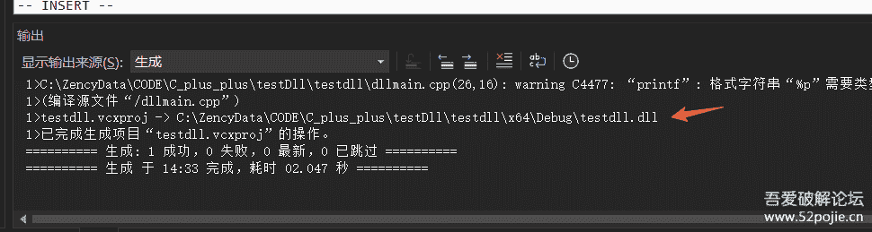

`image 47.png` (21.75 KB, 下载次数: 1)

<https://www.52pojie.cn/forum.php?mod=attachment&aid=MjcyNTY3OHwzNjdjOWU0OXwxNzkzNTcxNzM5fDE2ODA4NnwxOTY4NDg5&nothumb=yes>

2024-9-28 21:37 上传

## 注入与运行

接下来准备运行注入器，VS 新建一个控制台项目，并将主文件的代码修改为之前给出的注入器代码（要修改末尾的 DLL 文件路径）。

运行注入器代码（请确定此时 IDA Pro 还在调试），弹出命令行窗口显示找到句柄后，再点击 IDA Pro 这个运行按钮，跳过打下的断点。

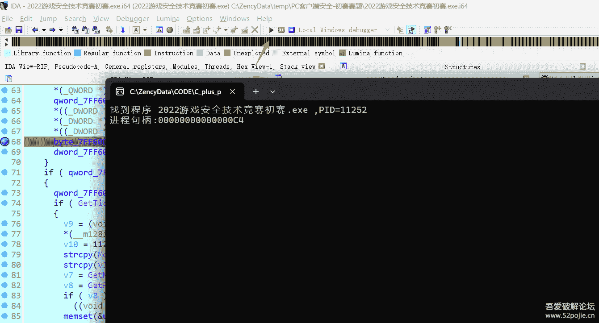

`image 48.png` (104.08 KB, 下载次数: 0)

<https://www.52pojie.cn/forum.php?mod=attachment&aid=MjcyNTY3OXwwM2NkMjAyNnwxNzkzNTcxNzM5fDE2ODA4NnwxOTY4NDg5&nothumb=yes>

2024-9-28 21:37 上传

在弹出的窗口中可以看到 `100` 次调用 `shellcode0` 时使用的参数，并且可以看到箭头指向的两个地方参数是开始重复的。也就是说绘图不只调用一次。

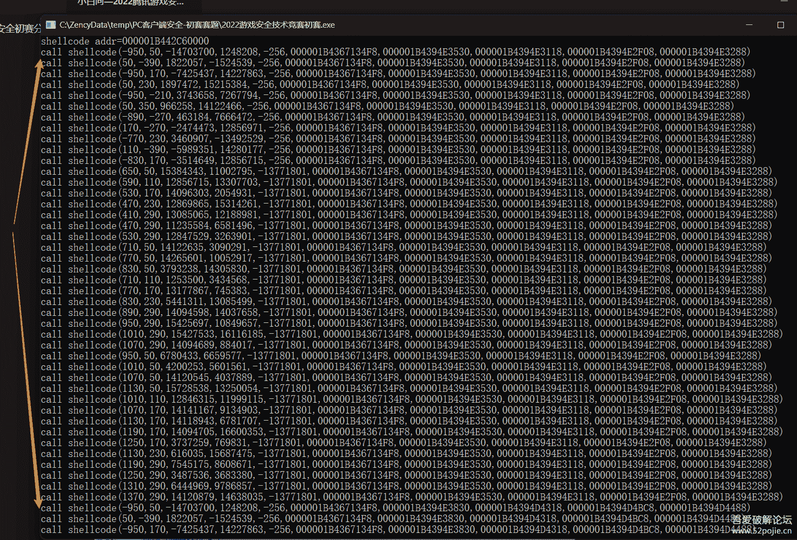

`image 49.png` (270.6 KB, 下载次数: 1)

<https://www.52pojie.cn/forum.php?mod=attachment&aid=MjcyNTY4MHxiNGZiZmIxNHwxNzkzNTcxNzM5fDE2ODA4NnwxOTY4NDg5&nothumb=yes>

2024-9-28 21:37 上传

## 结果分析

但是注意到赛题程序界面是一片白


`image 50.png` (17 KB, 下载次数: 1)

<https://www.52pojie.cn/forum.php?mod=attachment&aid=MjcyNTY4MXw5YmYxM2MyMnwxNzkzNTcxNzM5fDE2ODA4NnwxOTY4NDg5&nothumb=yes>

2024-9-28 21:37 上传

不知道是不是 hook 出问题了，于是不调试，直接在文件夹中打开赛题程序，然后发现程序是显示绘制的图像大概 4 秒，就会清空，然后显示一片白，由此看出不是 hook 的问题，大概只是 4 秒过了。

通过 hook 的结果可以看到，参数不重复的调用一共有 `42` 次，而赛题目标的图案中正好有 `42` 个点，且第五个参数为 `-256` 的有 `11` 个点，为 `-13771801` 的有 `31` 个点，与赛题目标黄蓝点的数量也相同，由此更加确认 `shellcode` 就是绘制图像的函数。

然后观察参数，我们已知第五个是颜色，后五个参数每次调用都相同，那应该就是前 4 个参数控制位置。前两个参数的格式像是 `x`、`y` 坐标，于是尝试将其视为坐标进行绘制，由于蓝色图案的显示是正常的，因此尝试将 `x`、`y` 理解为坐标，绘制蓝色图案

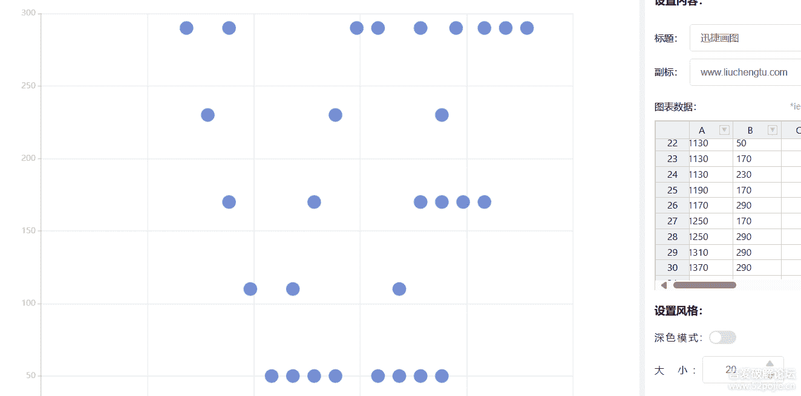

`image 51.png` (64.3 KB, 下载次数: 2)

<https://www.52pojie.cn/forum.php?mod=attachment&aid=MjcyNTY4Mnw2M2I3NDM5ZHwxNzkzNTcxNzM5fDE2ODA4NnwxOTY4NDg5&nothumb=yes>

2024-9-28 21:37 上传

发现是赛题中给出图案的上下翻转。由此确定前两个参数确实为坐标，而黄色图案的前两个参数中存在负数，可能这就是无法显示的原因，具体分析请见下期教程（三天内更新）
