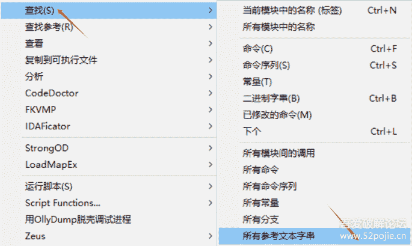
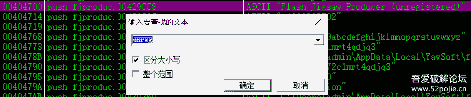
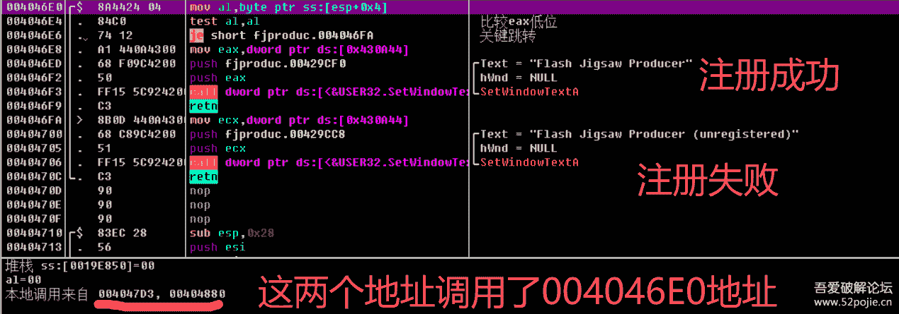
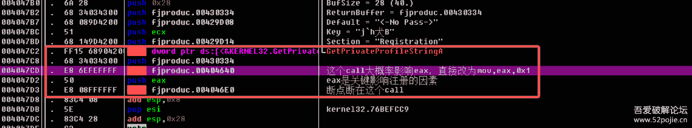
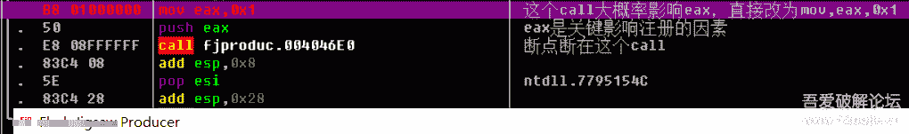

# [原创] 新手破解案例-1

- 原帖：https://www.52pojie.cn/forum.php?mod=viewthread&tid=1968576
- 抓取时间：2026-11-01T22:22:19

## 案例1

软件显示：


0.png (1.93 KB, 下载次数: 1)

[附件](https://www.52pojie.cn/forum.php?mod=attachment&aid=MjcyNTc3OHxiZDJhNWQ3MHwxNzkzNTcxNzM3fDE2ODA4NnwxOTY4NTc2&nothumb=yes)

2024-9-29 09:29 上传

### 步骤1：反汇编窗口查找-查找-所有参考文本字符串-`unreg`



1.png (98.32 KB, 下载次数: 1)

[附件](https://www.52pojie.cn/forum.php?mod=attachment&aid=MjcyNTc3OXxlODc1YjE0NXwxNzkzNTcxNzM3fDE2ODA4NnwxOTY4NTc2&nothumb=yes)

2024-9-29 09:29 上传



2.png (45.87 KB, 下载次数: 0)

[附件](https://www.52pojie.cn/forum.php?mod=attachment&aid=MjcyNTc4MHw2NzU0ZTMyM3wxNzkzNTcxNzM3fDE2ODA4NnwxOTY4NTc2&nothumb=yes)

2024-9-29 09:34 上传

### 步骤2：通过 `unreg` 进入对应的反汇编窗口



3.png (109.38 KB, 下载次数: 0)

[附件](https://www.52pojie.cn/forum.php?mod=attachment&aid=MjcyNTc4MnxkOTFlMThkYnwxNzkzNTcxNzM3fDE2ODA4NnwxOTY4NTc2&nothumb=yes)

2024-9-29 09:40 上传

### 步骤3

分析代码知道是 `004047D3`、`00404880` 这两个地址调用了这行：

```
004046E0 /$ 8A4424 04 mov al,byte ptr ss:[esp+0x4]
```

改变了 `eax` 寄存器的值。

到 `004047D3`、`00404880` 这两个地方下软件断点，重新加载程序，断点断在 `004047D3` 这个地址。



4.png (71.08 KB, 下载次数: 1)

[附件](https://www.52pojie.cn/forum.php?mod=attachment&aid=MjcyNTc4N3xkZWQwOGM5MXwxNzkzNTcxNzM3fDE2ODA4NnwxOTY4NTc2&nothumb=yes)

2024-9-29 10:05 上传

直接暴力\[//www.52pojie.cn" target="_blank" class="relatedlink"\](https://www.52pojie.cn:href="https)，不研究算法，允许程序，未注册提示消失



5.png (33.36 KB, 下载次数: 0)

[附件](https://www.52pojie.cn/forum.php?mod=attachment&aid=MjcyNTc4OXwzNzdmYjRlZHwxNzkzNTcxNzM3fDE2ODA4NnwxOTY4NTc2&nothumb=yes)

2024-9-29 10:09 上传
