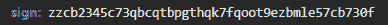
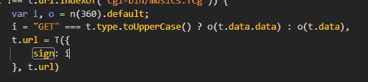
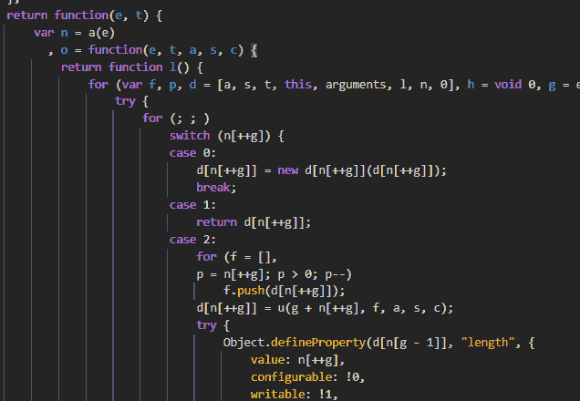
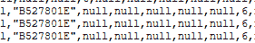
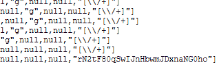
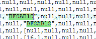
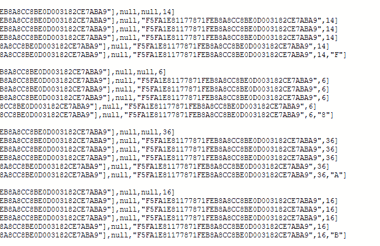

# [Web逆向] 某q音乐新版txjsvmp分析

- 原帖: https://www.52pojie.cn/forum.php?mod=viewthread&tid=1969992
- 抓取时间: 2026-11-01T22:22:13

## 目标网站

aHR0cHM6Ly95LnFxLmNvbS8=

### 目标参数



## 解决方法

补环境：检测环境较少就不进行说明，本文章主要讲一下直接扣取算法

## 流程分析

全局搜索`sign`



可以看到加密点是

`o(t.data)`进入`o`函数的内部可以看到是`jsvmp`



找到`swtich(n[++g])`在此处下条件断点

`JSON.stringify(d, (key, value) => value === window || !value || value.length > 1000 ? undefined : value)`

将打印的日志保存到本地

根据结果`zzcbf8ab18rn2tf80qswijnhbwmjdxnang0hob527801e`和日志进行分析







保存几次日志+分析可知

这段加密代码分为三段

1.`zzc`是固定的
2.`B527801E` 与 `BF8AB18`生成算法
3.`rN2tF80qSwIJnHbwmJDxnaNG0ho`生成算法

先分析第一部分算法，全局搜索`B527801E`找到第一次生成的位置往上看可以发现这样的日志



```
let encrypt_str = "********************************" // 脱敏展示

let first_index = [23, 脱敏展示, 6, 脱敏展示, 16, 脱敏展示, 7, 脱敏展示];
let last_index = [16, 脱敏展示, 32, 脱敏展示, 19, 脱敏展示, 8, 脱敏展示];

let first_encrypt = "";
let last_encrypt = "";

// 第一段加密

first_index.forEach(index => {
    first_encrypt += encrypt_str.charAt(index);
});

// 最后一段
last_index.forEach(index => {
    last_encrypt += encrypt_str.charAt(index);
});
console.log(first_encrypt)
console.log(last_encrypt)
```

中间的一段根据上面的方法也是可以去扣取的这里就留给大家作为实战作业了我简单说一下思路

1.根据`F5FA`这个hash值,通过算法生成第一个数组
2.和一个固定数组异或取余得到第二个数组。
3.生成的第二个数组转换为`base64`
4.正则表达式`replace`

最终结果

`'zzc'+'BF8AB18'+'rN2tF80qSwIJnHbwmJDxnaNG0ho'+'B527801E'`

不要忘记将最后的结果`toLowerCase()`
