# [原创] 修改PE入口点方式注入自己编写的DLL——《英雄无敌》1代小回城术修改成大回城术

- 原帖：[https://www.52pojie.cn/forum.php?mod=viewthread&tid=1970328](https://www.52pojie.cn/forum.php?mod=viewthread&tid=1970328)
- 抓取时间：2026-11-01T22:22:10

## 一、前言

《英雄无敌》每代都有回城术，而第一代的回城术则是所谓的“小回城术”，就是到达的城堡不能选择。到了《英雄无敌》2代和3代，都有大小回城术了，而大回城术可以使英雄回到己方的任意一座没有自己的英雄所在的城堡，有了这样的魔法，使得英雄能兼顾整个地图，是每个玩家都是首要得到的！可惜的是，到了《英雄无敌》四代，回城术又回到了小回城术并且限定只有会秩序类魔法的英雄才能拥有，极大地增加了完成地图的难度和时间！以前我有发过把二代里的小回城术修改成大回城术的博文：[https://www.52pojie.cn/thread-1967769-1-1.html](https://www.52pojie.cn/thread-1967769-1-1.html)

这次我将要把《英雄无敌》一代的小回城术，改成大回城术。具体方法包括：

1. 设计一个 DLL，就是一个由一个下拉框组成的对话框。
2. 把这个 DLL 注入到《英雄无敌》一代里。

本次修改是在这 2 个文章基础上进行的：

- [https://www.52pojie.cn/thread-1946484-1-1.html](https://www.52pojie.cn/thread-1946484-1-1.html)
- [https://www.52pojie.cn/thread-1947643-1-1.html](https://www.52pojie.cn/thread-1947643-1-1.html)

## 二、下拉框对话框

这个设计很简单，语言选择的是 masm32。

给 DLL 取名 `Towngate`，下面直接上代码。

### `Towngate.asm`

```
;********************************************************************
                .386
                .model flat, stdcall
                option casemap :none
;********************************************************************
; Include 文件定义
include                windows.inc
include                user32.inc
includelib        user32.lib
include                kernel32.inc
includelib        kernel32.lib
include                gdi32.inc
includelib        gdi32.lib
;********************************************************************
; Equ 等值定义
DLG_MAIN                equ        1
IDC_COMBOTEXT        equ        101
;********************************************************************
; 数据段
                        .data?
hInstance        dd        ?
dwCount                dd         ?
dwTown                dd        ?

                        .const
pTable                dd        sz1,sz2,sz3,sz4,sz5,sz6,sz7,sz8,sz9,sz10,\
                                sz11,sz12,sz13,sz14,sz15,sz16,sz17,sz18,sz19,sz20
sz1                        db        '1',0
sz2                        db        '2',0
sz3                        db        '3',0
sz4                        db        '4',0
sz5                        db        '5',0
sz6                        db        '6',0
sz7                        db        '7',0
sz8                        db        '8',0
sz9                        db        '9',0
sz10                db        '10',0
sz11                db        '11',0
sz12                db        '12',0
sz13                db        '13',0
sz14                db        '14',0
sz15                db        '15',0
sz16                db        '16',0
sz17                db        '17',0
sz18                db        '18',0
sz19                db        '19',0
sz20                db        '20',0
;********************************************************************
; 代码段
                .code
;********************************************************************                
; dll 的入口函数
DllEntry        proc        _hInstance,_dwReason,_dwReserved
                        mov eax,_dwReason
                        .if eax == DLL_PROCESS_ATTACH
                                push _hInstance
                                pop         hInstance
                        .endif
                        mov        eax,TRUE
                        ret
DllEntry        endp                        
;********************************************************************
_DlgProc        proc        uses ebx edi esi _hWnd,_wMsg,_wParam,_lParam
                local        @nCount:dword

                mov        eax,_wMsg
                .if        eax == WM_CLOSE
                        invoke        EndDialog,_hWnd,NULL
                .elseif        eax == WM_INITDIALOG
;********************************************************************
; 初始化组合框
                        mov esi,0
                        push dwCount
                        pop @nCount
                        dec @nCount
                        mov ebx, offset pTable
        @@:                mov edi, [ebx + esi*4]
                        invoke        SendDlgItemMessage,_hWnd,IDC_COMBOTEXT,CB_ADDSTRING,0,edi
                        .if esi == @nCount
                                jmp @F
                        .endif
                        inc esi
                        jmp @B
        @@:                invoke        SendDlgItemMessage,_hWnd,IDC_COMBOTEXT,CB_SETCURSEL,0,0
;********************************************************************                
                .elseif        eax == WM_COMMAND
                        mov        eax,_wParam
                        .if        ax ==        IDOK
                                invoke        EndDialog,_hWnd,NULL
;********************************************************************
; 演示处理下拉式组合框
                        .elseif        ax == IDC_COMBOTEXT
                                shr        eax,16
                                .if        ax == CBN_SELENDOK
                                        invoke        SendDlgItemMessage,_hWnd,IDC_COMBOTEXT,CB_GETCURSEL,0,0
                                        mov dwTown, eax
                                .endif
                        .endif
;********************************************************************
                .else
                        mov        eax,FALSE
                        ret
                .endif
                mov        eax,TRUE
                ret

_DlgProc        endp
;********************************************************************
GetTown                proc        _dwCount
                push _dwCount
                pop         dwCount
                invoke        DialogBoxParam,hInstance,DLG_MAIN,NULL,offset _DlgProc,NULL
                mov eax, dwTown
                ret
GetTown                endp
;********************************************************************
                End        DllEntry
```

### `Towngate.def`

```
EXPORTS

        GetTown
```

### `Towngate.rc`

```
/********************************************************************/
#include                
/********************************************************************/
#define        DLG_MAIN                1
#define IDC_COMBOTEXT        101
/********************************************************************/
DLG_MAIN DIALOG 100, 100, 200, 100
STYLE DS_MODALFRAME | WS_POPUP | WS_VISIBLE | WS_CAPTION | WS_SYSMENU | WS_THICKFRAME
FONT 12, "Comic Sans MS"
{
/*FONT 14 "Segoe Script"*/
 CTEXT "TOWN GATE",-1,50,0,100,30
 CTEXT "Select a town to port to",-1, 50,20,100,30
 COMBOBOX IDC_COMBOTEXT, 50, 45, 100, 70, CBS_DROPDOWNLIST | WS_TABSTOP
 PUSHBUTTON "OK", IDOK, 75, 70, 50, 14
}
```

### `Makefile` 文件

```
NAME = Towngate

OBJS = $(NAME).obj

RES  = $(NAME).res

DEF         = $(NAME).def

LINK_FLAG = /subsystem:windows /Dll

ML_FLAG = /c /coff

$(NAME).dll: $(OBJS) $(RES) $(DEF)

        Link $(LINK_FLAG) /Def:$(DEF) $(OBJS) $(RES)

.asm.obj:

        ml $(ML_FLAG) $
```

然后就可以编译链接成 dll 了（为了确保 dll 有效，已经用应用程序测试可以加载调用）。样子如下图：

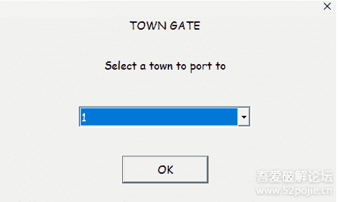

`h1-0.png`（11.88 KB，下载: 2）

[附件下载](https://www.52pojie.cn/forum.php?mod=attachment&aid=MjcyNzA5OXw5NzA0MGQ5NXwxNzkzNTcxNzI4fDE2ODA4NnwxOTcwMzI4&nothumb=yes)

2024-10-8 06:54 上传

## 三、修改PE入口点方式注入DLL

这种注入方式的优点非常明显：

1. 这种注入方式，不怕 dll 升级与修改，即修改 dll 无需再去修改 PE。
2. 无需繁琐的导入表重定位操作与计算。

注入方法只是很简单的三步：

第一步：在 PE 文件的空白处输入 dll 文件名称字符串，并 `push 地址`。

第二步：`call LoadLibraryA`。

第三步：跳回原 PE 入口点。

最后修改 PE 的入口点为上面第一步 `push` 所在命令行地址即可。下面以《英雄无敌》1代注入 `Towngate.dll` 看具体操作：

用 OD 打开程序就会停在程序入口点，这个点也可以使用 PE 类程序查看的，本贴使用的是 Explorer Suite（也就是 CFF Explorer）。

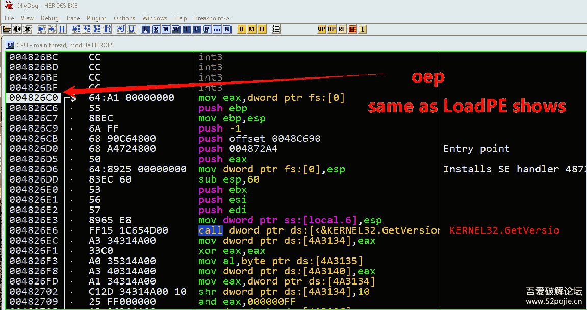

`h1-1.png`（131.35 KB，下载: 2）


2024-10-8 06:57 上传

在程序的尾部有很多空白，选定0048B0C0处作为新的入口点

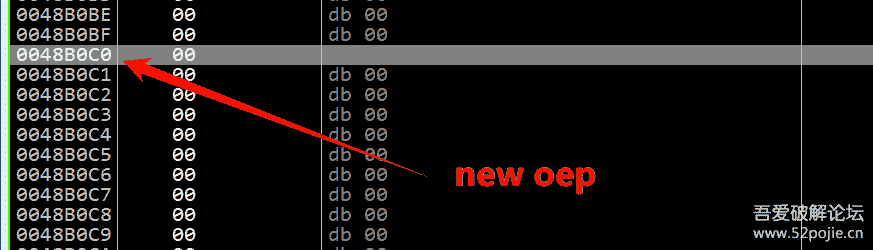

h1-2.png (39.64 KB, 下载次数: 2)

2024-10-8 06:58 上传

先在0047B0A4的地方输入字符串`Towngate.dll`，这是dll的文件名

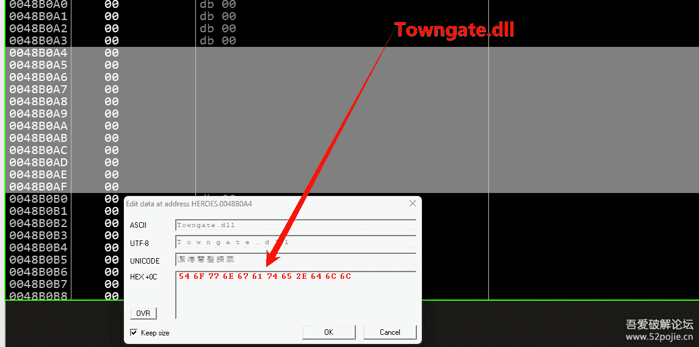

h1-3.png (73.08 KB, 下载次数: 1)

2024-10-8 06:59 上传

再在0047B0B1的地方输入`GetTown`，这是dll中的输出函数名

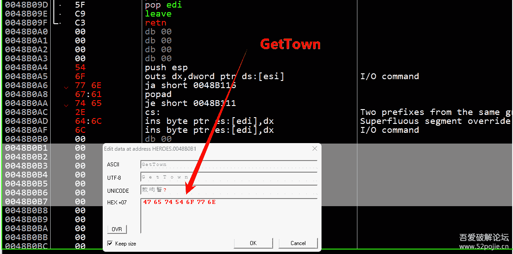

h1-4.png (85.44 KB, 下载次数: 1)

2024-10-8 07:00 上传

好，下面就可以按照上面的三步注入dll。在0048B0C0处，依次输入上面三步，结果如下图

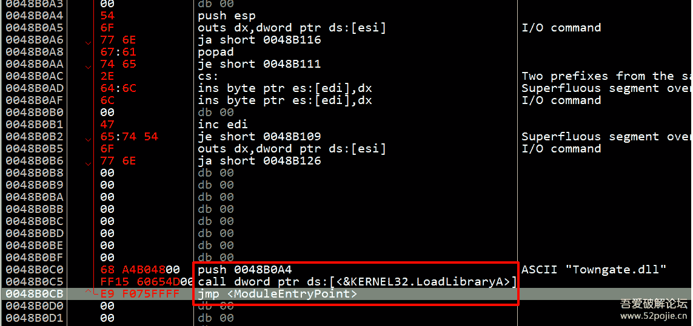

h1-5.png (85.69 KB, 下载次数: 0)

2024-10-8 07:01 上传

保存修改

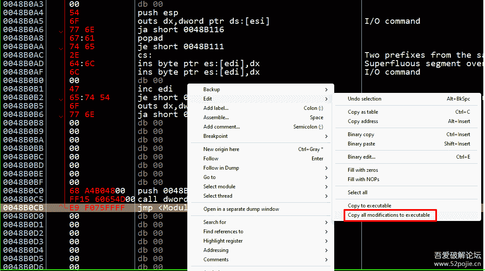

h1-6.png (151.26 KB, 下载次数: 1)

2024-10-8 07:01 上传

用`CFF Explorer`打开刚修改后的程序，可以看到此时程序的入口点是在826C0处（即4826C0）

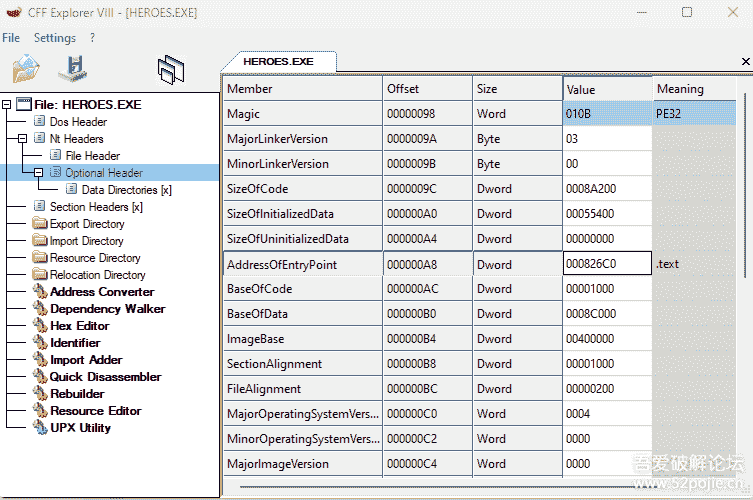

h1-7.png (65.67 KB, 下载次数: 2)

2024-10-8 07:02 上传

将其修改为8B0C0，并保存

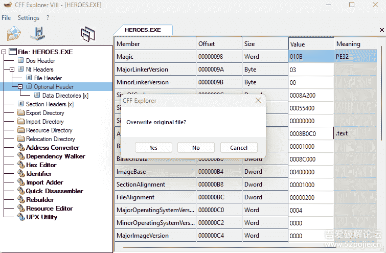

h1-8.png (72.19 KB, 下载次数: 1)

2024-10-8 07:03 上传

运行一下游戏，看看是否可以正常运行。可以正常运行，说明入口点的修改没有问题，下面就是修改程序代码的过程了。

## 四、回城术代码研读

下面是关键部分，也就是回城术是怎么选择城堡的

[Asm] 纯文本查看 复制代码


```
004351C5  |.  E8 67C80100          call HEROES.00451A31                                ;dark-f: it's failed
004351CA  |.  83C4 24              add esp,24
004351CD  |.  E9 2C020000          jmp HEROES.004353FE
004351D2  |>  C745 EC 00000000     mov [local.5],0                                        ;dark-f: initial
004351D9  |.  E9 03000000          jmp HEROES.004351E1                                ;===>E9 F25E0500-->0048B0D0
004351DE  |>  FF45 EC              /inc [local.5]                                        ;[ebp-14],loop=2,loc.5=1;2
004351E1  |>  A1 B0244C00           mov eax,dword ptr ds:[4C24B0]        ;dark-f: 026D0254 ASCII "Player 1"
004351E6  |.  0FBE40 56            |movsx eax,byte ptr ds:[eax+56]        ;dark-f: town number
004351EA  |.  3B45 EC              |cmp eax,[local.5]
004351ED  |.  0F8E 96000000        |jle HEROES.00435289                                ;dark-f: end loop, when scaning town No. = town No.
004351F3  |.  8B45 EC              |mov eax,[local.5]                                ;dark-f: loop No.,loop=2,eax=1;2
004351F6  |.  8B0D B0244C00        |mov ecx,dword ptr ds:[4C24B0]        ;026D0254 ASCII "Player 1"
004351FC  |.  0FBE4408 59          |movsx eax,byte ptr ds:[eax+ecx+59]        ;town ID: 03,0C;0B;02;0A;01;08;0;06;05;09;04;07
00435201  |.  8BC8                 |mov ecx,eax
00435203  |.  8D0480               |lea eax,dword ptr ds:[eax+eax*4]        ;ID*5
00435206  |.  8D0441               |lea eax,dword ptr ds:[ecx+eax*2]        ;ID+ID*5*2
00435209  |.  8D0480               |lea eax,dword ptr ds:[eax+eax*4]        ;(ID+ID*5*2)*5
0043520C  |.  8B0D 486D4C00        |mov ecx,dword ptr ds:[4C6D48]                ;[4C6D48]=XXXX0048
00435212  |.  0FBE8408 A5210100    |movsx eax,byte ptr ds:[eax+ecx+121A5]        ;dark-f: town X-coordination 13;29;42
0043521A  |.  8B4D FC              |mov ecx,[local.1]                                ;hero's address
0043521D  |.  0FBE49 1E            |movsx ecx,byte ptr ds:[ecx+1E]        ;[026E 3107]=FFFF0E32,hero X-coordination,ecx=32(12)
00435221  |.  2BC1                 |sub eax,ecx                                ;dark-f: for calculating distance delta? eax=13-32=E1;F7;10
00435223  |.  50                   |push eax
00435224  |.  E8 67C60400          |call HEROES.00481890                        ;get absolute value, eax=1F, edx=FFFFFFFF;eax=09;10
00435229  |.  83C4 04              |add esp,4
0043522C  |.  8BD8                 |mov ebx,eax                                                ;dark-f: keep eax into ebx(delta X), ebx=1F;09;10
0043522E  |.  8B45 EC              |mov eax,[local.5]                                ;0;1;2
00435231  |.  8B0D B0244C00        |mov ecx,dword ptr ds:[4C24B0]
00435237  |.  0FBE4408 59          |movsx eax,byte ptr ds:[eax+ecx+59]        ;town ID: 03;0C;0B
0043523C  |.  8BC8                 |mov ecx,eax
0043523E  |.  8D0480               |lea eax,dword ptr ds:[eax+eax*4]
00435241  |.  8D0441               |lea eax,dword ptr ds:[ecx+eax*2]
00435244  |.  8D0480               |lea eax,dword ptr ds:[eax+eax*4]
00435247  |.  8B0D 486D4C00        |mov ecx,dword ptr ds:[4C6D48]
0043524D  |.  0FBE8408 A6210100    |movsx eax,byte ptr ds:[eax+ecx+121A6]        ;town Y-coordination 3E;45;3A
00435255  |.  8B4D FC              |mov ecx,[local.1]
00435258  |.  0FBE49 1F            |movsx ecx,byte ptr ds:[ecx+1F]                        ;hero Y-coordination 0E(40)
0043525C  |.  2BC1                 |sub eax,ecx                                                ;3E-0E=30;45-0E=37;3A-0E=2C
0043525E  |.  50                   |push eax
0043525F  |.  E8 2CC60400          |call HEROES.00481890                        ;eax=30;37;2C
00435264  |.  83C4 04              |add esp,4
00435267  |.  03D8                 |add ebx,eax                                                ;distance=delta X + delta Y, ebx=4F;40;3C
00435269  |.  895D F8              |mov [local.2],ebx                                ;loc.2 keeps the result.;40;3C
0043526C  |.  8B45 F0              |mov eax,[local.4]                                ;loc.4=3E4, 3E4=996 is a limit?;4F;40
0043526F  |.  3945 F8              |cmp [local.2],eax                                ;keep min distance, ebx=4F^ E9 55FFFFFF          \jmp HEROES.004351DE                ;dark-f: this procedure gets the nearest town, loop all towns
00435289  |>  837D F4 FF           cmp [local.3],-1                        ;loc.3=-1, no available town (07)
0043528D  |.  0F85 1D000000        jnz HEROES.004352B0                ;dark-f: loc.3 != -1, has a town to portal
```

可以看出，上面的小回城术是根据英雄所在位置坐标，和己方所有城堡坐标作距离计算，得到最小的那个距离，就是英雄要回到的城堡。其中关键的数据有3个：`player1`的首地址，是存在`[4C24B0]`，而己方城堡数量，是存在上面那个地址偏移56的地方`[eax+56]`，再就是选中的城堡是存在`[local.3]`（即`[ebp-C]`）里的。

搞清楚了回城术的应用流程，修改就简单了，只要在跳入对每个城堡循环前，就将程序跳转到自己的代码那里，然后把所要去的城堡付给`[local.3]`即可。

因此，将程序中的这个跳转，改到跳到修改代码所在地址即可

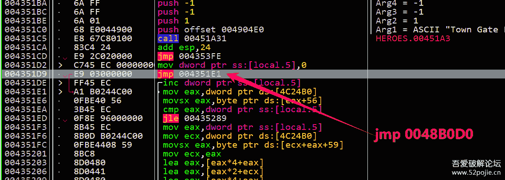

h1-9.png (103.78 KB, 下载次数: 0)

[href="forum.php?mod=attachment&aid=MjcyNzEwOHw3MzljYmYzMnwxNzkzNTcxNzI4fDE2ODA4NnwxOTcwMzI4&nothumb=yes" target="_blank"](https://www.52pojie.cn/forum.php?mod=attachment&aid=MjcyNzEwOHw3MzljYmYzMnwxNzkzNTcxNzI4fDE2ODA4NnwxOTcwMzI4&nothumb=yes)

2024-10-8 07:07 上传

## 五、修改代码

再看看修改的代码怎么写（下图红框就是）？

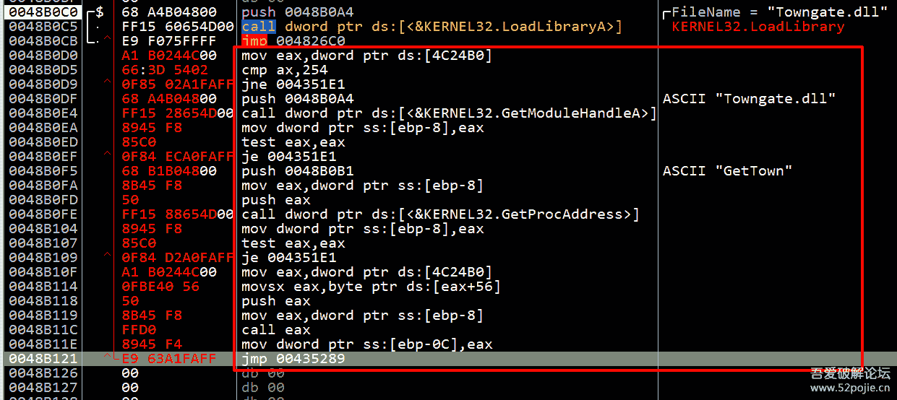

h1-10.png (108.46 KB, 下载次数: 0)

[href="forum.php?mod=attachment&aid=MjcyNzEwOXw0NjQxOTVmNXwxNzkzNTcxNzI4fDE2ODA4NnwxOTcwMzI4&nothumb=yes" target="_blank"](https://www.52pojie.cn/forum.php?mod=attachment&aid=MjcyNzEwOXw0NjQxOTVmNXwxNzkzNTcxNzI4fDE2ODA4NnwxOTcwMzI4&nothumb=yes)

2024-10-8 07:09 上传

由于玩家与电脑是使用同样的魔法代码的，因此，这样修改后要防止电脑不会使用而无法游戏，所以必须把电脑的排除出去，动态调试可知，玩家首地址的低16位为254，因此，可以用这判断将电脑仍回到小回城术上去。

大意就是：根据玩家首地址的低16位是否为254，将电脑排除掉，不等于254就返回小回城术流程-->得到`dll`的句柄-->检查句柄是否为`NULL`，如果是`NULL`，让程序回到原有的小回城术流程上去-->得到导出函数入口地址-->检查入口地址是否为`NULL`，若是同样返回原有程序的小回城术流程-->得到己方城堡数量，作为调用导出函数的参数，调用导出函数-->将导出函数的返回值传递给`[local.3]`-->最后跳转到原路径的`00435289`处。

修改后的程序代码在`X32dbg`中的样子（红框中三行是改变入口点的）：

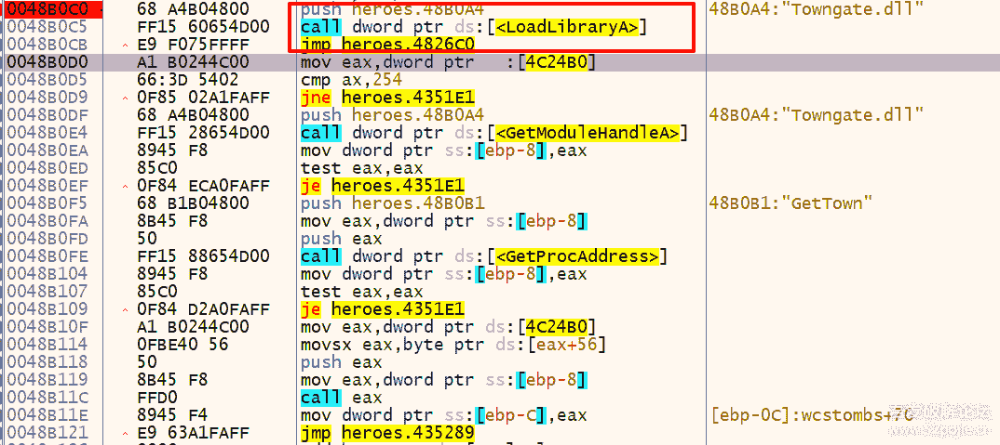

h1-11.png (124.39 KB, 下载次数: 1)

[href="forum.php?mod=attachment&aid=MjcyNzExMHxjMGU4MTZkOHwxNzkzNTcxNzI4fDE2ODA4NnwxOTcwMzI4&nothumb=yes" target="_blank"](https://www.52pojie.cn/forum.php?mod=attachment&aid=MjcyNzExMHxjMGU4MTZkOHwxNzkzNTcxNzI4fDE2ODA4NnwxOTcwMzI4&nothumb=yes)

2024-10-8 07:10 上传

## 六、检验效果

游戏中，回城术的使用方法是：

1 己方城堡从第一个开始，依次1、2、3、4下去，记住英雄要去的城堡是第几个？

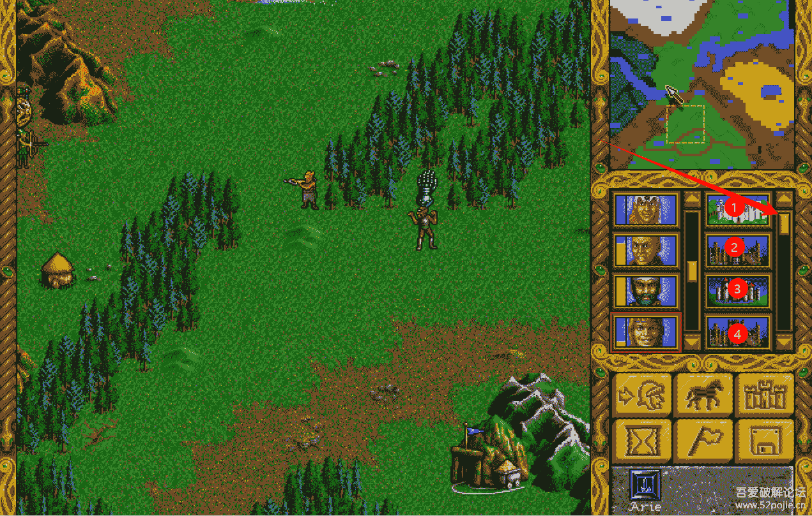

h1-12.png (1.49 MB, 下载次数: 0)

[href="forum.php?mod=attachment&aid=MjcyNzExMXxmMTBjOGIyNXwxNzkzNTcxNzI4fDE2ODA4NnwxOTcwMzI4&nothumb=yes" target="_blank"](https://www.52pojie.cn/forum.php?mod=attachment&aid=MjcyNzExMXxmMTBjOGIyNXwxNzkzNTcxNzI4fDE2ODA4NnwxOTcwMzI4&nothumb=yes)

2024-10-8 07:12 上传

2 打开魔法书，点击回城术

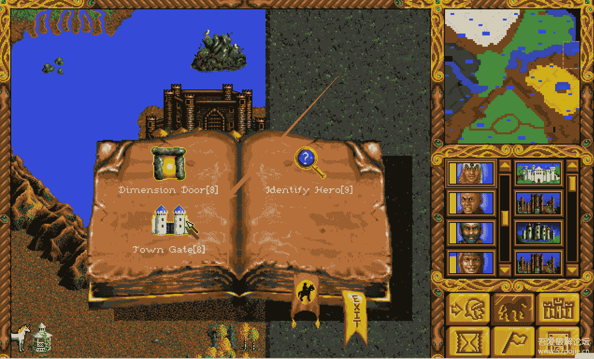

h1-13.png (1.06 MB, 下载次数: 1)

[href="forum.php?mod=attachment&aid=MjcyNzExMnw5ODc0OTQxOXwxNzkzNTcxNzI4fDE2ODA4NnwxOTcwMzI4&nothumb=yes" target="_blank"](https://www.52pojie.cn/forum.php?mod=attachment&aid=MjcyNzExMnw5ODc0OTQxOXwxNzkzNTcxNzI4fDE2ODA4NnwxOTcwMzI4&nothumb=yes)

2024-10-8 07:12 上传

3 在下拉框中就选中第几个（注意：即使是列表中的第一个，也要用鼠标选中一次）

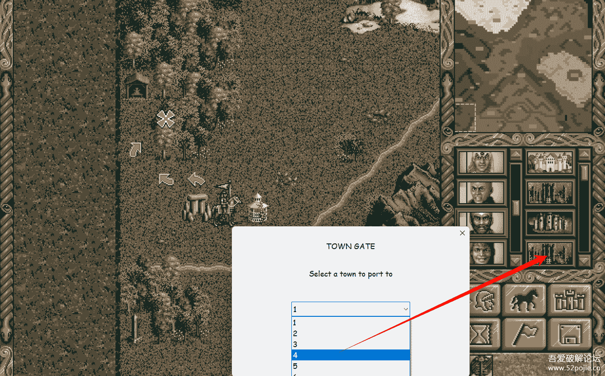

h1-14.png (1.19 MB, 下载次数: 2)

[href="forum.php?mod=attachment&aid=MjcyNzExM3xlZDc5MGJhNHwxNzkzNTcxNzI4fDE2ODA4NnwxOTcwMzI4&nothumb=yes" target="_blank"](https://www.52pojie.cn/forum.php?mod=attachment&aid=MjcyNzExM3xlZDc5MGJhNHwxNzkzNTcxNzI4fDE2ODA4NnwxOTcwMzI4&nothumb=yes)

2024-10-8 07:14 上传

4 点击OK就行了，下面看看实测结果

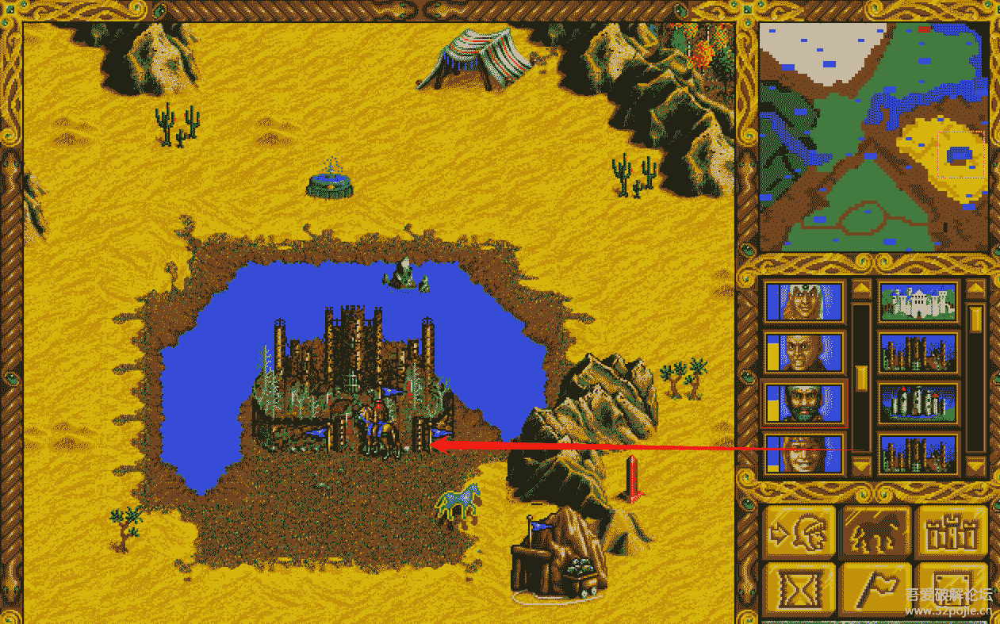

h1-15.png (1.25 MB, 下载次数: 1)

[href="forum.php?mod=attachment&aid=MjcyNzExNHxhMzllMjliNHwxNzkzNTcxNzI4fDE2ODA4NnwxOTcwMzI4&nothumb=yes" target="_blank"](https://www.52pojie.cn/forum.php?mod=attachment&aid=MjcyNzExNHxhMzllMjliNHwxNzkzNTcxNzI4fDE2ODA4NnwxOTcwMzI4&nothumb=yes)

2024-10-8 07:14 上传

## 七、程序包（dll和已经修改的运行程序）下载

[//wwzd.lanzoup.com/inEvw2bxohoh" target="_blank"](https://wwzd.lanzoup.com/inEvw2bxohoh:rel="nofollow noopener" href="https)
