# [Web逆向] 【JS逆向系列】某乎`__zse_ck`参数js与wasm多重套娃地狱级（右篇）

- 原帖: https://www.52pojie.cn/forum.php?mod=viewthread&tid=1970885
- 抓取时间: 2026-11-01T22:22:06

[@【JS逆向系列】某乎__zse_ck参数js与wasm多重套娃地狱级（右篇）](https://www.52pojie.cn/【JS逆向系列】某乎__zse_ck参数js与wasm多重套娃地狱级（右篇）)

## wasm层vm分析

既然`wasm`暂时无法搜索到结果，那么先返回`js`继续分析分析

从之前的版本可以猜测到，`wasm`中肯定调用了很多`js`层的环境内容，那么这里肯定就会调用各个导入函数，但是胶水代码又是在`jsvmp`中，没有办法直接下断点。

而在上一篇中反汇编的代码可以看到，胶水代码会被绑定到`window.Go`上面，那么就可以在胶水代码执行完成之后，`wasm`加载之前下断点

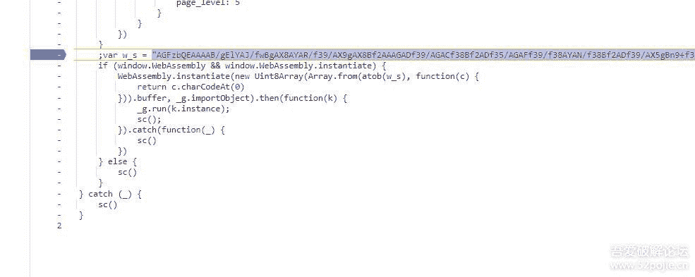

[001.jpg (36.63 KB, 下载次数: 0)](https://www.52pojie.cn/forum.php?mod=attachment&aid=MjcyNzM1OHwzMjY0NDY4YnwxNzkzNTcxNzIzfDE2ODA4NnwxOTcwODg1&nothumb=yes)
2024-10-9 17:58 上传

就可以通过`window.Go`看到里面的内容

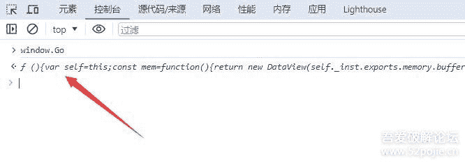

[002.jpg (21.89 KB, 下载次数: 1)](https://www.52pojie.cn/forum.php?mod=attachment&aid=MjcyNzM1OXxkNmMxZGI2Y3wxNzkzNTcxNzIzfDE2ODA4NnwxOTcwODg1&nothumb=yes)
2024-10-9 17:58 上传

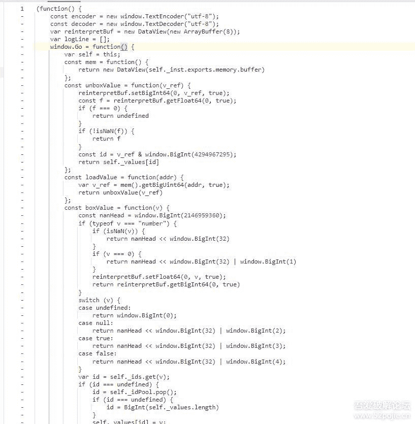

[003.jpg (100.19 KB, 下载次数: 1)](https://www.52pojie.cn/forum.php?mod=attachment&aid=MjcyNzM2MHw1ZGE5NDQwNXwxNzkzNTcxNzIzfDE2ODA4NnwxOTcwODg1&nothumb=yes)
2024-10-9 17:58 上传

往下拉在【`syscall/js.valueGet`】函数内下一个断点，就可以大概看到从`js`获取了什么内容

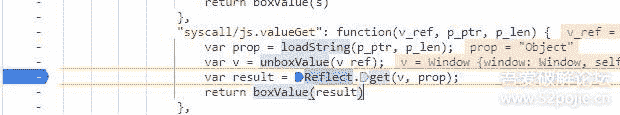

[004.jpg (19.71 KB, 下载次数: 1)](https://www.52pojie.cn/forum.php?mod=attachment&aid=MjcyNzM2MXwyZTFiZTdlZnwxNzkzNTcxNzIzfDE2ODA4NnwxOTcwODg1&nothumb=yes)
2024-10-9 17:59 上传

多次调用后，会发现堆栈中不断出现【`(*main.VM)`】前缀的函数

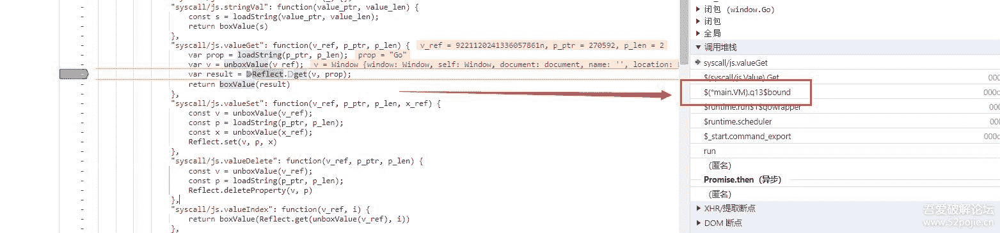

[005.jpg (91.49 KB, 下载次数: 1)](https://www.52pojie.cn/forum.php?mod=attachment&aid=MjcyNzM2MnwzYzM5NzdmZHwxNzkzNTcxNzIzfDE2ODA4NnwxOTcwODg1&nothumb=yes)
2024-10-9 17:59 上传

那么不排除`wasm`中存在一个自己实现的`vm`

那么在`wasm`中查看首次断下的【`runtime.run$1$gowrapper`】函数

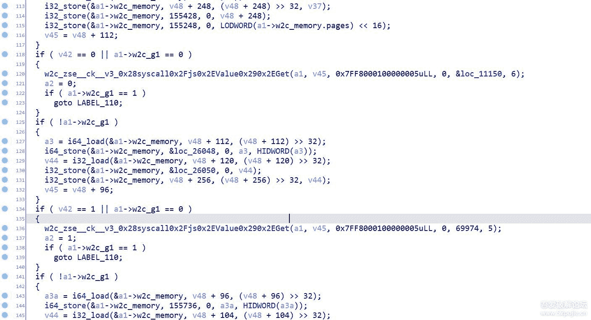

[006.jpg (156.53 KB, 下载次数: 1)](https://www.52pojie.cn/forum.php?mod=attachment&aid=MjcyNzM2M3xlMTc3NjQxMHwxNzkzNTcxNzIzfDE2ODA4NnwxOTcwODg1&nothumb=yes)
2024-10-9 17:59 上传

这里出现了两次【`syscall/js.valueGet`】，与网页断点调试出现的堆栈信息是一致的

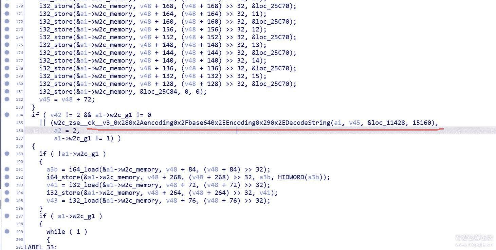

[007.jpg (186.13 KB, 下载次数: 0)](https://www.52pojie.cn/forum.php?mod=attachment&aid=MjcyNzM2NHxiYWVhYWFiY3wxNzkzNTcxNzIzfDE2ODA4NnwxOTcwODg1&nothumb=yes)
2024-10-9 17:59 上传

再往下，出现了一个`base64`解码的函数，地址是`0x11428`，长度是`15160`，从`wasm`中查看这部分内存

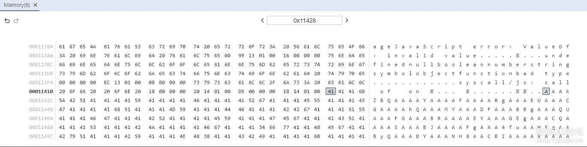

[008.jpg (97.55 KB, 下载次数: 1)](https://www.52pojie.cn/forum.php?mod=attachment&aid=MjcyNzM2NXw3MTIwZGRiNnwxNzkzNTcxNzIzfDE2ODA4NnwxOTcwODg1&nothumb=yes)
2024-10-9 17:59 上传

这部分进行`base64`解码之后，发现还是一堆乱码。那么很大概率这里就是`wasm`中`vm`的字节码了

继续根据`wasm`的逻辑，就是进行这部分字节码的解析，解析部分与`js`层的`vmp`非常类似

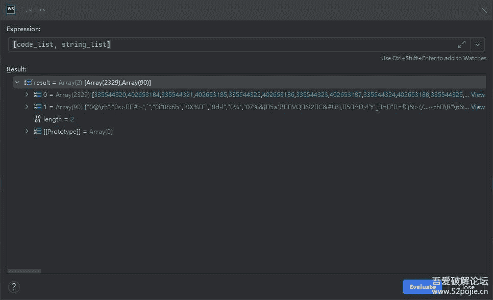

[009.jpg (42.16 KB, 下载次数: 0)](https://www.52pojie.cn/forum.php?mod=attachment&aid=MjcyNzM2NnxlZTE0OWZhYnwxNzkzNTcxNzIzfDE2ODA4NnwxOTcwODg1&nothumb=yes)
2024-10-9 17:59 上传

最终可以得到一个`2329`长度的大数组，以及一个`90`长度的字符串数组

那么解析部分与`js`层类似，那么运行逻辑会不会也是类似呢？

分析后发现【`runtime.run$1$gowrapper`】函数就是主循环函数，【`(*main.VM)`】前缀的函数就是子函数组，子函数里面的每一个`case`就是具体逻辑

但是`wasm`中的每一个`case`运行的内容与`js`相比明显难理解一些

所以无论是编写解释器难度会变高，想在里面插桩分析，自然难度也一样变高

搞不定就喊爹，经过某群聊大佬【Code】的帮助，才成功对整个流程进行反汇编

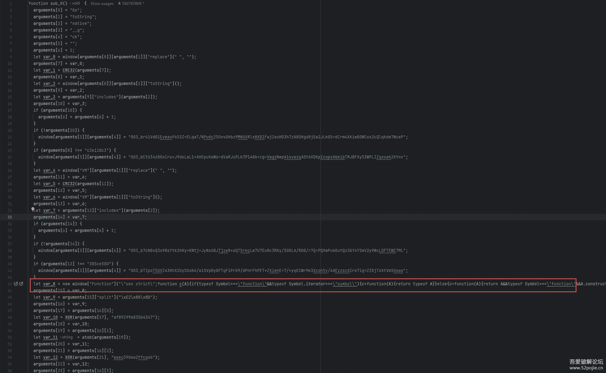

[010.jpg (200.31 KB, 下载次数: 1)](https://www.52pojie.cn/forum.php?mod=attachment&aid=MjcyNzM2N3xiMGIyZjg1NHwxNzkzNTcxNzIzfDE2ODA4NnwxOTcwODg1&nothumb=yes)
2024-10-9 17:59 上传

前面部分还是在不断的进行环境校验，并设置假的`ck`

后面`new`了一个非常长的`Function`，然后里面居然还是一个`jsvmp`，好家伙，搁着套娃呢

为什么说非常长，反汇编发现大数组长度达到了`8000+`，而且里面所有的代码均为环境检测

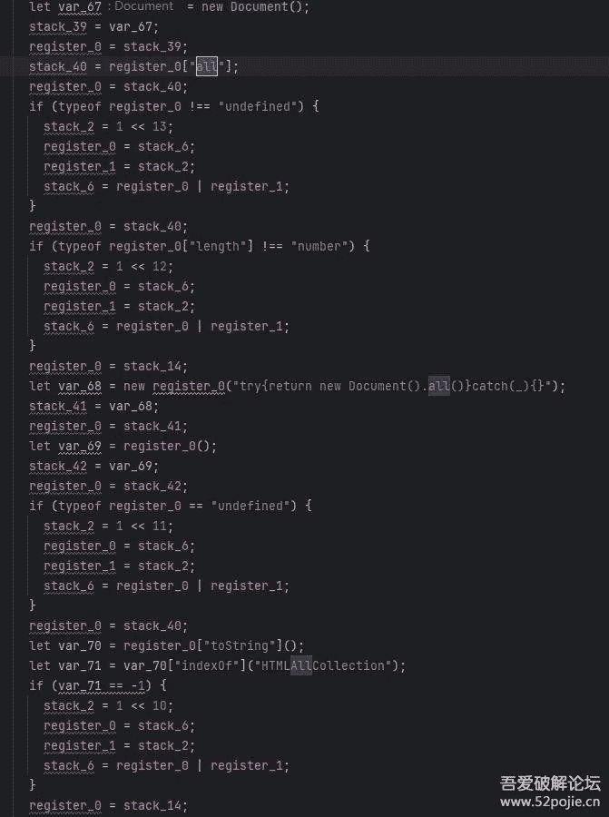

[011.jpg (73.98 KB, 下载次数: 2)](https://www.52pojie.cn/forum.php?mod=attachment&aid=MjcyNzM2OHwzMDNjYWIzMXwxNzkzNTcxNzIzfDE2ODA4NnwxOTcwODg1&nothumb=yes)
2024-10-9 17:59 上传

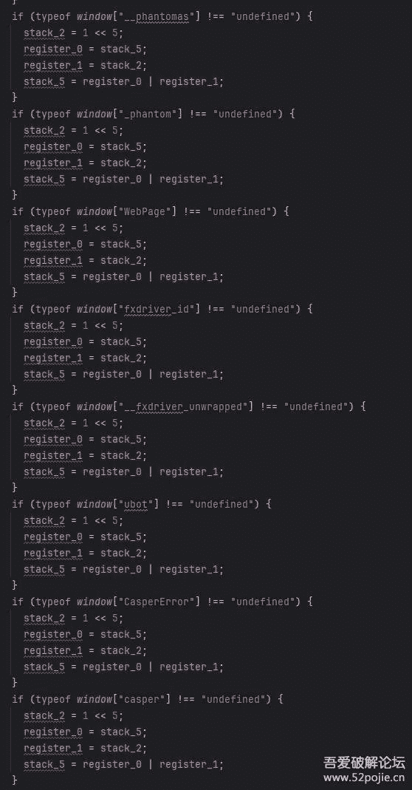

[012.jpg (78.98 KB, 下载次数: 1)](https://www.52pojie.cn/forum.php?mod=attachment&aid=MjcyNzM2OXxmM2JhMjA5N3wxNzkzNTcxNzIzfDE2ODA4NnwxOTcwODg1&nothumb=yes)
2024-10-9 17:59 上传

最后将加密后的环境信息绑定到`__g.r`进行返回

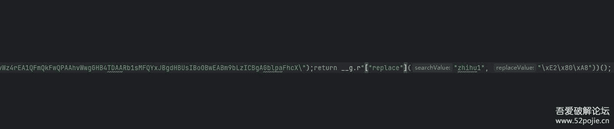

[013.jpg (17.44 KB, 下载次数: 1)](https://www.52pojie.cn/forum.php?mod=attachment&aid=MjcyNzM3MHw2ZjBmOTgxM3wxNzkzNTcxNzIzfDE2ODA4NnwxOTcwODg1&nothumb=yes)
2024-10-9 17:59 上传

内容主要分为`6`部分，并使用`"\xE2\x80\x8D"`进行分割

`wasm`中`vm`后面的逻辑就是拿到这部分加密的环境信息，然后解密，再在`vm`内进行一些检测，取一部分作为明文

接着`vm`再做一些其他的环境检测（`jsvmp`中没有的），也作为明文的一部分

最后再取`ua`的`crc32`与前面两项拼接，作为最终的明文

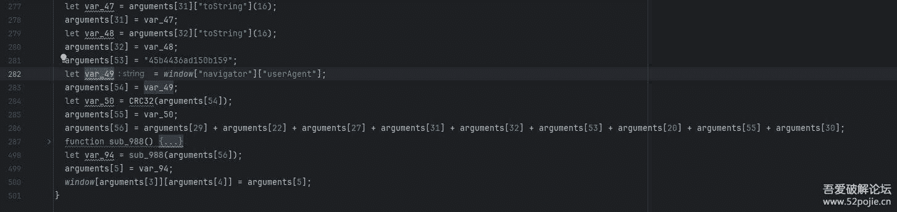

[014.jpg (51.68 KB, 下载次数: 0)](https://www.52pojie.cn/forum.php?mod=attachment&aid=MjcyNzM3MXxlNzA2OWQwMHwxNzkzNTcxNzIzfDE2ODA4NnwxOTcwODg1&nothumb=yes)
2024-10-9 17:59 上传

明文的拼接与上一个版本格式上是一模一样的，只是环境部分的值不一样

`sub_988`就是最终的加密函数，与之前一样，框架上也是使用的`sm4`，但是一样是经过了不同程度的魔改，然后经过一个魔改过得`base64`编码，形成了最终的`ck`

整理一下思路如下图

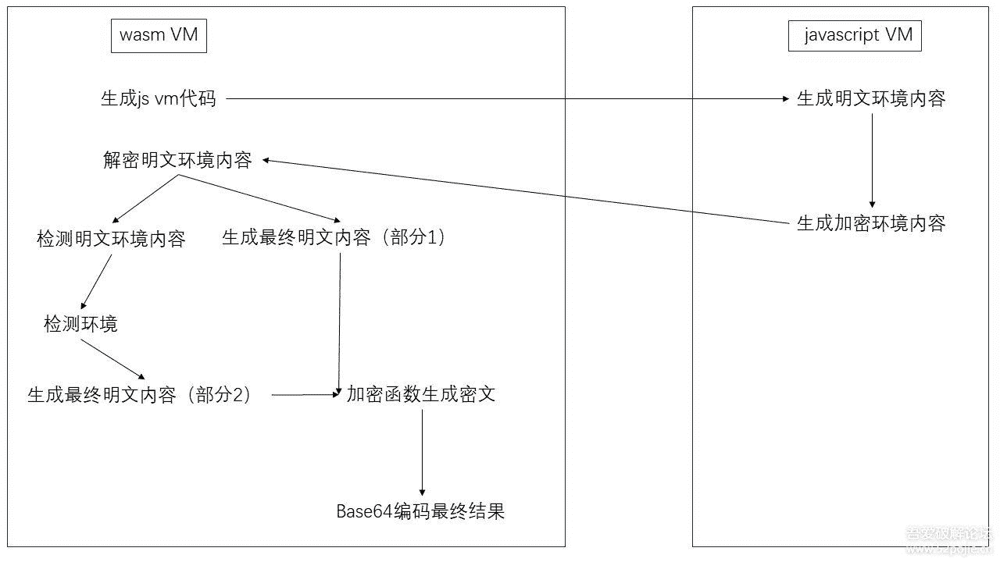

[015.jpg (71.61 KB, 下载次数: 1)](https://www.52pojie.cn/forum.php?mod=attachment&aid=MjcyNzM3MnwwMThjNWE2Y3wxNzkzNTcxNzIzfDE2ODA4NnwxOTcwODg1&nothumb=yes)
2024-10-9 17:59 上传

使用`python`还原出所有算法测试

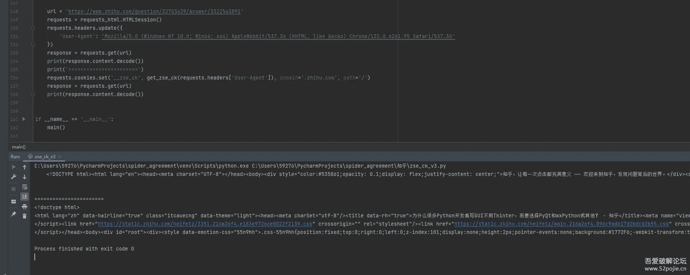

[016.jpg (138.41 KB, 下载次数: 1)](https://www.52pojie.cn/forum.php?mod=attachment&aid=MjcyNzM3M3xiYWU4NmZiOXwxNzkzNTcxNzIzfDE2ODA4NnwxOTcwODg1&nothumb=yes)
2024-10-9 17:59 上传

中文没有乱码完美

## 其他

之前版本只是使用了`wasm`，而更新后甚至在`wasm`中玩起了`vm`，也有的`wasm`出现了不同程度的混淆。按照这么发展，`web`逆向也是越来越难

搞不动了，去注册骑手了！！
