# [原创] 《英雄无敌》3——回城术修改（让没有土系高级英雄也能选择城堡）
- 原帖: https://www.52pojie.cn/forum.php?mod=viewthread&tid=1971618
- 抓取时间: 2026-11-01T22:22:00

## 一、前言
《英雄无敌》3的回城术，不像二代那样分大小回城术，而是根据英雄的土系属性是否达到高级或以上级，分大小回城术。有的英雄，可能很难出现土系属性让其发展，对于这样的英雄也就永远没有大回城术使用了，这无疑是这样的英雄的悲哀！
这次修改就是让所有英雄，只要能学到回城术，就可以选择到达想去的城堡。
本次修改是在（complete）英文完整版上修改的，并且是在前一篇文章（免CD修改）基础上进行的：
https://www.52pojie.cn/thread-1960687-1-1.html

## 二、逆向过程
在上篇文章已经提到过了，《英雄无敌》3游戏对字符串已经作了处理，反正用`OD`是搜不到的，无论有没有加载，因此想通过字符串查找到回城术的子程序是行不通的。那应该如何查找呢？
用`MessageBox`这个API函数也是没有用的，因为游戏中提示信息不是直接使用`MessageBox`的，至于其它的API我也没有仔细思考。那我是采用什么方法的呢？从小回城术的最近城堡如果有英雄，则回城不成功的提示来看，它们是完全相同的。看下图：
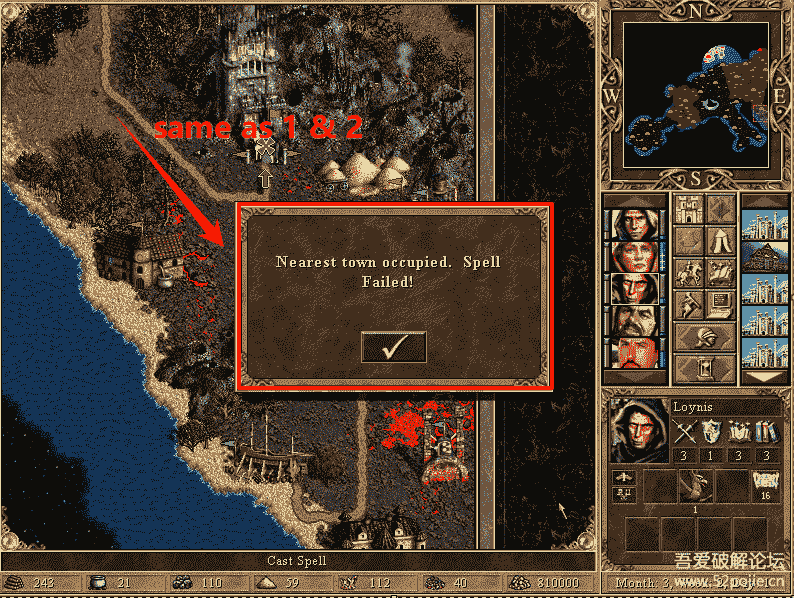
h3-town gate-0.png (792.25 KB, 下载次数: 1)
2024-10-12 00:28 上传
因此，我认为游戏开发者在这个子程序上应该是不会重写的，即使有变化，应该也是微小的，所以根据1代和2代中这个子程序的特点，来找到这个子程序应该是非常好的一个捷径。
1代和2代，这个子程序如下。
1代的：
[Asm] 纯文本查看 复制代码
```
004352E0  |.  6A FF         push -1
004352E2  |.  6A 00         push 0
004352E4  |.  6A FF         push -1
004352E6  |.  6A 00         push 0
004352E8  |.  6A FF         push -1
004352EA  |.  6A FF         push -1
004352EC  |.  6A 61         push 61
004352EE  |.  6A 01         push 1
004352F0  |.  68 4C054900   push HEROES.0049054C ;ASCII "Nearest town occupied.  Town Gate Failed!!!"
```
2代的：
[Asm] 纯文本查看 复制代码
```
00454466  |.  6A 00         push 0
00454468  |.  6A FF         push -1
0045446A  |.  6A 00         push 0
0045446C  |.  6A FF         push -1
0045446E  |.  6A 00         push 0
00454470  |.  6A FF         push -1
00454472  |.  6A FF         push -1
00454474  |.  6A FF         push -1
00454476  |.  B9 28FA5000   mov ecx,HEROES2W.0050FA28 ;ASCII "Nearest town occupied.  Spell Failed!!!"
```
很显然，这个子程序是很特别的，就是它的参数，那么多-1，而且还有连续的，这自然是非常明显的特征！于是，我试着在3代中寻找`push -1`，结果还真找到很相似的，如下：
[Asm] 纯文本查看 复制代码
```
0041D31C  |.  6A 00         push 0
0041D31E  |.  6A FF         push -1
0041D320  |.  6A 00         push 0
0041D322  |.  8B48 20       mov ecx,dword ptr ds:[eax+20]
0041D325  |.  6A FF         push -1
0041D327  |.  6A 00         push 0
0041D329  |.  6A FF         push -1
0041D32B  |.  8B89 700B0000 mov ecx,dword ptr ds:[ecx+0B70]
0041D331  |.  6A 00         push 0
0041D333  |.  6A FF         push -1
0041D335  |.  6A FF         push -1
0041D337  |.  6A FF         push -1
0041D339  |.  BA 01000000   mov edx,1
0041D33E  |>  E8 2D920D00   call 004F6570
```
于是我便在`004F6570`处下断点（自然那个信息框是没有用的）
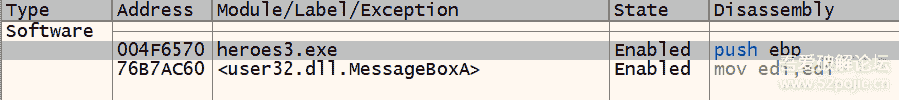
h3-town gate-1.png (21.1 KB, 下载次数: 1)
2024-10-12 00:32 上传
结果在调用回城术时真断下来了。
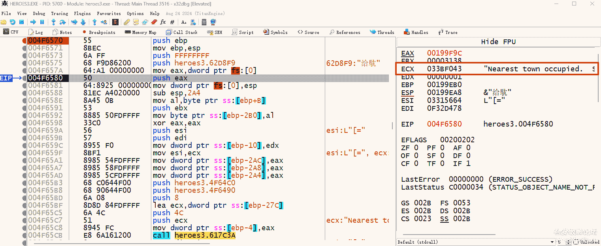
h3-town gate-2.png (182.94 KB, 下载次数: 1)
2024-10-12 00:33 上传
而且在其上还看到了找不到的那个字符串：`Nearest town occupied. Spell Failed!!!`
只要断下来了，下面的工作就简单了。先让`X32dbg`运行至`return`，返回到调用程序中。
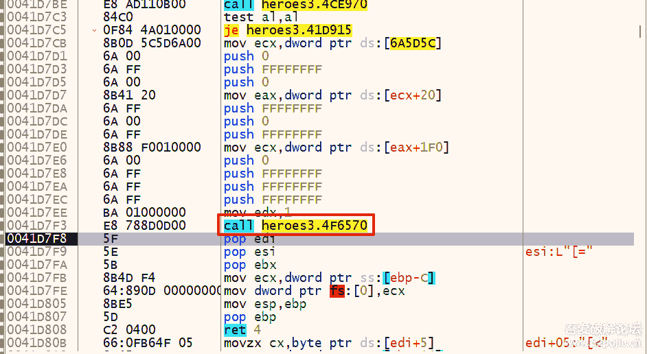
h3-town gate-3.png (97.08 KB, 下载次数: 0)
2024-10-12 00:33 上传
再向上找到程序的开始处。
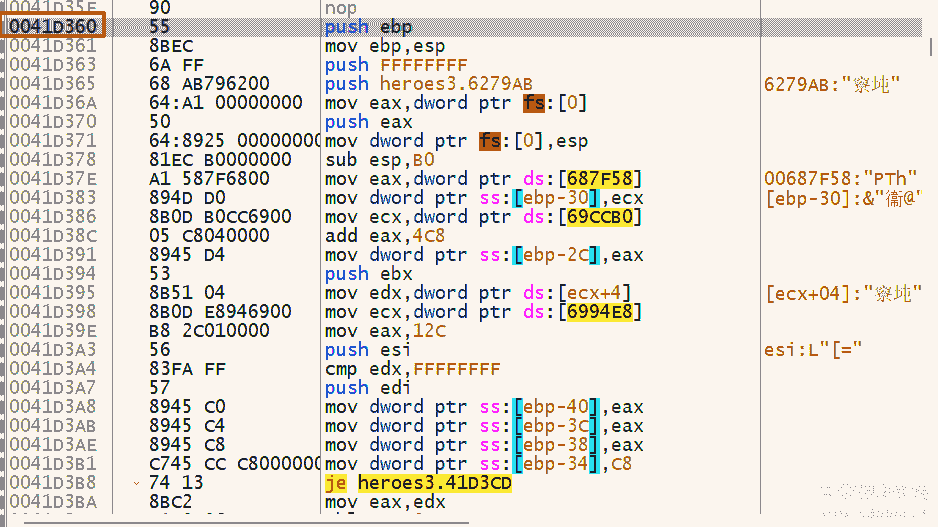
h3-town gate-4.png (126.61 KB, 下载次数: 1)
2024-10-12 00:34 上传
然后在这里重新下断点，把程序走一下看看。
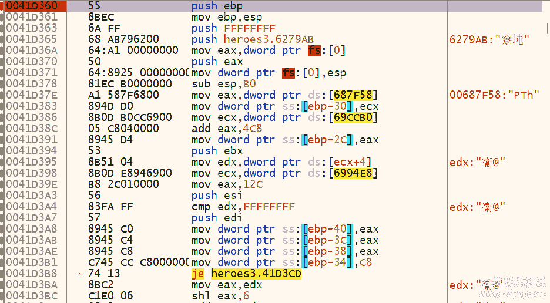
h3-town gate-5.png (126.73 KB, 下载次数: 1)
2024-10-12 00:35 上传
这次用土系专家来施放回城术
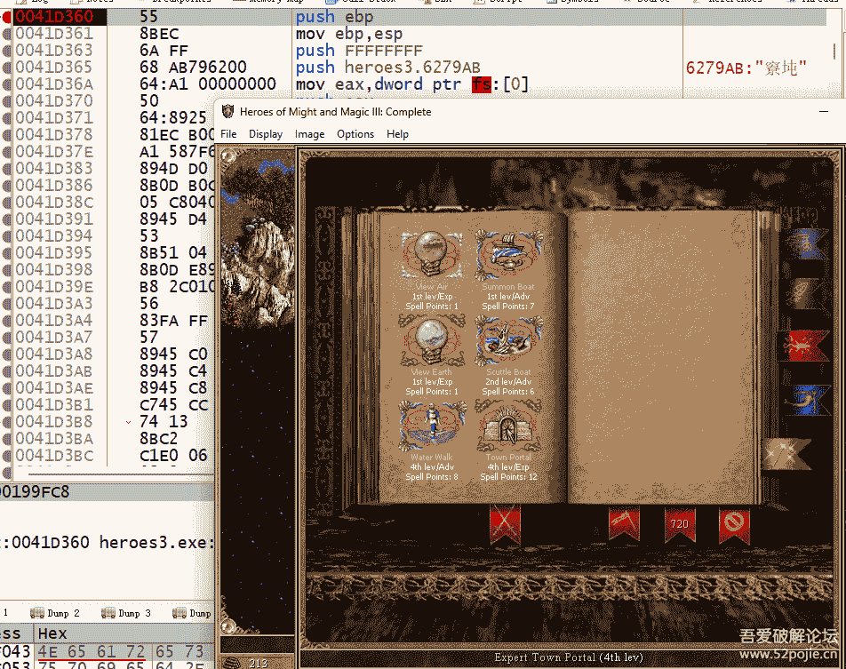
h3-town gate-6.png (594.91 KB, 下载次数: 0)
2024-10-12 00:35 上传
了解《英雄无敌》3的都知道，英雄技能学到了就是`basic`，再升一级就是`advanced`，最后就是`expert`，分别对应1，2，3级，没有该技能就是0级。一路走下来，很快就看到了关键比较
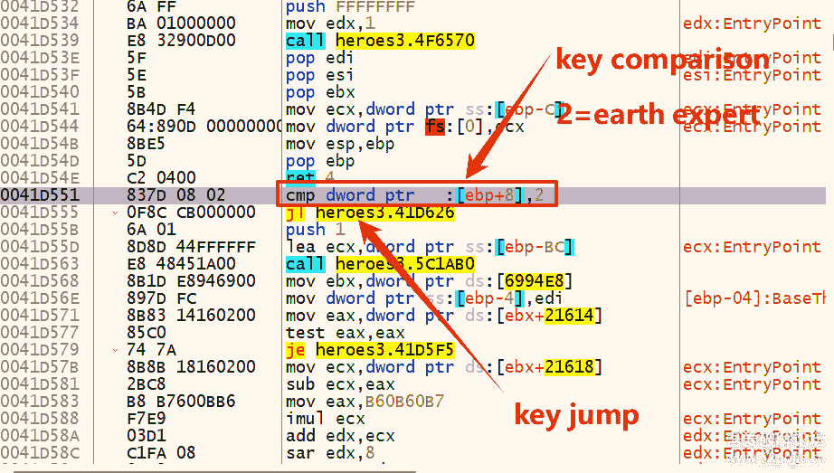
h3-town gate-7.png (134.32 KB, 下载次数: 1)
2024-10-12 00:36 上传
可以看到，程序中是拿英雄的技能属性与2（`advanced`）去比，小于2的就跳转。自然，把这个2改成0，则没有土系技能（等级0）也不会跳转了。
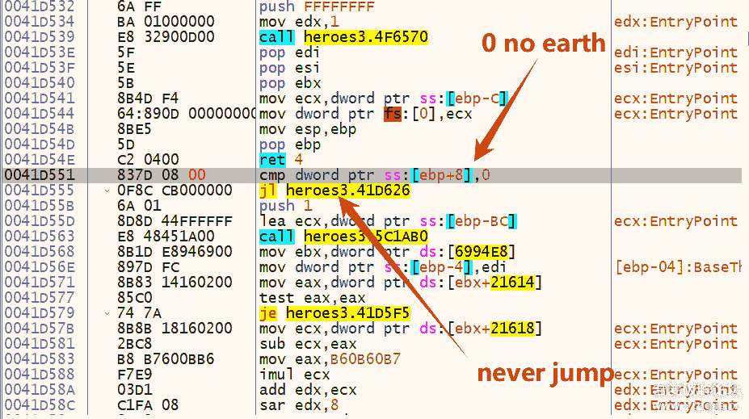
h3-town gate-8.png (129.04 KB, 下载次数: 1)
2024-10-12 00:37 上传
改好后，保存下来。

## 三、测试
找个没有土系技能的英雄来测试一下。这个英雄的四大元素类的技能只有水系的。
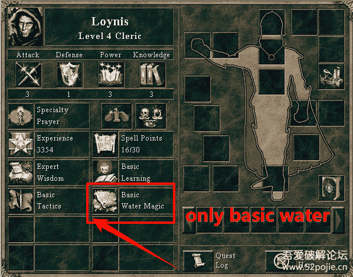
h3-town gate-9.png (453.51 KB, 下载次数: 1)
2024-10-12 00:38 上传
打开他的魔法书，可以看到，回城术只有一个角标志（没有土系技能，有2个角标志的就`basic`，3个角`advanced`），没有改的话只能使用小回城术，点击回城术
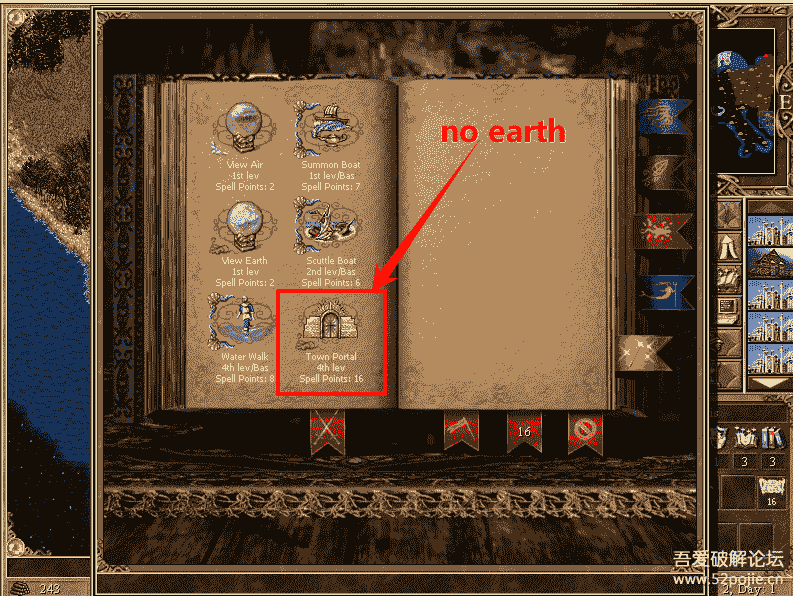
h3-town gate-10.png (636.96 KB, 下载次数: 1)
2024-10-12 00:39 上传
结果也出现了选择要去的城堡对话框，说明修改成功了。
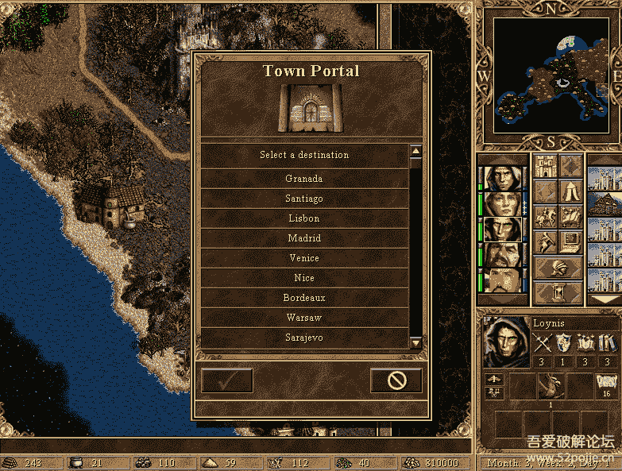
h3-town gate-11.png (775.89 KB, 下载次数: 0)
2024-10-12 00:40 上传

## 四、相关下载
https://wwzd.lanzoup.com/iKT6i2cbsqsd
```
