# [原创] 某网络播放器破解

- 原帖: `https://www.52pojie.cn/forum.php?mod=viewthread&tid=1971931`
- 抓取时间: `2026-11-01T22:21:57`

大概去年的时候，我弟问我能不能这个软件，这个软件是他买修图课用的播放器，当时纯菜逼一个(虽然现在也垃圾)，一看加的`vm`，直接右键回收站。这几天心血来潮跟他又要了这个播放器尝试破解，顺便要了他的账号和密码然后开始分析

首先用`die`查壳，`vm`壳不过没有加反调试和反调试器能直接附加

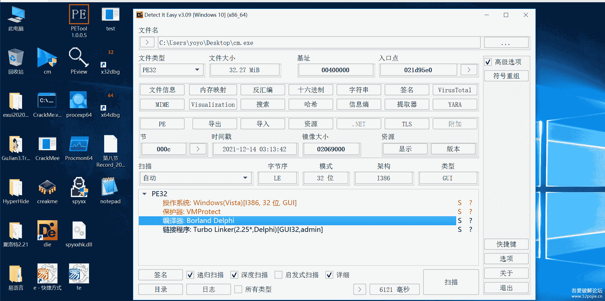

image.png (610.81 KB, 下载次数: 2)

[href="forum.php?mod=attachment&aid=MjcyODUzOXxjNzJkZDJkZnwxNzkzNTcxNzE1fDE2ODA4NnwxOTcxOTMx&nothumb=yes" target="_blank"](https://www.52pojie.cn/forum.php?mod=attachment&aid=MjcyODUzOXxjNzJkZDJkZnwxNzkzNTcxNzE1fDE2ODA4NnwxOTcxOTMx&nothumb=yes)

2024-10-12 17:50 上传

随便输入账号密码根据各种提示信息啥的定位到这个`call`，然后单步过去

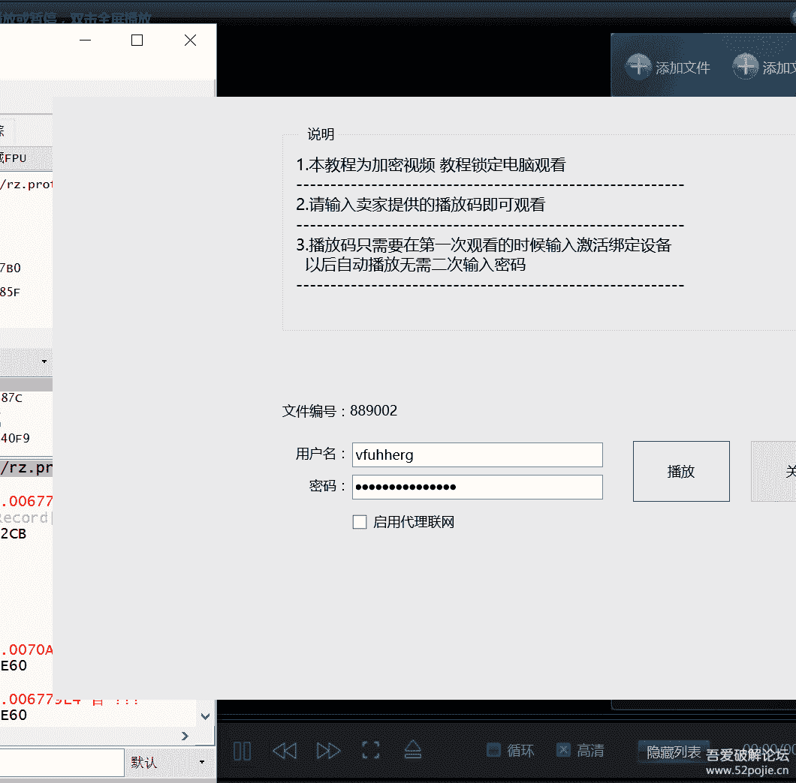

image.png (90.51 KB, 下载次数: 1)

[href="forum.php?mod=attachment&aid=MjcyODU0MHxkYTgzOTExOXwxNzkzNTcxNzE1fDE2ODA4NnwxOTcxOTMx&nothumb=yes" target="_blank"](https://www.52pojie.cn/forum.php?mod=attachment&aid=MjcyODU0MHxkYTgzOTExOXwxNzkzNTcxNzE1fDE2ODA4NnwxOTcxOTMx&nothumb=yes)

2024-10-12 17:57 上传

可以看到`ebp-0x3a8`的栈返回了一个字符串地址

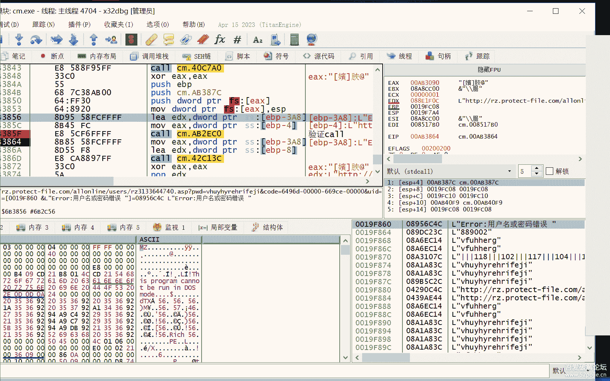

image.png (275.84 KB, 下载次数: 2)

[href="forum.php?mod=attachment&aid=MjcyODU0NnxhYTA2ZGE4N3wxNzkzNTcxNzE1fDE2ODA4NnwxOTcxOTMx&nothumb=yes" target="_blank"](https://www.52pojie.cn/forum.php?mod=attachment&aid=MjcyODU0NnxhYTA2ZGE4N3wxNzkzNTcxNzE1fDE2ODA4NnwxOTcxOTMx&nothumb=yes)

2024-10-12 17:59 上传

接下来输入别人正版账号密码看返回结果，发现是一个unicode格式的字符串 “AAAAAA424EA55F03-M9MM88974EA52FDMA9037802BB554A2M09433D|0||88900285g9mmy3|d966a02a4dd8b1244a0fd191bc8b273a”

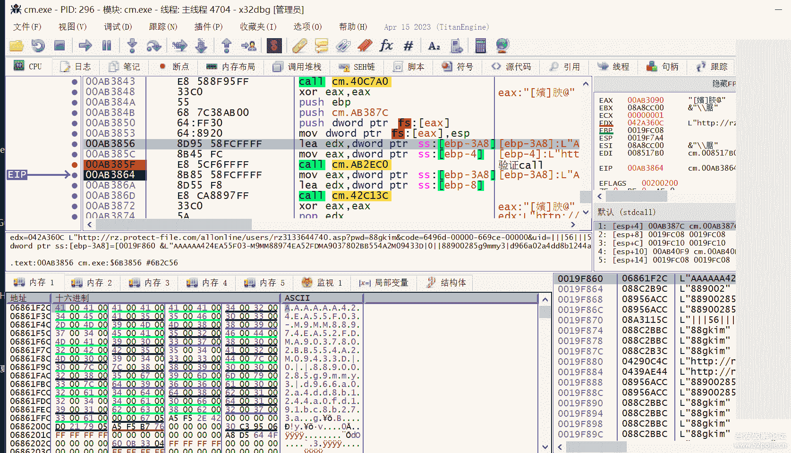

image.png (315.88 KB, 下载次数: 0)

[href="forum.php?mod=attachment&aid=MjcyODU1MHxiY2RkOTgyZnwxNzkzNTcxNzE1fDE2ODA4NnwxOTcxOTMx&nothumb=yes" target="_blank"](https://www.52pojie.cn/forum.php?mod=attachment&aid=MjcyODU1MHxiY2RkOTgyZnwxNzkzNTcxNzE1fDE2ODA4NnwxOTcxOTMx&nothumb=yes)

2024-10-12 18:02 上传

然后我去拿这个字符串去patch错误的在`.data`段随便找了一个空白区把数据复制过去并且修改`ebp-0x3a8`的值，然后直接`f9`，然后返回了一个错误好好好果然没让我失望破解失败

还得拿人家正版号去跟

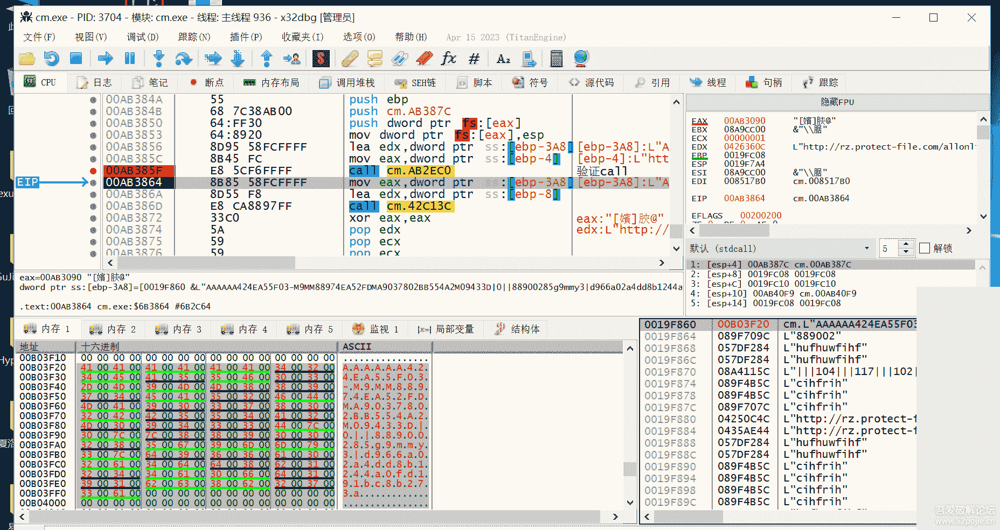

image.png (330.68 KB, 下载次数: 0)

[href="forum.php?mod=attachment&aid=MjcyODU1MXxjZjE4ZmI3OHwxNzkzNTcxNzE1fDE2ODA4NnwxOTcxOTMx&nothumb=yes" target="_blank"](https://www.52pojie.cn/forum.php?mod=attachment&aid=MjcyODU1MXxjZjE4ZmI3OHwxNzkzNTcxNzE1fDE2ODA4NnwxOTcxOTMx&nothumb=yes)

2024-10-12 18:06 上传

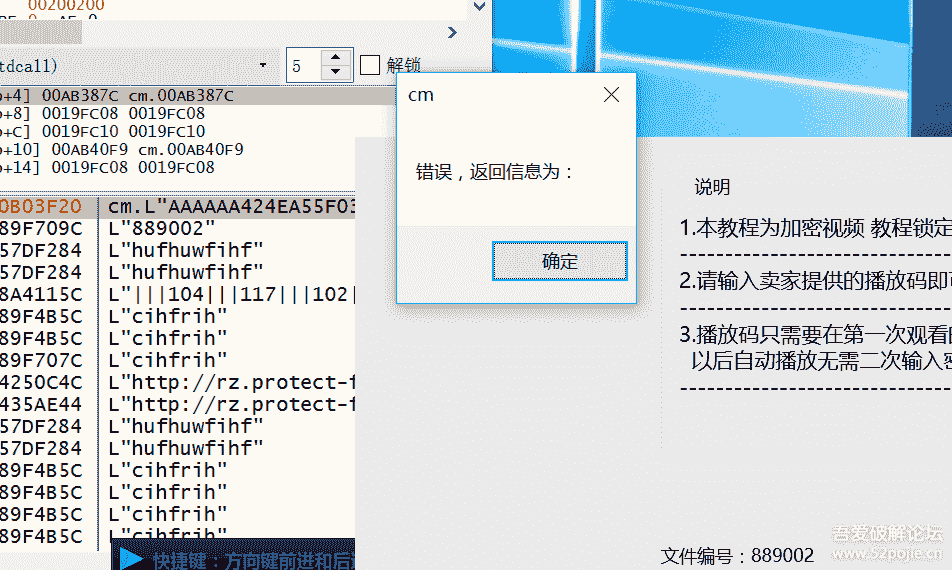

image.png (131.92 KB, 下载次数: 0)

[href="forum.php?mod=attachment&aid=MjcyODU1MnwzODZiOTY4ZHwxNzkzNTcxNzE1fDE2ODA4NnwxOTcxOTMx&nothumb=yes" target="_blank"](https://www.52pojie.cn/forum.php?mod=attachment&aid=MjcyODU1MnwzODZiOTY4ZHwxNzkzNTcxNzE1fDE2ODA4NnwxOTcxOTMx&nothumb=yes)

2024-10-12 18:09 上传

然后继续看别人正版号的后续流程，在验证`call`之后这个`call`又把`ebp-8`存的值改成了字符串地址，假码则不会[`ebp-8`] = 0,ok那么我继续patch，修改[`ebp-8`]的值

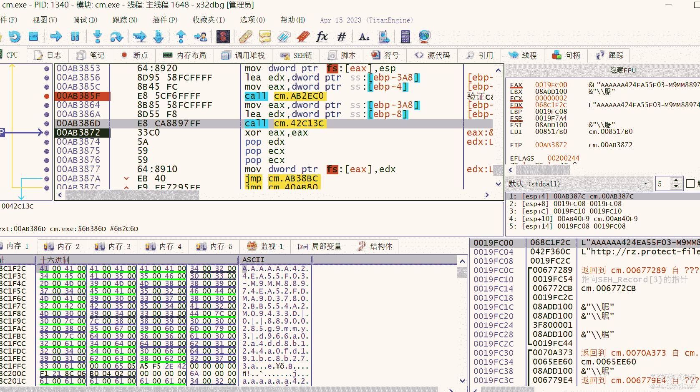

image.png (284.66 KB, 下载次数: 0)

[href="forum.php?mod=attachment&aid=MjcyODU1M3w2N2RiNmFhZXwxNzkzNTcxNzE1fDE2ODA4NnwxOTcxOTMx&nothumb=yes" target="_blank"](https://www.52pojie.cn/forum.php?mod=attachment&aid=MjcyODU1M3w2N2RiNmFhZXwxNzkzNTcxNzE1fDE2ODA4NnwxOTcxOTMx&nothumb=yes)

2024-10-12 18:15 上传

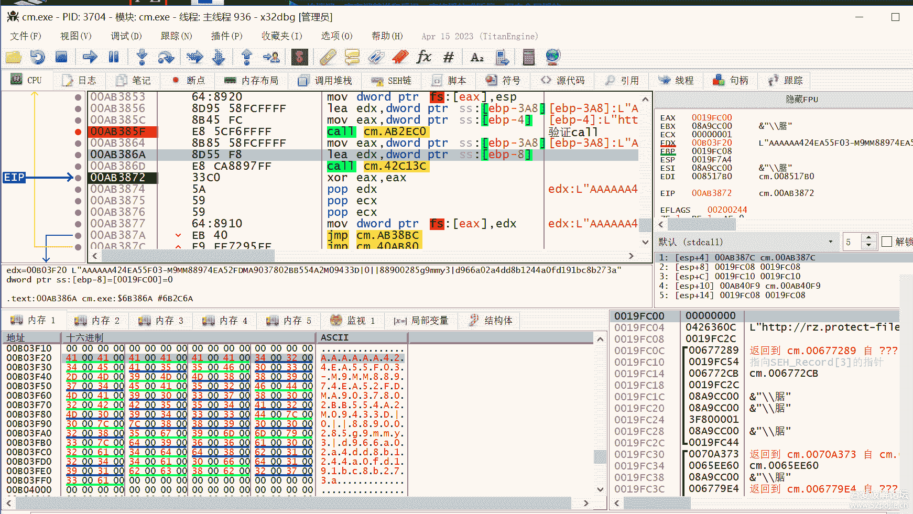

image.png (296.11 KB, 下载次数: 0)

[href="forum.php?mod=attachment&aid=MjcyODU1NHwxMTRkYTAzZXwxNzkzNTcxNzE1fDE2ODA4NnwxOTcxOTMx&nothumb=yes" target="_blank"](https://www.52pojie.cn/forum.php?mod=attachment&aid=MjcyODU1NHwxMTRkYTAzZXwxNzkzNTcxNzE1fDE2ODA4NnwxOTcxOTMx&nothumb=yes)

2024-10-12 18:18 上传

修改之后继续`f9`果然还是不行，继续跟正版号

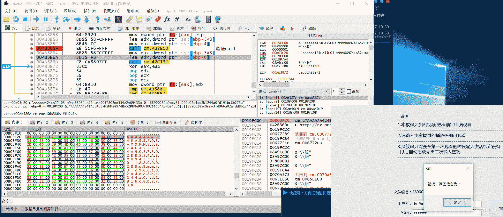

image.png (550.77 KB, 下载次数: 0)

[href="forum.php?mod=attachment&aid=MjcyODU1NXwzMzBjYjA2M3wxNzkzNTcxNzE1fDE2ODA4NnwxOTcxOTMx&nothumb=yes" target="_blank"](https://www.52pojie.cn/forum.php?mod=attachment&aid=MjcyODU1NXwzMzBjYjA2M3wxNzkzNTcxNzE1fDE2ODA4NnwxOTcxOTMx&nothumb=yes)

2024-10-12 18:27 上传

这个`call`把返回的字符串大写变成小写，并且返回值是`0x6a`,继续看假码是怎么处理的

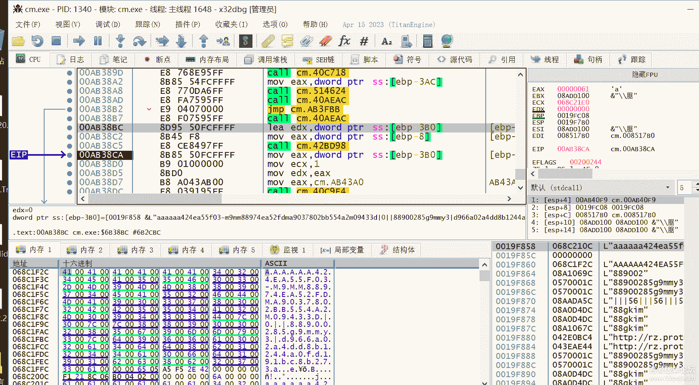

image.png (302.89 KB, 下载次数: 0)

[href="forum.php?mod=attachment&aid=MjcyODU1NnxmMDJkY2IxZHwxNzkzNTcxNzE1fDE2ODA4NnwxOTcxOTMx&nothumb=yes" target="_blank"](https://www.52pojie.cn/forum.php?mod=attachment&aid=MjcyODU1NnxmMDJkY2IxZHwxNzkzNTcxNzE1fDE2ODA4NnwxOTcxOTMx&nothumb=yes)

2024-10-12 18:29 上传

假码处理前可以看到`eax`和`edx`是参数`eax`是字符串`edx`则是储存新字符串地址

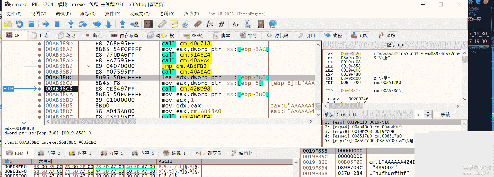

image.png (245.78 KB, 下载次数: 0)

[href="forum.php?mod=attachment&aid=MjcyODU1N3xiMGQ2YWNmZXwxNzkzNTcxNzE1fDE2ODA4NnwxOTcxOTMx&nothumb=yes" target="_blank"](https://www.52pojie.cn/forum.php?mod=attachment&aid=MjcyODU1N3xiMGQ2YWNmZXwxNzkzNTcxNzE1fDE2ODA4NnwxOTcxOTMx&nothumb=yes)

2024-10-12 18:31 上传

处理后可以看到返回值差了很多而且[`ebp-8`]是0，紧接着跟了一条`mov eax,xxxx`的指令，当时没注意直接又复制了一份小写的字符串以及修改`ebp-8`的值还是挂了

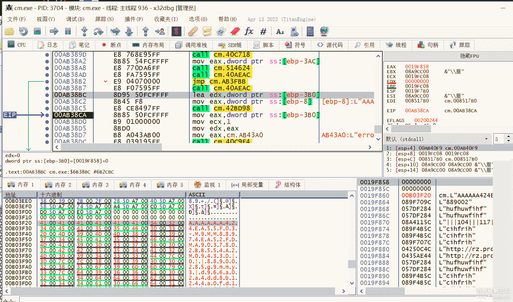

image.png (283.72 KB, 下载次数: 0)

[href="forum.php?mod=attachment&aid=MjcyODU1OHwwMWZjNmM4YXwxNzkzNTcxNzE1fDE2ODA4NnwxOTcxOTMx&nothumb=yes" target="_blank"](https://www.52pojie.cn/forum.php?mod=attachment&aid=MjcyODU1OHwwMWZjNmM4YXwxNzkzNTcxNzE1fDE2ODA4NnwxOTcxOTMx&nothumb=yes)

2024-10-12 18:33 上传

挂了之后我去重新分析验证`call`的下一个`call`也就是`call 0x42c13c`

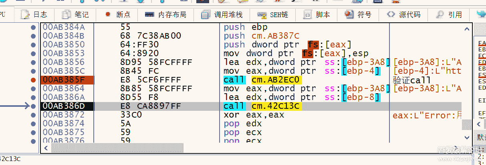

image.png (103.04 KB, 下载次数: 0)

[href="forum.php?mod=attachment&aid=MjcyODU2MXw3MjcwMWViYnwxNzkzNTcxNzE1fDE2ODA4NnwxOTcxOTMx&nothumb=yes" target="_blank"](https://www.52pojie.cn/forum.php?mod=attachment&aid=MjcyODU2MXw3MjcwMWViYnwxNzkzNTcxNzE1fDE2ODA4NnwxOTcxOTMx&nothumb=yes)

2024-10-12 18:38 上传

分析别人正版`call`可以看到`eax`是字符串首地址然后这里`sub eax,4`然后`mov eax,[eax]`可以发现这个值正好是`0x6a`，ok,那么我也去patch，将字符串前面四个字节改成`6a`,patch之后这个`call`得到了和正版号一样的结果

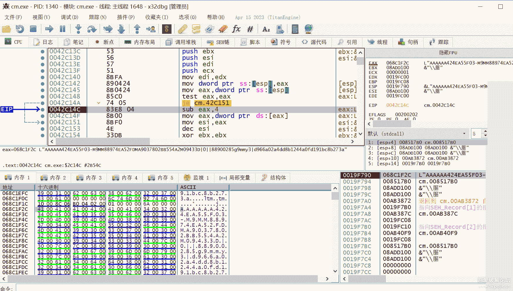

image.png (284.49 KB, 下载次数: 0)

[href="forum.php?mod=attachment&aid=MjcyODU2Mnw3NWM3N2RlMXwxNzkzNTcxNzE1fDE2ODA4NnwxOTcxOTMx&nothumb=yes" target="_blank"](https://www.52pojie.cn/forum.php?mod=attachment&aid=MjcyODU2Mnw3NWM3N2RlMXwxNzkzNTcxNzE1fDE2ODA4NnwxOTcxOTMx&nothumb=yes)

2024-10-12 18:41 上传

可以看到`ebp-8`这里已经不是0了

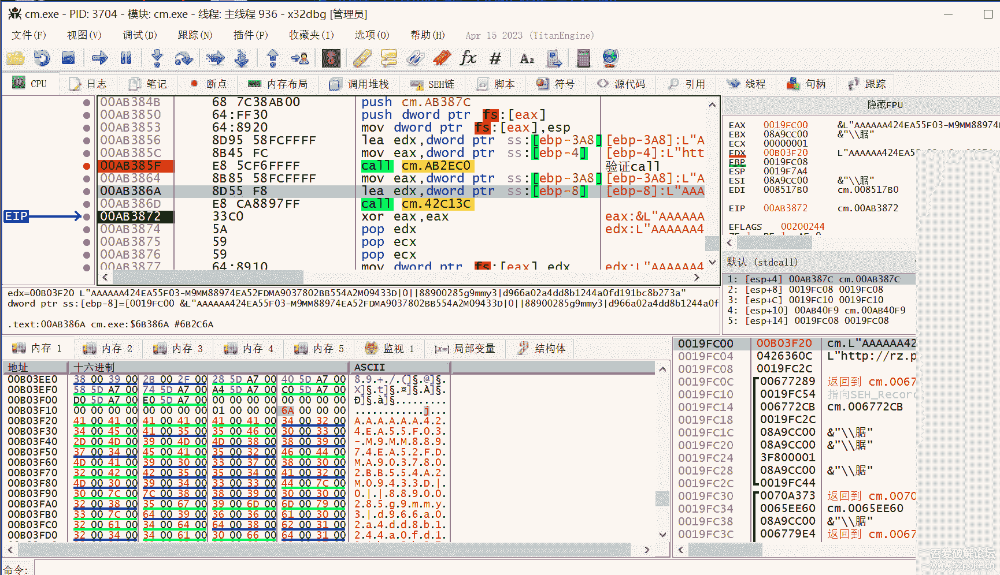

image.png (304.62 KB, 下载次数: 0)

[href="forum.php?mod=attachment&aid=MjcyODU2OHw5NWQwZGJkMHwxNzkzNTcxNzE1fDE2ODA4NnwxOTcxOTMx&nothumb=yes" target="_blank"](https://www.52pojie.cn/forum.php?mod=attachment&aid=MjcyODU2OHw5NWQwZGJkMHwxNzkzNTcxNzE1fDE2ODA4NnwxOTcxOTMx&nothumb=yes)

2024-10-12 18:46 上传

继续往下走可以看到效果和正版号一样返回值`0x6a`,`ebp-8`也不是0，然后我又`f9`，然后直接抛了异常

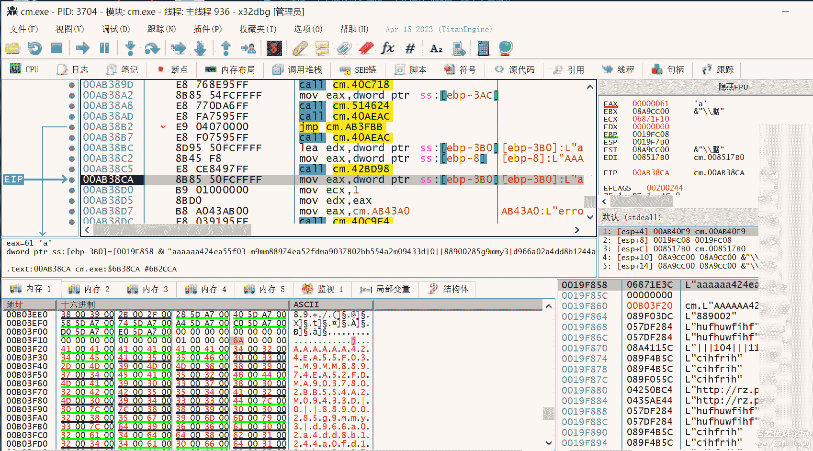

image.png (288.26 KB, 下载次数: 0)

[href="forum.php?mod=attachment&aid=MjcyODU2OXxkOGQwNjk1YnwxNzkzNTcxNzE1fDE2ODA4NnwxOTcxOTMx&nothumb=yes" target="_blank"](https://www.52pojie.cn/forum.php?mod=attachment&aid=MjcyODU2OXxkOGQwNjk1YnwxNzkzNTcxNzE1fDE2ODA4NnwxOTcxOTMx&nothumb=yes)

2024-10-12 18:47 上传

由于之前拿别人正版号测试的时候也会抛异常因为我把异常选项设置了不暂停让被调试进程处理，走到这里我猜应该还有其他地方没有patch，联想之前的`sub eax,4`，我猜测前面的数据会不会也有用

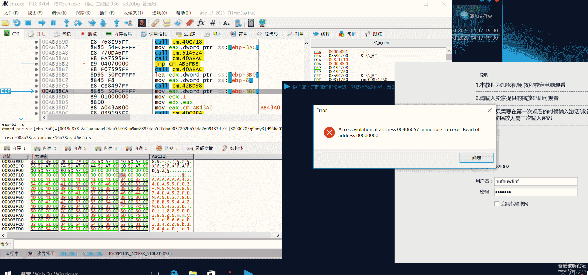

image.png (374.36 KB, 下载次数: 0)

[href="forum.php?mod=attachment&aid=MjcyODU3MHxiYjVmNmNiOHwxNzkzNTcxNzE1fDE2ODA4NnwxOTcxOTMx&nothumb=yes" target="_blank"](https://www.52pojie.cn/forum.php?mod=attachment&aid=MjcyODU3MHxiYjVmNmNiOHwxNzkzNTcxNzE1fDE2ODA4NnwxOTcxOTMx&nothumb=yes)

2024-10-12 18:49 上传

重新执行断到这里字符串前面16个字节然后除了之前的`6a`,我分别在另外三个字节下硬件断点

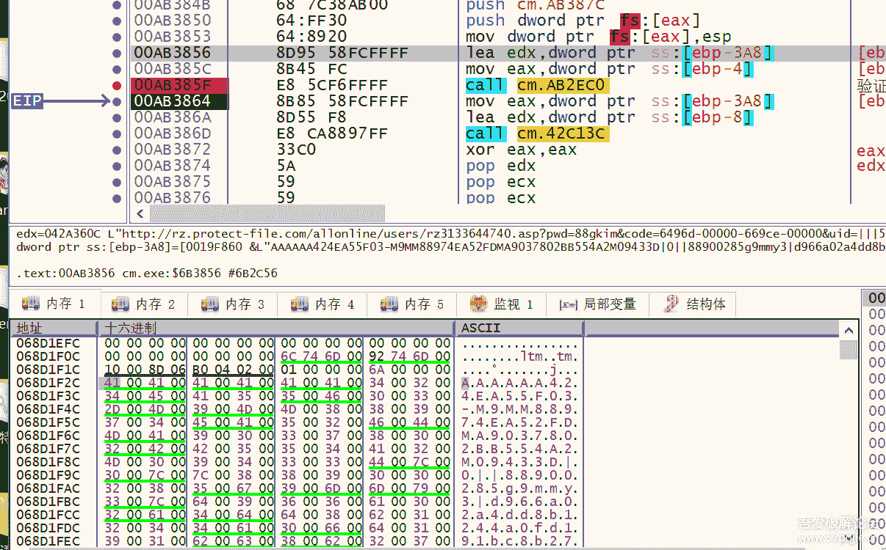

image.png (178.39 KB, 下载次数: 0)


# 逆向分析记录

[href="forum.php?mod=attachment&aid=MjcyODU3MXwwNjYzODQyZHwxNzkzNTcxNzE1fDE2ODA4NnwxOTcxOTMx&nothumb=yes" target="_blank"](https://www.52pojie.cn/forum.php?mod=attachment&aid=MjcyODU3MXwwNjYzODQyZHwxNzkzNTcxNzE1fDE2ODA4NnwxOTcxOTMx&nothumb=yes)

2024-10-12 18:53 上传

果然在这里 `mov ecx,[edx-8]`，对1进行了访问 `edx`是字符串地址，后续还有对这个值的修改 此处不在贴图 仅是为了证明这个值也要被用到

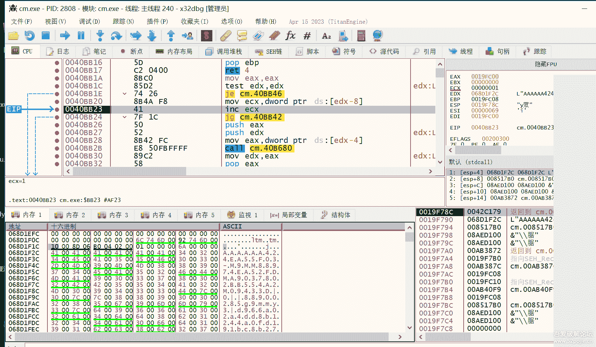
image.png (269.57 KB, 下载次数: 0)

[href="forum.php?mod=attachment&aid=MjcyODU3M3w1ZDMxNmMxOHwxNzkzNTcxNzE1fDE2ODA4NnwxOTcxOTMx&nothumb=yes" target="_blank"](https://www.52pojie.cn/forum.php?mod=attachment&aid=MjcyODU3M3w1ZDMxNmMxOHwxNzkzNTcxNzE1fDE2ODA4NnwxOTcxOTMx&nothumb=yes)

2024-10-12 18:55 上传

接下来是对第一个四字节的访问，可以看到`mov edx,[eax-4]`，注意此时这个四字节的值，是0x68d0010 接下来`test dl,7` 猜测这个值可能也有校验，我转到内存布局看到是申请的一个私有的页 而且基址是0x68d0000,大小是0x140000

然后我进行多次重新打开验证 发现`mov edx,[eax-4]`的值始终是申请的页基地址+0x10,猜测这个地址处可能有需要的值 也可能单纯验证地址，转到内存看一下，发现有值 ，把此处的值也复制过去，现在我们拿假码去尝试

把字符串依旧写在data段 看看结果如何

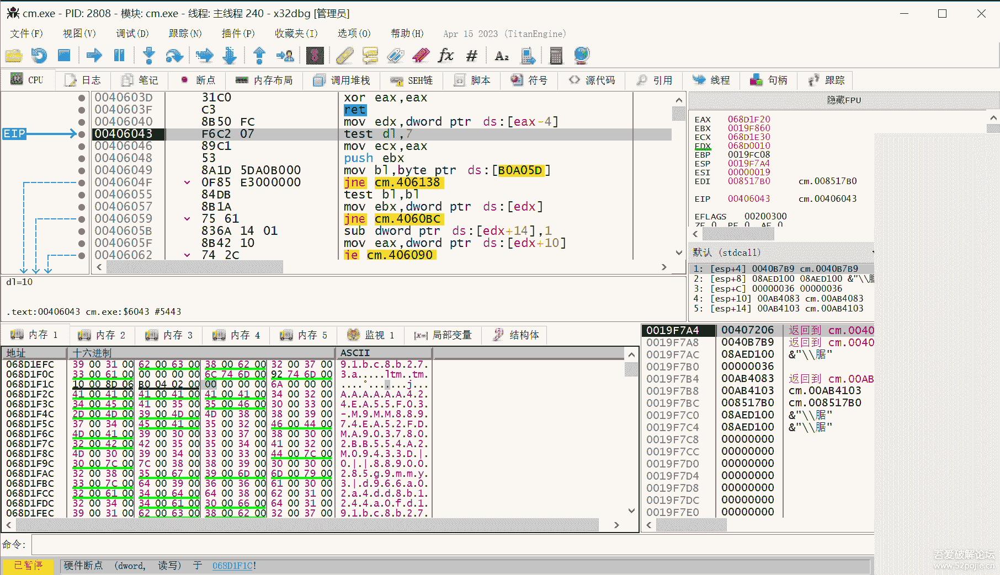
image.png (270.61 KB, 下载次数: 0)

[href="forum.php?mod=attachment&aid=MjcyODU3NXw1MDVjZWQyZXwxNzkzNTcxNzE1fDE2ODA4NnwxOTcxOTMx&nothumb=yes" target="_blank"](https://www.52pojie.cn/forum.php?mod=attachment&aid=MjcyODU3NXw1MDVjZWQyZXwxNzkzNTcxNzE1fDE2ODA4NnwxOTcxOTMx&nothumb=yes)

2024-10-12 18:57 上传

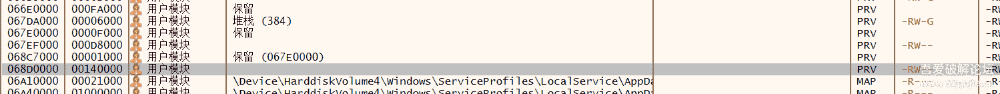
image.png (37.28 KB, 下载次数: 0)

[href="forum.php?mod=attachment&aid=MjcyODU3N3w2YTRmZjU3OHwxNzkzNTcxNzE1fDE2ODA4NnwxOTcxOTMx&nothumb=yes" target="_blank"](https://www.52pojie.cn/forum.php?mod=attachment&aid=MjcyODU3N3w2YTRmZjU3OHwxNzkzNTcxNzE1fDE2ODA4NnwxOTcxOTMx&nothumb=yes)

2024-10-12 19:00 上传

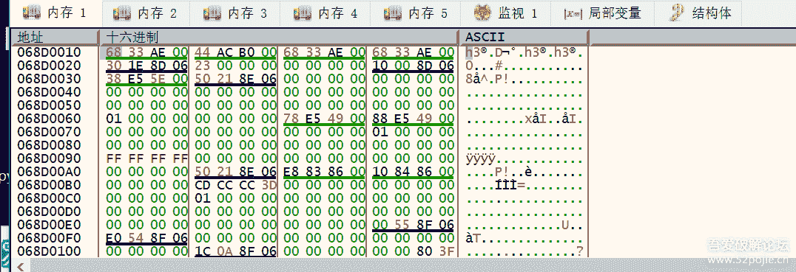
image.png (63.52 KB, 下载次数: 0)

[href="forum.php?mod=attachment&aid=MjcyODU3OHw0ZGFiZWIwZHwxNzkzNTcxNzE1fDE2ODA4NnwxOTcxOTMx&nothumb=yes" target="_blank"](https://www.52pojie.cn/forum.php?mod=attachment&aid=MjcyODU3OHw0ZGFiZWIwZHwxNzkzNTcxNzE1fDE2ODA4NnwxOTcxOTMx&nothumb=yes)

2024-10-12 19:03 上传

在验证`call`之后进行patch 然后`f9` 发现程序已经被破解了，很意外 当初还以为必须在那个申请的页面上，虽然说程序已经破解了 但是之前`mov edx,[eax-4]` `test dl,7`，猜测对这个只有一定的校验

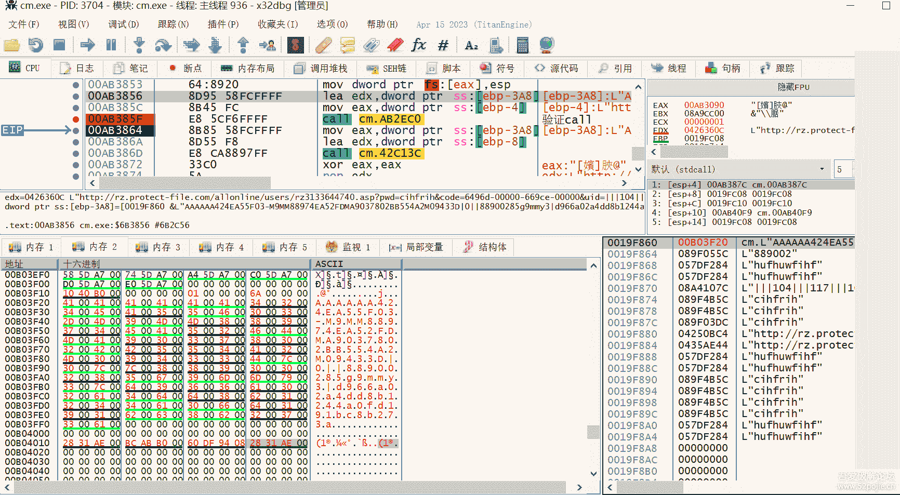
image.png (288.22 KB, 下载次数: 0)

[href="forum.php?mod=attachment&aid=MjcyODYxMXxkMTBhNjJhOHwxNzkzNTcxNzE1fDE2ODA4NnwxOTcxOTMx&nothumb=yes" target="_blank"](https://www.52pojie.cn/forum.php?mod=attachment&aid=MjcyODYxMXxkMTBhNjJhOHwxNzkzNTcxNzE1fDE2ODA4NnwxOTcxOTMx&nothumb=yes)

2024-10-12 20:14 上传

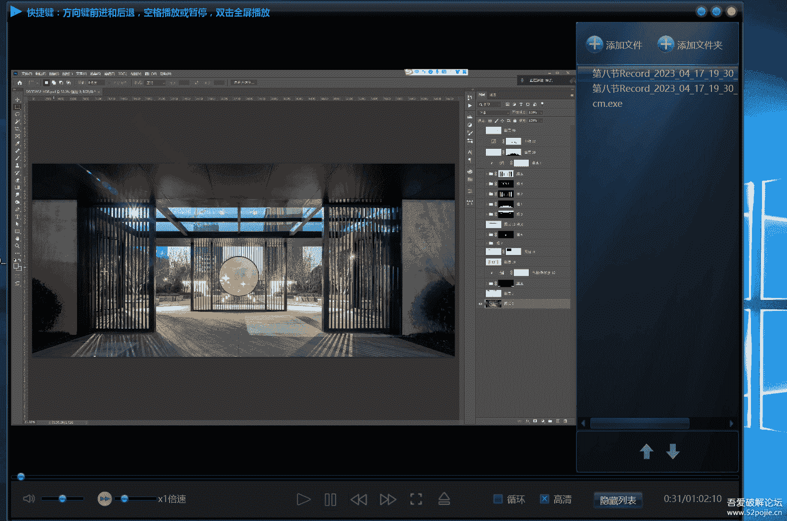
image.png (895.68 KB, 下载次数: 0)

[href="forum.php?mod=attachment&aid=MjcyODYxMnw5MTM3MmVhYnwxNzkzNTcxNzE1fDE2ODA4NnwxOTcxOTMx&nothumb=yes" target="_blank"](https://www.52pojie.cn/forum.php?mod=attachment&aid=MjcyODYxMnw5MTM3MmVhYnwxNzkzNTcxNzE1fDE2ODA4NnwxOTcxOTMx&nothumb=yes)

2024-10-12 20:17 上传

把这个值改成b09700试一下，其他的值依旧patch了 直接`f9` 发现程序依然可以运行，具体原因已经懒得去研究了（狗头保命） 现在尝试patch

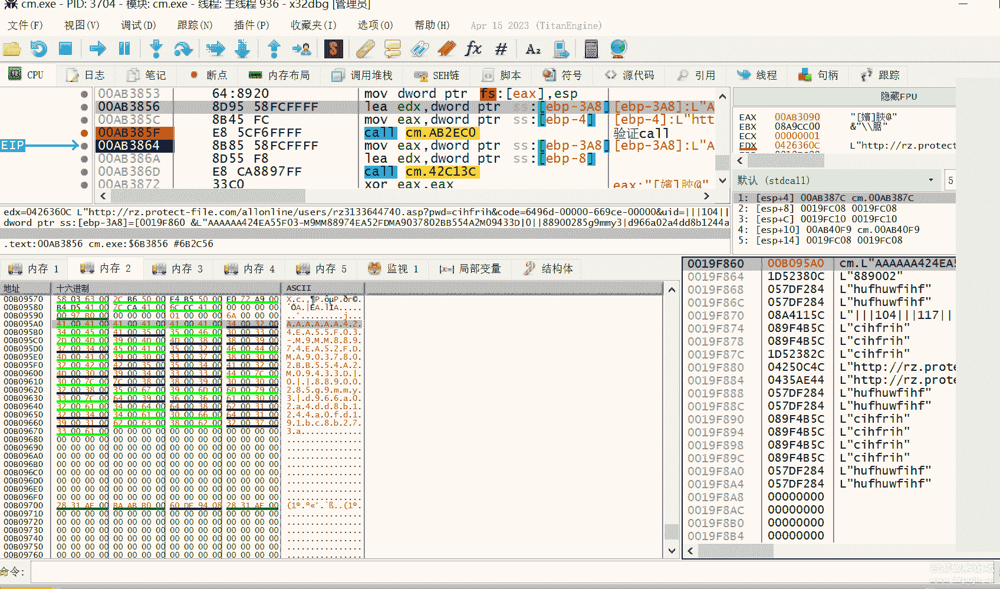
image.png (288.38 KB, 下载次数: 0)

[href="forum.php?mod=attachment&aid=MjcyODYxNnw1ZWM3MzQzZXwxNzkzNTcxNzE1fDE2ODA4NnwxOTcxOTMx&nothumb=yes" target="_blank"](https://www.52pojie.cn/forum.php?mod=attachment&aid=MjcyODYxNnw1ZWM3MzQzZXwxNzkzNTcxNzE1fDE2ODA4NnwxOTcxOTMx&nothumb=yes)

2024-10-12 20:29 上传

由于该程序没有重定位表 所以这里地址是死的，直接把数据找个空闲区扔过去 将这个`call`改掉，然后`f9`，程序可以正常运行 但是转储到文件再运行的时候发现弹框播放器损坏 有校验

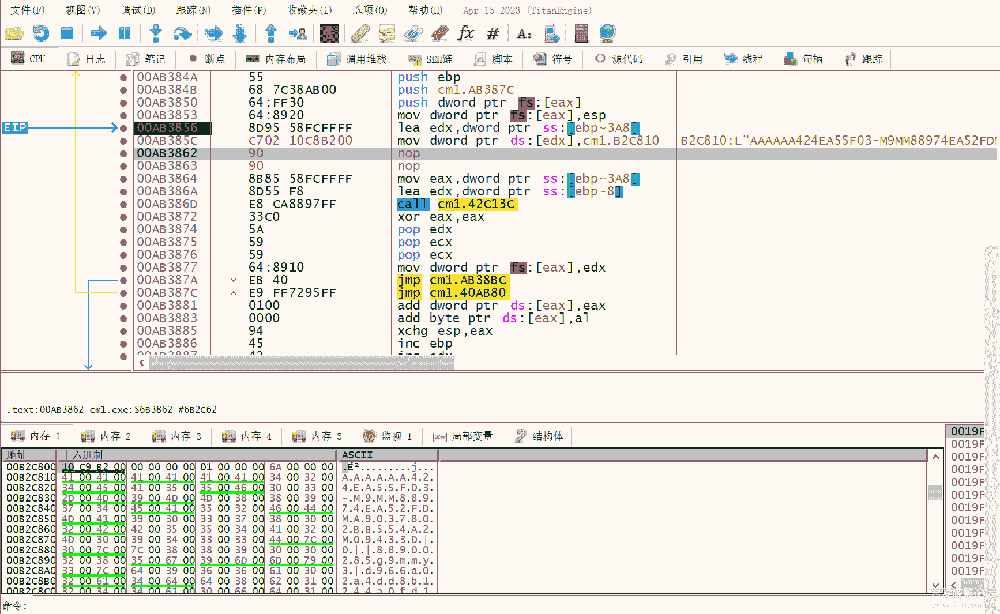
image.png (236.49 KB, 下载次数: 0)

[href="forum.php?mod=attachment&aid=MjcyODY0M3w5MzBlYjFiNnwxNzkzNTcxNzE1fDE2ODA4NnwxOTcxOTMx&nothumb=yes" target="_blank"](https://www.52pojie.cn/forum.php?mod=attachment&aid=MjcyODY0M3w5MzBlYjFiNnwxNzkzNTcxNzE1fDE2ODA4NnwxOTcxOTMx&nothumb=yes)

2024-10-12 21:31 上传

vm壳带的校验 Ok啊 过不去 校验在vm里 没学过vm 水平不够 那只能通过动态修补了 直接写个程序去patch 直接让ai写 就直接`WriteProcessMemory`就好了

初次写这种破解 可能有点乱 逆向还得是敢于去猜 万一猜对了呢

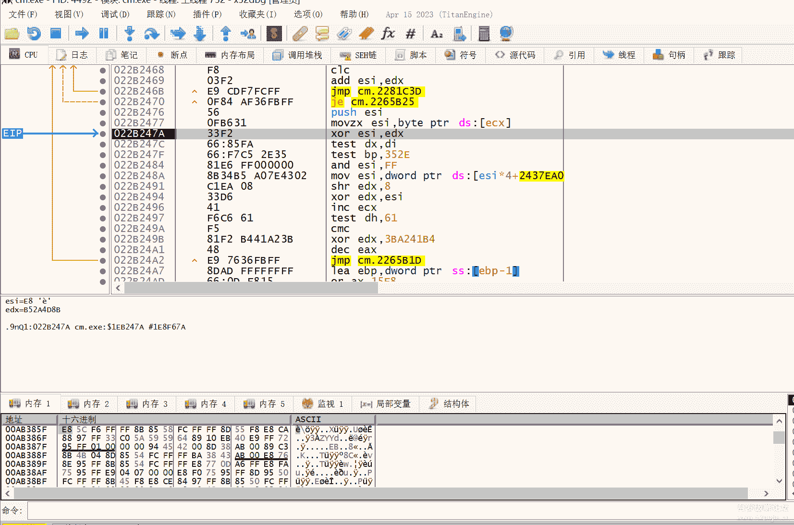
image.png (194.28 KB, 下载次数: 0)

[href="forum.php?mod=attachment&aid=MjcyODY0NHw3NWJkNjM1Y3wxNzkzNTcxNzE1fDE2ODA4NnwxOTcxOTMx&nothumb=yes" target="_blank"](https://www.52pojie.cn/forum.php?mod=attachment&aid=MjcyODY0NHw3NWJkNjM1Y3wxNzkzNTcxNzE1fDE2ODA4NnwxOTcxOTMx&nothumb=yes)

2024-10-12 21:33 上传

代码如下：

```
#include

BOOL WriteProcessMemoryByPID(DWORD processID, LPVOID baseAddress, SIZE_T size, LPVOID buffer) {
HANDLE hProcess = OpenProcess(PROCESS_ALL_ACCESS, FALSE, processID);
if (hProcess == NULL) {
MessageBoxA(0, "open process fail", 0, 0);
return FALSE;
}
SIZE_T bytesRead;
BOOL result = WriteProcessMemory(hProcess, baseAddress, buffer, size, &bytesRead);
if (!result || bytesRead != size) {
MessageBoxA(0, "patch failed", 0, 0);
CloseHandle(hProcess);
return result;
}
MessageBoxA(0, "patch success", 0, 0);
CloseHandle(hProcess);
return result;
}

LRESULT CALLBACK WindowProc(HWND hwnd, UINT uMsg, WPARAM wParam, LPARAM lParam) {
switch (uMsg) {
case WM_CREATE: {
CreateWindowA("STATIC", "输入进程PID:", WS_VISIBLE | WS_CHILD, 20, 20, 120, 25, hwnd, NULL, NULL, NULL);
// 创建文本框
CreateWindowA("EDIT", "", WS_CHILD | WS_VISIBLE | WS_BORDER, 150, 20, 100, 25, hwnd, (HMENU)1, NULL, NULL);
// 创建按钮
CreateWindowA("BUTTON", "patch", WS_TABSTOP | WS_VISIBLE | WS_CHILD | BS_DEFPUSHBUTTON, 20, 60, 80, 25, hwnd, (HMENU)2, NULL, NULL);
break;
}
case WM_COMMAND:
if (LOWORD(wParam) == 3) {
DestroyWindow(hwnd);
}
if (LOWORD(wParam) == 2) { // 处理“patch”按钮点击
HWND editBox = GetDlgItem(hwnd, 1);
char text[256] = {0};
SendMessageA(editBox, WM_GETTEXT, sizeof(text), (LPARAM)text);
int pid = atoi(text); // 将文本转换为整数
BYTE patchcode[] = {0xC7, 0x02, 0x10, 0xC8, 0xB2, 0x00, 0x90, 0x90 };
WriteProcessMemoryByPID(pid, (LPVOID)0x00AB385C, sizeof(patchcode), patchcode);
}
break;
case WM_DESTROY:
PostQuitMessage(0);
break;
default:
return DefWindowProc(hwnd, uMsg, wParam, lParam);
}
return 0;
}

int WINAPI WinMain(HINSTANCE hInstance, HINSTANCE hPrevInstance, LPSTR lpCmdLine, int nShowCmd) {
char CLASS_NAME[] = "patch";
WNDCLASSA wc = { };
wc.style = CS_HREDRAW | CS_VREDRAW;
wc.lpfnWndProc = WindowProc;
wc.hInstance = hInstance;
wc.lpszClassName = CLASS_NAME;
wc.hbrBackground = (HBRUSH)(COLOR_WINDOW + 1);
RegisterClassA(&wc);
int width = 400;
int height = 200;
int x = (GetSystemMetrics(SM_CXSCREEN) - width) / 2;
int y = (GetSystemMetrics(SM_CYSCREEN) - height) / 2;
HWND hwnd = CreateWindowA(CLASS_NAME, 0, WS_OVERLAPPEDWINDOW, x, y, 300, 150, NULL, NULL, hInstance, NULL);
ShowWindow(hwnd, nShowCmd);
MSG msg;
while (GetMessage(&msg, NULL, 0, 0)) {
TranslateMessage(&msg);
DispatchMessage(&msg);
}
return 0;
}
```
