# [原创] 【续】《英雄无敌》3完整版complete（英文）——免CD修改（完美版）

- 原帖: https://www.52pojie.cn/forum.php?mod=viewthread&tid=1972484
- 抓取时间: 2026-11-01T22:21:53

## 一、前言

在[前一篇文章](https://www.52pojie.cn/thread-1960687-1-1.html)中，介绍了《英雄无敌》3的complete（英文）版的免CD制作，但那是一副仓促之作，得很粗糙，留下了很大的不足！

h3-0.png (84.94 KB, 下载次数: 1)

[下载附件](https://www.52pojie.cn/forum.php?mod=attachment&aid=MjcyOTAwNXw5NWUzMzAyMXwxNzkzNTcxNzExfDE2ODA4NnwxOTcyNDg0&nothumb=yes)

2024-10-15 01:21 上传

由于《英雄无敌》3的一些过场动画，是放在光盘上，通过程序加载时，再把这些资源加载到内存的，因此，程序中对光盘信息的处理远较其它游戏复杂，而前文对程序调式不足，只是仓促绕过光驱检测，而在光驱上的资源也因此完全舍弃，自然程序中就缺少了一些动画资源，导致那次的免CD留下了不小的遗憾！而我又是一个强迫症者，这种不“完美”总是如鲠在喉，于是便有了这次完美版免CD。

## 二、准备工作

准备工作有两项：

1、 挂载《英雄无敌》3的play盘，把其中的`Heroes3`目录复制到电脑游戏安装目录里（我为了偷懒，把目录名称`Heroes3`改成了`H3`）

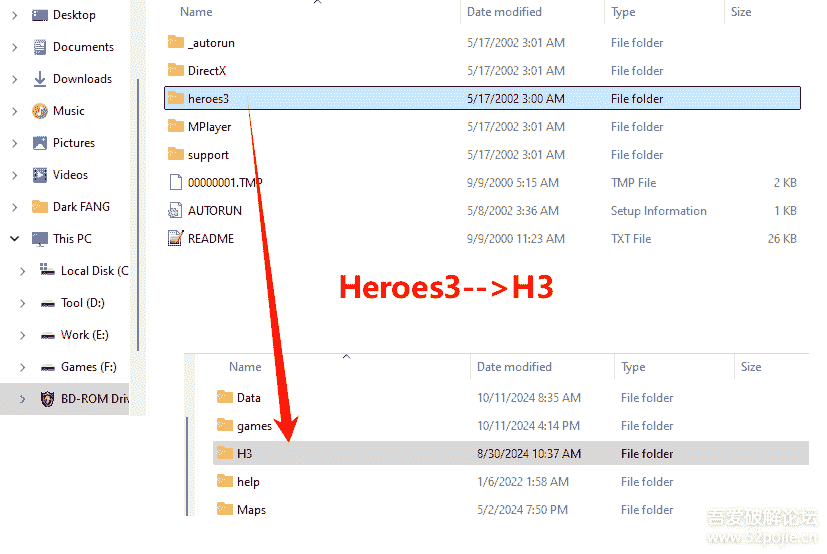

h3-0-2.png (68.97 KB, 下载次数: 1)

[下载附件](https://www.52pojie.cn/forum.php?mod=attachment&aid=MjcyOTAwNnw4YzM5OTE4OXwxNzkzNTcxNzExfDE2ODA4NnwxOTcyNDg0&nothumb=yes)

2024-10-15 01:22 上传

2、 用hex编辑软件（如：010Editor）打开游戏程序，来到`02D0`处，输入如下图所示数值

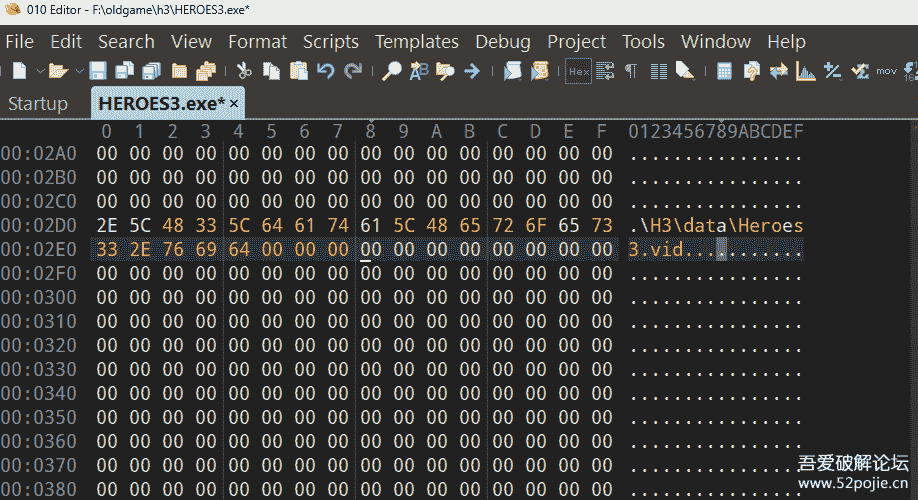

h3-0-3.png (57.06 KB, 下载次数: 1)

[下载附件](https://www.52pojie.cn/forum.php?mod=attachment&aid=MjcyOTAwN3xjNmFkYzdlYnwxNzkzNTcxNzExfDE2ODA4NnwxOTcyNDg0&nothumb=yes)

2024-10-15 01:23 上传

保存好就可以逆向了。

## 三、逆向修改过程

首先要说明一下，修改的一个非常重要的注意事项：修改的子程序一定不是“通用”子程序，即这个子程序只在此处调用，否则是不能修改的，切记！

在前文中已经找到了加载光驱的子程序了，即`004ED650`，关键`call`在`004ED9A6`处的`call 0050C1C0`。用X32dbg打开刚刚添加数值的游戏程序，直接在`004ED650`处下断点，并运行（前文已经把这个`call`修改成了`mov eax,7`了，把它还原成`call 0050C1C0`）

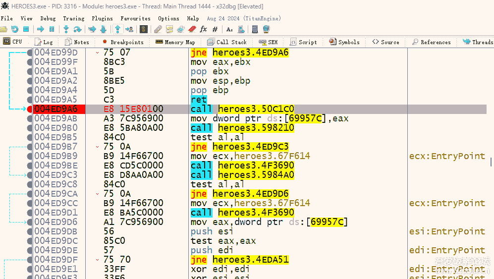

h3-0-4.png (127.58 KB, 下载次数: 1)

[下载附件](https://www.52pojie.cn/forum.php?mod=attachment&aid=MjcyOTAwOHw0MzlmMjE2NnwxNzkzNTcxNzExfDE2ODA4NnwxOTcyNDg0&nothumb=yes)

2024-10-15 01:24 上传

步入这个子程序。一路向下，在`50C293`处，遇到了跳转，自然是不能跳的，将其改成不跳。

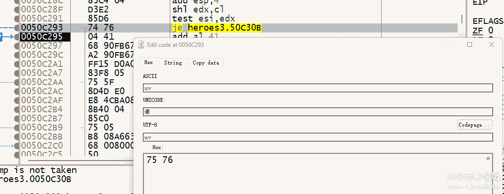

h3-0-5.png (70.27 KB, 下载次数: 1)

[下载附件](https://www.52pojie.cn/forum.php?mod=attachment&aid=MjcyOTAwOXw3MzhlYTRiMXwxNzkzNTcxNzExfDE2ODA4NnwxOTcyNDg0&nothumb=yes)

2024-10-15 01:25 上传

接着来到`50C2AA`处，光驱检测后，要是`eax`为5就是有光驱，但是免CD自然是没有的，`eax=1`，所以这里的跳转自然也不能让其自由地跳了。

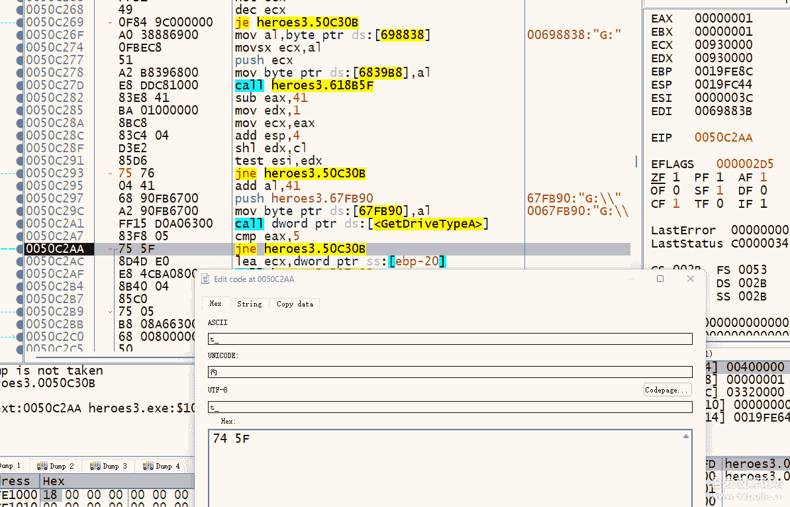

h3-0-6.png (164.6 KB, 下载次数: 1)

[下载附件](https://www.52pojie.cn/forum.php?mod=attachment&aid=MjcyOTAxMHw3M2ZhZjFhOHwxNzkzNTcxNzExfDE2ODA4NnwxOTcyNDg0&nothumb=yes)

2024-10-15 01:26 上传

接着在`2B4`处看到上面的`call`返回的结果应该是注册表中的游戏光驱信息，这个自然是不能再使用的，要把它改成我们在前面准备的第二个的那个地址，即`004002D0`，采用“先”直接修改`eax`（等后面一起考虑如何修改代码）

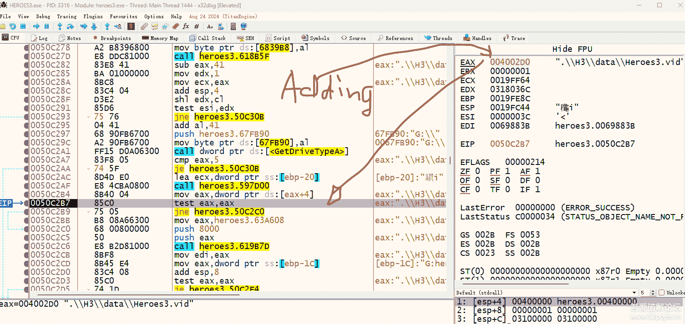

h3-0-7.png (230.19 KB, 下载次数: 1)

[下载附件](https://www.52pojie.cn/forum.php?mod=attachment&aid=MjcyOTAxMXxmZDUxZTVhN3wxNzkzNTcxNzExfDE2ODA4NnwxOTcyNDg0&nothumb=yes)

2024-10-15 01:27 上传

向下接着看到判断`eax`值并跳转或者输入值，这里的输入值本来应该跳过的，这样正好拿来修改代码。做法是跳转到下一行，将下一行改为给`eax`赋值`004002D0`

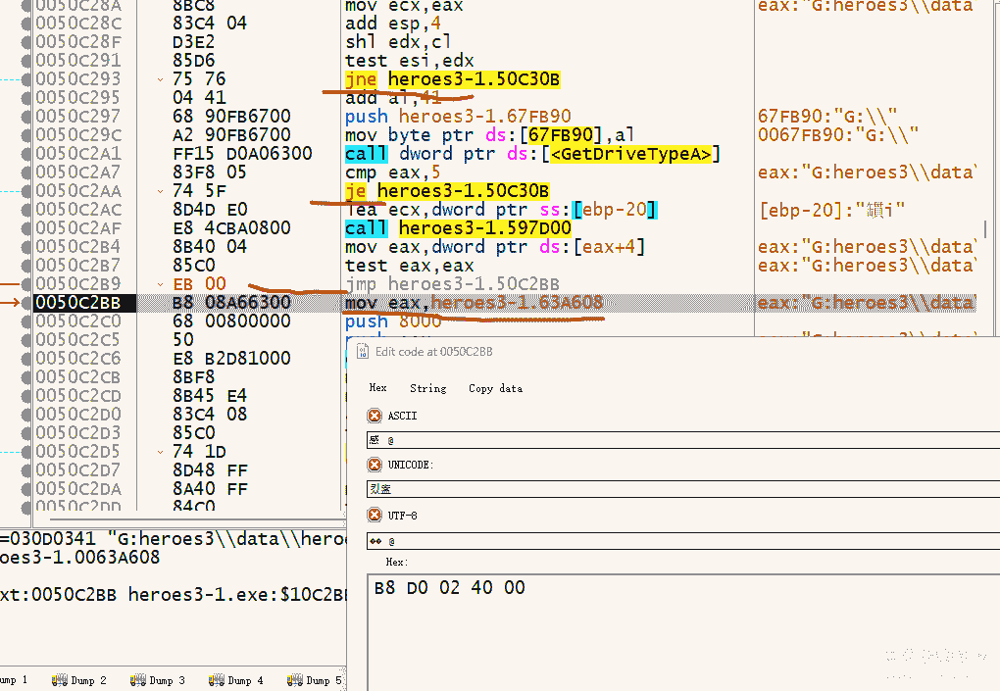

h3-0-8.png (141.63 KB, 下载次数: 1)

[下载附件](https://www.52pojie.cn/forum.php?mod=attachment&aid=MjcyOTAxMnw4NzI0M2IwOHwxNzkzNTcxNzExfDE2ODA4NnwxOTcyNDg0&nothumb=yes)

2024-10-15 01:28 上传

改成这样

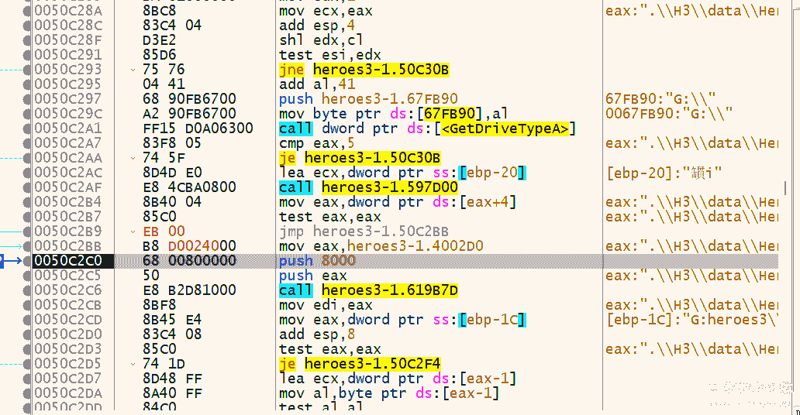

h3-0-9.png (140.11 KB, 下载次数: 1)

[下载附件](https://www.52pojie.cn/forum.php?mod=attachment&aid=MjcyOTAxM3w3N2JjZWQwYXwxNzkzNTcxNzExfDE2ODA4NnwxOTcyNDg0&nothumb=yes)

2024-10-15 01:28 上传

再向下到`2CD`这行时，程序又给`eax`赋给注册表内的值。

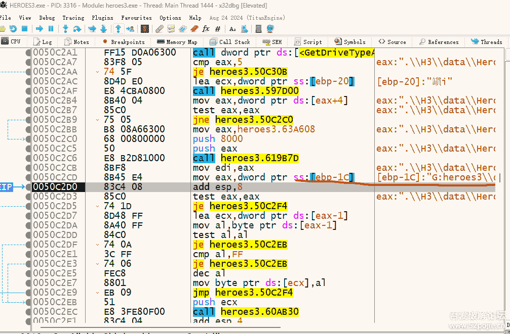

h3-0-10.png (158.63 KB, 下载次数: 1)

[下载附件](https://www.52pojie.cn/forum.php?mod=attachment&aid=MjcyOTAxNHwzZTI3ODQ5OXwxNzkzNTcxNzExfDE2ODA4NnwxOTcyNDg0&nothumb=yes)

2024-10-15 01:29 上传

因此这里又要修改`eax`的值。考虑到这里命令码数不够用，所以要三行全部变动。具体：将`2D0`行提升到`2CD`处，将`2CD`和`2D3`行的5个码合并成赋值命令，改成如下：

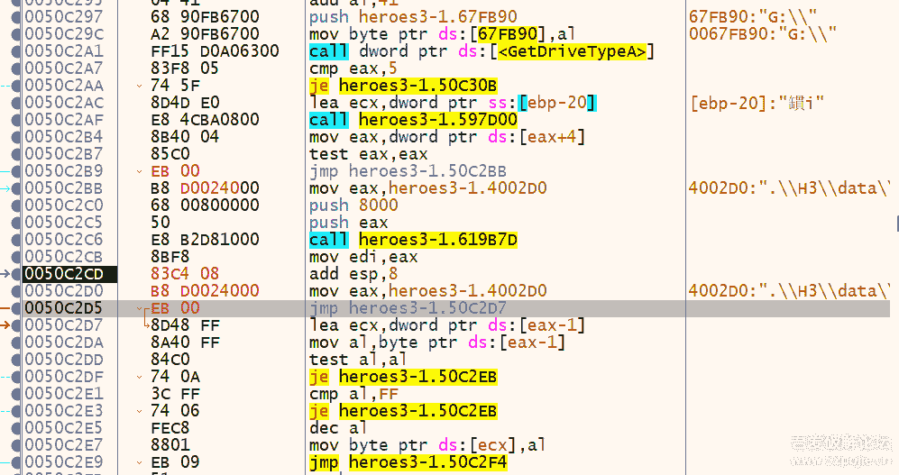

h3-0-11.png (126.74 KB, 下载次数: 0)

[下载附件](https://www.52pojie.cn/forum.php?mod=attachment&aid=MjcyOTAxNXw4N2UzMjQ4MnwxNzkzNTcxNzExfDE2ODA4NnwxOTcyNDg0&nothumb=yes)

2024-10-15 01:30 上传

这样再一路下来发现这个子程序没有问题了，返回到`004ED650`中。紧接着在`4ED9B0`处进入`598210`这个子程序。在`21E`和`223`处，`24C`和`251`处，遇到前面同样的事，将提供的地址再次赋给`eax`，修改如下

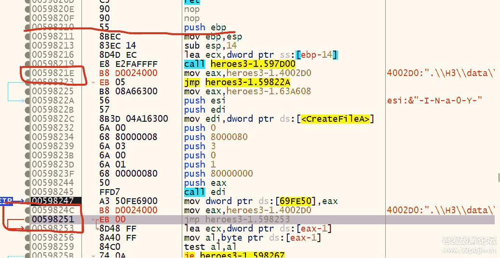

h3-0-12.png (131.68 KB, 下载次数: 1)

[下载附件](https://www.52pojie.cn/forum.php?mod=attachment&aid=MjcyOTAxNnxhOTY0NTA2MXwxNzkzNTcxNzExfDE2ODA4NnwxOTcyNDg0&nothumb=yes)

2024-10-15 01:31 上传

接着在`5DF`处再次遇到赋值注册表值

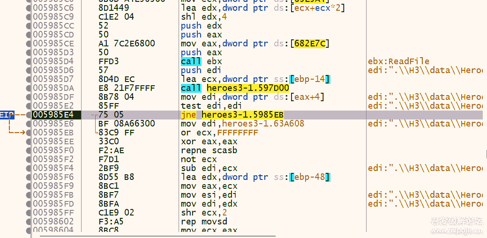

h3-0-13.png (121.59 KB, 下载次数: 1)

[下载附件](https://www.52pojie.cn/forum.php?mod=attachment&aid=MjcyOTAxN3w4NjM0YzdkMHwxNzkzNTcxNzExfDE2ODA4NnwxOTcyNDg0&nothumb=yes)

2024-10-15 01:32 上传

考虑到后面`606`处，再次调用局部变量`[ebp-10]`里的注册表值，因此这里对命令作个大调整，即把我们的地址赋给`edi`，同时修改`[ebp-10]`里的值为我们的地址，这样后面再赋值就不是注册表值，而是我们提供的地址了。最后改成如下

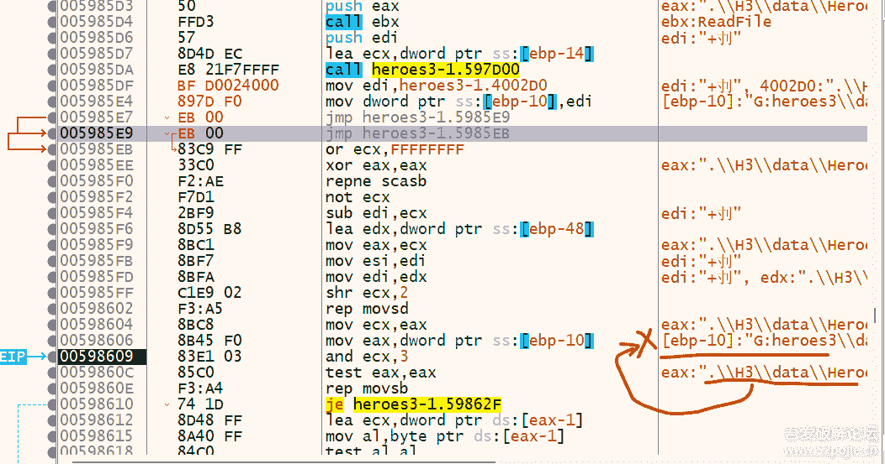

h3-0-14.png (145.26 KB, 下载次数: 0)

[下载附件](https://www.52pojie.cn/forum.php?mod=attachment&aid=MjcyOTAxOHw1ZmIwODkyOHwxNzkzNTcxNzExfDE2ODA4NnwxOTcyNDg0&nothumb=yes)

2024-10-15 01:32 上传

至此全部改完。

## 四、测试

打开游戏，选战役模式

h3-0-15.png (1.01 MB, 下载次数: 1)

[下载附件](https://www.52pojie.cn/forum.php?mod=attachment&aid=MjcyOTAxOXxmNTQ0YjE5YnwxNzkzNTcxNzExfDE2ODA4NnwxOTcyNDg0&nothumb=yes)

2024-10-15 01:33 上传

开始动画出现

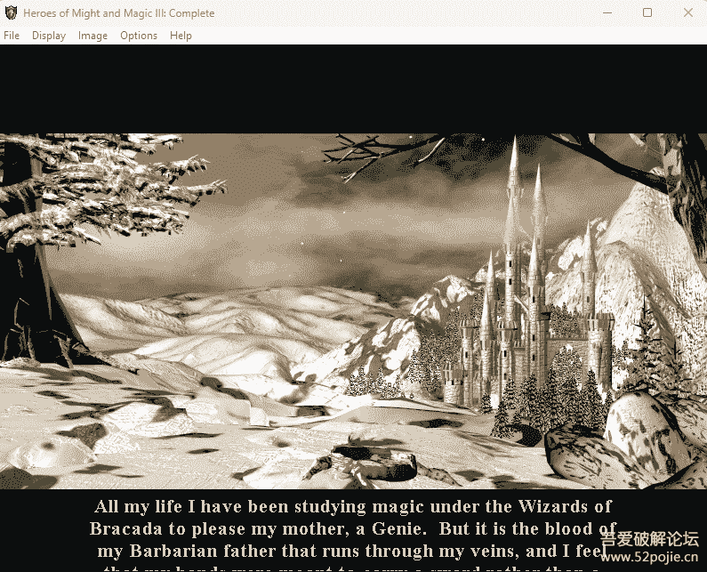

h3-0-16.png (561.91 KB, 下载次数: 1)

[下载附件](https://www.52pojie.cn/forum.php?mod=attachment&aid=MjcyOTAyMHxhZDNjNzE4Y3wxNzkzNTcxNzExfDE2ODA4NnwxOTcyNDg0&nothumb=yes)

2024-10-15 01:34 上传

让英雄战败导致游戏失败

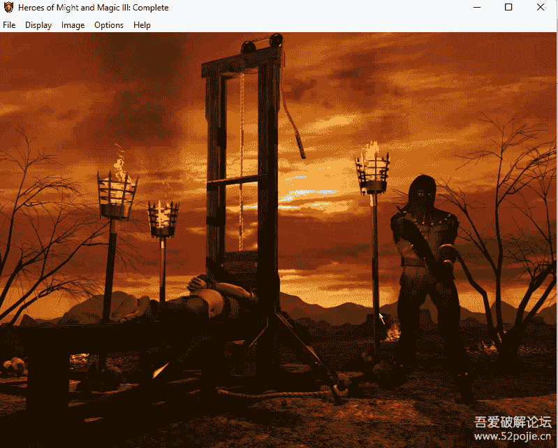

h3-0-17.png (317.78 KB, 下载次数: 1)

`[href="forum.php?mod=attachment&aid=MjcyOTAyMXwzYTRkY2U1ZHwxNzkzNTcxNzExfDE2ODA4NnwxOTcyNDg0&nothumb=yes" target="_blank"](https://www.52pojie.cn/forum.php?mod=attachment&aid=MjcyOTAyMXwzYTRkY2U1ZHwxNzkzNTcxNzExfDE2ODA4NnwxOTcyNDg0&nothumb=yes)`

2024-10-15 01:35 上传

## 五、下载

`[//wwzd.lanzoup.com/ixJR32ck1vxa" target="_blank"](https://wwzd.lanzoup.com/ixJR32ck1vxa:rel="nofollow noopener" href="https)`
