# [MacOS逆向] 3.3.5(565)maccleaner pro 分析学习

- 原帖: https://www.52pojie.cn/forum.php?mod=viewthread&tid=1973881
- 抓取时间: 2026-11-01T22:21:51

向@X1a0He致敬，通过学习他的帖子https://www.52pojie.cn/thread-1894271-1-1.html并感谢 [//www.52pojie.cn/home.php?mod=space&uid=375476](https://www.52pojie.cn/home.php?mod=space&uid=375476) 和 @Soft98两位大神的帮助


按照大神的帖子新版本处理方式略有不同，如有需要请阅读原帖。

使用到的工具：`ida pro`，`firda`，`vscode`

## 1. 解锁完全功能

字符串里搜索关键词`LicenseStateStorage`。然后操作如下图。

查询关键词
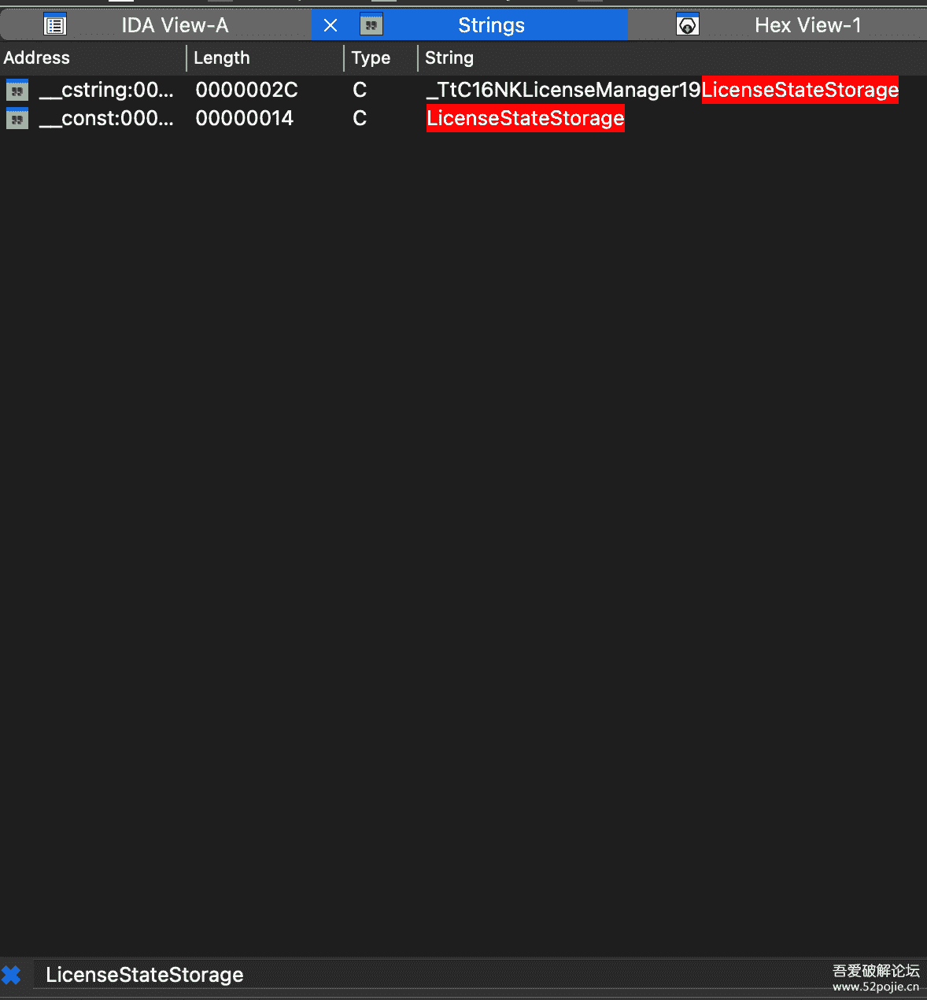

双击进入
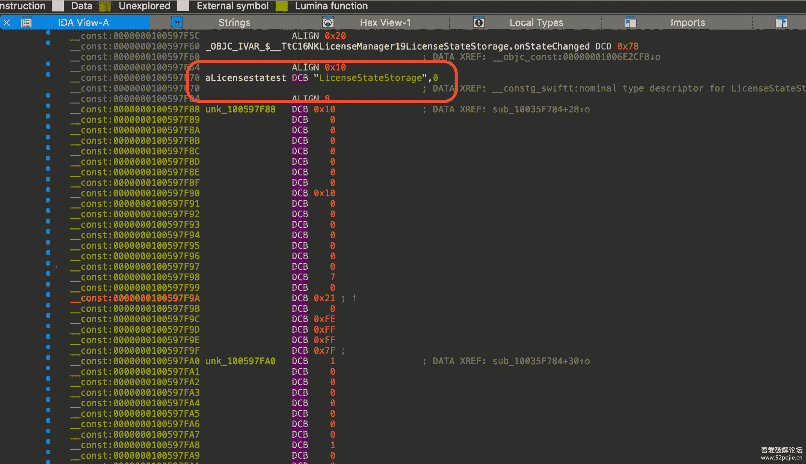

按 X 查找引用
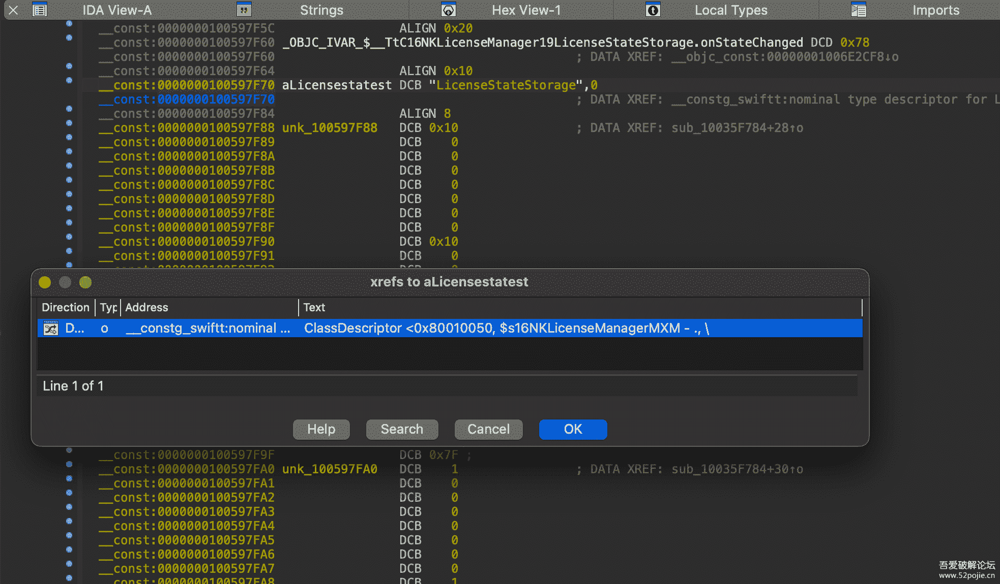

确定后显示如下。
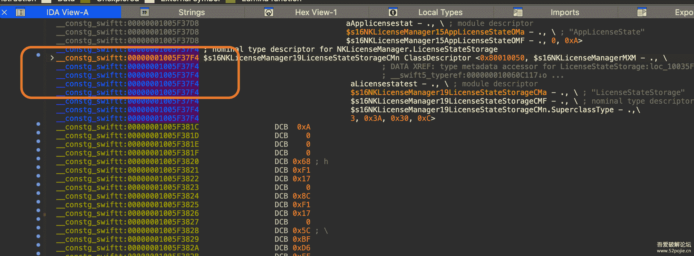

继续 X 然后选择 `_data`
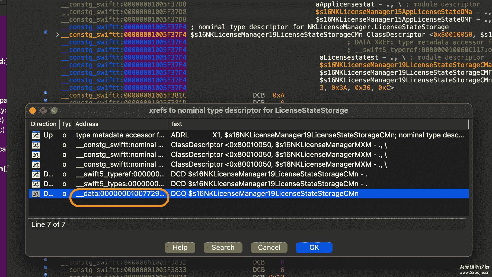

往下查找，到第二个
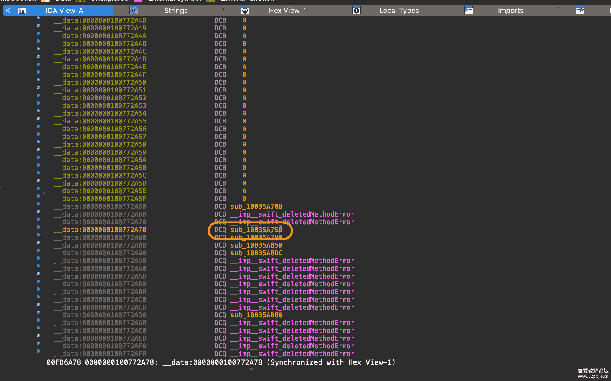

以下代码处理功能解锁：
```
var appBaseAddr = Module.findBaseAddress("MacCleaner\ Pro\ 3");
var func = appBaseAddr.add(0x35A750);//此处由搜索LicenseStateStorage定位
Interceptor.attach(func, {
    onEnter(this1, args) {
    },
    onLeave(result) {
        result.replace(0x1)
    },
})
```

## 2. 解锁实际功能

搜索关键词`NKProductTrial`
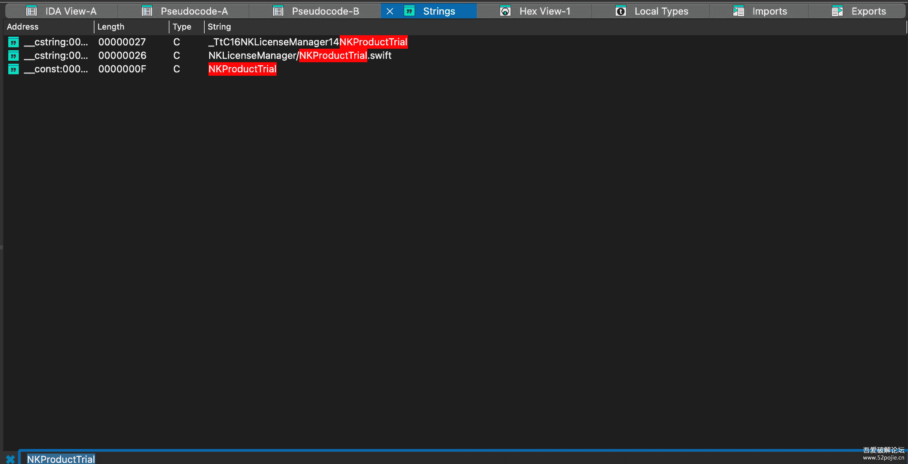

双击 `_TtC16NKLicenseManager14NKProductTrial` 进入然后找到 `6d13ee518z40w70uj1rq`
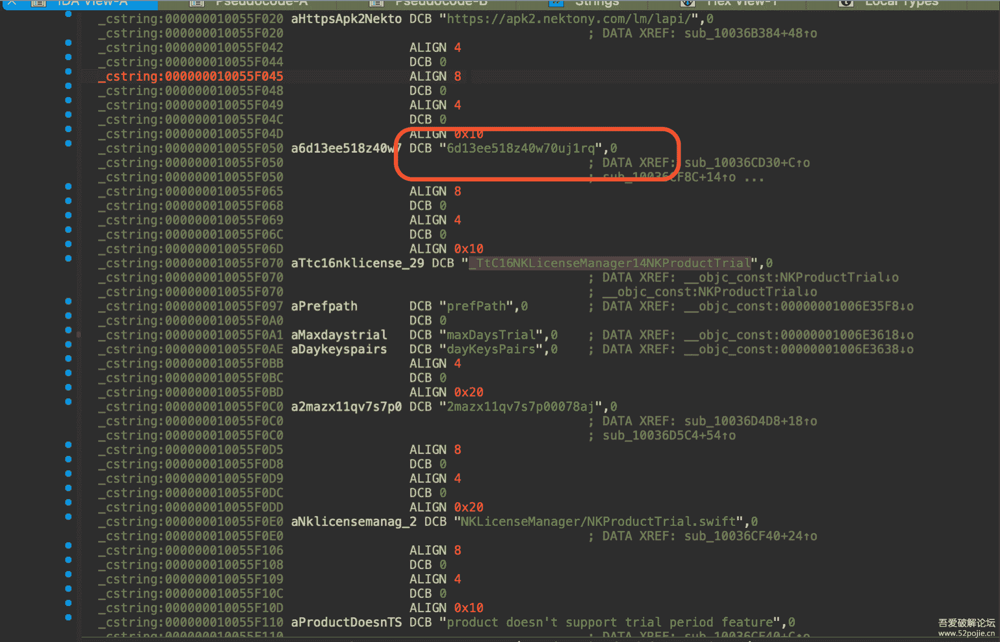

按 X 查找引用进第一个
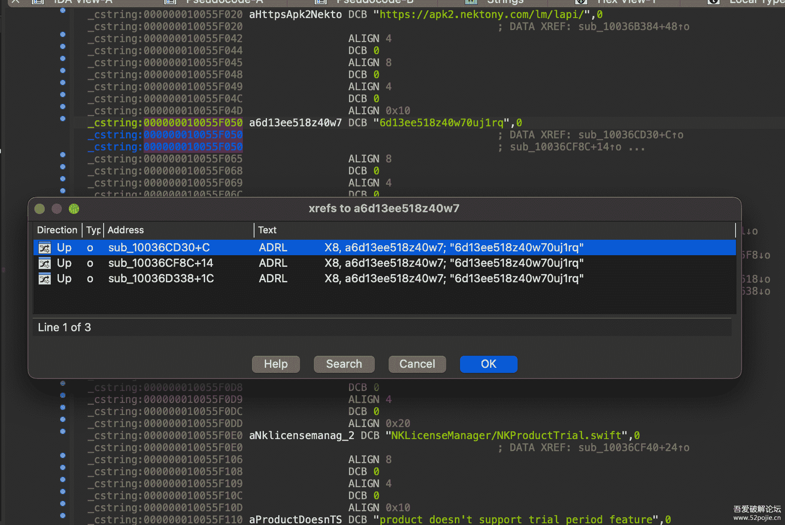

到函数顶，按 X
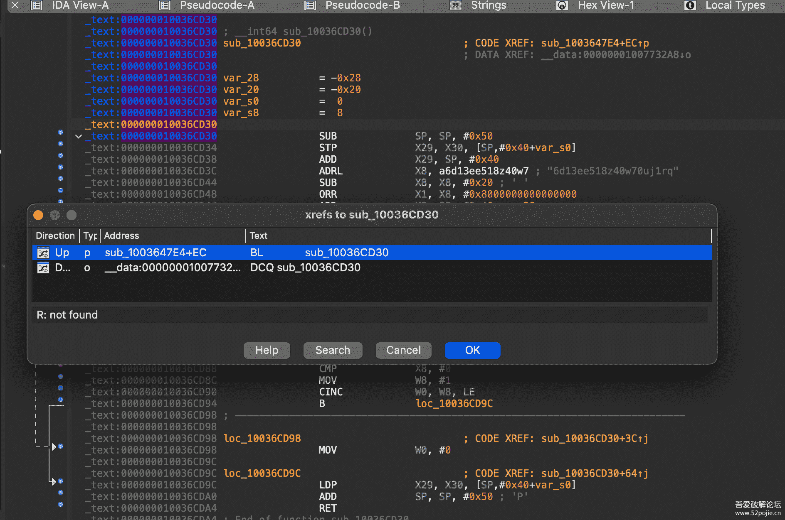

找到关键对比
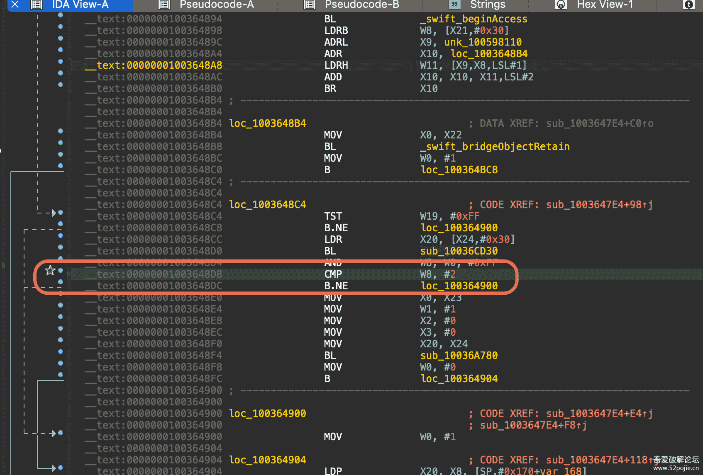

函数顶确定函数名及关键位置 `3647E4`
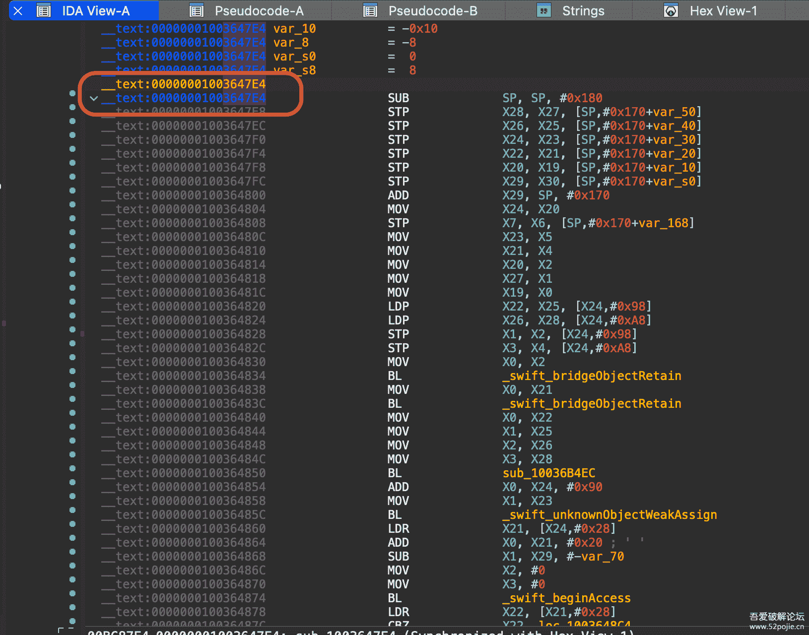

```
var unlock = appBaseAddr.add(0x3647e4)

Interceptor.attach(unlock, {
    onEnter(this1, args) {
    },
    onLeave(result) {
        result.replace(0x1)
    },
})
```

## 3. 去除弹窗

函数里搜索关键词 `AppDelegate applicationDidFinishLaunching`。具体操作如下图。

双击进入
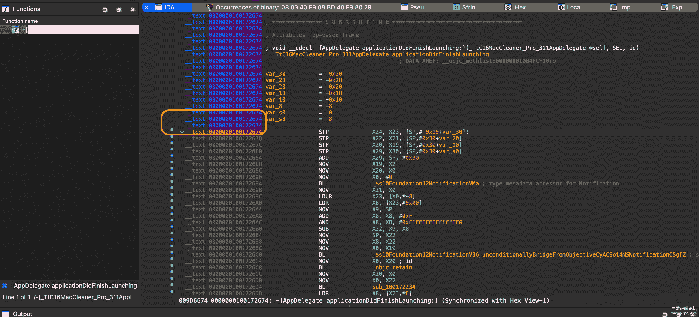

按 `tab` 定位到关键函数
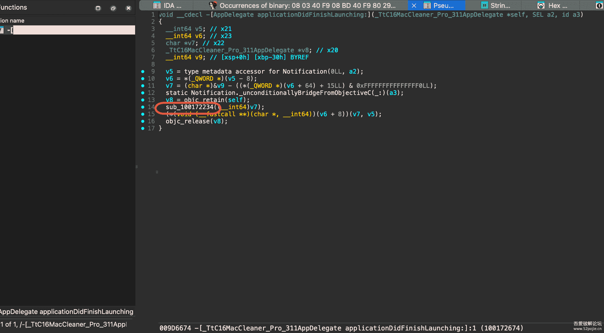

双击该函数进入。
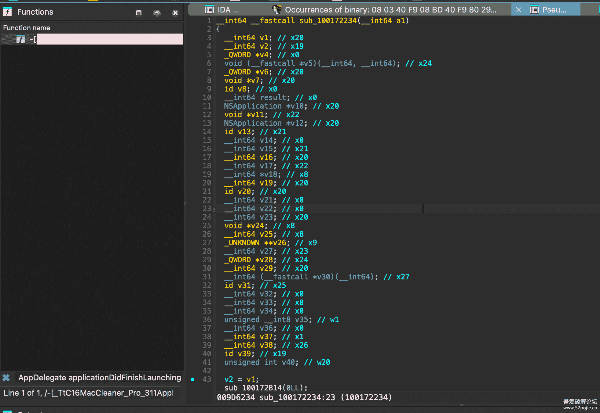

到函数最下面，定位到关键函数调用
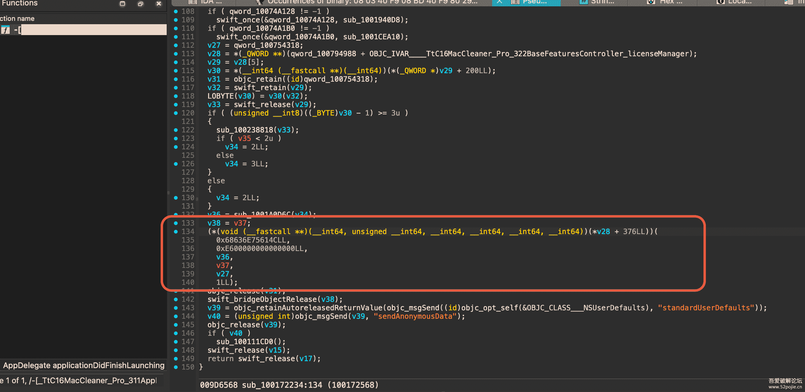

按 `tab` 键进入汇编模式，然后我们需要将这行 `nop` 掉
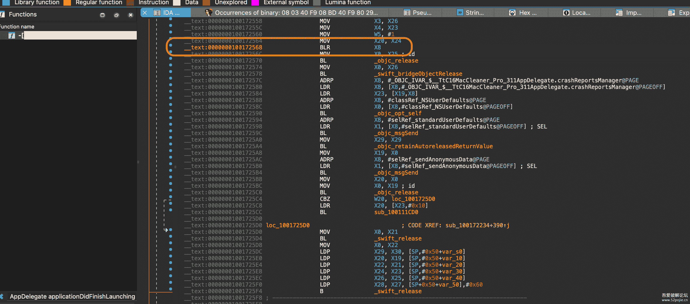

以下代码处理掉关键函数：
```
```


```
const offset = 0x172568;
var address = appBaseAddr.add(offset);//,
var targetAddress = ptr(address);
var length = 4; // 我们要修改 4 字节的内存区域
var data = new Uint8Array([0x1F, 0x20, 0x03, 0xD5]);
Memory.protect(targetAddress, length, 'rw');
console.log(Memory.readByteArray(address, length));
try {
    Memory.writeByteArray(targetAddress, data);
} catch (e) {
    console.log("Error: " + e.message);
}
console.log("change to -----", Memory.readByteArray(address, length));
console.log("******nop instruction written to address:", targetAddress);
var remove = appBaseAddr.add(offset);
Interceptor.attach(remove, {
    onEnter(this1, args) {

    },
    onLeave(result) {
    },
})
```
如果喜欢请用您发财的小手给我一个免费的评分。也算给我继续分析学习提供动力

