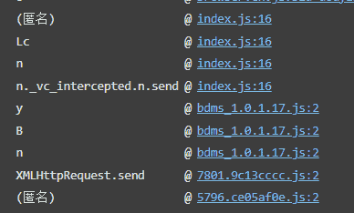
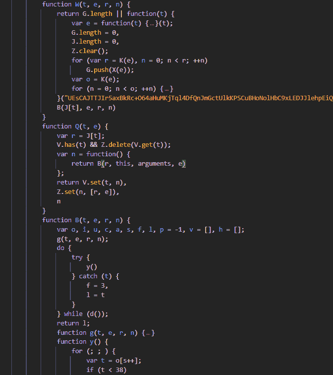
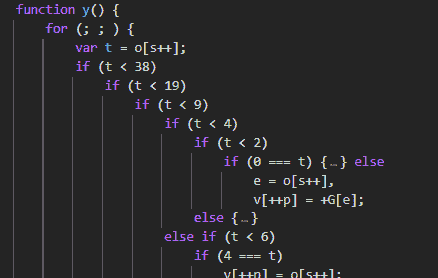
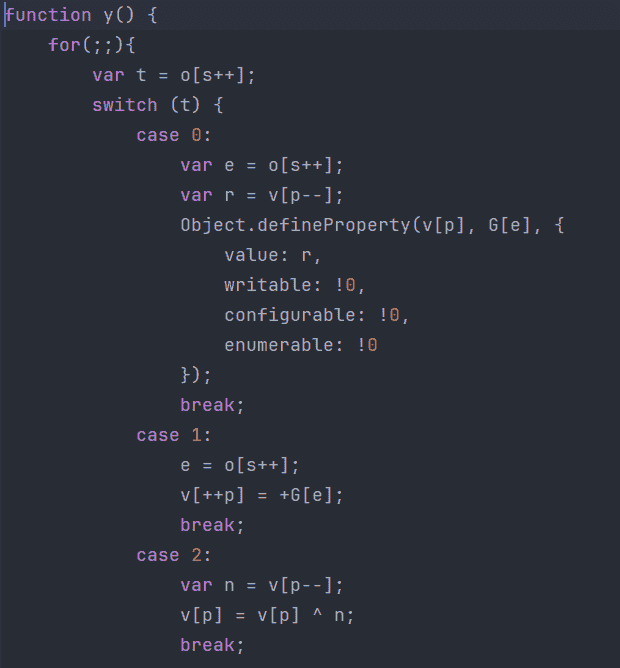

# [Web逆向] 某音新版`jsvmp`参数`a_bogus`分析

- 原帖：`https://www.52pojie.cn/forum.php?mod=viewthread&tid=1974900`
- 抓取时间：`2026-11-01T22:21:48`

## 目标网站

```
aHR0cHM6Ly93d3cuZG91eWluLmNvbS8/cmVjb21tZW5kPTE=
```

## 目标参数

`a_bogus`：`QfUnDqywQq******脱敏处理*****3Rp0kql7PDz/YDVbBzXkZeHkomkfSxJ6v*******脱敏处理*********jxRnHAqld5aH****脱敏处理****ctAAZE=`

## 解决方法

补环境，与之前版本的`ab`不同，加密的入口不好寻找，暂且搁置，后续在更新

本文主讲对`jsvmp`进行插桩来还原算法

## 流程分析与实现

首先观察堆栈，很明显的看到了`bdms_1.0.1.17.js`，如果你搞过之前版本的`ab`的话，就知道`ab`的加密是在这个文件内生成的



打开这个文件



可以看到`W`这个函数有一个指令集，我们跟栈进入的是`Q`函数里面的`n`方法，`n`方法里面有个`B`函数，再看`B`函数的结构，基本可以断定加密在`B`中执行



可以看到`B`函数中的`y`就是指令操作，通过`do-while`循环进行加密操作，可以看到`y`里面是控制流平坦化，我们可以先解混淆得到更好分析调试的代码，如下图还原后非常清晰可观



插桩的重点都在这个`apply`上，其他的插桩点和之前的`ab`类似就不在此赘述

```
var R = T.apply(E, j);
```

插桩完成后我们打印一下日志看一下，为了防止dy介入，我日志就不给大家看了，群内讨论，脱敏处理，希望大家别介意，我就直接把根据日志分析的加密流程告诉大家

```
function encty_time(){
    var time = Date.now();
    var str = ((time + 3) & 255) + ','
    var arr = []
    for (let i = 0; i 
```

1. `device_platform=*** + d**x` 进行2次`sm3`加密
2. `d**x` 进行一次`sm3`加密
3. 根据轨迹生成一个乱码，将该乱码和`ua`传入加密，加密后的结果再次进行`sm3`
4. 多次时间戳操作具体操作看日志很清楚
5. 轨迹加密成`[x,x1,x2,x3]`
6. `6**3`，`6**1`对这两个数操作
7. `1***|**3|1**6|**0|1**6|**0|1**6|**0|W**2`对这个数`charCodeAt`放到一个数组
8. 随机数和一些加密数组的操作，随机数生成一些数组的操作
9. 最后根据上面的加密结果生成一个数组，然后传入一个乱码和这个数组加密，最后的魔改`base64`加密得到最终结果
