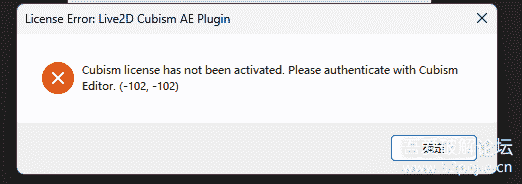
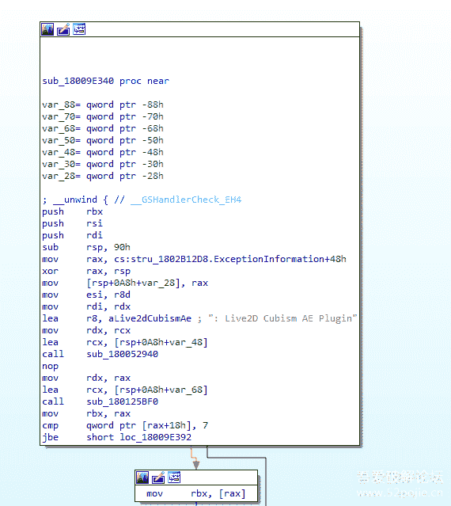
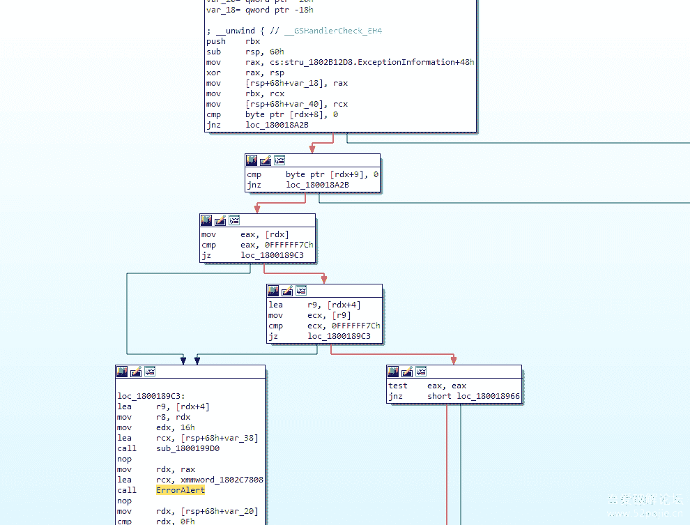
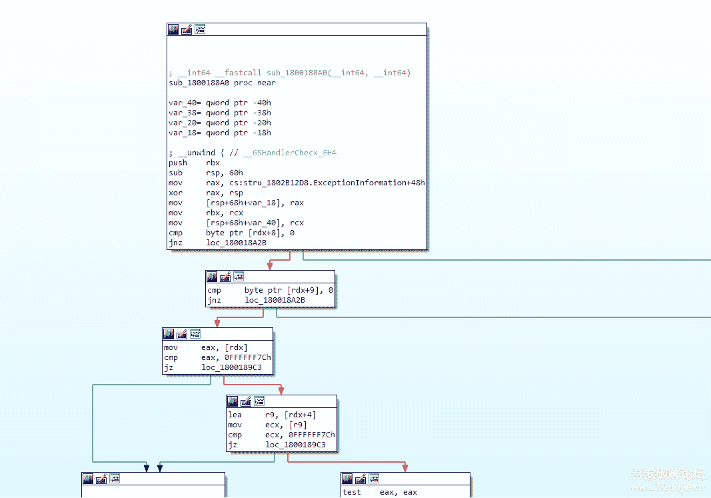
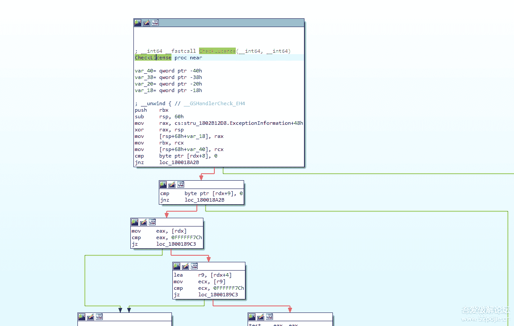
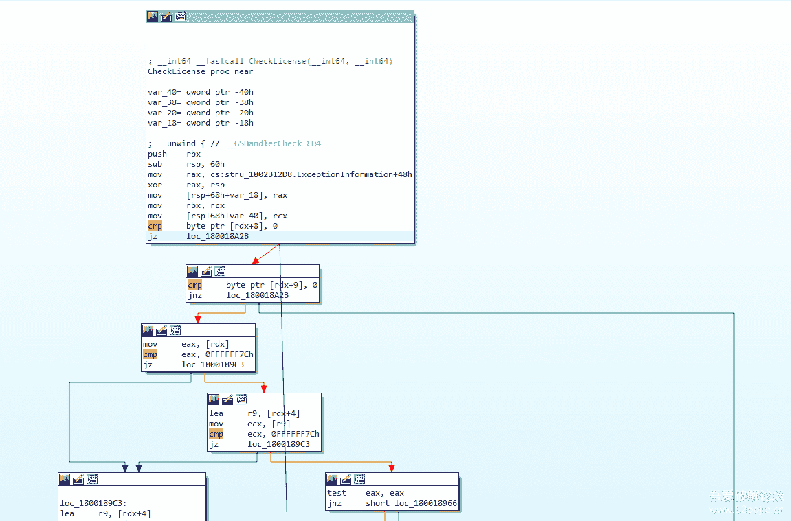
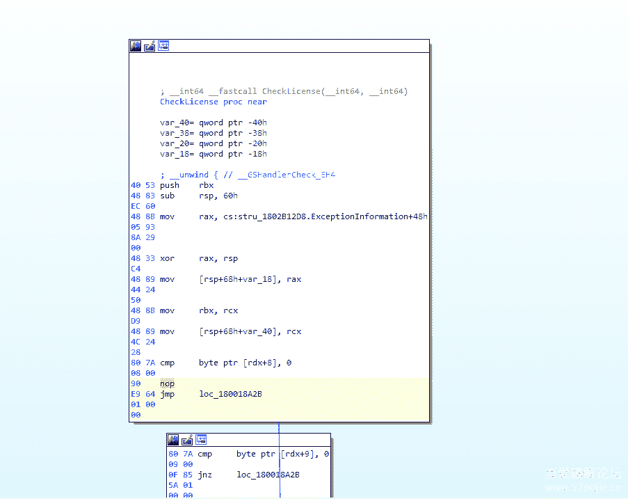

# [原创] [Live2D AE] Live2D AE 插件(Cubism 5 R4)破解记录（文件附）

- 原帖: https://www.52pojie.cn/forum.php?mod=viewthread&tid=1975079
- 抓取时间: 2026-11-01T22:21:46

居然更新了！直接搜索`License Error`是搜不到的~

首先，依然是导入`IDA`，然后我们来看下报错

1.png (15.11 KB, 下载次数: 2)

[href="forum.php?mod=attachment&aid=MjczMDkwNXxkNTk3MTE3NHwxNzkzNTcxNzAzfDE2ODA4NnwxOTc1MDc5&nothumb=yes" target="_blank"](https://www.52pojie.cn/forum.php?mod=attachment&aid=MjczMDkwNXxkNTk3MTE3NHwxNzkzNTcxNzAzfDE2ODA4NnwxOTc1MDc5&nothumb=yes)

2024-10-23 23:19 上传

报错不一样了，怎么办呢？你看啊，一般弹窗都会要求你给标题和内容，那么直接搜索"`Live2D Cubism AE Plugin`"

2.png (44.48 KB, 下载次数: 2)

[href="forum.php?mod=attachment&aid=MjczMDkwNnw3YmM1YzhjYXwxNzkzNTcxNzAzfDE2ODA4NnwxOTc1MDc5&nothumb=yes" target="_blank"](https://www.52pojie.cn/forum.php?mod=attachment&aid=MjczMDkwNnw3YmM1YzhjYXwxNzkzNTcxNzAzfDE2ODA4NnwxOTc1MDc5&nothumb=yes)

2024-10-23 23:19 上传

Bingo~给他再改个名。。。

3.png (56.29 KB, 下载次数: 2)

[href="forum.php?mod=attachment&aid=MjczMDkwN3wyMmRjNjM5NXwxNzkzNTcxNzAzfDE2ODA4NnwxOTc1MDc5&nothumb=yes" target="_blank"](https://www.52pojie.cn/forum.php?mod=attachment&aid=MjczMDkwN3wyMmRjNjM5NXwxNzkzNTcxNzAzfDE2ODA4NnwxOTc1MDc5&nothumb=yes)

2024-10-23 23:19 上传

然后反查这个函数的调用，发现了这个函数。那么，改名！

4.png (53.05 KB, 下载次数: 2)

[href="forum.php?mod=attachment&aid=MjczMDkwOHxkZjA3NGE5OXwxNzkzNTcxNzAzfDE2ODA4NnwxOTc1MDc5&nothumb=yes" target="_blank"](https://www.52pojie.cn/forum.php?mod=attachment&aid=MjczMDkwOHxkZjA3NGE5OXwxNzkzNTcxNzAzfDE2ODA4NnwxOTc1MDc5&nothumb=yes)

2024-10-23 23:19 上传

5.png (53.66 KB, 下载次数: 2)

[href="forum.php?mod=attachment&aid=MjczMDkwOXxmMzJkNmExMnwxNzkzNTcxNzAzfDE2ODA4NnwxOTc1MDc5&nothumb=yes" target="_blank"](https://www.52pojie.cn/forum.php?mod=attachment&aid=MjczMDkwOXxmMzJkNmExMnwxNzkzNTcxNzAzfDE2ODA4NnwxOTc1MDc5&nothumb=yes)

2024-10-23 23:19 上传

改完名再来看看逻辑，一堆乱七八糟的不用管，只知道这个分支树下大部分都会报错，但`loc_180018A2B`是不会报错的，到此，逻辑明了了！

我们先浅浅来一个经典`JNZ`改`JZ`，导出试一下~

6.png (58.61 KB, 下载次数: 1)

[href="forum.php?mod=attachment&aid=MjczMDkxMHw5MDdjMWFjM3wxNzkzNTcxNzAzfDE2ODA4NnwxOTc1MDc5&nothumb=yes" target="_blank"](https://www.52pojie.cn/forum.php?mod=attachment&aid=MjczMDkxMHw5MDdjMWFjM3wxNzkzNTcxNzAzfDE2ODA4NnwxOTc1MDc5&nothumb=yes)

2024-10-23 23:19 上传

导入没报错~完美！

8.png (231.9 KB, 下载次数: 2)

[href="forum.php?mod=attachment&aid=MjczMDkxMnxjMzMzNmVjOXwxNzkzNTcxNzAzfDE2ODA4NnwxOTc1MDc5&nothumb=yes" target="_blank"](https://www.52pojie.cn/forum.php?mod=attachment&aid=MjczMDkxMnxjMzMzNmVjOXwxNzkzNTcxNzAzfDE2ODA4NnwxOTc1MDc5&nothumb=yes)

2024-10-23 23:19 上传

那么以防万一，直接`jnz`改`jmp`~

7.png (44.85 KB, 下载次数: 1)

[href="forum.php?mod=attachment&aid=MjczMDkxMXxiNGRjOWNiOHwxNzkzNTcxNzAzfDE2ODA4NnwxOTc1MDc5&nothumb=yes" target="_blank"](https://www.52pojie.cn/forum.php?mod=attachment&aid=MjczMDkxMXxiNGRjOWNiOHwxNzkzNTcxNzAzfDE2ODA4NnwxOTc1MDc5&nothumb=yes)

2024-10-23 23:19 上传

导出，破解完成~

## 使用方法

将`Renderer.aex`替换掉`C:\Program Files\Common Files\Live2D Cubism AE Plugin\AE版本`下的同名文件即可

[href="forum.php?mod=attachment&aid=MjczMDkxNHw3YWM5YTQ4Y3wxNzkzNTcxNzAzfDE2ODA4NnwxOTc1MDc5" target="_blank"](https://www.52pojie.cn/forum.php?mod=attachment&aid=MjczMDkxNHw3YWM5YTQ4Y3wxNzkzNTcxNzAzfDE2ODA4NnwxOTc1MDc5)

(1.14 MB, 下载次数: 215)

2024-10-23 23:24 上传

点击文件名下载附件

下载积分: 吾爱币 -1 CB
