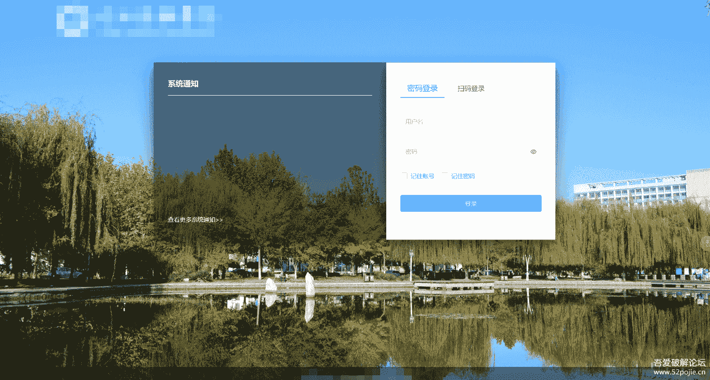
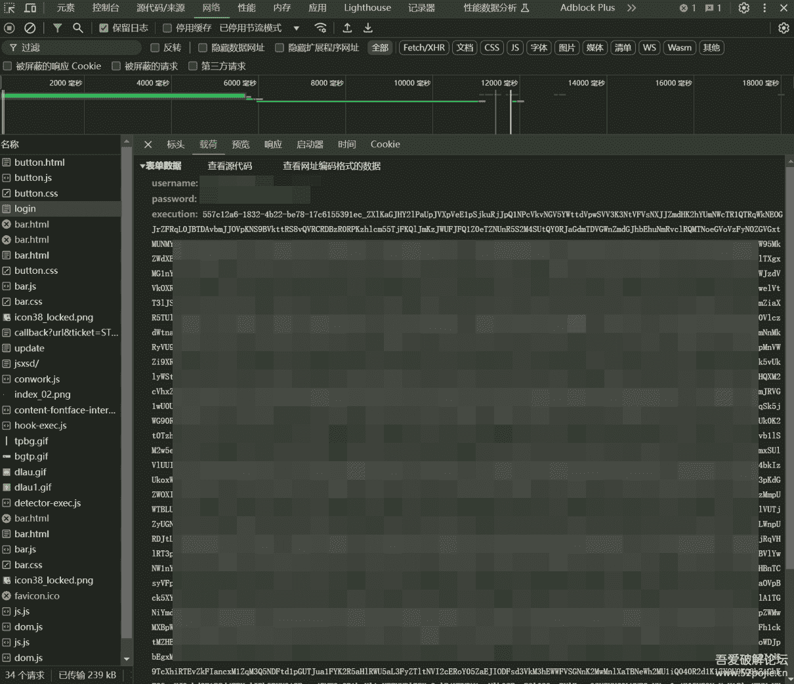
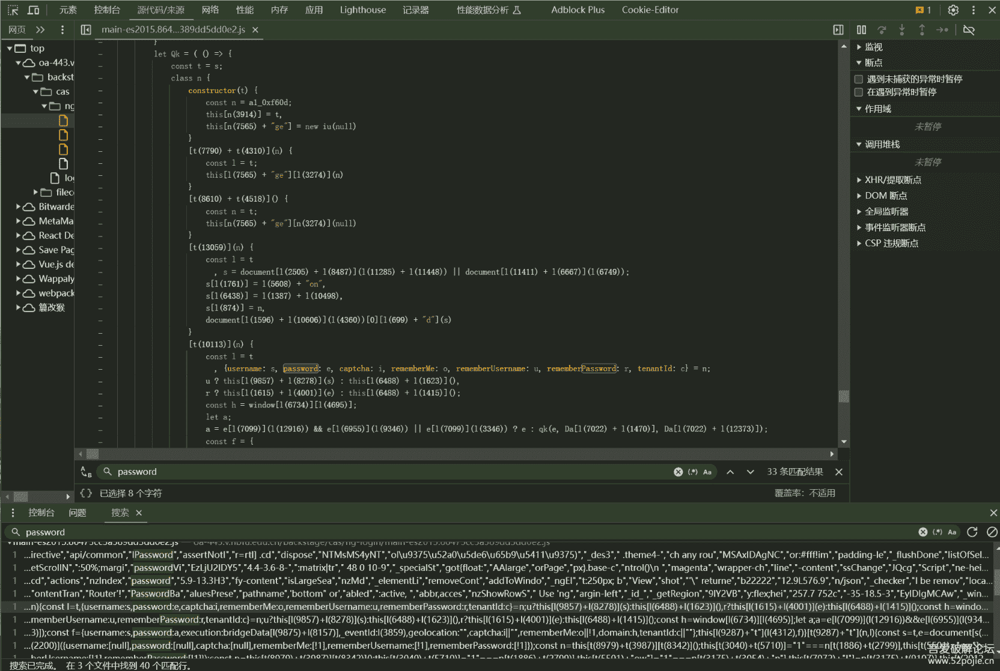
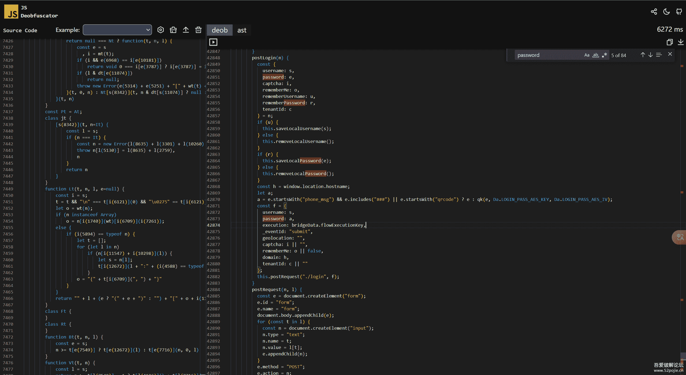
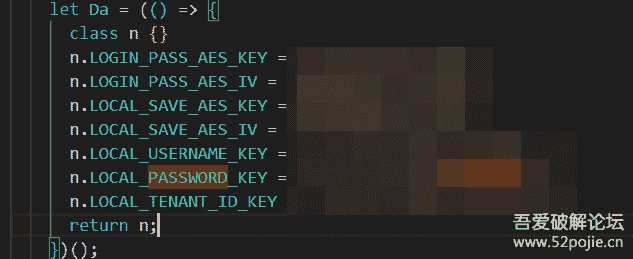
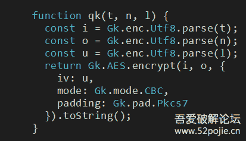
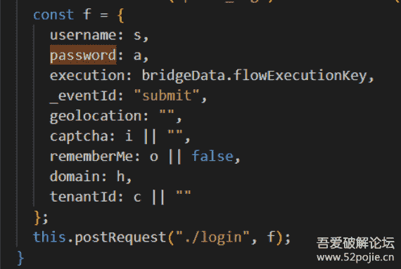
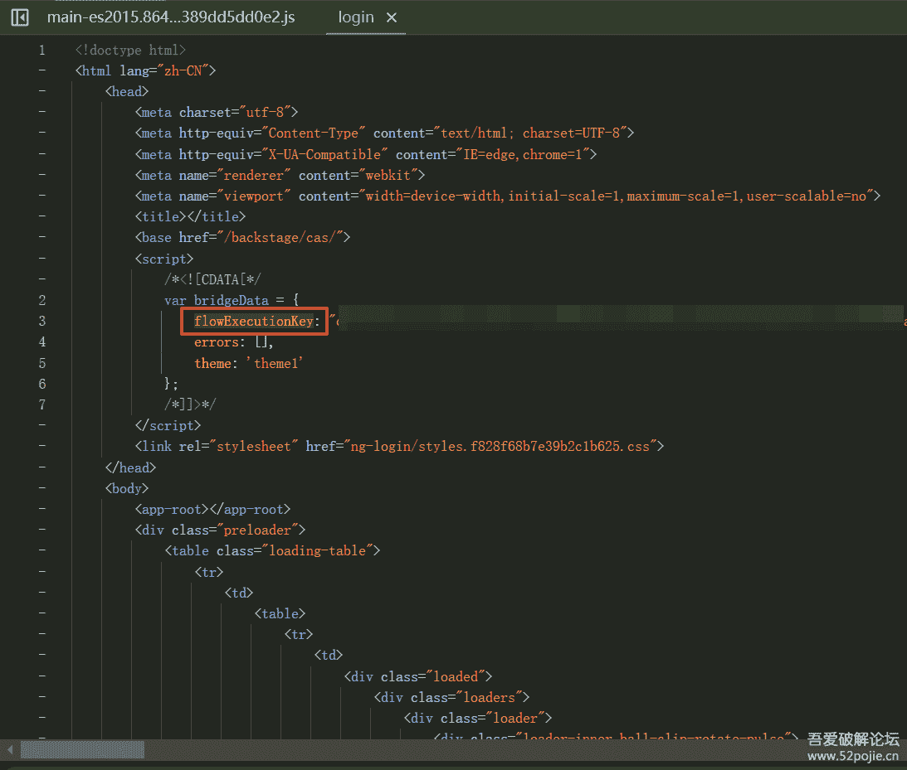

# [Web逆向] 某校WebVPN登录接口分析

- 原帖: https://www.52pojie.cn/forum.php?mod=viewthread&tid=1980542
- 抓取时间: 2026-11-01T22:21:16

本文仅用于学习研究，请勿用于非法用途和商业用途！如因此产生任何法律纠纷，均与作者无关！如有问题，麻烦版主立即删除

闲来无事，分析了某校WebVPN登录接口，首先抓个包：



WebVPN登陆页面.png (1.76 MB, 下载次数: 1)

[href="forum.php?mod=attachment&aid=MjczNDU1N3xlMzkxMDVjMXwxNzkzNTcxNjc0fDE2ODA4NnwxOTgwNTQy&nothumb=yes" target="_blank"](https://www.52pojie.cn/forum.php?mod=attachment&aid=MjczNDU1N3xlMzkxMDVjMXwxNzkzNTcxNjc0fDE2ODA4NnwxOTgwNTQy&nothumb=yes)

2024-11-12 09:52 上传



登录接口.png (392.74 KB, 下载次数: 1)

[href="forum.php?mod=attachment&aid=MjczNDU1NnxlZWE2MmExNXwxNzkzNTcxNjc0fDE2ODA4NnwxOTgwNTQy&nothumb=yes" target="_blank"](https://www.52pojie.cn/forum.php?mod=attachment&aid=MjczNDU1NnxlZWE2MmExNXwxNzkzNTcxNjc0fDE2ODA4NnwxOTgwNTQy&nothumb=yes)

2024-11-12 09:52 上传

## 登录接口参数

我们可以从登录接口得到这几个参数：
`username`: 用户名。
`password`: 被加密的密码。
`execution`: 验证令牌，用于防范CSRF攻击。
`_eventId`: 表单提交的事件标识（这里为`submit`）。
`geolocation`: 地理位置数据（这里为空）。
`captcha`: 验证码（这里为空）。
`rememberMe`: 是否记住用户（`true`或者`false`。`true`代表记住，`false`表示不记住）。
`domain` 和 `tenantId`: 指定登录域和租户ID（这里为空）。

省略为空的字段，这里主要分析`password`、`execution`是如何获取的

## 获取 `password`

回到WebVPN登陆页面，`F12`切换到源代码窗口，全局搜索`password`，定位到这一段代码：



定位password.png (508.3 KB, 下载次数: 1)

[href="forum.php?mod=attachment&aid=MjczNDY2N3wzYmQ2NzkwN3wxNzkzNTcxNjc0fDE2ODA4NnwxOTgwNTQy&nothumb=yes" target="_blank"](https://www.52pojie.cn/forum.php?mod=attachment&aid=MjczNDY2N3wzYmQ2NzkwN3wxNzkzNTcxNjc0fDE2ODA4NnwxOTgwNTQy&nothumb=yes)

2024-11-12 11:53 上传

```javascript
[t(10113)](n) {
    const l = t,
          {username: s, password: e, captcha: i, rememberMe: o, rememberUsername: u, rememberPassword: r, tenantId: c} = n;
    u ? this[l(9857) + l(8278)](s) : this[l(6488) + l(1623)](),
    r ? this[l(1615) + l(4001)](e) : this[l(6488) + l(1415)]();

    const h = window[l(6734)][l(4695)];
    let a;
    a = e[l(7099)](l(12916)) && e[l(6955)](l(9346)) || e[l(7099)](l(3346)) ? e : qk(e, Da[l(7022) + l(1470)], Da[l(7022) + l(12373)]);

    const f = {
        username: s,
        password: a,
        execution: bridgeData[l(9875) + l(8157)],
        _eventId: l(3859),
        geolocation: "",
        captcha: i || "",
        rememberMe: o || !1,
        domain: h,
        tenantId: c || ""
    };
    this[l(9287) + "t"](l(4312), f)
}
```

分析这段代码可知：代码里函数 `qk` 和参数（`Da[l(7022) + l(1470)]` 和 `Da[l(7022) + l(12373)]`）对密码`e`了进行处理，得到新的密码 `a`。

由于代码进行了混淆，这里不妨尝试反混淆，再进行进一步分析，这里用到了开源项目 https://github.com/kuizuo/js-deobfuscator

将整个代码复制进去，进行反混淆操作（会卡一会儿）：



反混淆.png (301.04 KB, 下载次数: 1)

[href="forum.php?mod=attachment&aid=MjczNDY3N3wxMTNiNTUxZHwxNzkzNTcxNjc0fDE2ODA4NnwxOTgwNTQy&nothumb=yes" target="_blank"](https://www.52pojie.cn/forum.php?mod=attachment&aid=MjczNDY3N3wxMTNiNTUxZHwxNzkzNTcxNjc0fDE2ODA4NnwxOTgwNTQy&nothumb=yes)

2024-11-12 12:03 上传

反混淆成功后，定位到之前的代码，此时已经知道`Da[l(7022) + l(1470)]`, `Da[l(7022) + l(12373)]`分别是`AES KEY`（加密密钥）和`AES IV`（初始化向量（IV）），往前翻一翻，还可以看到函数`qk`的源码、加密密钥的值、初始化向量的值：



key和iv的值.png (24.42 KB, 下载次数: 0)

[href="forum.php?mod=attachment&aid=MjczNDY4MXw2MzFjNGViMXwxNzkzNTcxNjc0fDE2ODA4NnwxOTgwNTQy&nothumb=yes" target="_blank"](https://www.52pojie.cn/forum.php?mod=attachment&aid=MjczNDY4MXw2MzFjNGViMXwxNzkzNTcxNjc0fDE2ODA4NnwxOTgwNTQy&nothumb=yes)

2024-11-12 12:12 上传



函数qk.png (22.5 KB, 下载次数: 1)

[href="forum.php?mod=attachment&aid=MjczNDY4MHw2ODNlMzgxYnwxNzkzNTcxNjc0fDE2ODA4NnwxOTgwNTQy&nothumb=yes" target="_blank"](https://www.52pojie.cn/forum.php?mod=attachment&aid=MjczNDY4MHw2ODNlMzgxYnwxNzkzNTcxNjc0fDE2ODA4NnwxOTgwNTQy&nothumb=yes)

2024-11-12 12:08 上传

```javascript
function qk(t, n, l) {
  const i = Gk.enc.Utf8.parse(t);
  const o = Gk.enc.Utf8.parse(n);
  const u = Gk.enc.Utf8.parse(l);
  return Gk.AES.encrypt(i, o, {
    iv: u,
    mode: Gk.mode.CBC,
    padding: Gk.pad.Pkcs7
  }).toString();
}
```

可以看到，这里指定了加密模式为 `CBC`，填充方式为 `PKCS7`，其实也已经拿到`password`的值了，可以通过`AES`在线加解密网站或者本地执行`python`代码验证结果：

提供一个示例代码：

```python
def encrypt_password(self, password, key, iv):
    """使用 AES 加密算法加密给定的密码。"""
    key_bytes = key.encode('utf-8')
    iv_bytes = iv.encode('utf-8')
    password_bytes = password.encode('utf-8')

    # 创建 AES 加密器
    cipher = Cipher(algorithms.AES(key_bytes), modes.CBC(iv_bytes), backend=default_backend())
    encryptor = cipher.encryptor()

    # 对密码进行填充，使其长度为 16 的倍数
    pad_length = 16 - len(password_bytes) % 16
    padded_password = password_bytes + bytes([pad_length] * pad_length)

    # 加密
    encrypted = encryptor.update(padded_password) + encryptor.finalize()
    return b64encode(encrypted).decode('utf-8')
```

## 获取 `execution`

回到之前调用`qk`函数的地方，观察代码：



定位execution.png (60.9 KB, 下载次数: 1)

[href="forum.php?mod=attachment&aid=MjczNDY4M3w2OGE2NjJmYXwxNzkzNTcxNjc0fDE2ODA4NnwxOTgwNTQy&nothumb=yes" target="_blank"](https://www.52pojie.cn/forum.php?mod=attachment&aid=MjczNDY4M3w2OGE2NjJmYXwxNzkzNTcxNjc0fDE2ODA4NnwxOTgwNTQy&nothumb=yes)

2024-11-12 12:21 上传

可以看到，`execution`的值是通过`bridgeData.flowExecutionKey`获取的。通过命名和经验可以判断，这个值通常是从服务器端的响应或者在页面加载时获取，索性全局搜索`flowExecutionKey`：



获取到flowExecutionKey.png (109.94 KB, 下载次数: 1)

[href="forum.php?mod=attachment&aid=MjczNDY4OXxjM2FiMzQ2MXwxNzkzNTcxNjc0fDE2ODA4NnwxOTgwNTQy&nothumb=yes" target="_blank"](https://www.52pojie.cn/forum.php?mod=attachment&aid=MjczNDY4OXxjM2FiMzQ2MXwxNzkzNTcxNjc0fDE2ODA4NnwxOTgwNTQy&nothumb=yes)

2024-11-12 12:25 上传

在`login`页面的HTML源码处找到了`flowExecutionKey`，因此验证了我们的猜想：`flowExecutionKey`在页面加载时获取

提供一个示例代码：

```python
def get_execution(session, login_url):
    """从登录页面获取 flowExecutionKey。"""
    response = session.get(login_url)
    if response.status_code == 200:
        soup = BeautifulSoup(response.text, 'html.parser')
        script_tags = soup.find_all('script')
        for script in script_tags:
            if 'flowExecutionKey' in script.text:
                match = re.search(r'flowExecutionKey:\s*"([^"]+)"', script.text)
                if match:
                    return match.group(1)
    print("未找到 flowExecutionKey")
    return None
```

到这里，登录接口的分析已经结束了，总体来说算是比较简单。我在本地测试登录接口确实也能正确登录，文章完毕。
