# [分享] [原创] 学习yyhd给新手看的（第十集）学习总结(保姆级)

- 原帖: `https://www.52pojie.cn/forum.php?mod=viewthread&tid=1981112`
- 抓取时间: `2026-11-01T22:21:10`

大家好，我是小白一枚，来到论坛也有一段时间了，但是一直没有完全学会如何软件。

最近看了yyhd的新手教程，终于成功破解了几个案例，非常开心。

原贴路径 `https://www.52pojie.cn/thread-1361115-1-1.html`

这篇文章也是学习后的经验总结，如果后续还有新的想法，将会继续发帖，分享技术。

说实话，在学到第十集之前，我还是不能完全独立破解，只能根据教程一点一点来，事后也没有特别的成功体验，因为学完了以后，还是一头雾水。

第十集和之前的几集来说，是一个难度巨大的提升，因为没有提示，无法检索，只能从系统层面开始推理（这点非常重要），可以应用于大多数软件。

## 学习总结

首先打开软件以后，输入账号和密码，点登录按钮后，无任何提示

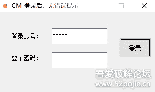
image.png (11.14 KB, 下载次数: 2)
2024-11-13 10:09 上传

把软件拖进`OD`，没有壳（现在还没学会，索性就直接找了专业的脱壳软件）

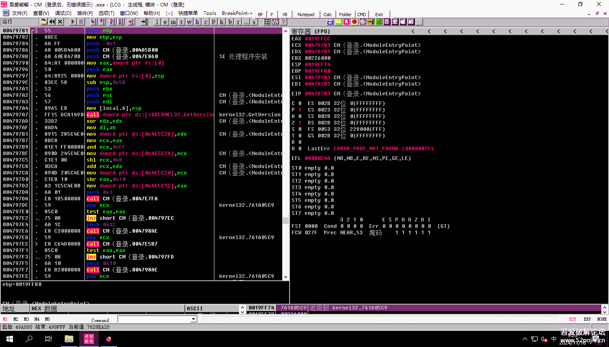
image.png (125.49 KB, 下载次数: 0)
2024-11-13 10:09 上传

由于没有提示信息，也没有检索内容，所以只能使用读取输入的账号和密码，做为断点进行分享。

而这个函数就是操作系统提供的：`GetwindowsTestA`，使用这个函数基本可以应用到所有需要输入账号密码的软件。

如何使用这个函数呢

首先我们需要先运行程序 `F9` 运行软件，输入账号密码，可以多点几下

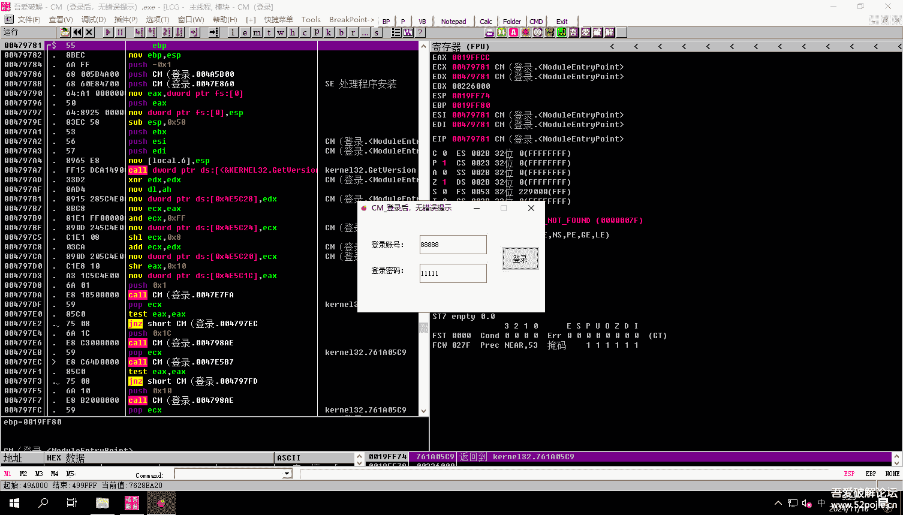
image.png (123.45 KB, 下载次数: 2)
2024-11-13 10:10 上传

勾选 `GetwindowsTestA`

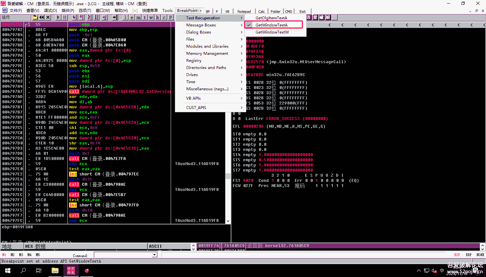
image.png (124.02 KB, 下载次数: 1)
2024-11-13 10:10 上传

再次点击登入按钮，这时 `OD` 已经跳转至 `GetwindowsTestA` 断点，后面我们就可以进行分析

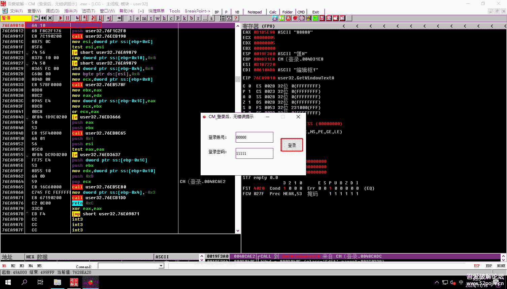
image.png (115.49 KB, 下载次数: 2)
2024-11-13 10:10 上传

取消 `GetwindowsTestA` 断点，免得出现问题（如果软件按 `F9` 后卡住，说明之前的断电没有取消，勾选断电后，关闭软件，重新打开就可以了）

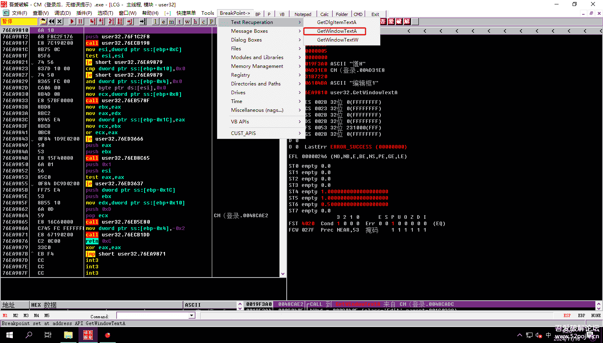
image.png (121.1 KB, 下载次数: 2)
2024-11-13 10:11 上传

### 分析逻辑

分析开始的逻辑（1、寻找账号密码——2、寻找验证账号密码的比较——3、最后寻找大跳转 `retn`）

首先，我们发现寄存器里，有刚刚输入的账号。

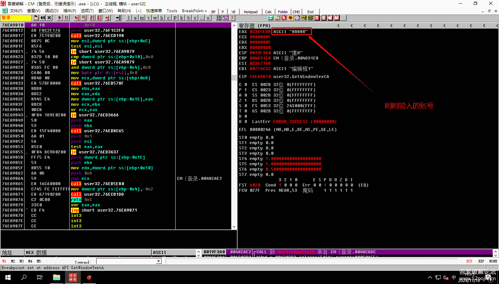
ee45aafbe93ebdc596fc20dd24788e8.png (115.61 KB, 下载次数: 1)
2024-11-13 11:16 上传

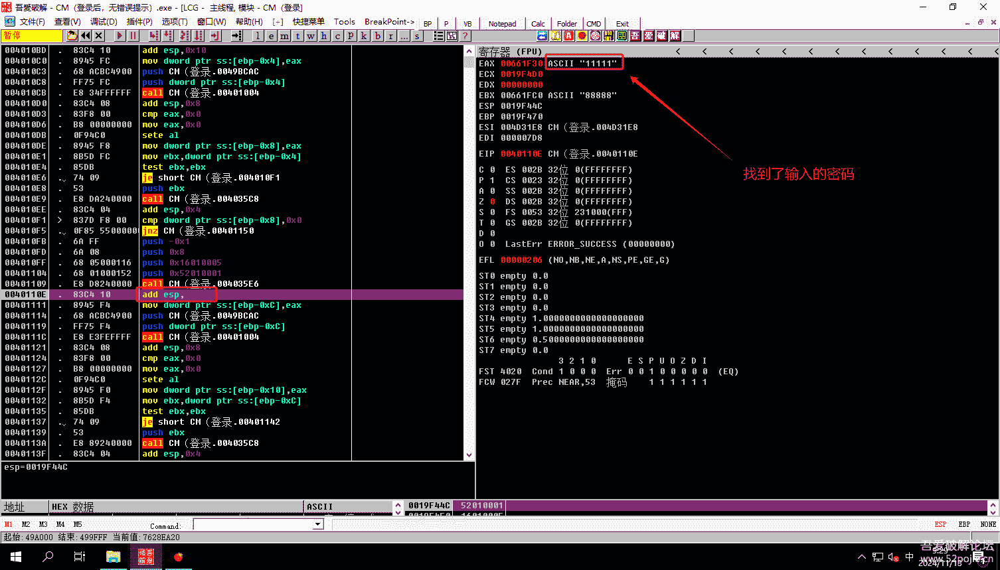
aad026312309fbab452b87274fa1527.png (120.33 KB, 下载次数: 1)
2024-11-13 10:12 上传

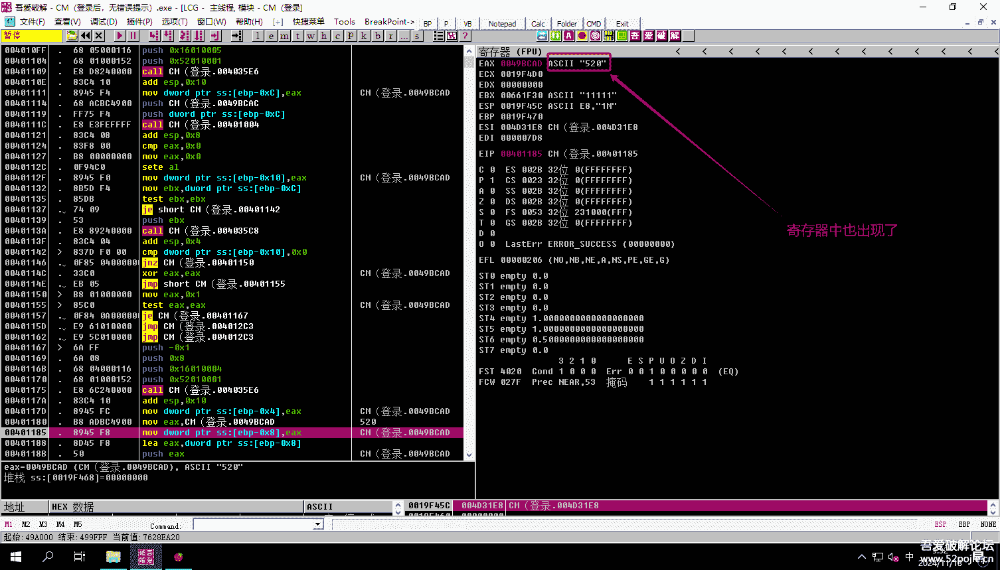
b7d187bbe716b11a942eb103b2f2dd1.png (129 KB, 下载次数: 1)
2024-11-13 10:12 上传

后面开始按 `F8`，继续寻找刚刚输入的密码。

账号密码都找到了，后面寻找比较账号密码的验证机制，继续 `F8`

第一个验证点，账号验证

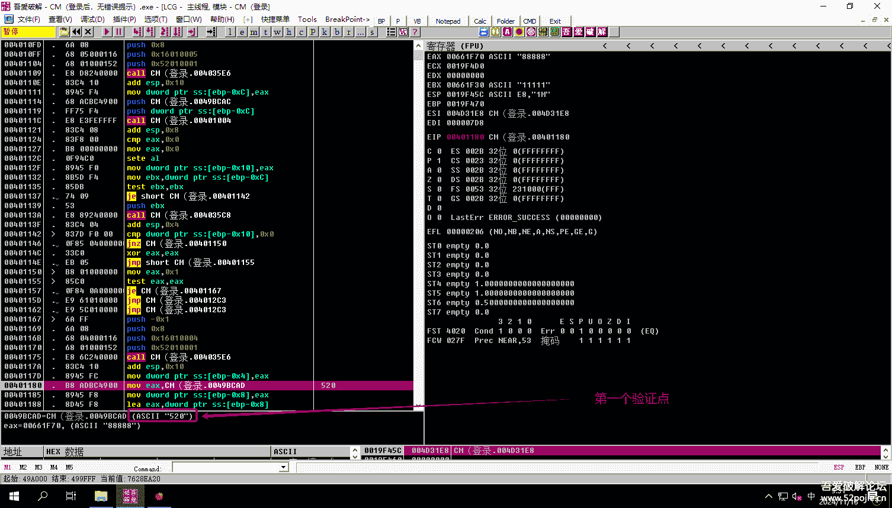
image.png (117.93 KB, 下载次数: 2)
2024-11-13 10:11 上传

第二个验证点，密码验证

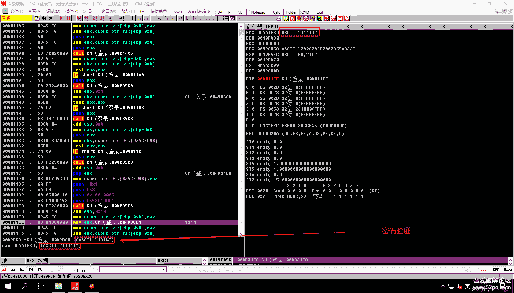
image.png (123.04 KB, 下载次数: 2)
2024-11-13 10:13 上传

2个比较点都找到了，后面就是寻找大跳转。

继续往下，很快就找到了大跳转及 `retn`

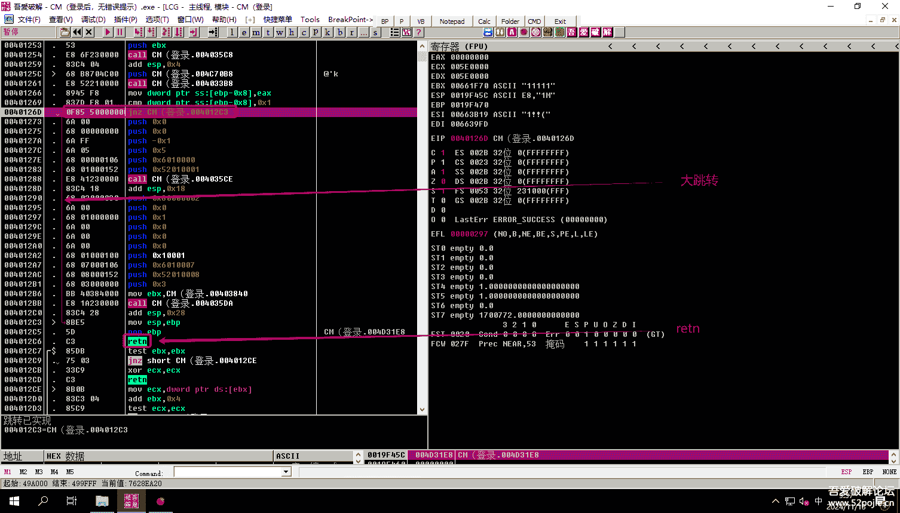
image.png (121.15 KB, 下载次数: 1)
2024-11-13 10:13 上传

### 打包验证

分析结束

开始打包验证，修改成 `nop`

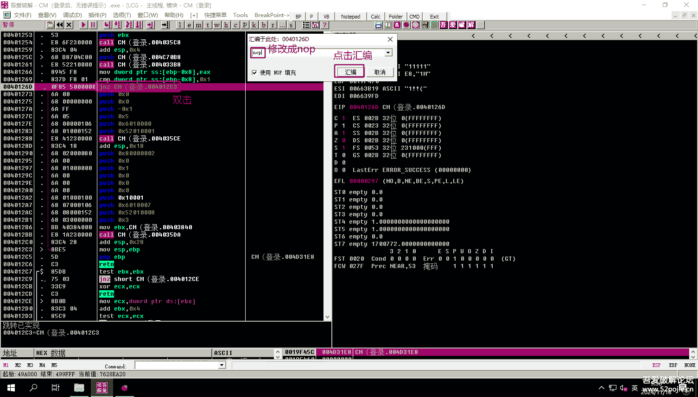
image.png (124.62 KB, 下载次数: 1)
2024-11-13 10:14 上传

所有修改

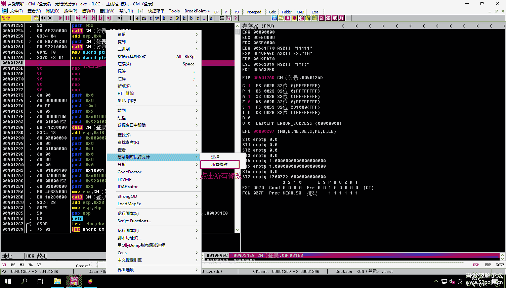
image.png (142.61 KB, 下载次数: 1)
2024-11-13 10:14 上传

点击全部复制

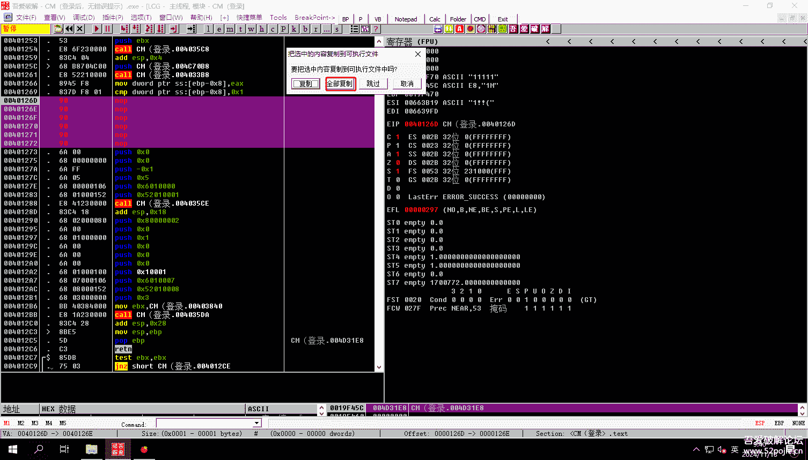
image.png (115.54 KB, 下载次数: 2)
2024-11-13 10:14 上传

保存文件

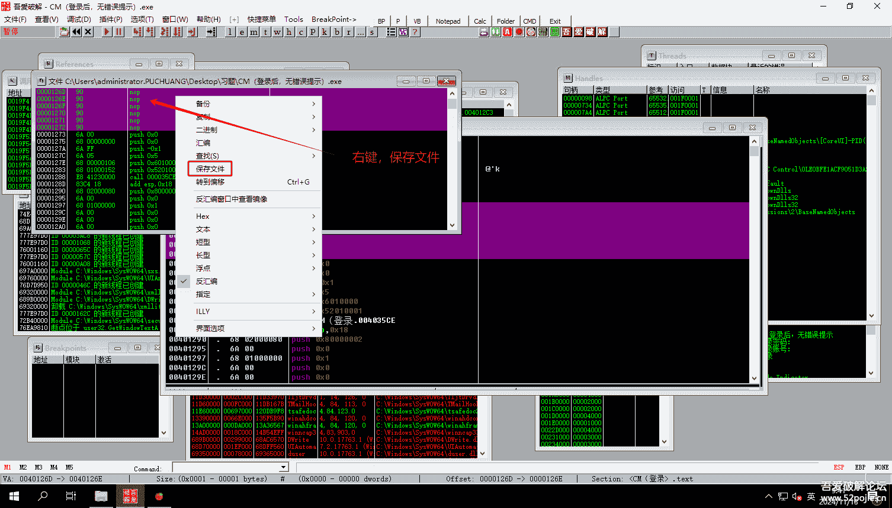
image.png (167.08 KB, 下载次数: 2)
2024-11-13 10:14 上传

随便输入文件名保存

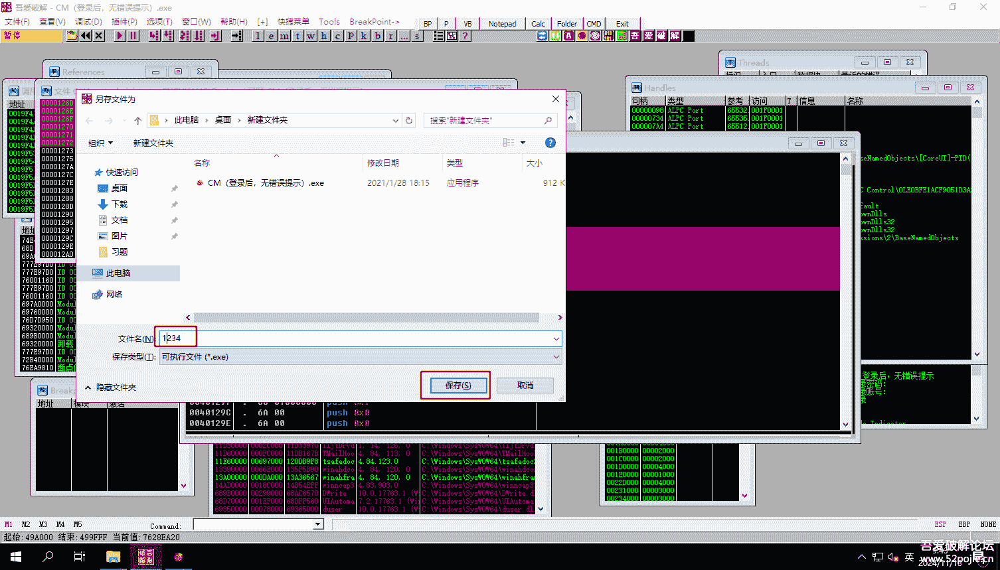
image.png (150.65 KB, 下载次数: 2)
2024-11-13 10:15 上传

运行软件

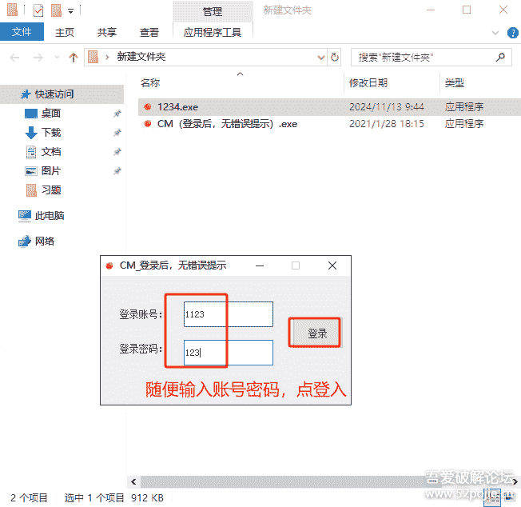
image.png (51.32 KB, 下载次数: 2)

[href="forum.php?mod=attachment&aid=MjczNTI3MHw5NTY2YjQxMnwxNzkzNTcxNjY4fDE2ODA4NnwxOTgxMTEy&nothumb=yes" target="_blank"](https://www.52pojie.cn/forum.php?mod=attachment&aid=MjczNTI3MHw5NTY2YjQxMnwxNzkzNTcxNjY4fDE2ODA4NnwxOTgxMTEy&nothumb=yes)

2024-11-13 10:15 上传

软件运行成功

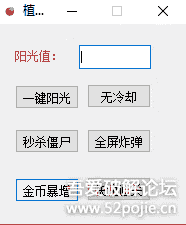

`image.png` (11.63 KB, 下载次数: 2)

[href="forum.php?mod=attachment&aid=MjczNTI3MXxmZDNmY2E2NnwxNzkzNTcxNjY4fDE2ODA4NnwxOTgxMTEy&nothumb=yes" target="_blank"](https://www.52pojie.cn/forum.php?mod=attachment&aid=MjczNTI3MXxmZDNmY2E2NnwxNzkzNTcxNjY4fDE2ODA4NnwxOTgxMTEy&nothumb=yes)

2024-11-13 10:15 上传

如果您觉得我发的内容确实对您有所帮助，请麻烦您支持一个热心值，进行精神鼓励，也是我继续写下去的动力！
