# [Web逆向] 【JS逆向】某建筑webpack逆向分析

- 原帖：https://www.52pojie.cn/forum.php?mod=viewthread&tid=1983924
- 抓取时间：2026-11-01T22:20:49

## 逆向目标

- 网址：aHR0cHM6Ly9qenNjLm1vaHVyZC5nb3YuY24vZGF0YS9jb21wYW55
- 目标：响应数据解密

## 抓包分析

随便翻个页，会发起一个请求，可以看到响应是加密的。

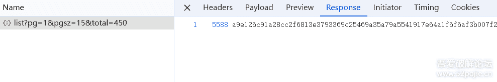 [附件下载](https://www.52pojie.cn/forum.php?mod=attachment&aid=MjczNzkwOHwzZWVlOWU4ZHwxNzkzNTcxNjQ2fDE2ODA4NnwxOTgzOTI0&nothumb=yes) 1.png (15.22 KB, 下载次数: 0) 2024-11-20 20:35 上传

## 逆向分析

### 定位响应拦截器

既然已经知道是响应加密了，那就直接开始逆向。点开启动器，按照经验（1.响应加密，2.xhr请求），那就先去响应拦截器搂一眼，一般是从`xxx.request`点进去即可。

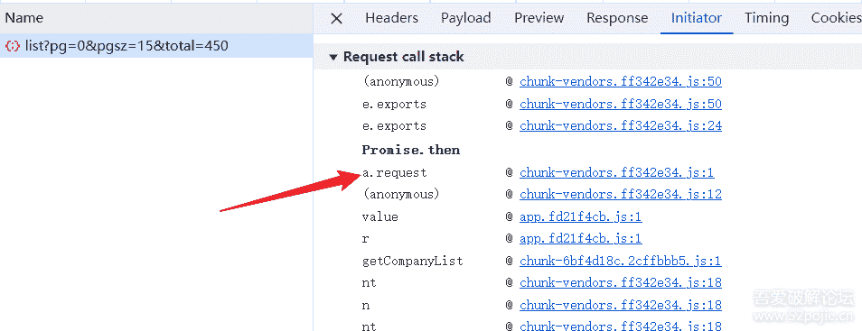 [附件下载](https://www.52pojie.cn/forum.php?mod=attachment&aid=MjczNzkwOXw3ZWMwZDZmMnwxNzkzNTcxNjQ2fDE2ODA4NnwxOTgzOTI0&nothumb=yes) 2.png (26.03 KB, 下载次数: 0) 2024-11-20 20:35 上传

下断，翻页，成功断住，一气呵成。

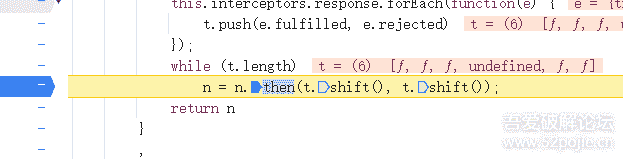 [附件下载](https://www.52pojie.cn/forum.php?mod=attachment&aid=MjczNzkxMHxmMjUxMTE1NHwxNzkzNTcxNjQ2fDE2ODA4NnwxOTgzOTI0&nothumb=yes) 3.png (10.95 KB, 下载次数: 0) 2024-11-20 20:35 上传

然后我们就需要找响应拦截器，其实逐个点进去看看都可以的，本案例就在下图箭头的地方，直接进去。

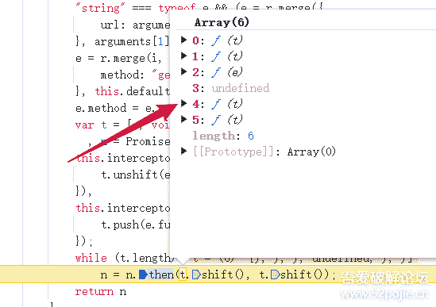 [附件下载](https://www.52pojie.cn/forum.php?mod=attachment&aid=MjczNzkxMXwyZDZlNTg5M3wxNzkzNTcxNjQ2fDE2ODA4NnwxOTgzOTI0&nothumb=yes) 4.png (22.88 KB, 下载次数: 0) 2024-11-20 20:35 上传

`xxx.interceptors.response.use` 这就是响应拦截器的一个标志，那`t.data`应该就是密文，`b`应该就是解密函数。

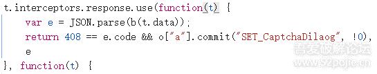 [附件下载](https://www.52pojie.cn/forum.php?mod=attachment&aid=MjczNzkxMnw0OGE0ZGViOHwxNzkzNTcxNjQ2fDE2ODA4NnwxOTgzOTI0&nothumb=yes) 5.png (8.87 KB, 下载次数: 0) 2024-11-20 20:35 上传

直接下断，成功断住。

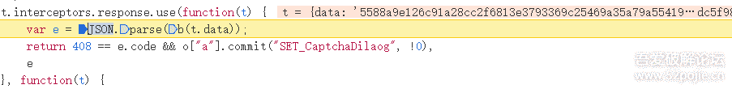 [附件下载](https://www.52pojie.cn/forum.php?mod=attachment&aid=MjczNzkxM3w4MTA2ODUzMHwxNzkzNTcxNjQ2fDE2ODA4NnwxOTgzOTI0&nothumb=yes) 6.png (10.98 KB, 下载次数: 0) 2024-11-20 20:35 上传

### 分析解密函数

然后我们直接单步进去`b`函数，经常玩逆向的朋友其实到这就已经秒了，这不一眼AES嘛。

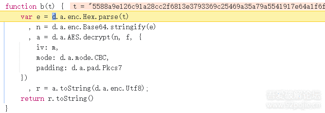 [附件下载](https://www.52pojie.cn/forum.php?mod=attachment&aid=MjczNzkxNHw2OTVjNGZiZHwxNzkzNTcxNjQ2fDE2ODA4NnwxOTgzOTI0&nothumb=yes) 7.png (12.09 KB, 下载次数: 0) 2024-11-20 20:35 上传

确实如此，其实逆向到这，拿到`key`，拿到`iv`，就可以找个加解密网站看是不是标准的AES了，经验证，算法没有被魔改。

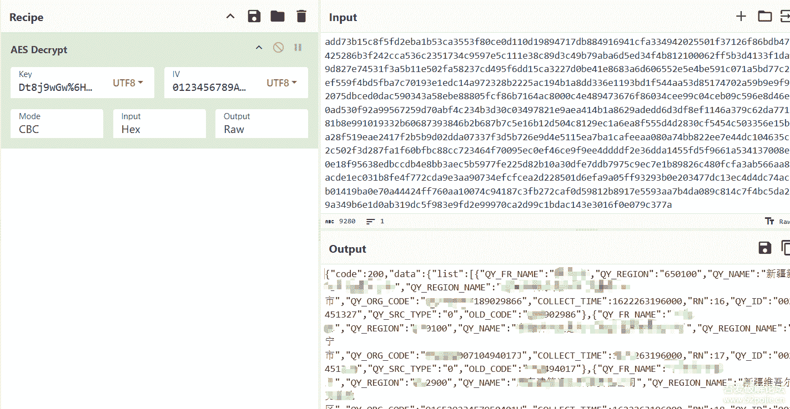 [附件下载](https://www.52pojie.cn/forum.php?mod=attachment&aid=MjczNzkxNXw3ZTMyMzdhMHwxNzkzNTcxNjQ2fDE2ODA4NnwxOTgzOTI0&nothumb=yes) 8.png (147.21 KB, 下载次数: 0) 2024-11-20 20:35 上传

### 抠取 webpack 加载器

但是！！！我们这篇文章的主题是webpack，我们就不按套路出牌，否则以后遇到webpack，加解密算法不明显的时候，该不会抠还是不会抠。

经常搞webpack的朋友都清楚，代码该怎么抠，无非就是找加载器，补齐缺失的模块，导出关键函数，最后进行加解密。

我们先分析一下代码逻辑，在解密的时候主要用到了`d`对象，而`d`又是`n.n(u)`，很显然第一个`n`就是加载器，因为前面很多对象都通过`n(xxx)`赋值，而`xxx`就是模块名称。

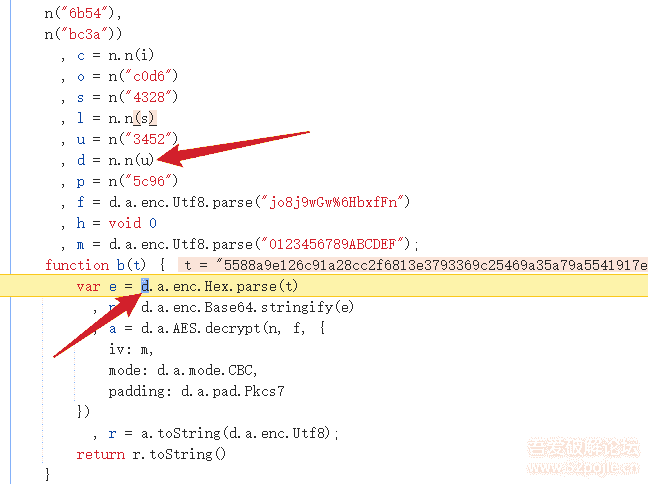 [附件下载](https://www.52pojie.cn/forum.php?mod=attachment&aid=MjczNzkxNnw1OTU0ZGU5MXwxNzkzNTcxNjQ2fDE2ODA4NnwxOTgzOTI0&nothumb=yes) 9.png (21.78 KB, 下载次数: 0) 2024-11-20 20:35 上传

加载器找到了，可以在`u = n("3452")`中下断，因为`d`的赋值用到了`u`，然后刷新页面，进去加载器，发现加载器实际是函数`s`。

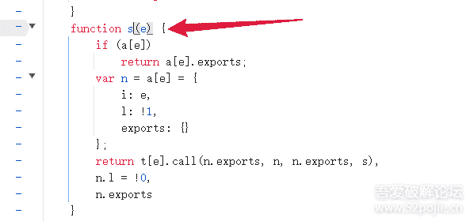 [附件下载](https://www.52pojie.cn/forum.php?mod=attachment&aid=MjczNzkxN3wwZTkzN2I5ZnwxNzkzNTcxNjQ2fDE2ODA4NnwxOTgzOTI0&nothumb=yes) 10.png (12.71 KB, 下载次数: 0) 2024-11-20 20:35 上传

然后我们把加载器拿下来（箭头所指部分），注意，先不要拿模块，模块就是这个自执行函数传入的大对象，我们先传空。

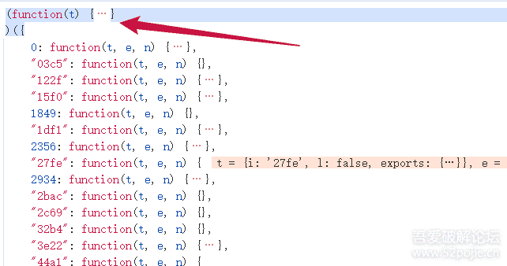 [附件下载](https://www.52pojie.cn/forum.php?mod=attachment&aid=MjczNzkxOHwyODEwM2ZhOHwxNzkzNTcxNjQ2fDE2ODA4NnwxOTgzOTI0&nothumb=yes) 11.png (18.07 KB, 下载次数: 0) 2024-11-20 20:35 上传

代码拿下来之后，回到加载器中分析一下逻辑，`e`为模块名，`a`为存储模块的地方，先判断有没有，有的话直接返回，没有的话就走后面的逻辑，去`t`对象里面拿，而`t`就是自执行函数的传参，包含了所有模块。

所以，我们抠模块的时候，直接从`t`对象拿就行。

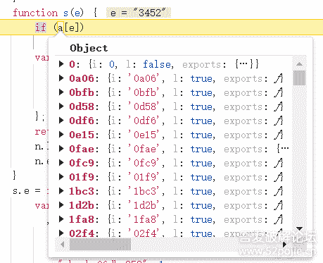 [附件下载](https://www.52pojie.cn/forum.php?mod=attachment&aid=MjczNzkxOXxjMmJlMzVhMXwxNzkzNTcxNjQ2fDE2ODA4NnwxOTgzOTI0&nothumb=yes) 12.png (24.58 KB, 下载次数: 0) 2024-11-20 20:35 上传

下面有两种选择：

- 运行代码，缺哪个模块补哪个，直到成功解密
- 半自动抠webpack

我选第二种，那么怎么半自动抠模块呢，首先我们要清楚需要构造一个怎样的字符串，才适合我们的加载器调用。

> `{"模块名": 模块函数, ...}`，这应该没有异议吧。或者你构造成数组也没问题，不过数组是怎么调用的，要自己去看看webpack的相关知识了。

那我就直接将字符串挂到`window`上了，下面是流程：

- 回到`u = n("3452")`断点，刷新页面，重新断住
- 将字符串挂载到`window`上，`window.module_str = '{'`
- 在加载器的`if (a[e])`处下条件断点，``window.module_str += `"${e}":${t[e].toString()},`,false``
- 在目标对象后面下断（可以在这`p = n("5c96")`），确保成功加载了`d`对象
- 将断点跳到`p = n("5c96")`处
- 执行`window.module_str += '}'`
- 执行`copy(window.module_str)`
- 将自执行函数的空对象换成我们复制的对象

OK，到这里，我们就成功把加载器和解密相关的模块都抠下来了，接下来就是导出我们需要的东西。

### 导出并验证解密

我就直接在自执行函数最后将加载器挂到`window`（`global`）上了。剩下的就是网页上怎么解密的，我们就怎么解密就行了。

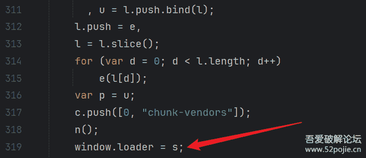 [附件下载](https://www.52pojie.cn/forum.php?mod=attachment&aid=MjczNzkyMHw3ZGVhZTcxNnwxNzkzNTcxNjQ2fDE2ODA4NnwxOTgzOTI0&nothumb=yes) 13.png (40.45 KB, 下载次数: 0) 2024-11-20 20:36 上传

解密结果：

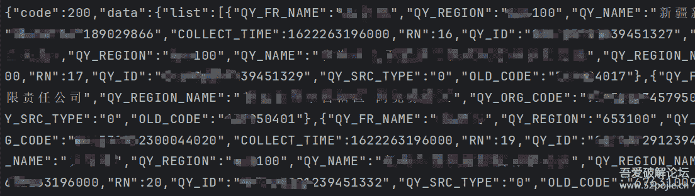 [附件下载](https://www.52pojie.cn/forum.php?mod=attachment&aid=MjczNzkyMXwzOTVmNTRkNnwxNzkzNTcxNjQ2fDE2ODA4NnwxOTgzOTI0&nothumb=yes) 14.png (86.17 KB, 下载次数: 1) 2024-11-20 20:36 上传

成功！！！
