# [原创] 破解Typora复现 上——初识`AES-256`加密算法

原帖：https://www.52pojie.cn/forum.php?mod=viewthread&tid=1983982
抓取时间：2026-11-01T22:20:47

## 目的

发表这篇帖子的目的主要是分享一些在破解`Typora`的`AES`加密过程中可能需要的背景知识和经验，希望能帮助一些和我一样的新手。

## 过程

### 背景知识

- `Typora`采用的框架是`Electron`。
- 调试它的可执行文件还是得用上反汇编软件，例如`IDA`。
- `asar`是一种打包方式，可以直接用`nodejs`的`asar`提取出来，没有加密。
- `AES`是一种块加密，也就是把明文划分成相同大小的块再进行加密，加密用的密钥叫`key`。`AES-128`、`192`、`256`用到的`key`长度分别是`16byte`、`24byte`、`32byte`。这里`Typora`用到的是`AES-256`，所以`key`的长度是`32byte`。[^3][^4]

  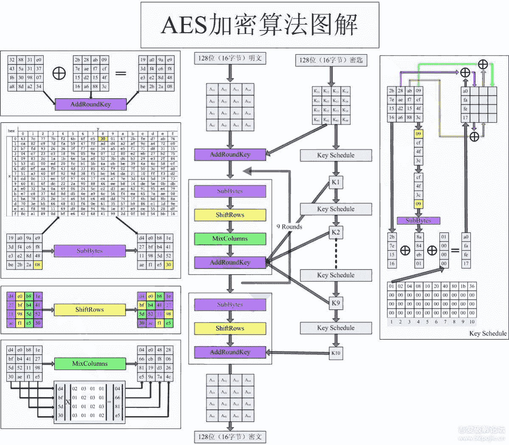
  `aes_details.jpg` (228.91 KB, 下载次数: 1)
  `details`
  2024-11-21 00:35 上传
  [附件下载](https://www.52pojie.cn/forum.php?mod=attachment&aid=MjczNzk1MHxkMzNiYzljY3wxNzkzNTcxNjQ1fDE2ODA4NnwxOTgzOTgy&nothumb=yes)

  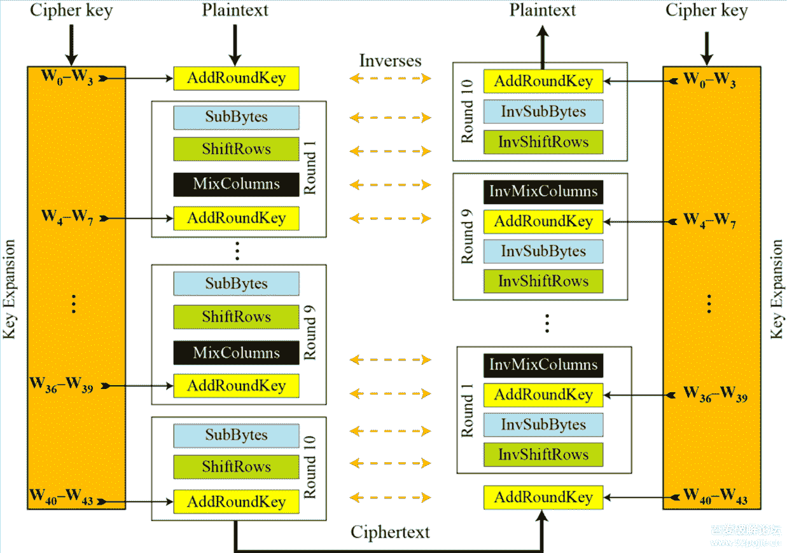
  `aes_enc_dec.png` (251.12 KB, 下载次数: 1)
  `enc_dec`
  2024-11-21 00:40 上传
  [附件下载](https://www.52pojie.cn/forum.php?mod=attachment&aid=MjczNzk1MXwxMGRiMmE1NXwxNzkzNTcxNjQ1fDE2ODA4NnwxOTgzOTgy&nothumb=yes)

- `AES`加密和解密会分别用到两个`256byte`的矩阵，叫`SBox`和`InvBox`。它们的值是固定的，所以可以通过`IDA`的`FindCrypt`插件找出来。
- 块加密有不同的模式，有`CBC`、`ECB`、`CFB`等等。其中`ECB`是每个明文块分别加密；`CBC`和`CFB`是把上一块的密文和当前块的明文做异或后再加密，区别是它们俩明文与密文做异或的时机不一样。在这里`Typora`用的是`CBC`模式。[^9]
- `CBC`这种加密方式需要在第一个加密的周期前面再加一个初始的“与明文做异或”的块，就叫`iv`(initial vector)。因为`AES`的块是一个`4x4`的格子，长度为`16byte`，所以`iv`的长度就是`16byte`。

### 整体介绍

`Typora`通过`app.asar`里的`main.node`模块(实际为`dll`动态链接库文件)加载`atom.js`中关于验证`license`的代码，`atom.js`通过`AES-256`加密后用`base64`编码，以密文的形式存储。解密的过程就发生在`main.node`中。[^1][^2]

破解的思路是找到`AES`加密的`key`和`iv`，修改解密出来的验证`license`的代码，再将修改过的代码加密，替换掉原来的`atom.js`，再重新打包。所以整个过程大概可以分成两个部分：`AES`解密和 patch `JavaScript`代码。因为不太熟悉后面这部分，估计还得花点时间搞，所以我打算下次再写。

听说还有一种更方便的方法是`hook`，不过我还没怎么搞明白。

### 文件结构

在`Typora`的安装路径下，有`Typora.exe`可执行文件，它会使用`resources/app.asar.unpacked`中的`main.node`来动态加载`app.asar`，再解密里面的`atom.js`。我们自己打开`app.asar`后里面会`3`个文件，其他两个都不用管，重点关注这个`atom.js`就好了。

```
Typora
➜  tree -L 3
.
├── chrome_100_percent.pak
├── chrome_200_percent.pak
├── d3dcompiler_47.dll
├── DO NOT ADD FILES HERE
├── ffmpeg.dll
├── icudtl.dat
├── libEGL.dll
├── libGLESv2.dll
├── LICENSE
├── LICENSES.chromium.html
├── locales
│   ├── uk.pak
|   ...
│   ├── zh-CN.pak
│   └── zh-TW.pak
├── resources
│   ├── app.asar
│   ├── app.asar.unpacked
|   |   └── main.node
│   ├── appsrc
│   ├── assets
│   ├── conf.default.json
│   ├── Docs
│   ├── DO NOT ADD FILES HERE
│   ├── html
│   ├── lib.asar
│   ├── locales
│   ├── node_modules
│   ├── node_modules.asar
│   ├── package.json
│   ├── page-dist
│   ├── style
│   ├── updater
│   └── window.html
├── resources.pak
├── snapshot_blob.bin
├── Typora.exe
├── Typora.VisualElementsManifest.xml
├── unins000.dat
├── unins000.exe
├── v8_context_snapshot.bin
├── version
├── vk_swiftshader.dll
├── vk_swiftshader_icd.json
└── vulkan-1.dll
```

听说这个“`chrome_100_percent.pak`”“`chrome_200_percent.pak`”是`Electron`框架的一个特征。[Electron程序逆向（asar归档解包）](https://www.cnblogs.com/cc11001100/p/14290584.html)

简单提取一下：`npx asar extract app.asar app.asar.manual`

```
Typora/resources/app.asar.manual
➜  tree
.
├── atom.js
├── main.node
└── package.json
```

### 步骤

1. 通过`IDA`打开`main.node`。`IDA`会自动识别文件类型，然后自动勾选一些选项。

   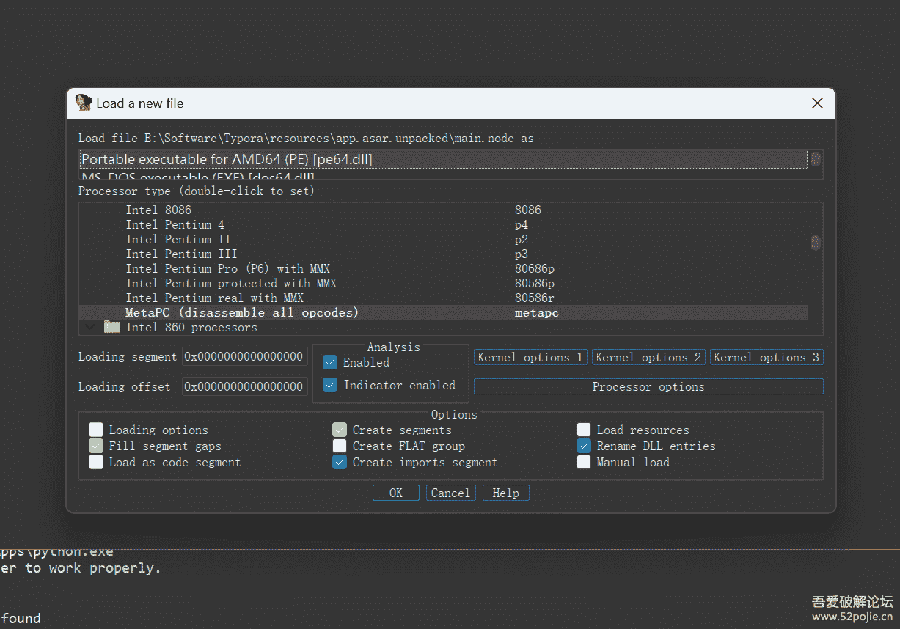
   `ida_open.png` (78.96 KB, 下载次数: 1)
   2024-11-21 00:41 上传
   [附件下载](https://www.52pojie.cn/forum.php?mod=attachment&aid=MjczNzk1OXxhYjVkOGRiN3wxNzkzNTcxNjQ1fDE2ODA4NnwxOTgzOTgy&nothumb=yes)

2. `Shift+F12`打开字符串搜索，找到“`./atom.js`”，双击点进去，`F5`自动生成伪代码，估计就是用这个函数加载的密文。把函数名“`sub_xxxx`”改成“`load_atomjs`”这种方便理解的名字。点击函数名，按`N`即可修改，后面分析伪代码修改变量名也是这样。

   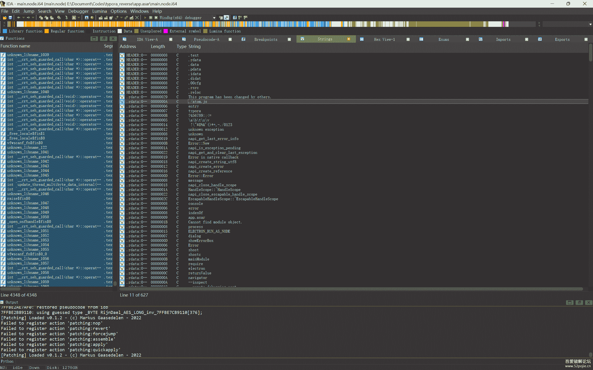
   `ida_strings.png` (440.79 KB, 下载次数: 1)
   2024-11-21 00:41 上传
   [附件下载](https://www.52pojie.cn/forum.php?mod=attachment&aid=MjczNzk2MHw4OGEwNGM0M3wxNzkzNTcxNjQ1fDE2ODA4NnwxOTgzOTgy&nothumb=yes)

   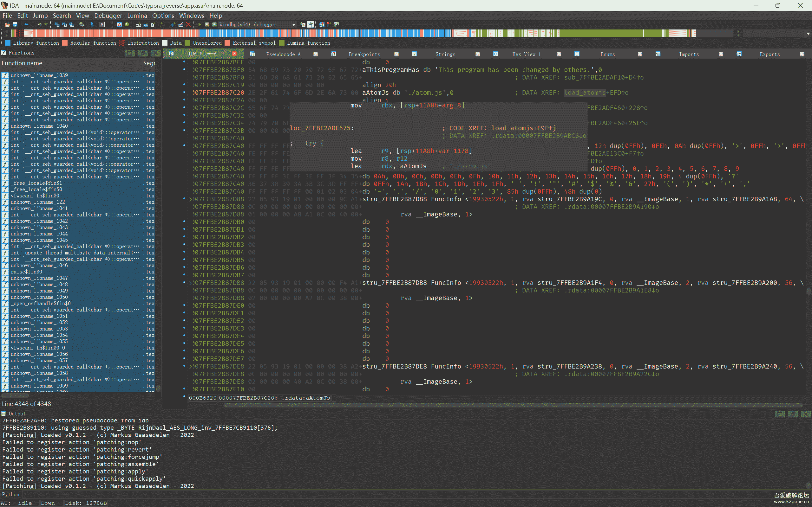
   `ida_load_atomjs.png` (533.38 KB, 下载次数: 0)
   `load_atomjs`
   2024-11-21 00:40 上传
   [附件下载](https://www.52pojie.cn/forum.php?mod=attachment&aid=MjczNzk1NnxhNGFiNDk0MXwxNzkzNTcxNjQ1fDE2ODA4NnwxOTgzOTgy&nothumb=yes)

   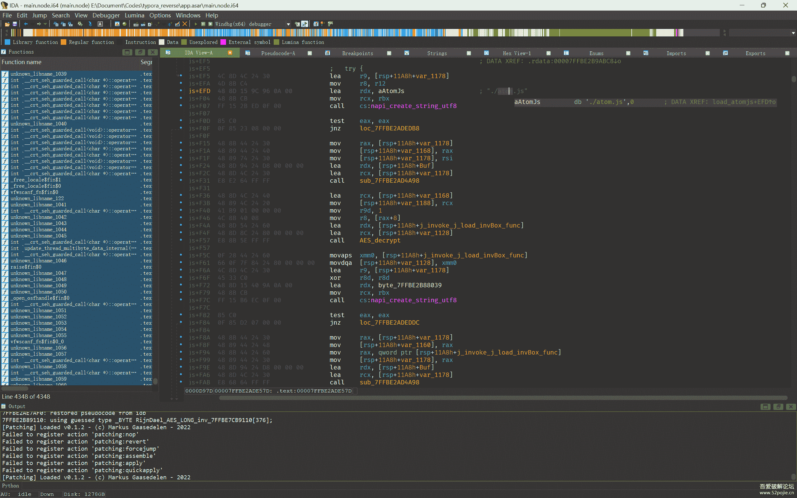
   `ida_load_atomjs_asm.png` (524.37 KB, 下载次数: 0)
   `asm`
   2024-11-21 00:40 上传
   [附件下载](https://www.52pojie.cn/forum.php?mod=attachment&aid=MjczNzk1N3wzM2I3ZWJjNHwxNzkzNTcxNjQ1fDE2ODA4NnwxOTgzOTgy&nothumb=yes)

3. `Ctrl+Alt+F`使用`FindCrypt`插件，或者在工具栏`Edit/Plugins/`下点开，可以找到两个`RijinDaelSBox`和`InvBox`。第二个`IDA`的识别有一点错误，把后面的不相干的数据也划成`InvBox`的了，小键盘`*`修改`Array`的大小为`256byte`。我们要找解密的过程，所以要找用了`InvBox`的函数。双击`InvBox`进去，可以把函数重命名为“`load_invbox`”。右边分号后面的是汇编代码的注释，可以看到“`DATA XREF: sub_xxxx`”，这是`IDA`自动生成的，代表`IDA`找到的引用了这个数据的函数，可以双击点进去。

   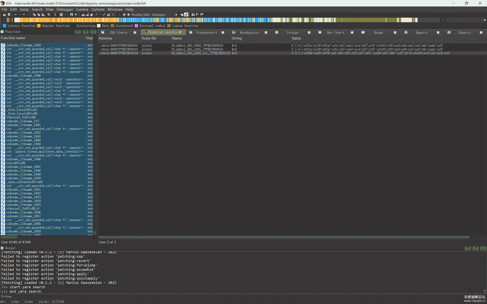
   `ida_findcrypt.png` (299.5 KB, 下载次数: 1)
   `findcrypt`
   2024-11-21 00:40 上传
   [附件下载](https://www.52pojie.cn/forum.php?mod=attachment&aid=MjczNzk1NHwzN2RiMjliZnwxNzkzNTcxNjQ1fDE2ODA4NnwxOTgzOTgy&nothumb=yes)

   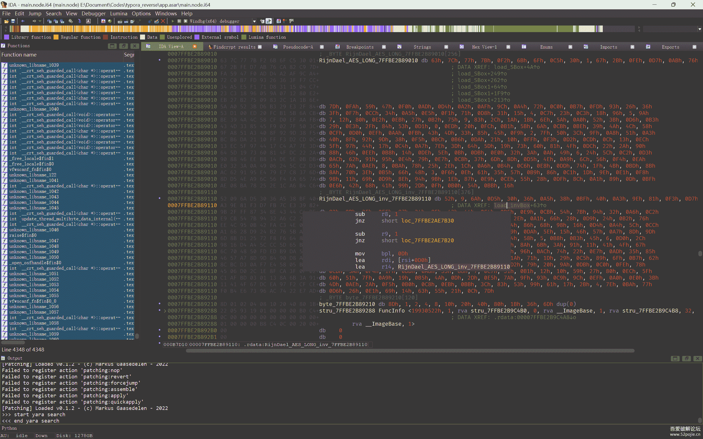
   `ida_invbox.png` (649.15 KB, 下载次数: 1)
   `invbox`
   2024-11-21 00:40 上传
   [附件下载](https://www.52pojie.cn/forum.php?mod=attachment&aid=MjczNzk1NXwwNTExZTIzMnwxNzkzNTcxNjQ1fDE2ODA4NnwxOTgzOTgy&nothumb=yes)

4. 在汇编代码窗口按`X`查看当前函数的交叉引用，工具栏`View/Graphs`可以查看调用当前函数和当前函数调用的关系图。可以看到重命名后`IDA`自动把单纯调用“`load_invbox`”的函数命名为了“`j_load_invbox`”。

   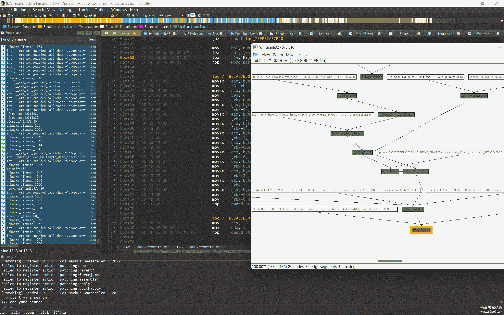
   `ida_xref.png` (500.82 KB, 下载次数: 2)
   2024-11-21 00:41 上传
   [附件下载](https://www.52pojie.cn/forum.php?mod=attachment&aid=MjczNzk2MXwwZmM1ZDgxNnwxNzkzNTcxNjQ1fDE2ODA4NnwxOTgzOTgy&nothumb=yes)

5. “`load_invbox`”函数的伪代码的结构很像`AES`解密的流程[^8]，我们把其中的循环结构标记出来后就更清晰了。将伪代码中无意义的`v1`、`v2`的变量名重命名为有实际意义的变量名，以及通过/添加注释，可以降低理解代码的难度。

   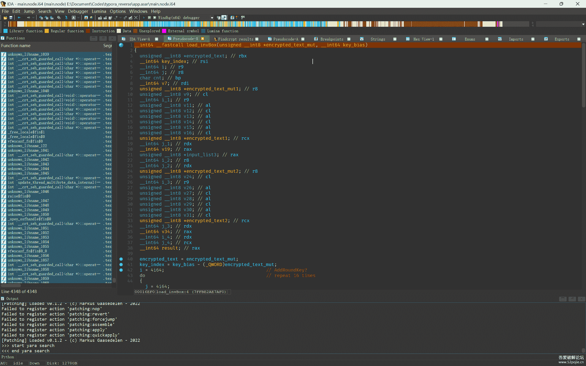
   `ida_load_invbox.png` (431.09 KB, 下载次数: 1)
   `load_invbox`
   2024-11-21 00:40 上传
   [附件下载](https://www.52pojie.cn/forum.php?mod=attachment&aid=MjczNzk1OHwwZDA0NTY5MXwxNzkzNTcxNjQ1fDE2ODA4NnwxOTgzOTgy&nothumb=yes)

6. 找到表示密文的变量并重命名，下断点，动态调试，双击变量名。右键调试窗口的`hex`子窗口，synchronized with 汇编窗口，再取消同步，多走几步可以看到数据一行一行地变为“`require…`”开头的明文。因为`AES-256`的`key`在做`key expansion`的时候，头两轮的`key`分别是原`key`的前后两段；而在解密中这两段`key`会用在最后两次`AddRoundKey`中。因为第一次找的时候我没找到`key`具体存放在哪里，所以我们可以异或密文和明文得到`key`来曲线救国。

   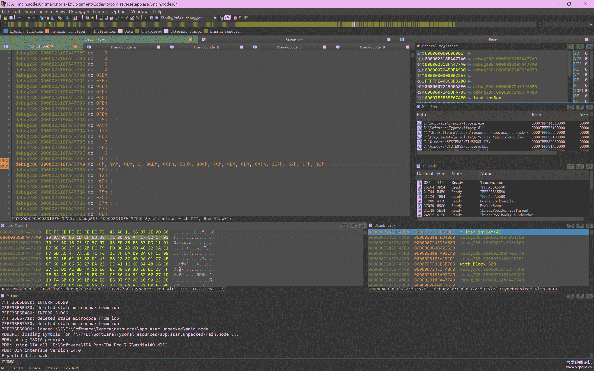
   `ida_debug.png` (466.29 KB, 下载次数: 1)
   `debug`
   2024-11-21 00:40 上传
   [附件下载](https://www.52pojie.cn/forum.php?mod=attachment&aid=MjczNzk1M3w2YzNjMWZjYXwxNzkzNTcxNjQ1fDE2ODA4NnwxOTgzOTgy&nothumb=yes)


在旧版的Typora中，`iv`就是密文的前16byte，在1.9.5中已经不是了。奈何我实在没看懂`iv`到底是在哪里，所以我就求助于比较新的教程：[Typora破解复现](https://www.cnblogs.com/Here-is-SG/p/16749410.html)、[\[原创\]【最新】Typora最新版的逆向过程分析](https://bbs.kanxue.com/thread-282319.htm)，把教程中标注为`iv`的变量标注为`iv`，动态调试得到它的值。

## 其他

在CyberChef中选择`cbc`模式解密失败，选择`cbc/no padding`模式成功了，但是明文的末尾有一串非ascii字符串。我猜测是CyberChef自动去除padding时不能判断哪里是padding。

### IDA的颜色

1,2两篇教程的ida的`theme`都设置成了护眼的黑色，而非默认的米黄色，第2篇米黄色背景的软件是x64dbg

### CyberChef

第1篇教程保存按钮的软件是notepad++，两篇都用到了[CyberChef](https://cyberchef.org/)（BAKE！）

## 参考链接

[^1]: [https://www.52pojie.cn/thread-1553967-1-1.html](https://www.52pojie.cn/thread-1553967-1-1.html)
[^2]: [https://www.52pojie.cn/thread-1968245-1-1.html](https://www.52pojie.cn/thread-1968245-1-1.html)
[^4]: [https://ctf-wiki.org/crypto/blockcipher/aes/](https://ctf-wiki.org/crypto/blockcipher/aes/)
[^5]: [https://bbs.kanxue.com/thread-272538.htm](https://bbs.kanxue.com/thread-272538.htm)
[^8]: [https://sxyz.blog/aes-from-scratch/](https://sxyz.blog/aes-from-scratch/)
[^9]: [https://en.wikipedia.org/wiki/Block_cipher_mode_of_operation](https://en.wikipedia.org/wiki/Block_cipher_mode_of_operation)
