# [Web逆向] `testab` 逆向流程分析

- 原帖: https://www.52pojie.cn/forum.php?mod=viewthread&tid=1984407
- 抓取时间: 2026-11-01T22:20:45

## 前言

好久不更新,就随便水一下. 感觉这个东西也比较烂大街. 大佬路过的直接跳过

## 目标

逆向如下参数，哪个网站就不说了。懂得都懂

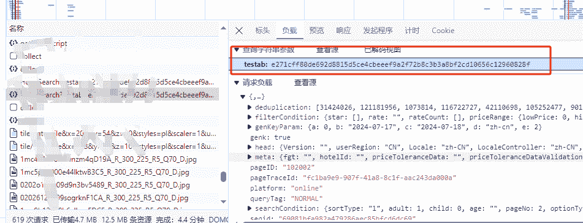

## 断点分析

这里就直接搜索 然后断点 断在这个地方 就OK了。

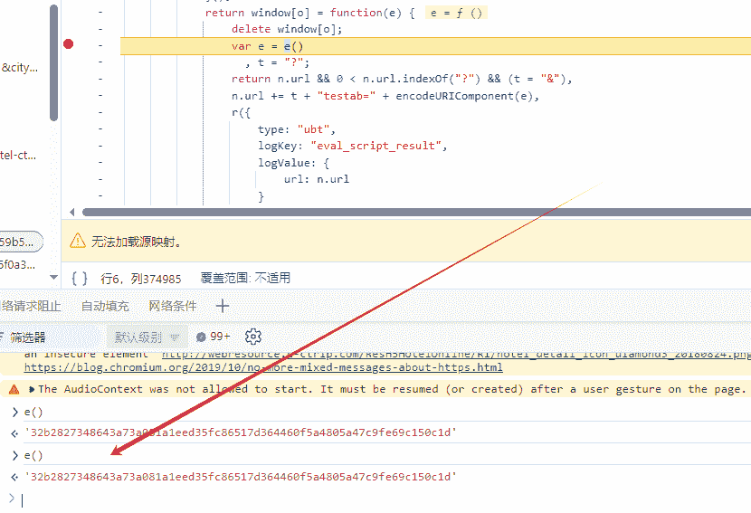

然后就发现进到了一个JSVMP里面

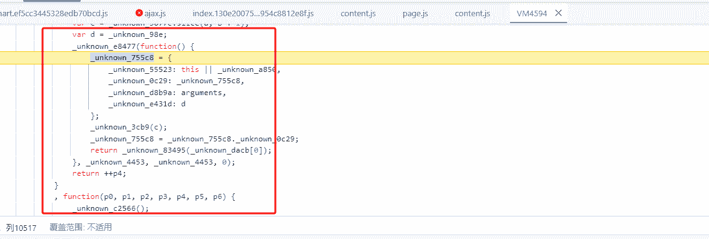

剩下的就是直接分析。

PS：细节部分动态的就不多说了。就是一个请求里返回出来的VM代码

## 补环境

这里找到`apply`调用处

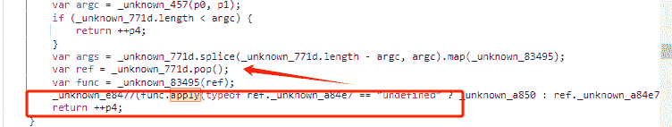

在这里打印下`args`输出一下传参的值。

对比上面的64位大数组 和浏览器中的大数组 值一致 就代表补OK了。

然后直接打印日志。

发现日志点还是太少了。这里就得找运算过程中产生的一些信息了。

日志打印这里。输出`val`的值。

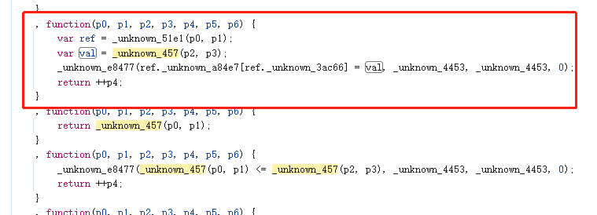

这里打印出来`val`有一堆异常的值。

这里说下 手补的话 要保证环境不能跑错。一步错 步步错。

第一步就是要赋值：

`self = top = window;`

`window.self = window.top = window;`

到这一步就能生成一个错误的值了。

然后往下走就能看到一堆环境 也全部补上。

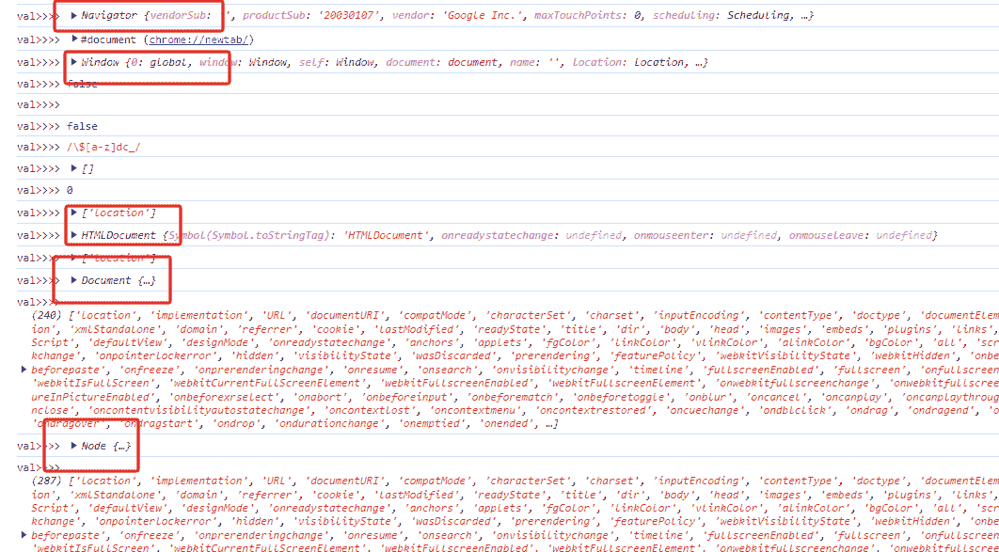

### `Process` 检测

如下图还有`process`检测。所以在开头也要删除掉`process`。这里可以把`global`、`buffer`的一些`Node`检测全部删除。

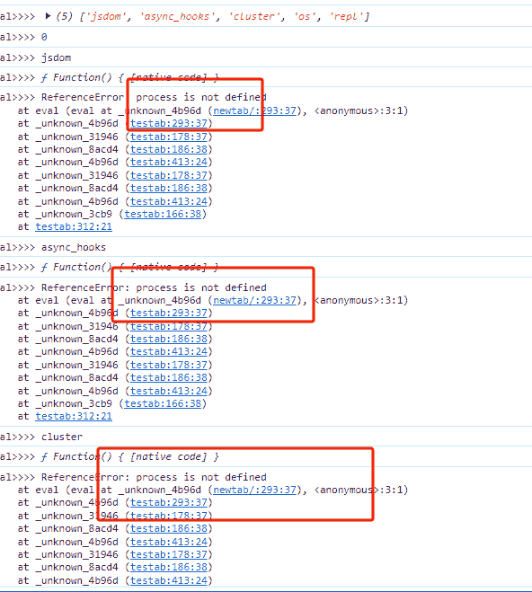

继续往下看。

### `appendChild` 检测

这里就是`appendChild`先后的问题。如果这个不会补。可以不补。你实现的乱七八糟可能不一定对。反正最后都是`false`.

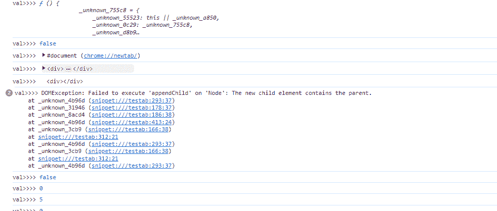

继续往下追。

### `Createlement`

这里应该也是创建一个标签 拿到css的标签值。

这里也要对比。

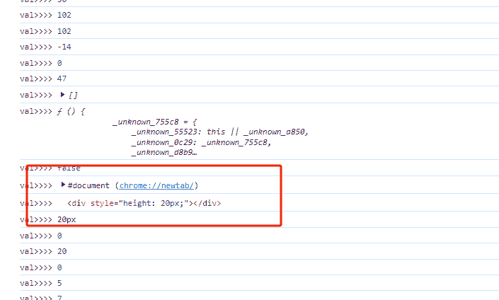

继续走 也是

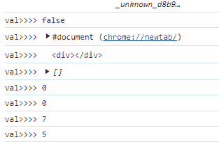

到这里 如果还是不成功。可以额外多插一插

如下图所示位置。这里的话 逻辑打印的很全 即使纯算 也可以以这个为参考 然后去上层取值打断点。

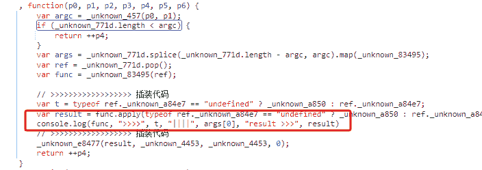

简单说下 还有一堆的原型链的检测 和`toString()`检测 其中包含`Image`、`Screen`、`HTML`、`WINDOW`等...

更方便的方法 直接用`v-jstools`吐一下 改一下`process`还有一些其他的环境值。一会儿就出来了。

改完如下图所示，一模一样 就代表成功了.

对比值一样的就行了

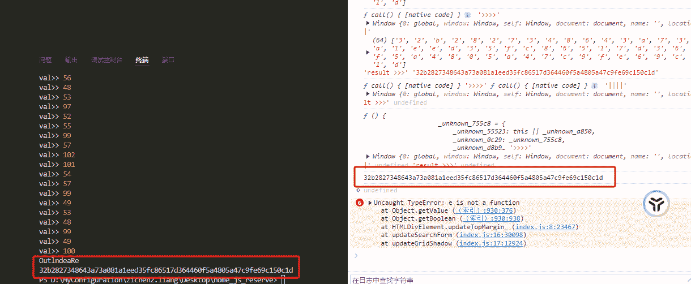

## 纯算

如下图位置打好断点

直接单步入栈

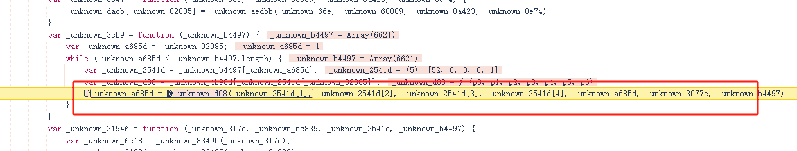

这里搜索下`apply`调用函数

然后瞎GG插装一波

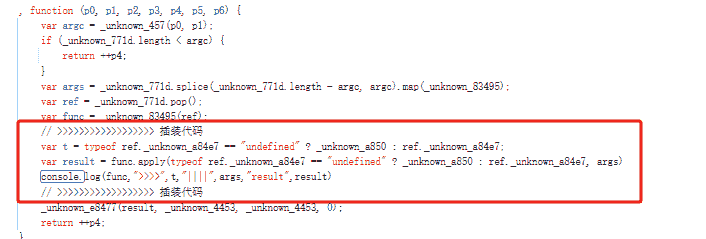

这里我们从下往上去看

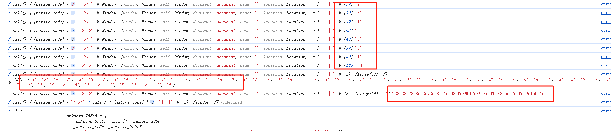

可以看到 生成的最后一个值 用来`.join`拼接

然后这个数组的生成 我们就可以简易的还原一下。

```js
let last_arr = [
    51, 50, 98, 50, 56, 50, 55, 51, 52, 56, 54, 52,
    51, 97, 55, 51, 97, 48, 56, 49, 97, 49, 101, 101,
    100, 51, 53, 102, 99, 56, 54, 53, 49, 55, 100, 51,
    54, 52, 52, 54, 48, 102, 53, 97, 52, 56, 48, 53,
    97, 52, 55, 99, 57, 102, 101, 54, 57, 99, 49, 53,
    48, 99, 49, 100
]

const testab = last_arr.map(val => String.fromCharCode(val)).join('');

console.log(testab)
```

然后继续网上看

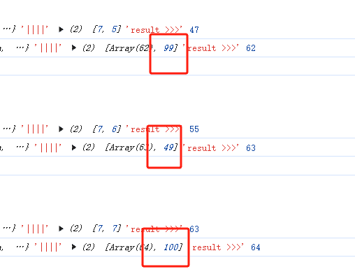

这里发现永远是外面一层大数组 包着一个最后的一个值。

然后把最后一个值 添加到里面的这个数组。

这里再细细观察 可以发现 他是又好几个数组生成。然后最终再生成这个`testab`

其实这里有个很简单 却 很笨的方法。

- 先找出生成的某个值。然后去看逻辑。
- 然后把逻辑处持续插装打值。
- 基于值分析。

这里简单说下定位和分析的流程吧。

找到定位点。然后挨个追栈 基于返回的指令集的索引去挨个对。

如下图所示

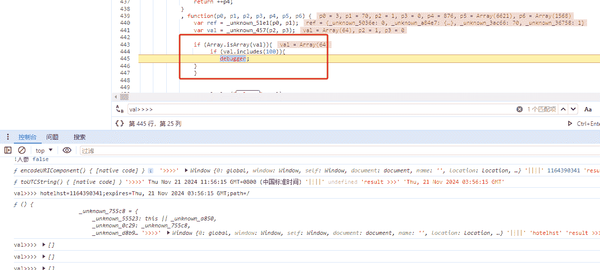

### 生成数组

如下图位置。

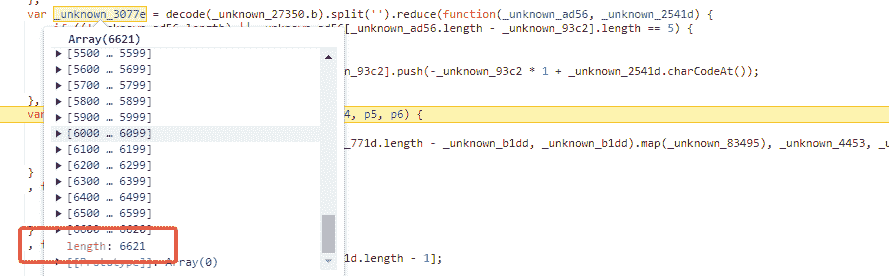

### 第一组

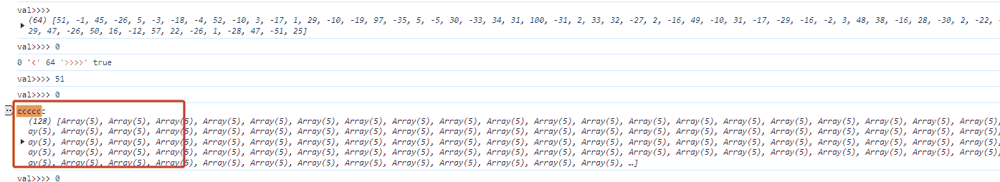

### 第二组

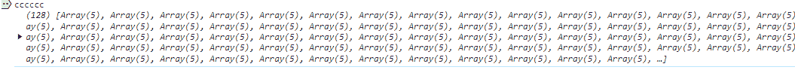

### 第三组

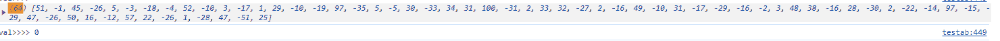

### 转置

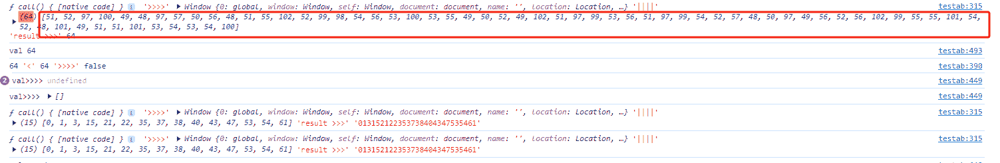

### 最后

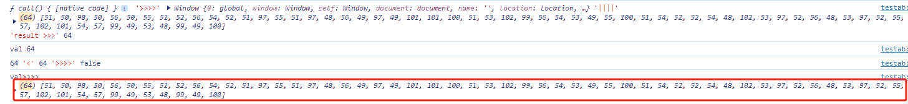

### `fromcharcode`

### 结果

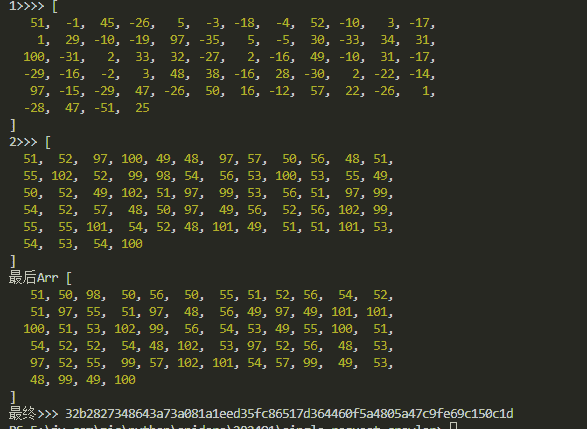
