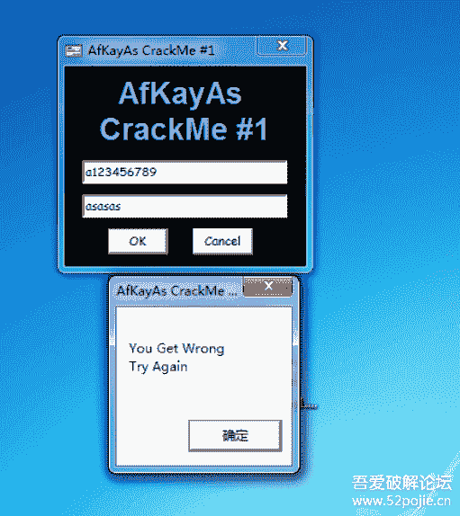
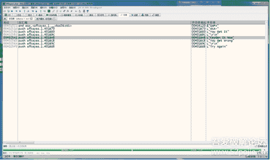
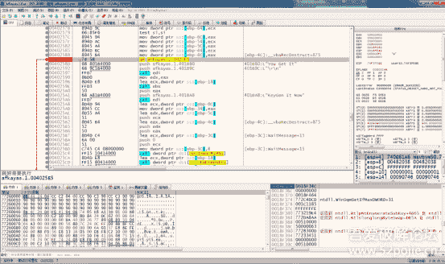
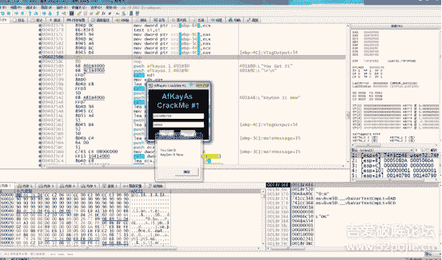
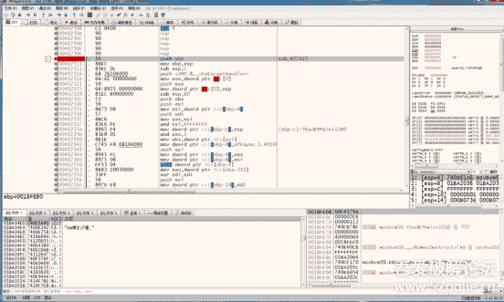
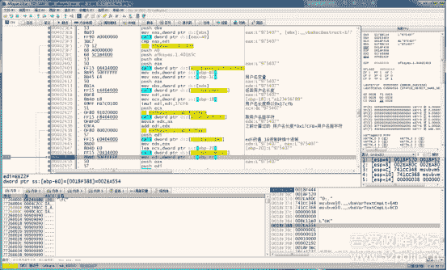
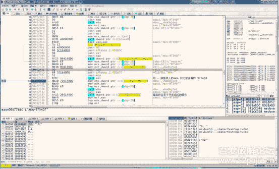
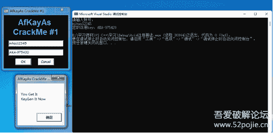

# [原创] 新手学破解记录贴【160个CrackMe】之002

- 原帖：<https://www.52pojie.cn/forum.php?mod=viewthread&tid=1984784>
- 抓取时间：2026-11-01T22:20:39

本人刚刚入门汇编逆向分析，本帖将记录我对160个CrackMe程序中的第002程序的分析过程。在学习的过程中，我会边学边记录。如果有不正确之处，还请各位指正。

## 程序运行

程序没有壳，查壳步骤略过，直接打开程序看一下运行过程。跟上一个第一个程序类似，要输入正确的用户名和密码才可以正确提示。



`fbbcae98750e7bb492c4c4a9b1538de8.png`（194.39 KB，下载次数：1）｜[附件下载](https://www.52pojie.cn/forum.php?mod=attachment&aid=MjczODUwM3w1ZGNmYWViMnwxNzkzNTcxNjM3fDE2ODA4NnwxOTg0Nzg0&nothumb=yes)｜2024-11-23 15:07 上传

## 爆破分析

现在拖入 `x32dng` 来分析一下，首先进行搜索字符串的操作。既然 `YouGetWrong` 这个字符串是错误的提示，那上面的 `YouGetIt` 就是正确的提示了。我们在正确提示处下一个断点，再运行重新注册试一下。



`0b9583779b8250d813ee036d9f42753a.png`（65.29 KB，下载次数：1）｜[附件下载](https://www.52pojie.cn/forum.php?mod=attachment&aid=MjczODUwNXxkNGNkMGQ0Y3wxNzkzNTcxNjM3fDE2ODA4NnwxOTg0Nzg0&nothumb=yes)｜2024-11-23 15:08 上传

定位到字符串的代码处，发现上面有一个关键跳转，跳过了正确的提示。直接把这个跳转 `nop` 掉，让它不进行跳转，就直接爆破成功了。



`d423eebddd37165c4c95a07925176674.png`（188.1 KB，下载次数：0）｜[附件下载](https://www.52pojie.cn/forum.php?mod=attachment&aid=MjczODUwNnxmMWY1Y2IxMXwxNzkzNTcxNjM3fDE2ODA4NnwxOTg0Nzg0&nothumb=yes)｜2024-11-23 15:08 上传



`aa118c99442b8e54c3ef34dcbe5c4e5c.png`（175.73 KB，下载次数：1）｜[附件下载](https://www.52pojie.cn/forum.php?mod=attachment&aid=MjczODUwN3xjYTEwM2QzOXwxNzkzNTcxNjM3fDE2ODA4NnwxOTg0Nzg0&nothumb=yes)｜2024-11-23 15:09 上传

## 密码算法分析

至此爆破就算完成了。再来分析一下密码生成的算法。首先在这个函数头部下一个断点，进行汇编代码的分析。



`b94486ffb2a79625d5989bac8707f3cf.png`（149.91 KB，下载次数：1）｜[附件下载](https://www.52pojie.cn/forum.php?mod=attachment&aid=MjczODUwOXxhODM1ZTVjMHwxNzkzNTcxNjM3fDE2ODA4NnwxOTg0Nzg0&nothumb=yes)｜2024-11-23 15:09 上传

上面汇编代码没什么太重要的，一直按 `F8` 到 `0x402412` 地址，发现把用户名作为参数传给下面的 `CALL`。这个 `CALL` 返回了用户名的长度，然后用长度乘以 `0x17CFB`，再加上用户名首个字符，转换成十进制之后就是 `975407`。



`image.png`（180.42 KB，下载次数：1）｜[附件下载](https://www.52pojie.cn/forum.php?mod=attachment&aid=MjczODUxMHw4Mjk1YmU1Y3wxNzkzNTcxNjM3fDE2ODA4NnwxOTg0Nzg0&nothumb=yes)｜2024-11-23 15:10 上传

继续按 `F8` 跟进，一直到 `0x0040251C` 这个地址。这个 `CALL` 传入了 3 个参数：输入的密码、常量 `AKA-`、之前计算出来的数值，也就是 `975407`。经过这个 `CALL` 之后返回了拼接后的字符串 `AKA-975407`，这个也就是正确的密码。



`1bd9476be75db5df96bba623582849ab.png`（171.37 KB，下载次数：1）｜[附件下载](https://www.52pojie.cn/forum.php?mod=attachment&aid=MjczODUxMXxhZTQ2YjFkZHwxNzkzNTcxNjM3fDE2ODA4NnwxOTg0Nzg0&nothumb=yes)｜2024-11-23 15:11 上传

总结：第一部分代码通过用户名长度乘以 `0x17CFB`，再加上用户名首个字符，计算出来的数值转成十进制。用户名长度是 `10`，对应十六进制 `0xA`；用户名首字符 `'a'` 对应十六进制 `0x61`，相当于 `0xA * 0x17CFB + 0x61 = 0xEE22F`，也就是十进制的 `975407`。

### 第一部分代码

```asm
00402409 | 8B95 50FFFFFF            | mov edx,dword ptr ss:[ebp-B0]           |
0040240F | 8B45 E4                  | mov eax,dword ptr ss:[ebp-1C]           | 用户名变量
00402412 | 50                       | push eax                                | eax:L"AKA-975407"
00402413 | 8B1A                     | mov ebx,dword ptr ds:[edx]              | ebx:__vbaObjSet
00402415 | FF15 E4404000            | call dword ptr ds:[]      | 返回用户名长度
0040241B | 8BF8                     | mov edi,eax                             | edi:__vbaStrCat, eax:L"AKA-975407"
0040241D | 8B4D E8                  | mov ecx,dword ptr ss:[ebp-18]           | [ebp-18]:L"asasas"
00402420 | 69FF FB7C0100            | imul edi,edi,17CFB                      | 用户名长度乘以0x17cfb
00402426 | 51                       | push ecx                                |
00402427 | 0F80 91020000            | jo                |
0040242D | FF15 F8404000            | call dword ptr ds:[]       | 取用户名首字符
00402433 | 0FBFD0                   | movsx edx,ax                            |
00402436 | 03FA                     | add edi,edx                             | 之前计算过的 用户名长度*0x17CFB+用户名首字符
00402438 | 0F80 80020000            | jo                |
0040243E | 57                       | push edi                                | edi:__vbaStrCat
0040243F | FF15 E0404000            | call dword ptr ds:[]        | edi的值 16进制转换十进制 
```

### 第二部分代码

第二部分代码通过之前计算出来的 `975407`，前面再拼接上固定值 `AKA-`，最终的结果就是 `AKA-975407`。

```asm
0040251C | 50                       | push eax                                | eax:L"AKA-975407"

0040251D | 68 701B4000              | push afkayas.1.401B70                   | 401B70:L"AKA-"

00402522 | 51                       | push ecx                                |

00402523 | FFD7                     | call edi                                | 拼接传入的AKA- 和之前计算的 975408
```

### 注册机编写

```cpp
#include 
#include 
using namespace std;

int main()
{
	string str;
	cout > str;
	int len = str.length();
	char ch = str[0];
	int num = len * 0x17CFB + ch;

	string key = "AKA-"+ to_string(num);
	cout
```



`6586ed5df220f508c37ae3e033bffd1e.png`（64.79 KB，下载次数：1）｜[附件下载](https://www.52pojie.cn/forum.php?mod=attachment&aid=MjczODUxNHwyNTU5YTJmZnwxNzkzNTcxNjM3fDE2ODA4NnwxOTg0Nzg0&nothumb=yes)｜2024-11-23 15:12 上传
