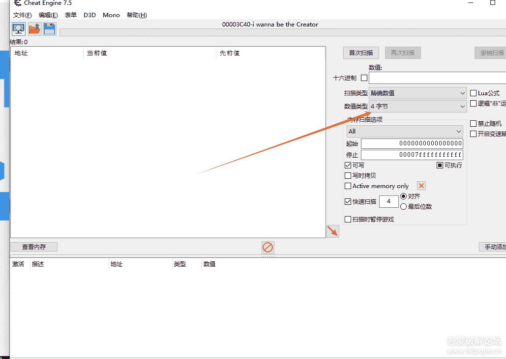
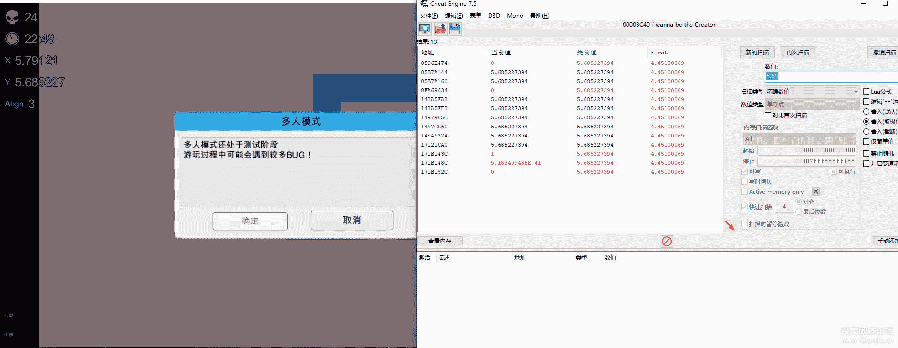
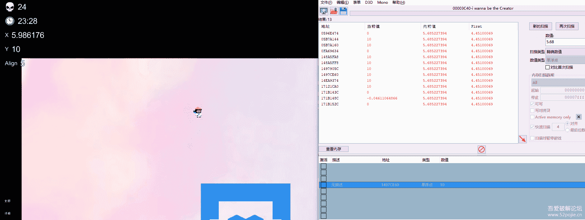

# [原创] IwannaIC游戏

- 原帖: https://www.52pojie.cn/forum.php?mod=viewthread&tid=1985283
- 抓取时间: 2026-11-01T22:20:31

其实我对单浮点，不太明白，只是借用了一下CE的基础操作，用CE实现了飞天改坐标。

第一步，用CE打开游戏进程，这个就不截图了，很基础了，然后已知是单浮点数，这边选择一下单浮点，这样后期查找数值的时候能快速一些，

1732510800325.jpg (54.47 KB, 下载次数: 1)

[href="forum.php?mod=attachment&aid=MjczODk3M3w3MzM5M2YyOHwxNzkzNTcxNjI5fDE2ODA4NnwxOTg1Mjgz&nothumb=yes" target="_blank"](https://www.52pojie.cn/forum.php?mod=attachment&aid=MjczODk3M3w3MzM5M2YyOHwxNzkzNTcxNjI5fDE2ODA4NnwxOTg1Mjgz&nothumb=yes)

2024-11-25 13:11 上传

第二步，我是搜的Y值，也就是说上下的一个值，第一次的数值，然后在跳一下，变动的数值，反复搜索，得到的地址就是咱们想要的

1732510836297.jpg (198.39 KB, 下载次数: 1)

[href="forum.php?mod=attachment&aid=MjczODk3NHwwYmJjNTI4ZnwxNzkzNTcxNjI5fDE2ODA4NnwxOTg1Mjgz&nothumb=yes" target="_blank"](https://www.52pojie.cn/forum.php?mod=attachment&aid=MjczODk3NHwwYmJjNTI4ZnwxNzkzNTcxNjI5fDE2ODA4NnwxOTg1Mjgz&nothumb=yes)

2024-11-25 13:11 上传

第三步，得到的最后几个地址，然后修改选中的地址单浮点数值，然后实现人物浮空效果，这样就是人物多高都可以，X值是一个道理，就不做演示了

1732510889501.jpg (234.58 KB, 下载次数: 0)

[href="forum.php?mod=attachment&aid=MjczODk3NXwwYjkxYTEwMXwxNzkzNTcxNjI5fDE2ODA4NnwxOTg1Mjgz&nothumb=yes" target="_blank"](https://www.52pojie.cn/forum.php?mod=attachment&aid=MjczODk3NXwwYjkxYTEwMXwxNzkzNTcxNjI5fDE2ODA4NnwxOTg1Mjgz&nothumb=yes)

2024-11-25 13:11 上传

最后想说的是我发帖比较少，如果有违规的地方，麻烦版主，帮忙删除一下，谢谢。在补充一下这些数值，可以通过指针扫描得到基址，但是有一些扫描不到，我也不会弄了，希望大佬们，帮忙看看还有什么可以，补充的，或者实现其他功能，下面是原版游戏地址，请勿修改玩游戏，会失去很多乐趣，我只是喜欢修改的这个过程。通过百度网盘分享的文件：`2.7552打包版本(可将关卡导出为单独的游戏).zip`

链接：https://pan.baidu.com/s/1vQu4iPglqRX2FyCYk4UaEQ?pwd=jnt4

提取码：jnt4

--来自百度网盘超级会员V4的分享
