# [Web逆向] 某某服务网逆向---小白讲解

- 原帖：https://www.52pojie.cn/forum.php?mod=viewthread&tid=1985694
- 抓取时间：2026-11-01T22:20:26

今天分享一个小练习案例

目标：aHR0cHM6Ly9jaGluYXZvbHVudGVlci5tY2EuZ292LmNuL3NpdGUvcHJvamVjdA==

本文章中所有内容仅供学习交流使用，不用于其他任何目的，不提供完整代码，抓包内容、敏感网址、数据接口等均已做脱敏处理，严禁用于商业用途和非法用途，否则由此产生的一切后果均与作者无关。本文章未经许可禁止转载，禁止任何修改后二次传播，擅自使用本文讲解的技术而导致的任何意外，作者均不负责，第一次写，哪里不到位的还请多多指点，感谢大家的观看

## 扣取思路

1. 找到指定数据包
2. 跟栈找到加密位置
3. 扣取加密代码
4. 数据对比

## 第一步：打开开发者工具寻找目标数据包

里面的 `bean`。

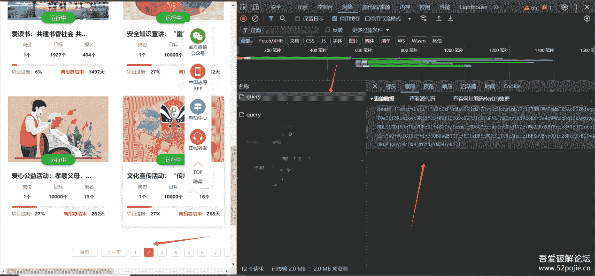

`wps_doc_33.png` (285.65 KB, 下载次数: 3)

[附件下载](https://www.52pojie.cn/forum.php?mod=attachment&aid=MjczOTM4NHxiYjI1NjAwZXwxNzkzNTcxNjI0fDE2ODA4NnwxOTg1Njk0&nothumb=yes)

2024-11-26 15:16 上传

## 第二步：找启动器

进入第一个堆栈，将断点移动到 `send` 处。

- 2.1 随意点击分页
- 2.2 再次发包，断住

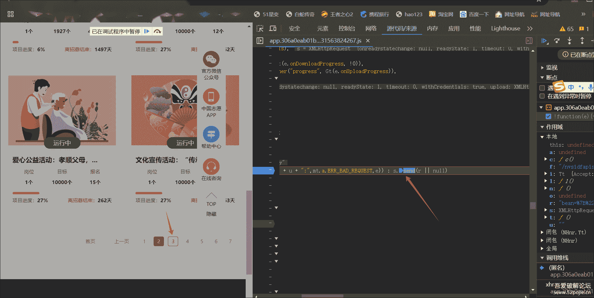

`wps_doc_0.png` (264 KB, 下载次数: 4)

[附件下载](https://www.52pojie.cn/forum.php?mod=attachment&aid=MjczOTM4NXxiZGZmNTE1NnwxNzkzNTcxNjI0fDE2ODA4NnwxOTg1Njk0&nothumb=yes)

2024-11-26 15:16 上传

## 第三步：向上跟栈

可以看到此处有个异步但不用管，因为此时 `e` 中目标参数还处于加密状态。

- 3.1 推测此处不是
- 3.2 还需要向上跟栈

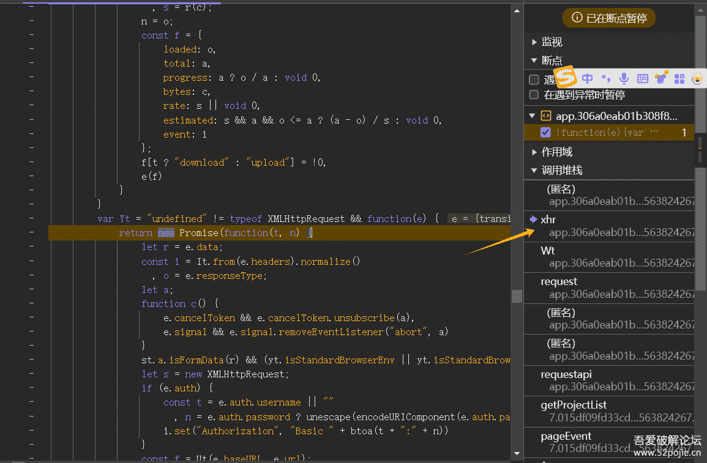

`wps_doc_1.png` (81.25 KB, 下载次数: 3)

[附件下载](https://www.52pojie.cn/forum.php?mod=attachment&aid=MjczOTM4NnxlOTdlNGY5OHwxNzkzNTcxNjI0fDE2ODA4NnwxOTg1Njk0&nothumb=yes)

2024-11-26 15:17 上传

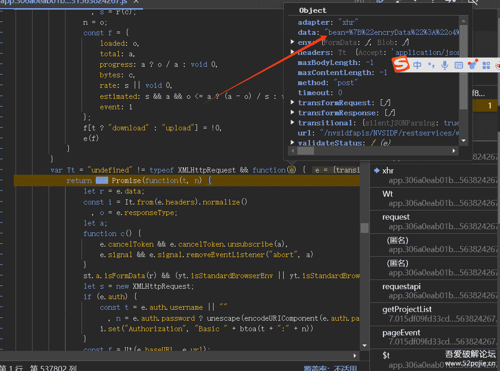

`wps_doc_2.png` (90 KB, 下载次数: 1)

[附件下载](https://www.52pojie.cn/forum.php?mod=attachment&aid=MjczOTM4N3xiOGJmZDZmOHwxNzkzNTcxNjI0fDE2ODA4NnwxOTg1Njk0&nothumb=yes)

2024-11-26 15:18 上传

## 第四步：跟到这里时

1 代表了此时断点所在处，然后向上看，可以看到 2 出现了目标参数。

- 4.1 清楚看到目标参数生成
- 4.2 将断点断在目标参数生成地方

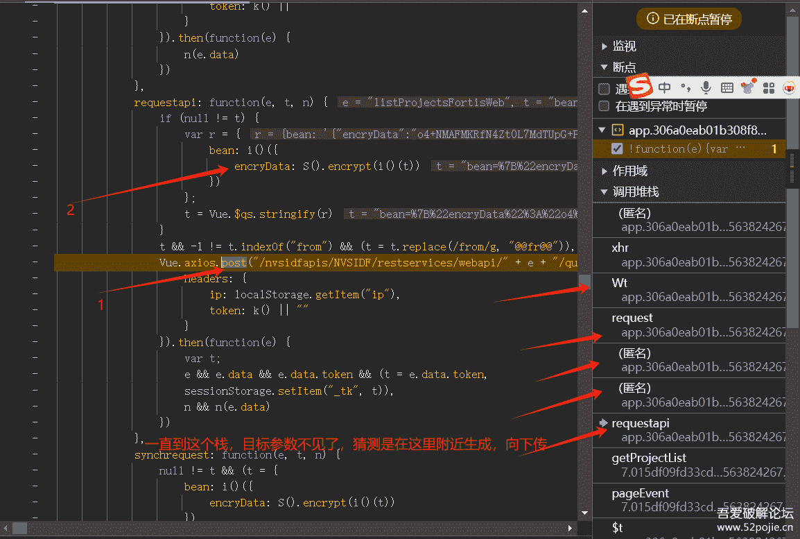

`wps_doc_3.png` (99.45 KB, 下载次数: 1)

[附件下载](https://www.52pojie.cn/forum.php?mod=attachment&aid=MjczOTM4OXxkNDNmYmE0OHwxNzkzNTcxNjI0fDE2ODA4NnwxOTg1Njk0&nothumb=yes)

2024-11-26 15:18 上传

## 第五步：按照 1 和 2 放掉断点，再次分页发送

- 5.1 在控制台打印 `t` 的值，可以看到明文，这是未加密时
- 5.2 全选中，可以看到明文被加密后的值
- 5.3 位置找到，可以开始扣取加密明文的加密函数

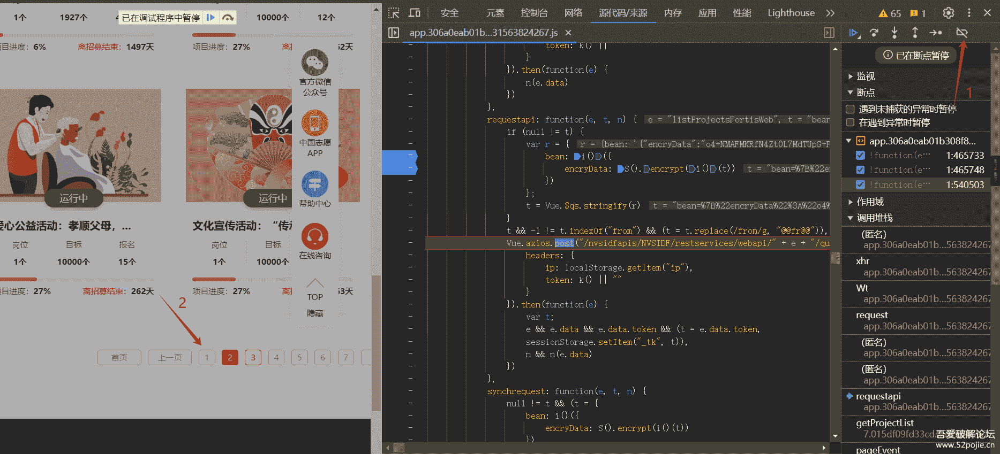

`wps_doc_4.png` (250.77 KB, 下载次数: 1)

[附件下载](https://www.52pojie.cn/forum.php?mod=attachment&aid=MjczOTM5MXxjYWU1ZWNjY3wxNzkzNTcxNjI0fDE2ODA4NnwxOTg1Njk0&nothumb=yes)

2024-11-26 15:19 上传

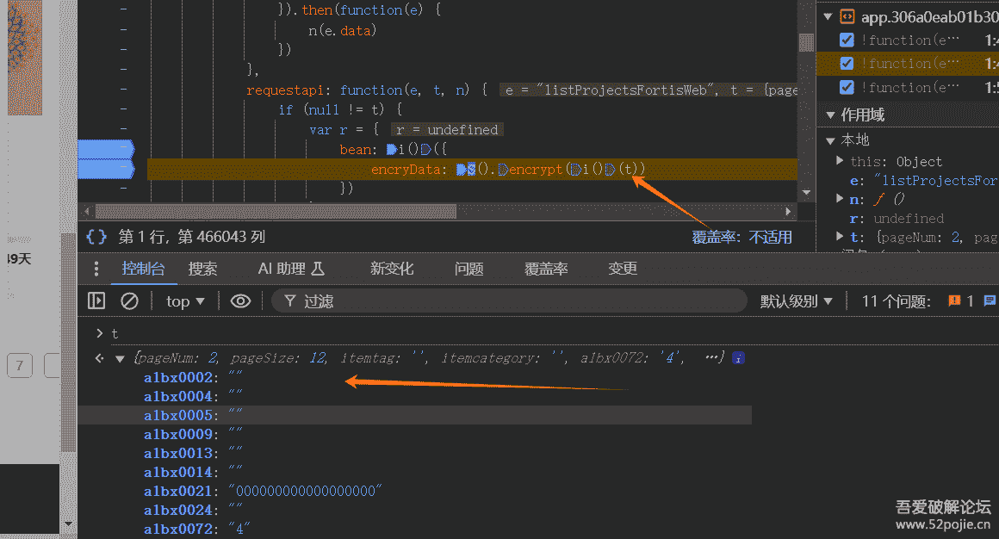

`wps_doc_5.png` (60.86 KB, 下载次数: 1)

[附件下载](https://www.52pojie.cn/forum.php?mod=attachment&aid=MjczOTM5MnxhZjdjYmY5ZnwxNzkzNTcxNjI0fDE2ODA4NnwxOTg1Njk0&nothumb=yes)

2024-11-26 15:19 上传

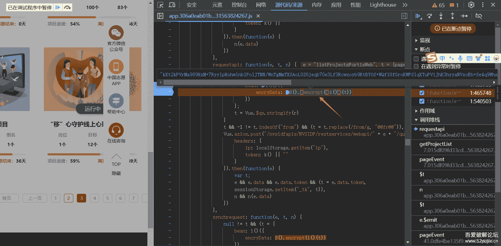

`wps_doc_6.png` (213.58 KB, 下载次数: 0)

[附件下载](https://www.52pojie.cn/forum.php?mod=attachment&aid=MjczOTM5M3xhMzk1N2MxOXwxNzkzNTcxNjI0fDE2ODA4NnwxOTg1Njk0&nothumb=yes)

2024-11-26 15:19 上传

## 第六步：可以看到这是一个 `webpack`

所以这里需要那个扣取那个，还有一个加载器。

- 6.1 分析这句代码可以得知是先是 `i()` 加密 `t`
- 6.2 然后是 `S().encrypt` 加密 6.1
- 6.3 然后再使用了一次 `i()` 加密 6.2
- 6.4 这里就不说怎样找加载器了直接跳过
- 6.5 扣取出加载器，导出备用
- 6.6 所以要扣取的加密函数为 `i()`、`S()` 这两个

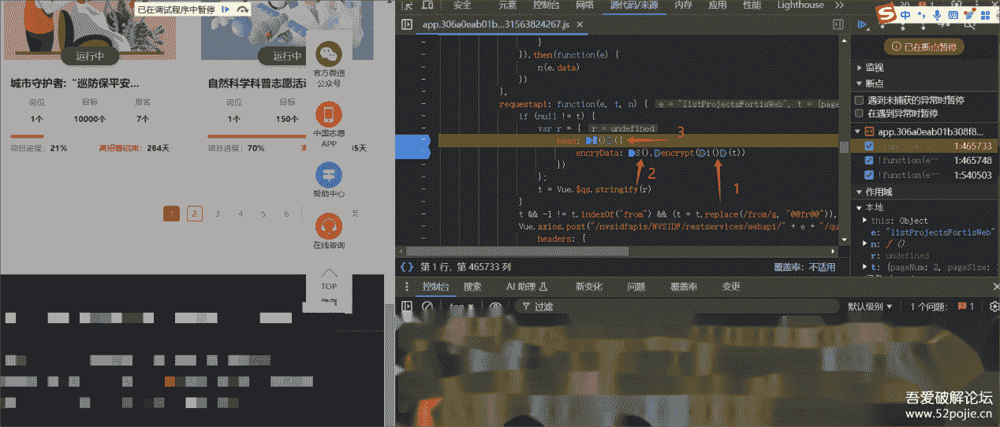

`wps_doc_7.png` (298.74 KB, 下载次数: 1)

[附件下载](https://www.52pojie.cn/forum.php?mod=attachment&aid=MjczOTM5NXxkNTk3Y2ExOXwxNzkzNTcxNjI0fDE2ODA4NnwxOTg1Njk0&nothumb=yes)

2024-11-26 15:21 上传

## 第七步：扣取函数

像扣取这种函数，就需要找他定义处，因为他肯定是在某处先定义后使用，所以：

- 7.1 将这整个代码复制到可以快速查看的工具里 Notepad++ 里面
- 7.2 进行关键字搜索，可以看到有五个相同的，但他们是一样的加密方式，所以只需要分页断点，参照第一次断住的加密位置即可

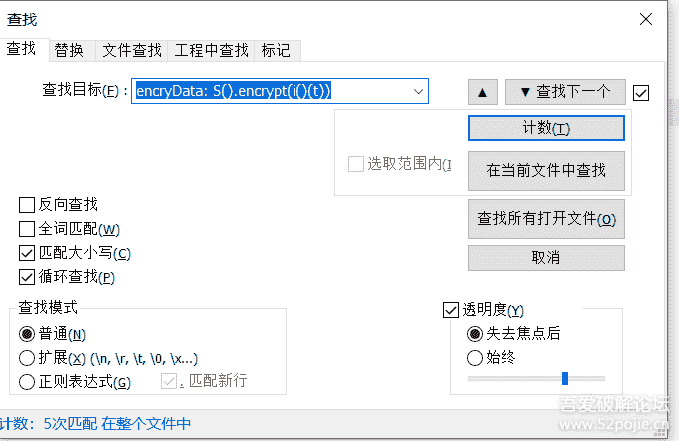

`wps_doc_8.png` (27.76 KB, 下载次数: 0)

[附件下载](https://www.52pojie.cn/forum.php?mod=attachment&aid=MjczOTM5NnxiNTlmOWU5Y3wxNzkzNTcxNjI0fDE2ODA4NnwxOTg1Njk0&nothumb=yes)

2024-11-26 15:21 上传

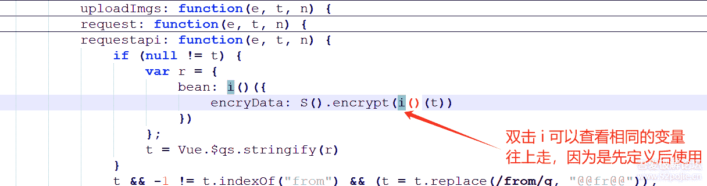

`wps_doc_9.png` (43.36 KB, 下载次数: 0)

[附件下载](https://www.52pojie.cn/forum.php?mod=attachment&aid=MjczOTM5OHw2ZGM5NGFmM3wxNzkzNTcxNjI0fDE2ODA4NnwxOTg1Njk0&nothumb=yes)

2024-11-26 15:22 上传

- 7.3 可以看到在模块开头有 `i` 的定义，同时在分析
  - 7.3.1 2 是我们需要的 `i` 加密函数，它还使用 1，也就是 `r`，`r` 加载了一个模块，所以将这两个扣取备用

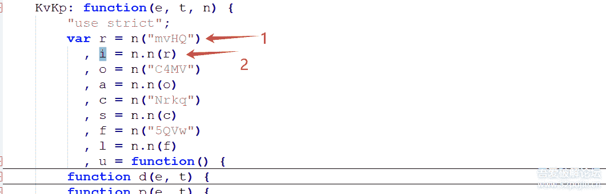

`wps_doc_10.png` (30.56 KB, 下载次数: 1)

[附件下载](https://www.52pojie.cn/forum.php?mod=attachment&aid=MjczOTQwMHxlZjU4ODk2NnwxNzkzNTcxNjI0fDE2ODA4NnwxOTg1Njk0&nothumb=yes)

2024-11-26 15:22 上传

- 7.4 接着扣取 `S()` 加密函数，先分析
  - 7.4.1 看它的样子猜测像是 RSA，如果是 RSA，他肯定在某处 `new` 了一次然后使用
  - 7.4.2 双击 `S` 可以看到就在头顶上，展开发现有 `new`，但是 `new` 的内容里面跟 AES 相似，所以跟 AES 相似，它里面还有个 `w`，也就是 3，这为变量位置也在上面 4 的位置，将它们一并扣取备用

（加密种类学的不是很好，尽请见谅，还请大佬们多多指点）

  - 7.4.3 将扣取的 `S` 加密函数放入 `code` 软件运行测试，发现报错 `A` 未定义，那么我们就要返回 Notepad++ 将 `A` 扣取出，这里就需要缺什么补什么，直到不报错

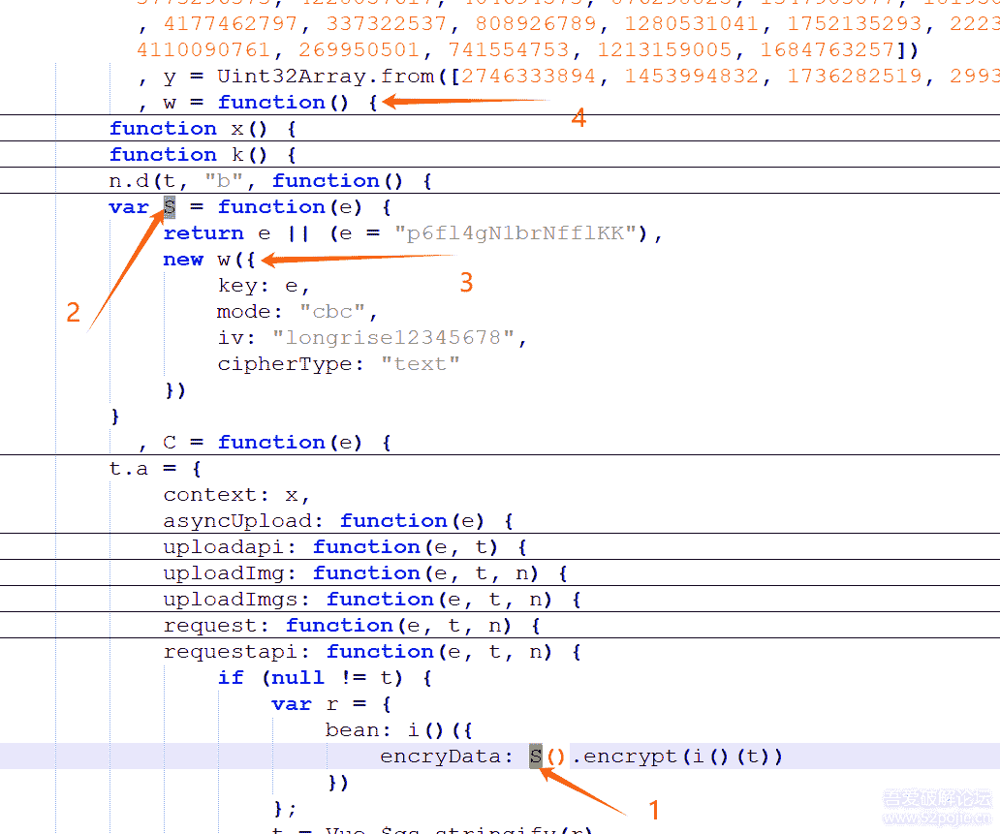

`wps_doc_11.png` (79.09 KB, 下载次数: 1)

[附件下载](https://www.52pojie.cn/forum.php?mod=attachment&aid=MjczOTQwMnxkOTdlYWM3M3wxNzkzNTcxNjI0fDE2ODA4NnwxOTg1Njk0&nothumb=yes)

2024-11-26 15:23 上传

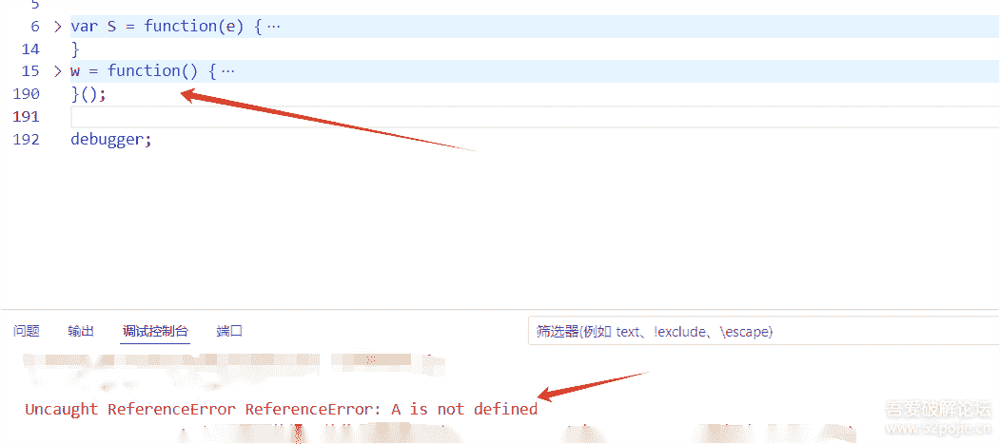

`wps_doc_12.png` (52.66 KB, 下载次数: 1)

[附件下载](https://www.52pojie.cn/forum.php?mod=attachment&aid=MjczOTQwM3xmODQ2MjAzZnwxNzkzNTcxNjI0fDE2ODA4NnwxOTg1Njk0&nothumb=yes)

2024-11-26 15:23 上传

  - 7.4.4 将 `A` 补入后，报小 `a` 未定义，返回 Notepad++，寻找发现它也是，加载的模块跟前面的 `i` 样子相同，但内容不同，扣出备用

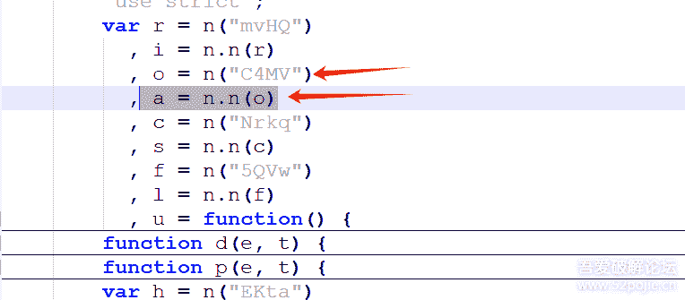

`wps_doc_13.png` (28.17 KB, 下载次数: 2)

[附件下载](https://www.52pojie.cn/forum.php?mod=attachment&aid=MjczOTQwNXwyOWFiMWEwYnwxNzkzNTcxNjI0fDE2ODA4NnwxOTg1Njk0&nothumb=yes)

2024-11-26 15:24 上传

  - 7.4.5 将之前的扣取的和现在扣取的合并为一块

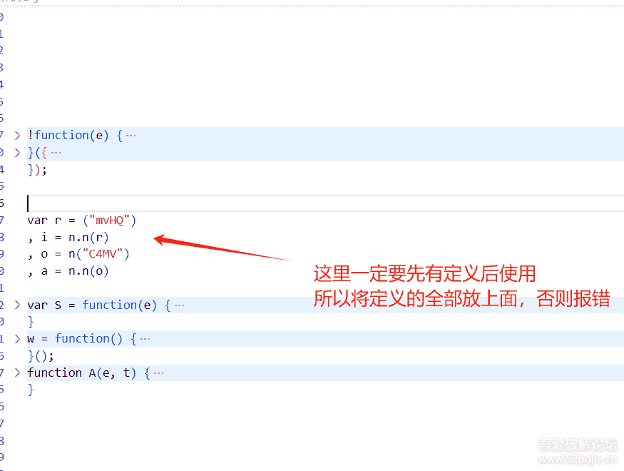

`wps_doc_14.png` (40.01 KB, 下载次数: 3)

[附件下载](https://www.52pojie.cn/forum.php?mod=attachment&aid=MjczOTQwN3xmMGQzMjY5ZXwxNzkzNTcxNjI0fDE2ODA4NnwxOTg1Njk0&nothumb=yes)

2024-11-26 15:26 上传

# 第八步 扣取 出加载器 导出使用 修改代码 可以在本地使用
## 8.1 这里就不讲加载器怎样扣取,直接到扣取后
## 8.2 将加载器整个扣取后，导出, 需要的模块也在加载器里面自带的
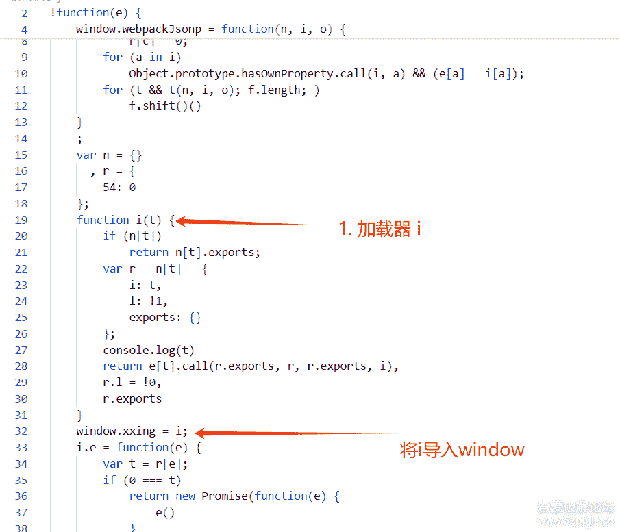
wps_doc_15.png (62.7 KB, 下载次数: 1)
[href="forum.php?mod=attachment&aid=MjczOTQwOHxiNGNjM2ZhNHwxNzkzNTcxNjI0fDE2ODA4NnwxOTg1Njk0&nothumb=yes" target="_blank"](https://www.52pojie.cn/forum.php?mod=attachment&aid=MjczOTQwOHxiNGNjM2ZhNHwxNzkzNTcxNjI0fDE2ODA4NnwxOTg1Njk0&nothumb=yes)
2024-11-26 15:27 上传
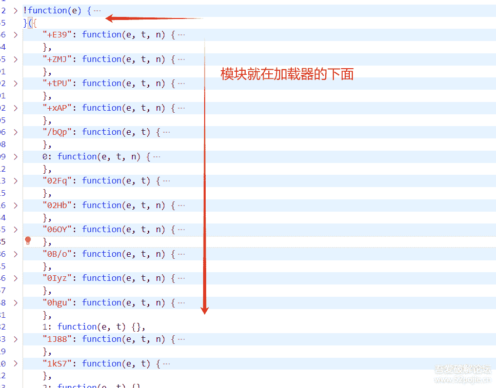
wps_doc_16.png (67.9 KB, 下载次数: 0)
[href="forum.php?mod=attachment&aid=MjczOTQwOXxiMjFlY2ZmMnwxNzkzNTcxNjI0fDE2ODA4NnwxOTg1Njk0&nothumb=yes" target="_blank"](https://www.52pojie.cn/forum.php?mod=attachment&aid=MjczOTQwOXxiMjFlY2ZmMnwxNzkzNTcxNjI0fDE2ODA4NnwxOTg1Njk0&nothumb=yes)
2024-11-26 15:27 上传
## 8.3 将原本的的n加载器 在本地 替换为 自己导出的加载器
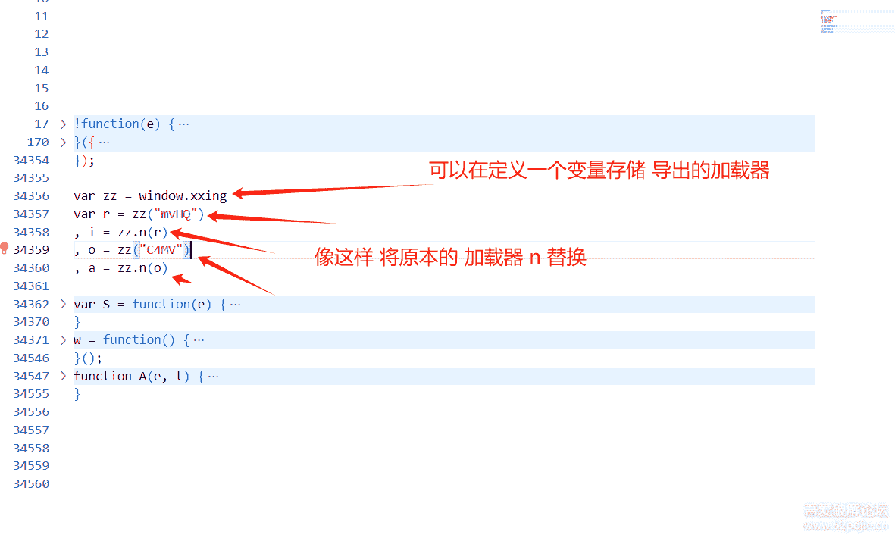
wps_doc_17.png (61.13 KB, 下载次数: 1)
[href="forum.php?mod=attachment&aid=MjczOTQxMHwzYWM1NWI3MnwxNzkzNTcxNjI0fDE2ODA4NnwxOTg1Njk0&nothumb=yes" target="_blank"](https://www.52pojie.cn/forum.php?mod=attachment&aid=MjczOTQxMHwzYWM1NWI3MnwxNzkzNTcxNjI0fDE2ODA4NnwxOTg1Njk0&nothumb=yes)
2024-11-26 15:27 上传
## 8.4 准备三个文件 `Cryptojs`、`SWEE`、`VueLazyload` 这是主体里缺失的 另外这样写可以 防止代码在一个文件里 运行慢 还有可以保持简洁保存备用

wps_doc_18.png (5.17 KB, 下载次数: 2)
[href="forum.php?mod=attachment&aid=MjczOTQxMnxmMDRlNTk4M3wxNzkzNTcxNjI0fDE2ODA4NnwxOTg1Njk0&nothumb=yes" target="_blank"](https://www.52pojie.cn/forum.php?mod=attachment&aid=MjczOTQxMnxmMDRlNTk4M3wxNzkzNTcxNjI0fDE2ODA4NnwxOTg1Njk0&nothumb=yes)
2024-11-26 15:27 上传
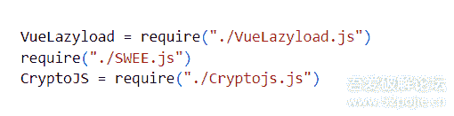
wps_doc_19.png (14.17 KB, 下载次数: 1)
[href="forum.php?mod=attachment&aid=MjczOTQxNXxjOTg3OGQxMHwxNzkzNTcxNjI0fDE2ODA4NnwxOTg1Njk0&nothumb=yes" target="_blank"](https://www.52pojie.cn/forum.php?mod=attachment&aid=MjczOTQxNXxjOTg3OGQxMHwxNzkzNTcxNjI0fDE2ODA4NnwxOTg1Njk0&nothumb=yes)
2024-11-26 15:28 上传
## 8.5 然后点击运行可以看到 会依次报错以下三个

wps_doc_20.png (3.34 KB, 下载次数: 2)
[href="forum.php?mod=attachment&aid=MjczOTQxN3xmMDgyNmYyOXwxNzkzNTcxNjI0fDE2ODA4NnwxOTg1Njk0&nothumb=yes" target="_blank"](https://www.52pojie.cn/forum.php?mod=attachment&aid=MjczOTQxN3xmMDgyNmYyOXwxNzkzNTcxNjI0fDE2ODA4NnwxOTg1Njk0&nothumb=yes)
2024-11-26 15:29 上传

wps_doc_21.png (4.36 KB, 下载次数: 0)
[href="forum.php?mod=attachment&aid=MjczOTQxOHw3MzE0NjhhZHwxNzkzNTcxNjI0fDE2ODA4NnwxOTg1Njk0&nothumb=yes" target="_blank"](https://www.52pojie.cn/forum.php?mod=attachment&aid=MjczOTQxOHw3MzE0NjhhZHwxNzkzNTcxNjI0fDE2ODA4NnwxOTg1Njk0&nothumb=yes)
2024-11-26 15:29 上传

wps_doc_22.png (5.45 KB, 下载次数: 2)
[href="forum.php?mod=attachment&aid=MjczOTQxOXwxNDExNzUwYnwxNzkzNTcxNjI0fDE2ODA4NnwxOTg1Njk0&nothumb=yes" target="_blank"](https://www.52pojie.cn/forum.php?mod=attachment&aid=MjczOTQxOXwxNDExNzUwYnwxNzkzNTcxNjI0fDE2ODA4NnwxOTg1Njk0&nothumb=yes)
2024-11-26 15:29 上传
# 第九步 寻找这三个文件 按照顺序 可以发现其实 这三个是 分开的独立文件
## 9.1 `CryptoJS`
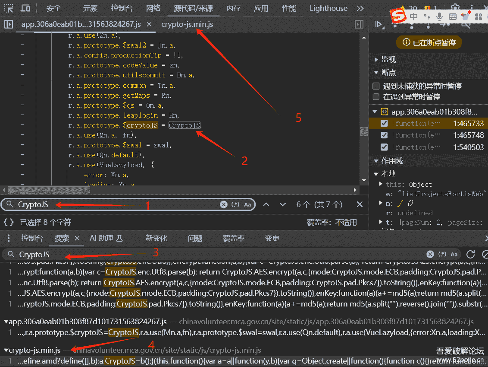
wps_doc_23.png (151.56 KB, 下载次数: 3)
[href="forum.php?mod=attachment&aid=MjczOTQyMHw0ZWY2N2RiMXwxNzkzNTcxNjI0fDE2ODA4NnwxOTg1Njk0&nothumb=yes" target="_blank"](https://www.52pojie.cn/forum.php?mod=attachment&aid=MjczOTQyMHw0ZWY2N2RiMXwxNzkzNTcxNjI0fDE2ODA4NnwxOTg1Njk0&nothumb=yes)
2024-11-26 15:30 上传
## 9.2 `swal`
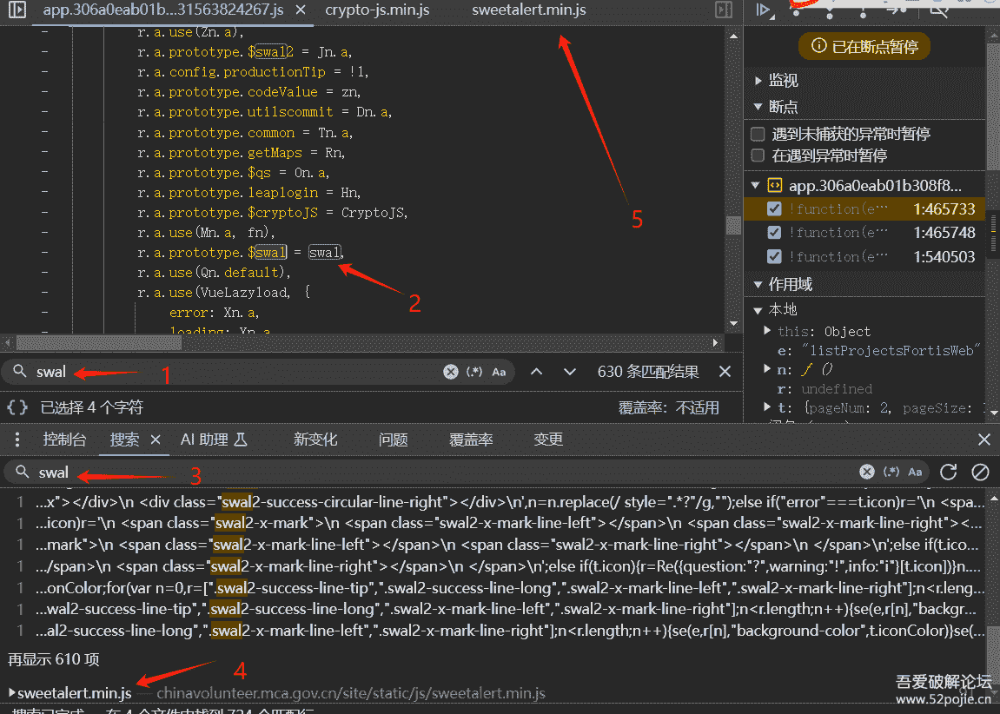
wps_doc_24.png (128.24 KB, 下载次数: 1)
[href="forum.php?mod=attachment&aid=MjczOTQyMXxmZjMzNjA5NXwxNzkzNTcxNjI0fDE2ODA4NnwxOTg1Njk0&nothumb=yes" target="_blank"](https://www.52pojie.cn/forum.php?mod=attachment&aid=MjczOTQyMXxmZjMzNjA5NXwxNzkzNTcxNjI0fDE2ODA4NnwxOTg1Njk0&nothumb=yes)
2024-11-26 15:30 上传
## 9.3 `VueLazyload`
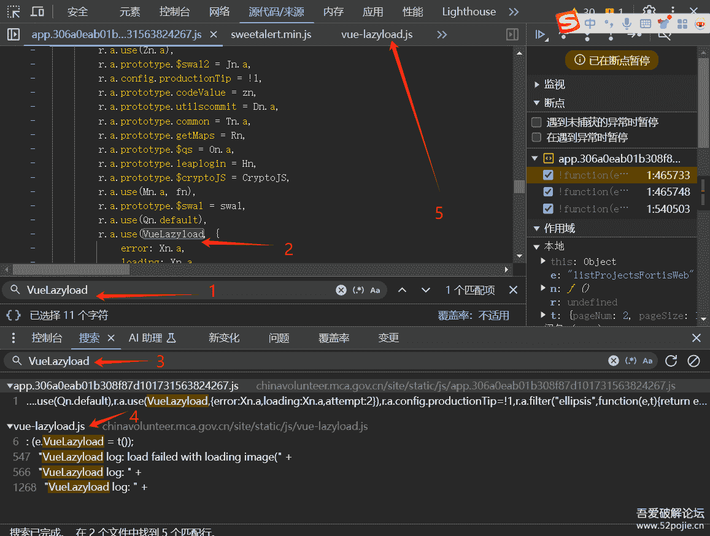
wps_doc_25.png (127.68 KB, 下载次数: 0)
[href="forum.php?mod=attachment&aid=MjczOTQyMnw3NDdiMjZlYnwxNzkzNTcxNjI0fDE2ODA4NnwxOTg1Njk0&nothumb=yes" target="_blank"](https://www.52pojie.cn/forum.php?mod=attachment&aid=MjczOTQyMnw3NDdiMjZlYnwxNzkzNTcxNjI0fDE2ODA4NnwxOTg1Njk0&nothumb=yes)
2024-11-26 15:30 上传
找到之后 分别放入 之前创建备用的三个的文件中,导入主代码，运行
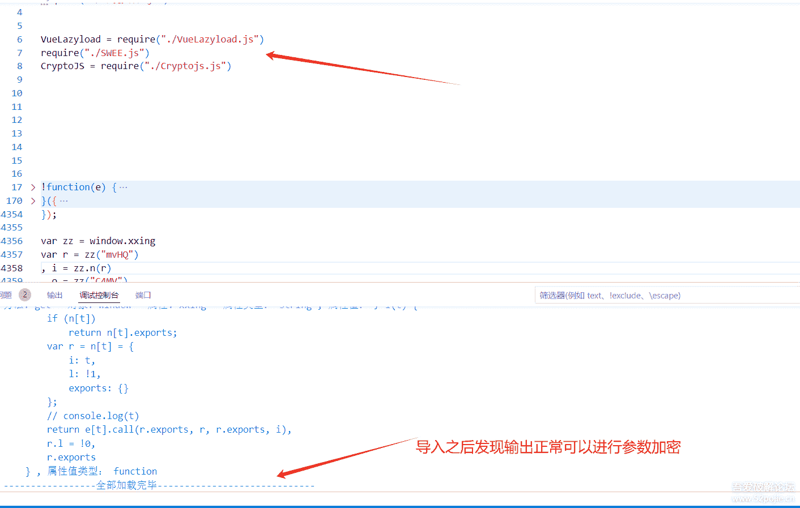
wps_doc_26.png (70.14 KB, 下载次数: 1)
[href="forum.php?mod=attachment&aid=MjczOTQyM3xkNzA5Yjk5NXwxNzkzNTcxNjI0fDE2ODA4NnwxOTg1Njk0&nothumb=yes" target="_blank"](https://www.52pojie.cn/forum.php?mod=attachment&aid=MjczOTQyM3xkNzA5Yjk5NXwxNzkzNTcxNjI0fDE2ODA4NnwxOTg1Njk0&nothumb=yes)
2024-11-26 15:31 上传
# 第十步 调用 加密函数 将参数加密
## 10.1 将明文数据进行 打印复制到本地
## 10.2 根据浏览器 加密的样子 粘贴复制
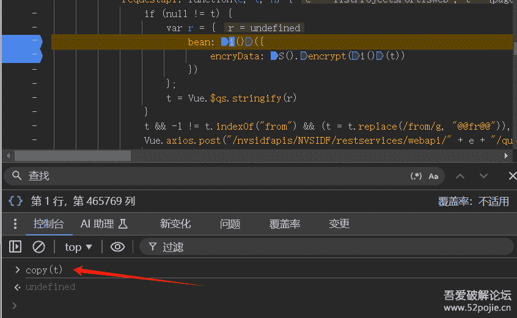
wps_doc_27.png (36.78 KB, 下载次数: 0)
[href="forum.php?mod=attachment&aid=MjczOTQyNHw4MjRhODg3N3wxNzkzNTcxNjI0fDE2ODA4NnwxOTg1Njk0&nothumb=yes" target="_blank"](https://www.52pojie.cn/forum.php?mod=attachment&aid=MjczOTQyNHw4MjRhODg3N3wxNzkzNTcxNjI0fDE2ODA4NnwxOTg1Njk0&nothumb=yes)
2024-11-26 15:31 上传
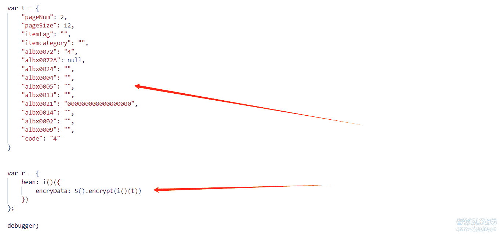
wps_doc_28.png (45.68 KB, 下载次数: 2)
[href="forum.php?mod=attachment&aid=MjczOTQyNXxmZDRhMGQxYXwxNzkzNTcxNjI0fDE2ODA4NnwxOTg1Njk0&nothumb=yes" target="_blank"](https://www.52pojie.cn/forum.php?mod=attachment&aid=MjczOTQyNXxmZDRhMGQxYXwxNzkzNTcxNjI0fDE2ODA4NnwxOTg1Njk0&nothumb=yes)
2024-11-26 15:31 上传
## 10.3 运行发生报错，原因是因为，扣少了，所以进行将`S`加密函数导出 使用在本地代码中搜索 目标位置 导出
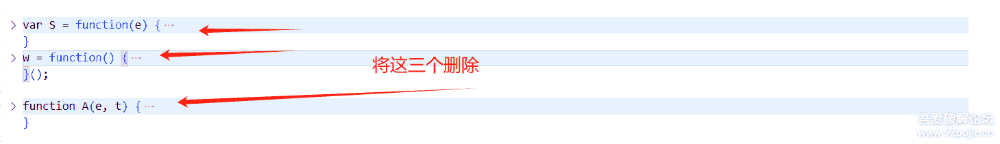
wps_doc_29.png (21.77 KB, 下载次数: 0)
[href="forum.php?mod=attachment&aid=MjczOTQyNnw0NmJmNTBkZHwxNzkzNTcxNjI0fDE2ODA4NnwxOTg1Njk0&nothumb=yes" target="_blank"](https://www.52pojie.cn/forum.php?mod=attachment&aid=MjczOTQyNnw0NmJmNTBkZHwxNzkzNTcxNjI0fDE2ODA4NnwxOTg1Njk0&nothumb=yes)
2024-11-26 15:32 上传
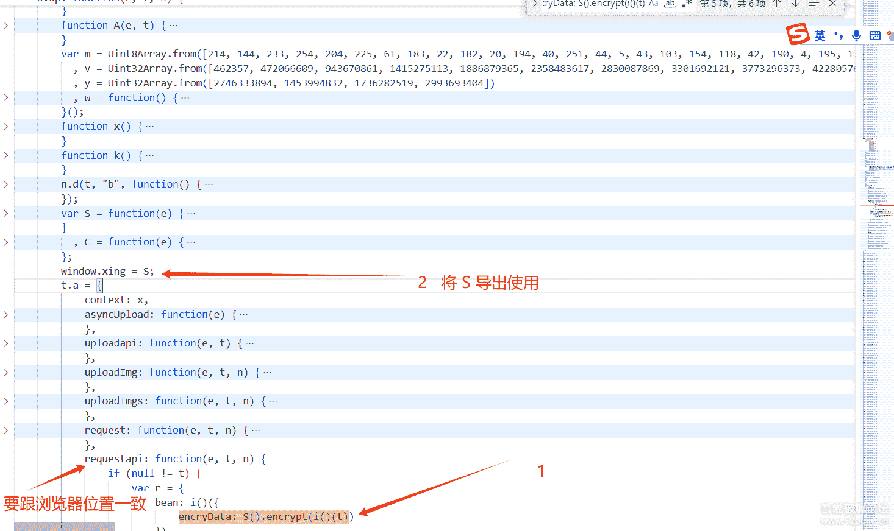
wps_doc_30.png (125.26 KB, 下载次数: 1)
[href="forum.php?mod=attachment&aid=MjczOTQyN3w2MjAzYTkxY3wxNzkzNTcxNjI0fDE2ODA4NnwxOTg1Njk0&nothumb=yes" target="_blank"](https://www.52pojie.cn/forum.php?mod=attachment&aid=MjczOTQyN3w2MjAzYTkxY3wxNzkzNTcxNjI0fDE2ODA4NnwxOTg1Njk0&nothumb=yes)
2024-11-26 15:32 上传
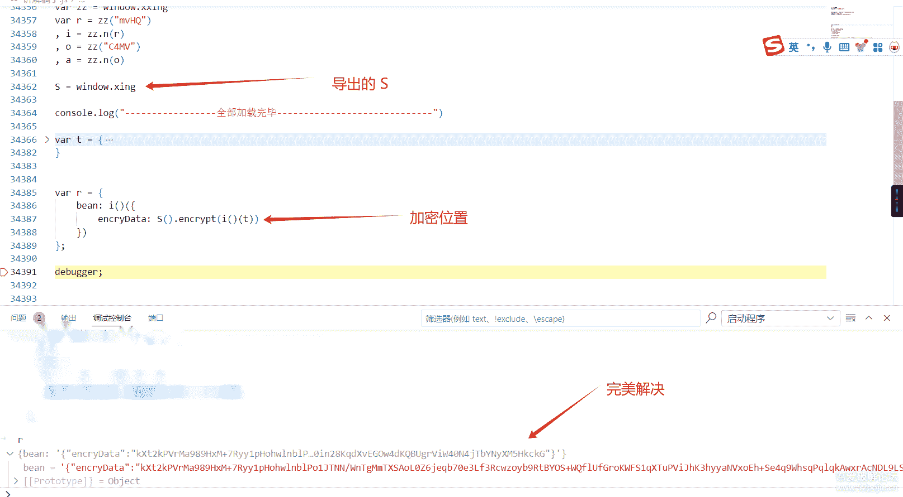
wps_doc_31.png (145.73 KB, 下载次数: 2)
[href="forum.php?mod=attachment&aid=MjczOTQyOHwzYTI5NGJiNXwxNzkzNTcxNjI0fDE2ODA4NnwxOTg1Njk0&nothumb=yes" target="_blank"](https://www.52pojie.cn/forum.php?mod=attachment&aid=MjczOTQyOHwzYTI5NGJiNXwxNzkzNTcxNjI0fDE2ODA4NnwxOTg1Njk0&nothumb=yes)
2024-11-26 15:32 上传
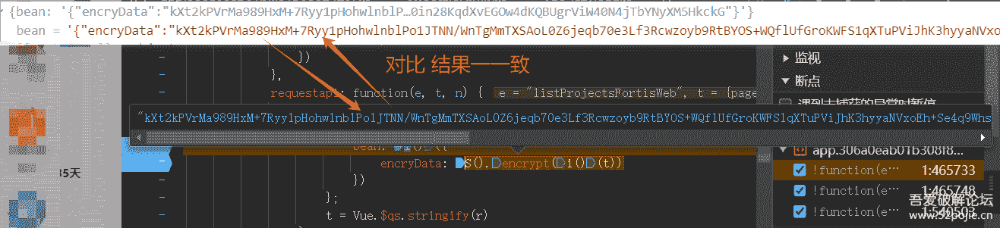
wps_doc_32.png (63.33 KB, 下载次数: 1)
[href="forum.php?mod=attachment&aid=MjczOTQzMHw5ZDI3MDljNnwxNzkzNTcxNjI0fDE2ODA4NnwxOTg1Njk0&nothumb=yes" target="_blank"](https://www.52pojie.cn/forum.php?mod=attachment&aid=MjczOTQzMHw5ZDI3MDljNnwxNzkzNTcxNjI0fDE2ODA4NnwxOTg1Njk0&nothumb=yes)
2024-11-26 15:32 上传
## 总结 :
1.在本地运行 需要补环境 将所扣代码放入浏览器 进行验证补环境在这不做讲解
2. 需要注意明文的 一致性 否则会导致加密结果不一致
## 结束语：第一次做文章 不足之处 还有很多 希望大佬们 可以留言对我的不足之处 进行指点

