# [原创] 新手学破解记录贴【160个CrackMe】之005

- 原帖: [https://www.52pojie.cn/forum.php?mod=viewthread&tid=1985792](https://www.52pojie.cn/forum.php?mod=viewthread&tid=1985792)
- 抓取时间: 2026-11-01T22:20:24

本人刚刚入门汇编逆向[分析](https://www.52pojie.cn)，本帖将记录我对160个CrackMe程序中的第005程序的分析过程。在学习的过程中，我会边学边记录。如果有不正确之处，还请各位指正。

程序打开后有一个文本框和一个图片框在进行轮播图片还有一个注册按钮，右边文本是作者给的介绍和提示。

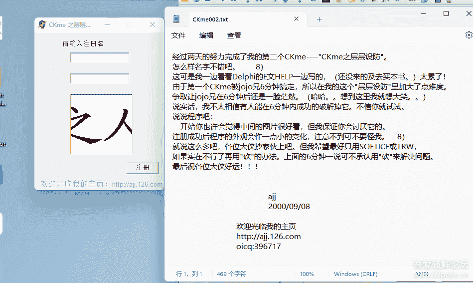

[`image.png` (91.58 KB, 下载次数: 1)](https://www.52pojie.cn/forum.php?mod=attachment&aid=MjczOTM4M3w5NDdlYjMwNnwxNzkzNTcxNjIyfDE2ODA4NnwxOTg1Nzky&nothumb=yes)

2024-11-26 15:15 上传

查了一下壳是`upx`的压缩壳，先用通用[脱壳](https://www.52pojie.cn/forum-5-1.html)机进行脱壳。

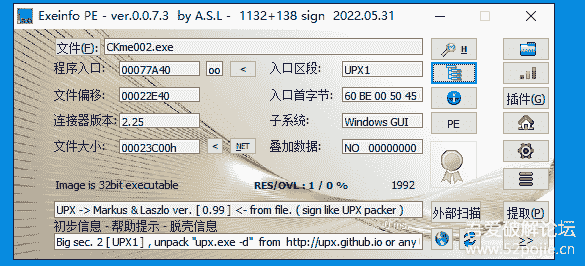

[`image.png` (122.36 KB, 下载次数: 2)](https://www.52pojie.cn/forum.php?mod=attachment&aid=MjczOTM4OHwxY2U1MmNmYXwxNzkzNTcxNjIyfDE2ODA4NnwxOTg1Nzky&nothumb=yes)

2024-11-26 15:18 上传


[`image.png` (40.96 KB, 下载次数: 2)](https://www.52pojie.cn/forum.php?mod=attachment&aid=MjczOTM5MHxhMTc1ZGQxYXwxNzkzNTcxNjIyfDE2ODA4NnwxOTg1Nzky&nothumb=yes)

2024-11-26 15:19 上传

还是查找字符串，看一下有没有有用的字符，通过搜索字符串我们看到了`"注册了"`这个位置，我们进去看一下。

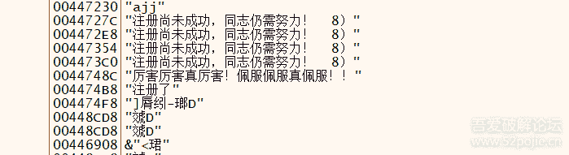

[`image.png` (25.05 KB, 下载次数: 1)](https://www.52pojie.cn/forum.php?mod=attachment&aid=MjczOTM5OXw3NTg0NjZmMHwxNzkzNTcxNjIyfDE2ODA4NnwxOTg1Nzky&nothumb=yes)

2024-11-26 15:22 上传

可以看到上面有5个跳转，我们要让代码能顺利走到字符串`"注册了"`这个位置才能注册成功，所以先把这5个跳转全部`nop`试一下。

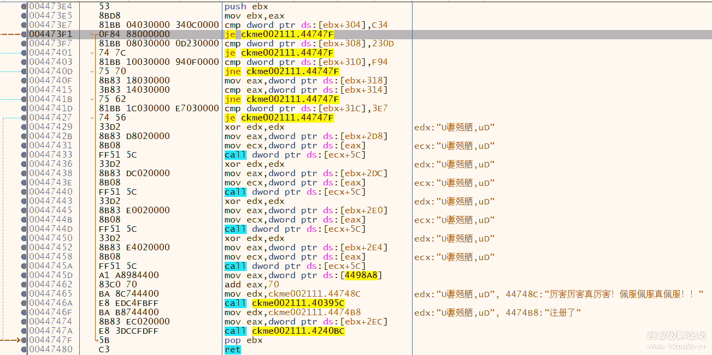

[`image.png` (168.77 KB, 下载次数: 1)](https://www.52pojie.cn/forum.php?mod=attachment&aid=MjczOTQwMXwzNDk0MzYxZHwxNzkzNTcxNjIyfDE2ODA4NnwxOTg1Nzky&nothumb=yes)

2024-11-26 15:23 上传

`nop`掉之后，爆破就成功了。

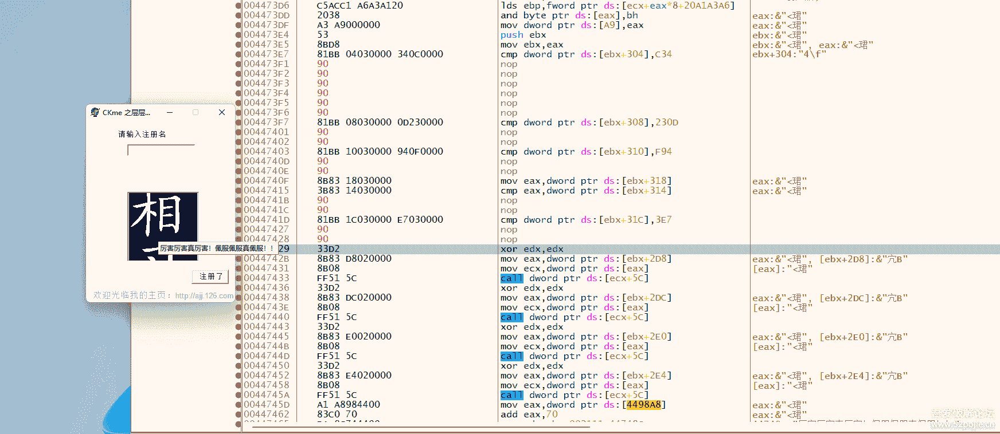

[`image.png` (219.63 KB, 下载次数: 1)](https://www.52pojie.cn/forum.php?mod=attachment&aid=MjczOTQxNHxiYmIxMWM4N3wxNzkzNTcxNjIyfDE2ODA4NnwxOTg1Nzky&nothumb=yes)

2024-11-26 15:28 上传

继续来研究下它的注册算法，通过上面爆破发现核心在这5个比较跳转，只要让跳转能顺利走到字符串`"注册了"`这个位置哪就算成功了。这5个比较是一个循环检测，并不需要点击注册按钮。

```asm
```


# 关键比较分析

## 初始反汇编片段

```asm
004473E7 | 81BB 04030000 340C0000      | cmp dword ptr ds:[ebx+304],C34                      |  exb+304 地址的值 和 0xC34 比较
004473F1 | 0F84 88000000               | je ckme002.44747F                                   |
004473F7 | 81BB 08030000 0D230000      | cmp dword ptr ds:[ebx+308],230D                     | ebx+308地址的值 和 0x230D比较
00447401 | 74 7C                       | je ckme002.44747F                                   |
00447403 | 81BB 10030000 940F0000      | cmp dword ptr ds:[ebx+310],F94                      | ebx+31 地址的值 和 0xF94 比较
0044740D | 75 70                       | jne ckme002.44747F                                  |
0044740F | 8B83 18030000               | mov eax,dword ptr ds:[ebx+318]                      |
00447415 | 3B83 14030000               | cmp eax,dword ptr ds:[ebx+314]                      | 相当于  ebx+318 和 ebx+314 地址的值比较
0044741B | 75 62                       | jne ckme002.44747F                                  |
0044741D | 81BB 1C030000 E7030000      | cmp dword ptr ds:[ebx+31C],3E7                      |
00447427 | 74 56                       | je ckme002.44747F                                   |
```

现在就要主要看这 5 个重要的比较。

## 比较1：`cmp dword ptr ds:[ebx+304],C34`

`exb+0x304` 和 `0xC34` 进行比较。如果相等就跳转，否则不跳转。这个比较肯定要让它不等于 `0xC34`，才能走到下一个跳转里面。那目前的重点就是：怎么找到 `exb+0x304` 地址的值是在哪里有赋值操作的。看它比较的时候固定和 `0xC34` 做比较，先搜索一下常量 `0xC34` 看一下。

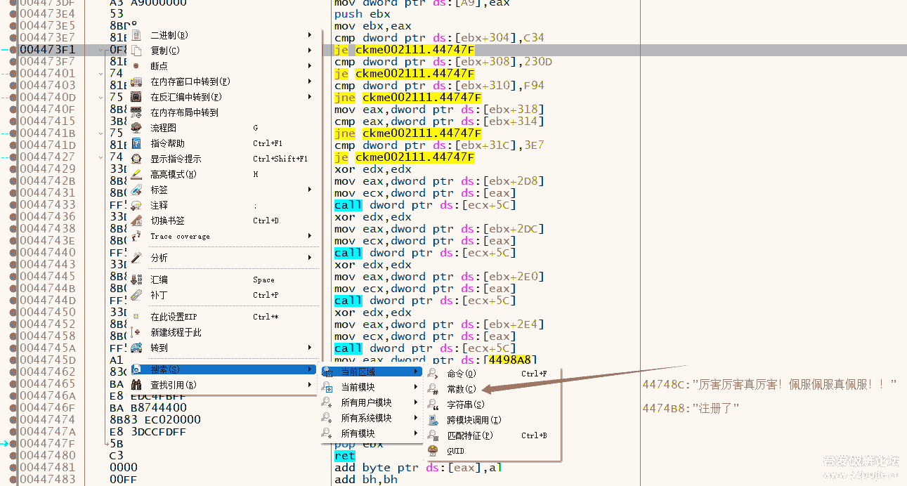

[附件](https://www.52pojie.cn/forum.php?mod=attachment&aid=MjczOTQzMnxmODU1ZTkwZHwxNzkzNTcxNjIyfDE2ODA4NnwxOTg1Nzky&nothumb=yes)

*2024-11-26 15:33 上传*

搜索完，我们发现有 3 个位置使用了 `0xC34` 这个常量值，赋值操作只有第一个和第二个，所以只看这两个。

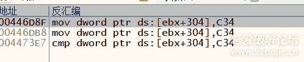

[附件](https://www.52pojie.cn/forum.php?mod=attachment&aid=MjczOTQzNXxhNTE5ZTQyYnwxNzkzNTcxNjIyfDE2ODA4NnwxOTg1Nzky&nothumb=yes)

*2024-11-26 15:36 上传*

这两个赋值 `0xC34` 的地方有两个跳转：第一个跳转要让它不进行跳转，第二个跳转要让它进行跳转，才可以避免赋值 `0x3C`。在跳转这个地方下一个断点，不知道这个断点是怎么触发的，推测是启动的时候就判断个什么东西，然后给赋了一个初始值（因为我之前下了硬件访问断点，发现后面并没有什么操作能让它断下来，才有的这个推测）。

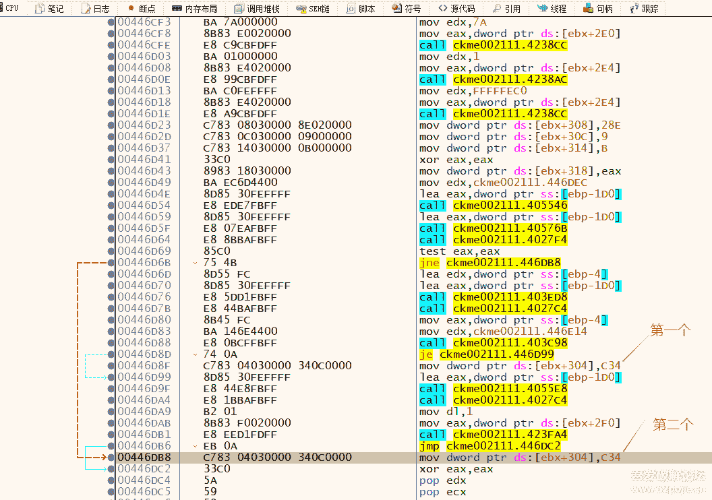

[附件](https://www.52pojie.cn/forum.php?mod=attachment&aid=MjczOTQzN3xjZGUzNWZhZHwxNzkzNTcxNjIyfDE2ODA4NnwxOTg1Nzky&nothumb=yes)

*2024-11-26 15:38 上传*

果然，重启之后直接断了下来。我们看一下这部分的代码来分析一下：首先会判断 `X:\ajj.126.c0m\j\o\j\o\ok.txt` 这个路径是否存在，如果不存在，直接跳转赋值 `0xC34`。

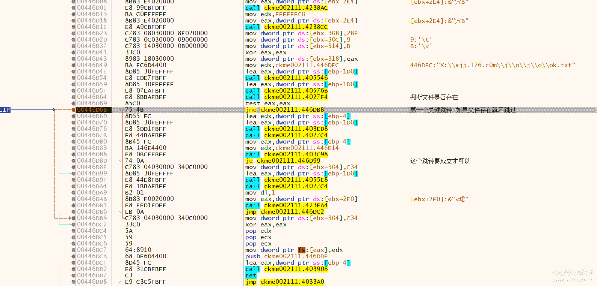

[附件](https://www.52pojie.cn/forum.php?mod=attachment&aid=MjczOTQzOXw0Mjk2NWE3NHwxNzkzNTcxNjIyfDE2ODA4NnwxOTg1Nzky&nothumb=yes)

*2024-11-26 15:40 上传*

因为我电脑并没有 X 盘，所以我把它改成了 C 盘，这样第一个跳转就不会成立了。

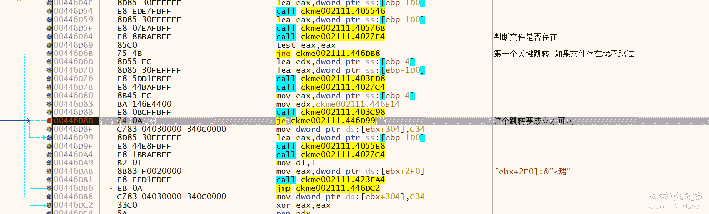

[附件](https://www.52pojie.cn/forum.php?mod=attachment&aid=MjczOTQ0MHxjMGVlMWFjZnwxNzkzNTcxNjIyfDE2ODA4NnwxOTg1Nzky&nothumb=yes)

*2024-11-26 15:42 上传*

再来看一下第二个跳转，有 3 个 `CALL`，大概执行的功能就是把文本里面的值读出来，跟固定读取出来的内容和 `0x446E14` 内存地址里面的字符做对比。需要让它一致，这个跳转才能跳过。

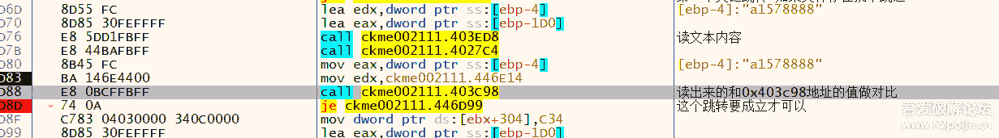

[附件](https://www.52pojie.cn/forum.php?mod=attachment&aid=MjczOTQ0M3w2YTY0ZDVmZHwxNzkzNTcxNjIyfDE2ODA4NnwxOTg1Nzky&nothumb=yes)

*2024-11-26 15:46 上传*

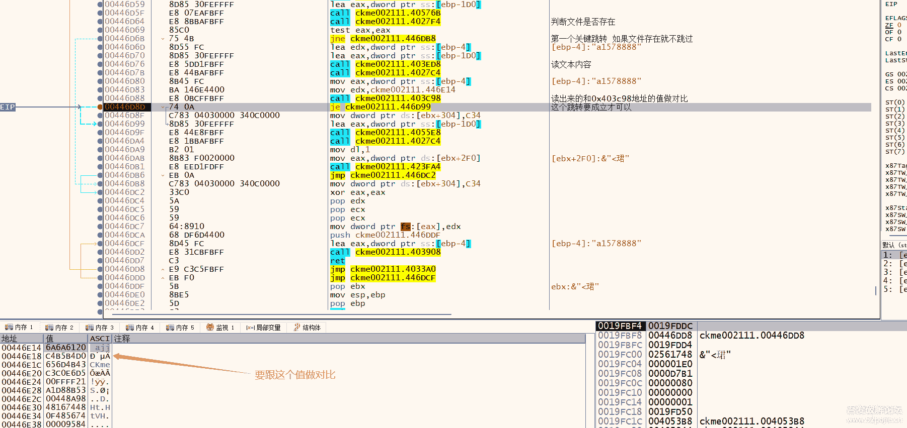

[附件](https://www.52pojie.cn/forum.php?mod=attachment&aid=MjczOTQ0NHxiZmEwODdkMHwxNzkzNTcxNjIyfDE2ODA4NnwxOTg1Nzky&nothumb=yes)

*2024-11-26 15:53 上传*

因为 `0x446E14` 地址里面的字符串是乱码（不知道是什么编码），所以我们直接用 `Win Hex` 把这个 16 进制数据储存进去：

```text
00446E14 6A6A6120  ajj
00446E18 C4B5B4D0  &#208;&#180;&#181;&#196;
00446E1C 656D4B43  CKme
00446E20 C3C0E6D5  &#213;&#230;&#192;&#195;
00446E24 00FFFF21  !&#255;&#255;.
```

内存是小端序存储，并且字符串是以 0 结尾，所以我们的格式应该是：`20 61 6A 6A D0 B4 B5 C4 43 4B 6D 65 D5 E6 C0 C3 21 FF FF`。

储存完成之后，再运行程序，这个跳转已经能跳过了。至此，我们的 5 个比较中，第 1 个已经搞定了。

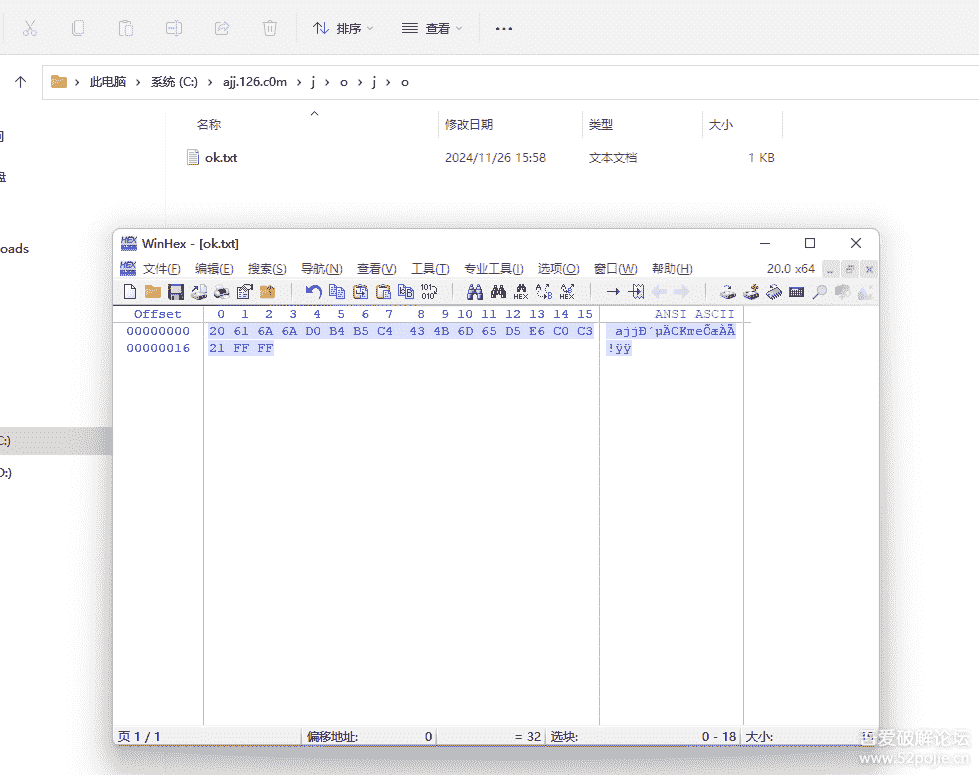

[附件](https://www.52pojie.cn/forum.php?mod=attachment&aid=MjczOTQ0NXw1OWZjNTUzZXwxNzkzNTcxNjIyfDE2ODA4NnwxOTg1Nzky&nothumb=yes)

*2024-11-26 15:58 上传*

第 1 个比较搞定后发现，程序界面多出来了一个文本框，但是不能输入任何内容。先不管它，继续看第二个比较。

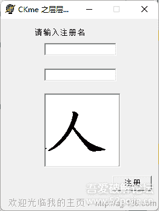

[附件](https://www.52pojie.cn/forum.php?mod=attachment&aid=MjczOTQ0N3xhODM5ZjE3M3wxNzkzNTcxNjIyfDE2ODA4NnwxOTg1Nzky&nothumb=yes)

*2024-11-26 16:01 上传*

## 比较2：`cmp dword ptr ds:[ebx+308],230D`

`ebx+308` 地址的值和 `0x230D` 进行比较，也是一样，要让 `ebx+308` 地址里面的值不等于 `0x230D` 才可以，还是搜索常量看一下。搜索后发现在这个位置有赋值 `0x230D` 的操作。但是这块代码是怎么触发的呢？目前程序上只有一个可用的文本框、一个不可用的文本框和一个注册按钮。

首先重启一下程序，看一下会不会断下来。重启后发现程序并不会断下来，继续在可输入文本框里面输入内容，发现也不会断下来。那现在能操作的就只有这个注册按钮了，如果点击注册按钮也断不下来，那就只能用 `e2a` 看一下这个程序都有哪些事件，然后逐一查看了。

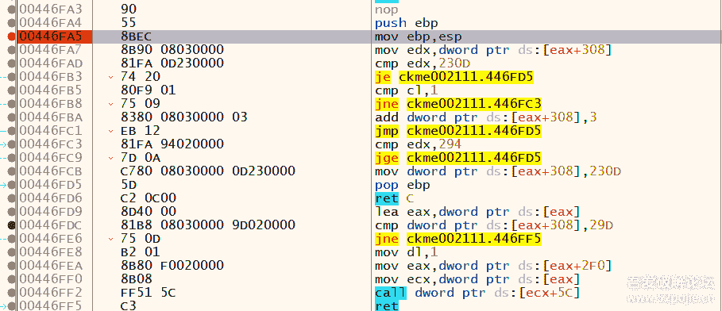

[附件](https://www.52pojie.cn/forum.php?mod=attachment&aid=MjczOTQ1OHxlNTBhNWE3YnwxNzkzNTcxNjIyfDE2ODA4NnwxOTg1Nzky&nothumb=yes)

*2024-11-26 16:06 上传*

好在点击注册断了下来。既然断下来了，我们就来逐行分析一下代码。

```asm
00446FA4 | 55                          | push ebp                                     |
00446FA5 | 8BEC                        | mov ebp,esp                                  |
00446FA7 | 8B90 08030000               | mov edx,dword ptr ds:[eax+308]               | eax+308 就是 第2个比较的ebx+308的位置
00446FAD | 81FA 0D230000               | cmp edx,230D                                 | 取出 第2个比较值 和 0x23D作比较  初始值为 0x28E
00446FB3 | 74 20                       | je ckme002111.446FD5                         | 如果成立 相当于就不会赋值 0x230D
00446FB5 | 80F9 01                     | cmp cl,1                                     |
00446FB8 | 75 09                       | jne ckme002111.446FC3                        | 如果cl等于0x1 就会给 第2个比较的值增加0x3 并且jmp跳过赋值0x230D
00446FBA | 8380 08030000 03            | add dword ptr ds:[eax+308],3                 |
00446FC1 | EB 12                       | jmp ckme002111.446FD5                        |
00446FC3 | 81FA 94020000               | cmp edx,294                                  |
00446FC9 | 7D 0A                       | jge ckme002111.446FD5                        | 如果第2个比较的值大于等于0x294 就不会赋值0x23D
00446FCB | C780 08030000 0D230000      | mov dword ptr ds:[eax+308],230D              |
00446FD5 | 5D                          | pop ebp                                      |
00446FD6 | C2 0C00                     | ret C                                        |
```

通过上面代码，有几个疑问：


# 注册按钮及鼠标事件逆向分析

## 1. 未点击注册按钮的情况
如果我不点击注册按钮 那它的初始值就默认是 `0x28E` 了 跟 `0x23D` 直接就不一样了 我不点击注册不就直接可以了吗？

## 2. 点击注册后的比较
如果我点击了注册那还有一个比较 那就是 `cl` 寄存器 和 `0x1` 比较 只有相等才不会赋值 `0x23D` 并且还会把第二个比较值加 `0x3`。如果点击注册必须让 `cl` 寄存器的值等于 `0x1` 才行 那 `cl` 寄存器代表的到底是什么 ？

如果我不点击注册 第二个比较确实直接就搞定了，可是我不点击注册 我应该操作什么 ？思路直接就卡死了。。。我要是点击注册 那必须要让 `cl` 寄存器的值为 `0x1`。

后面代码 `cl` 寄存器不等于 `0x1` 会再次比较第二个初始值是否大于等于 `0x294` 如果大于等于 它也不会赋值 `0x23D`。 因为初始值是 `0x28E` 如果想让他达到 `0x294` 就要加 2 次 `0x3`，直接点说就是：点击注册的前两次 只要 `cl` 寄存器的值为 `0x1` 后面在点击 注册 无论它是不是 `0x1` 都不会赋值 `0x23D` 了。

分析到现在卡死了 我决定重新用 `e2a` 分析一下这个程序到底都有哪些事件。 针对事件在一点点进行梳理。通过 `e2a` 查看组件的事件 我们发现 有好多隐藏的动作是我们不知道的，比如 图片框有双击事件 每个图片也有对应的鼠标按下事件等等...

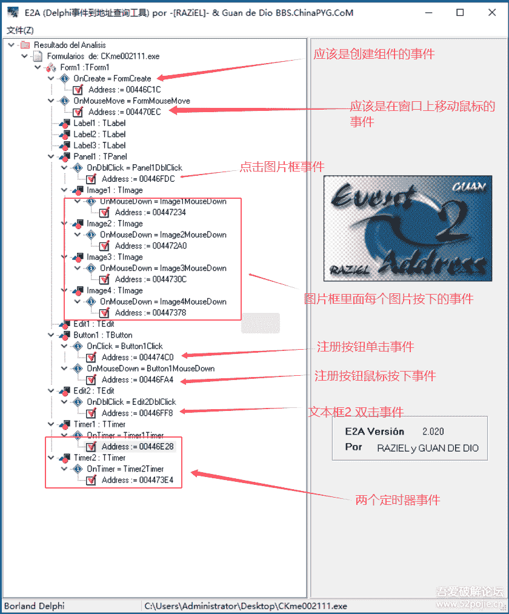
image.png (310.57 KB, 下载次数: 1)
[href="forum.php?mod=attachment&aid=MjczOTQ2MHwxNmQ4ZjdmNXwxNzkzNTcxNjIyfDE2ODA4NnwxOTg1Nzky&nothumb=yes" target="_blank"](https://www.52pojie.cn/forum.php?mod=attachment&aid=MjczOTQ2MHwxNmQ4ZjdmNXwxNzkzNTcxNjIyfDE2ODA4NnwxOTg1Nzky&nothumb=yes)
6
2024-11-26 16:13 上传

## 注册按钮事件分析
现在主要看这个注册按钮的事件，注册按钮有两个事件 一个是左键单击 一个是鼠标按下。

首先跳转到 `0x004474C0` 看鼠标单击事件， 它只有这一行代码 把 `eax+0x31c` 地址赋值为 `0x3E7`

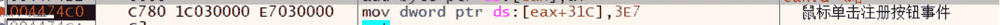
image.png (200.98 KB, 下载次数: 0)
[href="forum.php?mod=attachment&aid=MjczOTQ2MXwxMTkyMTVhYXwxNzkzNTcxNjIyfDE2ODA4NnwxOTg1Nzky&nothumb=yes" target="_blank"](https://www.52pojie.cn/forum.php?mod=attachment&aid=MjczOTQ2MXwxMTkyMTVhYXwxNzkzNTcxNjIyfDE2ODA4NnwxOTg1Nzky&nothumb=yes)
2024-11-26 16:15 上传

然后跳转到 `0x00446FA4` 看鼠标按下事件， 鼠标单击的同时还会触发鼠标按下的事件，之前鼠标左键单击注册按钮 `cl` 寄存器的值就为 `0`,既然注册按钮除了单击事件外还有鼠标按下事件 咱们还可以按下鼠标右键 按下滑轮键 都可以触发这个事件 咱们逐一来试一下。经过测试发现 按下滑轮键 `cl` 寄存器的值为 `0x2`, 按下鼠标右键 `cl` 的值为 `0x1`。

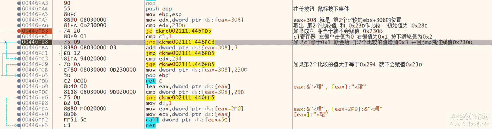
image.png (255.13 KB, 下载次数: 1)
[href="forum.php?mod=attachment&aid=MjczOTQ2M3w5NDY1MjQyM3wxNzkzNTcxNjIyfDE2ODA4NnwxOTg1Nzky&nothumb=yes" target="_blank"](https://www.52pojie.cn/forum.php?mod=attachment&aid=MjczOTQ2M3w5NDY1MjQyM3wxNzkzNTcxNjIyfDE2ODA4NnwxOTg1Nzky&nothumb=yes)
7
2024-11-26 16:17 上传

如果启动程序不左键单击注册按钮 或者 右键单击注册按钮 第二个比较都不会跳转，但是右键单击会把 `ebx+0x308` 的值增加 `0x3` 具体作用是什么现在还不得而知。反正比较 2 已经不会进行赋值 `0x23D` 了 那就先分析到这里。

### 意外收获
用 `e2a` 查看了事件后我每个事件地址都进去备注了一下，在查看到双击图片框的事件的时候发现了刚刚 比较 2 里面右键单击会把 `ebx+0x308` 的值增加 `0x3` 如果 `ebx+0x308` 的值增加到 `0x29D` 的时候去双击图片框（注意是图片框 不是图片）就会调用一个 `CALL`，但是有什么用不知道 咱们先来测试一下。 之前说过 `ebx+0x308` 的初始值是 `0x28E` ，右键点击一次注册增加 `0x3`,那就右键点击 5 次之后在双击这个图片框就会调用这个 `CALL`，先来测试一下它到底是干什么的。执行完成之后我们发现原本禁用的输入框现在解除禁用了。

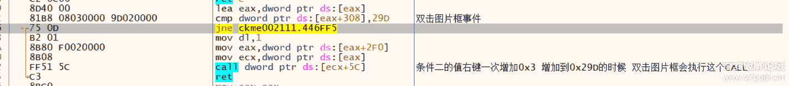
image.png (83.73 KB, 下载次数: 1)
[href="forum.php?mod=attachment&aid=MjczOTQ2NHw4ZmQzOTI3ZXwxNzkzNTcxNjIyfDE2ODA4NnwxOTg1Nzky&nothumb=yes" target="_blank"](https://www.52pojie.cn/forum.php?mod=attachment&aid=MjczOTQ2NHw4ZmQzOTI3ZXwxNzkzNTcxNjIyfDE2ODA4NnwxOTg1Nzky&nothumb=yes)
2024-11-26 16:20 上传

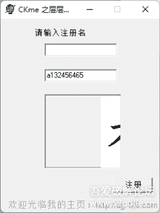
image.png (22.12 KB, 下载次数: 1)
[href="forum.php?mod=attachment&aid=MjczOTQ2NXw1ZmE5YzViOHwxNzkzNTcxNjIyfDE2ODA4NnwxOTg1Nzky&nothumb=yes" target="_blank"](https://www.52pojie.cn/forum.php?mod=attachment&aid=MjczOTQ2NXw1ZmE5YzViOHwxNzkzNTcxNjIyfDE2ODA4NnwxOTg1Nzky&nothumb=yes)
8
2024-11-26 16:21 上传

## 比较3 分析
比较 3：`cmp dword ptr ds:[ebx+310],F94` 要让 `ebx+0x310` 的值等于 `0xF94`,首先还是搜索常量 `0xF94` 看一下能不能定位到赋值的地方。

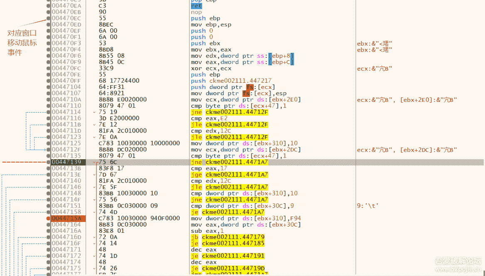
image.png (332.74 KB, 下载次数: 0)
[href="forum.php?mod=attachment&aid=MjczOTQ2Nnw2MjFlMzljOXwxNzkzNTcxNjIyfDE2ODA4NnwxOTg1Nzky&nothumb=yes" target="_blank"](https://www.52pojie.cn/forum.php?mod=attachment&aid=MjczOTQ2Nnw2MjFlMzljOXwxNzkzNTcxNjIyfDE2ODA4NnwxOTg1Nzky&nothumb=yes)
2024-11-26 16:22 上传

定位到了地址 `0x0044715A` 是比较 3 的关键赋值。这块代码是窗口上移动鼠标的事件代码，在窗口上移动鼠标就会执行这部分代码，但是想走到 `0x0044715A` 这个赋值代码 上面还有好多个比较跳转。按照正向思维来分析 既然这个地方是捕捉窗口鼠标移动的事件 那我肯定要拿到鼠标的 `x,y` 坐标才能在去干其它的事情 否则进行捕捉鼠标动作也没什么意义，所以这些判断可能都跟鼠标的坐标值有关系。

程序窗口尺寸为 260，316 我是鼠标从右下移动到程序界面然后断点断下 看到 `EAX` 的值是 `0x101` `EDX` 是 `0X13B`， 对应十进制就是 257，315。

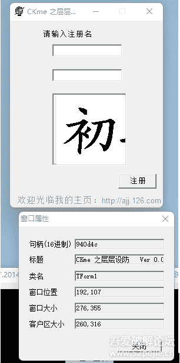
image.png (26.32 KB, 下载次数: 1)
[href="forum.php?mod=attachment&aid=MjczOTQ2N3wxMTI3NjM2NHwxNzkzNTcxNjIyfDE2ODA4NnwxOTg1Nzky&nothumb=yes" target="_blank"](https://www.52pojie.cn/forum.php?mod=attachment&aid=MjczOTQ2N3wxMTI3NjM2NHwxNzkzNTcxNjIyfDE2ODA4NnwxOTg1Nzky&nothumb=yes)
9
2024-11-26 16:24 上传

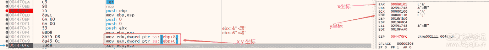
image.png (81.19 KB, 下载次数: 1)
[href="forum.php?mod=attachment&aid=MjczOTQ2OHwzNGZjN2Q4ZHwxNzkzNTcxNjIyfDE2ODA4NnwxOTg1Nzky&nothumb=yes" target="_blank"](https://www.52pojie.cn/forum.php?mod=attachment&aid=MjczOTQ2OHwzNGZjN2Q4ZHwxNzkzNTcxNjIyfDE2ODA4NnwxOTg1Nzky&nothumb=yes)
2024-11-26 16:24 上传

继续往下看，这部分代码是干什么用的不太清楚。

```asm
```


# 关键跳转分析

## 汇编片段与正向逻辑

```
004470FE | 55                          | push ebp                                     |
004470FF | 68 17724400                 | push ckme002111.447217                       |
00447104 | 64:FF31                     | push dword ptr fs:[ecx]                      |
00447107 | 64:8921                     | mov dword ptr fs:[ecx],esp                   |
0044710A | 8B8B E0020000               | mov ecx,dword ptr ds:[ebx+2E0]               | ecx:&"宂B", [ebx+2E0]:&"宂B"
00447110 | 8079 47 01                  | cmp byte ptr ds:[ecx+47],1                   | 取 ecx+47 的一个字节 比较值是否为0x1
00447114 | 75 19                       | jne ckme002111.44712F                        |
00447116 | 3D E2000000                 | cmp eax,E2                                   | 比较X坐标是否大于等于e2
0044711B | 7E 12                       | jle ckme002111.44712F                        |
0044711D | 81FA 2C010000               | cmp edx,12C                                  | 比较Y坐标是否大于等于12C
00447123 | 7E 0A                       | jle ckme002111.44712F                        |
00447125 | C783 10030000 10000000      | mov dword ptr ds:[ebx+310],10                | 比较都满足的 给ebx赋值310
```

翻译成正向代码就是：

```
If(ecx+0x47 == 0x1 and x坐标 >= 0xE2 and y坐标 >= 0x12C)
{
   EBX+0x310 = 0x10;
}
```

继续看下面的代码，有一个跳转，是`ecx+47`地址的值拿出一个字节和`0x1`比较，我们要进入到这个跳转里面才可以。继续搜索常量`0x47`看一下能不能定位到。

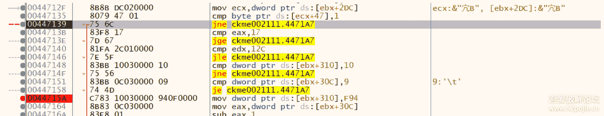

image.png (155.4 KB, 下载次数: 2)  
[附件下载](https://www.52pojie.cn/forum.php?mod=attachment&aid=MjczOTQ3MHw5ODFlYjA4N3wxNzkzNTcxNjIyfDE2ODA4NnwxOTg1Nzky&nothumb=yes)  
10  
2024-11-26 16:26 上传

## 定位 `ecx+0x47`

通过搜索定位到了关键处，发现了这个`ecx+47`位置的值是实时变动的，只要图片改变对应的值也会改变。

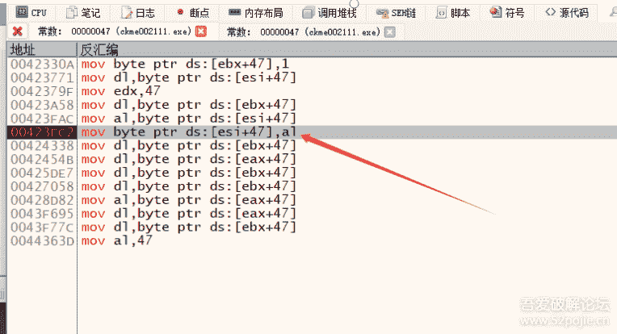

image.png (131.99 KB, 下载次数: 1)  
[附件下载](https://www.52pojie.cn/forum.php?mod=attachment&aid=MjczOTQ3MXxkNTY4Y2NjN3wxNzkzNTcxNjIyfDE2ODA4NnwxOTg1Nzky&nothumb=yes)  
2024-11-26 16:27 上传

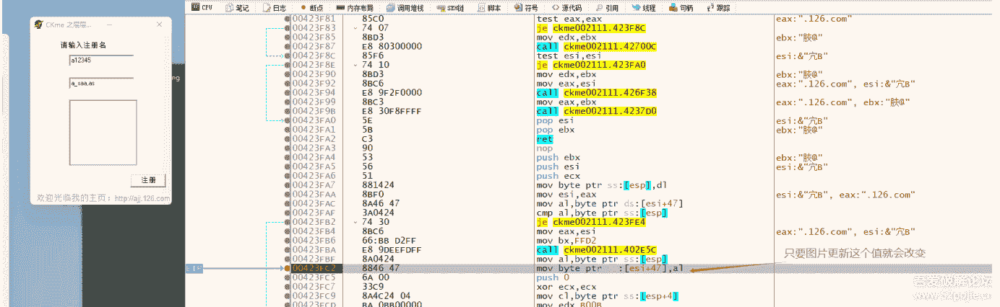

image.png (235.38 KB, 下载次数: 1)  
[附件下载](https://www.52pojie.cn/forum.php?mod=attachment&aid=MjczOTQ3MnxiNWU5MmYyYnwxNzkzNTcxNjIyfDE2ODA4NnwxOTg1Nzky&nothumb=yes)  
2024-11-26 16:27 上传

当图片框图片到达第三个的时候，这个地址里面的值自动就变成了`0x01010101`，只取一个字节，那这个值就是`0x1`。这样也就是说，等到是第三张图片的时候，我们把鼠标移动到程序内，这个跳转就不会进行跳了，现在来试一下。

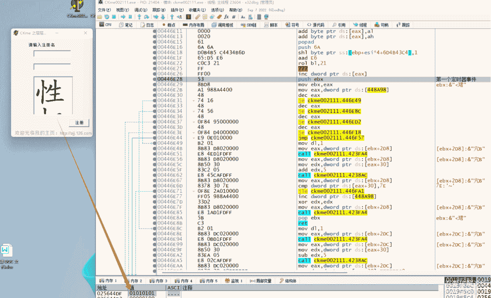

image.png (531.74 KB, 下载次数: 1)  
[附件下载](https://www.52pojie.cn/forum.php?mod=attachment&aid=MjczOTQ3M3wxZmM5OGQyM3wxNzkzNTcxNjIyfDE2ODA4NnwxOTg1Nzky&nothumb=yes)  
13  
2024-11-26 16:28 上传

## 比较两个 `ecx+0x47` 跳转地址

测试完后发现第一个跳转不跳了，第二个跳转还是跳，那也就是说明这两个`ecx+0x47`不是一个地址。我们仔细看一下这两个跳转的上2行代码，确实不是一个地址，之前没注意，第一个跳转的`ecx`地址是`ebx+0x20`，第二个是`ebx+0x2DC`。

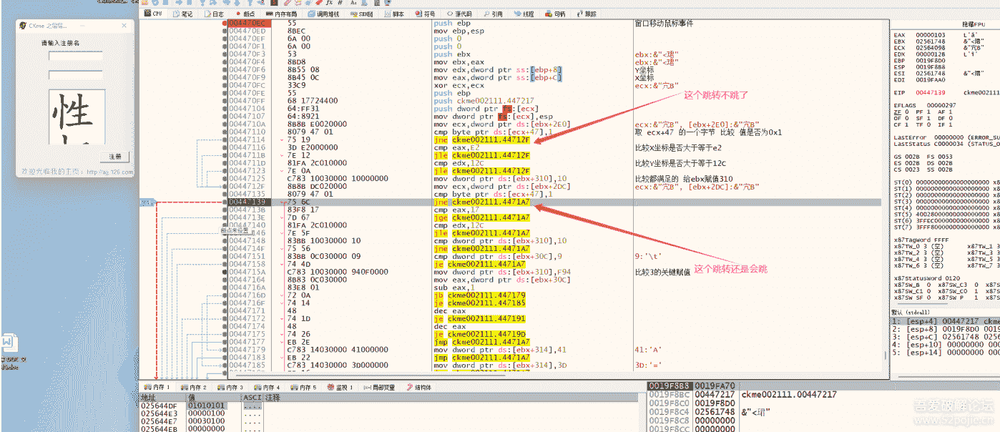

image.png (455.76 KB, 下载次数: 1)  
[附件下载](https://www.52pojie.cn/forum.php?mod=attachment&aid=MjczOTQ3NHxlNGZlYzQyY3wxNzkzNTcxNjIyfDE2ODA4NnwxOTg1Nzky&nothumb=yes)  
2024-11-26 16:29 上传

之前找的播放到图片3的时候，对应的是第一个跳转赋值`0x1`的代码，现在我们单步到第二个跳转的位置，在内存窗口重新跟随到`ecx+0x47`内存地址，然后放开程序，再观察一下第二个跳转是什么时候赋值`0x1`的。

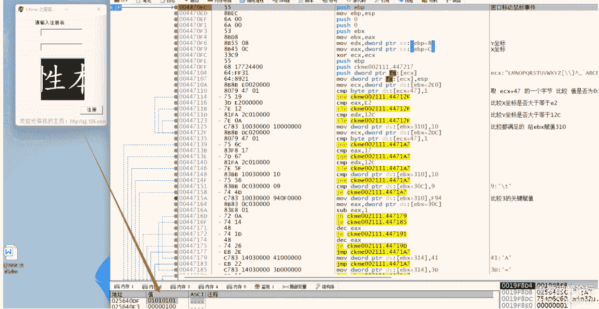

image.png (403.82 KB, 下载次数: 0)  
[附件下载](https://www.52pojie.cn/forum.php?mod=attachment&aid=MjczOTQ3Nnw5Nzc1ZmY1Y3wxNzkzNTcxNjIyfDE2ODA4NnwxOTg1Nzky&nothumb=yes)  
2024-11-26 16:30 上传

通过上面的分析发现，第一个跳转是在第三张图的时候不成立，第二个跳转是在第2张图的时候不成立，那我们等到他运行到第二张图的时候，再把鼠标放到程序内看一下。

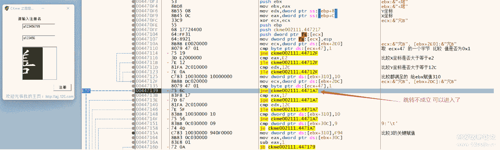

image.png (274.7 KB, 下载次数: 1)  
[附件下载](https://www.52pojie.cn/forum.php?mod=attachment&aid=MjczOTQ3N3xjM2QxYmIwNXwxNzkzNTcxNjIyfDE2ODA4NnwxOTg1Nzky&nothumb=yes)  
14  
2024-11-26 16:31 上传

这个时候跳转就不成立可以正常往下走了，然后下面还有一些跳转代码，我们要让他全部不进行跳转才可以走到比较3的关键赋值位置。

## 后续跳转条件

通过下面这部分代码可以看出：

- 第一个跳转：鼠标 X 坐标要小于`0x17`，对应十进制就是 23 才能不跳转；
- 第二个跳转：鼠标 Y 坐标要大于`0x12C`，对应十进制 300 才能不跳转。

说人话就是第一个、第二个跳转鼠标要从左下角移动到程序内才不跳。

```
0044713B | 83F8 17                            | cmp eax,17                                  |
0044713E | 7D 67                              | jge ckme002111.4471A7                       | 大于等于X坐标跳转
00447140 | 81FA 2C010000                      | cmp edx,12C                                 |
00447146 | 7E 5F                              | jle ckme002111.4471A7                       | 小于等于Y坐标跳转
00447148 | 83BB 10030000 10                   | cmp dword ptr ds:[ebx+310],10               |
0044714F | 75 56                              | jne ckme002111.4471A7                       | ebx+310 不等于 0x10 跳转
00447151 | 83BB 0C030000 09                   | cmp dword ptr ds:[ebx+30C],9                | ebx+30C等于0x9 跳转
00447158 | 74 4D                              | je ckme002111.4471A7                        |
```

已经分析完了前两个跳转怎么让他不跳，我们先来试一下（在第二张图的时候鼠标从左下角移动到程序内）。

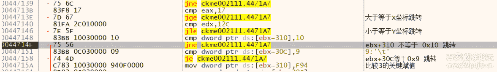

image.png (114.68 KB, 下载次数: 1)  
[附件下载](https://www.52pojie.cn/forum.php?mod=attachment&aid=MjczOTQ3OHxjOTkxMmJhYXwxNzkzNTcxNjIyfDE2ODA4NnwxOTg1Nzky&nothumb=yes)  
2024-11-26 16:33 上传

## 第三个跳转与赋值

现在已经顺利的走到第三个跳转了，第三个跳转`ebx+0x310`等于`0x10`就不会跳，那对应下图的就是这部分代码满足就会给`ebx+0x310`赋值`0x10`。相当于在第三张图片的时候，鼠标从右下角移动到程序内（自己转换一下坐标值就知道了），然后再等到第二张图的时候鼠标从左下移动到程序内，这三个跳转就都不会跳了。

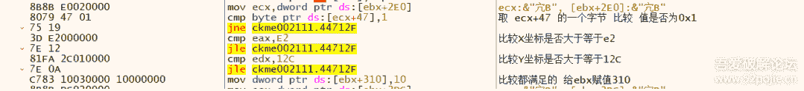

image.png (75.58 KB, 下载次数: 1)  
[附件下载](https://www.52pojie.cn/forum.php?mod=attachment&aid=MjczOTQ3OXw4NTAxYThlMXwxNzkzNTcxNjIyfDE2ODA4NnwxOTg1Nzky&nothumb=yes)  
2024-11-26 16:34 上传

## 定位 `ebx+0x30C` 的赋值

还差最后一个跳转比较3就搞定了，现在来看一下怎么才能让`ebx+0x30C`的位置不等于`0x9`，继续搜索常数`0x30C`。搜索后在文本框2双击事件里面找到了这个`ebx+0x30C`的赋值（每一个事件之前都用`e2a`都看过了一遍并备注了，所以才知道是在哪个事件里面）。

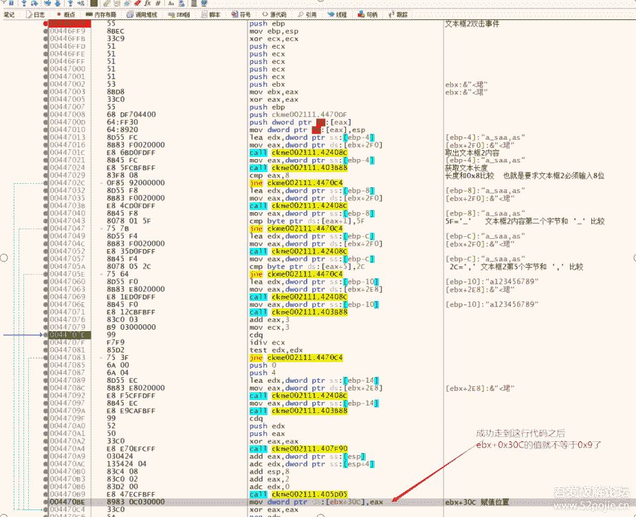

image.png (435.66 KB, 下载次数: 0)  
[附件下载](https://www.52pojie.cn/forum.php?mod=attachment&aid=MjczOTQ4N3w0ZmY3NTRmZHwxNzkzNTcxNjIyfDE2ODA4NnwxOTg1Nzky&nothumb=yes)  
2024-11-26 16:35 上传

来分析下面代码，看它是什么逻辑才能成功走到给`ebx+30C`赋值的位置。


```asm
00446FF8 | 55                                 | push ebp                                    | 文本框2双击事件
00446FF9 | 8BEC                               | mov ebp,esp                                 |
00446FFB | 33C9                               | xor ecx,ecx                                 | ecx:&"宂B"
00446FFD | 51                                 | push ecx                                    | ecx:&"宂B"
00446FFE | 51                                 | push ecx                                    | ecx:&"宂B"
00446FFF | 51                                 | push ecx                                    | ecx:&"宂B"
00447000 | 51                                 | push ecx                                    | ecx:&"宂B"
00447001 | 51                                 | push ecx                                    | ecx:&"宂B"
00447002 | 53                                 | push ebx                                    | ebx:&"首先取出了输入框2的内容 接着判断内容长度是否等于0x8,在判断了第一个字节是否等于字符 “_”,在判断 第五个字节是否等于字符 “,” 。然后又取文本框1内容长度+0x3和3进行取模运算是否等于0。
```

正向代码：[C++] 纯文本查看 复制代码

```cpp
int main() {        //对应文本框1

        string user = "a12345";

        //对应文本框2

        string password = "a_asa,as";

        if (password.length() == 0x8 and password[1] == 0x5F and password[5] == 0x2C)

        {

                int len = user.length() + 0x3;

                if (len % 3 == 0)

                {

                        //ebx+0x30=eax;

                }

        }

        return 0;

}
```

## 比较4

`mov eax, dword ptr ds:[ebx+318]` `cmp eax, dword ptr ds:[ebx+314]` 相当于要让 `ebx+0x318` 和 `ebx+0x314` 的值相等才可以。首先看 `ebx+0x314` 赋值的地方，这个地方之前已经看到了，其实就在分析比较3的时候，把 `ebx+0x310` 赋值完 `0xF94` 之后执行的代码。

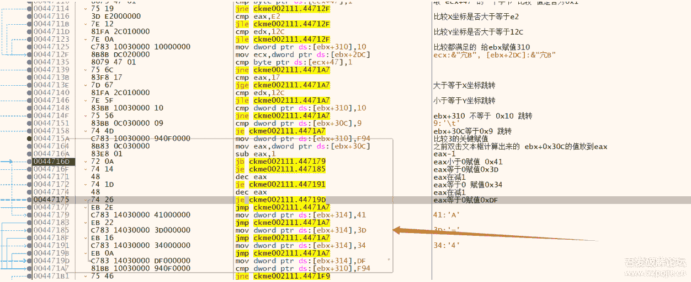

image.png (331.95 KB, 下载次数: 1)

[下载附件](https://www.52pojie.cn/forum.php?mod=attachment&aid=MjczOTUwM3w5ZTVjMDkwM3wxNzkzNTcxNjIyfDE2ODA4NnwxOTg1Nzky&nothumb=yes)

2024-11-26 17:11 上传

通过这段代码就可以很清楚地看出，给 `ebx+0x314` 赋值什么，取决于刚才在分析比较 `ebx+0x30C` 赋的值是什么。具体是怎么计算的先不管它，反正就只有这4个固定的值。

继续往下看还有一个跳转，执行完这个跳转才会出 `CALL`，看一下这个跳转里面干了什么。

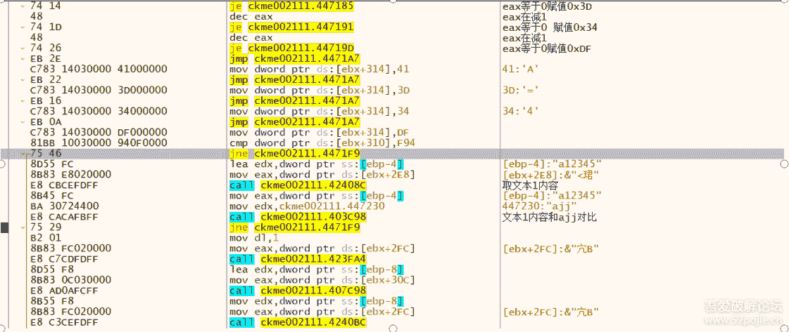

image.png (230.48 KB, 下载次数: 2)

[下载附件](https://www.52pojie.cn/forum.php?mod=attachment&aid=MjczOTUwNHw2MTIxOWQ0NHwxNzkzNTcxNjIyfDE2ODA4NnwxOTg1Nzky&nothumb=yes)

2024-11-26 17:12 上传

首先取了文本1内容（也就是用户名），然后和字符串 `"ajj"` 对比，如果相等还会执行 3 个 `CALL`。那就把用户名改成 `ajj` 试一下会发生什么。

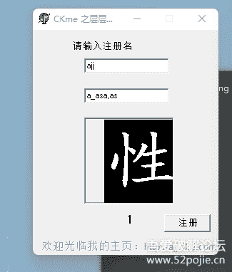

image.png (21.17 KB, 下载次数: 1)

[下载附件](https://www.52pojie.cn/forum.php?mod=attachment&aid=MjczOTUwN3wyODM1M2Q3N3wxNzkzNTcxNjIyfDE2ODA4NnwxOTg1Nzky&nothumb=yes)

2024-11-26 17:24 上传

如果用户名输入 `ajj`，就会把 `ebx+0x30C` 的值显示到程序上面，通过这个显示的值我们就知道 `ebx+0x314` 赋值什么。也就是说，用户名只能输入 `ajj`，这个才是正确的用户名。输入完后看程序上显示的是什么：如果是 0，那 `ebx+0x314` 赋值 `0x41`；1 赋值 `0x3D`；2 赋值 `0x34`；3 赋值 `0xDF`。现在已经搞清楚了 `ebx+0x314` 的赋值方式，怎么才能让 `ebx+0x318` 的值等于 `ebx+0x314` 的值？这个时候要继续去看 `ebx+0x318` 是在哪里赋值的了。

还是搜索常量 `0x318`，搜索完我们发现，只有第一个是直接赋值了一个 `eax`，剩下的都是在它本身的值上做自增操作。先进到第一个赋值操作看一下。

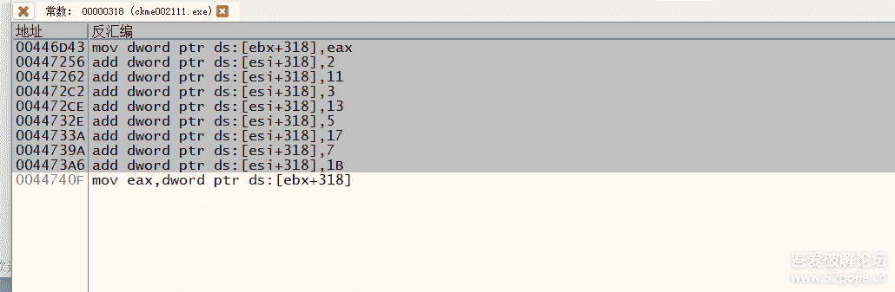

image.png (39.1 KB, 下载次数: 1)

[下载附件](https://www.52pojie.cn/forum.php?mod=attachment&aid=MjczOTUwOXxjNTZlNzE1OXwxNzkzNTcxNjIyfDE2ODA4NnwxOTg1Nzky&nothumb=yes)

2024-11-26 17:25 上传

第一个进去后发现，这个是启动的时候直接就赋初始值 `0x0`。继续往下看第二个。

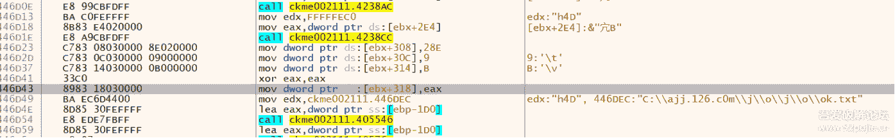

image.png (146.92 KB, 下载次数: 1)

[下载附件](https://www.52pojie.cn/forum.php?mod=attachment&aid=MjczOTUxMHwzOGIyZTE1OXwxNzkzNTcxNjIyfDE2ODA4NnwxOTg1Nzky&nothumb=yes)

2024-11-26 17:26 上传

第二个进去后发现是图片1的鼠标按下事件，会根据 `bl` 寄存器判断是左键点击的还是右键点击的。如果是左键那就加 `0x2`，右键加 `0x11`。

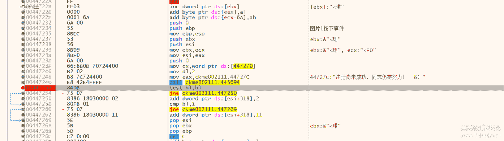

image.png (183.8 KB, 下载次数: 3)

[下载附件](https://www.52pojie.cn/forum.php?mod=attachment&aid=MjczOTUxMXxjNjBlYTUxNnwxNzkzNTcxNjIyfDE2ODA4NnwxOTg1Nzky&nothumb=yes)

2024-11-26 17:26 上传

剩下的 3 个图片按下事件同理，只不过加的值不一样。通过上面的常量搜索出来的值，大家可以自行进入看一下，我就不一一列出了，我直接把对应的值发出来了：

- 图片1鼠标左键增加：`0x2`，右键增加：`0x11`
- 图片2鼠标左键增加：`0x3`，右键增加：`0x13`
- 图片3鼠标左键增加：`0x5`，右键增加：`0x17`
- 图片4鼠标左键增加：`0x7`，右键增加：`0x1B`

自己计算出来对应的图片左键点还是右键点，把值加到和 `ebx+0x314` 的值一样即可。

## 比较5

`cmp dword ptr ds:[ebx+31C], 3E7`，让 `ebx+317` 的值不等于 `0x3E7` 即可。这个咱们在程序最开始的爆破的时候就看到了：左键单击按钮注册事件，注册按钮不能左键点，只要不点就不会赋值 `0x3E7`。

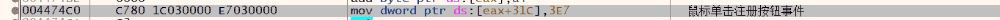

image.png (149.42 KB, 下载次数: 1)

[下载附件](https://www.52pojie.cn/forum.php?mod=attachment&aid=MjczOTUxMnw5MGYwMTBhOXwxNzkzNTcxNjIyfDE2ODA4NnwxOTg1Nzky&nothumb=yes)

2024-11-26 17:27 上传

把上面所有的分析出来的流程全部操作一遍，就注册成功了。

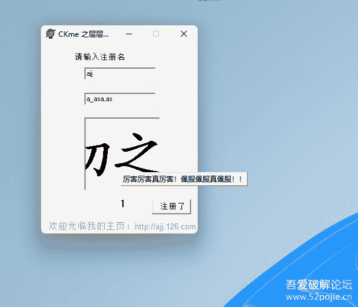

image.png (71.22 KB, 下载次数: 1)

[下载附件](https://www.52pojie.cn/forum.php?mod=attachment&aid=MjczOTUxM3xlYmRjNDg2Y3wxNzkzNTcxNjIyfDE2ODA4NnwxOTg1Nzky&nothumb=yes)

2024-11-26 17:27 上传

至此，程序的全部逆向分析过程就算完成了。

## 总结

1. 首先创建一个 `X:\ajj.126.c0m\j\o\j\o\ok.txt` 的文本，里面储存十六进制数据 `20 61 6A 6A D0 B4 B5 C4 43 4B 6D 65 D5 E6 C0 C3 21 FF FF`。
2. 用户名输入 `ajj`，密码按照这种格式输入：`x_xxx,xx`。
3. 鼠标在第三张图的时候，从右下角移动到程序内；然后在第二张图的时候，在左下角移动到程序内。
4. 按照上述操作完成后，程序上会出现一个 `0 1 2 3` 的数字，分别对应数值 `0x41`、`0x3D`、`0x34`、`0xDF`。
5. 每一个图片左键或者右键单击都会对应增加数值，具体增加数值看上面内容，自己点击到数值和上面的 `0 1 2 3` 对应的数值相等。
6. 不能左键点注册按钮。

完成以上的操作，就算是注册成功了。注册机就不写了。这个程序比较另类，这种验证方式我估计用户是接受不了，我也接受不了！！！亲爱的 `ajj` 作者，你有想过你的程序经历24年还会给一个初学者带来暴击吗？？
