# [原创] 新手学破解记录贴【160个CrackMe】之007

- 原帖：`https://www.52pojie.cn/forum.php?mod=viewthread&tid=1987555`
- 抓取时间：2026-11-01T22:18:46

## 查壳与程序信息

本人刚刚入门汇编逆向分析，本帖将记录我对 160 个 `CrackMe` 程序中的第 007 程序的分析过程。在学习的过程中，我会边学边记录。如果有不正确之处，还请各位指正。

首先查壳程序是无壳 `Delphi` 编写。点击帮助按钮，弹出提示框，大概意思是隐藏掉注册下面的注册按钮，让 `logo` 显示出来。

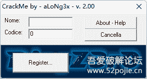

2024-12-2 14:37 上传

`Delphi` 编写的程序，先放到 `E2A` 看一下这些按钮的事件地址。通过下图可以看出，程序还有一个按钮是隐藏，隐藏掉按钮并显示出 `logo` 就算破解成功。那我们先输入假码，然后在注册按钮事件下断点看一下。

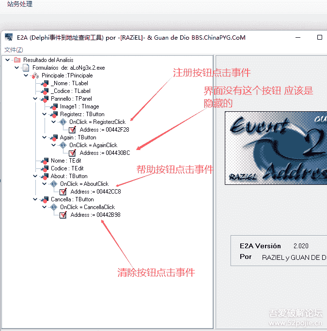

2024-12-2 14:41 上传

断下开之后，我们发现有一个跳转，经过下面的提示，看的出来他是检测你输入的密码是不是整数型。如果不是，就会走到这个进入到这个跳转里面，然后弹提示框，要求输入一个长整数形的密码。

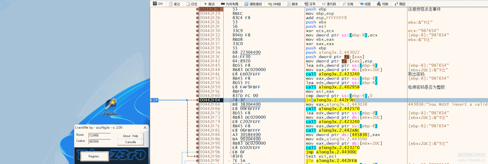

2024-12-2 14:49 上传

我输的是一个整数型密码，所以这个跳转不成立，继续往下走。会看到还有一个跳转，如果我把这个跳转 `nop` 掉，那么程序就会把注册按钮隐藏掉，并且让之前分析出来的那个隐藏按钮显示出来。所以这个跳转上面的 `CALL` 肯定是包含了算法的。我们进到这个 `CALL` 去看一下。

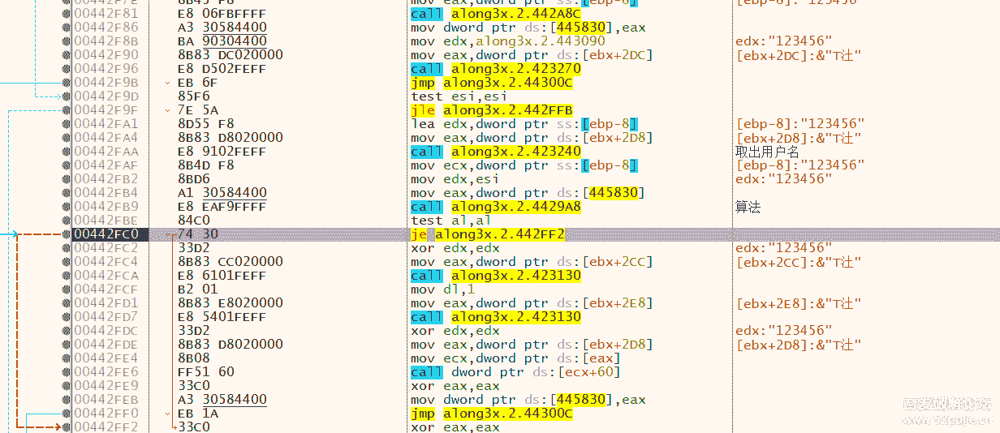

2024-12-2 14:52 上传

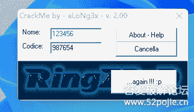

2024-12-2 14:53 上传

进到这个 `CALL` 内，我们就发现了一大堆计算的操作。

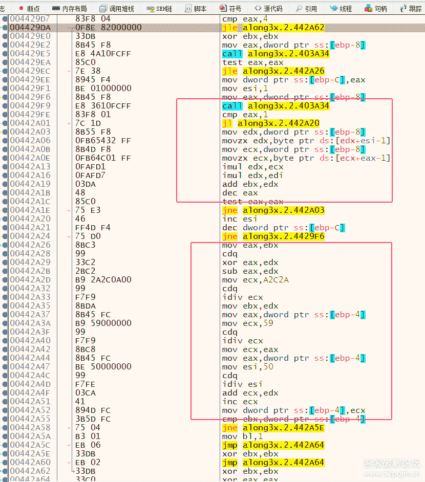

2024-12-2 14:56 上传

## 用户名算法初步分析

继续分析一下这些算法到底是怎么计算的。首先我们看到了这个算法就是两层循环：用户名的第一个字符乘以最后一个字符，再乘以 `edi`。第一次用一个字符把所有的字符乘一遍，再用第二个乘……最后的结果相加起来放到 `ebx` 中（看下面的正向代码就理解了）。其中会和 `edi` 相乘，但是 `edi` 的值是 0，那么最后无论怎么计算结果也是 0，那这个计算的代码就没有意义了。继续往下看，到底会不会用到这个算法算出来的值；如果需要用到这个计算出来的值，那肯定要找到 `edi` 的赋值才可以。

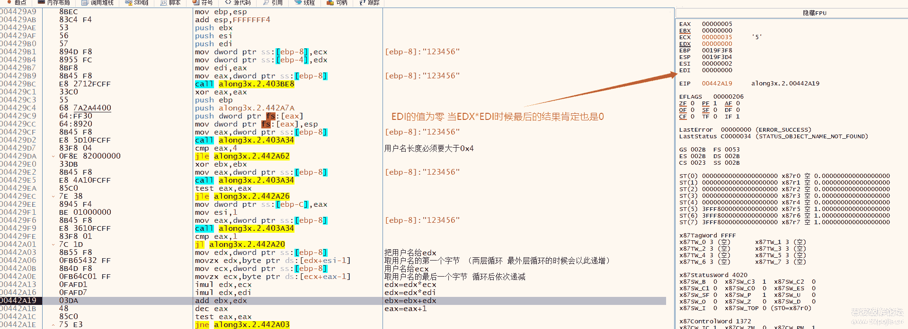

2024-12-2 15:03 上传

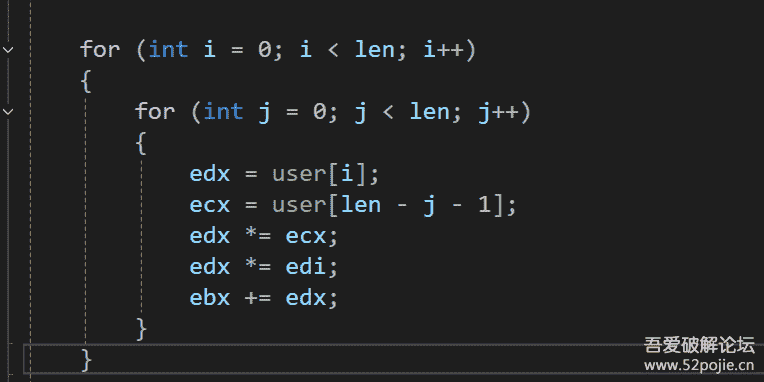

2024-12-2 15:07 上传

继续往下的走代码可以看出，把刚才用户名算法计算出来的值和 `0xA2C2A` 做了取模运算；接着又把密码转成 16 进制后，`密码16进制值 / 0x59` 的商，加上 `密码16进制值 % 0x50` 的余数，再加 `0x1` 后的值，和用户名的计算出来的值相等才可以。

用户名计算的算法我们已经知道了，但是 `edi` 的值是 0，这样肯定是不对的，必须要找到 `edi` 的值才可以正确计算。

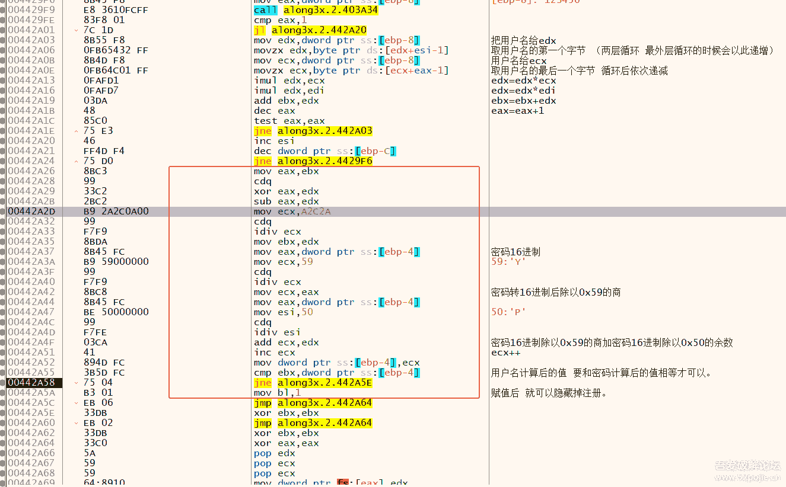

2024-12-2 15:12 上传

## 向上溯源 `edi` 的赋值

现在需要向上溯源找 `edi` 的值。在这个 `CALL` 内，发现 `edi` 的值是 `eax`，那我们就要知道 `eax` 是哪里来的。

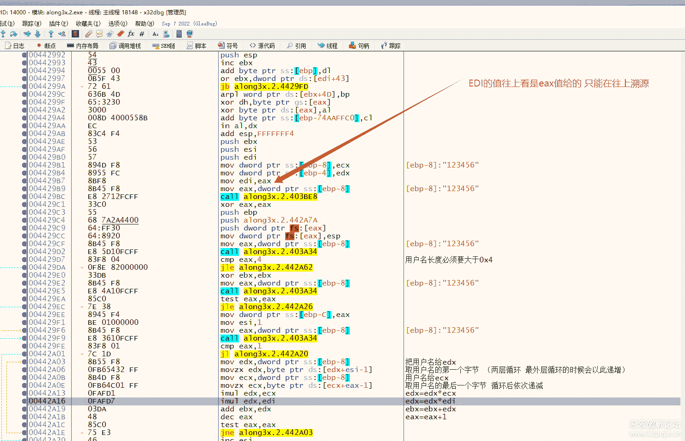

2024-12-2 15:18 上传

继续向上溯源，我们发现 `eax` 的值来源于 `0x445830` 这个地址，那现在就要找这个地址是在哪里赋值的。

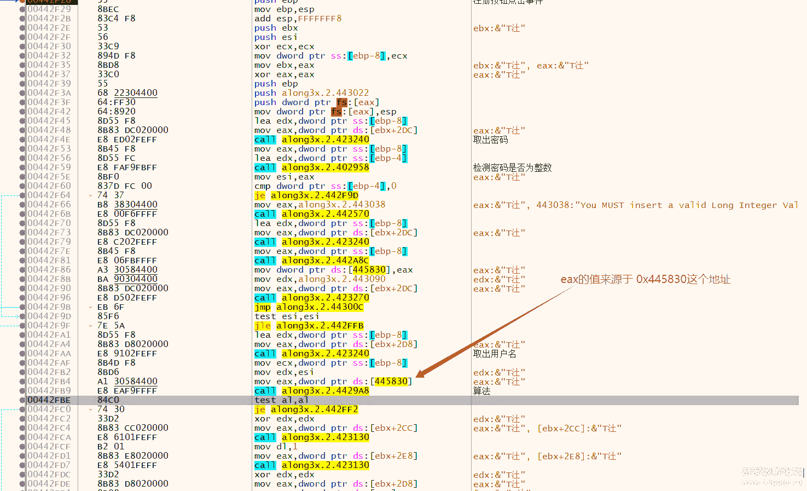

2024-12-2 15:20 上传

我们搜索这个内存地址的常量，看到一共有 8 处对他进行了赋值。那我们肯定要看距离这个算法最近的地址，也就是 `0x00442F86` 地址。

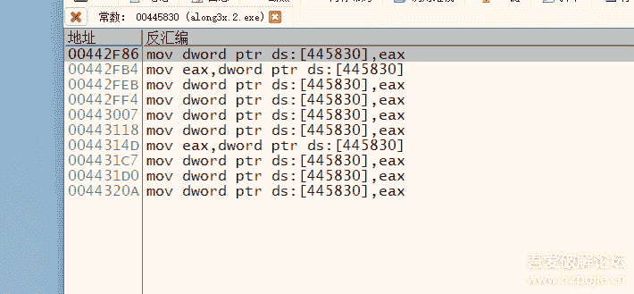

2024-12-2 15:21 上传

可以看到这个赋值是在要输入不符合密码规范的时候才会赋值，那也就是说，我们先要输入一个纯数字以外的密码，触发这个赋值才可以。

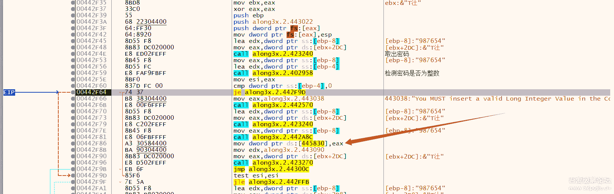

2024-12-2 15:24 上传

在这行代码可以看出，这个地址的值是 `eax`，`eax` 作为 `CALL` 的返回值，那我们肯定要进入这个 `CALL` 去看一下。

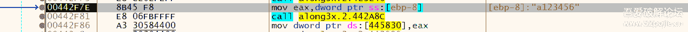

2024-12-2 15:26 上传

## 密码算法分析

进入这个 `CALL`，我们看到一些计算，这部分就是算法了。具体逻辑就是循环 `密码长度 - 1`，第二个字节和 `0x11` 做取模运算后 `+ 1`，再乘以第一个字节，依次递增循环，得出来的值累加到 `esi` 里面（对应下面正向代码）。

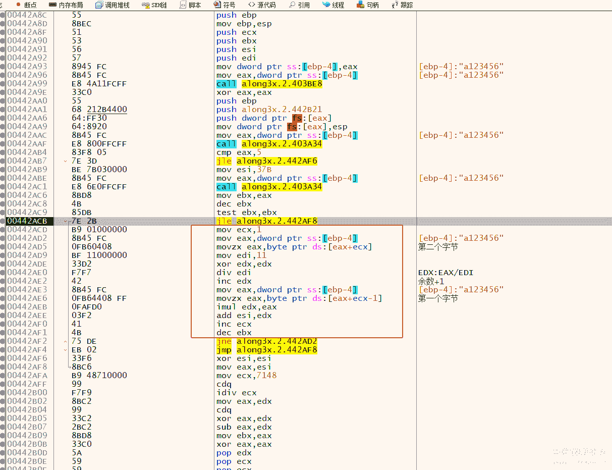

2024-12-2 15:30 上传

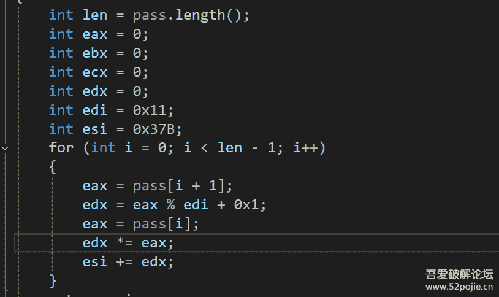

2024-12-2 15:35 上传

## 总结与穷举思路

目前算法已经梳理清楚了：一个用户名算法，一个密码算法，一个 `edi` 算法。首先要输入不符合规范的用户名计算出 `edi`，然后用 `edi` 才能计算出用户名算法的值；然后密码算法算出来的值和用户名算法值相等，即可隐藏注册按钮、显示 `again` 按钮。

现在已知用户名算法算出来的值，`密码的16进制值 / 0x59` 的商 + `密码的16进制值 % 0x50` + `0x1` 和算出来的用户名相等即可。那我们就通过最简单的方法，给他穷举出来即可。

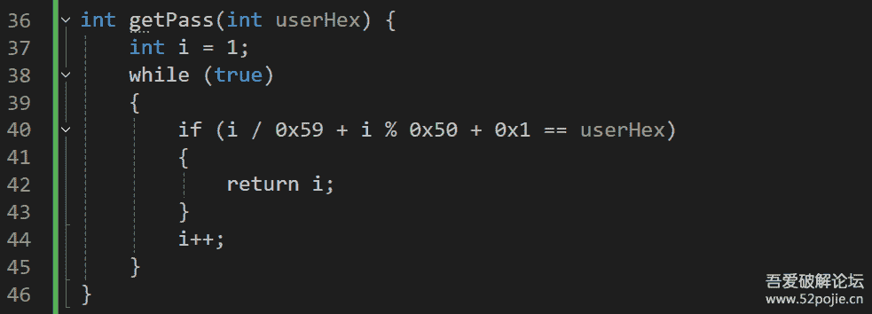


https://www.52pojie.cn/forum.php?mod=attachment&aid=Mjc0MDgxN3wzMDI1ZTczNHwxNzkzNTcxNTI0fDE2ODA4NnwxOTg3NTU1&nothumb=yes

2024-12-2 15:42 上传

经过测试已经可以顺利隐藏注册按钮。

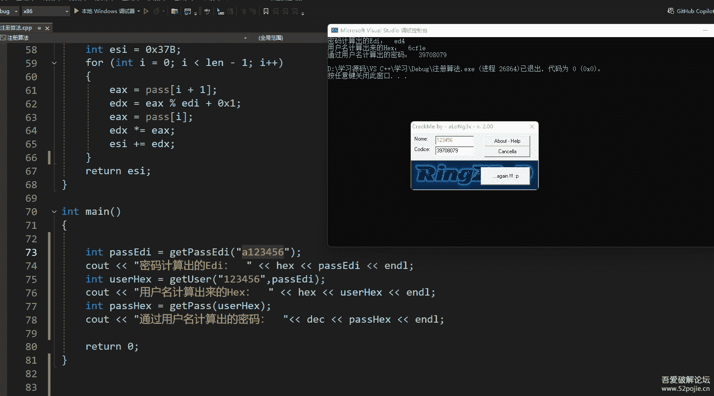

`image.png` (179.63 KB, 下载次数: 1)

https://www.52pojie.cn/forum.php?mod=attachment&aid=Mjc0MDgxOHxhNzliNTg4Y3wxNzkzNTcxNTI0fDE2ODA4NnwxOTg3NTU1&nothumb=yes

2024-12-2 15:44 上传

again按钮隐藏的算法和注册按钮算法一样，还是在输入一遍刚才错误的密码在输入计算出来的密码就隐藏掉了。

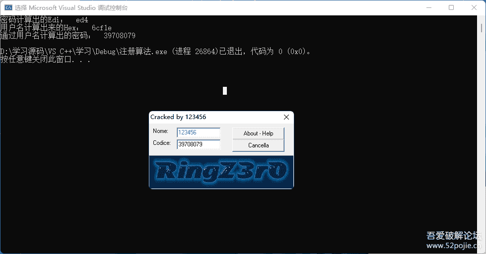

`image.png` (39.41 KB, 下载次数: 0)

https://www.52pojie.cn/forum.php?mod=attachment&aid=Mjc0MDgxOXwzYWQwZWEzYXwxNzkzNTcxNTI0fDE2ODA4NnwxOTg3NTU1&nothumb=yes

2024-12-2 15:47 上传

### 注册机

[C++] 纯文本查看 复制代码

```
#include 
using namespace std;

int getUser(string user, int passEdi)
{

	int len = user.length();
	int eax = 0;
	int ebx = 0;
	int ecx = 0;
	int edx = 0;
	int edi = passEdi;

	for (int i = 0; i < len; i++)
	{
		for (int j = 0; j < len; j++)
		{
			edx = user[i];
			ecx = user[len - j - 1];
			edx *= ecx;
			edx *= edi;
			ebx += edx;
		}
	}

	eax = ebx;
	ecx = 0xA2C2A;
	edx = eax % ecx;
	return edx;

}

int getPass(int userHex) {
	int i = 1;
	while (true)
	{
		if (i / 0x59 + i % 0x50 + 0x1 == userHex)
		{
			return i;
		}
		i++;
	}
}

int getPassEdi(string pass)
{
	int len = pass.length();
	int eax = 0;
	int ebx = 0;
	int ecx = 0;
	int edx = 0;
	int edi = 0x11;
	int esi = 0x37B;
	for (int i = 0; i < len - 1; i++)
	{
		eax = pass[i + 1];
		edx = eax % edi + 0x1;
		eax = pass[i];
		edx *= eax;
		esi += edx;
	}
	return esi;
}

int main()
{
	
	int passEdi = getPassEdi("a123456");
	cout << "密码计算出的Edi：  " << hex << passEdi << endl;
	int userHex = getUser("123456",passEdi);
	cout << "用户名计算出来的Hex：  " << hex << userHex << endl;
	int passHex = getPass(userHex);
	cout << "通过用户名计算出的密码：  "<< dec << passHex << endl;

	return 0;
}
```
