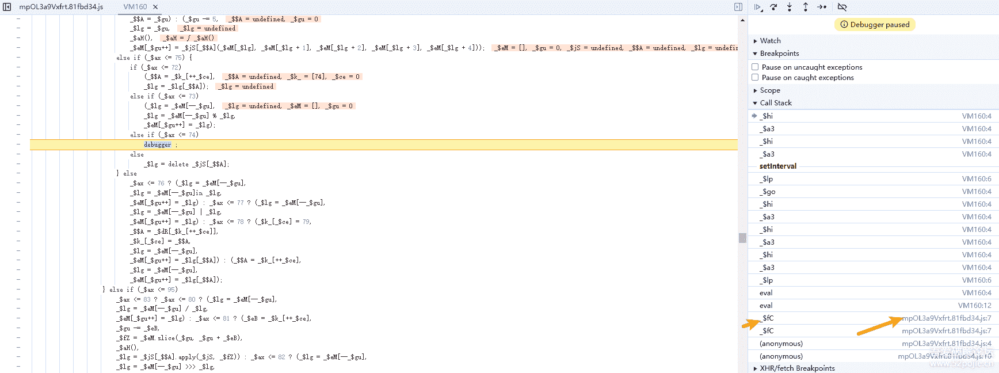
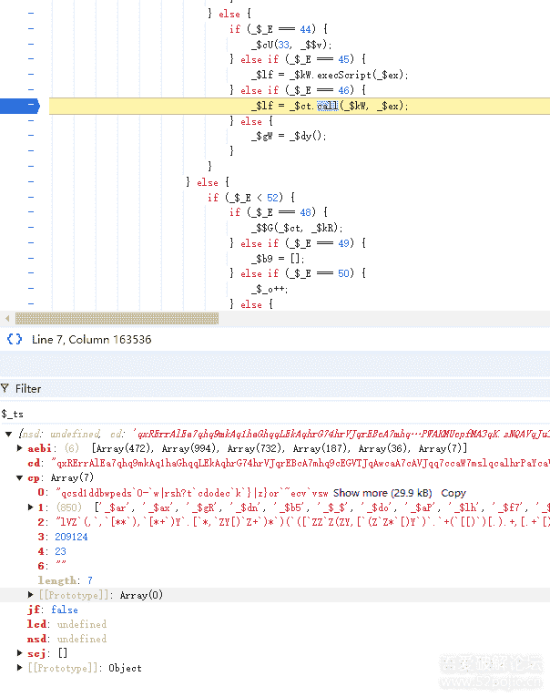
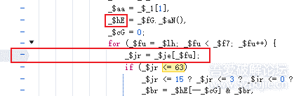
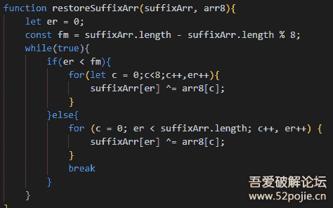
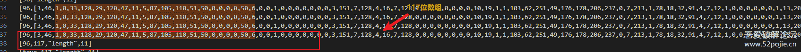
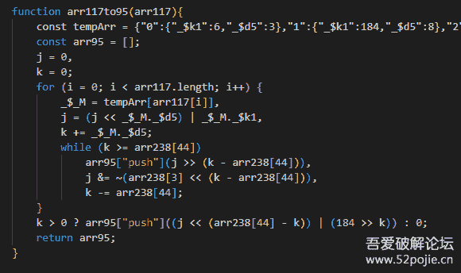
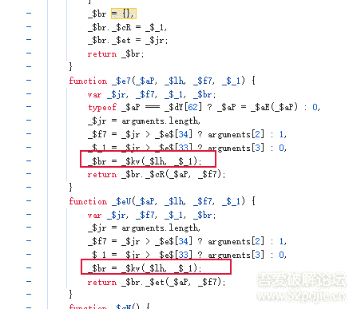
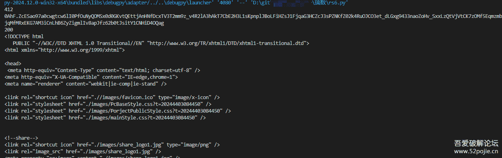

# [Web逆向] 【JS逆向】瑞数6逆向简单分析

- 原帖: `https://www.52pojie.cn/forum.php?mod=viewthread&tid=1988393`
- 抓取时间: 2026-11-01T22:18:42

本文不提供具体网址哈，简单分析一下6代第一次`cookie`的生成，注意是简单分析

首先在页面写个油猴脚本hook住`cookie`

```
var cookie_cache = document.cookie;
Object.defineProperty(document, 'cookie', {
    get: function() {
        debugger;
        console.log('Getting cookie');
        return cookie_cache;
    },
    set: function(val) {
        debugger;
        console.log('Setting cookie', val);
        var cookie = val.split(";")[0];
        var ncookie = cookie.split("=");
        var flag = false;
        var cache = cookie_cache.split("; ");
        cache = cache.map(function(a){
            if (a.split("=")[0] === ncookie[0]){
                flag = true;
                return cookie;
            }
            return a;
        })
        cookie_cache = cache.join("; ");
        if (!flag){
            cookie_cache += cookie + "; ";
        }
        this._value = val;
        return cookie_cache;
    },
});
```



1.png (76.41 KB, 下载次数: 2)

[href="forum.php?mod=attachment&aid=Mjc0MTQwNHxmOGUzZDAyMnwxNzkzNTcxNTE5fDE2ODA4NnwxOTg4Mzkz&nothumb=yes" target="_blank"](https://www.52pojie.cn/forum.php?mod=attachment&aid=Mjc0MTQwNHxmOGUzZDAyMnwxNzkzNTcxNTE5fDE2ODA4NnwxOTg4Mzkz&nothumb=yes)

2024-12-4 21:21 上传

在如图所示的地方打上断点后再次刷新页面进入静态js的`eval`函数执行前

这里只要再按一下`F11`即可进入`vm`，不过我们先看下静态js生成的`$_ts`



2.png (29.23 KB, 下载次数: 2)

[href="forum.php?mod=attachment&aid=Mjc0MTQxM3xkMDUwYzhkOHwxNzkzNTcxNTE5fDE2ODA4NnwxOTg4Mzkz&nothumb=yes" target="_blank"](https://www.52pojie.cn/forum.php?mod=attachment&aid=Mjc0MTQxM3xkMDUwYzhkOHwxNzkzNTcxNTE5fDE2ODA4NnwxOTg4Mzkz&nothumb=yes)

2024-12-4 22:52 上传

这里的`$_ts`里，`cd`是页面`script`里的`cd`，`cp[1]`和`cp[3]`是根据页面`nsd`生成的850个参数名和`vm`代码的每隔一段距离的字符的`charCodeAt`的和，简单点来说就是对代码做了校验。

下面说下`eval`里代码第一次`cookie`的生成逻辑

插桩点：搜索



4.png (9.85 KB, 下载次数: 2)

[href="forum.php?mod=attachment&aid=Mjc0MTQxNXwxYWRlOWJlNnwxNzkzNTcxNTE5fDE2ODA4NnwxOTg4Mzkz&nothumb=yes" target="_blank"](https://www.52pojie.cn/forum.php?mod=attachment&aid=Mjc0MTQxNXwxYWRlOWJlNnwxNzkzNTcxNTE5fDE2ODA4NnwxOTg4Mzkz&nothumb=yes)

2024-12-4 22:55 上传

这里简单说下`vm`的函数里有功能不会变的函数，分别是数组转字符串，字符串转数组、字符串转数字、数字转数组、两组数组进行操作获得新数组...

首先对把`cd`转化成数组，如果你观察过多组`cd`转化的数组，会发现转化后的数组都是`0`开头

`cd`转化后的数组（假设是`arr`），根据前两位（假设是`[0,175]`开头），首先对`arr.slice(2).slice(0,175)`得到`preArr`，`arr.slice(177)`得到`suffixArr`

前面截取的这段数组`preArr`通过一系列操作得到一个8位数组。

后面的`suffix`通过和这个8位数组异或得到新数组。



3.png (23.21 KB, 下载次数: 1)

[href="forum.php?mod=attachment&aid=Mjc0MTQxNHw4NTMzZWJhNnwxNzkzNTcxNTE5fDE2ODA4NnwxOTg4Mzkz&nothumb=yes" target="_blank"](https://www.52pojie.cn/forum.php?mod=attachment&aid=Mjc0MTQxNHw4NTMzZWJhNnwxNzkzNTcxNTE5fDE2ODA4NnwxOTg4Mzkz&nothumb=yes)

2024-12-4 22:53 上传

后面的操作通过对这个新数组的截取来继续进行

根据插桩日志往前看，在`cookie`生成之前先是一个176位的数组，176位数组之前是144位数组，再之前是96位数组，然后是95位，最后定格在117位数组的生成。

逆推分析出大概流程后，需要先分析这个117位数组的产生

`[1,0,33,128]`，这是117数组的前四位，前两个数字写死，第三个`33`是`eval.toString()`的长度，`128`是`1`



8.png (44.7 KB, 下载次数: 1)

[href="forum.php?mod=attachment&aid=Mjc0MTQyMXxjOTc3Nzk4YnwxNzkzNTcxNTE5fDE2ODA4NnwxOTg4Mzkz&nothumb=yes" target="_blank"](https://www.52pojie.cn/forum.php?mod=attachment&aid=Mjc0MTQyMXxjOTc3Nzk4YnwxNzkzNTcxNTE5fDE2ODA4NnwxOTg4Mzkz&nothumb=yes)

2024-12-4 23:52 上传

117位数组生成后，需要将它转化成95位长度的数组



6.png (33.27 KB, 下载次数: 1)

[href="forum.php?mod=attachment&aid=Mjc0MTQxNnxmMmNhOTE4ZnwxNzkzNTcxNTE5fDE2ODA4NnwxOTg4Mzkz&nothumb=yes" target="_blank"](https://www.52pojie.cn/forum.php?mod=attachment&aid=Mjc0MTQxNnxmMmNhOTE4ZnwxNzkzNTcxNTE5fDE2ODA4NnwxOTg4Mzkz&nothumb=yes)

2024-12-4 23:07 上传

这里的`tempArr`我是写死的，似乎生成的逻辑不会改变（不确定，暂时没发现什么问题）

生成95位数组后，截取`suffixArr`的一部分（`11,43`）32位长度数组对前16位进行异或得到新的95位长度数组

后续的插桩在`= {}`，（这里页面搜索有19个，位置不固定，没法给出确定的位置）



5.png (15.47 KB, 下载次数: 1)

[href="forum.php?mod=attachment&aid=Mjc0MTQxN3wwOTA2N2FkN3wxNzkzNTcxNTE5fDE2ODA4NnwxOTg4Mzkz&nothumb=yes" target="_blank"](https://www.52pojie.cn/forum.php?mod=attachment&aid=Mjc0MTQxN3wwOTA2N2FkN3wxNzkzNTcxNTE5fDE2ODA4NnwxOTg4Mzkz&nothumb=yes)

2024-12-4 23:12 上传

按照这个方法走下去，对日志进行分析，最终就能得到176位的数组，其实在拿到117位数组的时候，后面的都不是什么难事了，最好自己动手去实现一遍，感觉无聊逆一逆rs还挺消磨时光的。

117数组里比较困难的点在于对代码的检查，这里不同的人有不同的办法，不过可以在静态文件里找方法（毕竟要检查的代码都拿到了...）

小弟第一次在52发文章，对编辑器也不是很熟悉，也不敢讲的太详细，写的不好的地方还请见谅。简单说了下我对rs6第一次`cookie`生成的分析过程（其实啥也没说hhh）。刚开始调试的时候还需要写AST来还原一下那段异常难看的三元，后面弄多了直接就在三元上开干了（捂脸）

个人感觉rs6应该不存在严格意义上的纯算（吧），至少应该抠代码（吧）。还有就是，可能我分析的这个网站或者说我这个做法，不一定适合其他网站哈，不过同一个版本的分析流程应该或许大概差不多（吧）。



7.png (50.58 KB, 下载次数: 1)

[href="forum.php?mod=attachment&aid=Mjc0MTQxOXw3OGQ3MjMzZnwxNzkzNTcxNTE5fDE2ODA4NnwxOTg4Mzkz&nothumb=yes" target="_blank"](https://www.52pojie.cn/forum.php?mod=attachment&aid=Mjc0MTQxOXw3OGQ3MjMzZnwxNzkzNTcxNTE5fDE2ODA4NnwxOTg4Mzkz&nothumb=yes)

2024-12-4 23:27 上传

祝你成功~ 加油！
