# [Web逆向] 某网课平台 `m3u8` `key` 分析以及脚本下载

- 原帖：<https://www.52pojie.cn/forum.php?mod=viewthread&tid=1988537>
- 抓取时间：2026-11-01T22:18:40

## 获取 `m3u8` `key`

1. 播放视频，搜索 `key` 关键字，找到请求 `key` 文件。

   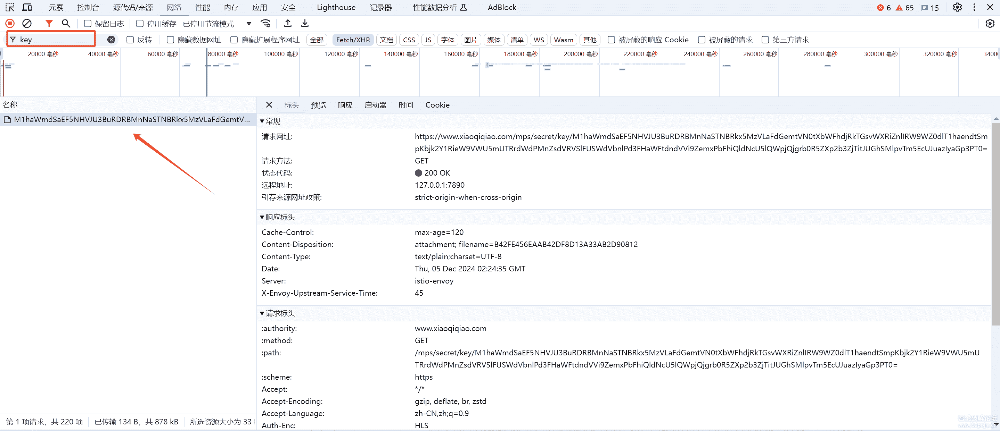

   `image.png`（279.34 KB，下载次数：2）

   [附件下载](https://www.52pojie.cn/forum.php?mod=attachment&aid=Mjc0MTQ0MXw1MzhmNTcwZXwxNzkzNTcxNTE4fDE2ODA4NnwxOTg4NTM3&nothumb=yes)

   搜索 `key`

   2024-12-5 10:30 上传

2. 下载 `key` 之后发现，是33字节文件，这明显不是正常的 `key`（正常为16字节）。

   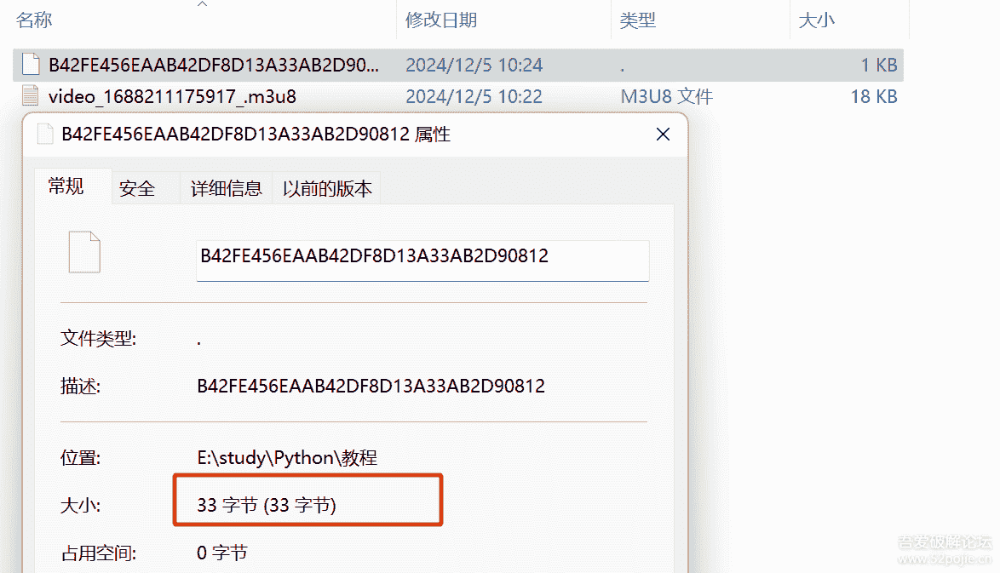

   `image.png`（56.19 KB，下载次数：2）

   [附件下载](https://www.52pojie.cn/forum.php?mod=attachment&aid=Mjc0MTQ0MnxlZjRmMjRiYXwxNzkzNTcxNTE4fDE2ODA4NnwxOTg4NTM3&nothumb=yes)

   `key` 文件信息

   2024-12-5 10:31 上传

3. 接下来就去 `js`，看看是哪个程序调用这个请求，发现有个叫 `onkeyload` 的堆栈，感觉像生成 `key` 的程序，进去看看。

   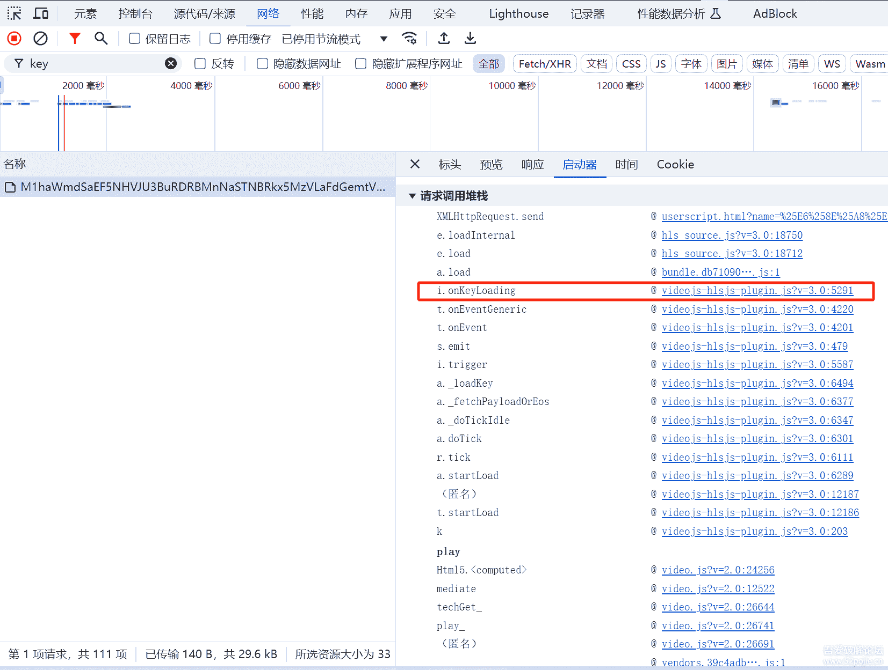

   `image.png`（303.56 KB，下载次数：0）

   [附件下载](https://www.52pojie.cn/forum.php?mod=attachment&aid=Mjc0MTQ0NHw4NWYxNjY0OHwxNzkzNTcxNTE4fDE2ODA4NnwxOTg4NTM3&nothumb=yes)

   `js` 调试1

   2024-12-5 10:42 上传

4. 把 `onkeyload` 这段设置断点，刷新浏览器并播放，发现 `key` 没获取到，

   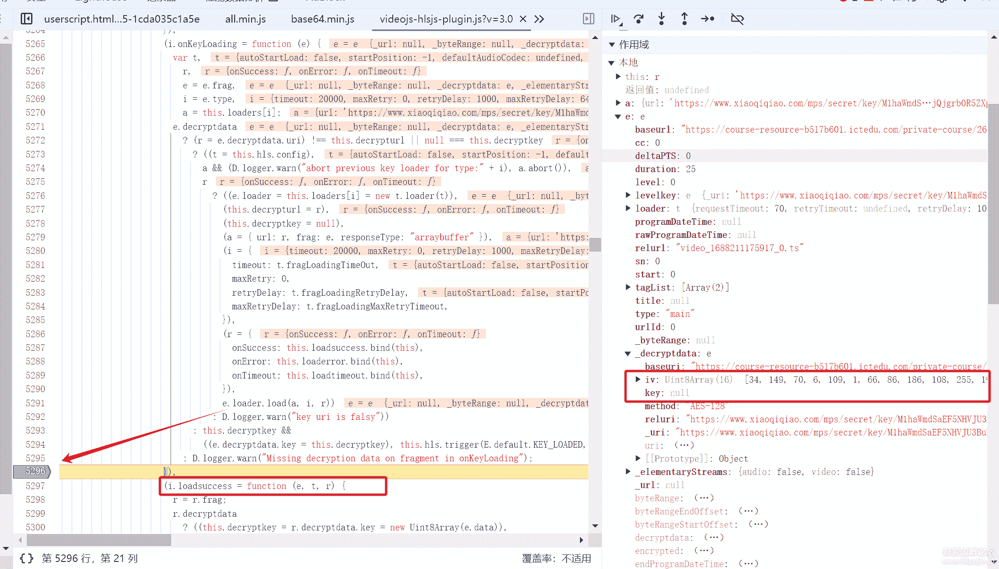

   `image.png`（566.16 KB，下载次数：1）

   [附件下载](https://www.52pojie.cn/forum.php?mod=attachment&aid=Mjc0MTQ1M3xjZDExZTVjNHwxNzkzNTcxNTE4fDE2ODA4NnwxOTg4NTM3&nothumb=yes)

   获取 `key`1

   2024-12-5 11:28 上传

5. 但发现 `loadsuccess` 这段函数，把这段也打个断点。重新播放视频，发现有16字节的 `key` 了，拿去下载试试。

   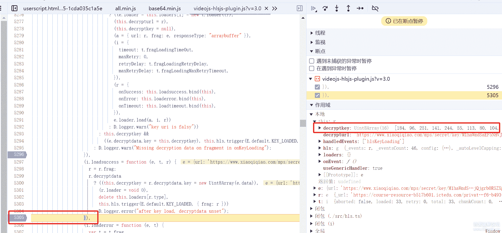

   `image.png`（367.73 KB，下载次数：1）

   [附件下载](https://www.52pojie.cn/forum.php?mod=attachment&aid=Mjc0MTQ1NHw4MzRmYWJiMnwxNzkzNTcxNTE4fDE2ODA4NnwxOTg4NTM3&nothumb=yes)

   获取 `key`2

   2024-12-5 11:31 上传

6. 先把这16字节转换成 `base64` 先得到：`uGD7jfQ3cVBooMDg7tv7PA==`

7. 打开 `m3u8` 发现没补全链接，手动补全一下。

   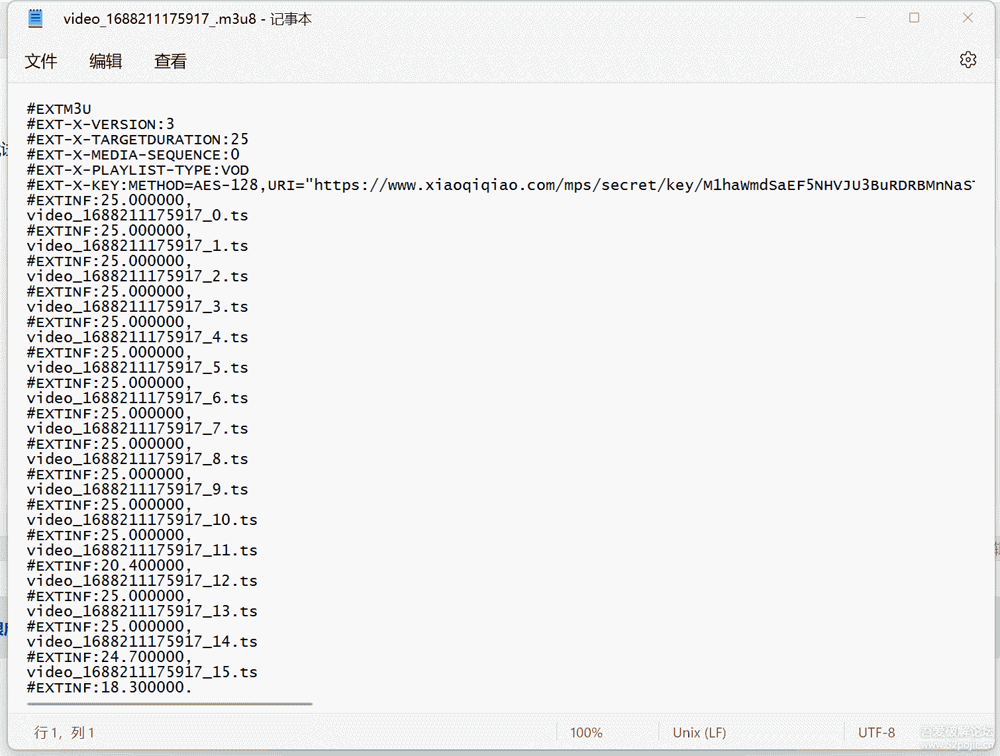

   `image.png`（112.46 KB，下载次数：1）

   [附件下载](https://www.52pojie.cn/forum.php?mod=attachment&aid=Mjc0MTQ1Nnw3OGI1ZWRmMHwxNzkzNTcxNTE4fDE2ODA4NnwxOTg4NTM3&nothumb=yes)

   `m3u8` 文件

   2024-12-5 11:34 上传

   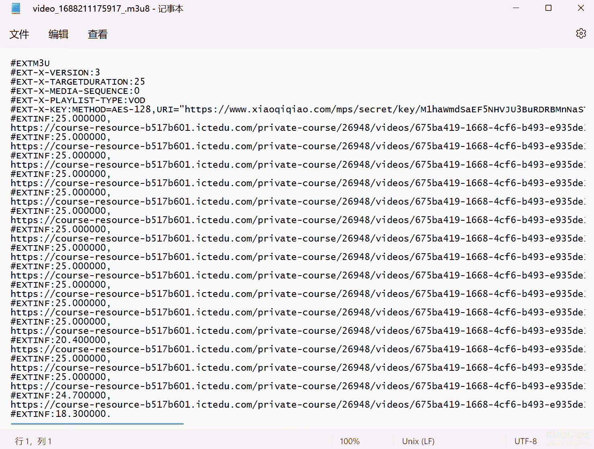

   `image.png`（158.35 KB，下载次数：0）

   [附件下载](https://www.52pojie.cn/forum.php?mod=attachment&aid=Mjc0MTQ2Mnw1ZTI2NWQ0ZXwxNzkzNTcxNTE4fDE2ODA4NnwxOTg4NTM3&nothumb=yes)

   `m3u8` 文件2

   2024-12-5 11:35 上传

8. 使用逍遥一仙 大神的 `m3u8` 下载工具，成功下载。

   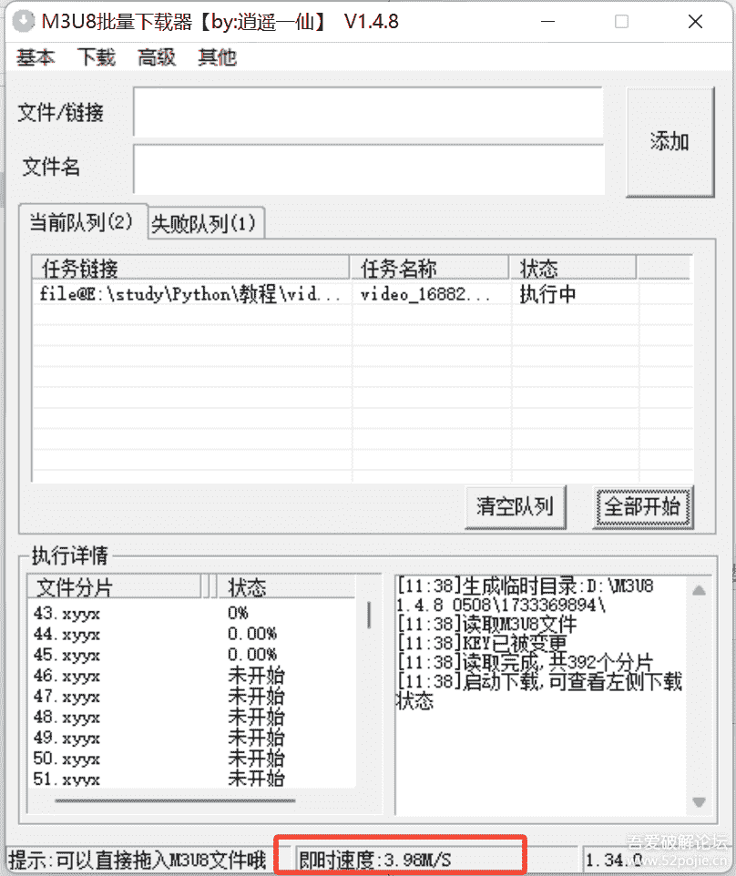

   `image.png`（166.25 KB，下载次数：1）

   [附件下载](https://www.52pojie.cn/forum.php?mod=attachment&aid=Mjc0MTQ2Nnw5ZDI3NTMxNnwxNzkzNTcxNTE4fDE2ODA4NnwxOTg4NTM3&nothumb=yes)

   2024-12-5 11:39 上传

## 编写批量下载脚本

- 既然要编写批量脚本，最方便的当然是尝试获取加密算法。

1. 继续跟踪 `js`，多次调试发现 `loadsuccess`，上一个堆栈为 `r.onsuccess`，进去瞧一瞧。

   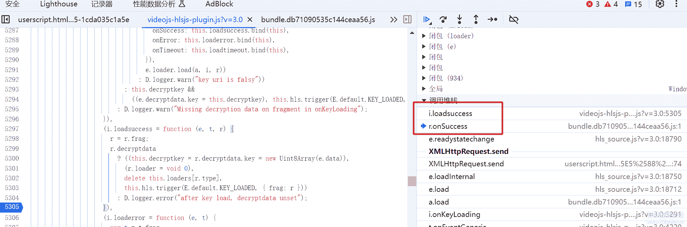

   `image.png`（262.92 KB，下载次数：1）

   [附件下载](https://www.52pojie.cn/forum.php?mod=attachment&aid=Mjc0MTQ3MHw1YWY2ZTA5NnwxNzkzNTcxNTE4fDE2ODA4NnwxOTg4NTM3&nothumb=yes)

   2024-12-5 12:00 上传

2. 发现 `key` 是从 `gt` 这里传过来的，继续跟。

   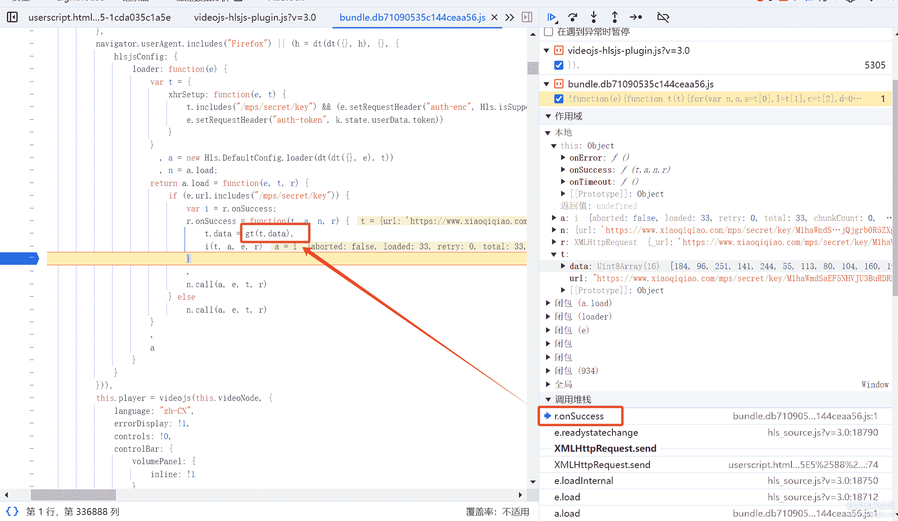

   `image.png`（361.11 KB，下载次数：1）

   [附件下载](https://www.52pojie.cn/forum.php?mod=attachment&aid=Mjc0MTQ4NXw5MjFhYzNhN3wxNzkzNTcxNTE4fDE2ODA4NnwxOTg4NTM3&nothumb=yes)

   2024-12-5 13:40 上传

3. 发现是从 `decoderModule` 来的，继续。

   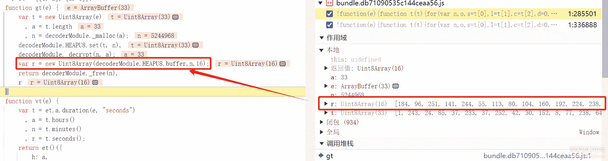

   `image.png`（183.25 KB，下载次数：1）

   [附件下载](https://www.52pojie.cn/forum.php?mod=attachment&aid=Mjc0MTQ4NnwxZGU0YzU3YXwxNzkzNTcxNTE4fDE2ODA4NnwxOTg4NTM3&nothumb=yes)

   2024-12-5 13:44 上传

4. 跟进来发现是 `wasm`，研究半天搞不懂算了算了。。。开摆！

   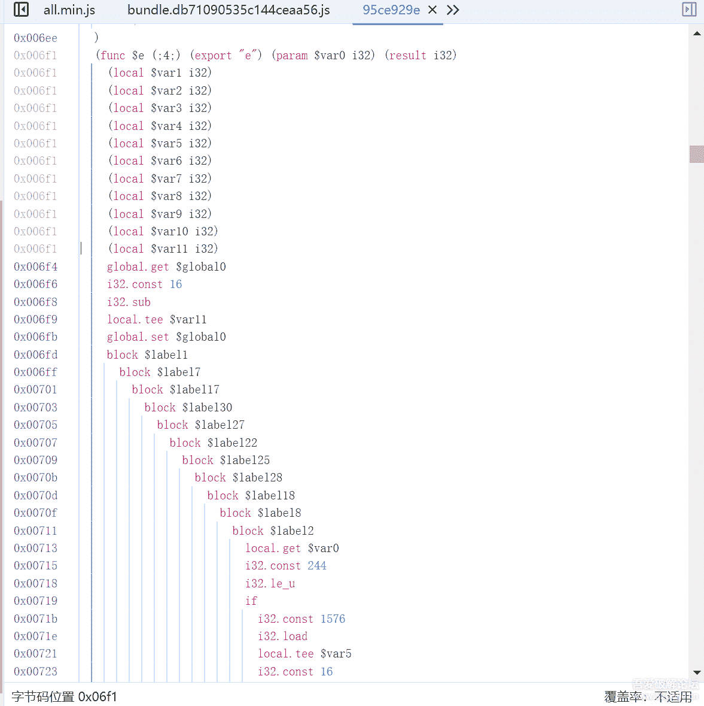

   `image.png`（214.46 KB，下载次数：1）

   [附件下载](https://www.52pojie.cn/forum.php?mod=attachment&aid=Mjc0MTQ4N3xiNWUzYzMyMXwxNzkzNTcxNTE4fDE2ODA4NnwxOTg4NTM3&nothumb=yes)

   2024-12-5 13:47 上传

- 换思路：直接从 `gt` 这截取数组，通过油猴脚本，发送 `base64` 到本地 `py` 程序，`py` 程序用来修改 `key` 链接，最后直接把 `m3u8` 文件拖进下载器下载。

这里就直接贴代码了，代码基本来自gpt。

### 油猴脚本


# 推送 base64 密码到 Python

## 用户脚本

```javascript
// ==UserScript==
// [//www.52pojie.cn/home.php?mod=space&uid=170990" target="_blank"](https://www.52pojie.cn/home.php?mod=space&uid=170990:href="https)         推送base64密码到python
// [//www.52pojie.cn/home.php?mod=space&uid=467642" target="_blank"](https://www.52pojie.cn/home.php?mod=space&uid=467642:href="https)    http://tampermonkey.net/
// [//www.52pojie.cn/home.php?mod=space&uid=1248337" target="_blank"](https://www.52pojie.cn/home.php?mod=space&uid=1248337:href="https)      0.1
// @description  请求完某个API，打印其中对应的全局参数
// [//www.52pojie.cn/home.php?mod=space&uid=686208" target="_blank"](https://www.52pojie.cn/home.php?mod=space&uid=686208:href="https)       Your Name
// [//www.52pojie.cn/home.php?mod=space&uid=195849" target="_blank"](https://www.52pojie.cn/home.php?mod=space&uid=195849:href="https)        https://www.xiao.com/*
// [//www.52pojie.cn/home.php?mod=space&uid=609072" target="_blank"](https://www.52pojie.cn/home.php?mod=space&uid=609072:href="https)        GM_xmlhttpRequest
// [//www.52pojie.cn/home.php?mod=space&uid=67665" target="_blank"](https://www.52pojie.cn/home.php?mod=space&uid=67665:href="https) *
// ==/UserScript==

(function() {
    'use strict';

    // 目标API地址
    const targetURL = 'https://www.xiao.com/courselab/public/v1.0/course-videos:play';

    // 保存原始的 XMLHttpRequest 原型方法
    const originalOpen = XMLHttpRequest.prototype.open;
    const originalSend = XMLHttpRequest.prototype.send;

    // 覆盖 open 方法
    XMLHttpRequest.prototype.open = function(method, url, async, user, password) {
        this._url = url; // 保存请求的 URL
        return originalOpen.apply(this, arguments);
    };

    // 覆盖 send 方法
    XMLHttpRequest.prototype.send = function(data) {
        if (this._url === targetURL) {
            // 监听 readyState 变化
            this.addEventListener('readystatechange', function() {
                if (this.readyState === 4 && this.status === 200) {
                    try {
                        setTimeout(() => {
                            // 将响应处理为 ArrayBuffer
                            const buffer = this.response;

                            // 将 ArrayBuffer 转换为 Uint8Array
                            const uint8Array = new Uint8Array(decoderModule.HEAPU8.buffer,5244968,16);
                            console.log('uint8Array Data:', uint8Array);

                            // 将 Uint8Array 转换为 Base64
                            const base64String = uint8ArrayToBase64(uint8Array);

                            // 打印 Base64 编码的数据
                            console.log('Base64 Data:', base64String);

                            // 打印videoId
                            console.log('Payload Data:', data);
                            const videoId = JSON.parse(data).videoId;
                            console.log('videoId:', videoId);

                            // 复制 Base64 数据到剪贴板
                            // copyToClipboard(base64String);

                            // 带着 Base64 字符串请求本地服务器
                            send(base64String,videoId);

                            // 你可以在此处对 Uint8Array 数据进行进一步处理
                        }, 500); // 延迟500毫秒
                    } catch (error) {
                        console.error('Error processing ArrayBuffer:', error);
                    }
                }
            });

            // 设置 responseType 为 arraybuffer
            this.responseType = 'arraybuffer';
        }

        // 调用原始的 send 方法
        return originalSend.apply(this, arguments);
    };
    // 将 Uint8Array 转换为 Base64 编码的函数
    function uint8ArrayToBase64(uint8Array) {
        let binaryString = '';
        for (let i = 0; i  {
            console.log('Base64 data copied to clipboard');
        }).catch(err => {
            console.error('Failed to copy data to clipboard:', err);
        });
    }

    function send(base64String,videoId) {
        'use strict';

        // Format data
        let data = `#KEY,${base64String}\r\n`;

        // Convert data to GBK encoding
        let gbkEncodedData = btoa(unescape(encodeURIComponent(data)));

        // Function to send data
        function sendData() {
            GM_xmlhttpRequest({
                method: 'POST',
                url: 'http://127.0.0.1:8789/modify-file',
                data: JSON.stringify({
                    video_id: videoId,
                    base64_string: base64String
                }),
                headers: {
                    'Content-Type': 'application/json'
                },
                onload: function(response) {
                    console.log('Response from server:', response.responseText);
                },
                onerror: function(error) {
                    console.error('Error communicating with server:', error);
                }
            });
        }

        // Call the sendData function
        sendData();
    }
})();
```

## py程序（需要手动设置文件夹）

```python
from flask import Flask, request, jsonify
import os,re

app = Flask(__name__)

# 设置文件夹路径
TARGET_FOLDER = "E:\study\Python\m3u8"  # 修改为你的目标文件夹路径

@app.route('/modify-file', methods=['POST'])
def modify_file():
    # 获取请求参数
    data = request.json
    video_id = data.get("video_id")
    base64_string = data.get("base64_string")

    if not video_id or not base64_string:
        return jsonify({"error": "缺少参数video_id和base64_string"}), 400

    # 搜索目标文件
    target_file = None
    for root, dirs, files in os.walk(TARGET_FOLDER):
        for file in files:
            if video_id in file:
                target_file = os.path.join(root, file)
                break
        if target_file:
            break

    if not target_file:
        return jsonify({"error": f"No file found with video_id: {video_id}"}), 404

    try:
        # 读取文件内容
        with open(target_file, 'r', encoding='utf-8') as f:
            content = f.read()
            print('搜索到文件：',target_file)

        # 替换内容
        modified_content = re.sub(r'URI=".*?"', f'URI="base64:{base64_string}"', content)

        # 保存修改后的文件
        with open(target_file, 'w', encoding='utf-8') as f:
            f.write(modified_content)

        return jsonify({"message": f"File {target_file} modified successfully"}), 200

    except Exception as e:
        return jsonify({"error": f"Failed to modify file: {str(e)}"}), 500

if __name__ == '__main__':
    # 运行服务器，监听端口 8788
    app.run(host='0.0.0.0', port=8789)
```
