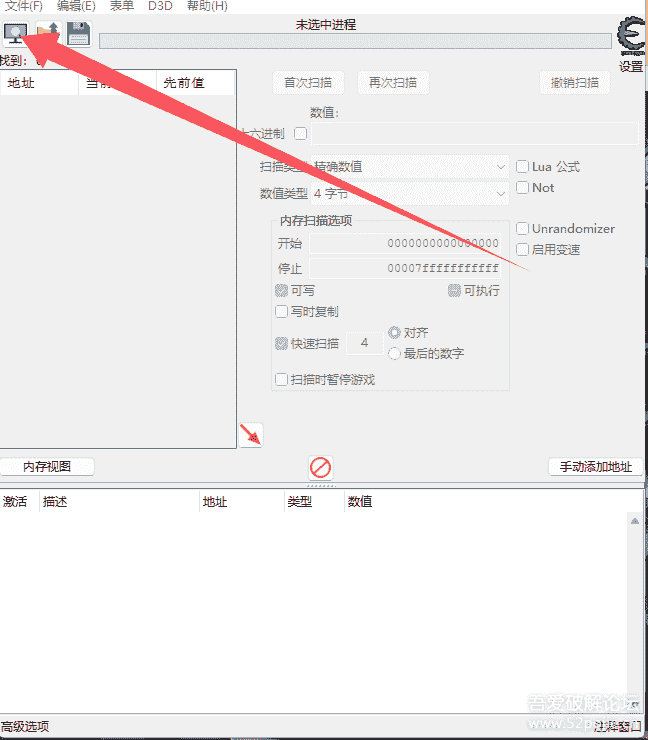
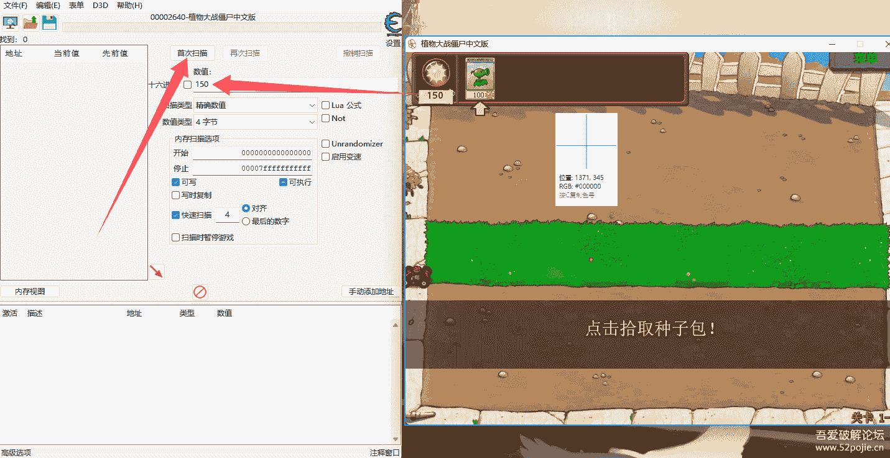
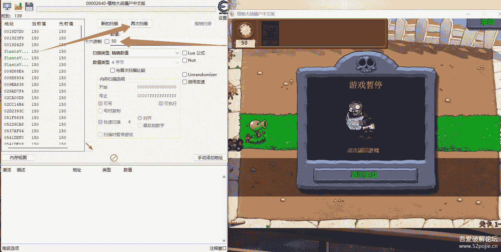
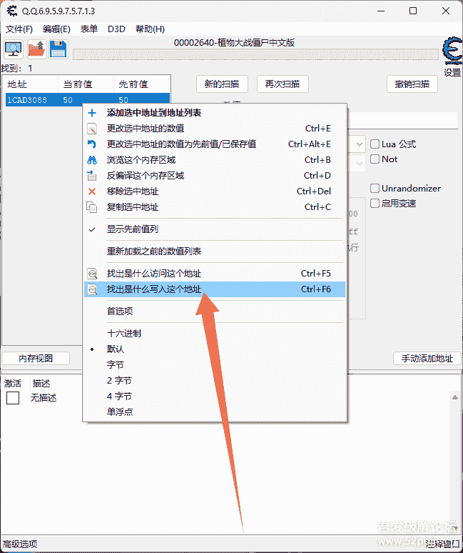
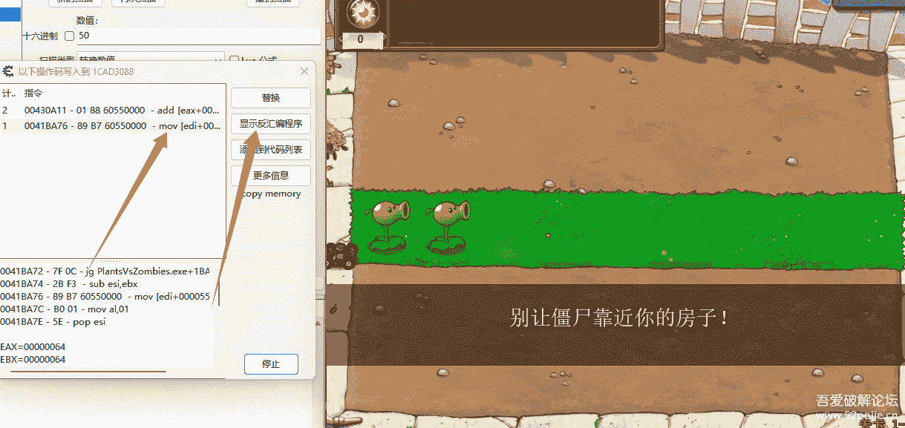
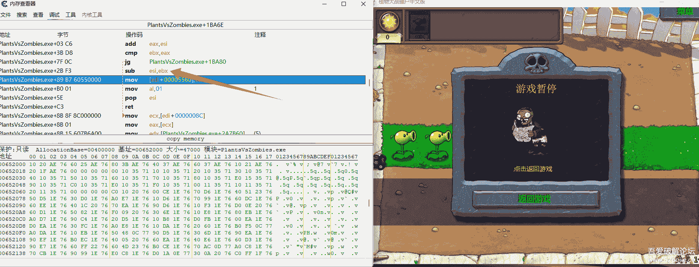
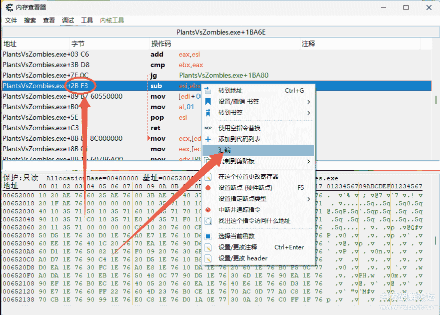
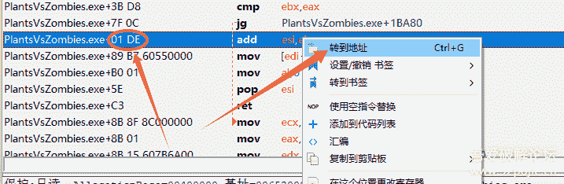
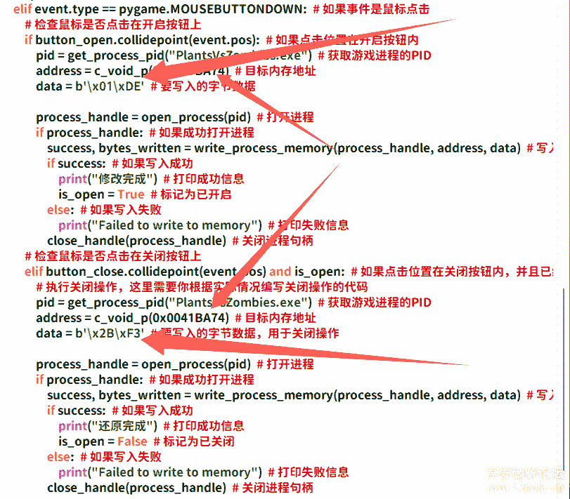

# [原创] CE植物大战僵尸 阳光反增 接上Python植物大战僵尸阳光反增

- 原帖：`https://www.52pojie.cn/forum.php?mod=viewthread&tid=1989026`
- 抓取时间：2026-11-01T22:18:38

书接上文：上期地址 `https://www.52pojie.cn/thread-1987274-1-1.html`

评论区有兄弟问我，地址该怎么找。这帖带大家找一下。

## 附加游戏截图

下面三张就是附加游戏，没什么好说的。

-   
  `7569696d6e2732326a766d75726972337e7973337f7e787f726e337e7270327c25787e257c2c2e2b.png` (59.87 KB, 下载次数: 3)  
  [附件下载](https://www.52pojie.cn/forum.php?mod=attachment&aid=Mjc0MTk5OHwyMDUxOGQ3NHwxNzkzNTcxNTE2fDE2ODA4NnwxOTg5MDI2&nothumb=yes)  
  2024-12-6 22:22 上传
-   
  `7569696d6e2732326a766d75726972337e7973337f7e787f726e337e7270322a2f25797c242a2a2e.png` (31.84 KB, 下载次数: 3)  
  [附件下载](https://www.52pojie.cn/forum.php?mod=attachment&aid=Mjc0MTk5OXw4NjQwY2ZiMnwxNzkzNTcxNTE2fDE2ODA4NnwxOTg5MDI2&nothumb=yes)  
  2024-12-6 22:22 上传
-   
  `7569696d6e2732326a766d75726972337e7973337f7e787f726e337e7270322d2f2e7f287f7f287e.png` (18.34 KB, 下载次数: 5)  
  [附件下载](https://www.52pojie.cn/forum.php?mod=attachment&aid=Mjc0MjAwMHw1ZjM3OTI4N3wxNzkzNTcxNTE2fDE2ODA4NnwxOTg5MDI2&nothumb=yes)  
  2024-12-6 22:22 上传

## 查找阳光地址

下面两张找阳光地址，搜初始阳光，改变一下阳光，再搜。

-   
  `7569696d6e2732326a766d75726972337e7973337f7e787f726e337e7270327c252a2a2e242c2f7f.png` (665.45 KB, 下载次数: 0)  
  [附件下载](https://www.52pojie.cn/forum.php?mod=attachment&aid=Mjc0MjAwNHwwMWZiY2Q1YnwxNzkzNTcxNTE2fDE2ODA4NnwxOTg5MDI2&nothumb=yes)  
  2024-12-6 22:23 上传
-   
  `7569696d6e2732326a766d75726972337e7973337f7e787f726e337e727032252b24297c297e2f2a.png` (628.84 KB, 下载次数: 0)  
  [附件下载](https://www.52pojie.cn/forum.php?mod=attachment&aid=Mjc0MjAwM3w4MDhjZGE0NnwxNzkzNTcxNTE2fDE2ODA4NnwxOTg5MDI2&nothumb=yes)  
  2024-12-6 22:22 上传

## 定位改写指令

然后重点来了，右键找改写，回游戏收集阳光种一颗植物，找这个带`mov`的，显示反汇编程序。

-   
  `7569696d6e2732326a766d75726972337e7973337f7e787f726e337e7270322c297e782e2b792e79.png` (70.75 KB, 下载次数: 0)  
  [附件下载](https://www.52pojie.cn/forum.php?mod=attachment&aid=Mjc0MjAwNXxmNmRlYjIyOHwxNzkzNTcxNTE2fDE2ODA4NnwxOTg5MDI2&nothumb=yes)  
  2024-12-6 22:23 上传
-   
  `7569696d6e2732326a766d75726972337e7973337f7e787f726e337e7270327b2a2f292b7f2b2d2d.png` (512.11 KB, 下载次数: 0)  
  [附件下载](https://www.52pojie.cn/forum.php?mod=attachment&aid=Mjc0MjAwN3wwZTdmMmVjZHwxNzkzNTcxNTE2fDE2ODA4NnwxOTg5MDI2&nothumb=yes)  
  2024-12-6 22:23 上传

找它上面那行，记住现在的字节`2B F3`，一会儿要用，右键改成`add`，再记住字节`01 DE`，然后右键转到地址，记下这个地址`0041BA74`。

## 汇编说明

这里解释一下：

汇编中，`mov`是赋值，`sub`是减法，`add`是加法，将赋值上面的减法改成加法就能实现反增，你用空指令替换也能实现不减。

```asm
PlantsVsZombies.exe+1BA74 - 2B F3                 - sub esi,ebx
PlantsVsZombies.exe+1BA76 - 89 B7 60550000        - mov [edi+00005560],esi
```

-   
  `7569696d6e2732326a766d75726972337e7973337f7e787f726e337e7270327e2a287e2c2d2e2528.png` (544.6 KB, 下载次数: 1)  
  [附件下载](https://www.52pojie.cn/forum.php?mod=attachment&aid=Mjc0MjAwOHw0MmU5NmVlMHwxNzkzNTcxNTE2fDE2ODA4NnwxOTg5MDI2&nothumb=yes)  
  2024-12-6 22:23 上传
-   
  `37d3d539b6003af3f6616930252ac65c1138b683.png` (120.28 KB, 下载次数: 0)  
  [附件下载](https://www.52pojie.cn/forum.php?mod=attachment&aid=Mjc0MjAxM3w1ZjhlMmExN3wxNzkzNTcxNTE2fDE2ODA4NnwxOTg5MDI2&nothumb=yes)  
  2024-12-6 22:26 上传
-   
  `7569696d6e2732326a766d75726972337e7973337f7e787f726e337e7270322f292c7b24287e7c79.png` (14.84 KB, 下载次数: 0)  
  [附件下载](https://www.52pojie.cn/forum.php?mod=attachment&aid=Mjc0MjAwOXw4MzM1ZmQ1OXwxNzkzNTcxNTE2fDE2ODA4NnwxOTg5MDI2&nothumb=yes)  
  2024-12-6 22:23 上传
-   
  `7569696d6e2732326a766d75726972337e7973337f7e787f726e337e7270322f242e292e29247f2d.png` (47.2 KB, 下载次数: 0)  
  [附件下载](https://www.52pojie.cn/forum.php?mod=attachment&aid=Mjc0MjAxMXxlOTNmMjg3OXwxNzkzNTcxNTE2fDE2ODA4NnwxOTg5MDI2&nothumb=yes)  
  2024-12-6 22:23 上传
-   
  `7569696d6e2732326a766d75726972337e7973337f7e787f726e337e727032797e7e29282c797c25.png` (12.28 KB, 下载次数: 0)  
  [附件下载](https://www.52pojie.cn/forum.php?mod=attachment&aid=Mjc0MjAxMHw3MTI4YjM1OXwxNzkzNTcxNTE2fDE2ODA4NnwxOTg5MDI2&nothumb=yes)  
  2024-12-6 22:23 上传

## 写入Python

最后，将地址和字节写入Python，怎么实现内存修改自己看源码，每一行写的都很明白，看不懂先学基础!先学基础!先学基础!

-   
  `7569696d6e2732326a766d75726972337e7973337f7e787f726e337e727032797f7f29297c78792f.png` (151.29 KB, 下载次数: 1)  
  [附件下载](https://www.52pojie.cn/forum.php?mod=attachment&aid=Mjc0MjAxMnwyNDQ4NTI4OXwxNzkzNTcxNTE2fDE2ODA4NnwxOTg5MDI2&nothumb=yes)  
  2024-12-6 22:23 上传
