# [Web逆向] 【JS逆向】某招标公告逆向分析

- 原帖：`https://www.52pojie.cn/forum.php?mod=viewthread&tid=1989050`
- 抓取时间：2026-11-01T22:18:37

## 逆向目标

- 网址：`aHR0cHM6Ly9jdGJwc3AuY29tLyMvYnVsbGV0aW5MaXN0`
- 目标：查询参数`type__1017`，响应数据解密

## 抓包分析

随便翻页，发起一个请求，可以看到表单参数`type__1017`可能需要逆向。

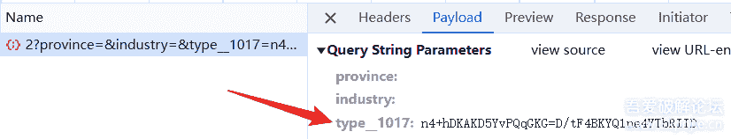

`1.png` (21.97 KB, 下载次数: 5)

[论坛附件](https://www.52pojie.cn/forum.php?mod=attachment&aid=Mjc0MjA1OXw4ZmIzMmQ0YXwxNzkzNTcxNTE1fDE2ODA4NnwxOTg5MDUw&nothumb=yes)

2024-12-7 03:32 上传

响应数据也是加密的。

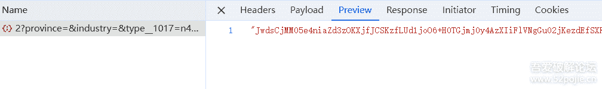

`2.png` (15.38 KB, 下载次数: 6)

[论坛附件](https://www.52pojie.cn/forum.php?mod=attachment&aid=Mjc0MjA2MHw3OTkxMGExNHwxNzkzNTcxNTE1fDE2ODA4NnwxOTg5MDUw&nothumb=yes)

2024-12-7 03:32 上传

浅浅从启动器进去看看，又是混淆的代码。

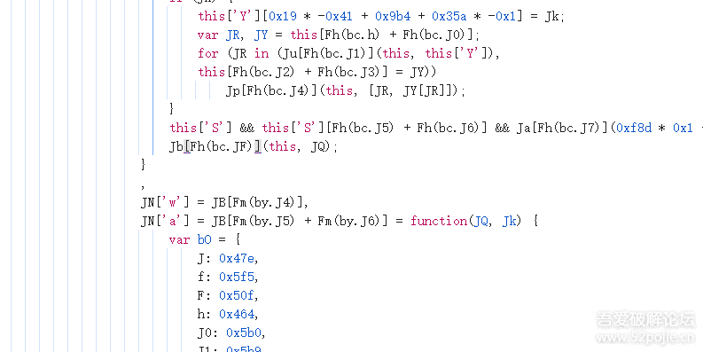

`3.png` (18.07 KB, 下载次数: 6)

[论坛附件](https://www.52pojie.cn/forum.php?mod=attachment&aid=Mjc0MjA2MXwyNjZiNzBkNXwxNzkzNTcxNTE1fDE2ODA4NnwxOTg5MDUw&nothumb=yes)

2024-12-7 03:32 上传

那我们这一章就来讲讲类OB混淆的反混淆吧，本人AST菜鸡一个，路过的大佬多多指点。

## 反混淆

用到的AST基本框架如下：

```javascript
const parse = require('@babel/parser').parse
const generator = require('@babel/generator').default;
const traverse = require('@babel/traverse').default;
const types = require('@babel/types')
const fs = require('fs')

// 自行将后面讲的三个特征的代码放到这

// 待反混淆的文件
let jsCode = fs.readFileSync('./encode.js', { encoding: 'utf-8' })

let ast = parse(jsCode);

//////////////////
// 具体还原逻辑
//////////////////

// 语法数转JS代码
let { code } = generator(ast, {compact: false});

// 保存
fs.writeFile('./decode.js', code, (err) => {
});
```

我们先把代码整体复制到`vscode`中，简单捋一捋还原的思路。

首先，对于OB混淆，我们需要有一个认识：就是部分字符串会被所谓的加密函数进行了解密，在使用的时候就会调用相应的解密函数进行解密。

与解密函数相关的特征有如下三个：

- 大数组
- 数组移位
- 解密函数
- 大数组

**大数组**

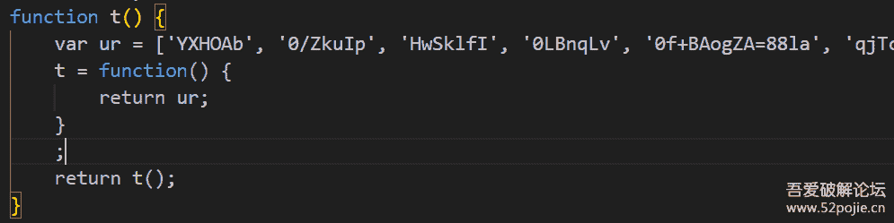

`4.png` (26.79 KB, 下载次数: 3)

[论坛附件](https://www.52pojie.cn/forum.php?mod=attachment&aid=Mjc0MjA2MnwyNzllZWNiNnwxNzkzNTcxNTE1fDE2ODA4NnwxOTg5MDUw&nothumb=yes)

2024-12-7 03:32 上传

**数组移位**（一般是一个自执行函数，将大数组当参数传进去）

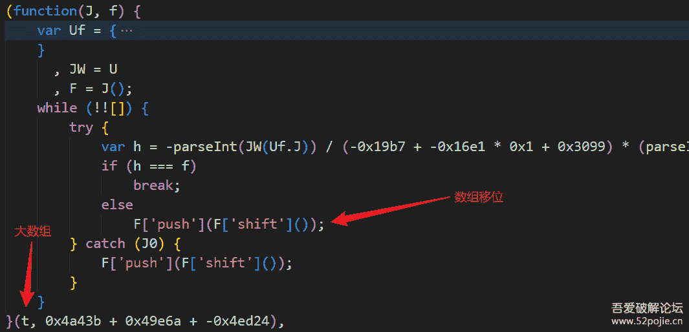

`5.png` (57.67 KB, 下载次数: 4)

[论坛附件](https://www.52pojie.cn/forum.php?mod=attachment&aid=Mjc0MjA2M3xmN2Y5MjZhOHwxNzkzNTcxNTE1fDE2ODA4NnwxOTg5MDUw&nothumb=yes)

2024-12-7 03:32 上传

**解密函数**（会用到大数组），这里`U`是解密函数

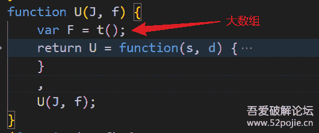

`6.png` (20.66 KB, 下载次数: 3)

[论坛附件](https://www.52pojie.cn/forum.php?mod=attachment&aid=Mjc0MjA2NHxkNDQwN2E0ZXwxNzkzNTcxNTE1fDE2ODA4NnwxOTg5MDUw&nothumb=yes)

2024-12-7 03:32 上传

下面开始进行还原，思路仅供参考。。。

需要将前面三个特征的代码复制下来便于解密，记得把代码压缩一下。

我们先分析一下之后的代码，待解密的字符串有这样的特征，解密函数是引用的`U`，参数是从对象中取的数字。

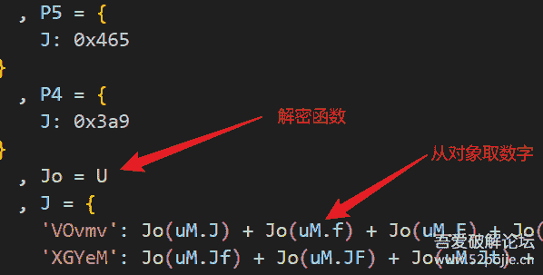

`7.png` (35.98 KB, 下载次数: 3)

[论坛附件](https://www.52pojie.cn/forum.php?mod=attachment&aid=Mjc0MjA2NXw3YmEyMThjMHwxNzkzNTcxNTE1fDE2ODA4NnwxOTg5MDUw&nothumb=yes)

2024-12-7 03:32 上传

那我们先还原字符串

> 思路：用一个数组保存解密函数及其引用的变量名，然后找到所有解密函数调用的地方进行还原，如：`Jo(uM.J)` 还原成 xxx字符串。

AST代码：

```javascript
// 递归解密函数的引用，添加到数组中
let startFuncName = 'U'
let decodeFuncArr = [startFuncName ]

traverse(ast, {
    VariableDeclarator: function (path) {
        if (
            path.get('id').isIdentifier() &&
            path.get('init').isIdentifier() &&
            decodeFuncArr.indexOf(path.get('init.name').node) != -1
        ) {
            decodeFuncArr.push(path.get('id.name').node)
        }
    }
})

// 字符串还原
let argsType = ['isNumericLiteral']
traverse(ast, {
    CallExpression: {
        exit: function (path) {
            if (
                path.get('callee').isIdentifier() &&
                decodeFuncArr.indexOf(path.get('callee.name').node) != -1 &&
                path.get('arguments').length === 1
            ) {
                let argTypeTagArr = []  // 存储参数是否为指定类型的数组
                for (let i = 0; i  c)) {
                    // 如果符合指定的类型，就是需要解密的地方
                    let args = []  // 存储参数的值
                    for (let i = 0; i ', eval(`${startFuncName}(${args.join(',')})`))

                    path.replaceWith(types.valueToNode(eval(`${startFuncName}(${args.join(',')})`)))
                }
            }
        }
    }
})
```

还原后将部分字符串进行拼接。

AST代码：

```javascript
// 字符串拼接
traverse(ast, {
    BinaryExpression: {
        exit: function (path) {
            let left = path.get("left").node.value
            let right = path.get("right").node.value
            if (path.get("left").isStringLiteral() && path.get("right").isStringLiteral()) {
                path.replaceInline(types.valueToNode(left + right))
            }
        }
    }
})
```

下一步，我们需要把对象中的字符串以及函数调用还原回去。

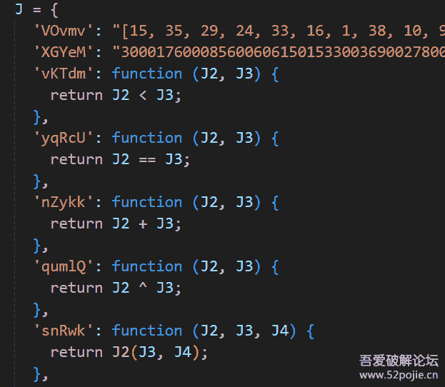

`8.png` (57.1 KB, 下载次数: 1)

[论坛附件](https://www.52pojie.cn/forum.php?mod=attachment&aid=Mjc0MjA2Nnw4NjIzYzM0OXwxNzkzNTcxNTE1fDE2ODA4NnwxOTg5MDUw&nothumb=yes)

2024-12-7 03:32 上传

> 思路：首先用到的地方是`J["aZyay"]`或`J["oqDBR"](Jd, JP)`类型，我们直接拿到对象的属性，然后去对应的对象判断属性值是字符串类型还是函数类型，进行替换。

AST代码：

```javascript
// 排除一些不在对象的属性
let buildInFunc = [
    'apply', 'slice', 'shift', 'which', 'split', 'index', 'input', 'clone', 'token', 'refer', 'scene', 'width',
    'style', 'round', 'parse', 'match', 'catch'
]

// 从对象中取字符串还原
traverse(ast, {
    MemberExpression: {
        exit: function (path) {
            if (
                path.get('object').isIdentifier() &&
                path.get('property').isStringLiteral()
            ) {
                console.log(path.toString())
                let identifier = path.get('object.name').node
                let property = path.get('property.value').node
                if (property.length !== 5) return
                if (buildInFunc.indexOf(property) !== -1) return
                if (!path.scope.getAllBindings()[identifier]) return
                let property_nodes = path.scope.getAllBindings()[identifier].path.get('init.properties')
                for (let i = 0; i ', property_nodes[i].get('value.value').node)
                        path.replaceWith(types.valueToNode(property_nodes[i].get('value.value').node))
                    }
                }
            }
        }
    }
})

// 从对象中取函数调用还原
traverse(ast, {
    CallExpression: {
        exit: function (path) {
            if (
                path.get('callee').isMemberExpression() &&
                path.get('callee.property').isStringLiteral()
            ) {
                console.log(path.toString())
                let identifier = path.get('callee.object.name').node
                let property = path.get('callee.property.value').node
                if (property.length !== 5) return
                if (buildInFunc.indexOf(property) !== -1) return
                // 获取obj对象属性值，为操作符或函数
                let property_paths = path.scope.getAllBindings()[identifier].path.get('init.properties')
                property_paths = Array.from(property_paths)
                property_paths.forEach(node_path => {
                    // 属性名称
```


## AST 还原处理

### 操作符与函数调用还原

```javascript
let obj_property = node_path.get('key.value').node

if (
    obj_property === property &&
    node_path.get('value').isFunctionExpression()
) {
    let func_bodys = node_path.get('value.body.body')
    func_bodys = Array.from(func_bodys)
    func_bodys.forEach(body => {
        // 在return处才知道函数是操作符类型还是函数调用类型
        if (body.isReturnStatement()) {
            if (body.get('argument').isBinaryExpression()) {
                // 操作符还原
                let operator = body.get('argument.operator').node
                let left = path.get('arguments.0')
                let right = path.get('arguments.1')
                console.log(path.toString(), '-->', left.toString(), operator, right.toString())
                path.replaceWith(types.binaryExpression(operator, left.node, right.node))
            } else if (body.get('argument').isCallExpression()) {
                // 函数调用还原
                let origin_args = path.get('arguments')
                origin_args = Array.from(origin_args)
                let args
                if (origin_args.length === 1) {
                    args = []  // 没有参数
                } else {
                    args = origin_args.slice(1).map(arg => arg.node)
                }
                let old_path_string = path.toString()
                path.replaceWith(types.callExpression(origin_args[0].node, args))
                console.log(old_path_string, '-->', path.toString())
            } else if (body.get('argument').isLogicalExpression()) {
                // 操作符还原
                let operator = body.get('argument.operator').node
                let left = path.get('arguments.0')
                let right = path.get('arguments.1')
                console.log(path.toString(), '-->', left.toString(), operator, right.toString())
                path.replaceWith(types.logicalExpression(operator, left.node, right.node))
            }
        }
    })
})

}

}

}

})
```

### 控制流还原

然后，我们对这样的控制流进行还原。

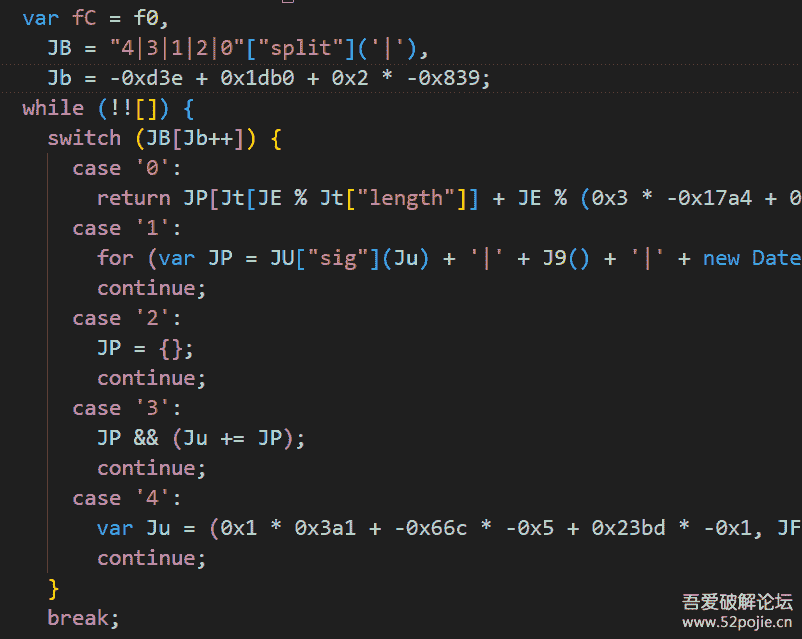

`9.png` (68 KB, 下载次数: 3)

[附件下载](https://www.52pojie.cn/forum.php?mod=attachment&aid=Mjc0MjA2N3w3NzlhMDA1OHwxNzkzNTcxNTE1fDE2ODA4NnwxOTg5MDUw&nothumb=yes)

2024-12-7 03:32 上传

思路：拿到控制器和 `case` 节点，然后根据控制器的顺序对 `case` 节点进行排序。

#### AST 代码

```javascript
let controler_code = {}
let controler = {}
traverse(ast, {
    WhileStatement: {
        exit: function (path) {
            if (
                path.get('test').isUnaryExpression() || (path.get('test').isArrayExpression() && path.get('test').toString() === '[]')
            ) {
                if (path.get('body.body').length === 0) return  // while循环体为空，直接返回
                if (path.get('body.body.0').isTryStatement()) return
                console.log(path.toString())
                let switch_condition
                try {
                    switch_condition = path.get('body.body.0.discriminant.object.name').node  // 控制器名称
                } catch (e) {
                    return
                }
                controler_code[switch_condition] = {}  // 整体代码有多个控制流，需要分开

                if (!path.scope.getAllBindings()[switch_condition].path.get('init.callee.object').isStringLiteral()) return
                // 取控制器，var _0x41a9c6 = "1|4|3|0|2"["split"]('|')
                eval(`controler['${switch_condition}'] = ` + path.scope.getAllBindings()[switch_condition].path.get('init').toString())
                let cases_path = path.get('body.body.0.cases')  // 拿到所有case节点，数组类型
                for (var i = 0; i  {
                        if (!c.isContinueStatement()) {
                            // 剔除case中的continue
                            controler_code[switch_condition][case_num].push(c)
                        }
                    })
                }
                let code_node = []
                for (var i = 0; i  {
                        code_node.push(n.node)
                    })
                    // code_node.push(controler_code[switch_condition][index][0].node)
                }
                path.replaceWithMultiple(code_node)
            }
        }
    }
})
```

最后，再处理一下。

### 解编码

```javascript
const transform_literal = {
    NumericLiteral({node}){
        if (node.extra && /^0[obx]/i.test(node.extra.raw)){
            node.extra = undefined;
        }
    },
    StringLiteral({node}){
        if (node.extra && /\\[ux]/gi.test(node.extra.raw)){
            node.extra = undefined;
        }
    }
}
traverse(ast, transform_literal)
```

### 表达式计算

```javascript
traverse(ast, {
    BinaryExpression: {
        exit(path){
            let {confident,value} = path.evaluate();
            if(!confident)return
            path.replaceInline({type:"NumericLiteral", value: value})
        }
    }
})
```

### 移除无用对象

```javascript
ast = parse(generator(ast, { compact: true }).code)

traverse(ast, {
    VariableDeclarator: {
        exit(path) {
            let { init, id } = path.node;
            if (!types.isObjectExpression(init) && !types.isIdentifier(id)) return;
            let { scope } = path;
            let binding = scope.getBinding(id.name);
            if (binding.referencePaths.length !== 0) return;
            path.remove();
        }
    }
})
```

成功将四千多行的代码还原到七百多行，而且逻辑也清晰多了（图不贴了）。

然后，我们再验证一下这代码能不能用，按道理来说，应该一步一验证的，但是我已经踩过坑了，所以直接一次性讲完。

具体验证方法就是去浏览器替换看能不能用，记得一定一定一定要压缩！！！保存的时候`let { code } = generator(ast, {compact: true});`将`compact`修改为`true`即可。

可以看到替换后也能成功拿到数据。

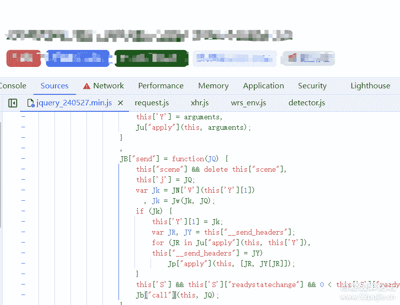

`10.png` (37.62 KB, 下载次数: 2)

[附件下载](https://www.52pojie.cn/forum.php?mod=attachment&aid=Mjc0MjA2OHw4MzRmOTFjYnwxNzkzNTcxNTE1fDE2ODA4NnwxOTg5MDUw&nothumb=yes)

2024-12-7 03:32 上传

## 逆向分析

我们需要的逆向的参数是`type__1017`，可以搜索`type__`，可以看到数组`Jt`有，那我们就可以大胆猜测下面的`Ju`应该是我们要的值了。

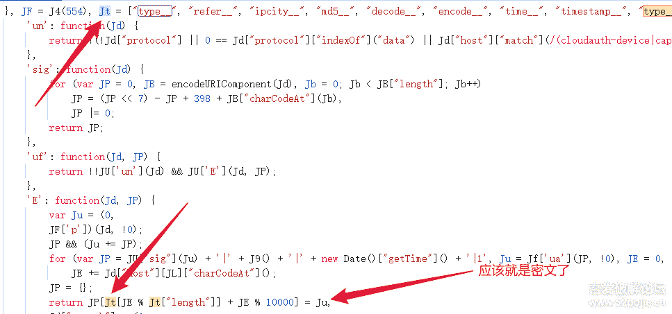

`11.png` (34.23 KB, 下载次数: 3)

[附件下载](https://www.52pojie.cn/forum.php?mod=attachment&aid=Mjc0MjA2OXw3Y2Y5NjBhMXwxNzkzNTcxNTE1fDE2ODA4NnwxOTg5MDUw&nothumb=yes)

2024-12-7 03:32 上传

`Ju`确实是我们要的值，这个值非常好跟，抠代码靠自己了。

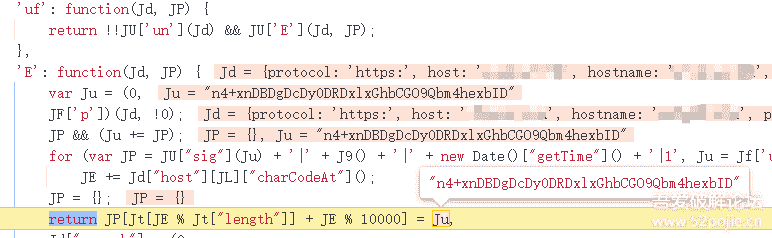

`12.png` (21.07 KB, 下载次数: 3)

[附件下载](https://www.52pojie.cn/forum.php?mod=attachment&aid=Mjc0MjA3MHwwZDczNWQxZXwxNzkzNTcxNTE1fDE2ODA4NnwxOTg5MDUw&nothumb=yes)

2024-12-7 03:33 上传

然后我们看数据解密，老样子，我们尝试`hook` `JSON.parse`。

`hook`到响应数据的明文。

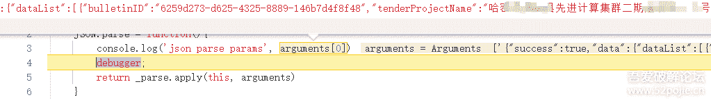

`13.png` (14.35 KB, 下载次数: 4)

[附件下载](https://www.52pojie.cn/forum.php?mod=attachment&aid=Mjc0MjA3MXxjOTAwNzNjOHwxNzkzNTcxNTE1fDE2ODA4NnwxOTg5MDUw&nothumb=yes)


2024-12-7 03:33 上传

我们往上跟一个栈，很明显了，`DES`，剩下的就交给你们了。

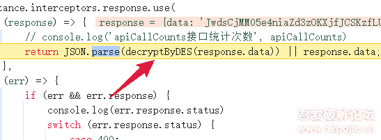

`14.png` (13.95 KB, 下载次数: 3)

[`forum.php?mod=attachment&aid=Mjc0MjA3MnxlOTc4NmUyMHwxNzkzNTcxNTE1fDE2ODA4NnwxOTg5MDUw&nothumb=yes`](https://www.52pojie.cn/forum.php?mod=attachment&aid=Mjc0MjA3MnxlOTc4NmUyMHwxNzkzNTcxNTE1fDE2ODA4NnwxOTg5MDUw&nothumb=yes)

2024-12-7 03:33 上传

总的来说，反混淆后就特别简单了。

加解密搞定后，我们模拟请求一下数据。

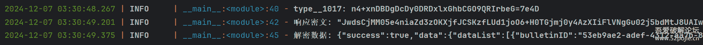

`15.png` (60.64 KB, 下载次数: 3)

[`forum.php?mod=attachment&aid=Mjc0MjA3M3w5NjBmMTQ2NnwxNzkzNTcxNTE1fDE2ODA4NnwxOTg5MDUw&nothumb=yes`](https://www.52pojie.cn/forum.php?mod=attachment&aid=Mjc0MjA3M3w5NjBmMTQ2NnwxNzkzNTcxNTE1fDE2ODA4NnwxOTg5MDUw&nothumb=yes)

2024-12-7 03:33 上传

成功！！！
