# [分享] 【新手进阶】【手动 自动】给程序添加网页 文本弹窗

- 原帖：[https://www.52pojie.cn/forum.php?mod=viewthread&tid=1989467](https://www.52pojie.cn/forum.php?mod=viewthread&tid=1989467)
- 抓取时间：2026-11-01T22:18:25

## 修改版权之给程序加弹窗、网页

### 手动操作

讲师：Kido

#### 添加函数

- 首先使用 StudPE 打开目标程序，选择“函数”、“`USER32.dll`”。

  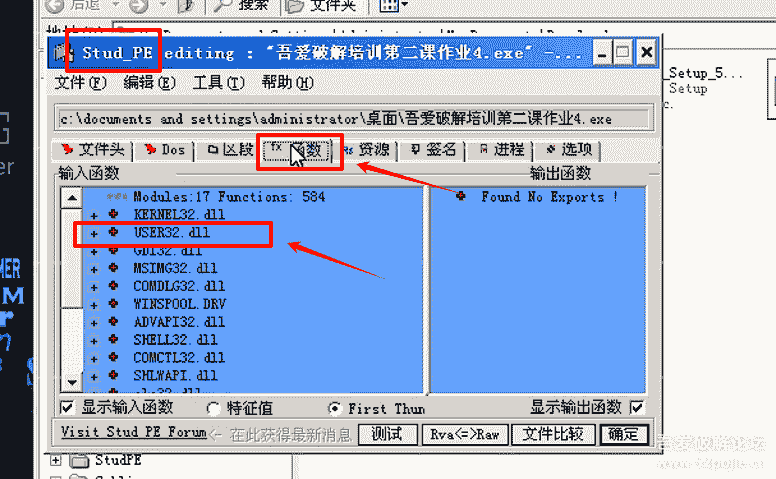

  `image-20241208185941795.png`（259.39 KB，下载次数：6）；[附件下载](https://www.52pojie.cn/forum.php?mod=attachment&aid=Mjc0MjI5NXwyN2EwMTExMXwxNzkzNTcxNTAyfDE2ODA4NnwxOTg5NDY3&nothumb=yes)；2024-12-8 21:54 上传

- 看一下是否有 `MessageBoxA` 函数，若没有，则需要手动添加：右键，`Add New Import`。

  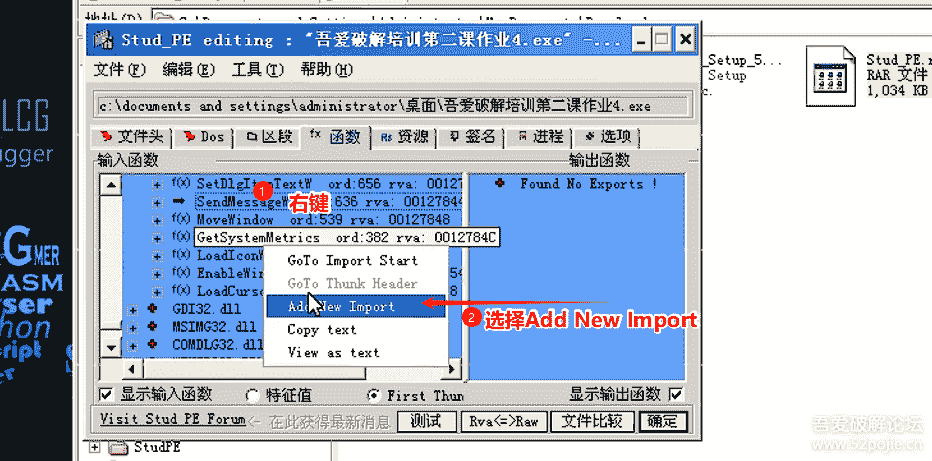

  `image-20241208190149057.png`（327.2 KB，下载次数：6）；[附件下载](https://www.52pojie.cn/forum.php?mod=attachment&aid=Mjc0MjI5NnxlNmZlMGI5MXwxNzkzNTcxNTAyfDE2ODA4NnwxOTg5NDY3&nothumb=yes)；2024-12-8 21:54 上传

- 点击“DLL选择”按钮，选择 `C:\WINDOWS\system32\user32.dll`。

  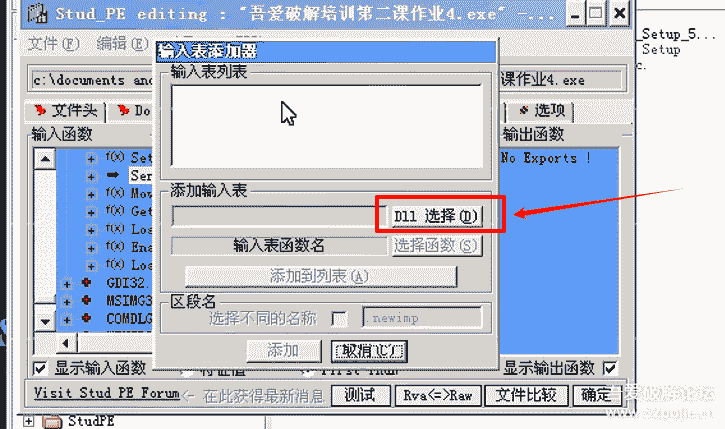

  `image-20241208190229765.png`（225.96 KB，下载次数：6）；[附件下载](https://www.52pojie.cn/forum.php?mod=attachment&aid=Mjc0MjI5N3w5ODkwOTVkN3wxNzkzNTcxNTAyfDE2ODA4NnwxOTg5NDY3&nothumb=yes)；2024-12-8 21:54 上传

- 再点击“选择函数”按钮。

  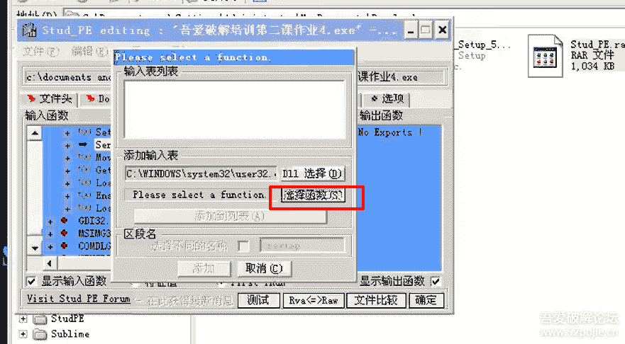

  `image-20241208190510473.png`（267.09 KB，下载次数：0）；[附件下载](https://www.52pojie.cn/forum.php?mod=attachment&aid=Mjc0MjI5OHwxZGUyYzA2NHwxNzkzNTcxNTAyfDE2ODA4NnwxOTg5NDY3&nothumb=yes)；2024-12-8 21:54 上传

- 选择 `MessageBoxA` 函数，点击“确定”。

  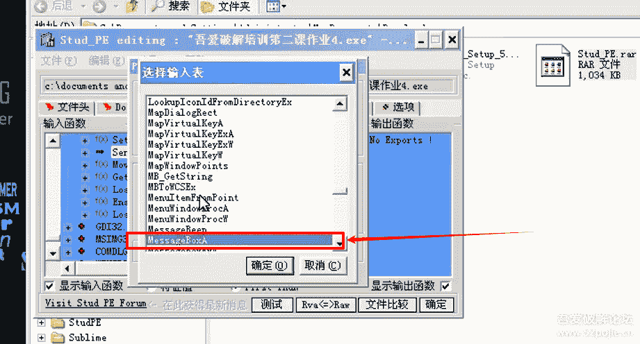

  `image-20241208190549322.png`（306.65 KB，下载次数：1）；[附件下载](https://www.52pojie.cn/forum.php?mod=attachment&aid=Mjc0MjI5OXxmZGI4ZWZjOXwxNzkzNTcxNTAyfDE2ODA4NnwxOTg5NDY3&nothumb=yes)；2024-12-8 21:54 上传

- 点击“添加到列表”，选中输入表列表中的这个函数，点击“添加”，点击右下角“确定”。

  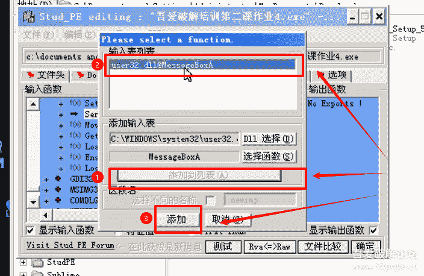

  `image-20241208190749592.png`（249.62 KB，下载次数：1）；[附件下载](https://www.52pojie.cn/forum.php?mod=attachment&aid=Mjc0MjMwMHwwNmQ3ZjhhYnwxNzkzNTcxNTAyfDE2ODA4NnwxOTg5NDY3&nothumb=yes)；2024-12-8 21:54 上传

- 此时函数就添加好了。

#### 调用函数添加弹窗

- 重新用 StudPE 打开目标程序，找到刚刚添加的函数，复制其 `rva` 值，这里是 `001AA187`。

  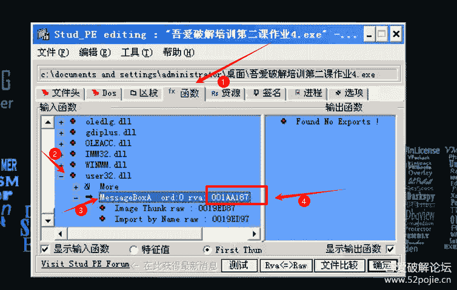

  `image-20241208191126431.png`（290.01 KB，下载次数：1）；[附件下载](https://www.52pojie.cn/forum.php?mod=attachment&aid=Mjc0MjMwMXw5OTdkMmVlNHwxNzkzNTcxNTAyfDE2ODA4NnwxOTg5NDY3&nothumb=yes)；2024-12-8 21:54 上传

- 用 OD 载入程序，`Ctrl+G` 输入 `001AA187`，选择 `RVA`，点击“OK”。

  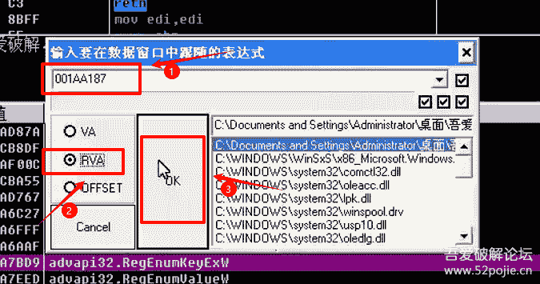

  `image-20241208191254956.png`（203.59 KB，下载次数：1）；[附件下载](https://www.52pojie.cn/forum.php?mod=attachment&aid=Mjc0MjMwMnwxMjUxNGZmOHwxNzkzNTcxNTAyfDE2ODA4NnwxOTg5NDY3&nothumb=yes)；2024-12-8 21:54 上传

- 左下角出现提示，复制地址 `005AA187`。

  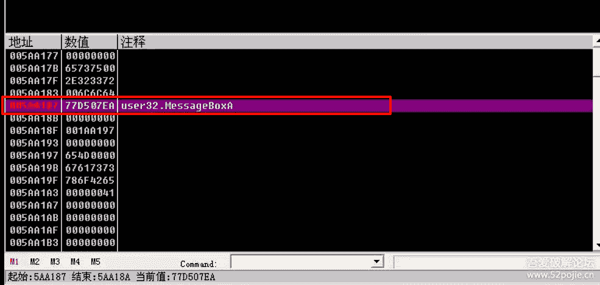

  `image-20241208191348340.png`（153.98 KB，下载次数：1）；[附件下载](https://www.52pojie.cn/forum.php?mod=attachment&aid=Mjc0MjMwM3xkNTdjMWM0YnwxNzkzNTcxNTAyfDE2ODA4NnwxOTg5NDY3&nothumb=yes)；2024-12-8 21:54 上传

- 再次用 StudPE 打开程序，选择“区段”，右键，选择 `New Section` 添加新的区段。

  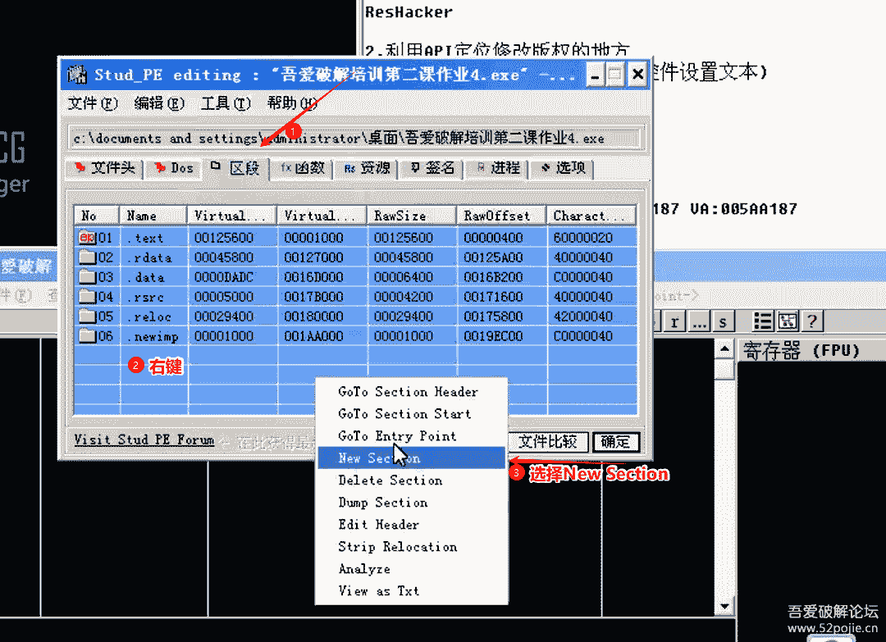

  `image-20241208191516402.png`（462.41 KB，下载次数：1）；[附件下载](https://www.52pojie.cn/forum.php?mod=attachment&aid=Mjc0MjMwNHxlMjFmOThiOHwxNzkzNTcxNTAyfDE2ODA4NnwxOTg5NDY3&nothumb=yes)；2024-12-8 21:54 上传

- 区段名随意填写，原始大和虚拟大小可以大一些，例如 `1000`，选择“用空字节填充区段”，点击“增加”。经过一个弹窗提示，点击右下角“确定”。

  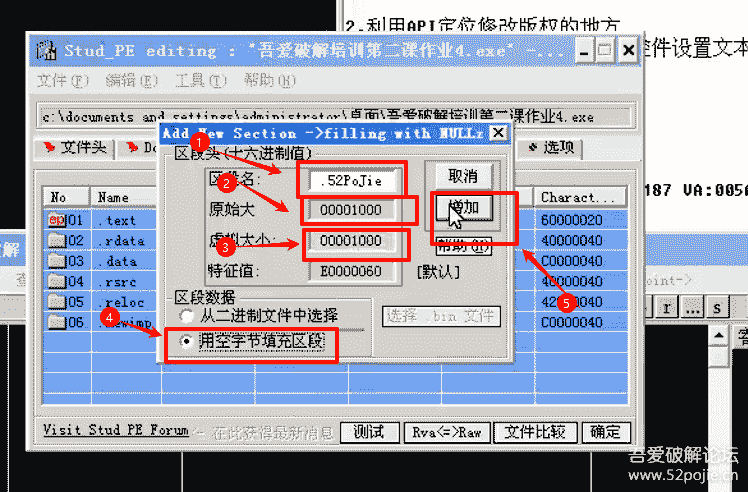

  `image-20241208191728056.png`（282.12 KB，下载次数：1）；[附件下载](https://www.52pojie.cn/forum.php?mod=attachment&aid=Mjc0MjMwNXxkYzU5MjExMHwxNzkzNTcxNTAyfDE2ODA4NnwxOTg5NDY3&nothumb=yes)；2024-12-8 21:54 上传

- 用 OD 载入，点击最上方的 `m`，选择新添加的区段。

  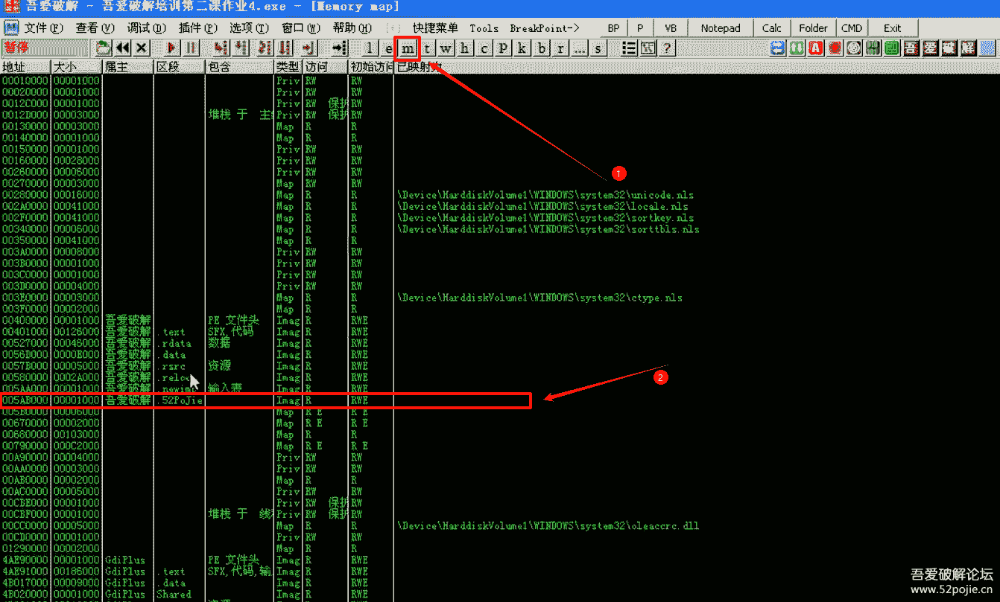

  `image-20241208192001426.png`（671.71 KB，下载次数：1）；[附件下载](https://www.52pojie.cn/forum.php?mod=attachment&aid=Mjc0MjMwNnw3ZDlmMjFmZnwxNzkzNTcxNTAyfDE2ODA4NnwxOTg5NDY3&nothumb=yes)；2024-12-8 21:54 上传

- 找到了地址 `05AB000`（见上图第二个红框最左侧），回到调试窗口，`Ctrl+G` 跳到这个地址。右键，选择 `此处为新EIP`，弹窗点击“是”。

  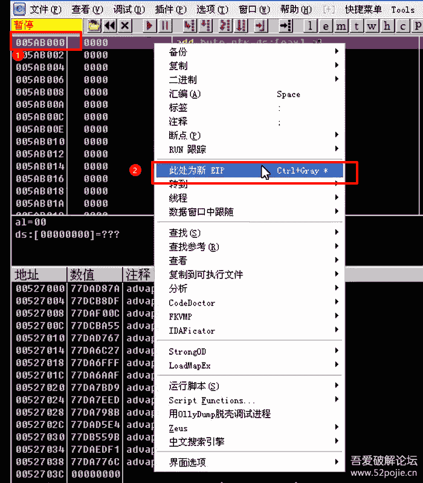

  `image-20241208192213630.png`（374.3 KB，下载次数：1）；[附件下载](https://www.52pojie.cn/forum.php?mod=attachment&aid=Mjc0MjMwN3xjZjQzZGRkY3wxNzkzNTcxNTAyfDE2ODA4NnwxOTg5NDY3&nothumb=yes)；2024-12-8 21:54 上传

- 从 `005AB00` 开始依次输入 4 个 `push 0`，第五个输入 `call [005AA187]`，其中方括号内容正是第三步中获得的地址，出现注释，记住 `005AB008` 处代码 `cal1 dword ptr ds:[0x5AA187]` 后面要用。

  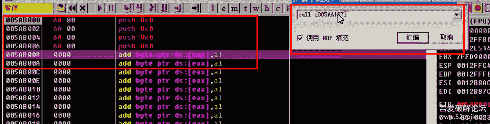

  `image-20241208192802644.png`（269.49 KB，下载次数：1）；[附件下载](https://www.52pojie.cn/forum.php?mod=attachment&aid=Mjc0MjMwOHwwMTkzZmY2OXwxNzkzNTcxNTAyfDE2ODA4NnwxOTg5NDY3&nothumb=yes)；2024-12-8 21:54 上传

- 依次步过，堆栈窗口出现提示，成功弹出窗口。

  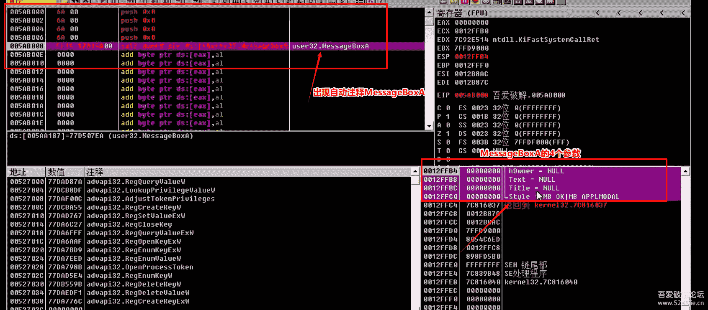

  `image-20241208192905241.png`（787.08 KB，下载次数：1）；[附件下载](https://www.52pojie.cn/forum.php?mod=attachment&aid=Mjc0MjMxMHwyMTVjNWI1ZnwxNzkzNTcxNTAyfDE2ODA4NnwxOTg5NDY3&nothumb=yes)；2024-12-8 21:54 上传

  

  `image-20241208192931398.png`（27.25 KB，下载次数：1）；[附件下载](https://www.52pojie.cn/forum.php?mod=attachment&aid=Mjc0MjMxMXxkM2YzMjkyN3wxNzkzNTcxNTAyfDE2ODA4NnwxOTg5NDY3&nothumb=yes)；2024-12-8 21:54 上传

#### 修改弹窗内容

从上到下 4 个 `push` 依次是


```
push Style(0)
push Title
push Text
push hOwner
```

- 首先修改标题, 将第二个`005AB002`处的`push`的`0x0`随便改为一个稍微下面一点的我们的新区段的地址, 例如`005AB01A`并在左下角内存窗口跟到`005AB01A`

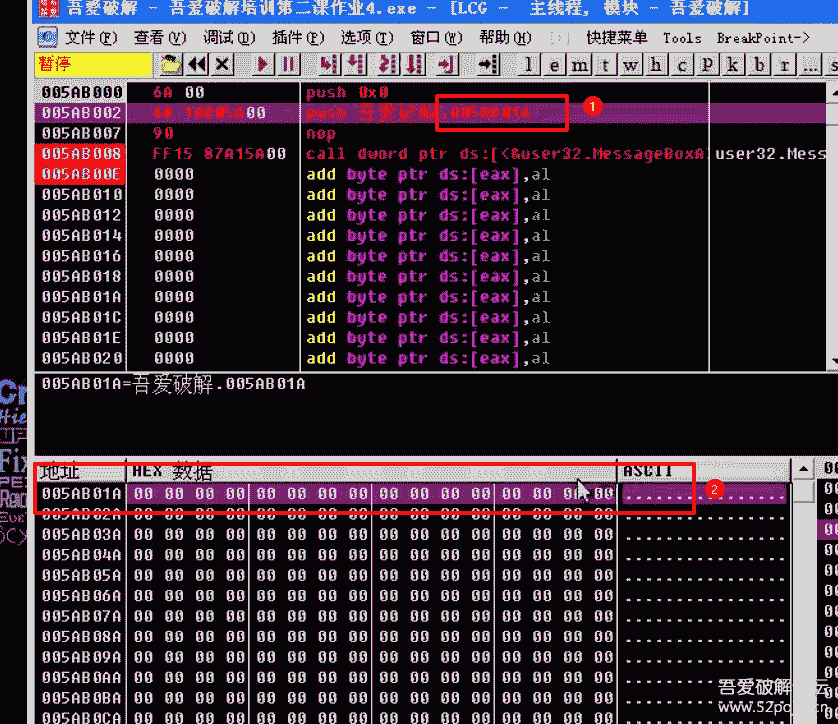

image-20241208193515426.png (587.5 KB, 下载次数: 1)

[href="forum.php?mod=attachment&aid=Mjc0MjMxMnxmNzgwYmE2NnwxNzkzNTcxNTAyfDE2ODA4NnwxOTg5NDY3&nothumb=yes" target="_blank"](https://www.52pojie.cn/forum.php?mod=attachment&aid=Mjc0MjMxMnxmNzgwYmE2NnwxNzkzNTcxNTAyfDE2ODA4NnwxOTg5NDY3&nothumb=yes)

2024-12-8 21:54 上传

- 选中这一行, 右键"用二进制编辑", 输入你要的标题, 点击"确定"

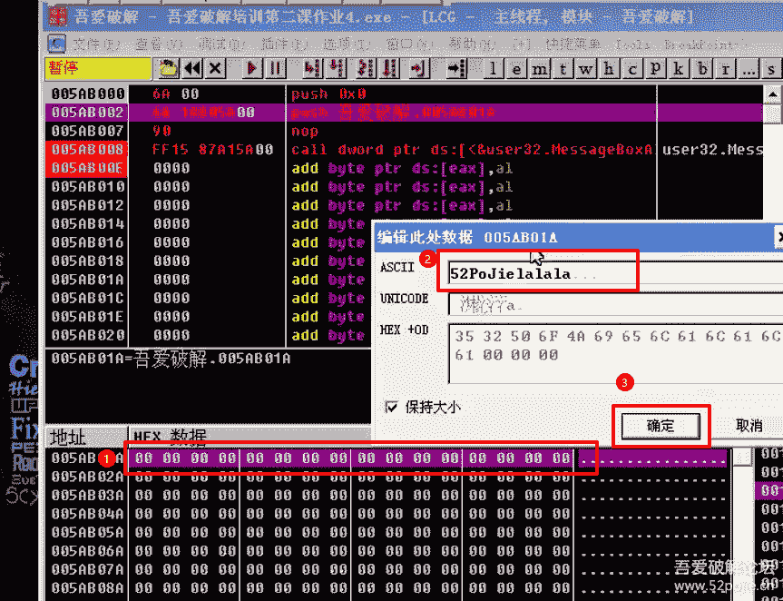

image-20241208193720108.png (526.75 KB, 下载次数: 1)

[href="forum.php?mod=attachment&aid=Mjc0MjMxM3w1MjIwYTAyYXwxNzkzNTcxNTAyfDE2ODA4NnwxOTg5NDY3&nothumb=yes" target="_blank"](https://www.52pojie.cn/forum.php?mod=attachment&aid=Mjc0MjMxM3w1MjIwYTAyYXwxNzkzNTcxNTAyfDE2ODA4NnwxOTg5NDY3&nothumb=yes)

2024-12-8 21:54 上传

- 同理修改`005AB007`处, 这里修改的是弹窗显示的内容

- 将`005AB00C`改为`push 0`

- 将`005AB00E`处改为我们之前记住的调用`MessageBoxA`函数的代码`call dword ptr ds:[0x5AA187]`

修改完后如下图所示, 黄框是我们修改好的代码, 蓝框是由于修改标题和文本的内容导致出现的代码, 所以之前要选择一个偏下的地址防止干扰

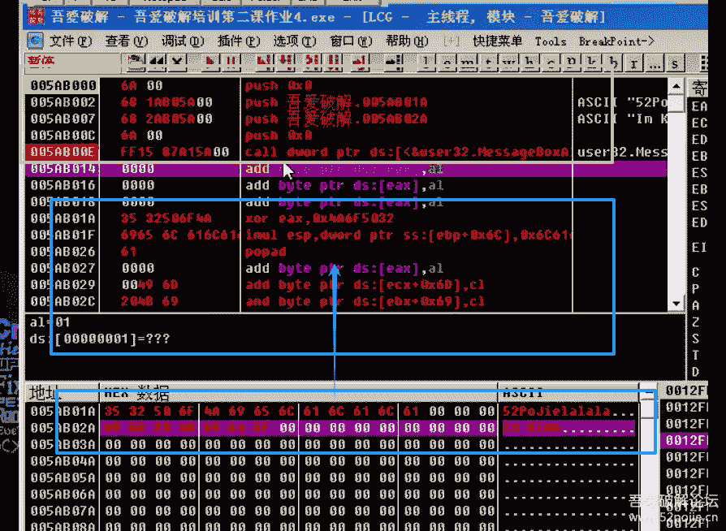

image-20241208194502428.png (539.19 KB, 下载次数: 1)

[href="forum.php?mod=attachment&aid=Mjc0MjMxNHw4ZmE1M2M3MXwxNzkzNTcxNTAyfDE2ODA4NnwxOTg5NDY3&nothumb=yes" target="_blank"](https://www.52pojie.cn/forum.php?mod=attachment&aid=Mjc0MjMxNHw4ZmE1M2M3MXwxNzkzNTcxNTAyfDE2ODA4NnwxOTg5NDY3&nothumb=yes)

2024-12-8 21:54 上传

- 将下一行`005AB014`改为跳转到原来的程序入口点(`OEP`)

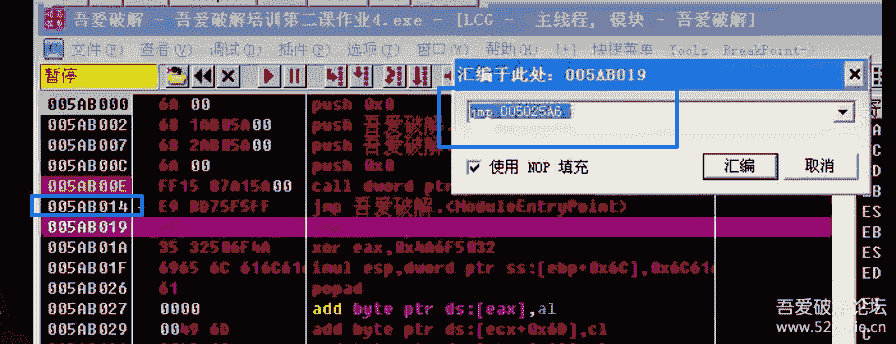

image-20241208194614828.png (315.2 KB, 下载次数: 1)

[href="forum.php?mod=attachment&aid=Mjc0MjMxNXw3NDRjMWM0ZnwxNzkzNTcxNTAyfDE2ODA4NnwxOTg5NDY3&nothumb=yes" target="_blank"](https://www.52pojie.cn/forum.php?mod=attachment&aid=Mjc0MjMxNXw3NDRjMWM0ZnwxNzkzNTcxNTAyfDE2ODA4NnwxOTg5NDY3&nothumb=yes)

2024-12-8 21:55 上传

- 保存文件, 再次载入`OD`, 找到我们修改的第一行`005AB000`, 右键, "此处为`EIP`"

- 运行程序, 成功弹窗, 并且不影响原来的程序


image-20241208194932314.png (42.99 KB, 下载次数: 1)

[href="forum.php?mod=attachment&aid=Mjc0MjMxNnw1MjdmNjQxOXwxNzkzNTcxNTAyfDE2ODA4NnwxOTg5NDY3&nothumb=yes" target="_blank"](https://www.52pojie.cn/forum.php?mod=attachment&aid=Mjc0MjMxNnw1MjdmNjQxOXwxNzkzNTcxNTAyfDE2ODA4NnwxOTg5NDY3&nothumb=yes)

2024-12-8 21:55 上传

## 修改程序入口点

- 用`StudPE`打开我们修改后的程序, 点击"区段", 找到我们新加的区段, 找到第四列的`001AB000`

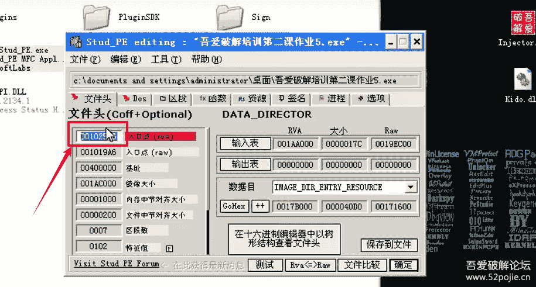

image-20241208195112179.png (374.88 KB, 下载次数: 1)

[href="forum.php?mod=attachment&aid=Mjc0MjMxN3wzOTk1NTM5ZnwxNzkzNTcxNTAyfDE2ODA4NnwxOTg5NDY3&nothumb=yes" target="_blank"](https://www.52pojie.cn/forum.php?mod=attachment&aid=Mjc0MjMxN3wzOTk1NTM5ZnwxNzkzNTcxNTAyfDE2ODA4NnwxOTg5NDY3&nothumb=yes)

2024-12-8 21:55 上传

- 在"文件头"标签页将入口点改为`001AB000`(也可以点击右下"`RvaRaw`", 选择"虚拟地址", 输入我们在`OD`中修改代码的地址, 即`005AB000`, 找到上方的"相对虚拟地址", 也是`1AB000`)点击右下角"保存到文件"

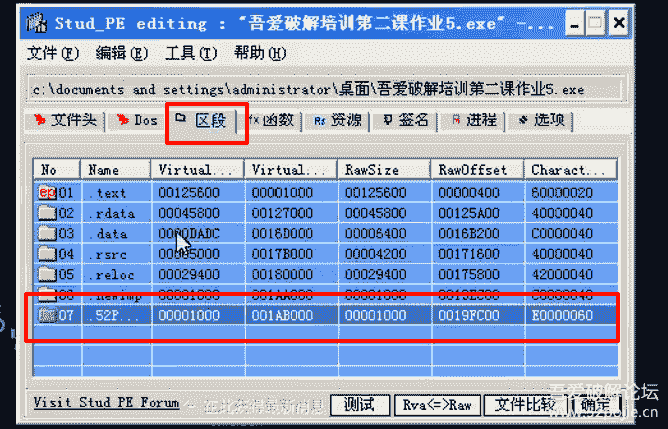

image-20241208195214113.png (293.69 KB, 下载次数: 1)

[href="forum.php?mod=attachment&aid=Mjc0MjMxOHxjOWNiYzQ3Y3wxNzkzNTcxNTAyfDE2ODA4NnwxOTg5NDY3&nothumb=yes" target="_blank"](https://www.52pojie.cn/forum.php?mod=attachment&aid=Mjc0MjMxOHxjOWNiYzQ3Y3wxNzkzNTcxNTAyfDE2ODA4NnwxOTg5NDY3&nothumb=yes)

2024-12-8 21:55 上传

- 测试程序, 成功弹窗。至此, 修改结束

## 总结

- 添加`MessageBoxA`的导入表并获取`VA`

- 添加一个新的区段，并植入汇编代码(`弹窗并跳回原来的EP`)

- 修改`EP`到新的起始位置并保存

类似地, 你也可以用这个方法弹网页, 判断文件是否存在等

## 自动操作

想必大家已经学会了手动添加弹窗，但是每次都自己手动添加实在是太麻烦了，这里推荐三个程序一件添加

### 网络验证通杀器-你想辅助工具v8.0

优点：可以添加消息弹窗和网页弹窗

缺点：不能只加一种弹窗

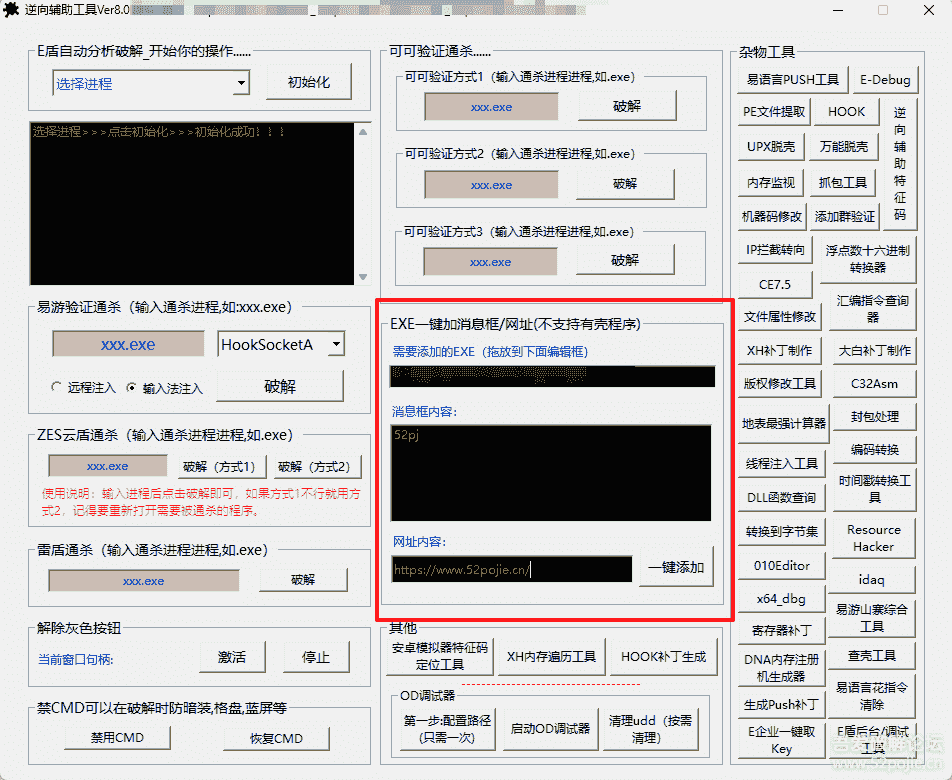

image-20241208214907456.png (109.98 KB, 下载次数: 1)

[href="forum.php?mod=attachment&aid=Mjc0MjMxOXw4Mjk3NGFkMHwxNzkzNTcxNTAyfDE2ODA4NnwxOTg5NDY3&nothumb=yes" target="_blank"](https://www.52pojie.cn/forum.php?mod=attachment&aid=Mjc0MjMxOXw4Mjk3NGFkMHwxNzkzNTcxNTAyfDE2ODA4NnwxOTg5NDY3&nothumb=yes)

2024-12-8 21:55 上传

### 无壳EXE加弹窗工具

优点：可以添加消息弹窗和网页弹窗，界面简洁

缺点：不能只加一种弹窗

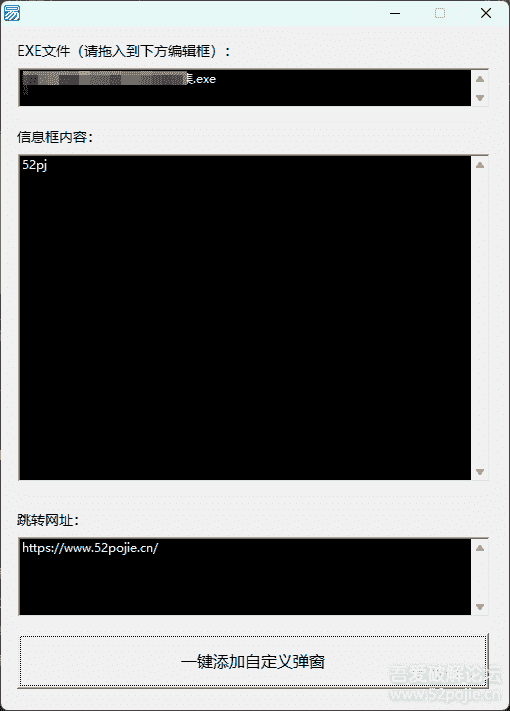

image-20241208215045280.png (24.9 KB, 下载次数: 1)

[href="forum.php?mod=attachment&aid=Mjc0MjMyMHw5ODVlMTI0OHwxNzkzNTcxNTAyfDE2ODA4NnwxOTg5NDY3&nothumb=yes" target="_blank"](https://www.52pojie.cn/forum.php?mod=attachment&aid=Mjc0MjMyMHw5ODVlMTI0OHwxNzkzNTcxNTAyfDE2ODA4NnwxOTg5NDY3&nothumb=yes)

2024-12-8 21:55 上传

### 一键给exe加弹窗皮肤

优点：可以单独加网页或者弹窗，可以设置弹窗标题

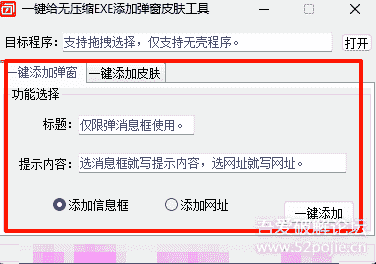

image-20241208215154321.png (18.15 KB, 下载次数: 1)

[href="forum.php?mod=attachment&aid=Mjc0MjMyMXwwNDBmNGNkN3wxNzkzNTcxNTAyfDE2ODA4NnwxOTg5NDY3&nothumb=yes" target="_blank"](https://www.52pojie.cn/forum.php?mod=attachment&aid=Mjc0MjMyMXwwNDBmNGNkN3wxNzkzNTcxNTAyfDE2ODA4NnwxOTg5NDY3&nothumb=yes)

2024-12-8 21:55 上传
