# [Web逆向] 某某方sign参数逆向-------小白讲解02

- 原帖: https://www.52pojie.cn/forum.php?mod=viewthread&tid=1989660
- 抓取时间: 2026-11-01T22:18:21

本文章中所有内容仅供学习交流使用，不用于其他任何目的，不提供完整代码，抓包内容、敏感网址、数据接口等均已做脱敏处理，严禁用于商业用途和非法用途，否则由此产生的一切后果均与作者无关.本文章未经许可禁止转载，禁止任何修改后二次传播，擅自使用本文讲解的技术而导致的任何意外，作者均不负责。

感谢各位大佬的支持和观看

今天讲一个网站是处于响应头部的 `sign` 参数逆向

目标网址

`aHR0cHM6Ly9zb3VrZS54ZGYuY24vc2VhcmNoP2NpdHlDb2RlPTQzMDMwMCZjYXRlZ29yeUNvZGU9MTIz`

## 第一步

### 1.1 打开开发者工具
### 1.2 分页发包找到指定数据包

图片 1.png (134.6 KB, 下载次数: 2)
[href="forum.php?mod=attachment&aid=Mjc0MjUwM3wyNDk1YjgxZXwxNzkzNTcxNDk4fDE2ODA4NnwxOTg5NjYw&nothumb=yes" target="_blank"](https://www.52pojie.cn/forum.php?mod=attachment&aid=Mjc0MjUwM3wyNDk1YjgxZXwxNzkzNTcxNDk4fDE2ODA4NnwxOTg5NjYw&nothumb=yes)
2024-12-9 15:15 上传

## 第二步

### 2.1 点击目标数据包的启动器
### 2.2 跟栈,此次简单,第一个栈就可以看到`sign`
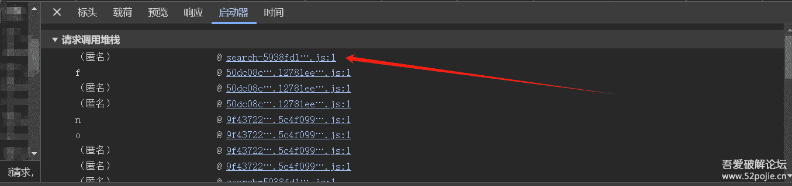
图片 2.png (28.37 KB, 下载次数: 2)
[href="forum.php?mod=attachment&aid=Mjc0MjUwNHw0NTMxNjU1N3wxNzkzNTcxNDk4fDE2ODA4NnwxOTg5NjYw&nothumb=yes" target="_blank"](https://www.52pojie.cn/forum.php?mod=attachment&aid=Mjc0MjUwNHw0NTMxNjU1N3wxNzkzNTcxNDk4fDE2ODA4NnwxOTg5NjYw&nothumb=yes)
2024-12-9 15:16 上传
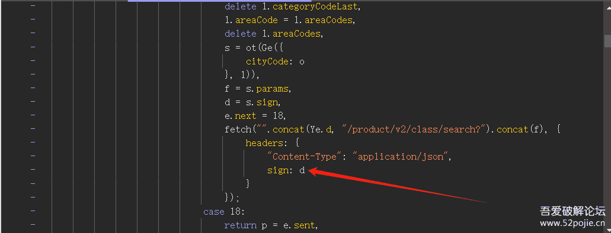
图片 3.png (19.84 KB, 下载次数: 2)
[href="forum.php?mod=attachment&aid=Mjc0MjUwNXwwN2M4Zjg4ZXwxNzkzNTcxNDk4fDE2ODA4NnwxOTg5NjYw&nothumb=yes" target="_blank"](https://www.52pojie.cn/forum.php?mod=attachment&aid=Mjc0MjUwNXwwN2M4Zjg4ZXwxNzkzNTcxNDk4fDE2ODA4NnwxOTg5NjYw&nothumb=yes)
2024-12-9 15:16 上传

## 第三步

### 3.1 分页断点在目标 `sign` 处
### 3.2 可以看到 2 处的值就是我们要的`sign`值
### 3.3 点击 3 到断点指定地点对比两处`sign`是否相同
可以看到两处相同请求时的也是这里的`sign`但值会变化,大家可以自己对比一下,这里节省掉,继续下一步,向上找
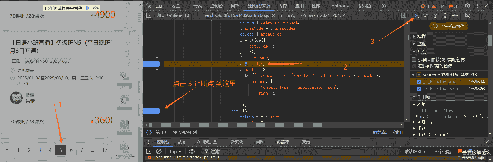
图片 4.png (142.35 KB, 下载次数: 1)
[href="forum.php?mod=attachment&aid=Mjc0MjUwNnw3MDE5YWQ3NXwxNzkzNTcxNDk4fDE2ODA4NnwxOTg5NjYw&nothumb=yes" target="_blank"](https://www.52pojie.cn/forum.php?mod=attachment&aid=Mjc0MjUwNnw3MDE5YWQ3NXwxNzkzNTcxNDk4fDE2ODA4NnwxOTg5NjYw&nothumb=yes)
2024-12-9 15:16 上传
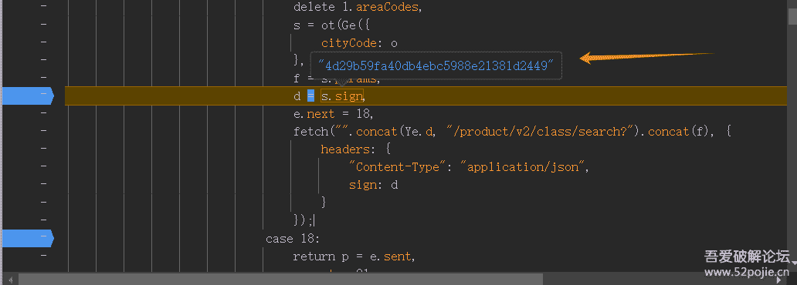
图片 5.png (19.51 KB, 下载次数: 1)
[href="forum.php?mod=attachment&aid=Mjc0MjUwN3xlYjk2YWJhMHwxNzkzNTcxNDk4fDE2ODA4NnwxOTg5NjYw&nothumb=yes" target="_blank"](https://www.52pojie.cn/forum.php?mod=attachment&aid=Mjc0MjUwN3xlYjk2YWJhMHwxNzkzNTcxNDk4fDE2ODA4NnwxOTg5NjYw&nothumb=yes)
2024-12-9 15:17 上传
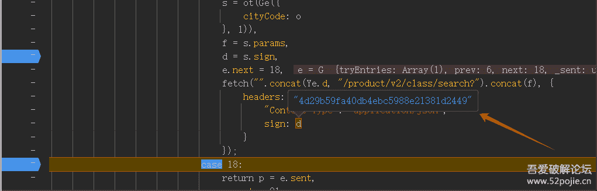
图片 6.png (21.52 KB, 下载次数: 1)
[href="forum.php?mod=attachment&aid=Mjc0MjUwOHw4NzE5MWQyZXwxNzkzNTcxNDk4fDE2ODA4NnwxOTg5NjYw&nothumb=yes" target="_blank"](https://www.52pojie.cn/forum.php?mod=attachment&aid=Mjc0MjUwOHw4NzE5MWQyZXwxNzkzNTcxNDk4fDE2ODA4NnwxOTg5NjYw&nothumb=yes)
2024-12-9 15:17 上传

## 第四步

### 4.1 分析`sign`值,在那赋值,谁赋值给谁的
### 4.2 在第三步时我们看到 `sign:d` 是我们要的 那`d` 也就在他上面是`d=s.sign`
### 4.3 所以从 4.2 我们知道了 `d` 里面存放了 `s` 的`sign`值 `params` 是请求载荷(不需要)
### 4.4 根据图里的 1 , 2 , 3 进行放走断点再次发包断点到`s`处
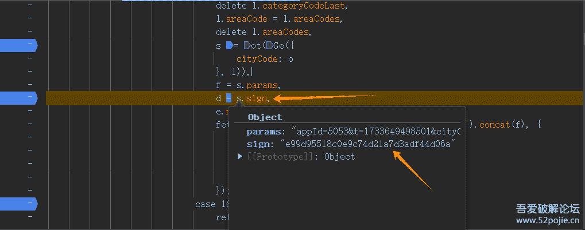
图片 7.png (22.83 KB, 下载次数: 1)
[href="forum.php?mod=attachment&aid=Mjc0MjUwOXw3ZGVkNmY3ZnwxNzkzNTcxNDk4fDE2ODA4NnwxOTg5NjYw&nothumb=yes" target="_blank"](https://www.52pojie.cn/forum.php?mod=attachment&aid=Mjc0MjUwOXw3ZGVkNmY3ZnwxNzkzNTcxNDk4fDE2ODA4NnwxOTg5NjYw&nothumb=yes)
2024-12-9 15:17 上传
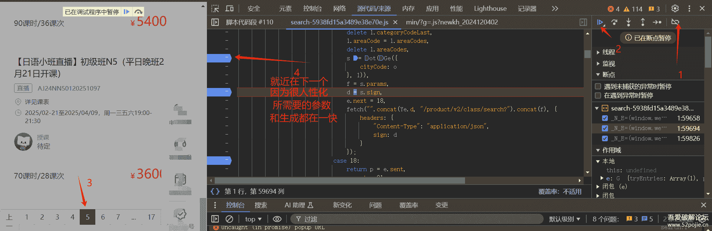
图片 8.png (152.25 KB, 下载次数: 1)
[href="forum.php?mod=attachment&aid=Mjc0MjUxMHxlY2ZiZGQ1NnwxNzkzNTcxNDk4fDE2ODA4NnwxOTg5NjYw&nothumb=yes" target="_blank"](https://www.52pojie.cn/forum.php?mod=attachment&aid=Mjc0MjUxMHxlY2ZiZGQ1NnwxNzkzNTcxNDk4fDE2ODA4NnwxOTg5NjYw&nothumb=yes)
2024-12-9 15:18 上传
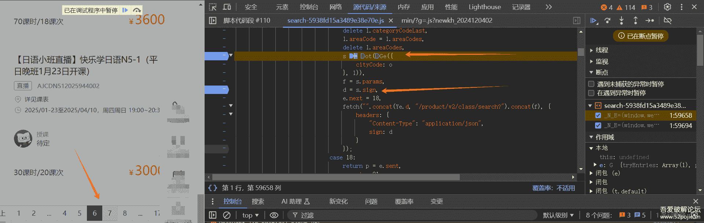
图片 9.png (134.58 KB, 下载次数: 1)
[href="forum.php?mod=attachment&aid=Mjc0MjUxMXwzMGQ1ZTE1Y3wxNzkzNTcxNDk4fDE2ODA4NnwxOTg5NjYw&nothumb=yes" target="_blank"](https://www.52pojie.cn/forum.php?mod=attachment&aid=Mjc0MjUxMXwzMGQ1ZTE1Y3wxNzkzNTcxNDk4fDE2ODA4NnwxOTg5NjYw&nothumb=yes)
2024-12-9 15:18 上传

## 第五步

### 5.1 从第四步我们知道参数是由 `s` 传过来的然后我们再次分页发包断点也是直接到了`s`定义处
### 5.2 将`s`扣取出放到我们`js`文件中进行一个分析
### 5.3 从内向外分析
#### 5.3.1 ------> 0 : “430300” 是个固定值
#### 5.3.2 ------> `l` 是一个`Object`

图片 10.png (8.82 KB, 下载次数: 0)
[href="forum.php?mod=attachment&aid=Mjc0MjUxMnxhMzFlNTUzMXwxNzkzNTcxNDk4fDE2ODA4NnwxOTg5NjYw&nothumb=yes" target="_blank"](https://www.52pojie.cn/forum.php?mod=attachment&aid=Mjc0MjUxMnxhMzFlNTUzMXwxNzkzNTcxNDk4fDE2ODA4NnwxOTg5NjYw&nothumb=yes)
2024-12-9 15:18 上传
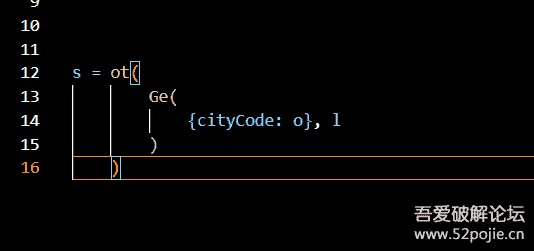
图片 11.png (11.04 KB, 下载次数: 0)
[href="forum.php?mod=attachment&aid=Mjc0MjUxM3xmOWVlNGQ5MXwxNzkzNTcxNDk4fDE2ODA4NnwxOTg5NjYw&nothumb=yes" target="_blank"](https://www.52pojie.cn/forum.php?mod=attachment&aid=Mjc0MjUxM3xmOWVlNGQ5MXwxNzkzNTcxNDk4fDE2ODA4NnwxOTg5NjYw&nothumb=yes)
2024-12-9 15:18 上传
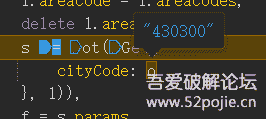
图片 12.png (9.93 KB, 下载次数: 1)
[href="forum.php?mod=attachment&aid=Mjc0MjUxNHw5ZTFlOThlYnwxNzkzNTcxNDk4fDE2ODA4NnwxOTg5NjYw&nothumb=yes" target="_blank"](https://www.52pojie.cn/forum.php?mod=attachment&aid=Mjc0MjUxNHw5ZTFlOThlYnwxNzkzNTcxNDk4fDE2ODA4NnwxOTg5NjYw&nothumb=yes)
2024-12-9 15:18 上传
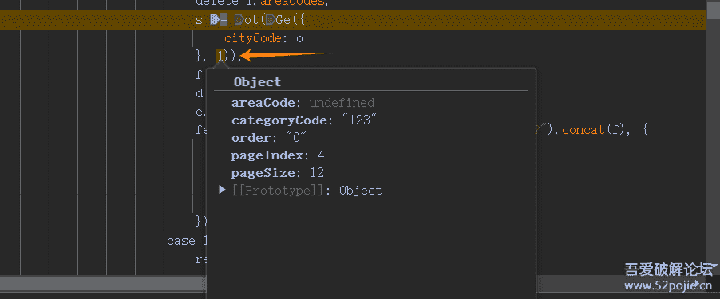
图片 13.png (18.74 KB, 下载次数: 0)
[href="forum.php?mod=attachment&aid=Mjc0MjUxNXxhNmRjOWU3NHwxNzkzNTcxNDk4fDE2ODA4NnwxOTg5NjYw&nothumb=yes" target="_blank"](https://www.52pojie.cn/forum.php?mod=attachment&aid=Mjc0MjUxNXxhNmRjOWU3NHwxNzkzNTcxNDk4fDE2ODA4NnwxOTg5NjYw&nothumb=yes)
2024-12-9 15:19 上传
#### 5.3.3 ------> `ot` 和 `Ge` 都是方法
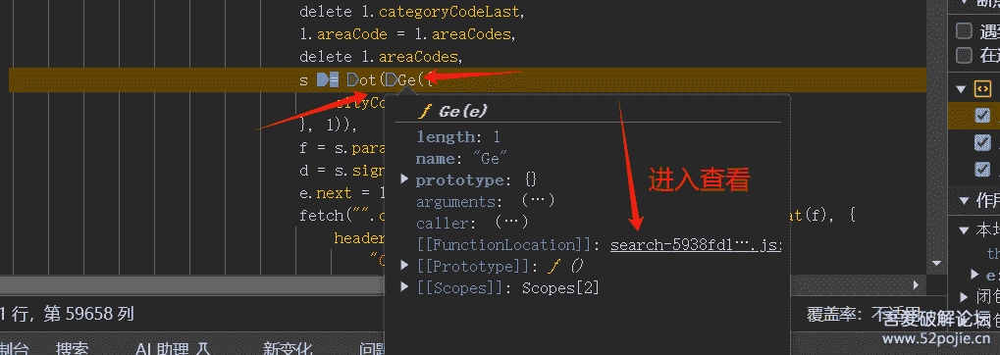
图片 14.png (37.32 KB, 下载次数: 1)
[href="forum.php?mod=attachment&aid=Mjc0MjUxNnxiYzk1OWZkYXwxNzkzNTcxNDk4fDE2ODA4NnwxOTg5NjYw&nothumb=yes" target="_blank"](https://www.52pojie.cn/forum.php?mod=attachment&aid=Mjc0MjUxNnxiYzk1OWZkYXwxNzkzNTcxNDk4fDE2ODA4NnwxOTg5NjYw&nothumb=yes)
2024-12-9 15:19 上传
#### 5.3.4 传值过程:
先将两个对象------>传入`Ge`方法返回值------>传入`ot`然后将最终结果赋值给`s`变量
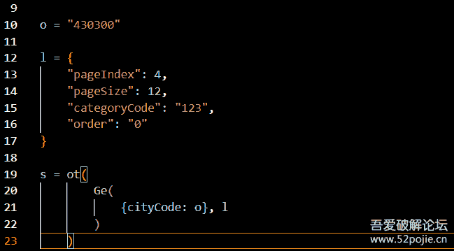
图片 15.png (20.82 KB, 下载次数: 1)
[href="forum.php?mod=attachment&aid=Mjc0MjUxN3wwNWU4NzUyY3wxNzkzNTcxNDk4fDE2ODA4NnwxOTg5NjYw&nothumb=yes" target="_blank"](https://www.52pojie.cn/forum.php?mod=attachment&aid=Mjc0MjUxN3wwNWU4NzUyY3wxNzkzNTcxNDk4fDE2ODA4NnwxOTg5NjYw&nothumb=yes)
2024-12-9 15:19 上传

## 第六步

### 6.1 我们找到了位置
### 6.2 分析了 `d` 的由来
### 6.3 分析了`s` 的组成
### 6.4 我们就可以开始扣取加密函数,来获取我们的的`sign`值

## 第七步

### 7.1 在`Code`中新开一页`js`文件(临时的只是为了方便查看所需内容)
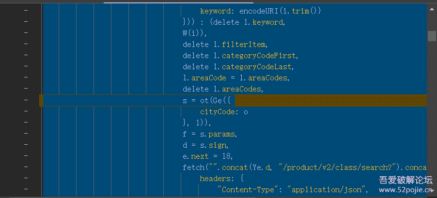
图片 16.png (19.8 KB, 下载次数: 1)
[href="forum.php?mod=attachment&aid=Mjc0MjUxOHxkNjQ5ZTI1YnwxNzkzNTcxNDk4fDE2ODA4NnwxOTg5NjYw&nothumb=yes" target="_blank"](https://www.52pojie.cn/forum.php?mod=attachment&aid=Mjc0MjUxOHxkNjQ5ZTI1YnwxNzkzNTcxNDk4fDE2ODA4NnwxOTg5NjYw&nothumb=yes)
2024-12-9 15:19 上传
### 7.2 复制这一页代码粘贴到其中(可以折叠代码快速查看)
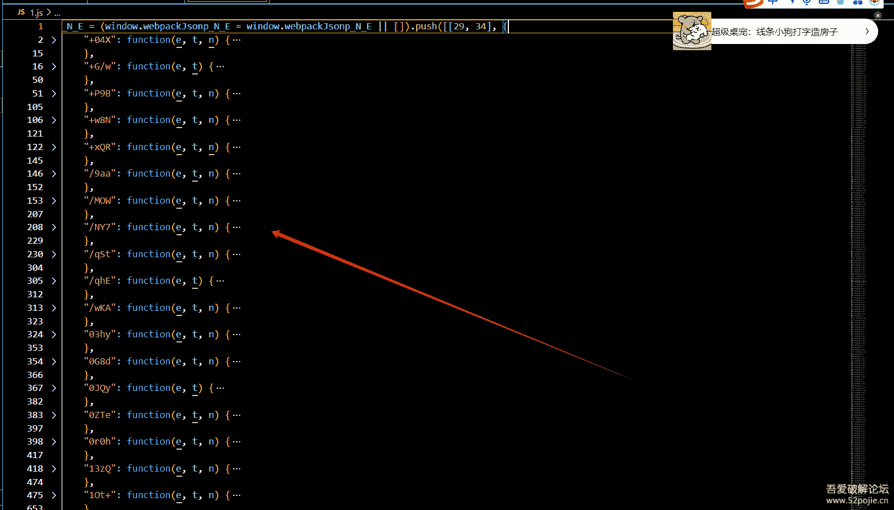
图片 17.png (137.07 KB, 下载次数: 1)
[href="forum.php?mod=attachment&aid=Mjc0MjUxOXxhM2RkNWVjM3wxNzkzNTcxNDk4fDE2ODA4NnwxOTg5NjYw&nothumb=yes" target="_blank"](https://www.52pojie.cn/forum.php?mod=attachment&aid=Mjc0MjUxOXxhM2RkNWVjM3wxNzkzNTcxNDk4fDE2ODA4NnwxOTg5NjYw&nothumb=yes)
2024-12-9 15:20 上传
### 7.3 搜索我们断点位置的关键字方便在`js`文件的代码中快速定位
#### 7.3.1 比如: “`cityCode: o`” , `d = s.sign`(位置要与浏览器一致)
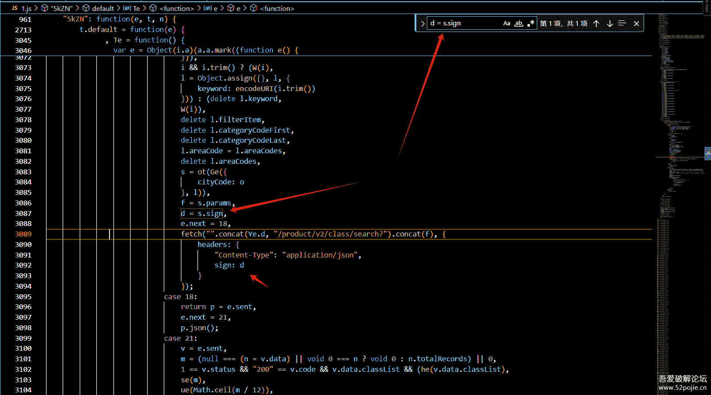
图片 18.png (161.83 KB, 下载次数: 0)

## 7.4 我们查看第五步分析的代码结构得知

### 7.4.1 `ot()` 函数和 `Ge()` 函数（寻找方式一样）

[附件下载](https://www.52pojie.cn/forum.php?mod=attachment&aid=Mjc0MjUyMHw4YTRlMDRhYnwxNzkzNTcxNDk4fDE2ODA4NnwxOTg5NjYw&nothumb=yes)（2024-12-9 15:20 上传）

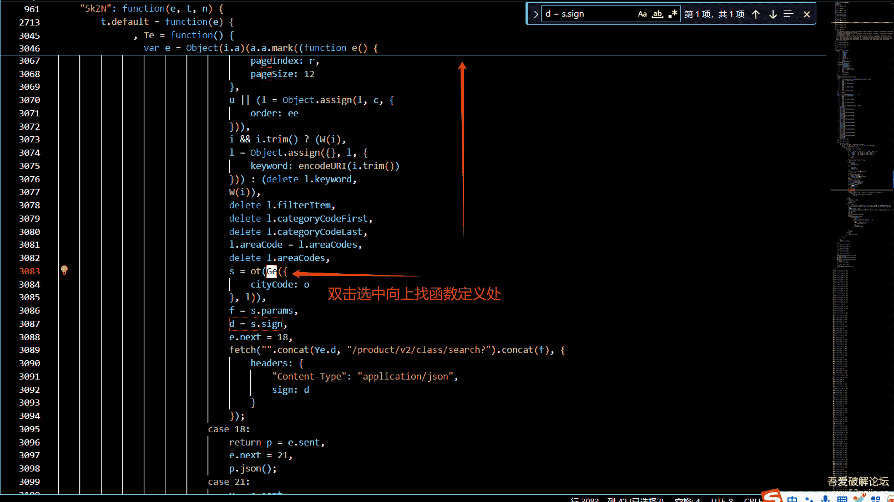

图片 19.png（157.39 KB，下载次数：1）

[附件下载](https://www.52pojie.cn/forum.php?mod=attachment&aid=Mjc0MjUyMXxhMDU5NGJhN3wxNzkzNTcxNDk4fDE2ODA4NnwxOTg5NjYw&nothumb=yes)（2024-12-9 15:20 上传）

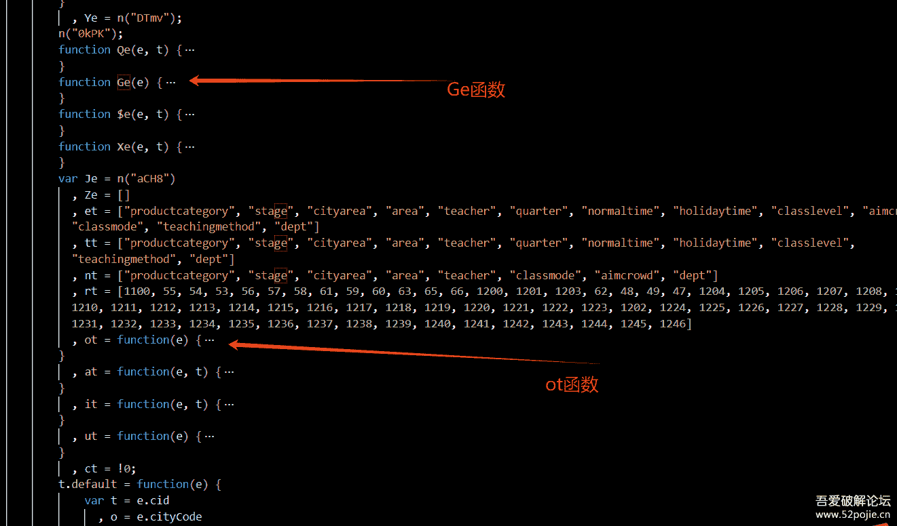

图片 20.png（80.45 KB，下载次数：1）

### 7.4.2 代码整合运行调试

查看下一步报错（报错很关键）。到这里我们运行，会有报错提示，有些函数未定义，所以我们就缺什么补什么。

[附件下载](https://www.52pojie.cn/forum.php?mod=attachment&aid=Mjc0MjUyMnw5NzM3MGI0M3wxNzkzNTcxNDk4fDE2ODA4NnwxOTg5NjYw&nothumb=yes)（2024-12-9 15:21 上传）

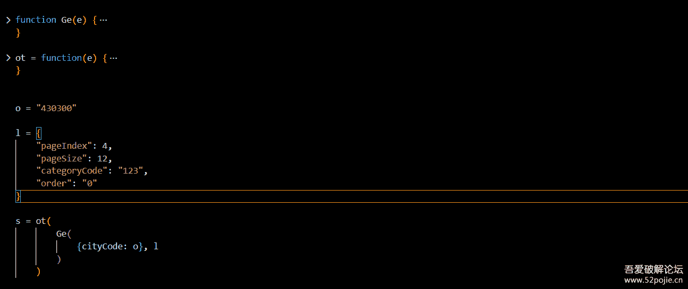

图片 21.png（24.65 KB，下载次数：0）

[附件下载](https://www.52pojie.cn/forum.php?mod=attachment&aid=Mjc0MjUyM3xmYzE1ODgxYnwxNzkzNTcxNDk4fDE2ODA4NnwxOTg5NjYw&nothumb=yes)（2024-12-9 15:21 上传）

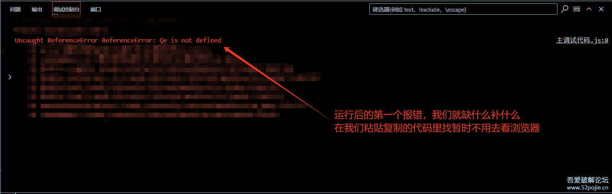

图片 22.png（51.24 KB，下载次数：1）

[附件下载](https://www.52pojie.cn/forum.php?mod=attachment&aid=Mjc0MjUyNHwwYjRiYzY2Y3wxNzkzNTcxNDk4fDE2ODA4NnwxOTg5NjYw&nothumb=yes)（2024-12-9 15:21 上传）

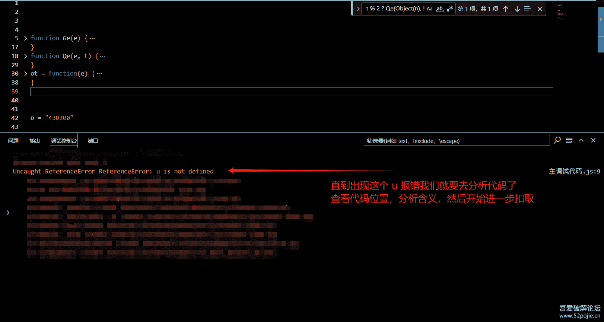

图片 23.png（69.94 KB，下载次数：1）

### 7.4.3 定位 `u.a`

定位到为止之后发现是 `u.a`，从 `u` 里面点出来的。那我们在浏览器中找到这个位置，查看 `u` 里面是什么。

在浏览器中 1 的位置搜索定位，可以发现有多个；在 2 的位置切换到我们需要的目标位置上，分页断点到目标位置上，进行分析。

[附件下载](https://www.52pojie.cn/forum.php?mod=attachment&aid=Mjc0MjUyNXwyYjIzOTk2OHwxNzkzNTcxNDk4fDE2ODA4NnwxOTg5NjYw&nothumb=yes)（2024-12-9 15:22 上传）

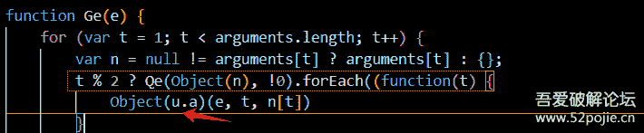

图片 24.png（22.11 KB，下载次数：1）

[附件下载](https://www.52pojie.cn/forum.php?mod=attachment&aid=Mjc0MjUyNnw5ODAzMzg0M3wxNzkzNTcxNDk4fDE2ODA4NnwxOTg5NjYw&nothumb=yes)（2024-12-9 15:22 上传）

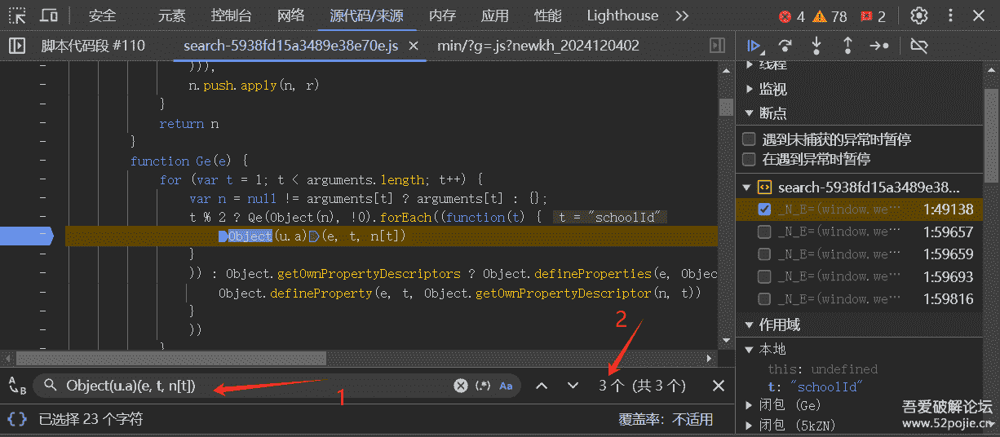

图片 25.png（73.31 KB，下载次数：1）

## 7.5 查看 `u` 中的内容

我们将鼠标放在 `u` 身上可以查看内容，发现里面有 `a`，他的内容是一个 `n()` 函数。我们可以从 2 进入到这个 `a` 的地方，进行查看。

[附件下载](https://www.52pojie.cn/forum.php?mod=attachment&aid=Mjc0MjUyN3xmODlhYWM4NHwxNzkzNTcxNDk4fDE2ODA4NnwxOTg5NjYw&nothumb=yes)（2024-12-9 15:22 上传）

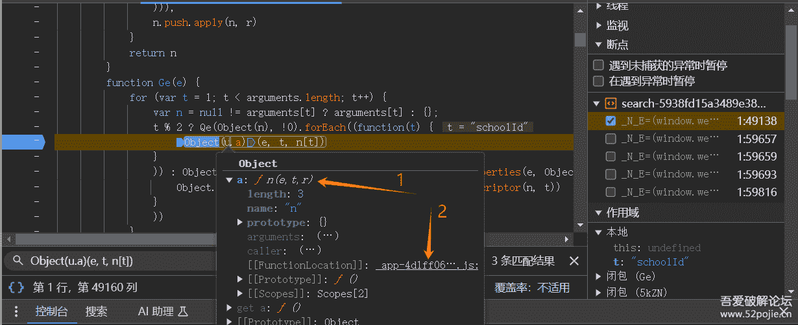

图片 26.png（61.9 KB，下载次数：0）

### 7.5.1 分析模块

我们可以在此处分析：1 位置是 `a`，我们不做细致分析，主要看 2，可以看到是个模块。那么初步我们就知道：(1) 有加载器；(2) 多文件或单文件 `webpack`。可在 3 的位置到最顶部查看，也就 4 的位置，它属于 `webpack` 类的其中一种（这里讲解的不清晰，希望大佬们可以给我提提建议，让我多学习学习）。

[附件下载](https://www.52pojie.cn/forum.php?mod=attachment&aid=Mjc0MjUyOHw2MDk0MTExNnwxNzkzNTcxNDk4fDE2ODA4NnwxOTg5NjYw&nothumb=yes)（2024-12-9 15:22 上传）

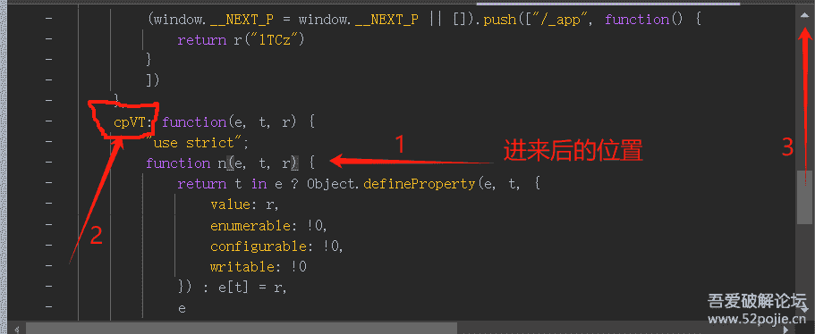

图片 27.png（23.78 KB，下载次数：1）

[附件下载](https://www.52pojie.cn/forum.php?mod=attachment&aid=Mjc0MjUyOXxjY2NmN2I2MHwxNzkzNTcxNDk4fDE2ODA4NnwxOTg5NjYw&nothumb=yes)（2024-12-9 15:22 上传）

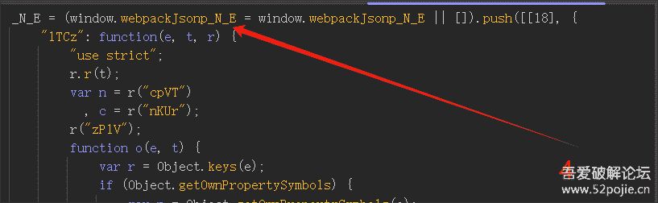

图片 28.png（20.94 KB，下载次数：0）

### 7.5.2 准备三个文件

（为了程序可以快速运行不卡顿，页面整洁效果）

1. 加载器的文件（加载器在这不讲解，可以去参考有关文章）
2. 模块存放文件
3. 环境文件（很少，在这也不讲解，可以去参考有关文章）
4. 按照图片里面的顺序，进行创建文件、导入文件，为后续扣取代码做准备。
5. 加载器和环境我已经填充好（剩余加载器未导出），所以我在本地操作。

[附件下载](https://www.52pojie.cn/forum.php?mod=attachment&aid=Mjc0MjUzMHxiM2QyNjcwYnwxNzkzNTcxNDk4fDE2ODA4NnwxOTg5NjYw&nothumb=yes)（2024-12-9 15:23 上传）

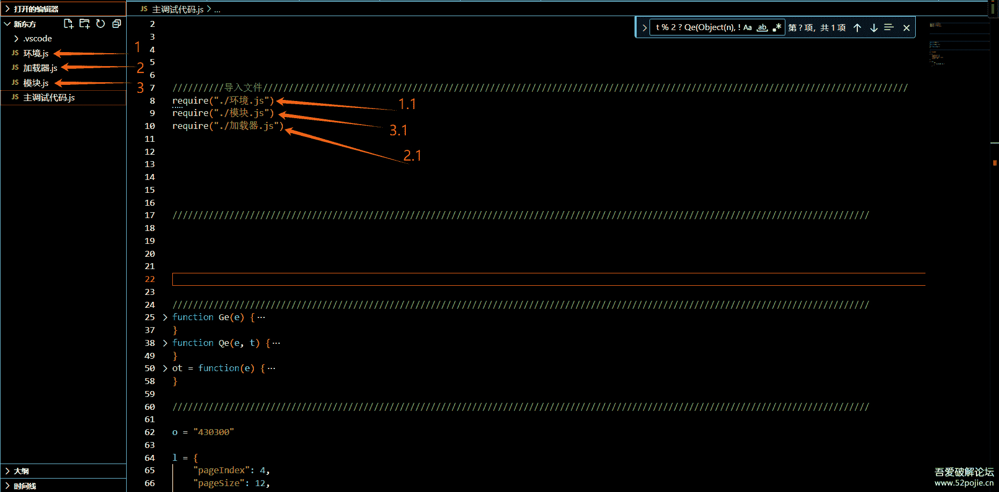

图片 29.png（84.64 KB，下载次数：1）

## 第八步

### 8.1 导出加载器并打印模块

其中 1 导出加载器到 `window`（全局），2 打印加载时的模块便于查看。

[附件下载](https://www.52pojie.cn/forum.php?mod=attachment&aid=Mjc0MjUzMXwwZmFkODhmNXwxNzkzNTcxNDk4fDE2ODA4NnwxOTg5NjYw&nothumb=yes)（2024-12-9 15:23 上传）

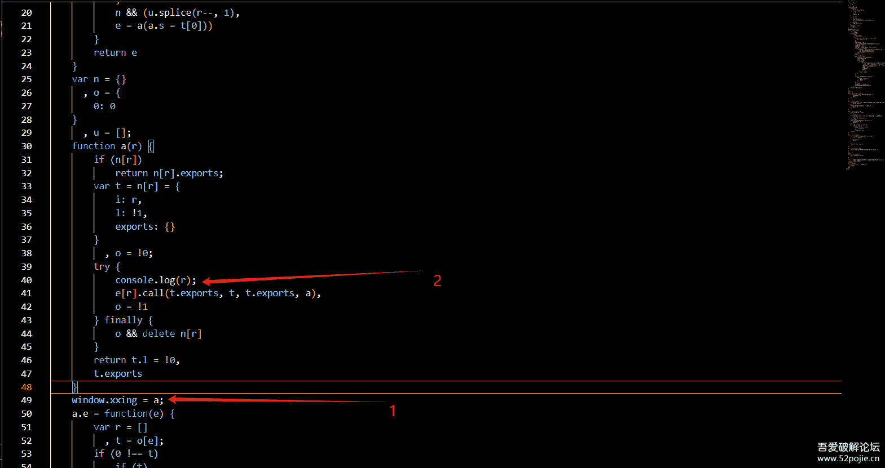

图片 30.png（76.47 KB，下载次数：1）

### 8.2 扣取 `u`

返回到我们刚开始报错的 `u` 的位置开始扣取，扣取 `u` 我们需要找到它的定义处。

#### 8.2.1 查找 `u` 的定义

在第八步我们保存了一个临时文件用于我们查找，双击 `u` 向上找（因为要先定义后使用），我们就要找到他在那定义的。

[附件下载](https://www.52pojie.cn/forum.php?mod=attachment&aid=Mjc0MjUzMnxlZjhlNWIyNHwxNzkzNTcxNDk4fDE2ODA4NnwxOTg5NjYw&nothumb=yes)（2024-12-9 15:23 上传）

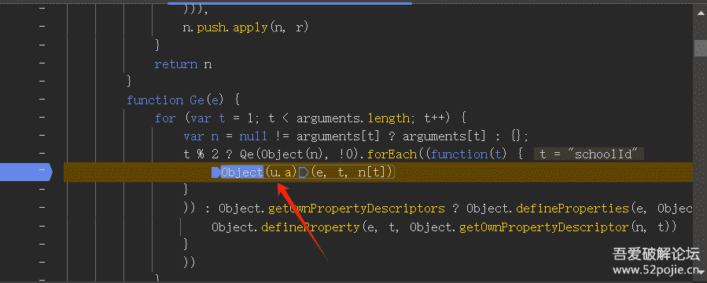

图片 31.png（19.9 KB，下载次数：1）

[附件下载](https://www.52pojie.cn/forum.php?mod=attachment&aid=Mjc0MjUzM3wxZmMwNDliM3wxNzkzNTcxNDk4fDE2ODA4NnwxOTg5NjYw&nothumb=yes)（2024-12-9 15:23 上传）

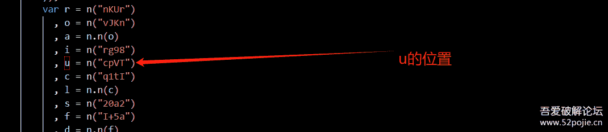

图片 32.png（22.13 KB，下载次数：1）

#### 8.2.2 定义 `window` 并再次运行

扣取出来放在我们的调试的文件里，还需要在头部定义 `window`，因为加载器导入了 `window` 里，本地需要定义后使用，我们再次运行。

[附件下载](https://www.52pojie.cn/forum.php?mod=attachment&aid=Mjc0MjUzNHw4N2JlNDgzYXwxNzkzNTcxNDk4fDE2ODA4NnwxOTg5NjYw&nothumb=yes)（2024-12-9 15:24 上传）

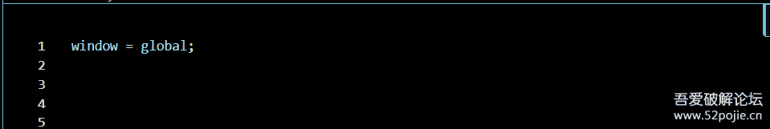

图片 33.png（8.46 KB，下载次数：1）

[附件下载](https://www.52pojie.cn/forum.php?mod=attachment&aid=Mjc0MjUzNXw2YzI3N2NmY3wxNzkzNTcxNDk4fDE2ODA4NnwxOTg5NjYw&nothumb=yes)（2024-12-9 15:24 上传）

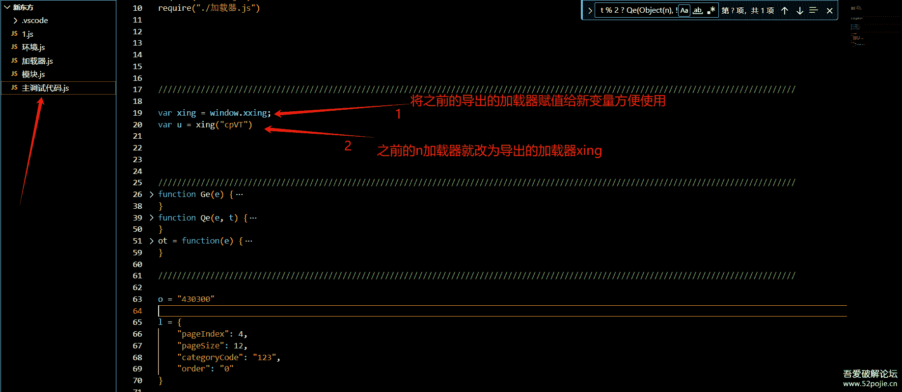

图片 34.png（86.94 KB，下载次数：1）

### 8.3 缺少模块报错

可以看到这次报错是缺少了模块，而且在第九步导出加载器时同时定义了打印模块，现在排上了用场。通过图片分析让我们知道了缺失那个模块而报错，复制被打印的模块全局搜错寻找。

[附件下载](https://www.52pojie.cn/forum.php?mod=attachment&aid=Mjc0MjUzNnw5ZjliYzQ0NnwxNzkzNTcxNDk4fDE2ODA4NnwxOTg5NjYw&nothumb=yes)（2024-12-9 15:24 上传）

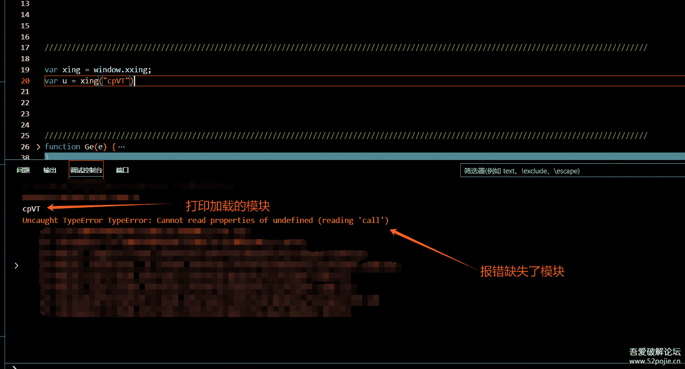

图片 35.png（54.68 KB，下载次数：1）

#### 8.3.1 查找并扣取嵌套模块

在浏览器中根据 1、2、3 步骤我们找到了需要模块，但是猜测它有可能模块嵌套模块，导致浪费时间，所以将整个文件扣取下来放到之前创建的模块文件中，这样如果有嵌套就不需要担心少扣取（弊端：需要补环境、运行速度慢、有些模块用不到），然后运行。

[附件下载](https://www.52pojie.cn/forum.php?mod=attachment&aid=Mjc0MjUzN3xlMmViMTVmOXwxNzkzNTcxNDk4fDE2ODA4NnwxOTg5NjYw&nothumb=yes)（2024-12-9 15:24 上传）

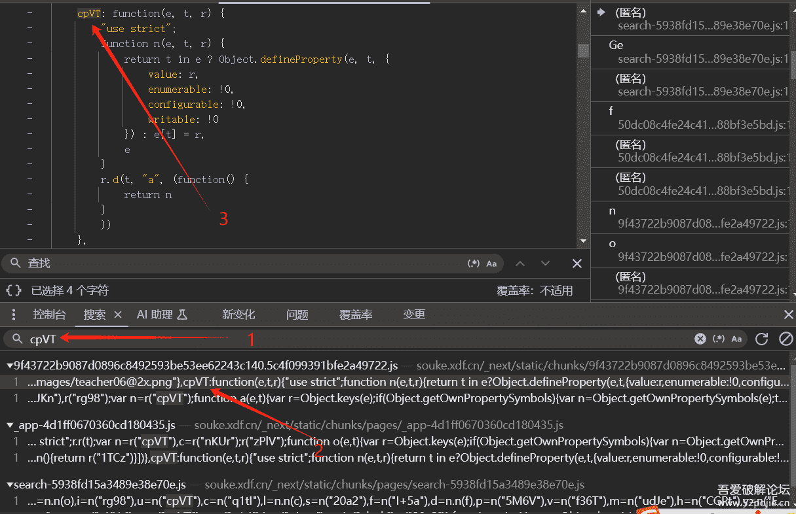

图片 36.png（134.59 KB，下载次数：1）

[href="forum.php?mod=attachment&aid=Mjc0MjUzOHw4MzE2ODYxZHwxNzkzNTcxNDk4fDE2ODA4NnwxOTg5NjYw&nothumb=yes" target="_blank"](https://www.52pojie.cn/forum.php?mod=attachment&aid=Mjc0MjUzOHw4MzE2ODYxZHwxNzkzNTcxNDk4fDE2ODA4NnwxOTg5NjYw&nothumb=yes)
2024-12-9 15:24 上传
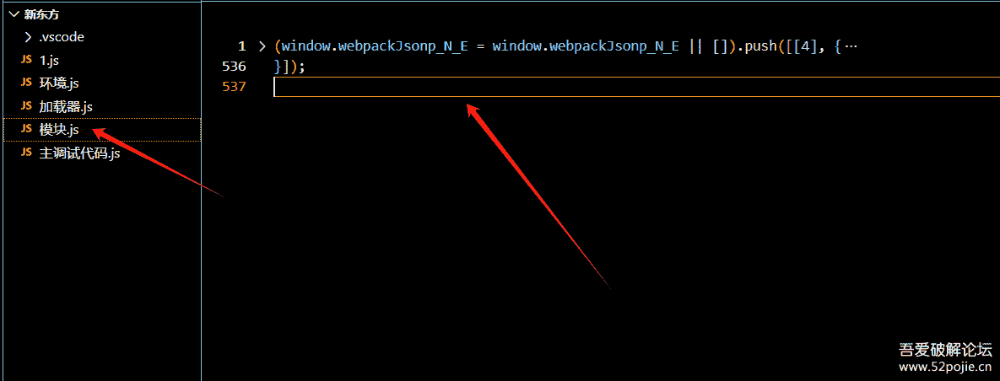
图片 37.png (30.13 KB, 下载次数: 1)
[href="forum.php?mod=attachment&aid=Mjc0MjUzOXw3YTYwMWZkZHwxNzkzNTcxNDk4fDE2ODA4NnwxOTg5NjYw&nothumb=yes" target="_blank"](https://www.52pojie.cn/forum.php?mod=attachment&aid=Mjc0MjUzOXw3YTYwMWZkZHwxNzkzNTcxNDk4fDE2ODA4NnwxOTg5NjYw&nothumb=yes)
2024-12-9 15:24 上传

### 8.3.2
然后很高兴的看到报错换了,`Ye`,那我们就定位到报错的位置查看那句代码报错,找到之后我们返回到浏览器,
注:我们的断点从未取消它还在`u`哪里也就是9.2.1步骤
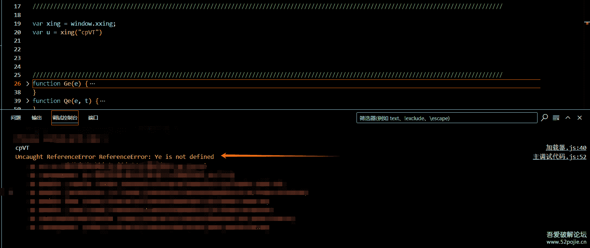
图片 38.png (48.48 KB, 下载次数: 1)
[href="forum.php?mod=attachment&aid=Mjc0MjU0MHw3YWIxMGIxMHwxNzkzNTcxNDk4fDE2ODA4NnwxOTg5NjYw&nothumb=yes" target="_blank"](https://www.52pojie.cn/forum.php?mod=attachment&aid=Mjc0MjU0MHw3YWIxMGIxMHwxNzkzNTcxNDk4fDE2ODA4NnwxOTg5NjYw&nothumb=yes)
2024-12-9 15:25 上传
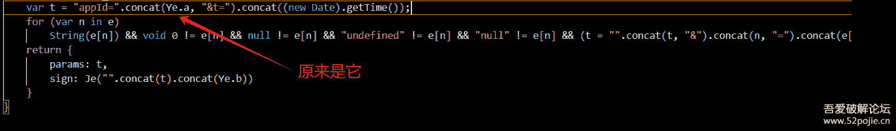
图片 39.png (34.99 KB, 下载次数: 2)
[href="forum.php?mod=attachment&aid=Mjc0MjU0MXwxZGQzZGUwNXwxNzkzNTcxNDk4fDE2ODA4NnwxOTg5NjYw&nothumb=yes" target="_blank"](https://www.52pojie.cn/forum.php?mod=attachment&aid=Mjc0MjU0MXwxZGQzZGUwNXwxNzkzNTcxNDk4fDE2ODA4NnwxOTg5NjYw&nothumb=yes)
2024-12-9 15:25 上传

### 8.3.3
搜索关键字,然后放掉`u`断点,让断点端在`Ye`处,在2处查看`Ye`内容,
跟之前的`u`查看方法一致但为了节省时间就跳过,直接找他定义处
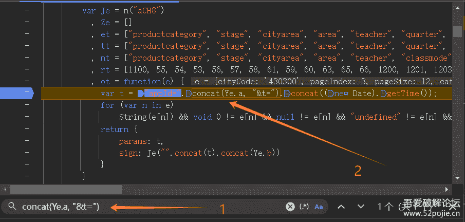
图片 40.png (33.76 KB, 下载次数: 1)
[href="forum.php?mod=attachment&aid=Mjc0MjU0Mnw1MWVjZWE3M3wxNzkzNTcxNDk4fDE2ODA4NnwxOTg5NjYw&nothumb=yes" target="_blank"](https://www.52pojie.cn/forum.php?mod=attachment&aid=Mjc0MjU0Mnw1MWVjZWE3M3wxNzkzNTcxNDk4fDE2ODA4NnwxOTg5NjYw&nothumb=yes)
2024-12-9 15:25 上传
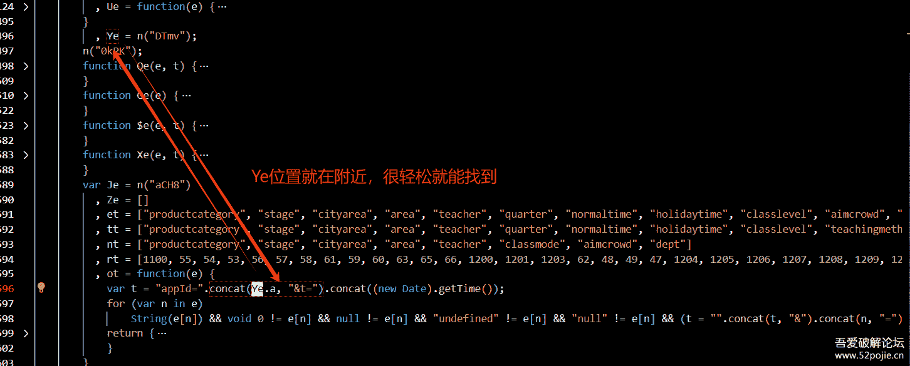
图片 41.png (98.25 KB, 下载次数: 2)
[href="forum.php?mod=attachment&aid=Mjc0MjU0M3xlOTVmOGQ4ZHwxNzkzNTcxNDk4fDE2ODA4NnwxOTg5NjYw&nothumb=yes" target="_blank"](https://www.52pojie.cn/forum.php?mod=attachment&aid=Mjc0MjU0M3xlOTVmOGQ4ZHwxNzkzNTcxNDk4fDE2ODA4NnwxOTg5NjYw&nothumb=yes)
2024-12-9 15:25 上传

### 8.3.4
扣取下来放入主代码里格式与`u`一致直接改后的图片,再次运行,看报错
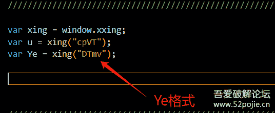
图片 42.png (17.05 KB, 下载次数: 1)
[href="forum.php?mod=attachment&aid=Mjc0MjU0NHw1ODdjMzQ1ZHwxNzkzNTcxNDk4fDE2ODA4NnwxOTg5NjYw&nothumb=yes" target="_blank"](https://www.52pojie.cn/forum.php?mod=attachment&aid=Mjc0MjU0NHw1ODdjMzQ1ZHwxNzkzNTcxNDk4fDE2ODA4NnwxOTg5NjYw&nothumb=yes)
2024-12-9 15:26 上传

### 8.3.5
可以看到报错换了这次是`Je` 内容查看然后去找位置跟前两个函数扣取一样,
所以省略掉,不做讲解只放流程。
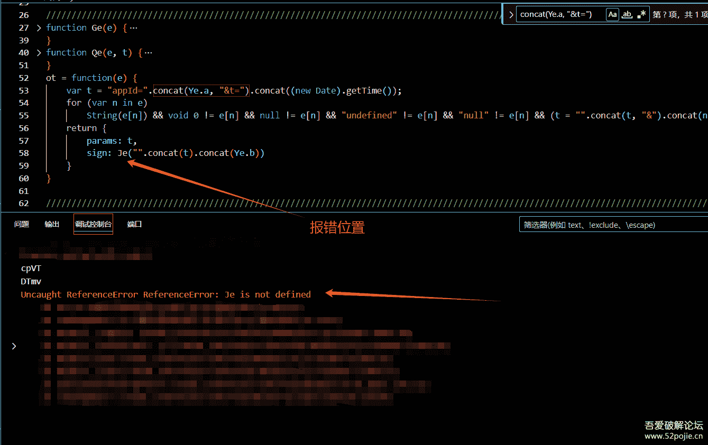
图片 43.png (74.71 KB, 下载次数: 1)
[href="forum.php?mod=attachment&aid=Mjc0MjU0NXxlNjA2ODNiY3wxNzkzNTcxNDk4fDE2ODA4NnwxOTg5NjYw&nothumb=yes" target="_blank"](https://www.52pojie.cn/forum.php?mod=attachment&aid=Mjc0MjU0NXxlNjA2ODNiY3wxNzkzNTcxNDk4fDE2ODA4NnwxOTg5NjYw&nothumb=yes)
2024-12-9 15:26 上传
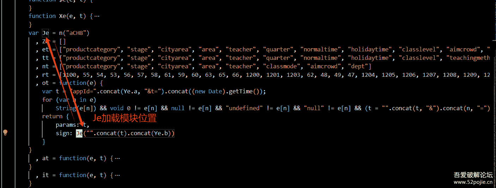
图片 44.png (81.91 KB, 下载次数: 0)
[href="forum.php?mod=attachment&aid=Mjc0MjU0NnxkOWIwMjk0Y3wxNzkzNTcxNDk4fDE2ODA4NnwxOTg5NjYw&nothumb=yes" target="_blank"](https://www.52pojie.cn/forum.php?mod=attachment&aid=Mjc0MjU0NnxkOWIwMjk0Y3wxNzkzNTcxNDk4fDE2ODA4NnwxOTg5NjYw&nothumb=yes)
2024-12-9 15:26 上传
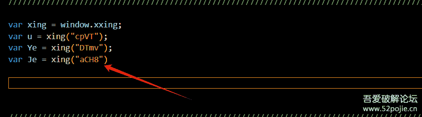
图片 45.png (19.15 KB, 下载次数: 1)
[href="forum.php?mod=attachment&aid=Mjc0MjU0N3xiYzU5ZDBhN3wxNzkzNTcxNDk4fDE2ODA4NnwxOTg5NjYw&nothumb=yes" target="_blank"](https://www.52pojie.cn/forum.php?mod=attachment&aid=Mjc0MjU0N3xiYzU5ZDBhN3wxNzkzNTcxNDk4fDE2ODA4NnwxOTg5NjYw&nothumb=yes)
2024-12-9 15:26 上传

### 8.4
将`Je` 扣取完成后,紧接着就报错,不过好在,打印了加载的模块,复制到浏览器里搜索
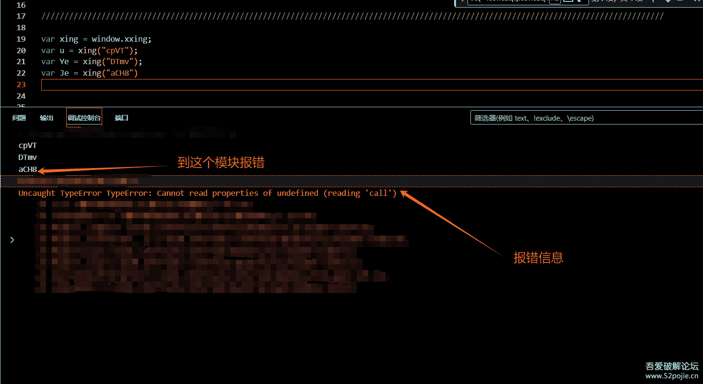
图片 46.png (62.92 KB, 下载次数: 1)
[href="forum.php?mod=attachment&aid=Mjc0MjU0OHxmNGZiM2QzYXwxNzkzNTcxNDk4fDE2ODA4NnwxOTg5NjYw&nothumb=yes" target="_blank"](https://www.52pojie.cn/forum.php?mod=attachment&aid=Mjc0MjU0OHxmNGZiM2QzYXwxNzkzNTcxNDk4fDE2ODA4NnwxOTg5NjYw&nothumb=yes)
2024-12-9 15:27 上传
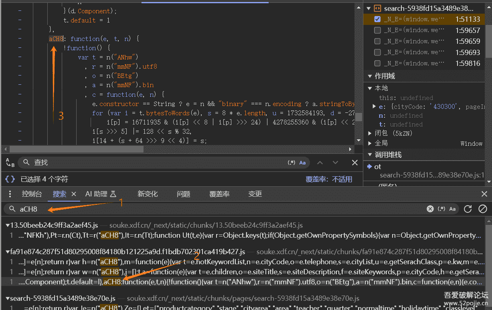
图片 47.png (120.67 KB, 下载次数: 1)
[href="forum.php?mod=attachment&aid=Mjc0MjU0OXw0MWMwOWViMnwxNzkzNTcxNDk4fDE2ODA4NnwxOTg5NjYw&nothumb=yes" target="_blank"](https://www.52pojie.cn/forum.php?mod=attachment&aid=Mjc0MjU0OXw0MWMwOWViMnwxNzkzNTcxNDk4fDE2ODA4NnwxOTg5NjYw&nothumb=yes)
2024-12-9 15:27 上传

### 8.4.1
将整个代码文件复制下来放入模块文件里,返回调试代码运行测试
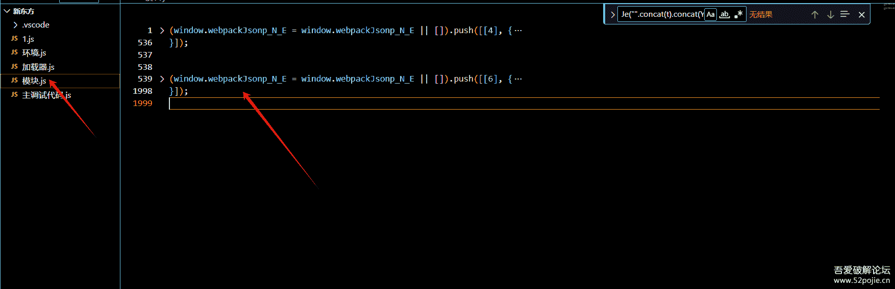
图片 48.png (45.79 KB, 下载次数: 1)
[href="forum.php?mod=attachment&aid=Mjc0MjU1MXw2YWM2MzkwMnwxNzkzNTcxNDk4fDE2ODA4NnwxOTg5NjYw&nothumb=yes" target="_blank"](https://www.52pojie.cn/forum.php?mod=attachment&aid=Mjc0MjU1MXw2YWM2MzkwMnwxNzkzNTcxNDk4fDE2ODA4NnwxOTg5NjYw&nothumb=yes)
2024-12-9 15:29 上传

## 第九步

### 9.1
代码最后放个`debugger` 来调试没有报错并且,输出了结果
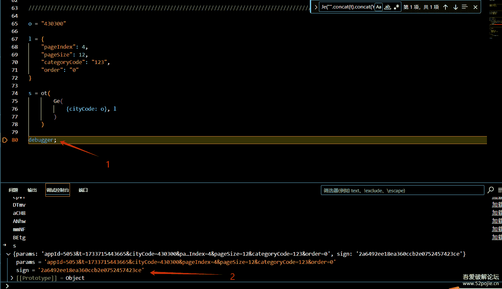
图片 49.png (78.68 KB, 下载次数: 1)
[href="forum.php?mod=attachment&aid=Mjc0MjU1MHw1MTg4NGFlY3wxNzkzNTcxNDk4fDE2ODA4NnwxOTg5NjYw&nothumb=yes" target="_blank"](https://www.52pojie.cn/forum.php?mod=attachment&aid=Mjc0MjU1MHw1MTg4NGFlY3wxNzkzNTcxNDk4fDE2ODA4NnwxOTg5NjYw&nothumb=yes)
2024-12-9 15:28 上传

## 总结
1. 首先找了位置
2. 分析参数
3. 扣取加密函数
4. 解决了每个报错信息
5. 可以给自己放松一下,欣赏结果带给我们的成就感
最后,文章哪里有不足之处,还请各位大佬多多提出宝贵的意见,感谢各位的观看,感谢各位大佬的支持

。
