# [Web逆向] 一个技术网站的反反爬和模拟镜像网站搭建方法

- 原帖：[https://www.52pojie.cn/forum.php?mod=viewthread&tid=1990765](https://www.52pojie.cn/forum.php?mod=viewthread&tid=1990765)
- 抓取时间：2026-11-01T22:18:07

无意中在搜索技术资料的时候发现一个看似简陋但是内涵丰富的小网站，对于我经常查的东西非常有帮助。但是在线的方式总是会受到网速的影响，要想做的随时随地的快速查阅。随即想到这个网站既然这么装修简单，应该很容易就能把它的主要内容下载下来，存到手机或者电脑上，用 NodeJs 搭建一个本地的网站去提升查阅的速度和效率。但是事实证明，这个网站采用了非常让人费解技术，让我走了不少弯路，这些弯路在大佬们看起来应该都是非常简单技术，但是实在是坑有些多，这些小坑叠加起来也非常考验耐心。下面看一下这个网站的主页和里面的主要内容（为了不违规，网站的地址在帖子中均做脱敏处理）。

这是一个 3GPP 常用技术规范的查询网站：

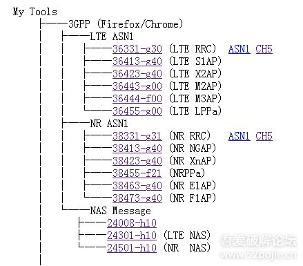

进去看了一下，整理的还挺不错：

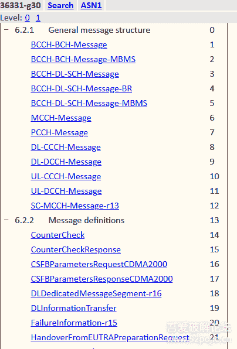

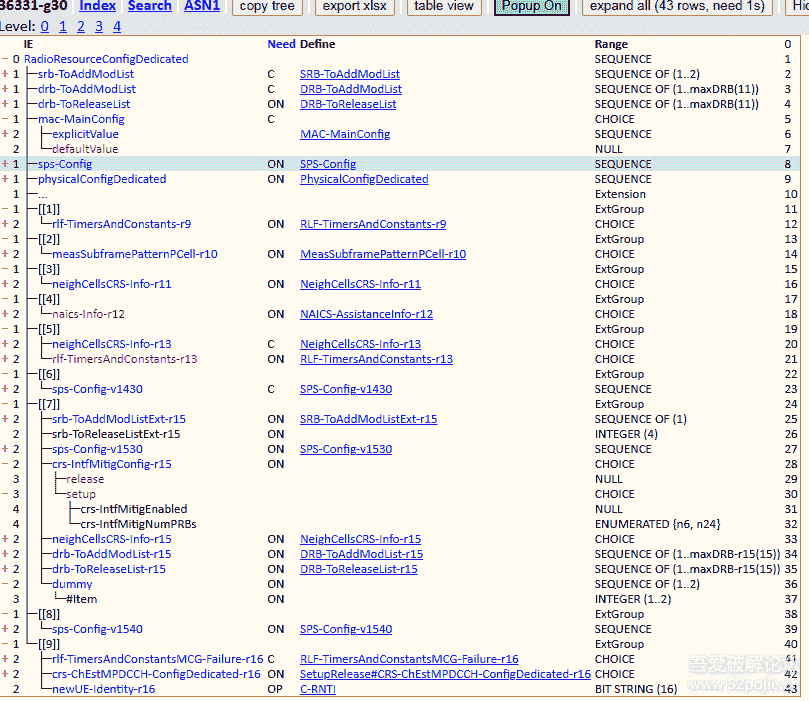

里面的内容还是非常干货多多，符合我的需求。随即尝试开干。

## 第一招：用 `wget` 进行递归的爬

按照以往的经验，简单的网站用这个方法，能把大部分网页和脚本给爬下来。

采用如下命令：

```
wget --mirror --user-agent="Mozilla/5.0 (Windows NT 10.0; Win64; x64; rv:91.0) Gecko/20100101 Firefox/91.0" --page-requisites --no-parent --no-if-modified-since 这里跟网站的主页地址
```

爬完后的内容主目录如下：


双击 `index.html`，欣喜了一阵，主页出来啦。

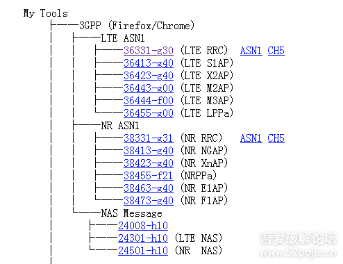

但是随即点击任何一个链接，都让人一下子跌入谷底，每个页面都是直接光显示下面一行字。


最开始我以为这个网站挑浏览器，换了 `firefox` 还是不行。而且这无法解释为什么同一个浏览器我直接打开就能看内容，爬下来就看不了内容。

## 检视爬取内容

于是我开始检视自己爬下来的内容，终于知道是咋回事了，原来爬下来的网页就是一些垃圾网页，大部分都是 1KB 的，只有少量的网页是由内容的。

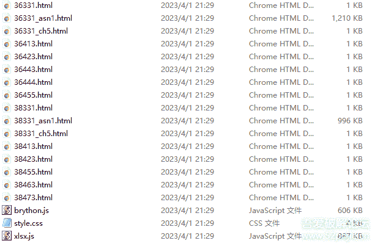

随便打开一个 1KB 的网页，看看里面的内容

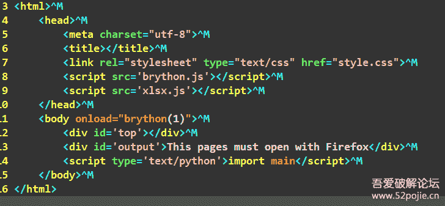

就这么几行内容，换啥浏览器都不可能有有用的内容。尝试了几种其他简单的方法，无效，除非用浏览器手动打开，保存后的网页是有内容的。难道真要我开发一个浏览器去完全模拟这个过程么，代价太大，后来想想先手动搞搞，看看规律。

## 手动保存后的网页

如下是手动保存后的网页，打开是正常的。

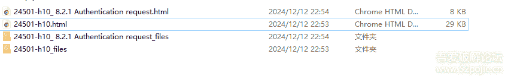

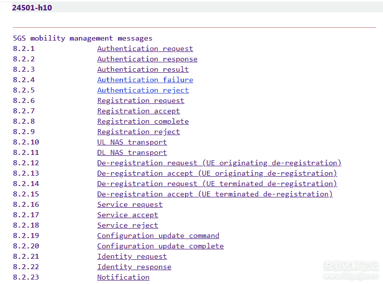

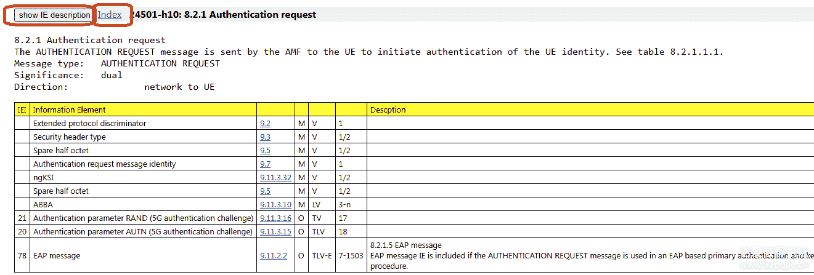

有点遗憾的是上面的按钮功能是无用的了。在原来的网页上点击这个按钮可以显示或者隐藏详细内容，效果如下：

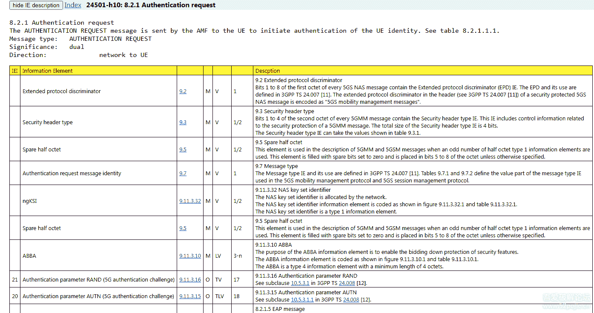

## 隐藏内容的处理

对于我来说，我希望的是一直显示出详细的内容，那么就相当于每次都要点一下这个按钮再手动保存。有些费事。后来突发奇想，感觉肯定是这个页面做了什么隐藏技术。是内容被隐藏了。

用文本编辑器分别打开隐藏了详细内容和显示详细内容的 Html 文件，发现了如果需要显示详情信息，只需要额外定义 就可以了。那这样就好说了，就可以先以默认的页面保存，然后写一个 `python` 脚本进行添加相应的定义就好了。

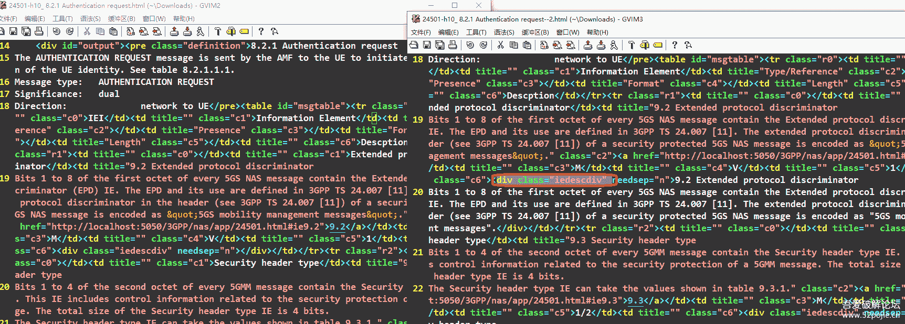

## 自动化保存脚本

最开始的时候是手动打开保存，但是半小时过后，手已经疼了。这样不是事儿，需要引入自动化才行。于是写了如下脚本来模拟这个过程：

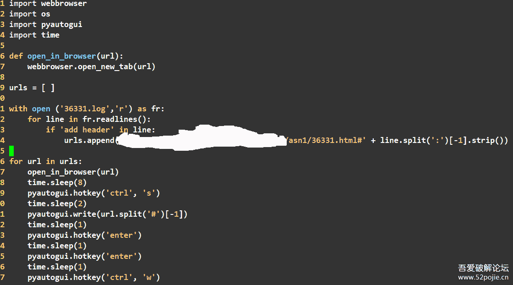

本来最开始的时候我基本没有添加 `sleep` 的时间，想加快这个速度，结果欲速则不达，保存下来的网页大部分都是还是空白的加之前的提示，说明网页还没有生成成功就被我保存了，白白浪费了时间。后来经过我仔细微调才得到上面脚本中的参数，速度是降低了一些，但是起码是机器在做，我可以休息，慢慢等。

## 保存后的资源文件夹问题

随后经过很长时间，网页保存完毕之后，就得到了一个很多 `html` 的文件夹。但是也存在一个问题，就是保存网页的时候，存了好多与网页同名的文件夹，文件夹里的内容都是相同的，都是 Html 引用的 js 脚本和资源，如果保存了 200 个网页就会出现 200 个这样的文件夹，而且资源尺寸挺大的，占用了非常大的硬盘空间，其实只需要一份就可以了。我想删掉这些文件夹，

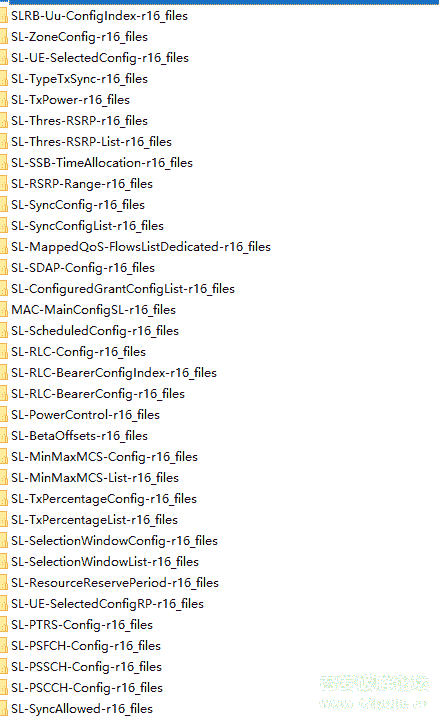


[href="forum.php?mod=attachment&aid=Mjc0MzM0N3wwOTc5YmExYXwxNzkzNTcxNDg0fDE2ODA4NnwxOTkwNzY1&nothumb=yes" target="_blank"](https://www.52pojie.cn/forum.php?mod=attachment&aid=Mjc0MzM0N3wwOTc5YmExYXwxNzkzNTcxNDg0fDE2ODA4NnwxOTkwNzY1&nothumb=yes)

2024-12-12 23:20 上传

但是我发现如果手动删掉一个文件夹，之前下载的html也同步被删除了。 除非把文件夹的名字修改一下，才能确保删掉文件夹的时候Html是保留的。但是上千个文件夹我不可能手动去改名把。后来想着肯定是windows自己的行为导致的，如果我用Python程序去删文件夹，会不会就不触发这种机制呢。于是试了一下，果然好使，采用如下代码可以确保删掉所有文件夹而保留html文件。

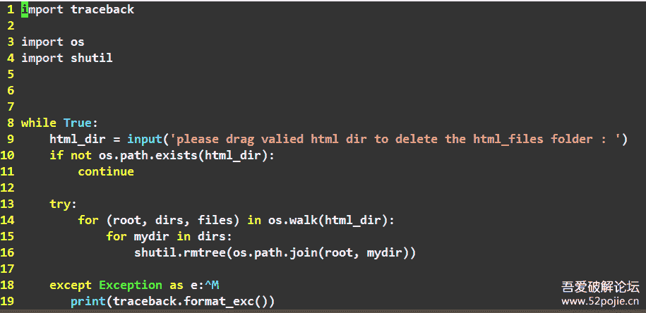

image.png (36.13 KB, 下载次数: 2)

[href="forum.php?mod=attachment&aid=Mjc0MzM0OHw4YmIzNWJjNXwxNzkzNTcxNDg0fDE2ODA4NnwxOTkwNzY1&nothumb=yes" target="_blank"](https://www.52pojie.cn/forum.php?mod=attachment&aid=Mjc0MzM0OHw4YmIzNWJjNXwxNzkzNTcxNDg0fDE2ODA4NnwxOTkwNzY1&nothumb=yes)

2024-12-12 23:22 上传

文件是都保存下来了，但是里面的href链接和下一级的html子文件无法匹配，导致无法相互点击链接实现跳转。 这是整个任务中最关键耗时的。需要通过多个python代码实现。 如下贴出本次用到的主要代码，详细过程就不多说了。

对于NAS协议，以24.501为例， 主文件结构中可以看出href的格式我已经处理为点击链接会跳转到`24501`目录下的对应章节号.html中，由于原始保存的html的命名为`24501-h10_ 8.2.1 Authentication request.html`，我需要把文件名只保留数字编号。对应的代码如下：

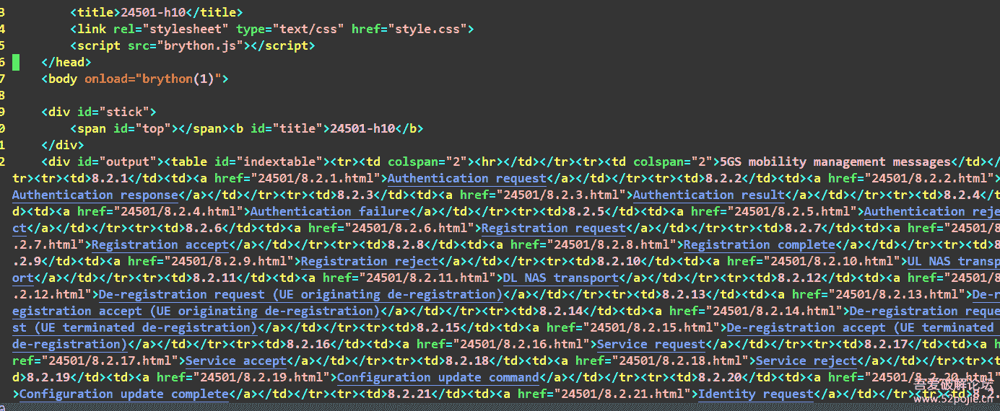

image.png (122.87 KB, 下载次数: 1)

[href="forum.php?mod=attachment&aid=Mjc0MzM0OXxkNTk2OGUzN3wxNzkzNTcxNDg0fDE2ODA4NnwxOTkwNzY1&nothumb=yes" target="_blank"](https://www.52pojie.cn/forum.php?mod=attachment&aid=Mjc0MzM0OXxkNTk2OGUzN3wxNzkzNTcxNDg0fDE2ODA4NnwxOTkwNzY1&nothumb=yes)

2024-12-12 23:26 上传

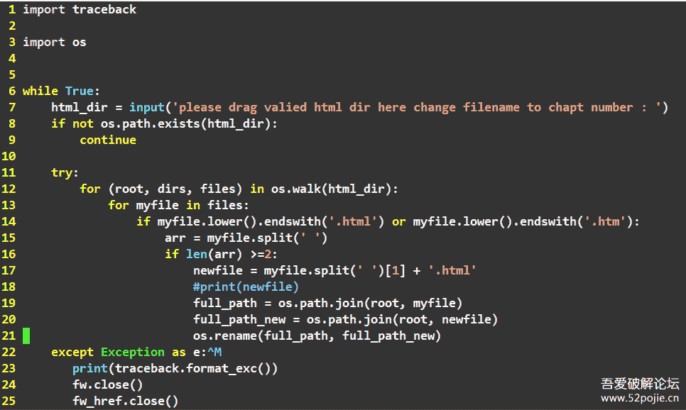

image.png (53.45 KB, 下载次数: 1)

[href="forum.php?mod=attachment&aid=Mjc0MzM1OXw1NTZhMzRjOXwxNzkzNTcxNDg0fDE2ODA4NnwxOTkwNzY1&nothumb=yes" target="_blank"](https://www.52pojie.cn/forum.php?mod=attachment&aid=Mjc0MzM1OXw1NTZhMzRjOXwxNzkzNTcxNDg0fDE2ODA4NnwxOTkwNzY1&nothumb=yes)

2024-12-12 23:28 上传

对于子页面的href进行交叉引用修复，代码如下：

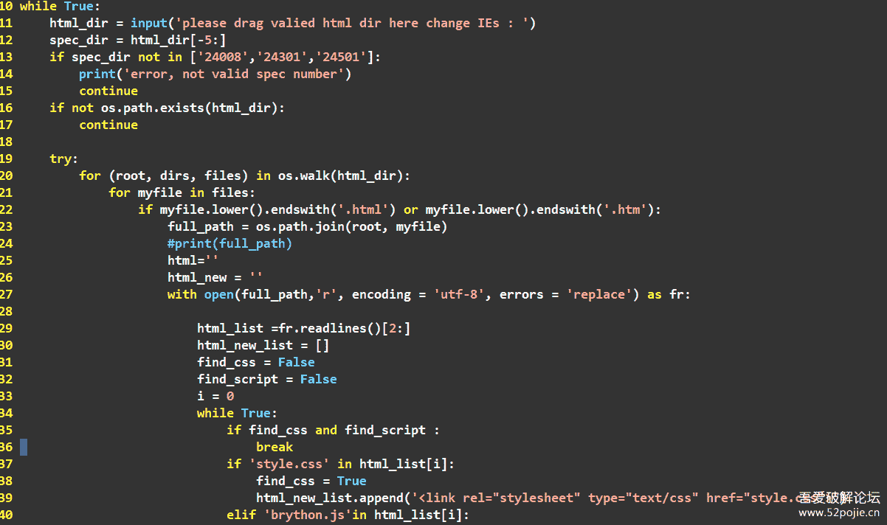

image.png (71.42 KB, 下载次数: 1)

[href="forum.php?mod=attachment&aid=Mjc0MzM2NHxhOTU5MGRhM3wxNzkzNTcxNDg0fDE2ODA4NnwxOTkwNzY1&nothumb=yes" target="_blank"](https://www.52pojie.cn/forum.php?mod=attachment&aid=Mjc0MzM2NHxhOTU5MGRhM3wxNzkzNTcxNDg0fDE2ODA4NnwxOTkwNzY1&nothumb=yes)

2024-12-12 23:33 上传

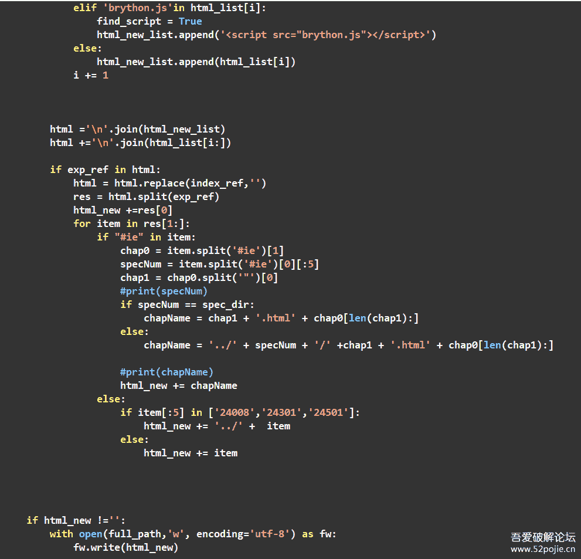

image.png (64.66 KB, 下载次数: 1)

[href="forum.php?mod=attachment&aid=Mjc0MzM2NnwyYmFlOGRiNXwxNzkzNTcxNDg0fDE2ODA4NnwxOTkwNzY1&nothumb=yes" target="_blank"](https://www.52pojie.cn/forum.php?mod=attachment&aid=Mjc0MzM2NnwyYmFlOGRiNXwxNzkzNTcxNDg0fDE2ODA4NnwxOTkwNzY1&nothumb=yes)

2024-12-12 23:34 上传

根据前面提到的方法，用代码将`iedescdiv`打开，显示出详细信息

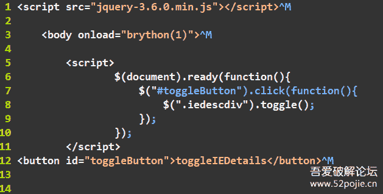

image.png (29.64 KB, 下载次数: 1)

[href="forum.php?mod=attachment&aid=Mjc0MzM2OHxlNDMwMGQ2MHwxNzkzNTcxNDg0fDE2ODA4NnwxOTkwNzY1&nothumb=yes" target="_blank"](https://www.52pojie.cn/forum.php?mod=attachment&aid=Mjc0MzM2OHxlNDMwMGQ2MHwxNzkzNTcxNDg0fDE2ODA4NnwxOTkwNzY1&nothumb=yes)

2024-12-12 23:37 上传

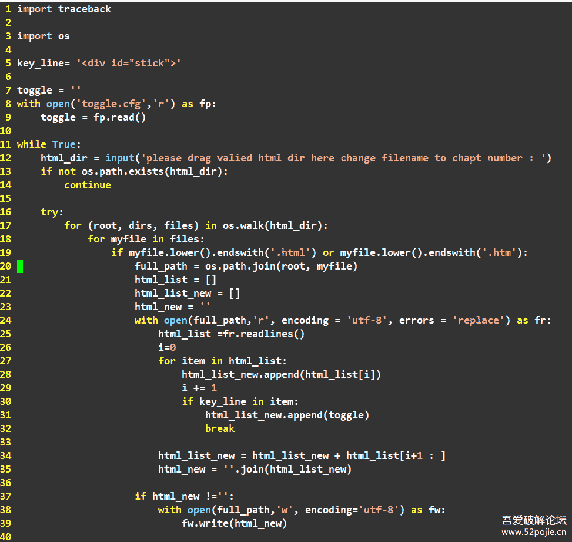

image.png (74.92 KB, 下载次数: 1)

[href="forum.php?mod=attachment&aid=Mjc0MzM2OXw2OTZlMjAzYnwxNzkzNTcxNDg0fDE2ODA4NnwxOTkwNzY1&nothumb=yes" target="_blank"](https://www.52pojie.cn/forum.php?mod=attachment&aid=Mjc0MzM2OXw2OTZlMjAzYnwxNzkzNTcxNDg0fDE2ODA4NnwxOTkwNzY1&nothumb=yes)

2024-12-12 23:38 上传

命名完毕之后的目录结构如下:

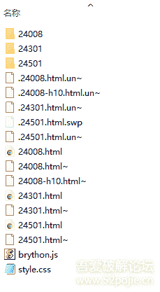

image.png (15.89 KB, 下载次数: 1)

[href="forum.php?mod=attachment&aid=Mjc0MzM2MHxhNTMzNjY2N3wxNzkzNTcxNDg0fDE2ODA4NnwxOTkwNzY1&nothumb=yes" target="_blank"](https://www.52pojie.cn/forum.php?mod=attachment&aid=Mjc0MzM2MHxhNTMzNjY2N3wxNzkzNTcxNDg0fDE2ODA4NnwxOTkwNzY1&nothumb=yes)

2024-12-12 23:29 上传

点进`24501`目录，结构如下：

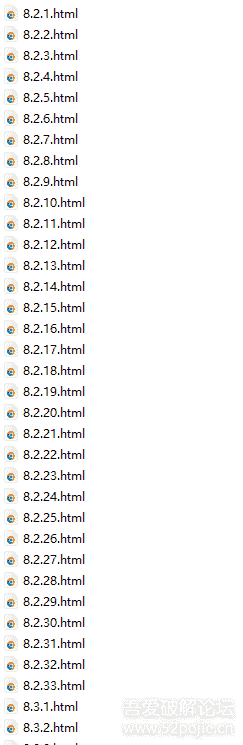

image.png (15.47 KB, 下载次数: 1)

[href="forum.php?mod=attachment&aid=Mjc0MzM2MnxlODkxYzQ0NnwxNzkzNTcxNDg0fDE2ODA4NnwxOTkwNzY1&nothumb=yes" target="_blank"](https://www.52pojie.cn/forum.php?mod=attachment&aid=Mjc0MzM2MnxlODkxYzQ0NnwxNzkzNTcxNDg0fDE2ODA4NnwxOTkwNzY1&nothumb=yes)

2024-12-12 23:30 上传

实际验证一把，加载速度飞起，而且基本上是以假乱真，完全满足我的需求了。

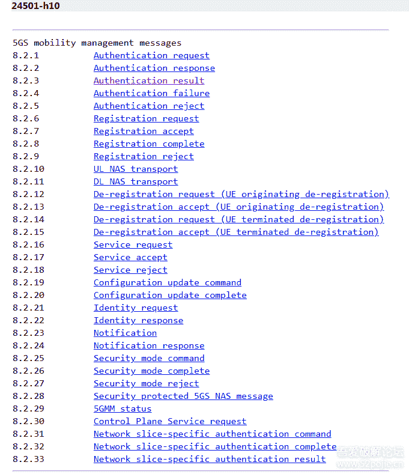

image.png (71.73 KB, 下载次数: 1)

[href="forum.php?mod=attachment&aid=Mjc0MzM2N3w4NTE0NzE4YXwxNzkzNTcxNDg0fDE2ODA4NnwxOTkwNzY1&nothumb=yes" target="_blank"](https://www.52pojie.cn/forum.php?mod=attachment&aid=Mjc0MzM2N3w4NTE0NzE4YXwxNzkzNTcxNDg0fDE2ODA4NnwxOTkwNzY1&nothumb=yes)

2024-12-12 23:35 上传

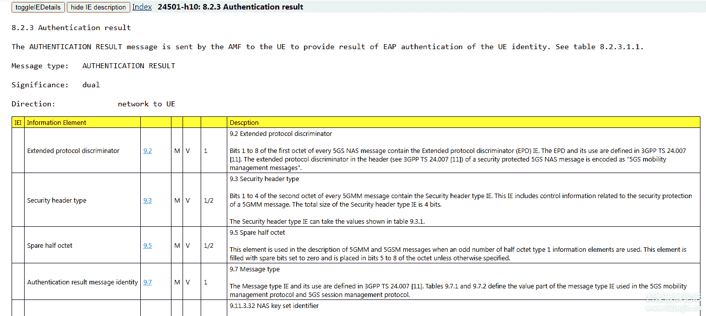

image.png (73.19 KB, 下载次数: 1)

[href="forum.php?mod=attachment&aid=Mjc0MzM2M3wxMjNlODE5MnwxNzkzNTcxNDg0fDE2ODA4NnwxOTkwNzY1&nothumb=yes" target="_blank"](https://www.52pojie.cn/forum.php?mod=attachment&aid=Mjc0MzM2M3wxMjNlODE5MnwxNzkzNTcxNDg0fDE2ODA4NnwxOTkwNzY1&nothumb=yes)

2024-12-12 23:31 上传

采用类似方法搞定了基本所有规范了。

接下来就剩下一个，NR Resource Tool的部分，这部分给出了一些有趣的动画演示页面，而且参数都是可以配置的，非常适合学习和理解3GPP的概念。

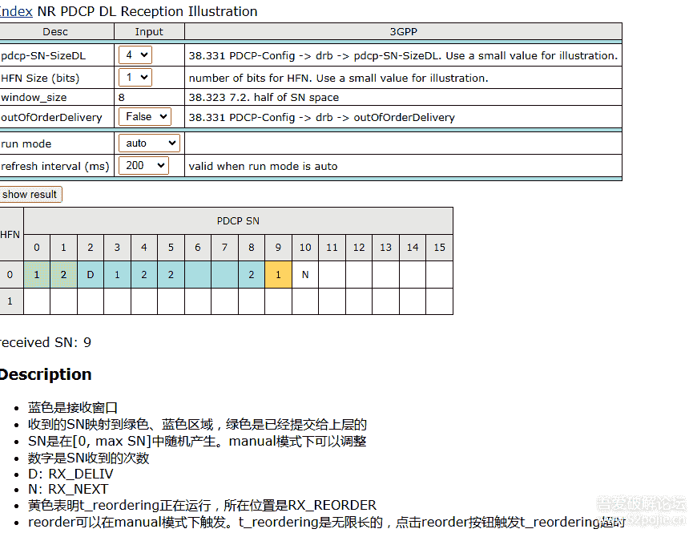

image.png (56.43 KB, 下载次数: 1)

[href="forum.php?mod=attachment&aid=Mjc0MzM3MHwxMDNiMTc0NHwxNzkzNTcxNDg0fDE2ODA4NnwxOTkwNzY1&nothumb=yes" target="_blank"](https://www.52pojie.cn/forum.php?mod=attachment&aid=Mjc0MzM3MHwxMDNiMTc0NHwxNzkzNTcxNDg0fDE2ODA4NnwxOTkwNzY1&nothumb=yes)

2024-12-12 23:40 上传

从爬取的网页html来看，貌似是包含了所有的有用信息了，但是用NodeJs加载运行之后却没有出现原网站的配置表格和演示动画。

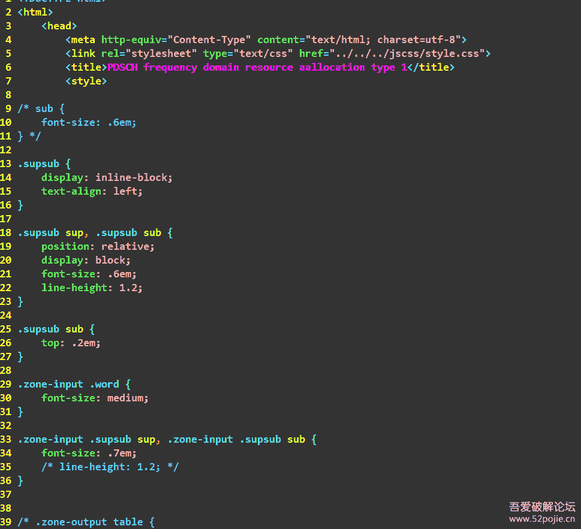

image.png (64.11 KB, 下载次数: 1)

[href="forum.php?mod=attachment&aid=Mjc0MzM3MXxkZjA1YWYzN3wxNzkzNTcxNDg0fDE2ODA4NnwxOTkwNzY1&nothumb=yes" target="_blank"](https://www.52pojie.cn/forum.php?mod=attachment&aid=Mjc0MzM3MXxkZjA1YWYzN3wxNzkzNTcxNDg0fDE2ODA4NnwxOTkwNzY1&nothumb=yes)

2024-12-12 23:42 上传

奇怪了，反复看了页面引用的东西，实在找不到思路，感觉整个Html中唯一有用的几行代码就是下面了。但是每个Html页面都是下面这几行代码，为什么就能显示出不同的内容呢。想了半天基本就要放弃了。

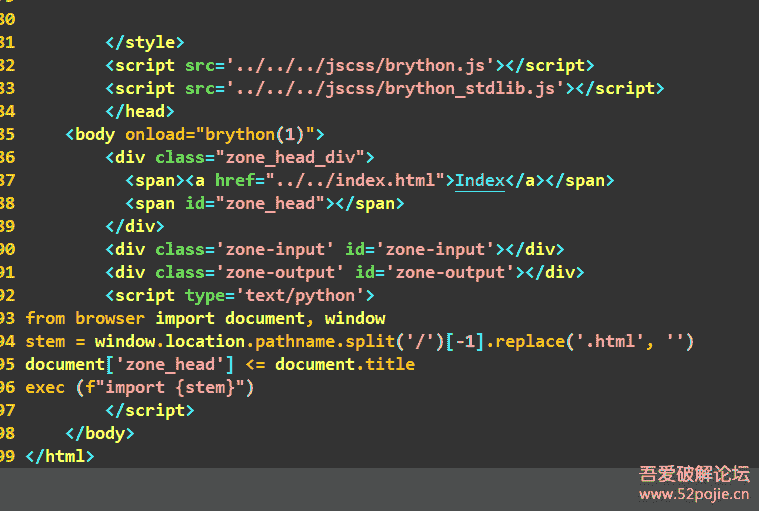

image.png (56.12 KB, 下载次数: 1)

[href="forum.php?mod=attachment&aid=Mjc0MzM3Mnw3MTc4Zjk0NHwxNzkzNTcxNDg0fDE2ODA4NnwxOTkwNzY1&nothumb=yes" target="_blank"](https://www.52pojie.cn/forum.php?mod=attachment&aid=Mjc0MzM3Mnw3MTc4Zjk0NHwxNzkzNTcxNDg0fDE2ODA4NnwxOTkwNzY1&nothumb=yes)

2024-12-12 23:44 上传

突然发现如下的3句话，仔细琢磨了一下，感觉这个是重点，意思就是得到当前html的名字，去掉.html作为新的名字，然后执行一个 import 这个名字。然后就完了？ 在html里面还能import？？？。突然发现。难道python也可以做html调用的脚本语言?

```python
from browser import document, window

stem = window.location.pathname.split('/')[-1].replace('.html', '')

document['zone_head']

exec (f"import {stem}")
```

继续向上搜索，发现所有Html里出现最频繁的一句话 ， brython是个啥玩意儿？ 经过搜索发现原来还真的是python可以作为类似于java的脚本语言方式调用。 那这里的意思就是import 一个python模块了。但是我没有这个模块的py文件啊。这下子基本就歇菜了，巧妇难为无米之炊。准备彻底放弃。

但是后来突发奇想，我自己写python的时候经常把模块名和文件名写成一样的，会不会作者也是这样呢。 于是我就大胆试了一把， 将当前网页的地址目录下直接加上比如 `resource_allocatoin_type_1.html`对应的模块我猜是`resource_allocatoin_type_1.py`，直接在浏览器中将html改为py回车。哈哈，被我猜中了，还真是一个py文件被下载下来了。太激动了。打开py文件，发现内容详实，应该就是原始文件

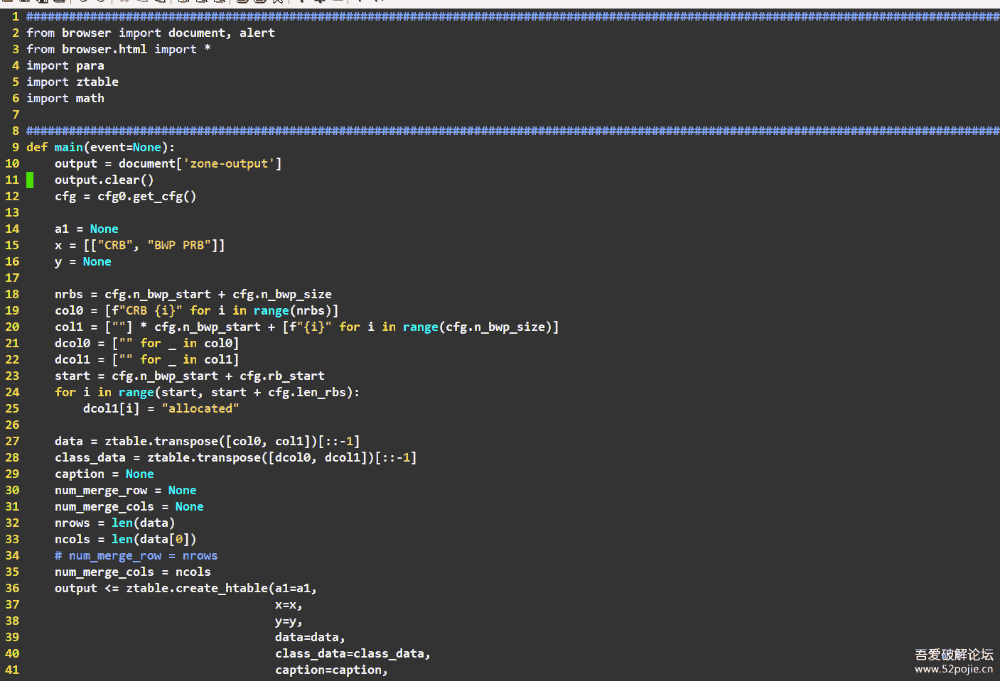

image.png (83.44 KB, 下载次数: 1)

[href="forum.php?mod=attachment&aid=Mjc0MzM3M3wwMGQxYjNmMnwxNzkzNTcxNDg0fDE2ODA4NnwxOTkwNzY1&nothumb=yes" target="_blank"](https://www.52pojie.cn/forum.php?mod=attachment&aid=Mjc0MzM3M3wwMGQxYjNmMnwxNzkzNTcxNDg0fDE2ODA4NnwxOTkwNzY1&nothumb=yes)

2024-12-12 23:55 上传

把这个文件赶紧放到于html同目录中，刷新，结果又是失望，怎么还是不行？？？难道还缺啥？ 后来仔细阅读了代码发现，如下我标为粗体的部分不像是标准库，应该是作者自己写的。

```python
from browser import document, alert

from browser.html import *

import para

import ztable

import math
```

于是再次大胆尝试下载`para.py`和`ztable.py`竟然都能下载下来。 放到同一个目录如下，同理又找到了`para.py`依赖的`parabase.py`。放到一起。

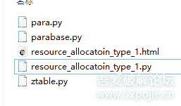

image.png (9.74 KB, 下载次数: 0)

[href="forum.php?mod=attachment&aid=Mjc0MzM3NHw3YzE1YjZjZnwxNzkzNTcxNDg0fDE2ODA4NnwxOTkwNzY1&nothumb=yes" target="_blank"](https://www.52pojie.cn/forum.php?mod=attachment&aid=Mjc0MzM3NHw3YzE1YjZjZnwxNzkzNTcxNDg0fDE2ODA4NnwxOTkwNzY1&nothumb=yes)


2024-12-12 23:58 上传

刷新页面：

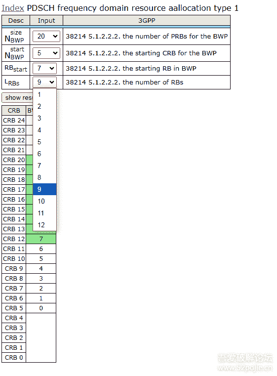

`image.png` (41.82 KB, 下载次数: 1)

[href="forum.php?mod=attachment&aid=Mjc0MzM3NXw1OTk4MTdlMnwxNzkzNTcxNDg0fDE2ODA4NnwxOTkwNzY1&nothumb=yes" target="_blank"](https://www.52pojie.cn/forum.php?mod=attachment&aid=Mjc0MzM3NXw1OTk4MTdlMnwxNzkzNTcxNDg0fDE2ODA4NnwxOTkwNzY1&nothumb=yes)

2024-12-12 23:59 上传

大功告成。剩下的就是把其他页面按照同样方法搞定就好。

至此一个另类的属于我自己的技术镜像网站诞生。我可以自由的不受约束的随时随地查询啦。
