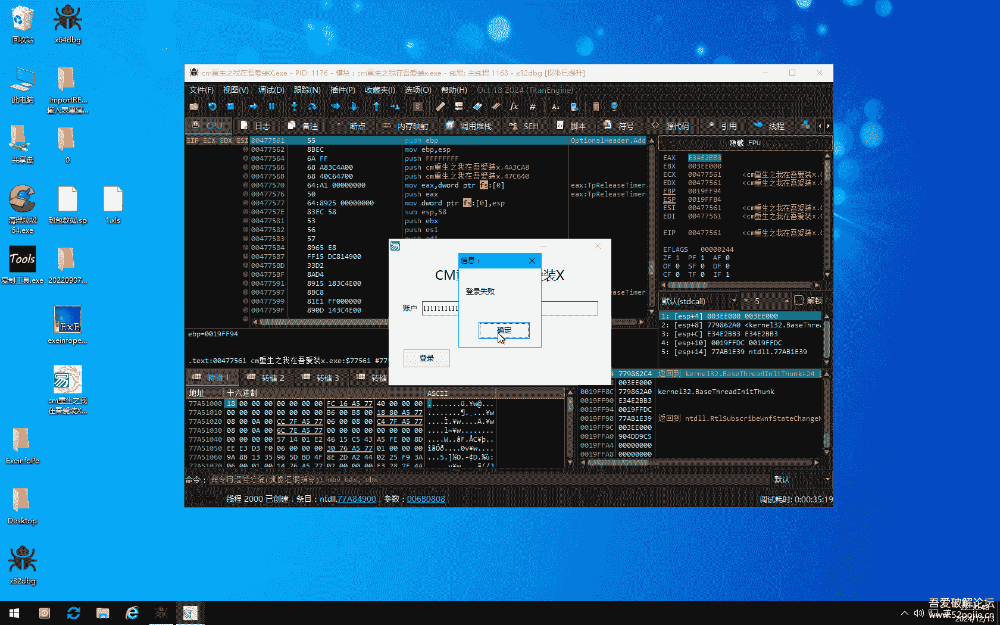
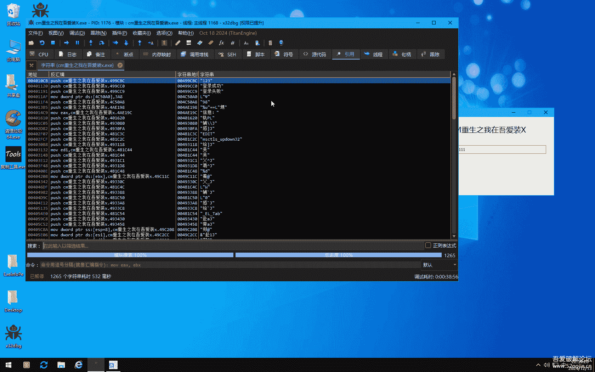
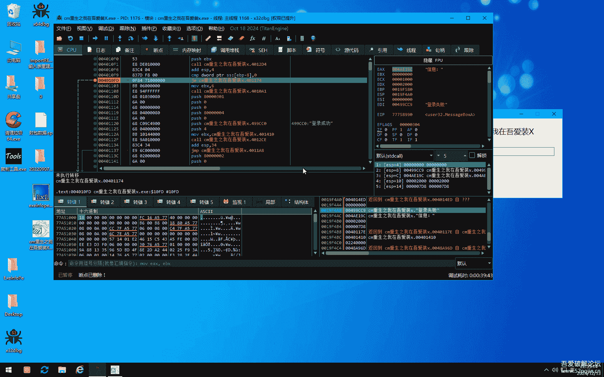
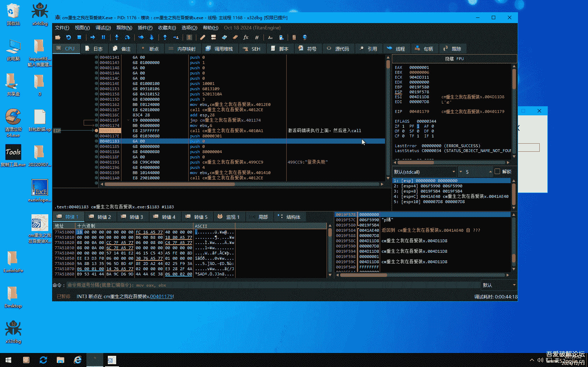
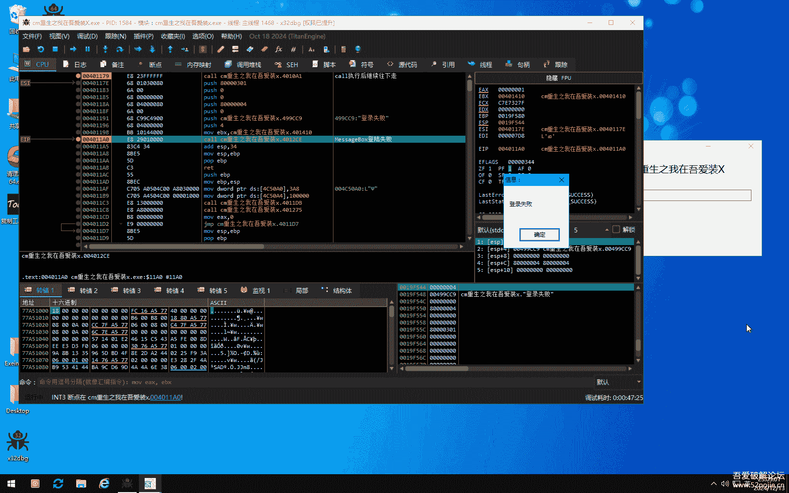
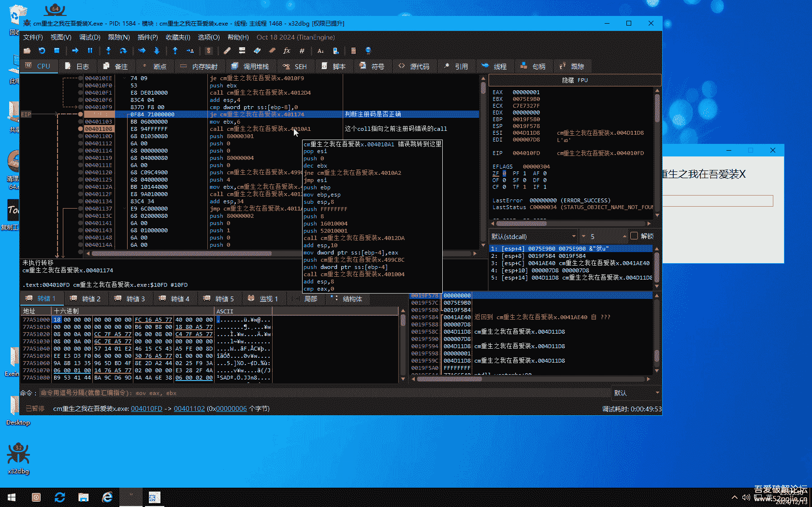
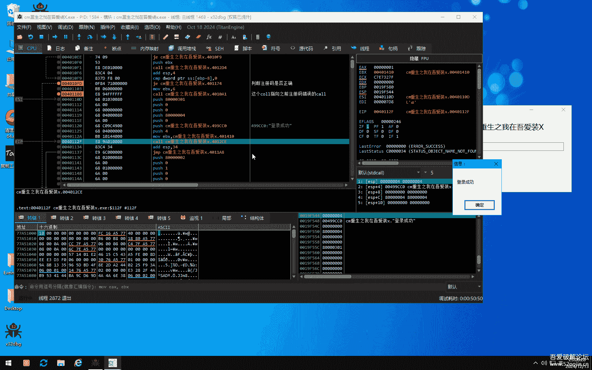
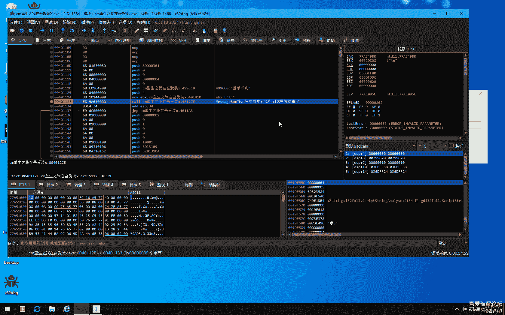
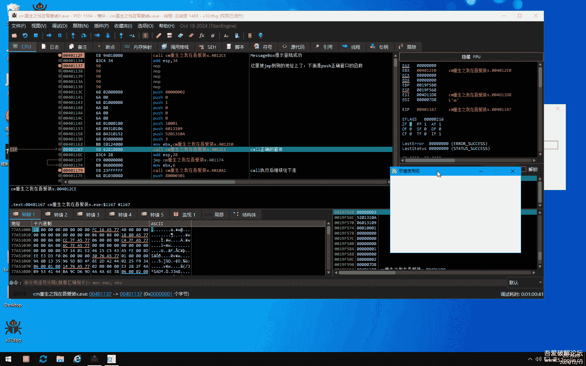

# [原创] 破解吾爱一个CrackMe的程序

- 原帖: https://www.52pojie.cn/forum.php?mod=viewthread&tid=1991131
- 抓取时间: 2026-11-01T22:18:03

原帖地址: https://www.52pojie.cn/thread-1990544-1-1.html

原件大家可以去源地址下载
首先查壳，无壳E语言编写

`1查壳.png` (769.72 KB, 下载次数: 1)
2024-12-13 23:44 上传

简单运行查看一下报错确定方向

`2让程序跑起来看看报错的位置是什么样的.png` (517.11 KB, 下载次数: 0)
2024-12-13 23:46 上传

既然能显示到错误我们就直接搜索字符串看看能不能找到验证的判断

`4用字符串搜索有用信息.png` (424.98 KB, 下载次数: 0)
2024-12-13 23:46 上传

就在正确的不远处就发现了判断的`je`跳

`5找到登录成功发现je验证入口.png` (446 KB, 下载次数: 0)
2024-12-13 23:47 上传

如果跳转成立直接跳到失败的地方

`6验证不通过直接跳进弹出失败的call.png` (402.07 KB, 下载次数: 0)
2024-12-13 23:48 上传

`7验证失败.png` (396.84 KB, 下载次数: 0)
2024-12-13 23:49 上传

修改`zf`位为0不跳转让他执行下面，第一个`call`之前标记过是失败的地方，不管直接过

`9路过之前失败的call多标记还是有好处的.png` (415.14 KB, 下载次数: 0)
2024-12-13 23:50 上传

跳过之后就成功进入正确的提示了，接下来找他的隐藏窗口

`10验证成功.png` (393.04 KB, 下载次数: 0)
2024-12-13 23:52 上传

这里直接跳过了一段`push`窗体的过程

`11验证成功后的函数段被跳过了.png` (313.6 KB, 下载次数: 0)
2024-12-13 23:53 上传

直接把跳转`nop`掉隐藏的窗口就出现了

`12nop之后直接显示隐藏窗口.png` (310.38 KB, 下载次数: 0)
2024-12-13 23:53 上传

程序到这里就到此结束了

流程还是很友好的可以尝试下正确的账号
