# [Web逆向] 【JS逆向】某手机厂商登录逆向分析

- 原帖：<https://www.52pojie.cn/forum.php?mod=viewthread&tid=1991268>
- 抓取时间：2026-11-01T22:18:02

## 逆向目标

- 网址：`aHR0cHM6Ly9wYXNzcG9ydC52aXZvLmNvbS5jbi8jL2xvZ2lu`
- 目标：表单数据加密，响应数据解密

## 抓包分析

我们选择密码登录，输入手机号和密码登录，会发起一个`login`请求，其中表单数据`encData`和`encKey`是需要逆向的。

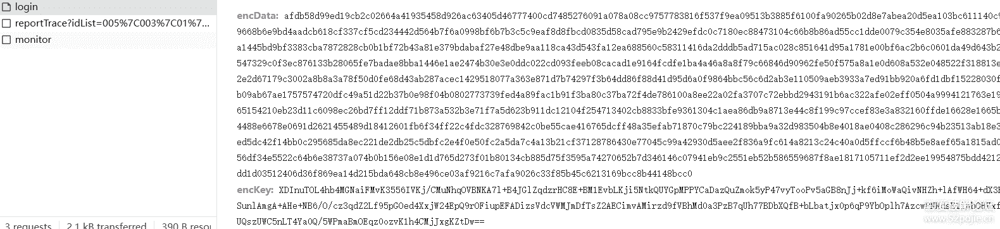
`1.png` (46.93 KB, 下载次数: 1)
[附件下载](https://www.52pojie.cn/forum.php?mod=attachment&aid=Mjc0MzcwMHw0MGEyMjdiOXwxNzkzNTcxNDc5fDE2ODA4NnwxOTkxMjY4&nothumb=yes)
2024-12-14 17:21 上传

响应数据是加密的，也需要进行逆向分析。

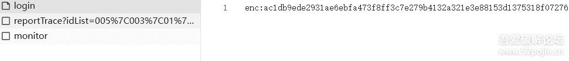
`2.png` (12.06 KB, 下载次数: 1)
[附件下载](https://www.52pojie.cn/forum.php?mod=attachment&aid=Mjc0MzcwMXw2Y2Q5YmM3N3wxNzkzNTcxNDc5fDE2ODA4NnwxOTkxMjY4&nothumb=yes)
2024-12-14 17:21 上传

## 逆向分析

### 表单数据加密

我们全局搜索`encData`，最终搜索到下图的地方，直接下断，重新请求，成功断住，`encKey`也在此处。

`e.params`中的`nounce`和`pwd`也需要进行分析，但我们先分析`encData`和`encKey`的生成。

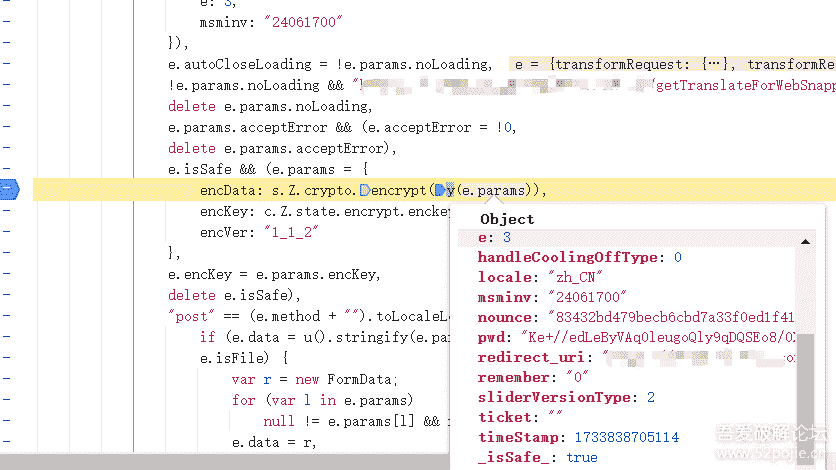
`3.png` (31.14 KB, 下载次数: 1)
[附件下载](https://www.52pojie.cn/forum.php?mod=attachment&aid=Mjc0MzcwMnw1NjM1YWIyNHwxNzkzNTcxNDc5fDE2ODA4NnwxOTkxMjY4&nothumb=yes)
2024-12-14 17:21 上传

首先是`y`函数，将`e.params`处理成一个字符串。

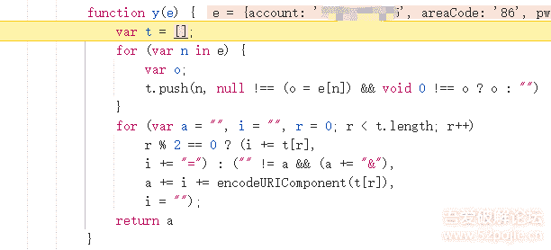
`4.png` (13.11 KB, 下载次数: 1)
[附件下载](https://www.52pojie.cn/forum.php?mod=attachment&aid=Mjc0MzcwM3wzMjk1NjgxOXwxNzkzNTcxNDc5fDE2ODA4NnwxOTkxMjY4&nothumb=yes)
2024-12-14 17:21 上传

然后是`encrypt()`函数，对`ae().enc.Utf8.parse(t)`这种写法比较熟悉的大佬都知道应该是用了`crypto-js`这个加密库。

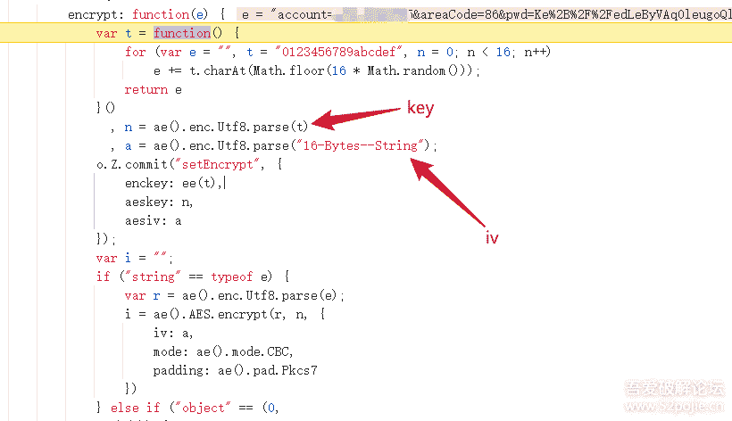
`5.png` (24.25 KB, 下载次数: 1)
[附件下载](https://www.52pojie.cn/forum.php?mod=attachment&aid=Mjc0MzcwNHw3NDAzNzJlZXwxNzkzNTcxNDc5fDE2ODA4NnwxOTkxMjY4&nothumb=yes)
2024-12-14 17:21 上传

可以用`crypto-js`这个库复现加密，经验证，是标准的AES，一个随机`key`，一个固定`iv`。

```js
const CryptoJS = require('crypto-js')
function encrypt(e){
    var t = function() {
    for (var e = "", t = "0123456789abcdef", n = 0; n 
```

而我们要的`encKey`也在此处`enckey: ee(t)`，这个跟进去会发现就是一个RSA加密，可以用`node-jsencrypt`这个标准库解决。

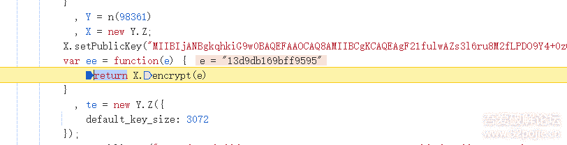
`6.png` (12.14 KB, 下载次数: 2)
[附件下载](https://www.52pojie.cn/forum.php?mod=attachment&aid=Mjc0MzcwNXxhY2Q2ZjJkM3wxNzkzNTcxNDc5fDE2ODA4NnwxOTkxMjY4&nothumb=yes)
2024-12-14 17:21 上传

```js
const JSEncrpyt = require('node-jsencrypt')

function rsa_encrypt(e) {
    let rsa = new JSEncrpyt()
    rsa.setPublicKey("公钥")
    return rsa.encrypt(e)
}
```

那有人就会好奇，`o.Z.commit("setEncrypt", {enckey: ee(t),aeskey: n,aesiv: a})`这一步在干什么，先卖个关子，后文会分析。

该案例用了一种常见的安全设计模式，结合了AES和RSA两种加密算法的优点，将两者结合使用既保证了安全性，又能有较高的效率。

AES在对大量数据进行加解密的时候速度快

RSA的安全性基于大数分解的数学难题，破解难度极高

AES作为对称加密的一种，密钥安全性尤为重要，且密钥是前后端共享的，如果密钥在传输过程中被截获，数据的安全性将无法保证。

而RSA加密速度较慢，适合加密较小的数据（如密钥），可以用于加密AES的密钥，确保密钥在传输过程中不会被窃取。

表单参数的加密搞定了，还需要看`e.params`中的`pwd`和`nonce`是怎么来的。

首先看`nounce`，就在`encData`上面一点的地方，`nounce`由一个时间戳和一个随机数生成，而`m()`的返回值大概率是个hash函数，其实`nounce`就是一个随机值。

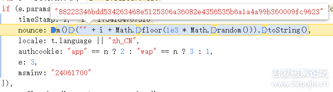
`7.png` (13.93 KB, 下载次数: 2)
[附件下载](https://www.52pojie.cn/forum.php?mod=attachment&aid=Mjc0MzcwNnw4ZTIwOGM3MnwxNzkzNTcxNDc5fDE2ODA4NnwxOTkxMjY4&nothumb=yes)
2024-12-14 17:21 上传

遇到hash函数，我们可以尝试对字符串`'1'`进行hash看是不是标准算法，64的长度，6b8b开头，应该就是标准的sha256。

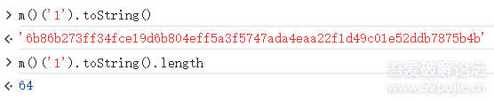
`8.png` (9.02 KB, 下载次数: 1)
[附件下载](https://www.52pojie.cn/forum.php?mod=attachment&aid=Mjc0MzcwN3w3ZDkzZjVmNXwxNzkzNTcxNDc5fDE2ODA4NnwxOTkxMjY4&nothumb=yes)
2024-12-14 17:21 上传

记住一些常见hash函数的特征，有时候就可以在控制台验证它是不是标准的算法，能够稍微提高那么一点效率。

然后是`pwd`，往前看，它已经生成了，并且如果往前跟栈就到异步之前了，那没办法，我们就在`s.request`处下断，重新请求。

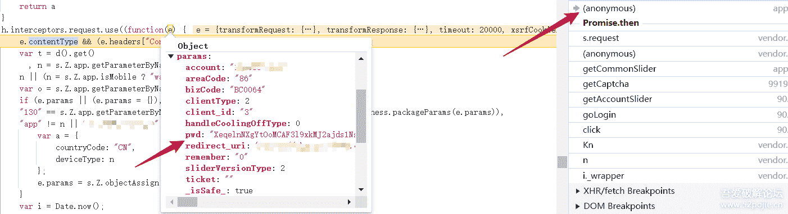
`9.png` (54.65 KB, 下载次数: 0)
[附件下载](https://www.52pojie.cn/forum.php?mod=attachment&aid=Mjc0MzcwOHxjOGRhOTM3OHwxNzkzNTcxNDc5fDE2ODA4NnwxOTkxMjY4&nothumb=yes)
2024-12-14 17:21 上传

可以看到，`pwd`已经生成了，也就是说`pwd`是在异步之前就已经生成了，那我们就没必要跟异步了，这一点很重要，做逆向一定要细心，不要觉得密文往前跟就是异步了，就认为一定是异步生成的。

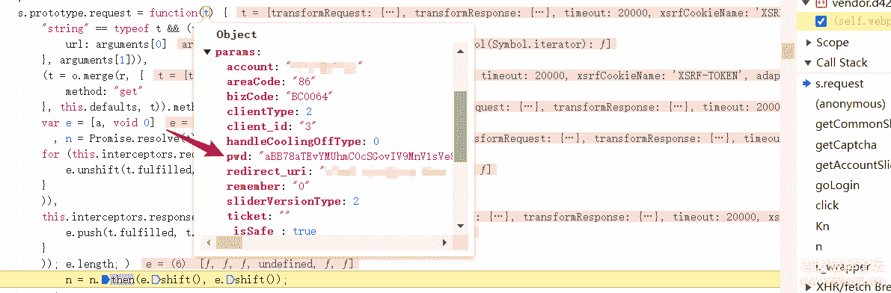
`10.png` (49 KB, 下载次数: 1)
[附件下载](https://www.52pojie.cn/forum.php?mod=attachment&aid=Mjc0MzcwOXxjMDUzZWQ0OHwxNzkzNTcxNDc5fDE2ODA4NnwxOTkxMjY4&nothumb=yes)
2024-12-14 17:21 上传

我们继续往前跟栈，发现`pwd`是在这生成的。

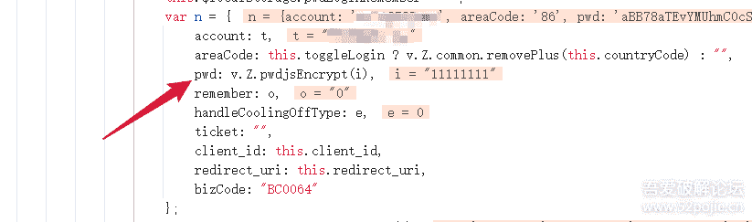
`11.png` (17.09 KB, 下载次数: 1)
[附件下载](https://www.52pojie.cn/forum.php?mod=attachment&aid=Mjc0MzcxMHw5OWYwZTk4MnwxNzkzNTcxNDc5fDE2ODA4NnwxOTkxMjY4&nothumb=yes)
2024-12-14 17:21 上传

我们点进去看看，发现还是一个RSA，只不过是公钥换了。

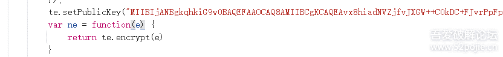
`12.png` (8.99 KB, 下载次数: 1)
[附件下载](https://www.52pojie.cn/forum.php?mod=attachment&aid=Mjc0MzcxMXxjYzYxNTRmZHwxNzkzNTcxNDc5fDE2ODA4NnwxOTkxMjY4&nothumb=yes)
2024-12-14 17:21 上传

至此我们的表单参数就搞定了，下面继续看响应数据加密。

### 响应数据解密

老规矩还是hook `JSON.parse`，成功断住。

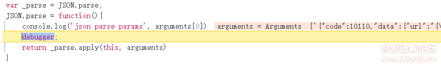
`13.png` (10.3 KB, 下载次数: 0)
[附件下载](https://www.52pojie.cn/forum.php?mod=attachment&aid=Mjc0MzcxMnwzMDI2MTlkNHwxNzkzNTcxNDc5fDE2ODA4NnwxOTkxMjY4&nothumb=yes)
2024-12-14 17:22 上传

往上跟一个栈，就会找到解密的位置。`encKey`熟不熟悉，没错，其实就是表单的`encKey`。

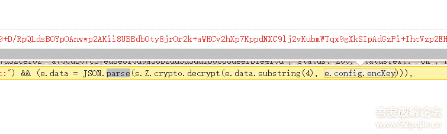
`14.png` (11.99 KB, 下载次数: 1)
[附件下载](https://www.52pojie.cn/forum.php?mod=attachment&aid=Mjc0MzcxM3xjYWNlNjMxMHwxNzkzNTcxNDc5fDE2ODA4NnwxOTkxMjY4&nothumb=yes)
2024-12-14 17:22 上传

我们进去`decrypt()`函数看看，发现是AES解密，那这就信手拈来了，导包解决即可。

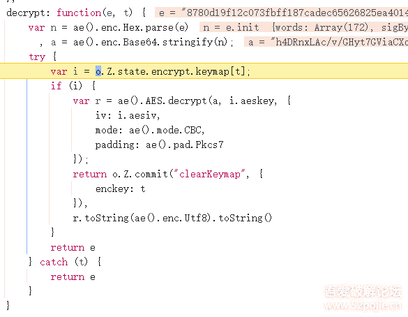
`15.png` (16.42 KB, 下载次数: 2)
[附件下载](https://www.52pojie.cn/forum.php?mod=attachment&aid=Mjc0MzcxNHxlMjQ3NGFjMHwxNzkzNTcxNDc5fDE2ODA4NnwxOTkxMjY4&nothumb=yes)
2024-12-14 17:22 上传


```
const CryptoJS = require('crypto-js')
function decrypt(e, t){
    var n = CryptoJS.enc.Hex.parse(e)
      , a = CryptoJS.enc.Base64.stringify(n);
    var aeskey = CryptoJS.enc.Utf8.parse('之前的key');
    var aesiv = CryptoJS.enc.Utf8.parse("16-Bytes--String")
    var r = CryptoJS.AES.decrypt(a, aeskey, {
        iv: aesiv,
        mode: CryptoJS.mode.CBC,
        padding: CryptoJS.pad.Pkcs7
    });
    return r.toString(CryptoJS.enc.Utf8).toString()
}
```

前文一些操作的谜底也终于揭开了，`o.Z.commit("setEncrypt", {enckey: ee(t),aeskey: n,aesiv: a})`其实就是将`key`和`iv`保存起来，然后解密的时候也用同样的`key`和`iv`。

好了，加密和解密都解决了，直接模拟请求。

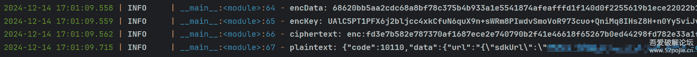

`16.png` (72.81 KB, 下载次数: 1)

[href="forum.php?mod=attachment&aid=Mjc0MzcxNXxmMzQ4ZWEzNHwxNzkzNTcxNDc5fDE2ODA4NnwxOTkxMjY4&nothumb=yes" target="_blank"](https://www.52pojie.cn/forum.php?mod=attachment&aid=Mjc0MzcxNXxmMzQ4ZWEzNHwxNzkzNTcxNDc5fDE2ODA4NnwxOTkxMjY4&nothumb=yes)

2024-12-14 17:22 上传

成功！！！

网站多请求几次会触发某象的验证码，以后有机会再分析怎么解决。
